# 酶工程 综合资料

> **整合来源**：西农大《酶工程》课程PPT（8章）+《酶工程（第三版）》陈守文+《酶工程（第五版）》韩双艳郭勇+《生物化学（上册）》朱圣庚  
> **总图片资源**：482张（来自课程PPT）  
> **编制日期**：2026年6月

---

# 目录

- [第一章 绪论](#第一章-绪论)
- [第二章 酶催化反应机理及反应动力学](#第二章-酶催化反应机理及反应动力学)
- [第三章 酶制剂的生产（微生物发酵产酶）](#第三章-酶制剂的生产微生物发酵产酶)
- [第四章 酶的分离纯化](#第四章-酶的分离纯化)
- [第五章 酶的固定化](#第五章-酶的固定化)
- [第六章 化学酶工程与生物酶工程](#第六章-化学酶工程与生物酶工程)
- [第七章 非水相酶催化](#第七章-非水相酶催化)
- [第八章 酶反应器与酶传感器](#第八章-酶反应器与酶传感器)
- [第九章 酶的应用](#第九章-酶的应用)
- [知识图谱总览](#知识图谱总览)

---

# 第一章 绪论

## 1.1 生物催化

### 1.1.1 生物技术的四大支柱

生物技术涵盖四大核心领域，酶工程是其中工业生物技术的关键组成部分：

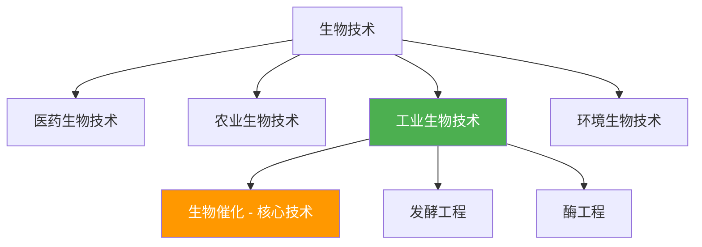

**生物技术产业化的三个浪潮**：
1. **医药生物技术**（1982年）：重组人胰岛素上市
2. **农业生物技术**（1996年）：转基因大豆、玉米、油菜相继上市
3. **工业生物技术**（世纪之交）：聚交酯、生物钢、聚乳酸相继上市

### 1.1.2 工业生物技术（Biorefinery）

工业生物技术是将生物质原料通过生物催化转化为燃料、化学品、材料等的综合技术体系。

**生物质原料来源**：树木、木材加工废弃物、草、农作物、农产废弃物、城市有机垃圾等  
**转化过程**：酸水解/发酵、酶/发酵、气/液发酵、热化学加工  
**产品**：燃料（生物柴油、燃料酒精）、精细化学品、大宗化学品、食品、塑料、溶剂等

> 📷 参见图片：`../酶工程资料/PPT_images/1绪论/`

### 1.1.3 生物催化是工业生物技术的核心技术

生物催化在以下领域发挥核心作用：化学工业、发酵工业、轻工业、采矿、医药、食品、能源、材料、环境。

**以生物催化法合成的主要产品**：

| 产品名称 | 产量 |
|---------|------|
| 丙烯酰胺 | 10万吨/年 |
| 聚乳酸 | 1.3万吨/年 |
| 阿斯巴甜 | 2万吨/年 |
| 生物柴油与汽油 | 1000万吨/年 |
| 抗菌素中间体6-APA | 0.9万吨/年 |

**趋势判断**：到2020年，通过生物催化技术，将实现化学工业的原料消耗、水资源消耗、能量消耗降低30%，污染物的排放和污染扩散减少30%。

### 1.1.4 生物催化剂工程的目标与瓶颈

**目标**：
- 开发生物催化剂
- 改善性能
- 开发分子模型
- 创造新技术用于新生物催化剂的开发

**技术瓶颈**：
- 对生物催化剂作用机理缺乏深入的认识
- 对次级代谢产物代谢途径缺乏理解
- 细胞工程化的方法十分有限
- 生产酶和辅因子的成本过高

## 1.2 酶工程的研究内容

### 1.2.1 酶工程的定义

**酶工程（Enzyme Engineering）** 又称为酶技术，是将酶、细胞器或细胞等置于特定的生物反应装置中，利用酶所具有的生物催化功能，借助工程手段将相应的原料转化成有用物质并服务于人类社会的一门科学技术。

### 1.2.2 酶工程的研究内容

酶工程是生物技术的重要组成部分，与发酵工程、基因工程、细胞工程密切相关。

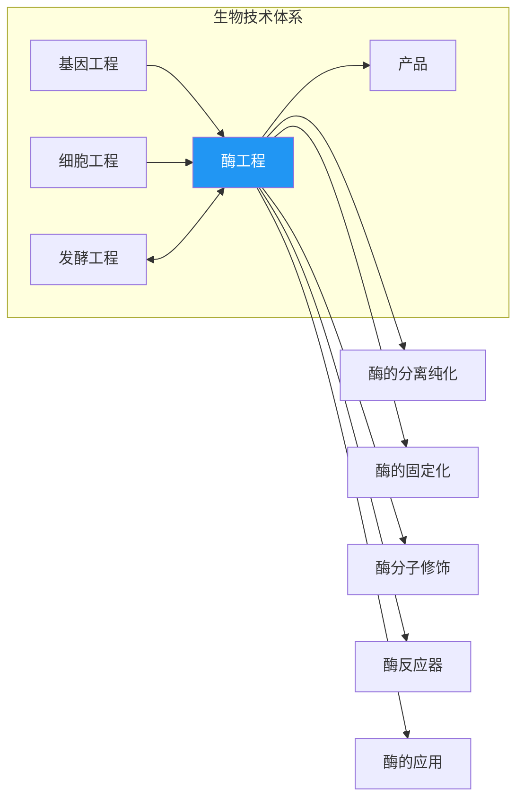

### 1.2.3 酶学及酶工程研究史

**关键里程碑**：
- 1890年：Emil Fisher提出锁钥模型（Lock and key model）
- 1913年：Michaelis & Menten提出米氏方程
- 1916年：Nelson和Griffin发现酶的固定化现象
- 1953年：Grubhofer和Schloith研究固定化酶
- 1958年：Koshland提出诱导契合模型
- 1969年：千畑一郎实现固定化酶工业化
- 1984年：Klibanov发表非水相酶催化研究
- 1971年："固定化酶"（immobilized enzyme）术语正式确立

## 1.3 国内外酶制剂工业概况

**主要酶制剂生产企业**：Novozymes（诺维信）是全球最大的酶制剂生产商。

**参考数据库与资源**：
- NCBI：http://www.ncbi.nlm.nih.gov
- CNKI：http://www.cnki.net
- ScienceDirect
- Springer LINK
- Enzyme and Microbiotech.（期刊）
- Biotech. and Bioeng.（期刊）

## 1.4 酶的分类与命名

### 1.4.1 蛋白类酶的分类（EC编号）

国际酶学委员会（IEC）将酶分为六大类：

1. **氧化还原酶（EC 1）**：催化氧化还原反应
2. **转移酶（EC 2）**：催化基团转移反应
3. **水解酶（EC 3）**：催化水解反应
4. **裂合酶（EC 4）**：催化非水解性裂解反应
5. **异构酶（EC 5）**：催化异构化反应
6. **连接酶（EC 6）**：催化连接反应，伴随ATP分解

### 1.4.2 核酸类酶（Ribozyme）

具有催化功能的RNA分子，可催化RNA的切割、连接等反应。

## 1.5 酶的活力测定

### 1.5.1 酶活力单位

- **习惯单位（U）**：底物（或产物）变化量/单位时间
- **国际单位（IU）**：1 μmol 变化量/分钟
- **Katal（Kat）**：1 mol 变化量/秒
- **比活力** = 活力单位/mg蛋白（衡量酶纯度）
- **转换系数（Kcat）**：底物（μmol）/秒·每个酶分子（衡量转换效率）

---

# 第二章 酶催化反应机理及反应动力学

## 2.1 酶的催化反应机理

### 2.1.1 酶的活性中心

酶的活性中心（active site）是酶分子中与底物结合并催化底物转化为产物的特定区域，通常为蛋白质表面的裂缝或凹陷。

**活性中心的组成部分**：
- **结合基团**（binding group）：识别并结合底物
- **催化基团**（catalytic group）：催化化学键的断裂与形成
- **必需基团**（essential group）：维持活性中心构象所必需的基团

> 📷 参见：`../酶工程资料/PPT_images/2酶催化反应机理/`

### 2.1.2 酶与底物分子结合的假说

**（1）中间络合物学说**

酶（E）与底物（S）首先形成酶-底物中间络合物（ES），然后分解为产物（P）和酶（E）：

$$E + S \rightleftharpoons ES \rightarrow E + P$$

**实验证实**：过氧化物酶与H₂O₂结合后，吸收光谱发生改变（645/587/548/498nm → 561/550nm），证明ES复合物的存在。

**（2）锁钥模型（Lock and Key Model）**——1890年Emil Fisher提出

底物的形状必须与酶的活性中心精确匹配，如同钥匙与锁的关系。

> 📷 参见：`../酶工程资料/PPT_images/2酶催化反应机理/slide3_img1.jpg`

**（3）诱导契合模型（Induced-fit Model）**——1958年Koshland提出

酶与底物结合时，酶分子构象发生连续变化，使活性中心与底物达到最佳匹配。

> 📷 参见：`../酶工程资料/PPT_images/2酶催化反应机理/`

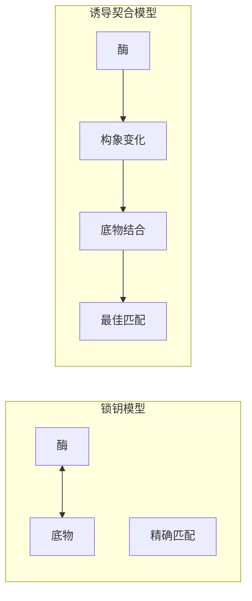

## 2.2 酶催化反应的速率理论

### 2.2.1 过渡态与活化能

- **过渡态（transition state）**：化学反应中反应物分子从常态转变为产物所经历的高能状态
- **活化能（activation energy）**：分子由常态转变为活化态所需的能量
- **活化分子**：达到或超过能阈的分子，活化分子越多，反应速度越快

**提高活化分子数量的途径**：
1. 对反应体系加热、照射（增加分子能量）
2. 降低活化能（酶的作用方式）

**酶催化的本质**：酶通过稳定过渡态，降低反应活化能，从而加速反应。

> 📷 参见：`../酶工程资料/PPT_images/2酶催化反应机理/slide7_img2.png`

### 2.2.2 酶高效催化的七大机制

酶催化作用来自以下七个方面：

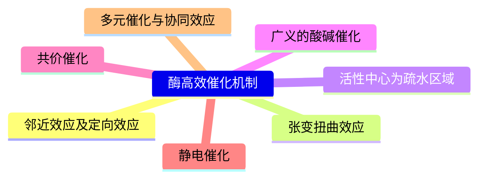

**（1）邻近效应（Approximation）和定向效应（Orientation）**

酶将底物分子集中到活性中心附近，并以正确的取向排列，大大增加了有效碰撞概率。

> 📷 参见：`../酶工程资料/PPT_images/2酶催化反应机理/slide10_img4.png`

**（2）张变和扭曲效应（Distortion or Strain）**

酶与底物结合时，诱导底物分子的敏感键产生张力或变形，使底物进入过渡态。

> 📷 参见：`../酶工程资料/PPT_images/2酶催化反应机理/slide11_img5.png`

**（3）活性中心为疏水区域**

酶的活性中心通常为疏水环境，有利于底物与酶的结合，排除水分子干扰。

> 📷 参见：`../酶工程资料/PPT_images/2酶催化反应机理/slide12_img7.png`

**（4）广义的酸碱催化**

通过瞬时地向反应物提供质子（酸催化）或从反应物中汲取质子（碱催化），以稳定过渡态、加速反应。

- 能供给质子的物质为酸，能接受质子的物质为碱
- 例：HA ⇌ A⁻ + H⁺（HA为酸，A⁻为碱）

**（5）共价催化（Covalent Catalysis）**

酶与底物形成一个反应活性很高的不稳定的共价中间产物，加快反应。

- **亲核催化**：催化剂的亲核基团对底物中亲电子的碳原子进行攻击，形成共价中间物
- **实例**：3-磷酸甘油醛脱氢酶（Cys类酶）催化形成1,3-二磷酸甘油酸
- **实例**：乙酰乙酸脱羧酶通过Schiff碱中间产物参与反应

> 📷 参见：`../酶工程资料/PPT_images/2酶催化反应机理/slide16_img9.png`

**（6）静电催化**

酶活性中心极性基团产生的静电场稳定过渡态。

**（7）多元催化与协同效应**

酶的催化作用是多个侧链基团协同作用完成的综合结果。

## 2.3 酶促反应动力学

### 2.3.1 基本概念

**酶促反应动力学**：研究酶促反应的速度和影响速度的各种因素以及反应历程。

**影响酶促反应速度的因素**：
- 酶浓度
- 底物浓度
- pH（最适pH）
- 温度（最适温度）
- 激活剂
- 抑制剂

> 📷 参见：`../酶工程资料/PPT_images/2酶催化反应机理/slide22_img13.emf`

### 2.3.2 米氏方程（Michaelis-Menten Equation）

**基本现象**：酶被底物饱和  
**基本假说**：酶-底物复合物中间产物学说

**米氏方程**：

$$v = \frac{V_{max}[S]}{K_m + [S]}$$

**米氏常数的意义**：
- 当 $v = \frac{1}{2}V_{max}$ 时，$K_m = [S]$
- $K_m$ 是酶在一定条件下的特征物理常数，可鉴别酶
- $K_m$ 可近似表示酶和底物的亲和力：**$K_m$ 越小，亲和力越大**

> 📷 参见：`../酶工程资料/PPT_images/2酶催化反应机理/slide23_img14.png`、`slide24_img15.png`

**推导：Briggs-Haldane稳态假说**

$$E + S \overset{K_1}{\rightleftharpoons} ES \overset{K_2}{\rightarrow} E + P$$

$$K_m = \frac{K_{-1} + K_2}{K_1}$$

**Lineweaver-Burk双倒数作图法**：

$$\frac{1}{v} = \frac{K_m}{V_{max}} \cdot \frac{1}{[S]} + \frac{1}{V_{max}}$$

> 📷 参见：`../酶工程资料/PPT_images/2酶催化反应机理/slide33_img22.png`

### 2.3.3 Vmax 和 Kcat

- **Vmax**：酶完全被底物饱和时达到的最大反应速度
- **Kcat（转换数）**：$K_{cat} = V_{max}/[E]$，每个酶分子单位时间内转化的底物分子数
- **实例**：$10^{-6}$ mol/L的碳酸酐酶每秒能转化0.6 mol/L H₂CO₃分子

### 2.3.4 影响酶反应速度的因素详解

**底物浓度**：
- [S] << Km：v与[S]成正比（一级反应）
- [S] >> Km：v = Vmax（零级反应）
- v = ½Vmax时：[S] = Km

**pH**：最适pH是酶催化活性最大的pH值  
**温度**：最适温度是酶催化活性最大的温度  
**激活剂**：能提高酶活性的物质  
**抑制剂**：能降低酶活性的物质

> 📷 参见：`../酶工程资料/PPT_images/2酶催化反应机理/` 整套58张图片

---

# 第三章 酶制剂的生产（微生物发酵产酶）

## 3.1 酶生物合成调节的基本理论

### 3.1.1 中心法则（Central Dogma）

DNA → RNA → 蛋白质，是酶生物合成的分子基础。

> 📷 参见：`../酶工程资料/PPT_images/4酶制剂的生产/slide4_img1.png`

### 3.1.2 细胞内酶的调控模式

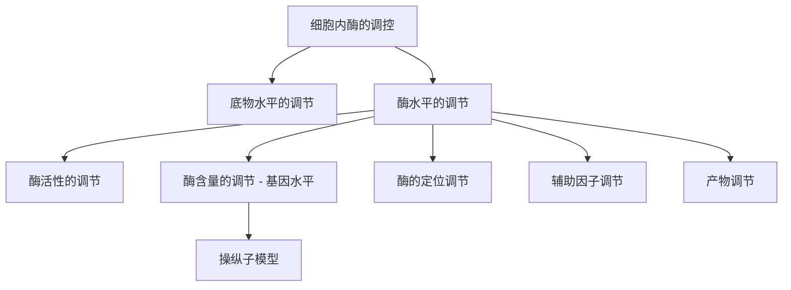

### 3.1.3 操纵子学说（Operon Theory）——Jacob & Monod

操纵子是基因表达的协同单位，由以下部分组成：

- **结构基因（Structural Gene, S）**：编码蛋白质
- **操纵基因（Operator Gene, O）**：控制结构基因的转录
- **启动子（Promotor Gene, P）**：RNA聚合酶结合位点
- **调节基因（Regulator Gene, R）**：编码阻遏蛋白

> 📷 参见：`../酶工程资料/PPT_images/4酶制剂的生产/slide8_img2.png`

**乳糖操纵子（Lac Operon）的诱导机制**：

1. 无乳糖时：阻遏蛋白与操纵基因结合，关闭基因表达
2. 有乳糖时：乳糖作为诱导剂与阻遏蛋白结合，使其失活，结构基因表达

> 📷 参见：`../酶工程资料/PPT_images/4酶制剂的生产/slide9_img3.png`、`slide10_img4.png`

**色氨酸操纵子（Trp Operon）的阻遏机制**：
- 辅阻遏物（色氨酸）与阻遏蛋白结合，激活阻遏蛋白
- 活化的阻遏蛋白与操纵基因结合，关闭基因表达

> 📷 参见：`../酶工程资料/PPT_images/4酶制剂的生产/slide11_img5.png`

### 3.1.4 分解代谢物阻遏（Catabolite Repression）

**二次生长现象（Diauxie，葡萄糖效应）**：
- 葡萄糖存在时，细菌优先利用葡萄糖，抑制其他糖类利用酶的合成
- 葡萄糖耗尽后，才开始利用其他糖类

**机制**：
- 葡萄糖降解产物降低细胞内cAMP浓度
- cAMP-CAP（降解物基因活化蛋白）复合物减少
- CAP-cAMP是lac操纵子转录所必需的激活因子
- 导致乳糖利用酶基因不表达

> 📷 参见：`../酶工程资料/PPT_images/4酶制剂的生产/slide14_img6.png`、`slide15_img7.png`、`slide16_img8.png`

## 3.2 酶的生产方法

### 3.2.1 三种生产方法

1. **提取分离法（Extraction）**：从动植物组织或微生物细胞中直接提取
   - SOD——从血液提取
   - 木瓜蛋白酶——从木瓜提取
   - 胰凝乳蛋白酶——从胰腺提取
2. **生物合成法（Biosynthesis）**：利用微生物发酵生产（最主要的方法）
   - 枯草芽孢杆菌产淀粉酶
   - 曲霉产糖化酶
3. **化学合成法（Chemical synthesis）**：化学合成酶（极少数）

### 3.2.2 微生物发酵产酶的优点

- 微生物生长速度快，发酵周期短
- 营养要求简单，成本低
- 易于大规模培养
- 可通过基因工程改造提高产量
- 不受季节和地域限制

## 3.3 微生物酶的发酵生产

### 3.3.1 优良产酶菌种应具备的条件

1. 酶产量高
2. 易培养（生长速率高、营养要求低）
3. 遗传性能稳定，不易退化
4. 易分离提纯
5. 安全可靠（不是致病菌）

### 3.3.2 常见产酶微生物

| 微生物类别 | 代表菌种 | 主要产酶 |
|-----------|---------|---------|
| 细菌 | 大肠杆菌（E. coli） | 多种重组酶 |
| 细菌 | 枯草芽孢杆菌（B. subtilis） | 淀粉酶、蛋白酶 |
| 细菌 | 醋酸杆菌（Acetobacter） | 醋酸合成相关酶 |
| 放线菌 | 链霉菌（Streptomyces） | 葡萄糖异构酶、抗生素 |
| 霉菌 | 黑曲霉（A. niger） | 糖化酶、果胶酶 |
| 霉菌 | 米曲霉（A. oryzae） | 蛋白酶、淀粉酶 |
| 霉菌 | 根霉（Rhizopus） | 糖化酶、脂肪酶 |
| 酵母 | 酿酒酵母（S. cerevisiae） | 转化酶、酒精发酵酶 |
| 酵母 | 假丝酵母（Candida） | 脂肪酶 |

> 📷 参见：`../酶工程资料/PPT_images/4酶制剂的生产/slide22_img10.png`至`slide26_img13.emf`

### 3.3.3 产酶微生物的分离和筛选

1. **样品采集**：从富含该酶作用底物的场所采集
2. **富集培养**：投其所好，取其所抗
3. **纯培养分离**：获得微生物的纯培养
4. **初筛**：选出产酶菌种，以多为主
5. **复筛**：选出产酶水平高的菌株，以质为主

**生产菌的改良方法**：
- 基因突变
- 基因转移
- 基因克隆

> 📷 参见：`../酶工程资料/PPT_images/4酶制剂的生产/slide27_img14.png`、`slide29_img15.png`

### 3.3.4 酶的发酵工艺条件与控制

**发酵工艺流程**：

保藏菌种 → 菌种活化 → 菌种扩大培养 → 发酵 → 分离纯化 → 酶

> 📷 参见：`../酶工程资料/PPT_images/4酶制剂的生产/slide31_img16.png`、`slide32_img17.png`

**培养基要求**：
- 满足菌种生长需求
- 满足菌种产酶需求
- 碳源、氮源、无机盐、生长因子等

**发酵条件控制**：
- 温度控制
- pH控制
- 溶氧控制
- 诱导物添加
- 产物反馈抑制的解除

**提高产酶的措施**：
- 优化培养基组成
- 控制发酵条件
- 添加诱导物
- 解除产物阻遏
- 添加表面活性剂

### 3.3.5 发酵方法

1. **固体发酵**：传统方法，适用于霉菌等
2. **液体深层发酵**：工业化主要方法
3. **固定化细胞发酵**：将细胞固定后进行发酵
4. **固定化原生质体发酵**：利用去壁的微生物细胞发酵

### 3.3.6 酶发酵动力学

**细胞生长动力学**：
- 延迟期 → 对数期 → 稳定期 → 衰亡期

**产酶动力学**：
- 生长偶联型：产酶与细胞生长同步
- 部分生长偶联型：产酶在生长后期开始
- 非生长偶联型：产酶在细胞停止生长后进行

### 3.3.7 酶的回收与成型

发酵结束后，发酵液经处理回收酶，制成不同剂型的酶制剂：
- 液体酶制剂
- 固体酶制剂（粉末、颗粒）

> 📷 参见：`../酶工程资料/PPT_images/4酶制剂的生产/` 整套54张图片

---

# 第四章 酶的分离纯化

## 4.1 酶的提取、分离纯化技术路线

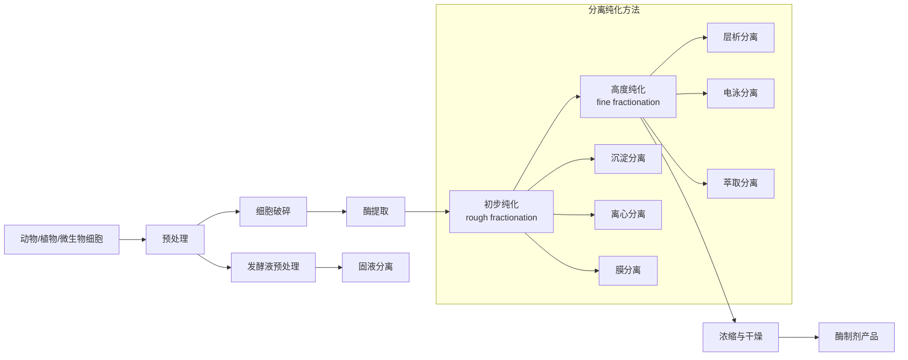

> 📷 参见：`../酶工程资料/PPT_images/5酶的分离纯化/` 整套113张图片

## 4.2 预处理（Pretreatment）

### 4.2.1 发酵液预处理

**目的**：改善发酵液的性质，便于固液分离

**影响发酵液过滤的因素**：
- 菌种特性
- 培养基组成
- 发酵液粘度

**提高过滤性能的方法**：
- 絮凝和凝聚
- 稀释、加热
- 加助滤剂（常用硅藻土等）

主要方法：**离心分离** 和 **过滤**

> 📷 参见：`../酶工程资料/PPT_images/5酶的分离纯化/slide6_img1.png`

### 4.2.2 细胞破碎

**各种微生物细胞壁的结构与组成**：

| 微生物 | 壁厚/nm | 主要组成 |
|-------|---------|---------|
| 革兰氏阳性细菌 | 15~50 | 肽聚糖(40%~90%) |
| 革兰氏阴性细菌 | 10~13 | 肽聚糖(5%~10%)、脂多糖 |
| 放线菌 | 同G+ | 肽聚糖 |
| 酵母菌 | 100~300 | 葡聚糖(30%~40%)、甘露聚糖(30%) |
| 霉菌 | 100~250 | 多聚糖(80%~90%) |

> 📷 参见：`../酶工程资料/PPT_images/5酶的分离纯化/slide7_img2.png`、`slide8_img3.png`、`slide9_img4.png`

**细胞破碎方法**：

| 方法类型 | 具体方法 | 原理 |
|---------|---------|------|
| **机械破碎** | 捣碎法、研磨法、匀浆法 | 通过机械运动产生的剪切力使细胞破碎 |
| **物理破碎** | 温度差破碎、压力差破碎、超声波破碎 | 通过各种物理因素破坏细胞外层结构 |
| **化学破碎** | 有机溶剂（甲苯、丙酮）、表面活性剂（Triton、Tween） | 化学试剂对细胞膜的作用 |
| **酶促破碎** | 自溶法、外加酶制剂法 | 细胞本身的酶系或外加酶制剂的催化作用 |

**细胞对破碎方法的敏感性**：
- 动植物细胞：对所有方法都敏感（+++）
- 革兰氏阴性菌：中等敏感（++）
- 酵母：敏感度较低（+）
- 孢子：极其耐受（-）

> 📷 参见：`../酶工程资料/PPT_images/5酶的分离纯化/slide10_img5.png`至`slide12_img8.png`

## 4.3 酶的提取

**主要提取方法**：

| 提取方法 | 使用的溶剂或溶液 | 提取对象 |
|---------|----------------|---------|
| 盐溶液提取 | 0.02~0.5 mol/L盐溶液 | 在低浓度盐溶液中溶解度较大的酶 |
| 酸溶液提取 | pH 2~6的水溶液 | 在稀酸中溶解度大且稳定的酶 |
| 碱溶液提取 | pH 8~12的水溶液 | 在稀碱中溶解度大且稳定的酶 |
| 有机溶剂提取 | 可与水混溶的有机溶剂 | 与脂质结合牢固或含较多非极性基团的酶 |

> 📷 参见：`../酶工程资料/PPT_images/5酶的分离纯化/slide13_img9.png`

## 4.4 酶的分离纯化方法

### 4.4.1 沉淀分离

**（一）盐析沉淀法（改变离子强度）**

**基本原理**：
- **盐溶**：低盐浓度时，蛋白质溶解度随盐浓度增加而增加
- **盐析**：高盐浓度时，蛋白质溶解度随盐浓度增加而降低

**盐析方程式**（Cohn方程）：
$$log S = \beta - K_s I$$

其中 $K_s$ 为盐析常数，$\beta$ 为常数，$I$ 为离子强度。

**常用中性盐**：硫酸铵 (NH₄)₂SO₄

**盐浓度的调整方式**：
- 饱和溶液法：$V = V_0 \frac{S_2 - S_1}{1 - S_2}$
- 添加固体硫酸铵法：$W = \frac{B(S_2 - S_1)}{1 - AS_2}$

**盐析的影响因素**：
1. 离子强度和种类
2. 蛋白质浓度
3. pH值
4. 温度

两种盐析法：**Ks分级盐析法** 和 **β分级盐析法**

> 📷 参见：`../酶工程资料/PPT_images/5酶的分离纯化/slide16_img10.png`至`slide23_img14.png`

**（二）有机溶剂沉淀（降低介电常数）**

**机理**：
- 降低溶液的介电常数
- 部分引起蛋白质脱水

**常用有机溶剂**：丙酮 > 乙醇 > 甲醇，用量一般为酶液体积的2倍左右，终浓度为70%。

**优缺点**：
- 优点：分辨率比盐析法高，沉淀不需脱盐，溶剂易蒸发
- 缺点：容易引起蛋白质变性失活，有机溶剂易燃易爆

> 📷 参见：`../酶工程资料/PPT_images/5酶的分离纯化/slide25_img15.png`

**（三）等电点沉淀（Isoelectric Precipitation）**

**原理**：蛋白质在等电点时溶解度最低

- 不同蛋白质具有不同的等电点
- 单独使用较少，多与其他方法联合使用

> 📷 参见：`../酶工程资料/PPT_images/5酶的分离纯化/slide27_img17.png`

**（四）有机聚合物沉淀法**

**沉淀剂**：常用聚乙二醇（PEG），多用分子量为6000~20000的PEG

**优点**：
1. 操作条件温和，不易引起生物大分子变性
2. 沉淀效能高
3. 沉淀后有机聚合物容易去除

> 📷 参见：`../酶工程资料/PPT_images/5酶的分离纯化/slide28_img18.png`

**（五）选择性变性沉淀法**

选择一定条件使杂蛋白变性沉淀而不影响所需酶蛋白：
- 热变性
- pH变性
- 有机溶剂变性

> 📷 参见：`../酶工程资料/PPT_images/5酶的分离纯化/slide29_img19.png`

### 4.4.2 离心分离

**基本原理**：
- 离心力：$F_c = m r \omega^2$
- 相对离心力：$RCF = 1.12 \times 10^{-5} N^2 r$（N为r/min）
- 沉降系数（S）：单位离心力下颗粒的沉降速度

**离心机种类**：

| 类型 | 转速(r/min) | 注意事项 |
|-----|------------|---------|
| 低速离心机 | <6000 | 常温，注意热变性和平衡 |
| 高速离心机 | 6000~25000 | 冷冻，精确平衡 |
| 超速离心机 | >25000 | 冷冻+真空，精确平衡 |

> 📷 参见：`../酶工程资料/PPT_images/5酶的分离纯化/slide30_img20.png`至`slide34_img24.png`

### 4.4.3 过滤与膜分离

- **常规过滤**：利用多孔介质截留固体颗粒
- **膜分离技术**：利用半透膜对不同分子量的物质进行选择性分离
  - 微滤（MF）：0.1~10 μm
  - 超滤（UF）：1~100 nm，用于酶浓缩
  - 纳滤（NF）：<2 nm
  - 反渗透（RO）：<0.5 nm

> 📷 参见：`../酶工程资料/PPT_images/5酶的分离纯化/`

### 4.4.4 层析分离（色谱分离）

**（1）凝胶过滤层析（分子筛层析）**
- 原理：根据分子大小不同进行分离
- 大分子先流出，小分子后流出

**（2）离子交换层析**
- 原理：根据蛋白质所带电荷不同进行分离
- 阳离子交换剂：CM-纤维素、SP-Sephadex
- 阴离子交换剂：DEAE-纤维素、QAE-Sephadex

**（3）亲和层析**
- 原理：利用生物分子之间的特异性亲和力进行分离
- 酶与底物/抑制剂/辅酶、抗原与抗体等

**（4）疏水作用层析**
- 原理：根据蛋白质疏水性的不同进行分离

> 📷 参见：`../酶工程资料/PPT_images/5酶的分离纯化/`

### 4.4.5 电泳分离

**常用电泳技术**：
- SDS-PAGE：按分子量分离蛋白质
- 等电聚焦（IEF）：按等电点分离
- 二维电泳（2-DE）：IEF + SDS-PAGE
- 毛细管电泳

> 📷 参见：`../酶工程资料/PPT_images/5酶的分离纯化/`

### 4.4.6 萃取分离

**双水相萃取**：
- 利用两种不相溶的高分子溶液（如PEG/葡聚糖）形成两相体系
- 酶在一相中优先分配，实现分离

**反胶束萃取**：
- 表面活性剂在有机相中形成纳米级含水"微胶囊"
- 酶被包裹在反胶束中，实现从水相到有机相的转移

> 📷 参见：`../酶工程资料/PPT_images/5酶的分离纯化/`

## 4.5 酶的浓缩、干燥与结晶

**浓缩方法**：
- 超滤浓缩
- 冷冻干燥
- 真空浓缩
- 吸水剂浓缩（PEG等）

**干燥方法**：
- 冷冻干燥（最温和）
- 喷雾干燥
- 真空干燥

**结晶**：酶在特定的条件下（适当pH、温度、离子强度等）形成规则晶体，是纯度的标志。

> 📷 参见：`../酶工程资料/PPT_images/5酶的分离纯化/` 整套113张图片

---

# 第五章 酶的固定化

## 5.1 概述

### 5.1.1 酶应用过程中的不足

1. **酶的稳定性较差**：大多数酶在高温、强酸、强碱和重金属离子等外界因素影响下容易变性失活
2. **酶的一次性使用**：游离酶难以回收利用，增加生产成本
3. **产物的分离纯化较困难**：酶成为杂质与产物混在一起

### 5.1.2 固定化酶的定义

**固定化酶（Immobilized Enzyme）**：经物理或化学方法处理，使酶变成不易随水流失即运动受到限制，而又能发挥催化作用的酶制剂。凡限制在一定的空间范围内并能连续反复地使用的酶。

> 📷 参见：`../酶工程资料/PPT_images/6酶的固定化/slide4_img2.png`

**研究历史**：
- 1916年：Nelson和Griffin发现
- 1953年：Grubhofer和Schloith研究
- 1969年：千畑一郎实现工业化
- 1971年："immobilized enzyme"术语确立

### 5.1.3 固定化酶的优缺点

**优点**：
- 不溶于水，易于与产物分离
- 可反复使用
- 可连续化生产
- 稳定性好

**缺点**：
- 固定化过程中往往会引起酶的失活

> 📷 参见：`../酶工程资料/PPT_images/6酶的固定化/slide8_img3.png`

## 5.2 酶的固定化方法

### 5.2.1 固定化方法分类

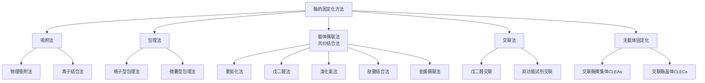

### 5.2.2 吸附法

**（1）物理吸附法**
- **操作方式**：静止法、电沉积法、反应器装载法、混合振摇装载法
- **优点**：固定化时酶分子的构象很少或基本不发生变化
- **缺点**：结合力弱，易解吸附
- **载体**：活性氧化铝、活性炭等无机载体；面筋、淀粉等有机载体

**（2）离子结合法**
- 酶分子与含有离子交换基团的固相载体结合
- **第一个实例**：固定化过氧化氢酶（DEAE-Cellulose）
- **第一个工业化实例**：固定化氨基酰化酶（DEAE-Sephadex A-50）
- **常用载体**：DEAE-C、CMC、DEAE-葡聚糖凝胶等

> 📷 参见：`../酶工程资料/PPT_images/6酶的固定化/slide12_img4.png`至`slide15_img7.png`

### 5.2.3 包埋法

将酶分子包埋于凝胶的网眼中或半透性的聚合物膜腔中。

**（1）格子型包埋法（Gel Entrapment）**
- **聚丙烯酰胺（PAG）包埋法**：最早采用的胶格包埋法
- 包埋容量：10~100 mg(蛋白)/g(单体)
- **海藻酸钙包埋法**：操作温和，最常用

> 📷 参见：`../酶工程资料/PPT_images/6酶的固定化/slide17_img8.png`至`slide20_img10.png`

**（2）微囊型包埋法（Microencapsulation）**
- 以超滤用的半透膜包裹含酶的液滴
- **四种制作方法**：界面聚合法、液体干燥法、分相法、液膜（脂质体）法

> 📷 参见：`../酶工程资料/PPT_images/6酶的固定化/slide21_img11.png`至`slide24_img14.png`

### 5.2.4 载体偶联法（共价结合法）

将酶分子的某些功能基团经共价键与载体结合。

**常用载体**：纤维素、琼脂糖胶、葡聚糖凝胶、甲壳质、氨基酸共聚物等

**酶分子上的非必需侧链基团**：游离氨基、胍基、酚羟基、巯基、咪唑基、羟基

**载体功能基团活化方法**：

| 方法 | 说明 |
|-----|------|
| **重氮化法** | 载体先用亚硝酸处理生成重氮盐衍生物，再与酶的酚基、咪唑基或氨基反应 |
| **戊二醛法** | 戊二醛与含伯胺基的聚合物反应，生成具有醛基功能的衍生物，再与酶反应偶联 |
| **溴化氰法** | 溴化氰活化多糖载体 |
| **芳香烃基化法或烷基化法** | 适用于含活性卤素的载体 |
| **肽键结合法** | 叠氮法、酸酐法、酰氯法、异硫氰酸法 |
| **金属偶联法** | 过渡金属（Ti、Sn、Zn、V、Fe的氯化物）使载体活化 |

> 📷 参见：`../酶工程资料/PPT_images/6酶的固定化/slide25_img15.png`至`slide38_img27.png`

### 5.2.5 交联法（Crosslinking）

利用双功能试剂或多功能试剂，使酶分子之间或酶蛋白与其他惰性蛋白之间发生交联，凝集成网状结构。

- **常用双功能试剂**：戊二醛（最常用）、已二胺、顺丁烯二酸酐、双偶氮氮苯
- **优点**：结合牢固，可长时间使用
- **缺点**：交联条件较剧烈，酶活力损失较大

> 📷 参见：`../酶工程资料/PPT_images/6酶的固定化/slide39_img28.png`至`slide42_img30.png`

### 5.2.6 固定化酶的评价指标

1. **固定化酶的活力**：与游离酶相比的活力回收率
2. **固定化效率**：蛋白质（酶）的结合效率
3. **半衰期**：固定化酶活力下降至初始活力一半所需的时间
4. **操作稳定性**：在连续操作条件下的稳定性

### 5.2.7 固定化对酶性质的影响

- **最适pH的变化**：通常会发生偏移
- **最适温度的变化**：通常最适温度升高
- **稳定性的变化**：通常热稳定性提高
- **动力学常数的变化**：Km值通常增大

### 5.2.8 细胞的固定化

- **固定化菌体（死细胞）**：含酶菌体或菌体碎片
- **固定化细胞**：在一定的空间范围内进行生命活动的细胞

**固定化细胞的方法**：吸附法、共价交联法、包埋法、无载体固定化

### 5.2.9 辅因子的固定化

- **辅基的固定化**：与酶蛋白紧密结合的辅因子
- **辅酶的固定化**：NAD⁺/NADH、NADP⁺/NADPH、ATP/ADP等
- **辅酶的再生**：通过偶联反应或化学反应实现辅酶再生

### 5.2.10 酶的定向固定化

1. **位点专一性的共价定向固定化**
2. **抗体偶联的定向固定化**
3. **生物酶介导的定向固定化技术**
4. **利用基因工程方法实现定向固定化**

> 📷 参见：`../酶工程资料/PPT_images/6酶的固定化/` 整套49张图片

---

# 第六章 化学酶工程与生物酶工程

## 6.1 概述

### 6.1.1 天然酶在应用中的限制因素

- 酶的活性不够高
- 酶稳定性较差
- 可能具有抗原性

### 6.1.2 改变酶特性的两条途径

1. **化学酶工程（Primary Enzyme Engineering）**：通过分子修饰的方法改变已分离出来的酶的天然结构
2. **生物酶工程（Advanced Enzyme Engineering）**：通过生物工程的方法改造编码酶分子的基因

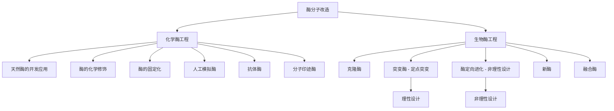

> 📷 参见：`../酶工程资料/PPT_images/7化学酶工程/slide3_img1.png`

## 6.2 化学酶工程

### 6.2.1 酶分子化学修饰

**定义**：通过化学基团的引入或除去，使蛋白质共价结构发生改变，从而改变酶的某些特性和功能的过程。

**酶化学修饰的原理**：
- 增强酶天然构象的稳定性与耐热性
- 保护酶活性部位与抗抑制剂
- 维持酶功能结构的完整性与抗蛋白水解酶
- 消除酶的抗原性及稳定酶的微环境

**酶分子修饰的意义**：
1. **提高酶的活力**（activity）
2. **增强酶的稳定性**（stability）
3. **降低或消除酶的抗原性**（immunological property）
4. **研究酶分子结构与功能的关系**（structure）

### 6.2.2 酶分子化学修饰的主要方法

**（1）金属离子置换修饰**

改变酶分子中所含的金属离子，使酶的特性和功能发生改变。

**操作方法**：酶液 → 加入EDTA → 透析或超滤 → 加入不同的金属离子

**结果**：可能使酶活性降低或完全失活，也可能使酶活性提高或稳定性增加

> 📷 参见：`../酶工程资料/PPT_images/7化学酶工程/slide16_img9.png`

**（2）酶的大分子修饰（共价修饰）**

使用可溶性大分子（如PEG、右旋糖苷、肝素等）通过共价键连接于酶分子表面，形成覆盖层。

**修饰过程**：
1. 修饰剂的选择
2. 修饰剂的活化
3. 修饰反应
4. 分离纯化

> 📷 参见：`../酶工程资料/PPT_images/7化学酶工程/slide18_img10.png`至`slide21_img12.png`

**PEG修饰SOD的效果**：

| 酶 | 半衰期 | 相对稳定性 |
|----|-------|-----------|
| 天然SOD | 6 min | 1 |
| 右旋糖酐-SOD | 7 h | 70 |
| Ficoll(低分子量)-SOD | 14 h | 140 |
| Ficoll(高分子量)-SOD | 24 h | 240 |
| 聚乙二醇-SOD | 35 h | 350 |

> 📷 参见：`../酶工程资料/PPT_images/7化学酶工程/slide27_img16.png`

**（3）酶蛋白主链修饰（肽链有限水解修饰）**

利用酶分子主链的切断和连接，改变酶分子的化学结构及其空间结构。主要通过酶切/酶原激活法实现。

**例**：胃蛋白酶原的激活

> 📷 参见：`../酶工程资料/PPT_images/7化学酶工程/slide30_img18.png`

**（4）酶蛋白侧链基团修饰**

用小分子化合物对酶蛋白侧链基团进行修饰。

**常用修饰剂**：

| 基团 | 修饰剂 | 作用 |
|-----|-------|------|
| 氨基 | 二硝基氟苯、醋酸酐 | 脱氨基或共价结合屏蔽 |
| 羧基 | 乙醇-盐酸、碳化二亚胺 | 酯化、酰基化 |
| 胍基 | 环已二酮、乙二醛 | 缩合生成稳定的杂环 |
| 巯基 | 二硫苏糖醇、巯基乙醇 | 破坏二硫键 |
| 酚基 | 四硝基甲烷 | 碘化、硝化或琥珀酰化 |
| 咪唑基 | 各类修饰剂 | 修饰组氨酸残基 |

> 📷 参见：`../酶工程资料/PPT_images/7化学酶工程/slide32_img19.png`至`slide42_img28.png`

**（5）变性诱导构象重建**

- 酶在一定条件下变性
- 在特定条件（非天然条件或有底物类似物、抑制剂等存在）下复性
- 酶折叠成所需的特殊结构，产生新的性状

**前沿技术**：Keyes实验室的"BIO-SYN-CAT™"技术，包括三个基本环节：微扰、诱导和修饰、交联

**（6）物理修饰**

通过物理因素（高温、高压、高盐、极端pH值等）改变酶分子空间构象，从而改变酶的特性和功能。

**特点**：不改变酶的组成单位及其基团，共价键不发生改变，只是副键发生某些变化和重排。

**（7）氨基酸置换修饰**

将肽链上的某一个氨基酸换成另一个氨基酸。

**两种途径**：
- **化学修饰法**：操作复杂，难度大，成本高
- **蛋白质工程（定点突变）**：最常用方法

**经典实例**：Bender等利用化学修饰法将枯草杆菌蛋白酶活性中心的丝氨酸转换为半胱氨酸，修饰后该酶失去对蛋白质和多肽的水解能力，但出现催化硝基苯酯等底物水解的活性。

> 📷 参见：`../酶工程资料/PPT_images/7化学酶工程/slide47_img30.png`

### 6.2.3 人工模拟酶

**理论基础**：模拟天然酶的结构和催化机制，人工合成具有催化活性的分子。

**分类**：
1. **环糊精模拟酶**：利用环糊精的疏水空腔模拟酶的活性中心
2. **大环聚醚模拟酶**：冠醚等大环化合物
3. **杯芳烃模拟酶**
4. **金属卟啉模拟酶**：模拟过氧化物酶等
5. **肽酶**：小分子肽类模拟酶

> 📷 参见：`../酶工程资料/PPT_images/7化学酶工程/`

### 6.2.4 抗体酶（Abzyme）

具有催化活性的抗体分子，将抗体的高特异性与酶的催化效率结合。

**制备方法**：
1. 以过渡态类似物为半抗原免疫动物
2. 通过杂交瘤技术产生单克隆抗体
3. 筛选具有催化活性的抗体

**催化反应类型**：酯水解、酰胺水解、Diels-Alder反应、氧化还原反应等

**抗体酶的催化特性**：
- 底物专一性高
- 可催化多种化学反应
- 可设计针对特定反应的抗体酶

### 6.2.5 分子印迹酶

**原理**：在模板分子（印迹分子）存在下，合成具有特异性识别空腔的聚合物，去除模板后形成与模板形状和功能基团互补的空穴。

**分类**：
- 共价印迹法
- 非共价印迹法

**应用**：手性拆分、特异性催化、分子识别

> 📷 参见：`../酶工程资料/PPT_images/7化学酶工程/`

## 6.3 生物酶工程

### 6.3.1 酶基因的克隆和表达

**酶基因的克隆步骤**：
1. 从基因组或cDNA文库中获取目的基因
2. 将基因插入表达载体
3. 转化宿主细胞（大肠杆菌、酵母、芽孢杆菌等）
4. 诱导表达
5. 纯化重组酶

**酶的异源表达**：将一种生物的酶基因在另一种生物中表达，实现酶的工业化生产。

### 6.3.2 酶定向进化（非理性设计）

**基本原理**：模拟自然进化过程，通过随机突变和定向选择，获得性能优良的突变酶。

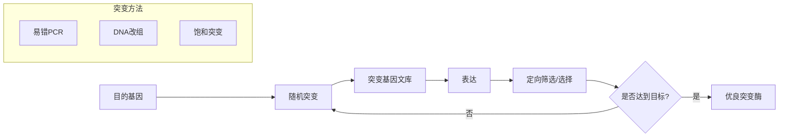

**酶定向进化的特点**：
- 不需要了解酶的三维结构
- 可快速获得性能改良的酶
- 可创造自然界不存在的酶活性

**定向进化策略**：
- 易错PCR（Error-prone PCR）
- DNA改组（DNA shuffling）
- 饱和突变（Saturation mutagenesis）
- 临时模板随机嵌合技术（RACHITT）

**高通量筛选方法**：
- 基于微量滴定板的筛选
- 基于荧光激活细胞分选（FACS）的筛选
- 基于高通量液滴微流控的筛选系统

### 6.3.3 酶蛋白理性设计

**前提**：需要了解酶的三维结构和催化机制

**步骤**：
1. 酶蛋白结构的预测
2. 确定待改造的氨基酸位点
3. 定点突变
4. 突变酶的功能鉴定

**常用定点突变技术**：
- 寡核苷酸定点突变
- PCR定点突变
- 盒式突变

**结构预测方法**：
- 同源建模
- 从头预测（Ab initio）
- 分子动力学模拟
- AI辅助预测（AlphaFold等）

### 6.3.4 融合酶

将两种或多种酶（或功能域）的基因融合，表达出具有多种催化功能或新功能的融合蛋白。

**应用**：
- 构建多酶复合体，实现底物通道效应
- 融合亲和标签便于纯化
- 融合报告基因便于检测

> 📷 参见：`../酶工程资料/PPT_images/7化学酶工程/` 整套106张图片

---

# 第七章 非水相酶催化

## 7.1 概述

### 7.1.1 传统观念的转变

传统上认为水是酶催化反应的最佳介质，但许多有机反应需要在非水相中进行。

**转向非水相催化的原因**：
- 有机底物的溶解性差
- 需要控制氧的参与
- 探索新的反应类型
- 减少微生物污染
- 发挥酶的优势

> 📷 参见：`../酶工程资料/PPT_images/8非水相催化/slide3_img1.png`

### 7.1.2 非水酶学的发展历史

- **1930年代**：Bourquelot首次证明酶在有机溶剂中具有活性（乙醇或丙酮中）
- **1977年**：Buckland和Martinek重新发现微生物细胞、游离酶、固定化酶在有机溶剂中的催化活性
- **1984年**：Klibanov在Science发表里程碑论文，首次报道非水相介质中脂肪酶的催化行为及热稳定性
- **至今**：非水酶学方法在多肽合成、聚合物合成、药物合成以及立体异构体拆分等方面显示出广阔的应用前景

**核心文献**：
- Klibanov, A.M. (1984). Enzymic catalysis in organic media at 100℃. Science, 224, 1249-1251.
- Klibanov, A.M. (2001). Improving enzymes by using them in monophasic organic solvents. Nature, 409, 241-246.

### 7.1.3 非水酶学研究的三个主要方向

1. **基本理论研究**：影响非水介质中酶催化的主要因素以及非水介质中酶学性质
2. **结构与功能研究**：阐明非水介质中酶的催化机制，建立和完善非水酶学的基本理论
3. **应用研究**：利用理论指导非水介质中酶催化反应的应用

## 7.2 非水相酶催化反应介质体系

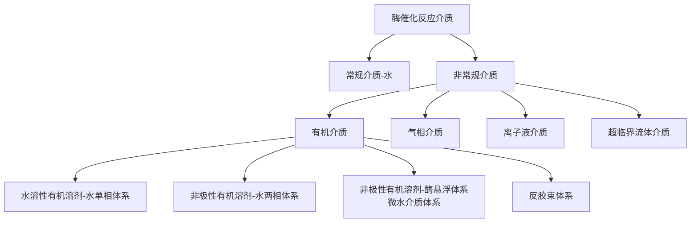

> 📷 参见：`../酶工程资料/PPT_images/8非水相催化/slide7_img2.png`

### 7.2.1 有机介质体系

**（1）与水互溶的有机溶剂-水单相体系**
- 有机溶剂与水形成均匀的单相溶液
- 酶、底物和产物都能溶解在这种体系中

**（2）非极性有机溶剂-水两相体系**
- 由含有溶解酶的水相和一个非极性的有机溶剂相组成
- 催化反应在水相或界面进行
- 有机相作为底物储库
- 产物更疏水时，平衡向产物方向移动

**（3）非极性有机溶剂-酶悬浮体系（微水介质体系）**
- 非极性有机溶剂取代大量水，固体酶悬浮在有机相中
- 仍含必需结合水维持催化活性（含水量一般<2%）

**（4）反胶束体系**
- 表面活性剂在有机溶剂中形成纳米级含水"微胶囊"
- 酶被包裹在反胶束的微小水池中

> 📷 参见：`../酶工程资料/PPT_images/8非水相催化/slide15_img5.png`、`slide16_img6.png`、`slide17_img7.png`

### 7.2.2 有机相酶反应的优点

1. 增加反应物的溶解度
2. 改变反应平衡方向（有利于合成反应）
3. 易于分离水和溶剂
4. 增强酶的稳定性
5. 改变酶的选择性（底物专一性、立体选择性）
6. 可催化水中不可能进行的反应
7. 酶可能表现出分子记忆行为

> 📷 参见：`../酶工程资料/PPT_images/8非水相催化/slide9_img3.png`

## 7.3 有机介质中酶促反应的影响因素

### 7.3.1 水对酶催化反应的影响

**必需水（Essential Water）**：
- 维持酶催化活性所必需的最少量的水（结合水）
- 与酶分子紧密结合的一层水分子，对酶活性至关重要
- 不同酶与必需水结合的紧密程度及必需水量不同

**最适含水量**：在特定的有机介质反应体系中，催化速度达到最大时的含水量

> 📷 参见：`../酶工程资料/PPT_images/8非水相催化/slide19_img8.png`至`slide21_img10.png`

**水活度（Thermodynamic Water Activity, aw）**：
$$a_w = P/P_0$$
- $P$：在一定条件下体系中水的蒸气压
- $P_0$：在相同条件下纯水的蒸气压
- 研究发现：最适水含量随溶剂极性增加而增加，但最佳水活度与溶剂极性无关

> 📷 参见：`../酶工程资料/PPT_images/8非水相催化/slide22_img11.png`

**水对反应的影响**：
1. **空间构象**：水影响酶分子中维持催化活性所必需的氢键和疏水相互作用
2. **反应速率**：催化活力随含水量增加而增加
3. **反应平衡**：水活度决定水解/合成反应的平衡位置
4. **立体选择性**：水活度影响酶的催化选择性

### 7.3.2 有机溶剂的影响

**溶剂选择原则**：
- 溶剂极性（log P值）：通常log P > 4的疏水性溶剂更适合
- 溶剂与水的不混溶性
- 溶剂对底物和产物的溶解能力
- 溶剂对酶的毒性

### 7.3.3 有机介质中酶的性质

**（1）酶活性的变化**：通常比水相中低（降低几个数量级），但可通过优化条件提高

**（2）稳定性的变化**：
- 热稳定性通常显著提高
- 可在100℃以上保持活性
- 储存稳定性增强

**（3）底物专一性的改变**：在水相和有机相中可能不同

**（4）pH记忆和分子记忆**：
- 酶在有机溶剂中"记住"了它最后所处水相的pH值（pH记忆）
- 酶在有机溶剂中的构象和活性受冻干前溶液条件的影响（分子记忆）

**（5）反应平衡方向的移动**：
- 在水中倾向于水解的反应，在有机溶剂中可能转向合成方向
- 如：蛋白酶在有机溶剂中可催化肽键合成

> 📷 参见：`../酶工程资料/PPT_images/8非水相催化/`

## 7.4 气相和超临界介质的酶促反应

### 7.4.1 气相介质中酶促反应

- 酶固定化后置于气相反应器中
- 底物以气态形式提供
- 适用于挥发性底物（如乙醇、乙酸乙酯等）

### 7.4.2 超临界流体介质中酶促反应

- 超临界CO₂是最常用的超临界介质
- 兼具气体的扩散性和液体的溶解能力
- 可通过调节压力和温度改变溶剂性质
- 产物易分离（降压即可）

## 7.5 非水相酶催化的应用

1. **多肽合成**：蛋白酶在有机溶剂中催化肽键合成
2. **聚合物合成**：脂肪酶催化聚酯合成
3. **手性化合物的拆分**：脂肪酶、酯酶等催化手性酯的水解或合成
4. **药物合成**：非水相酶催化合成药物中间体
5. **生物柴油生产**：脂肪酶催化油脂的酯交换反应
6. **风味物质合成**：酯酶催化合成酯类风味物质

> 📷 参见：`../酶工程资料/PPT_images/8非水相催化/` 整套44张图片

---

# 第八章 酶反应器与酶传感器

## 8.1 酶反应器（Enzyme Reactor）

### 8.1.1 概述

**定义**：以酶或固定化酶作为催化剂进行酶促反应的装置称为酶反应器。

**作用**：以尽可能低的成本，按一定速度由规定的反应物制备特定的产物。

**特点**：
- 与化学反应器相比：在低温、低压下发挥作用，耗能和产能较少
- 与发酵反应器相比：不表现自催化方式（即细胞的连续再生）

> 📷 参见：`../酶工程资料/PPT_images/9酶反应器/slide5_img2.png`

### 8.1.2 主要酶反应器的类型及特点

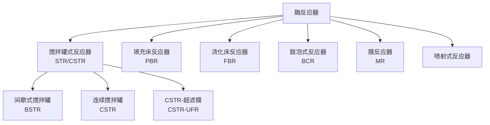

**（1）间歇式酶反应器（Batch Stirred Tank Reactor, BSTR）**

底物与酶一次性投入反应器，产物一次性取出。

- **优点**：装置简单，造价较低，传质阻力小
- **缺点**：操作麻烦，固定化酶反复回收时易失活
- **适用**：主要用于游离酶

> 📷 参见：`../酶工程资料/PPT_images/9酶反应器/slide14_img7.png`

**（2）连续流搅拌罐式酶反应器（Continuous Stirred Tank Reactor, CSTR）**

以恒定流速连续流入底物，同时以相同流速输出反应液。

- **优点**：混合良好，各部分组成相同
- **缺点**：搅拌桨剪切力大，易打碎固定化酶颗粒

> 📷 参见：`../酶工程资料/PPT_images/9酶反应器/slide15_img8.png`

**（3）填充床反应器（Packed Bed Reactor, PBR）——固定床反应器**

将颗粒状或片状固定化酶填充于其中构成，最常用的工业反应器。

- **操作特点**：底物以恒定速度通过固定化酶床层，流动状态接近活塞流
- **优点**：高效，易操作，结构简单
- **缺点**：传质系数和传热系数较低

> 📷 参见：`../酶工程资料/PPT_images/9酶反应器/slide16_img9.png`

**（4）流化床反应器（Fluidized Bed Reactor, FBR）**

底物以一定速度由下向上流过，使固定化酶颗粒在浮动状态下进行反应。

- **优点**：传热传质良好，可处理高粘度底物
- **缺点**：运转成本高，颗粒易机械破损，酶浓度不高

> 📷 参见：`../酶工程资料/PPT_images/9酶反应器/slide17_img10.png`

**（5）鼓泡式反应器（Bubble Column Reactor, BCR）**

底部有气体分散装置，适用于有气体吸收或产生的生物反应。

> 📷 参见：`../酶工程资料/PPT_images/9酶反应器/slide18_img11.png`

**（6）膜反应器（Membrane Reactor, MR）**

将酶催化反应与半透膜的分离作用组合在一起。

- **形式**：平板型、螺旋型、管型、中空纤维型、转盘型
- **CSTR-UFR**：连续搅拌罐-超滤膜反应器

> 📷 参见：`../酶工程资料/PPT_images/9酶反应器/slide19_img12.png`、`slide21_img14.png`

**（7）喷射式反应器**

利用高压蒸汽的喷射作用实现酶与底物的混合，进行高温短时催化反应。

- **适用**：游离酶的连续催化反应
- **条件**：适用于某些耐高温酶

> 📷 参见：`../酶工程资料/PPT_images/9酶反应器/slide22_img15.png`

### 8.1.3 各种酶反应器的特点比较

| 反应器类型 | 操作方式 | 适用的酶 | 特点 |
|-----------|---------|---------|------|
| **搅拌罐式(STR)** | 分批/流加/连续 | 游离酶、固定化酶 | 设备简单，操作容易，混合均匀 |
| **填充床(PBR)** | 连续 | 固定化酶 | 结构简单，密度大，效率高 |
| **流化床(FBR)** | 分批/流加/连续 | 固定化酶 | 传质传热好，不易堵塞 |
| **鼓泡式(BCR)** | 分批/流加/连续 | 游离酶、固定化酶 | 适合有气体参与的反应 |
| **膜反应器(MR)** | 连续 | 游离酶、固定化酶 | 反应分离一体化 |
| **喷射式** | 连续 | 游离酶 | 高温短时反应 |

> 📷 参见：`../酶工程资料/PPT_images/9酶反应器/slide24_img16.png`、`slide25_img17.png`

### 8.1.4 酶反应器的选型

**选择依据**：
1. 酶的应用形式（游离酶/固定化酶）
2. 酶的反应动力学性质
3. 底物和产物的理化性质

**游离酶反应器的选择**：
- 最常用：搅拌罐式反应器
- 有气体参与：鼓泡式反应器
- 价格较高：游离酶膜反应器
- 耐高温：喷射式反应器

**固定化酶反应器的选择**：
- 通常采用连续操作形式
- 根据固定化酶的形状、颗粒大小和稳定性选择

**根据酶反应动力学性质选择**：
- 酶与底物的混合程度
- 底物浓度对反应速度的影响
- 反应产物对酶的反馈抑制作用
- 酶催化作用的温度条件

### 8.1.5 酶反应器的设计

**基本步骤**：
1. 确定酶反应器的类型
2. 生产工艺参数及技术指标的确定
3. 物料衡算
4. 热量衡算
5. 设备材料的选择
6. 反应器结构设计
7. 反应器数目计算

**物料衡算内容**：
- 计算底物用量
- 产物转化率 Yp/s
- 产物收得率 R
- 反应液总体积 Vt
- 酶用量
- 反应器数目

### 8.1.6 酶反应器的操作

**操作条件的确定与调控**：
- 反应温度
- pH值
- 底物浓度
- 酶浓度
- 混合程度
- 物料流加速率
- 微生物污染控制

**操作注意事项**：
1. 保持操作稳定性
2. 防止酶的变性失活
3. 防止微生物污染
   - 保持清洁卫生
   - 清洗和消毒处理
   - 严格管理、经常检测

## 8.2 酶传感器（Biosensor）

### 8.2.1 概述

**定义**：将酶作为分子识别元件，与信号转换器结合，用于检测特定物质的装置。

**组成部分**：
1. **生物识别元件**：酶（分子识别）
2. **信号转换器**：将生化信号转换为可测信号（电化学、光学、热学等）

### 8.2.2 酶传感器类型

**按信号转换方式分类**：
1. **电化学酶传感器**
   - 电流型：检测酶促反应产生的电流
   - 电位型：检测酶促反应引起的电位变化
2. **光学酶传感器**
   - 检测酶促反应引起的光吸收、荧光或发光变化
3. **热敏酶传感器**
   - 检测酶促反应产生的热量变化

**应用**：
- 血糖检测（葡萄糖氧化酶传感器）
- 乳酸检测
- 尿素检测
- 环境污染物检测

> 📷 参见：`../酶工程资料/PPT_images/9酶反应器/` 整套31张图片

---

# 第九章 酶的应用

## 9.1 酶在医药领域中的应用

### 9.1.1 在分析检测及疾病诊断方面的应用

- 酶联免疫吸附测定（ELISA）
- 血糖试纸（葡萄糖氧化酶）
- 血脂检测
- 心肌酶谱诊断

### 9.1.2 在疾病治疗方面的应用

| 酶 | 治疗用途 |
|----|---------|
| 链激酶/尿激酶 | 溶血栓 |
| L-天冬酰胺酶 | 抗白血病 |
| 超氧化物歧化酶(SOD) | 抗炎、抗氧化 |
| 胰酶 | 助消化 |
| 溶菌酶 | 抗菌消炎 |

### 9.1.3 在药物生产方面的应用

- 半合成抗生素（6-APA、7-ACA）
- 手性药物合成与拆分
- 甾体药物转化

## 9.2 酶在农业领域中的应用

- 农产品保鲜与加工
- 农产品质量检测
- 饲料生产（纤维素酶、植酸酶）
- 抗性作物新品种培育

## 9.3 酶在食品领域中的应用

| 酶 | 应用 |
|----|------|
| 淀粉酶 | 糖化、酿造 |
| 葡萄糖异构酶 | 高果糖浆生产 |
| 果胶酶 | 果汁澄清 |
| 蛋白酶 | 肉品嫩化、啤酒澄清 |
| 脂肪酶 | 乳制品加工 |
| 纤维素酶 | 果蔬加工 |

## 9.4 酶在轻化工领域中的应用

- 洗涤剂（碱性蛋白酶、脂肪酶）
- 皮革加工（蛋白酶）
- 纺织（纤维素酶生物抛光）
- 造纸（脂肪酶脱树脂、漆酶漂白）
- 生物能源（纤维素酶生产燃料乙醇）

## 9.5 酶在环保领域的应用

- 废水处理
- 塑料降解
- 环境污染物检测与修复

---

# 知识图谱总览

## 酶工程完整知识体系图谱

```mermaid
graph TB
    title[酶工程知识体系] --> intro[第一章 绪论]
    title --> mech[第二章 酶催化反应机理及动力学]
    title --> prod[第三章 酶制剂的生产]
    title --> sep[第四章 酶的分离纯化]
    title --> immob[第五章 酶的固定化]
    title --> chem[第六章 化学酶工程与生物酶工程]
    title --> nonaq[第七章 非水相酶催化]
    title --> reactor[第八章 酶反应器与酶传感器]
    title --> app[第九章 酶的应用]

    intro --> bio[生物催化]
    intro --> def[酶工程定义与内容]
    intro --> class[酶分类命名]
    intro --> assay[酶活力测定]

    mech --> active[活性中心]
    mech --> models[结合假说]
    mech --> catalysis[七大催化机制]
    mech --> kinetics[米氏方程与动力学]
    
    prod --> regulation[酶合成调节-操纵子]
    prod --> microbe[产酶微生物]
    prod --> ferment[发酵工艺]
    prod --> kinetics2[发酵动力学]

    sep --> pretreat[预处理-细胞破碎]
    sep --> extract[酶提取]
    sep --> precip[沉淀分离-盐析]
    sep --> centrifuge[离心分离]
    sep --> membrane[膜分离]
    sep --> chroma[层析分离]
    sep --> electro[电泳分离]

    immob --> methods[固定化方法]
    immob --> adsorp[吸附法]
    immob --> entrap[包埋法]
    immob --> covalent[共价结合法]
    immob --> cross[交联法]
    immob --> cell[细胞固定化]
    immob --> cofactor[辅因子固定化]

    chem --> chem_mod[化学修饰]
    chem --> mimic[模拟酶]
    chem --> abzyme[抗体酶]
    chem --> imprint[分子印迹酶]
    chem --> cloning[酶基因克隆]
    chem --> evolution[定向进化]
    chem --> rational[理性设计]

    nonaq --> media[介质体系]
    nonaq --> water[水的影响]
    nonaq --> property[酶特性变化]
    nonaq --> gas[气相超临界]

    reactor --> type[反应器类型]
    reactor --> select[选型设计]
    reactor --> sensor[酶传感器]

    app --> medicine[医药]
    app --> food[食品]
    app --> agri[农业]
    app --> chem_ind[轻化工]
    app --> env[环保]
    app --> energy[能源]
```

## 酶工程核心技术路线图谱

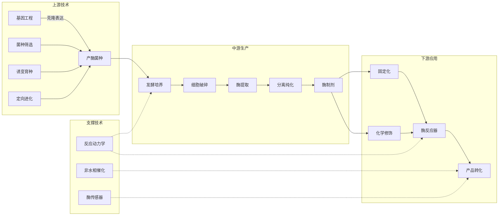

## 酶的高效催化机制图谱

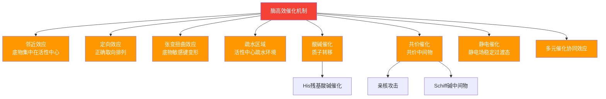

## 固定化酶方法选择图谱

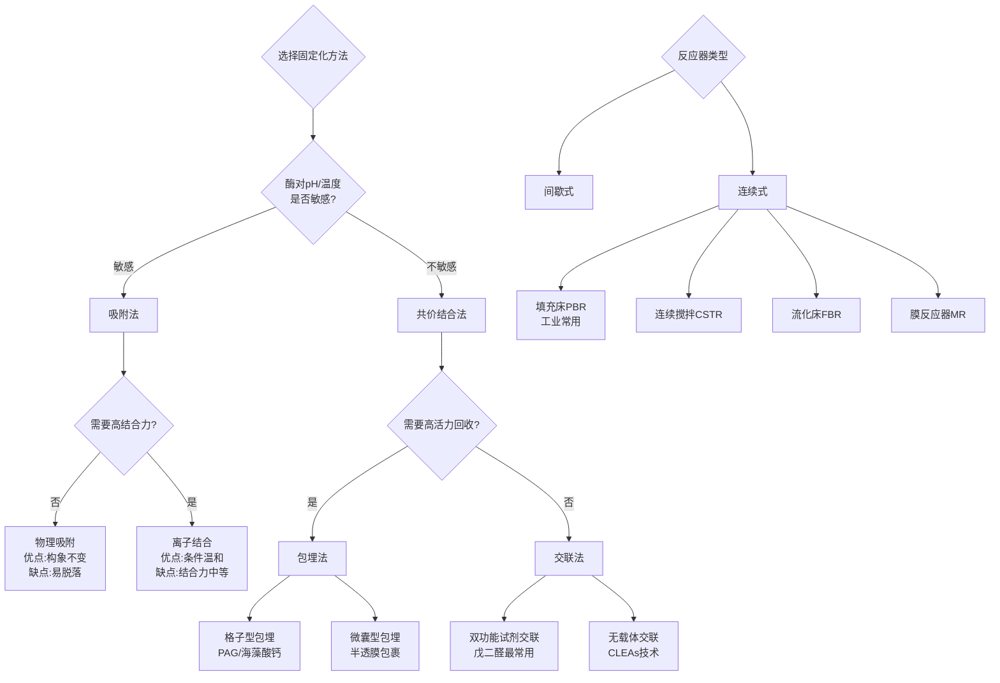

## 非水相催化反应体系选择图谱

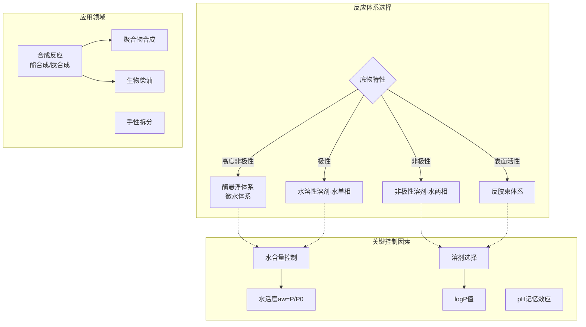

---

# 附录

## 附录A：常用术语中英文对照

| 中文 | English |
|-----|---------|
| 酶工程 | Enzyme Engineering |
| 生物催化 | Biocatalysis |
| 固定化酶 | Immobilized Enzyme |
| 米氏常数 | Michaelis Constant (Km) |
| 活性中心 | Active Site |
| 诱导契合 | Induced Fit |
| 盐析 | Salting Out |
| 层析 | Chromatography |
| 亲和层析 | Affinity Chromatography |
| 非水相催化 | Non-aqueous Catalysis |
| 水活度 | Water Activity (aw) |
| 定向进化 | Directed Evolution |
| 定点突变 | Site-directed Mutagenesis |
| 酶反应器 | Enzyme Reactor |
| 填充床反应器 | Packed Bed Reactor (PBR) |
| 抗体酶 | Abzyme |
| 分子印迹 | Molecular Imprinting |

## 附录B：参考资料

### 课程教材
1. 《酶工程》（第五版）韩双艳、郭勇主编，科学出版社，2024
2. 《酶工程》（第三版）陈守文主编
3. 《酶工程原理与技术》郭勇主编，高等教育出版社，2005
4. 《酶与酶工程》袁勤生、赵健主编，华东理工大学出版社
5. 《酶工程》罗贵民主编，化学工业出版社，2002

### 生物化学参考
6. 《生物化学》（上册）朱圣庚主编
7. 王镜岩《生物化学》

### 经典文献
8. Klibanov, A.M. (1984). Enzymic catalysis in organic media at 100℃. Science, 224, 1249-1251.
9. Klibanov, A.M. (2001). Improving enzymes by using them in monophasic organic solvents. Nature, 409, 241-246.

### 数据库与网络资源
- NCBI: http://www.ncbi.nlm.nih.gov
- CNKI: http://www.cnki.net
- ScienceDirect
- Novozymes: http://www.novozymes.com

---

> **编制说明**：本综合资料整合自西北农林科技大学"酶工程"课程教学PPT（8章，766张幻灯片，含482张课件图片）、《酶工程（第三版）》陈守文、《酶工程（第五版）》韩双艳郭勇、《生物化学（上册）》朱圣庚等多源资料，按酶工程学科体系系统化编排，包含知识图谱（Mermaid图表）12张，全面覆盖酶工程的核心知识体系。
>
> **图片索引**：文中标注的图片路径均相对于本文件所在目录。图片原始文件位于 `../酶工程资料/PPT_images/` 目录下，按章节和幻灯片编号组织。
