# 酶工程 综合资料（详细版）

> **整合来源**：西北农林科技大学《酶工程》课程PPT（8章，766张幻灯片）+《酶工程（第三版）》陈守文 +《酶工程（第五版）》韩双艳郭勇 +《生物化学（上册）》朱圣庚  
> **图片资源**：482张（来自课程PPT，按章节引用）  
> **编制日期**：2026年6月

---

# 目录

1. [第一章 绪论](#第一章-绪论)
2. [第二章 酶催化反应机理及反应动力学](#第二章-酶催化反应机理及反应动力学)
3. [第三章 酶制剂的生产（微生物发酵产酶）](#第三章-酶制剂的生产微生物发酵产酶)
4. [第四章 酶的分离纯化](#第四章-酶的分离纯化)
5. [第五章 酶的固定化](#第五章-酶的固定化)
6. [第六章 化学酶工程与生物酶工程](#第六章-化学酶工程与生物酶工程)
7. [第七章 非水相酶催化](#第七章-非水相酶催化)
8. [第八章 酶反应器与酶传感器](#第八章-酶反应器与酶传感器)
9. [第九章 酶的应用](#第九章-酶的应用)
10. [知识图谱总览](#知识图谱总览)
11. [附录](#附录)

---

# 第一章 绪论

## 1.1 生物催化——工业生物技术的核心技术

### 1.1.1 生物技术的四大支柱与三大浪潮

生物技术包括四大核心领域：**医药生物技术、农业生物技术、工业生物技术、环境生物技术**。其中工业生物技术是利用生物或生物分子机器生产产品和解决问题的技术体系，是迈向发达国家之战略。

**生物技术产业化的三个浪潮**：
1. **医药生物技术**（1982年）：重组人胰岛素上市，开创基因工程药物时代
2. **农业生物技术**（1996年）：转基因大豆、玉米、油菜相继上市，引发农业革命
3. **工业生物技术**（世纪之交）：聚交酯、生物钢、聚乳酸相继上市，开启生物基经济时代

### 1.1.2 工业生物技术（Biorefinery——生物冶炼厂）

工业生物技术将生物质原料通过生物催化过程转化为高价值产品。

**生物质原料**：树木、木材加工废弃物、草、农作物、农产废弃物、废弃动物、城市有机垃圾等

**转化过程**：酸水解/发酵、酶/发酵、气/液发酵、热化学加工等

**产品族**：
- **燃料**：燃料酒精、生物柴油
- **能源**：电、热
- **化学品**：精细化学品、大宗化学品
- **其他**：食品、塑料、溶剂、酚类、粘合剂、脂肪酸、醋酸、碳黑、颜料、香料、墨水、洗涤剂

**理想的生物冶炼厂**（Stephan Herrera, Nature Biotech 2004, 22(6):671-5）：
- 燃料酒精发酵技术
- 生物柴油
- 高效酶系统
- 太阳能利用工厂

### 1.1.3 典型工业生物技术过程

```
原材料 → 培养基（灭菌）→ 生物反应器 → 产品提取纯化 → 产品
                ↑                        ↑
           经加工原料              生物催化剂（游离或固定化）
           无菌空气                （酶/细胞）
           机械能                    检测控制仪表
```

**核心技术**：生物催化（Biocatalysis）

### 1.1.4 生物催化在各领域的应用

生物催化在以下领域发挥核心作用：化学工业、发酵工业、轻工业、采矿、医药、食品、能源、材料、生物安全、环境。

**"催化技术"事关国计民生、国家安全**：2002年催化技术相关产业占GDP的15.5%，最大份额为基础产业。发展方向：化学催化 → 生物催化。

### 1.1.5 以生物催化法合成的主要产品

| 产品名称 | 产量 | 说明 |
|---------|------|------|
| 丙烯酰胺 | 10万吨/年 | 微生物法生产，用于水处理絮凝剂 |
| 聚乳酸 | 1.3万吨/年 | 可生物降解塑料 |
| 阿斯巴甜 | 2万吨/年 | 二肽甜味剂 |
| 生物柴油与汽油 | 1000万吨/年 | 生物燃料 |
| 抗菌素中间体6-APA | 0.9万吨/年 | 半合成青霉素关键中间体 |

### 1.1.6 生物催化剂工程的目标与瓶颈

**目标**：
1. 开发生物催化剂
2. 改善性能（活性、稳定性、选择性）
3. 开发分子模型
4. 创造新技术用于新生物催化剂的开发

**技术瓶颈**：
1. 对生物催化剂作用机理缺乏深入的认识
2. 对次级代谢产物代谢途径缺乏理解
3. 细胞工程化的方法十分有限
4. 生产酶和辅因子的成本过高

**研究重点**：强化微生物细胞培养与发酵的调控措施，研究酶的诱导策略；实现生物催化剂的自主和规模生产；分析生物催化剂所催化的特定基团开辟全新的生物催化反应。

## 1.2 酶工程的研究内容

### 1.2.1 酶工程的定义

**酶工程（Enzyme Engineering）**，又称为酶技术，是将酶、细胞器或细胞等置于特定的生物反应装置中，利用酶所具有的生物催化功能，借助工程手段将相应的原料转化为有用物质并应用于社会生活的一门科学技术。

广义定义（Engineering概念）：将数学或系统知识应用于超出常规实践技能的范围，用于设计执行有用功能的任何复杂系统。

### 1.2.2 酶工程的研究内容

酶工程是生物技术的重要组成部分，与发酵工程、基因工程、细胞工程密切相关。

**课程内容安排**：
- **复习与简介**：酶工程发展概况，复习酶的基本概念 → **基础**
- **学习酶的生产方法**：重组表达 → **生产**
- **酶的分离提取** → **纯化**
- **酶的固定化技术** → **应用**
- **酶反应器** → **工程**
- **酶的改造** → **优化**
- **非水相酶催化** → **拓展**

### 1.2.3 酶和酶工程研究的重要意义

1. 运用酶技术生产有重要价值的产品
2. 利用酶制剂改进生产工艺，提高产品质量和产率，降低生产成本
3. 研究酶的理化性质及其作用机理，对于阐明生命现象的本质具有十分重要的意义
4. 酶是分子生物学研究的重要工具
5. 酶研究不仅深刻影响生物化学以至整个生物学领域，而且刺激了许多化学研究，成为灵感的源泉

### 1.2.4 酶学及酶工程研究史

#### 酶学研究简史

**不自觉的应用阶段**：酿酒、造酱、制饴、治病（古代文明）

**酶学的产生——消化与发酵现象**：

**消化研究**：
- 1777年：意大利物理学家Spallanzani的山鹰实验
- 1822年：美国外科医生Beaumont研究食物在胃里的消化
- 19世纪30年代：德国科学家施旺（Schwann）获得胃蛋白酶

**发酵研究**：
- 1684年：比利时医生Helment提出"ferment"（酵素）概念
- 1833年：法国化学家Payen和Person得到淀粉酶（diastase），这是第一个被发现的酶
- 1878年：德国科学家Kühne提出"enzyme"（酶）一词

**Pasteur vs Liebig的学术争论**：
- 19世纪，Pasteur（微生物学家）认为没有生物则没有发酵（生命论）
- Liebig（化学家）认为发酵是由化学物质引起的（化学论）
- 1896年：Buchner兄弟用酵母无细胞抽提物证明发酵与细胞活动无关，解决了这场争论

**酶学的迅速发展**：

| 年份 | 科学家 | 贡献 |
|------|--------|------|
| 1926 | Sumner | 从刀豆中提取出脲酶结晶，证明具有蛋白质性质 |
| 1930 | Northrop | 分离得到胃蛋白酶、胰蛋白酶、胰凝乳蛋白酶结晶，确立酶的化学本质 |

**酶学理论研究成果**：

| 年份 | 科学家 | 理论 |
|------|--------|------|
| 1890 | Emil Fisher | 锁钥学说（Lock and Key Model） |
| 1902 | Henri | 中间产物学说（ES复合物假说） |
| 1913 | Michaelis & Menten | 米氏学说（Michaelis-Menten方程） |
| 1958 | Koshland | 诱导契合学说（Induced-fit Model） |
| 1960 | Jacob & Monod | 操纵子学说（Operon Theory）——酶生物合成调控机制 |
| 1982 | Thomas R. Cech | 发现核酶（Ribozyme）——具有催化功能的RNA |
| 1983 | Altman | 核糖核酸酶P的RNA组分具有催化活性 |

**结论**：酶是具有生物催化功能的生物大分子（蛋白质或RNA）。酶分两大类：
- **蛋白类酶（P酶）**：主要由蛋白质组成
- **核酸类酶（R酶）**：主要由核糖核酸组成

#### 酶工程研究简史

| 年份 | 科学家/机构 | 贡献 |
|------|-----------|------|
| 1894 | 高峰让吉 | 高峰淀粉酶（Takadiastase） |
| 1896 | Buchner | 酵母无细胞抽提物 |
| 1908 | Rohm | 胰酶用于制革 |
| 1908 | Boidian | 细菌淀粉酶 |
| 1911 | Wallerstein | 木瓜蛋白酶 |
| 1949 | — | 液体深层培养法生产细菌α-淀粉酶 |
| 1959 | — | 葡萄糖淀粉酶催化淀粉生产葡萄糖新工艺 |
| 1969 | 千畑一郎（日本） | 固定化氨基酰化酶拆分DL-氨基酸，首次工业化 |
| 1971 | — | 第一届国际酶工程学术会议，"酶工程"学科正式确立 |
| 1973 | — | 固定化菌体（死细胞）技术 |
| 1973 | — | 固定化细胞（活细胞/增殖细胞）技术 |
| 80年代中期 | — | 固定化原生质体技术 |

**酶工程的分类**：
- **化学酶工程（初级酶工程）**：酶化学与化学工程技术相结合的产物。主要研究内容：酶的制备、酶的分离纯化、酶与细胞的固定化技术、酶分子修饰、酶反应器和酶的应用。
- **生物酶工程（高级酶工程）**：在化学酶工程基础上发展起来，酶学与现代分子生物学技术相结合的产物。

### 1.2.5 酶工程发展里程碑

```
1833 发现淀粉酶 (Payen & Person)
1878 Enzyme定名 (Kühne)
1890 锁钥理论 (Fisher)
1894 以米曲霉生产淀粉酶作为消化酶（高峰让吉）
1897 无细胞发酵（Buchner）
1913 中间产物学说 → 米氏方程（Michaelis & Menten）
1926 获得脲酶结晶 → 酶是蛋白质（Sumner）
1949 液体深层发酵生产细菌α-淀粉酶
1953 固定化酶（Grubhofer & Schleith）
1958 诱导契合模型（Koshland）
1960 操纵子学说 → 酶生物合成机制（Jacob & Monod）
1969 固定化氨基酰化酶生产L-氨基酸（千畑一郎）
1971 第一届国际酶工程会议
1973 基因工程技术
1978 定点突变技术
1982 核酶发现（Cech）
1984 非水相酶催化（Klibanov）
1986 重组酶生产
1994 DNA改组（DNA shuffling）
```

## 1.3 国内外酶制剂工业概况

### 1.3.1 国际市场格局

**世界三大酶制剂公司**（销售额占世界总额的70%）：
1. **Novo Nordisk（诺维信）**——丹麦，世界最大工业酶制剂公司（2003年销售额约8亿美元）
2. **Genencor International（杰能科）**——美国，世界第二大工业酶制剂公司
3. **Cultor**——芬兰

2001年工业酶制剂世界市场约为15亿美元，其中制药工业与精细化学工业约1.2亿~1.5亿美元。

### 1.3.2 酶的应用领域分布（按价值计）

| 应用领域 | 占比 |
|---------|------|
| 食品 | 45% |
| 洗涤剂 | 34% |
| 纺织 | 11% |
| 制革 | 3% |
| 制浆/造纸 | 1% |
| 其他 | 6% |

（世界市场（除医药外）数十亿美元，数据来源：Colin Ratledge, Basic Biotechnology）

### 1.3.3 我国酶工业发展阶段

| 年份 | 进展 |
|------|------|
| 1965 | 无锡酶制剂厂建厂，生产淀粉酶 |
| 1979 | 糖化酶、碱性蛋白酶、中性蛋白酶投产 |
| 1993 | 耐高温淀粉酶 |
| 1998 | 国外大公司纷纷入驻 |
| 1999 | 外资企业投产 |

**国内外差异**：
- **规模**：国外多公司重组，国内重复建设、效益低
- **品种**：国外品种多、专用性强，国内以大宗酶为主

## 1.4 酶的分类与命名

### 1.4.1 蛋白类酶的分类（EC编号系统）

国际酶学委员会（IEC, Enzyme Commission）根据催化反应类型将酶分为六大类：

**【EC 1】氧化还原酶（Oxidoreductases）**
催化氧化还原反应，包括脱氢酶、氧化酶、过氧化物酶、加氧酶等。
- 通式：$AH_2 + B \rightleftharpoons A + BH_2$
- 例：乙醇脱氢酶、乳酸脱氢酶、葡萄糖氧化酶

**【EC 2】转移酶（Transferases）**
催化一个基团从一种化合物转移到另一种化合物。
- 通式：$A-X + B \rightleftharpoons A + B-X$
- 例：转氨酶、己糖激酶、DNA聚合酶

**【EC 3】水解酶（Hydrolases）**
催化各种化合物的水解反应，是工业上应用最广的酶类。
- 通式：$A-B + H_2O \rightleftharpoons A-OH + B-H$
- 例：淀粉酶、蛋白酶、脂肪酶、纤维素酶

**【EC 4】裂合酶（Lyases）**
催化非水解性裂解反应，使C-C、C-O、C-N等键断裂。
- 通式：$A-B \rightleftharpoons A + B$
- 例：醛缩酶、脱羧酶、水合酶

**【EC 5】异构酶（Isomerases）**
催化各种同分异构体之间的相互转化。
- 例：葡萄糖异构酶（将葡萄糖转化为果糖）、磷酸葡萄糖异构酶

**【EC 6】连接酶（Ligases，合成酶）**
催化两种底物分子连接在一起的反应，伴随ATP等高能键的分解。
- 通式：$A + B + ATP \rightleftharpoons A-B + ADP + Pi$
- 例：DNA连接酶、谷氨酰胺合成酶

### 1.4.2 EC编号体系

每种酶有一个四位数字的EC编号，如：
- EC 3.2.1.1（α-淀粉酶）
  - 第一位（3）= 水解酶类
  - 第二位（2）= 作用于糖基化合物
  - 第三位（1）= 糖苷酶
  - 第四位（1）= α-淀粉酶

### 1.4.3 核酸类酶（Ribozyme）

具有催化功能的RNA分子，可催化：
- RNA前体的切割和连接
- RNA的剪接（self-splicing）
- 肽键形成（核糖体中的rRNA）

## 1.5 酶的活力测定

### 1.5.1 酶活力单位

- **习惯单位（U）**：在特定条件下，每分钟催化1 μmol底物转化所需的酶量（或底物/产物变化量/单位时间）
- **国际单位（IU）**：1 μmol 变化量/分钟
- **Katal（Kat）**：1 mol 变化量/秒（1 Kat = 6×10⁷ IU）

### 1.5.2 酶的比活力

$$比活力 = \frac{活力单位（U或IU）}{mg蛋白}$$

比活力是衡量酶纯度的重要指标。在酶的分离纯化过程中，比活力不断提高，提纯倍数 = 每次比活力/首次比活力。

### 1.5.3 转换数（Kcat）

$$K_{cat} = V_{max}/[E]$$

Kcat表示每个酶分子单位时间内转化的底物分子数，衡量酶的催化效率。

### 1.5.4 酶活力的测定方法

1. **终点法**：反应进行一定时间后，停止反应，测定产物生成量或底物减少量
2. **动力学法**：连续监测反应过程中吸光度等参数的变化，计算反应初速度

## 1.6 酶的催化特点及影响因素

### 1.6.1 酶的催化特点

1. **高效性**：酶催化反应速度比非催化反应高10⁸~10²⁰倍
2. **专一性**：酶对底物有严格的选择性
3. **温和性**：酶催化在常温、常压、近中性pH条件下进行
4. **可调节性**：酶活性受多种因素调控（变构调节、共价修饰、酶量调节等）

### 1.6.2 影响酶催化作用的因素

1. 温度
2. pH
3. 底物浓度
4. 酶浓度
5. 激活剂
6. 抑制剂
7. 离子强度

---

# 第二章 酶催化反应机理及反应动力学

## 2.1 酶的催化反应机理

### 2.1.1 酶的活性中心（Active Site）

**定义**：活性中心是酶分子中与底物结合并催化底物转化为产物的特定区域，通常为蛋白质表面的裂缝或凹陷，是一个三维结构实体。

**活性中心的组成**：
- **结合基团（Binding Group）**：识别并结合底物，决定酶的底物专一性
- **催化基团（Catalytic Group）**：催化化学键的断裂与形成，决定酶的催化性质
- **必需基团（Essential Group）**：维持活性中心构象所必需的基团

**酶活性中心的特点**（引自生物化学教材）：
- 活性中心是三维实体，通常位于蛋白质表面的裂缝或凹陷
- 底物通过多种弱相互作用（氢键、疏水作用、范德华力等）结合
- 活性中心的微环境是疏水的

> 📷 参见图片：`../酶工程资料/PPT_images/2酶催化反应机理/slide2_img1.png`

### 2.1.2 酶与底物分子结合的假说

**（1）中间络合物学说**

酶（E）与底物（S）首先形成酶-底物中间络合物（ES），然后分解为产物（P）和酶（E）：
$$E + S \rightleftharpoons ES \rightarrow E + P$$

**实验验证**：过氧化物酶与H₂O₂结合后，吸收光谱从645/587/548/498nm变为561/550nm，颜色由褐色变为红色，证明ES复合物的存在。

**酶促反应的五个步骤**：
1. 酶和底物结合形成复合物
2. 复合物进入过渡态（既不是底物也不是产物）
3. 形成酶-产物复合物
4. 酶和产物分离
5. 所有步骤均为平衡过程

> 📷 参见图片：`../酶工程资料/PPT_images/2酶催化反应机理/slide3_img1.jpg`

**（2）锁钥模型（Lock and Key Model）**——1890年Emil Fisher提出

底物的形状必须与酶的活性中心精确匹配，如同钥匙与锁的关系。该模型解释了酶的立体专一性，但不能解释酶如何催化逆反应以及酶的构象变化。

> 📷 参见图片：`../酶工程资料/PPT_images/2酶催化反应机理/slide4_img2.png`

**（3）诱导契合模型（Induced-fit Model）**——1958年Koshland提出

酶与底物结合时，酶分子构象发生连续变化，使活性中心与底物达到最佳匹配。该模型弥补了锁钥模型的不足，得到了广泛认可。

> 📷 参见图片：`../酶工程资料/PPT_images/2酶催化反应机理/slide5_img3.png`

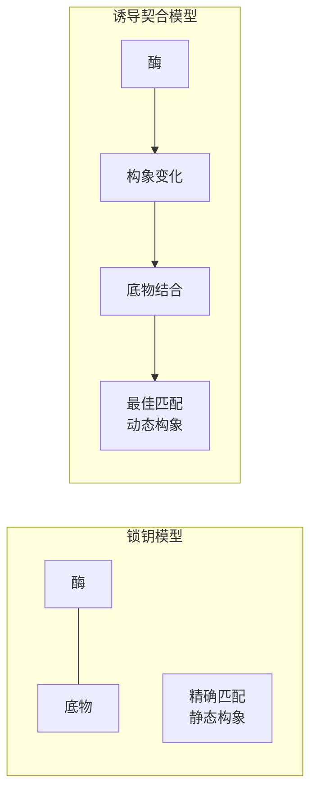

## 2.2 酶催化反应的速率理论

### 2.2.1 过渡态与活化能

**基本概念**：
- **过渡态（Transition State）**：化学反应中反应物分子从常态转变为产物所经历的高能状态，既不是底物也不是产物
- **活化能（Activation Energy, Ea）**：分子由常态转变为活化态所需的能量，即活化态与常态的能量差
- **活化分子**：达到或超过能阈的分子。活化分子越多，反应速度越快

**提高活化分子数量的途径**：
1. 对反应体系加热、照射（增加分子能量）
2. **降低活化能**（酶的作用方式——这是酶催化的本质）

**酶催化的本质**：酶通过稳定过渡态，降低反应活化能，从而加速反应。

> 📷 参见图片：`../酶工程资料/PPT_images/2酶催化反应机理/slide7_img2.png`

### 2.2.2 酶高效催化的七大机制

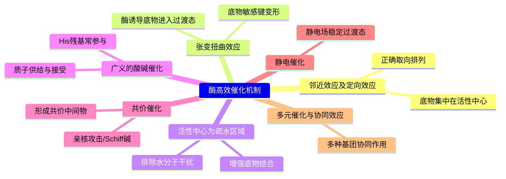

**（1）邻近效应（Approximation）和定向效应（Orientation）**

酶将底物分子集中到活性中心附近，并以正确的取向排列，大大增加了有效碰撞概率。在溶液中，反应物浓度即使为0.1 mol/L，碰撞概率也很低；而在酶活性中心，底物浓度可达到100 mol/L以上的有效浓度。

> 📷 参见图片：`../酶工程资料/PPT_images/2酶催化反应机理/slide10_img4.png`

**（2）张变和扭曲效应（Distortion or Strain）**

酶与底物结合时，诱导底物分子的敏感键产生张力或变形，使底物进入过渡态所需的活化能大大降低。酶也通过自身构象变化适应底物，如己糖激酶与葡萄糖结合时的构象变化。

> 📷 参见图片：`../酶工程资料/PPT_images/2酶催化反应机理/slide11_img5.png`

**（3）酶的活性中心为疏水区域**

酶的活性中心通常为疏水环境，有利于底物与酶的结合，排除水分子干扰。疏水环境还提高了静电相互作用的强度。

> 📷 参见图片：`../酶工程资料/PPT_images/2酶催化反应机理/slide12_img7.png`

**（4）广义的酸碱催化（General Acid-Base Catalysis）**

通过瞬时地向反应物提供质子（酸催化）或从反应物中汲取质子（碱催化），以稳定过渡态、加速反应。

- 能供给质子的物质为酸（$HA$），能接受质子的物质为碱（$A^-$）
- $$HA \rightleftharpoons A^- + H^+$$
- 例：$HA + X \rightarrow AXH$（酸催化），$AXH + B^- \rightarrow Y + BH + A^-$（碱催化）

酶的活性中心中，组氨酸（His）的咪唑基是最常见的酸碱催化基团，因其中性pH下既可提供质子又可接受质子。

**（5）共价催化（Covalent Catalysis）**

酶与底物形成一个反应活性很高的不稳定的共价中间产物，加快反应。

共价催化的最一般形式：**亲核催化**——催化剂的亲核基团对底物中亲电子的碳原子进行攻击，形成共价中间物。

**经典实例1**：3-磷酸甘油醛脱氢酶（Cys类酶）催化形成1,3-二磷酸甘油酸
> 📷 参见图片：`../酶工程资料/PPT_images/2酶催化反应机理/slide16_img9.png`

**经典实例2**：乙酰乙酸脱羧酶通过Schiff碱中间产物参与反应。酮体参与的脂肪酸代谢反应中，丙酮由乙酰乙酸脱羧生成，由乙酰乙酸脱羧酶催化。
> 📷 参见图片：`../酶工程资料/PPT_images/2酶催化反应机理/slide17_img11.png`

**（6）静电催化**

酶活性中心极性基团产生的静电场稳定过渡态。带电基团通过静电相互作用降低过渡态的能量。

**（7）多元催化与协同效应**

酶的催化作用是一个综合的结果，是通过侧链基团协同作用来完成的。一个酶分子上常同时存在多种催化基团，共同发挥作用。

> 📷 参见图片：`../酶工程资料/PPT_images/2酶催化反应机理/slide18_img12.png`

## 2.3 酶促反应动力学（Enzyme Kinetics）

### 2.3.1 基本概念

**酶促反应动力学**：研究酶促反应的速度和影响速度的各种因素以及反应历程的学科。

**酶促反应速度的测定**：**初速度（Initial Velocity）**——在反应最初阶段，底物消耗≤5%时测定的速度，此时产物对反应的抑制和底物消耗可忽略不计。

### 2.3.2 米氏方程（Michaelis-Menten Equation）

**基本现象**：酶被底物饱和——当底物浓度较低时，反应速度与底物浓度成正比（一级反应）；当底物浓度很高时，反应速度达到最大值（零级反应）。

**基本假说**：酶-底物复合物中间产物学说。

**米氏方程**：
$$v = \frac{V_{max}[S]}{K_m + [S]}$$

其中：
- $v$ = 反应初速度
- $V_{max}$ = 最大反应速度
- $[S]$ = 底物浓度
- $K_m$ = 米氏常数

[S]与v关系的三个区域：
- $[S] \ll K_m$（[S]很小时）：$v = \frac{V_{max}}{K_m}[S]$，v与[S]成正比——**一级反应**
- $[S]$适当时：不成比例关系
- $[S] \gg K_m$（[S]很大时）：$v = V_{max}$，酶被底物饱和——**零级反应**

> 📷 参见图片：`../酶工程资料/PPT_images/2酶催化反应机理/slide23_img14.png`、`slide26_img15.png`

### 2.3.3 米氏方程的推导

**（1）Michaelis-Menten快速平衡假说（1913年）**

反应机理：$E + S \overset{K_1}{\rightleftharpoons} ES \overset{K_2}{\rightarrow} E + P$

假设条件：
1. $[S] \gg [E]$，[S]可认为不变
2. 研究初速度，P的量很小，$P + E \rightarrow ES$可忽略不计
3. ES的形成速度极快（快速平衡），ES形成产物的速度极慢，故$K_1、K_{-1} \gg K_2$

推导结果：
$$v = \frac{V_{max}[S]}{K_S + [S]}$$

其中$K_S = \frac{K_{-1}}{K_1}$，称为底物常数。

**（2）Briggs-Haldane稳态假说（1925年）**

更一般的推导方法，不要求快速平衡假设。

**推导过程**：
1. ES生成速度：$K_1([E_t] - [ES])[S]$
2. ES分解速度：$K_{-1}[ES] + K_2[ES]$
3. 稳态时生成速度 = 分解速度：$K_1([E_t] - [ES])[S] = (K_{-1} + K_2)[ES]$
4. 整理得：$[ES] = \frac{[E_t][S]}{K_m + [S]}$，其中$K_m = \frac{K_{-1} + K_2}{K_1}$
5. 因为$v = K_2[ES]$，代入得：$v = \frac{K_2[E_t][S]}{K_m + [S]} = \frac{V_{max}[S]}{K_m + [S]}$

**快速平衡与稳态假说的实质区别**：
- 当$K_1、K_{-1} \gg K_2$时，$ES \rightarrow P + E$是整个反应平衡中极慢的一步
- 此时$K_m \approx K_{-1}/K_1 = K_S$，稳态平衡≈快速平衡
- **"都是K₂惹的祸"**

**两种假说比较**：

| 项目 | 快速平衡法 | 稳态法 |
|------|-----------|--------|
| 假设 | [S]>>[E]，初速度 | 同上 |
| 质量守恒 | [E₀]=[E]+[ES] | 同上 |
| 产物生成速率 | v=K₂[ES] | 同上 |
| 动力学常数 | Ks=K₋₁/K₁ | Km=(K₂+K₋₁)/K₁ |

### 2.3.4 Lineweaver-Burk双倒数作图法

对米氏方程取倒数：
$$\frac{1}{v} = \frac{K_m}{V_{max}} \cdot \frac{1}{[S]} + \frac{1}{V_{max}}$$

以$1/v$对$1/[S]$作图得一条直线（y = ax + b）：
- 纵截距 = $1/V_{max}$
- 横截距 = $-1/K_m$
- 斜率 = $K_m/V_{max}$

> 📷 参见图片：`../酶工程资料/PPT_images/2酶催化反应机理/slide33_img22.png`

### 2.3.5 Km和Vmax的意义

**Ⅰ Km（米氏常数）的意义**：
1. 当$v = \frac{1}{2}V_{max}$时，$K_m = [S]$（Km单位为浓度单位mol/L）
2. Km是酶在一定条件下的**特征物理常数**，可鉴别酶（不同酶的Km不同）
3. 可近似表示酶和底物的亲和力：**Km越小，亲和力越大**；Km越大，亲和力越小
4. Km可看作ES的解离常数：$K_m \approx \frac{[S][E]}{[ES]}$（当K₂很小时）

**Ⅱ Vmax的意义**：
- 一个酶促反应所能达到的最大速度
- 当底物完全饱和酶后：$V_{max} = K_2[E]$

**Ⅲ Kcat（转换数）的意义**：
- $K_{cat} = V_{max}/[E]$，催化常数
- 表示每个酶分子单位时间内转化的底物分子数
- Kcat的倒数表示酶催化循环的时间

**实例计算**：$10^{-6}$ mol/L的碳酸酐酶液每秒能转化0.6 mol/L H₂CO₃分子
- $K_{cat} = 0.6 / 10^{-6} = 6 \times 10^5 sec^{-1}$
- $1/K_{cat} = 1.7 \mu s$（每个催化循环仅需1.7微秒）

**Ⅳ kcat/Km——催化效率的最佳指标**：
- $v = \frac{k_{cat}[E][S]}{K_m + [S]}$
- 当$[S] \ll K_m$时：$v = \frac{k_{cat}}{K_m}[E][S]$，为二级速度常数
- 许多酶的$k_{cat}/K_m$值接近$10^8-10^9$ mol⁻¹·L·s⁻¹

### 2.3.6 Km值的应用

1. **提供测定酶活性的最佳底物**：Km值最小的底物是酶的"生理性"底物（最佳底物）
2. **判断测定酶活性时应选择的底物浓度**：通常用4Km的底物浓度即可
3. **鉴别酶正逆反应的催化效率**：了解酶对各种底物的Km值可推断主要催化方向
4. **推知连锁反应中的限速反应**：在连锁反应中，Km最大的酶催化的步骤常为限速步骤
5. **间接测定酶活力**：通过偶联指示酶反应测定酶活力
6. **鉴别同工酶的类型**：原级同工酶和次级同工酶的动力学参数不同
7. **推知细胞内代谢的调控情况**：如己糖激酶（Km=0.1 mmol/L）和葡萄糖激酶（Km=10 mmol/L）在肝脏中共同调节葡萄糖代谢
8. **临床诊断及药物筛选**：谷草转氨酶（GOT）的Km值可鉴别肝炎和心肌梗塞引起的血清GOT升高

**练习题**：已知某酶的Km值为0.05 mol·L⁻¹，要使反应速度达到最大反应速度的80%时底物的浓度应为多少？
- 解：$v/V_{max} = [S]/(K_m + [S]) = 0.8$
- $0.8(K_m + [S]) = [S]$
- $0.8K_m = 0.2[S]$
- $[S] = 4K_m = 0.2$ mol·L⁻¹

### 2.3.7 多底物酶促动力学

对于反应：$A + B \rightarrow P + Q$

多底物酶促反应有三种动力学机理：

**（1）有序顺次反应（Ordered Bi Bi）**
底物A和B与酶结合的顺序是一定的，产物P和Q的释放顺序也是一定的。
- 依赖NAD⁺和NADP⁺的脱氢酶服从有序顺次反应机制

**（2）随机顺次反应（Random Bi Bi）**
底物A和B与酶结合的顺序是随机的，产物P和Q的释放顺序也是随机的。
- 某些激酶（如肌酸激酶）服从随机顺次反应机制

**（3）乒乓反应（Ping Pong Mechanism，双置换反应）**
先结合第一个底物A，释放第一个产物P，酶构象变化，结合第二个底物B，释放第二个产物Q。
- 化学式：$E + A \rightleftharpoons EA \rightarrow FP \rightarrow F + P$，$F + B \rightleftharpoons FB \rightarrow EQ \rightarrow E + Q$
- 转氨酶、某些黄素酶具乒乓反应机制

> 📷 参见图片：`../酶工程资料/PPT_images/2酶催化反应机理/slide51_img35.jpg`至`slide55_img38.jpg`

### 2.3.8 pH对酶反应速度的影响

**影响机制**：
1. 过酸过碱导致酶蛋白变性
2. 影响底物分子的解离状态
3. 影响酶分子中催化基团的解离状态
4. 影响酶的活性中心构象

**最适pH（Optimum pH）**：酶催化活性最大的pH值。不同酶的最适pH不同，如胃蛋白酶（pH 1.5~2.0）、胰蛋白酶（pH 7.5~8.5）。

> 📷 参见图片：`../酶工程资料/PPT_images/2酶催化反应机理/slide56_img39.png`

### 2.3.9 温度对酶反应速度的影响

**双相效应**：
1. 在达到最适温度以前，反应速度随温度升高而加快（Arrhenius效应）
2. 酶是蛋白质，其变性速度亦随温度上升而加快

**最适温度**：两个效应平衡的结果。最适温度不是一个固定不变的常数，与反应时间、pH、离子强度等因素有关。

> 📷 参见图片：`../酶工程资料/PPT_images/2酶催化反应机理/slide58_img40.png`

### 2.3.10 激活剂对酶作用的影响

**激活剂（Activator）**：凡是能提高酶活性的物质。

| 类别 | 实例 |
|------|------|
| 金属离子 | K⁺、Na⁺、Mg²⁺、Cu²⁺、Mn²⁺、Zn²⁺、Se³⁺、Co²⁺、Fe²⁺ |
| 阴离子 | Cl⁻、Br⁻ |
| 有机分子-还原剂 | 抗坏血酸、半胱氨酸、谷胱甘肽 |
| 金属螯合剂 | EDTA |

### 2.3.11 抑制剂对酶作用的影响

**抑制剂（Inhibitor）**：能降低酶活性的物质，与变性作用不同（抑制剂通常不引起酶的空间结构破坏）。

**抑制程度的表示方法**：
- 相对活力分数 = 加抑制剂后活力/未加抑制剂活力
- 抑制分数 = 1 - 相对活力分数
- 抑制百分数 = 抑制分数 × 100%

**抑制作用的类型**：

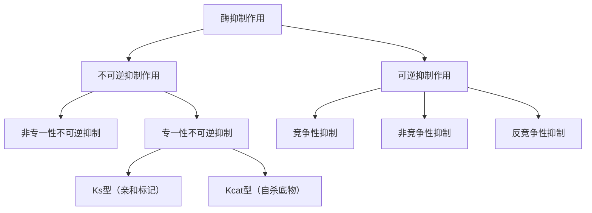

**Ⅰ 不可逆抑制作用**
抑制剂与酶活性中心（或外）的必需基团共价结合，使酶活性下降，无法用透析、超滤等物理方法除去抑制剂而使酶复活。

**①非专一性不可逆抑制**：抑制剂作用于酶分子中的一类或几类基团，其中包含必需基团，引起酶失活。

**②专一性不可逆抑制**：
- **实例**：有机磷杀虫剂（如敌敌畏）与乙酰胆碱酯酶活性中心的Ser-OH基团共价结合，使酶失活
- **Ks型不可逆抑制剂**（亲和标记试剂）：具有与底物相似的结构，同时带有活泼基团，能与酶活性中心的必需基团反应
  - 实例：对-甲苯磺酰-L-苯丙氨酰氯甲烷（TPCK）——胰凝乳蛋白酶的Ks型抑制剂

**Ⅱ 可逆抑制作用**
抑制剂与酶非共价结合，可通过透析等物理方法除去。

**三种可逆抑制作用的比较**：

| 类型 | 作用特点 | Km变化 | Vmax变化 | Lineweaver-Burk图特征 |
|------|---------|--------|---------|---------------------|
| **竞争性抑制** | 抑制剂与底物竞争酶的活性中心 | ↑增大 | 不变 | 纵截距不变，斜率增大 |
| **非竞争性抑制** | 抑制剂与活性中心外的位点结合 | 不变 | ↓减小 | 纵截距增大，斜率增大 |
| **反竞争性抑制** | 抑制剂只与ES复合物结合 | ↓减小 | ↓减小 | 平行线 |

**抑制剂的意义**：
- 研制杀虫剂、药物
- 研究酶的作用机理
- 确定代谢途径

> 📷 参见图片：`../酶工程资料/PPT_images/2酶催化反应机理/` 整套58张图片

---

# 第三章 酶制剂的生产（微生物发酵产酶）

## 3.1 酶生物合成调节的基本理论

### 3.1.1 中心法则（Central Dogma）

DNA → RNA → 蛋白质，是酶生物合成的分子基础。

- **转录（Transcription）**：DNA模板转录生成mRNA
- **翻译（Translation）**：mRNA指导蛋白质（酶）的合成
- **调控（Regulation）**：酶生物合成在转录和翻译水平上受到精确调控

> 📷 参见图片：`../酶工程资料/PPT_images/4酶制剂的生产/slide3_img1.png`、`slide4_img2.png`

### 3.1.2 细胞内酶的调控模式

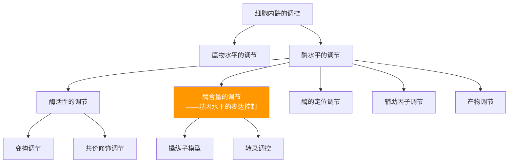

### 3.1.3 操纵子学说（Operon Theory）——Jacob & Monod（1960年诺贝尔奖）

**操纵子**是基因表达的协同单位，由以下部分组成：

```
┌─────────────────────────────────────────────────────┐
│  调节基因(R) │ 启动子(P) │ 操纵基因(O) │ 结构基因(S) │
└─────────────────────────────────────────────────────┘
                  ←── 控制区 ──→ ←── 信息区 ──→
                        ↓              ↓
                 RNA聚合酶结合位点   编码蛋白质
                 阻遏蛋白结合位点
```

**各部分的组成与功能**：

| 组成部分 | 英文 | 功能 |
|---------|------|------|
| **结构基因** | Structural Gene, S | 编码蛋白质（酶）的氨基酸序列 |
| **操纵基因** | Operator Gene, O | 控制结构基因的转录（开关） |
| **启动子** | Promotor Gene, P | RNA聚合酶结合位点，启动转录 |
| **调节基因** | Regulator Gene, R | 编码阻遏蛋白（Repressor） |

**操纵子调节系统示意图**：

```
调节基因     启动基因  操纵基因    结构基因
  ┌─┐         ┌─┐      ┌─┐      ┌─────┐
  │R│         │P│      │O│      │  S  │
  └─┘         └─┘      └─┘      └─────┘
   │                             │
   ↓                             ↓
  mRNA                          mRNA
   │                             │
   ↓                             ↓
 阻遏蛋白                      酶蛋白
 （有活性或无活性）
```

> 📷 参见图片：`../酶工程资料/PPT_images/4酶制剂的生产/slide8_img2.png`

**（1）乳糖操纵子（Lac Operon）——诱导型操纵子**

**结构**：LacZ（β-半乳糖苷酶）、LacY（透酶）、LacA（乙酰基转移酶）

**调控机制**：

**无乳糖时——基因关闭**：
- 调节基因表达产生有活性的阻遏蛋白
- 阻遏蛋白与操纵基因（O）结合
- 阻碍RNA聚合酶转录结构基因
- 乳糖利用酶不表达

**有乳糖时——基因表达**：
- 乳糖作为诱导剂与阻遏蛋白结合
- 阻遏蛋白构象改变，失去与操纵基因结合的能力
- RNA聚合酶顺利转录，乳糖利用酶大量合成

> 📷 参见图片：`../酶工程资料/PPT_images/4酶制剂的生产/slide9_img3.png`、`slide10_img4.png`、`slide12_img5.png`

**（2）色氨酸操纵子（Trp Operon）——阻遏型操纵子**

**调控机制**：
- 调节基因表达产生无活性的阻遏蛋白
- 当细胞内色氨酸（辅阻遏物）浓度高时，色氨酸与阻遏蛋白结合
- 阻遏蛋白被激活，与操纵基因结合，关闭结构基因转录
- 当色氨酸浓度低时，阻遏蛋白失活，结构基因表达

> 📷 参见图片：`../酶工程资料/PPT_images/4酶制剂的生产/slide11_img6.png`

**酶的诱导和阻遏操纵子模型总结**：

```
A. 有活性阻遏蛋白：与操纵基因结合 → 结构基因不表达 → 酶合成关闭
B. 有活性阻遏蛋白 + 诱导剂：诱导剂与阻遏蛋白结合 → 阻遏蛋白失活 → 结构基因表达
C. 无活性阻遏蛋白：不能与操纵基因结合 → 结构基因表达
D. 无活性阻遏蛋白 + 辅阻遏剂：辅阻遏剂与阻遏蛋白结合 → 激活阻遏蛋白 → 结构基因不表达
```

> 📷 参见图片：`../酶工程资料/PPT_images/4酶制剂的生产/slide13_img6.png`

### 3.1.4 分解代谢物阻遏（Catabolite Repression）

**二次生长现象（Diauxie，葡萄糖效应）**：
- 细菌在含有葡萄糖和乳糖的培养基中生长时，先利用葡萄糖生长，葡萄糖耗尽后，短暂停滞，再利用乳糖生长

**分子机制**：
1. 葡萄糖降解产物抑制腺苷酸环化酶活性，激活磷酸二酯酶
2. 细胞内cAMP浓度降低
3. cAMP-CAP（降解物基因活化蛋白/环腺苷酸受体蛋白CRP）复合物减少
4. CAP-cAMP是lac操纵子转录所必需的转录激活因子
5. 乳糖利用酶基因不能有效转录

```
葡萄糖 → 分解代谢产物 → 抑制腺苷酸环化酶 → cAMP↓
                                            ↓
CAP + cAMP → CAP-cAMP复合物（激活转录）→ 乳糖操纵子表达
                                    ↓
                            葡萄糖存在时cAMP↓
                            复合物少→表达受阻
```

> 📷 参见图片：`../酶工程资料/PPT_images/4酶制剂的生产/slide14_img7.png`、`slide15_img8.png`、`slide16_img9.png`

## 3.2 酶的生产方法

### 3.2.1 三种生产方法

**（1）提取分离法（Extraction）**：从动植物组织或微生物细胞中直接提取
- 实例：SOD（超氧化物歧化酶）——从血液中提取
- 实例：木瓜蛋白酶（Papain）——从木瓜中提取
- 实例：胰凝乳蛋白酶（Chymotrypsin）——从胰腺中提取

**（2）生物合成法（Biosynthesis）**：利用微生物发酵生产（**最主要的方法**）
- 枯草芽孢杆菌产淀粉酶
- 曲霉产糖化酶
- 芽孢杆菌产蛋白酶

**（3）化学合成法（Chemical Synthesis）**：极少数
- 化学合成酶价格昂贵，应用有限

### 3.2.2 微生物发酵产酶的优点

1. 微生物生长速度快，发酵周期短（数小时至数天）
2. 营养要求简单，成本低
3. 易于大规模培养
4. 可通过基因工程改造提高产量
5. 不受季节和地域限制
6. 可生产动植物难以获得的酶

## 3.3 微生物酶的发酵生产

### 3.3.1 优良产酶菌种应具备的条件

1. **酶产量高**——产酶水平高，经济性好
2. **易培养**——生长速率高、营养要求低
3. **遗传性能稳定**——不易退化，适合长期生产
4. **易分离提纯**——发酵液成分简单，分离方便
5. **安全可靠**——不是致病菌，不产生毒素

### 3.3.2 常见产酶微生物

**细菌（Bacteria）**：
| 菌种 | 主要产酶 |
|------|---------|
| **大肠杆菌（Escherichia coli）** | 多种重组酶（最常用的基因工程宿主菌） |
| **枯草芽孢杆菌（Bacillus subtilis）** | α-淀粉酶、中性蛋白酶、碱性蛋白酶 |
| **醋酸杆菌（Acetobacter）** | 醋酸合成相关酶 |

**放线菌（Actinobacteria）**：
| 菌种 | 主要产酶 |
|------|---------|
| **链霉菌（Streptomyces）** | 葡萄糖异构酶、多种抗生素 |

**霉菌（Molds）**：
| 菌种 | 主要产酶 |
|------|---------|
| **黑曲霉（Aspergillus niger）** | 糖化酶、果胶酶、酸性蛋白酶、纤维素酶 |
| **米曲霉（Aspergillus oryzae）** | 蛋白酶、淀粉酶 |
| **根霉（Rhizopus）** | 糖化酶、脂肪酶 |
| **木霉（Trichoderma）** | 纤维素酶 |
| **青霉（Penicillium）** | 磷酸二酯酶、葡萄糖氧化酶 |
| **红曲霉（Monascus）** | 色素酶 |

**酵母（Yeasts）**：
| 菌种 | 主要产酶 |
|------|---------|
| **酿酒酵母（Saccharomyces cerevisiae）** | 转化酶、酒精发酵酶系 |
| **假丝酵母（Candida）** | 脂肪酶 |

> 📷 参见图片：`../酶工程资料/PPT_images/4酶制剂的生产/slide22_img10.png`至`slide26_img13.emf`

### 3.3.3 产酶微生物的分离和筛选

**筛选流程**：
1. **样品采集**：从富含该酶作用底物的场所采集样品
2. **富集培养**：投其所好，取其所抗
3. **纯培养分离**：获得微生物的纯培养（pure culture）
4. **初筛**：选出产酶菌种，**以多为主**
5. **复筛**：选出产酶水平较高的菌株，**以质为主**

**实例**：应用含酪蛋白的培养基筛选产蛋白酶菌株

**生产菌的改良方法**：
1. **基因突变**：物理/化学诱变
2. **基因转移**：接合、转导、转化
3. **基因克隆**：DNA重组技术

> 📷 参见图片：`../酶工程资料/PPT_images/4酶制剂的生产/slide27_img14.png`、`slide29_img15.png`

### 3.3.4 菌种活化与扩大培养

**注意事项**：
1. **传代次数**：控制在一定范围内，防止菌种退化
2. **种子培养基**：适合菌种生长和代谢
3. **种子培养时间**：选择合适的培养阶段（通常为对数期）

**影响种子质量的因素及控制措施**：
- 培养基成分
- 培养温度
- 通气量
- 培养时间

### 3.3.5 酶制剂生产工艺流程

```
保藏菌种 → 菌种活化 → 菌种扩大培养 → 发酵 → 分离纯化 → 酶
                                            ↑
                                      无菌空气
                                      培养基
```

**发酵生产的三大要求**：
1. **性能优良的菌种**：产率、稳定性、发酵周期、营养要求、副产物、安全性
2. **满足菌种生长需求**：合适的培养基、温度、pH、溶氧
3. **满足菌种产酶需求**：诱导物添加、阻遏物控制

> 📷 参见图片：`../酶工程资料/PPT_images/4酶制剂的生产/slide31_img16.png`、`slide32_img17.png`

### 3.3.6 发酵工艺条件与控制

#### 3.3.6.1 培养基

**五大要素**：碳源、氮源、无机盐、生长因子、水

**（1）碳源**：
- 常用碳源：糖类、醇类、脂类、有机酸、烃类、蛋白质及其降解物
- 异养微生物：糖类是最好碳源，葡萄糖最为通用
- 选择合适碳源，以适应目的酶的合成调节机制

**（2）氮源**：
- 有机氮源：蛋白胨、酵母膏、牛肉膏
- 无机氮源：铵盐、硝酸盐
- 需要注意合适的**碳氮比（C/N）**：培养基中碳元素总量与氮元素总量之比

**（3）无机盐**：
- 常用：硫酸盐、磷酸盐、氯化物以及含K、Na、Ca、Mg、Fe等元素的化合物
- 根据微生物需要量，分为主要元素和微量元素

**（4）生长因子和促进剂**：
- 酶的诱导剂和其他促进剂

**典型培养基配方实例**：

| 菌种/产物 | 培养基配方 | pH |
|-----------|-----------|-----|
| 枯草杆菌BF7658 α-淀粉酶 | 玉米粉8%，豆饼粉4%，Na₂HPO₄ 0.8%，(NH₄)₂SO₄ 0.4%，CaCl₂ 0.2%，NH₄Cl 0.15% | 自然pH |
| 枯草杆菌AS1.398 中性蛋白酶 | 玉米粉4%，豆饼粉3%，麸皮3.2%，糠1%，Na₂HPO₄ 0.4%，KH₂PO₄ 0.03% | 自然pH |
| 黑曲霉 糖化酶 | 玉米粉10%，豆饼粉4%，麸皮1% | pH 4.4~5.0 |
| 地衣芽孢杆菌2709 碱性蛋白酶 | 玉米粉5.5%，豆饼4%，Na₂HPO₄ 0.4%，KH₂PO₄ 0.03% | pH 8.5 |
| 黑曲霉AS3.350 酸性蛋白酶 | 玉米粉6%，豆饼粉4%，玉米浆0.6%，CaCl₂ 0.5%，NH₄Cl 1%，Na₂HPO₄ 0.2% | pH 5.5 |
| 桔青霉 磷酸二酯酶 | 淀粉水解糖5%，蛋白胨0.5%，MgSO₄ 0.05%，CaCl₂ 0.04%，Na₂HPO₄ 0.05%，KH₂PO₄ 0.05% | 自然pH |
| 黑曲霉AS3.396 果胶酶 | 麸皮5%，果胶0.3%，(NH₄)₂SO₄ 2%，KH₂PO₄ 0.25%，MgSO₄ 0.05%，NaNO₃ 0.02%，FeSO₄ 0.001% | 自然pH |

#### 3.3.6.2 发酵条件控制

**（1）pH值的控制**

pH影响：
- 微生物的生长繁殖（最适生长pH）
- 酶的合成（最适产酶pH）
- 两者可能不同

**pH控制方法**：
- **初级调节**（起始培养基）：调整C/N比，调整生理酸性物质与生理碱性物质之比
- **补料调节**：流加酸/碱，补加碳、氮源
- **溶解氧调节**：控制代谢中间产物的氧化程度

**（2）温度的控制**

不同菌种的最适生长温度：
- 枯草杆菌：34~37℃
- 黑曲霉：28~32℃

最适生长温度与最适产酶温度可能不同。

**变温发酵实例**：枯草芽胞杆菌AS1.3398生产中性蛋白酶

| 温度控制方式 | 发酵时间 | 发酵单位 |
|------------|---------|---------|
| **变温**：0-4h 30℃→4-8h升至40℃→8-12h降至32℃→12h后30-32℃ | 26.5 h | **7100 u/ml** |
| **恒温**：30-32℃ | 27 h | 4275 u/ml |

变温发酵可显著提高酶产量（提高约66%）。

**控制温度方式**：夹套冷却、盘管冷却

**（3）溶解氧的控制**

耗氧速率 = 细胞呼吸强度 × 细胞浓度

**控制溶解氧的方法**：
1. 调节通气量
2. 调节氧的分压
3. 调节气液接触时间
4. 调节气液接触面积
5. 改变培养液的性质

**（4）泡沫控制**

酶制剂发酵过程中泡沫较多的原因：强烈的通气搅拌和培养基中天然蛋白质原料含量较高。

**（5）湿度控制**：固体发酵法需控制培养基湿度和发酵环境相对湿度

**（6）发酵过程的中间补料**

补料方案：
1. 补糖（碳源）
2. 补氮源
3. 补无机盐和产酶促进剂
4. 补全料和加水

#### 3.3.6.3 提高产酶的措施

**（一）菌种选育（一劳永逸的方法）**

| 方法 | 策略 | 目的 |
|------|------|------|
| **诱变育种** | 使诱导型变为组成型 | 选育组成型突变株 |
| | 使阻遏型变为去阻遏型 | 选育营养缺陷型突变株，解除反馈阻遏 |
| | 选育结构类似物抗性突变株 | 解除产物阻遏 |
| | 选育抗分解代谢阻遏突变株 | 解除分解代谢物阻遏 |
| **基因工程育种** | 基因克隆与表达 | 提高酶产量，表达异源酶 |

**（二）条件控制**

1. **添加诱导物**：酶的底物类似物最有效
2. **降低阻遏物浓度**：
   - 除去终产物（解除产物阻遏）
   - 添加阻止产物形成的抑制剂
   - 避免使用葡萄糖（解除分解代谢物阻遏）
   - 避免培养基过于丰富
   - 添加一定量的cAMP
3. **添加表面活性剂**：
   - 离子型表面活性剂：对细胞有毒害作用
   - **非离子型表面活性剂**：增加细胞通透性（Tween-80、Triton X-100）
4. **添加产酶促进剂**

### 3.3.7 发酵方法

**（1）液体深层发酵（Liquid Fermentation）**

**特点**：使用合成培养基，发酵罐内安装搅拌设备，进行通气培养，是目前酶制剂生产的主要培养方式。

**优点**：
- 产酶纯度高，质量稳定
- 较易控制发酵条件，有利于自动化控制
- 机械化程度高，劳动强度小
- 设备利用率高

**缺点**：设备投资较大

**（2）固态发酵（Solid State Fermentation，曲法培养）**

**方式**：浅盘法、转鼓法、厚层通气法

**优点**：
- 设备简单，投资较少
- 环境污染少
- 特别适用于霉菌的培养和发酵产酶

**缺点**：
- 劳动强度大
- 原料利用率低
- 产酶纯度较差，提取精制较难
- 传质传热效率低，发酵条件不易控制均匀
- 不宜胞内酶生产

**（3）分批发酵（Batch Fermentation）**

在一个封闭培养系统内具有初始限制量基质的发酵方式。细胞生长的五个阶段：延迟期 → 对数期 → 稳定期 → 衰亡期

**（4）连续发酵（Continuous Fermentation）**

把新鲜培养基连续供给发酵系统，同时以相同速度抽出含有细胞和产物的发酵液。

**优点**：
- 维持低基质浓度
- 提高设备利用率和单位时间产量
- 便于自动控制

**主要问题**：杂菌污染问题、生产菌株突变问题

**（5）补料分批发酵（Fed-batch Fermentation）**

以分批培养为基础，间歇或连续地补加新鲜培养基。

**特点——低基质浓度的优点**：
1. 除去快速利用碳源的阻遏效应
2. 避免积累有毒代谢物
3. 不需要严格的无菌条件
4. 不会产生菌种老化和变异等问题

### 3.3.8 发酵动力学

**细胞生长动力学**：
- 延迟期（Lag phase）→ 对数期（Log phase）→ 稳定期（Stationary phase）→ 衰亡期（Death phase）

**产酶动力学**：
- **生长偶联型**：产酶与细胞生长同步
- **部分生长偶联型**：产酶在生长后期开始
- **非生长偶联型**：产酶在细胞停止生长后进行

### 3.3.9 发酵设备概要

**发酵罐类型**：

**（1）标准型发酵罐（机械搅拌通气发酵罐）**：
- H/D = 1.7~4
- d/D = 1/2~1/3
- W/D = 1/8~1/12
- B/D = 0.8~1.0
- (s/d)₂ = 1.5~2.5
- (s/d)₃ = 1~2

**（2）自吸式充气发酵罐**
**（3）带升式充气发酵罐**

**固态发酵设备**：转鼓式培养罐、厚层通风培养、转轴式固态发酵罐

**酶液分离设备**：
- **过滤设备**：板框压滤机（最常用）
- **离心机**：管式离心机（15000~50000 rpm）、碟式离心机（~10000 rpm）

> 📷 参见图片：`../酶工程资料/PPT_images/4酶制剂的生产/slide53_img25.png`至`slide73_img37.png`

---

# 第四章 酶的分离纯化（The Extraction, Separation and Purification of Enzyme）

## 4.1 提取、分离纯化技术路线

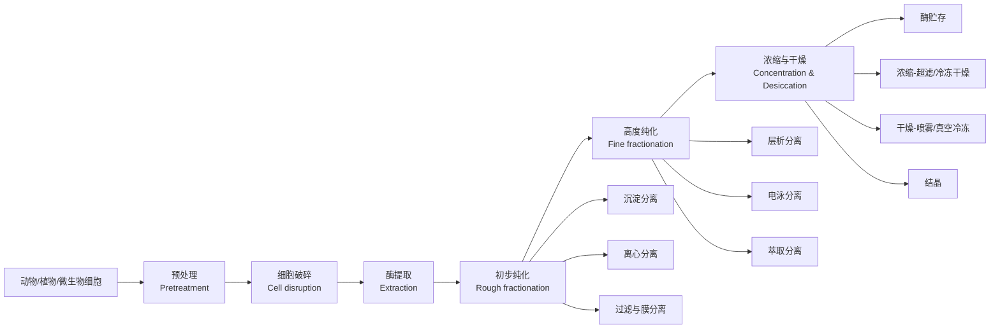

> 📷 参见图片：`../酶工程资料/PPT_images/5酶的分离纯化/` 整套113张图片

## 4.2 预处理（Pretreatment）

### 4.2.1 发酵液预处理

**目的**：改善发酵液性质，便于固液分离

**影响发酵液过滤的因素**：
1. 菌种特性
2. 培养基组成
3. 发酵液粘度

**提高过滤性能的方法**：
1. **絮凝和凝聚**：使细小颗粒聚集成较大颗粒
2. **稀释、加热**：降低粘度
3. **加助滤剂**：常用**硅藻土**等

主要分离方法：**离心分离** 和 **过滤**

> 📷 参见图片：`../酶工程资料/PPT_images/5酶的分离纯化/slide6_img1.png`

### 4.2.2 细胞破碎

**各种微生物细胞壁的结构与组成**：

| 微生物 | 壁厚/nm | 主要组成 | 层次 |
|-------|---------|---------|------|
| 革兰氏阳性细菌 | 15~50 | 肽聚糖(40%~90%)、多糖、胞壁酸、蛋白质 | 单层 |
| 革兰氏阴性细菌 | 10~13 | 肽聚糖(5%~10%)、脂蛋白、脂多糖(11%~22%)、磷脂、蛋白质 | 多层 |
| 放线菌 | 同G+ | 同革兰氏阳性菌 | 多层 |
| 酵母菌 | 100~300 | 葡聚糖(30%~40%)、甘露聚糖(30%)、几丁质(1%~2%)、蛋白质(6%~8%)、脂类 | 多层 |
| 霉菌 | 100~250 | 多聚糖(80%~90%)、脂类、蛋白质 | 多层 |

> 📷 参见图片：`../酶工程资料/PPT_images/5酶的分离纯化/slide7_img2.png`、`slide8_img3.png`、`slide9_img4.png`

**细胞破碎方法**：

| 方法类型 | 具体方法 | 原理 | 设备 |
|---------|---------|------|------|
| **机械破碎** | 捣碎法、研磨法、匀浆法 | 机械运动产生的剪切力 | 捣碎机、研磨机、匀浆机 |
| **物理破碎** | 温度差破碎、压力差破碎、超声波破碎 | 物理因素破坏细胞外层结构 | JY92-II D超声波细胞粉碎机、高压细胞破碎机 |
| **化学破碎** | 有机溶剂（甲苯、丙酮、丁醇、氯仿）<br/>表面活性剂（Triton、Tween） | 化学试剂对细胞膜的作用 | — |
| **酶促破碎** | 自溶法、外加酶制剂法 | 酶催化作用破坏细胞外层结构 | — |

**细胞对破碎方法的敏感性**：

| 细胞类型 | 声波 | 机械 | 渗透压 | 冻融 |
|---------|:----:|:----:|:-----:|:----:|
| 动植物 | +++ | +++ | +++ | +++ |
| 革兰氏阴性菌 | ++ | ++ | ++ | ++ |
| 革兰氏阳性芽孢菌 | ++ | + | ++ | + |
| 酵母 | + | + | + | + |
| 革兰氏阳性球菌 | + | - | + | + |
| 菌丝 | - | ++ | - | ++ |
| 孢子 | - | - | - | - |

> 📷 参见图片：`../酶工程资料/PPT_images/5酶的分离纯化/slide10_img5.png`至`slide12_img8.png`

## 4.3 酶的提取

**主要提取方法**：

| 提取方法 | 使用的溶剂或溶液 | 适用范围 |
|---------|----------------|---------|
| **盐溶液提取** | 0.02~0.5 mol/L的盐溶液 | 在低浓度盐溶液中溶解度较大的酶 |
| **酸溶液提取** | pH 2~6的水溶液 | 在稀酸中溶解度大且稳定性好的酶 |
| **碱溶液提取** | pH 8~12的水溶液 | 在稀碱中溶解度大且稳定性好的酶 |
| **有机溶剂提取** | 可与水混溶的有机溶剂 | 与脂质结合牢固或含较多非极性基团的酶 |

**影响酶提取的主要因素**：温度、pH、离子强度、溶剂种类、提取时间

> 📷 参见图片：`../酶工程资料/PPT_images/5酶的分离纯化/slide13_img9.png`

## 4.4 酶的分离纯化方法

### 4.4.1 沉淀分离（Precipitation Separation）

**在生物大分子制备中最常用的五种沉淀方法**：

**（一）中性盐沉淀（盐析法，Salting Out）**

**基本原理**：
- **盐溶（Salting in）**：低盐浓度时，蛋白质溶解度随盐浓度增加而增加
- **盐析（Salting out）**：高盐浓度时，蛋白质溶解度随盐浓度增加而降低

**盐析方程式（Cohn方程）**：
$$log S = \beta - K_s I$$

其中：
- $S$ = 蛋白质溶解度
- $\beta$ = 常数（与蛋白质种类和温度有关）
- $K_s$ = 盐析常数（与蛋白质和盐种类有关）
- $I$ = 离子强度

**两种盐析法**：
1. **Ks分级盐析法**：恒定pH和温度，改变离子强度
2. **β分级盐析法**：恒定离子强度，改变pH或温度

**常用中性盐**：**硫酸铵 (NH₄)₂SO₄**（最常用，溶解度大，价格低廉）

**盐浓度的表示**：用饱和度（Saturation）表示——溶液中饱和硫酸铵体积/溶液总体积

**调整盐浓度的方式**：
- **饱和溶液法**：$V = V_0 \frac{S_2 - S_1}{1 - S_2}$
  - V = 需加入饱和硫酸铵体积
  - V₀ = 原溶液体积
  - S₂ = 目标饱和度
  - S₁ = 原溶液饱和度

- **添加固体硫酸铵法**：$W = \frac{B(S_2 - S_1)}{1 - AS_2}$
  - A、B为与温度有关的常数

**盐析的影响因素**：
1. **离子强度和种类**：不同盐的盐析能力不同
2. **蛋白质浓度**：蛋白质浓度越高，越易沉淀
3. **pH值**：在等电点附近沉淀效果最好
4. **温度**：一般在室温或4℃进行

> 📷 参见图片：`../酶工程资料/PPT_images/5酶的分离纯化/slide16_img10.png`至`slide23_img14.png`

**（二）有机溶剂沉淀（降低介电常数）**

**沉淀机理**：
1. 降低溶液的介电常数，增加蛋白质分子间的静电引力
2. 部分引起蛋白质脱水

**常用有机溶剂**：**丙酮 > 乙醇 > 甲醇**
- 用量一般为酶液体积的2倍左右，终浓度为70%

**优缺点**：
- **优点**：分辨率比盐析法高，沉淀不需脱盐，溶剂易蒸发，沉淀易离心
- **缺点**：容易引起蛋白质变性失活，有机溶剂易燃易爆

> 📷 参见图片：`../酶工程资料/PPT_images/5酶的分离纯化/slide25_img15.png`

**（三）等电点沉淀（Isoelectric Precipitation）**

**原理**：蛋白质在等电点（pI）时溶解度最低

**使用方法**：
- 单独使用较少
- 多与其他方法联合使用（如盐析法、有机溶剂法）
- 常用于从粗酶液中除去某些等电点相距较大的杂蛋白

> 📷 参见图片：`../酶工程资料/PPT_images/5酶的分离纯化/slide27_img17.png`

**（四）有机聚合物沉淀法**

**沉淀剂**：常用**聚乙二醇（PEG）**，多用分子量为6000~20000的PEG

**优点**：
1. 操作条件温和，不易引起生物大分子变性
2. 沉淀效能高，使用少量PEG即可沉淀大量生物大分子
3. 沉淀后有机聚合物容易去除

> 📷 参见图片：`../酶工程资料/PPT_images/5酶的分离纯化/slide28_img18.png`

**（五）选择性变性沉淀法**

选择一定条件使杂蛋白变性沉淀而不影响目的酶：
1. **热变性**：升高温度使杂蛋白变性沉淀
2. **pH变性**：等电点沉淀法是其中一种变体
3. **有机溶剂变性**：使对有机溶剂敏感的杂蛋白变性沉淀

> 📷 参见图片：`../酶工程资料/PPT_images/5酶的分离纯化/slide29_img19.png`

### 4.4.2 离心分离（Centrifugation）

**基本原理**：
$$F_c = m \cdot r \cdot \omega^2$$
$$RCF = 1.12 \times 10^{-5} \cdot N^2 \cdot r$$

其中 $N$ = 转速(r/min)，$r$ = 旋转半径(cm)

**沉降系数（Sedimentation Constant, S）**：单位离心力下颗粒的沉降速度

**离心机的种类**：

| 类型 | 转速(r/min) | 注意事项 |
|-----|------------|---------|
| **低速离心机** | <6000 | 常温，注意热变性和离心管平衡 |
| **高速离心机** | 6000~25000 | 冷冻（防止温度升高），离心管精确平衡 |
| **超速离心机** | >25000 | 冷冻+真空系统，离心管精确平衡 |

**离心的形式**：差速离心、密度梯度离心

> 📷 参见图片：`../酶工程资料/PPT_images/5酶的分离纯化/slide30_img20.png`至`slide34_img24.png`

### 4.4.3 过滤与膜分离（Membrane Separation）

**膜分离技术发展历程**：

| 年代 | 膜过程 | 应用 |
|------|-------|------|
| 20世纪30年代 | 微滤 | 除菌过滤 |
| 1960年 | 反渗透（美国） | 海水脱盐 |
| 1960年 | 超滤（美国） | 大分子物质浓缩 |
| 1979年 | 气体分离（美国） | 氢回收 |
| 1982年 | 全蒸发（德国/荷兰） | 有机溶液脱水 |

**膜分离的分类**（按推动力）：

**（一）加压膜分离**：

| 类型 | 截留颗粒直径 | 操作压力 | 应用 |
|------|------------|---------|------|
| **微滤（MF）** | 0.2~2 μm | <0.1 MPa | 除菌 |
| **超滤（UF）** | 20Å~0.2 μm | 0.1~0.7 MPa | 分离病毒及生物大分子 |
| **反渗透（RO）** | <20Å | 0.7~13 MPa | 纯水制备、海水淡化 |

**超滤在酶分离中的应用**：
- 特别适于液体酶制剂的生产
- 截留分子量：300~50000道尔顿
- 操作压力：0.1~0.2 MPa
- 操作温度：20~50℃
- 对需要辅酶的酶的生产不适用

**（二）电场膜分离**：
- 电渗析（离子交换膜电渗析）

**（三）扩散膜分离**：
- 透析（Dialysis）

**膜材料**：金属膜、陶瓷膜（无机膜）、有机高分子膜

> 📷 参见图片：`../酶工程资料/PPT_images/5酶的分离纯化/slide50_img27.png`至`slide60_img33.png`

### 4.4.4 层析分离（Chromatography）

**层析法的基本原理**：

| 层析方法 | 分离依据 |
|---------|---------|
| **吸附层析** | 利用吸附剂对不同物质的吸附力不同 |
| **分配层析** | 利用各组分在两相中的分配系数不同 |
| **离子交换层析** | 利用离子交换剂对各种离子的亲和力不同 |
| **凝胶层析** | 利用各组分的相对分子质量不同 |
| **亲和层析** | 利用生物分子与配基之间专一又可逆的亲和力 |
| **层析聚焦** | 将等电点特性与离子交换层析结合 |

**层析装置**：梯度混合器 → 蠕动泵 → 层析柱 → 监测仪（A280） → 记录仪 → 收集器

**（1）凝胶过滤层析（Gel Filtration / Size Exclusion Chromatography）**

**原理**：根据分子大小不同进行分离，大分子先流出，小分子后流出

**分配系数**：
$$K_d = \frac{V_e - V_0}{V_i}$$
- $V_e$ = 洗脱体积
- $V_0$ = 外水体积（凝胶颗粒间隙体积）
- $V_i$ = 内水体积（凝胶颗粒内部体积）

**常用凝胶种类**：

| 型号 | 分离范围（Mr） | 溶胀体积 |
|------|--------------|---------|
| Sephadex G-25 | 1.0×10³~5.0×10³ | 4~6 mL/g |
| Sephadex G-50 | 1.5×10³~3.0×10⁴ | 9~11 mL/g |
| Sephadex G-75 | 3.0×10³~8.0×10⁴ | 12~15 mL/g |
| Sephadex G-100 | 4.0×10³~1.0×10⁵ | 15~20 mL/g |
| Sephadex G-150 | 5.0×10³~3.0×10⁵ | 20~30 mL/g |
| Sephadex G-200 | 5.0×10³~6.0×10⁵ | 20~30 mL/g |
| Sepharose 6B | 10⁴~3×10⁶ | — |
| Sepharose 4B | 10⁵~3×10⁷ | — |
| Sepharose 2B | 10⁶~10⁸ | — |

> 📷 参见图片：`../酶工程资料/PPT_images/5酶的分离纯化/slide80_img40.png`至`slide84_img43.png`

**（2）离子交换层析（Ion Exchange Chromatography, IEC）**

**原理**：利用蛋白质表面电荷性质不同进行分离

**离子交换剂类型**：

| 类型 | 功能基团 | 反离子 |
|------|---------|--------|
| **DEAE-Sephadex**（弱碱性阴离子） | 二乙氨基乙基 | Cl⁻ |
| **QAE-Sephadex**（强碱性阴离子） | 二乙氨基乙基-2-羟丙基 | Cl⁻ |
| **CM-Sephadex**（弱酸性阳离子） | 羧甲基 -CH₂COO⁻ | Na⁺ |
| **SP-Sephadex**（强酸性阳离子） | 磺丙基 -C₃H₆SO₃⁻ | Na⁺ |

**分离过程**：
1. **平衡**：离子交换剂与缓冲液平衡
2. **吸附**：带相反电荷的蛋白质结合到交换剂上
3. **去吸附**：提高盐浓度梯度，不同蛋白质依次洗脱
4. **分离结束**
5. **再生**：恢复交换剂的原始状态

**pH对蛋白质电荷的影响**：
- pH < pI：蛋白质带正电荷 → 结合阳离子交换剂
- pH > pI：蛋白质带负电荷 → 结合阴离子交换剂

> 📷 参见图片：`../酶工程资料/PPT_images/5酶的分离纯化/slide71_img36.png`至`slide79_img41.png`

**（3）亲和层析（Affinity Chromatography）**

**原理**：利用生物分子之间的特异性亲和力进行分离
- 酶 ↔ 底物/抑制剂/辅酶
- 抗体 ↔ 抗原
- 受体 ↔ 配体

**特点**：一步纯化可达极高纯度

> 📷 参见图片：`../酶工程资料/PPT_images/5酶的分离纯化/`

**（4）疏水作用层析（Hydrophobic Interaction Chromatography）**

**原理**：根据蛋白质疏水性的不同进行分离

### 4.4.5 电泳分离（Electrophoresis）

**常用电泳技术**：
1. **SDS-PAGE**：按分子量分离蛋白质
2. **等电聚焦（IEF）**：按等电点分离
3. **二维电泳（2-DE）**：IEF + SDS-PAGE
4. **毛细管电泳（CE）**

### 4.4.6 萃取分离（Extraction）

**双水相萃取**：
- 利用两种不相溶的高分子溶液（如PEG/葡聚糖）形成两相体系
- 酶在一相中优先分配，实现分离
- 条件温和，适合大规模操作

**反胶束萃取**：
- 表面活性剂在有机溶剂中形成纳米级含水"微胶囊"
- 酶被包裹在反胶束中，实现从水相到有机相的转移

### 4.4.7 酶的组合分离纯化策略

实际应用中通常采用多种方法组合使用：
1. 沉淀分离（粗纯）→ 层析分离（精纯）
2. 离子交换 → 凝胶过滤 → 亲和层析
3. 根据酶的性质设计纯化路线

## 4.5 酶的浓缩、干燥与结晶

**浓缩方法**：
| 方法 | 原理 | 适用性 |
|------|------|--------|
| **超滤** | 膜分离截留酶分子 | 广泛使用 |
| **冷冻干燥** | 低温真空升华 | 热不稳定酶 |
| **真空浓缩** | 减压蒸发 | 一般适用 |
| **吸水剂** | PEG吸水 | 实验室规模 |

**干燥方法**：
- **冷冻干燥**（最温和，保持酶活性）
- **喷雾干燥**（适用于热稳定酶）
- **真空干燥**

**结晶**：酶在特定条件下（适当pH、温度、离子强度等）形成规则晶体，是纯度的标志。

---

# 第五章 酶的固定化（Immobilized Enzyme and Cell）

## 5.1 概述

### 5.1.1 酶在应用过程中的三大不足

1. **稳定性较差**：大多数酶在高温、强酸、强碱和重金属离子等外界因素下容易变性失活（除某些耐高温酶外）
2. **一次性使用**：游离酶在反应过程中难以回收利用，即使酶仍有很高活力也难于回收，不仅提高生产成本，而且难于连续化生产
3. **产物分离纯化困难**：酶反应后成为杂质与产物混在一起，给产物进一步分离纯化带来困难

**解决方案**：**固定化技术**

> 📷 参见图片：`../酶工程资料/PPT_images/6酶的固定化/slide2_img1.png`

### 5.1.2 固定化酶的定义

**固定化酶（Immobilized Enzyme）**：经物理或化学方法处理，使酶变成不易随水流失（即运动受到限制），而又能发挥催化作用的酶制剂。凡限制在一定的空间范围内并能连续反复地使用的酶。

$$水溶性酶 + 水不溶性载体 \rightarrow 水不溶性酶（固定化酶）$$

> 📷 参见图片：`../酶工程资料/PPT_images/6酶的固定化/slide4_img2.png`

### 5.1.3 研究历史

| 年份 | 科学家/事件 | 贡献 |
|------|-----------|------|
| 1916 | Nelson和Griffin | 首次发现酶的固定化现象 |
| 1953 | Grubhofer和Schleith | 系统研究固定化酶 |
| 1969 | 千畑一郎 | 固定化氨基酰化酶工业化 |
| 1971 | 第一届国际酶工程会议 | "immobilized enzyme"术语确立 |

### 5.1.4 固定化酶的优缺点

**优点**：
1. 不溶于水，易于与产物分离
2. 可反复使用（降低生产成本）
3. 可连续化生产
4. 稳定性好（热稳定性、pH稳定性等）

**缺点**：
1. 固定化过程中往往会引起酶的失活（活力回收率通常<100%）

> 📷 参见图片：`../酶工程资料/PPT_images/6酶的固定化/slide8_img3.png`

### 5.1.5 相关概念

| 概念 | 定义 |
|------|------|
| **固定化酶** | 经提取和分离纯化后的酶进行固定化 |
| **固定化菌体（死细胞）** | 含酶菌体或菌体碎片进行固定化 |
| **固定化细胞** | 在一定的空间范围内进行生命活动的细胞（活细胞/增殖细胞） |

## 5.2 酶的固定化方法

### 5.2.1 固定化方法分类总览

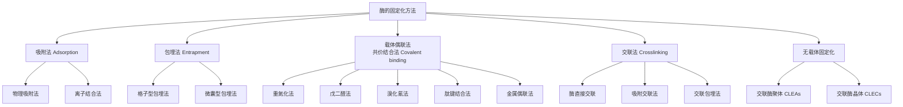

### 5.2.2 吸附法

**（1）物理吸附法**

**操作方式**：
- 静止法（Static procedure）
- 电沉积法（Electrodeposition procedure）
- 反应器装载法（Reactor loading process）
- 混合振摇装载法（Mixing or shaking bath loading）

**特点**：
- **优点**：固定化时酶分子的构象很少或基本不发生变化，活力回收高
- **缺点**：结合力弱，易解吸附

**载体**：
- 无机载体：活性氧化铝、活性炭等
- 有机载体：面筋、淀粉等

> 📷 参见图片：`../酶工程资料/PPT_images/6酶的固定化/slide12_img4.png`

**（2）离子结合法**

酶分子与含有离子交换基团的固相载体通过离子键结合。

**历史**：
- 第一个离子结合法固定化酶：固定化过氧化氢酶（DEAE-Cellulose）
- 第一个工业化的固定化酶：固定化氨基酰化酶（DEAE-Sephadex A-50）

**常用载体**：DEAE-C、CMC、DEAE-葡聚糖凝胶等

**实例——固定化氨基酰化酶的制备**：
1. 将100升DEAE-Sephadex A-25（预先用0.1 mol/L pH 7.0磷酸缓冲液洗）与1100~1700升氨基酰化酶(33400万单位)水溶液混合
2. 35℃搅拌10h，过滤，得到DEAE-Sephadex-氨基酰化酶复合物
3. 用水和0.2 mol/L乙酰-DL-蛋氨酸溶液洗涤，即得固定化酶
4. 活力为每升167000~200000单位，活力回收率达50%~60%

> 📷 参见图片：`../酶工程资料/PPT_images/6酶的固定化/slide14_img6.png`、`slide15_img7.png`

### 5.2.3 包埋法

将酶分子包埋于凝胶的网眼中或半透性的聚合物膜腔中。

**（1）格子型包埋法（Gel Entrapment）**

**聚丙烯酰胺（PAG）包埋法**（最早采用的胶格包埋法）：
1. 1 mL酶液加入3 mL含750 mg Acr单体和40 mg Bis的溶液中
2. 加0.5 mL 5%二甲氨基丙腈和1%过硫酸钾（加速剂和引发剂）
3. 混匀保温（23℃）10 min，即成含酶凝胶
4. 孔径1.0~4.0 nm，底物和产物可进出，酶分子不透出
5. 包埋容量：10~100 mg(蛋白)·g⁻¹(单体)

**固定化实例**：胰蛋白酶、木瓜蛋白酶、β-淀粉酶

**海藻酸钙包埋法**：最温和的包埋方法之一

> 📷 参见图片：`../酶工程资料/PPT_images/6酶的固定化/slide17_img8.png`至`slide20_img10.png`

**（2）微囊型包埋法（Microencapsulation）**

以超滤用的半透膜包裹含酶的液滴。

**四种制作方法**：

| 方法 | 膜材料 | 固定化实例 |
|------|--------|-----------|
| **界面聚合法** | 尼龙、聚脲 | 各种酶 |
| **液体干燥法** | 乙基纤维素、聚苯乙烯 | 各种酶 |
| **分相法（相分离法）** | 硝酸纤维素 | β-D-半乳糖苷酶、天门冬酰胺酶、脲酶 |
| **液膜法（脂质体法）** | 脂质体双分子膜 | 药物递送酶 |

> 📷 参见图片：`../酶工程资料/PPT_images/6酶的固定化/slide21_img11.png`至`slide24_img14.png`

### 5.2.4 载体偶联法（共价结合法）

将酶分子的某些功能基团经共价键与载体结合。

**常用载体**：纤维素、琼脂糖胶、葡聚糖凝胶、甲壳质、氨基酸共聚物、甲基丙烯醇共聚物

**酶分子上可用的功能基团**（非必需侧链基团）：
- 游离氨基（-NH₂）
- 胍基
- 酚羟基
- 巯基（-SH）
- 咪唑基
- 羟基（-OH）

**载体功能基团活化方法**：

**（1）重氮化法**
适用于多糖类的芳香族氨基衍生物、氨基酸共聚物、聚苯乙烯、聚丙烯酰胺、多孔玻璃等载体。

**步骤**：载体先用亚硝酸处理生成重氮盐衍生物，然后在温和条件下与酶分子的酚基、咪唑基或氨基反应而成键。

**多糖芳族氨基衍生物重氮化法**：用试剂对-β-硫酸酯乙砜基苯胺（SESA）研制了固定化糖酶和5'-磷酸二酯酶等。

**聚丙烯酰胺衍生物重氮化法**：商品名Bio-gel或Enzacryl（如Enzacryl AA）

**多孔玻璃氨基硅烷衍生物重氮化法**

**（2）戊二醛反应偶联法**
戊二醛与含伯胺基的聚合物反应，生成具有醛基功能的衍生物，然后与酶反应偶联。

**（3）溴化氰-亚胺碳酸基法**

**（4）芳香烃基化法或烷基化法**

**（5）肽键结合法**
- **叠氮法**：载体为羧甲基纤维素的叠氮衍生物，功能团为酶的氨基、羟基、巯基
- **酸酐法**：载体为马来酐与乙烯或苯乙烯的共聚物，功能团为酶的氨基
- **异硫氰酸法**：功能团为酶的氨基，载体为氨基衍生物

**（6）金属偶联法**
某些过渡金属（Ti、Sn、Zn、V、Fe的氯化物）使纤维素、尼龙、硼硅玻璃、滤纸等转化为固定化酶的载体。

> 📷 参见图片：`../酶工程资料/PPT_images/6酶的固定化/slide25_img15.png`至`slide38_img27.png`

### 5.2.5 交联法

利用双功能试剂或多功能试剂，使酶分子之间或酶蛋白与其它惰性蛋白之间发生交联，凝集成网状结构。

**常用双功能试剂**：

| 交联剂 | 化学式 |
|--------|--------|
| **戊二醛**（最常用） | OHC-CH₂-CH₂-CH₂-CHO |
| 二重氮联苯胺-2,2'-二磺酸 | — |
| 4,4'-二氟-3,3'-二硝基二苯砜 | — |
| 二苯基-4,4'-二硫氰酸-2,2'-二磺酸 | — |
| 1,5-二氟-2,4-二硝基苯 | — |
| 酚-2,4-二磺酰氯 | — |
| 3-甲氧基二苯基甲烷-4,4'-二异氰酸盐 | — |

**交联形式**：
1. **酶直接交联法**：酶分子之间直接交联
2. **酶辅助蛋白交联**：加入惰性蛋白共同交联
3. **双重固定法**：
   - 吸附交联法：先吸附后交联
   - 交联包埋法：先交联后包埋

**优缺点**：
- **优点**：结合牢固，可长时间使用
- **缺点**：颗粒小，机械性能差，酶活性低（常与吸附法或包埋法联合使用）

> 📷 参见图片：`../酶工程资料/PPT_images/6酶的固定化/slide39_img28.png`至`slide43_img31.png`

### 5.2.6 新型固定化方法——无载体固定化

**交联酶聚集体（CLEAs）**和**交联酶晶体（CLECs）**：


### 5.2.7 固定化方法比较

| 特征 | 吸附法 | 共价结合法 | 包埋法 | 膜截留 |
|------|:------:|:----------:|:------:|:------:|
| **制备难易** | 简单 | 困难 | 困难 | 简单 |
| **成本** | 低 | 高 | 中等 | 高 |
| **结合力** | 可变（弱~中） | 强 | 弱 | 强 |
| **酶泄漏** | 会 | 不会 | 会 | 不会 |
| **适用性** | 广泛 | 选择性 | 广泛 | 非常广 |
| **运行问题** | 高 | 低 | 高 | 高 |
| **扩散障碍** | 无 | 无 | 大 | 大 |

**四种方法详细比较**：

| 比较项目 | 物理吸附法 | 离子吸附法 | 包埋法 | 载体偶联法 | 交联法 |
|---------|:---------:|:---------:|:-----:|:---------:|:-----:|
| 制备难易 | 易 | 易 | 较难 | 难 | 较难 |
| 固定化程度 | 弱 | 中等 | 强 | 强 | 强 |
| 活力回收率 | 易流失 | 高 | 高 | 低 | 中等 |
| 再生 | 可能 | 可能 | 不可能 | 不可能 | 不可能 |
| 费用 | 低 | 低 | 低 | 高 | 中等 |
| 底物专一性 | 不变 | 不变 | 不变 | 可变 | 可变 |
| 适用性 | 酶源多 | 广泛 | 小分子底物 | 较广 | 较广 |

**工业固定化载体实例**：
- Eupergit C®
- Sepabeads® series
- Amberzyme™ Oxirane

**工业应用实例**：
- Immobilized Penicillin G Acylase（巨大芽孢杆菌青霉素G酰化酶固定在Eupergit®C上）
  - 循环次数：1000次
  - 生产力：800 Kg 6-APA/Kg（湿重），520 Kg 7-ADCA/Kg（湿重）

> 📷 参见图片：`../酶工程资料/PPT_images/6酶的固定化/slide45_img32.png`至`slide48_img35.png`

### 5.2.8 固定化酶的性质和形状

**固定化酶的形状**：
- **颗粒状**（占绝大多数）：主要用于工业发酵生产
- **线条状**：主要用于工业发酵生产
- **薄膜**：主要用于酶电极的制备
- **酶管**：机械强度较大，可用于工业生产

### 5.2.9 影响固定化酶性质的因素

**（1）酶构象改变**：固定化过程导致酶蛋白构象变化，影响与底物的结合能力和催化能力

**（2）立体屏蔽（空间障碍）**：载体的存在给酶的活性部位或调节部位造成空间障碍

**（3）分配效应**：载体的亲水性/疏水性及静电作用引起固定化酶内部底物、质子、离子、溶剂等在微环境和宏观体系之间的不等分配

**（4）扩散限制效应**：
- **外扩散**：底物/产物在液相主体和载体表面间的迁移
- **内扩散**：底物/产物在载体孔道内的迁移

**（5）微扰效应**：载体的性质直接影响酶的催化能力或对效应物作出反应的能力

### 5.2.10 固定化对酶性质的影响

**（1）酶活力的变化**：通常固定化后酶活力有所下降

**（2）稳定性变化**（**通常提高**）：
- 热稳定性提高
- 对化学试剂的稳定性提高
- 对蛋白酶的稳定性提高
- 操作稳定性提高
- 贮藏稳定性提高

> 📷 参见图片：`../酶工程资料/PPT_images/6酶的固定化/slide57_img37.png`至`slide60_img39.png`

**（3）最适温度变化**：通常升高，不同固定化方法可能不同

**（4）最适pH变化**：

| 微环境因素 | 效应 | 最适pH变化 |
|-----------|------|-----------|
| 载体带负电 | 吸引H⁺，微环境pH↓ | 最适pH偏高 |
| 载体带正电 | 吸引OH⁻，微环境pH↑ | 最适pH偏低 |
| 产物为酸性 | 微环境pH↓ | 最适pH偏高 |
| 产物为碱性 | 微环境pH↑ | 最适pH偏低 |

> 📷 参见图片：`../酶工程资料/PPT_images/6酶的固定化/slide62_img40.png`、`slide63_img41.png`

**（5）底物专一性变化**：与底物分子量大小有关。作用于大分子底物的酶固定化后活力下降更明显（因空间位阻）

**（6）动力学参数变化**：Km值通常变大（因扩散限制）

### 5.2.11 固定化酶（细胞）的评估指标

**（1）固定化酶的活力**：
- 单位为每毫克干重固定化酶每分钟转化底物的量（μmol·min⁻¹·mg⁻¹）
- 酶膜、酶管、酶板以单位面积的反应初速度表示

**测定方法**：
- 振荡测定法
- 酶柱测定法
- 连续测定法

**（2）酶结合效率**：
$$\text{结合效率} = \frac{\text{加入总酶活力} - \text{上清液酶活力}}{\text{加入总酶活力}} \times 100\%$$

- 结合效率=1：扩散限制引起的酶失活不明显
- 结合效率<1：扩散限制对酶活力有影响
- 结合效率>1：有细胞分裂或从载体排除抑制剂等原因

**（3）活力回收率**：
$$\text{活力回收率} = \frac{\text{固定化酶总活力}}{\text{加入酶总活力}} \times 100\%$$

**（4）半衰期**：在连续测定条件下，固定化酶活力下降为最初活力一半所经历的连续工作时间

> 📷 参见图片：`../酶工程资料/PPT_images/6酶的固定化/slide65_img42.png`至`slide68_img43.png`

## 5.3 细胞的固定化

### 5.3.1 固定化细胞的特点

固定在载体上并在一定空间范围内进行生命活动的细胞称为**固定化细胞**，又称固定化活细胞或固定化增殖细胞。

**与固定化酶相比的优越性**：
1. 保持了胞内酶系的原始状态与天然环境，稳定性好
2. 保持了胞内原有的多酶系统，对于多步催化转换优势明显，且无需辅酶再生
3. 细胞密度提高，可提高生产能力
4. 发酵稳定性好，可较长时间反复使用或连续使用
5. 发酵液中含菌体较少，有利于产品分离纯化
6. 可提高基因工程菌的稳定性

### 5.3.2 细胞固定化方法

| 方法 | 特点 |
|------|------|
| **吸附螯合法** | 可逆，条件温和，方法简便，但操作稳定性差 |
| **化学法（共价交联）** | 操作稳定性高 |
| **包埋法** | 只适于小分子底物 |
| **无载体固定化** | 去自溶酶法、絮凝法 |

### 5.3.3 固定化植物细胞

**特点**：可生产次生代谢产物（如紫杉醇、吗啡等）
**固定化方法**：吸附法、包埋法

### 5.3.4 固定化动物细胞

**特点**：可生产单克隆抗体、疫苗、生长因子等
**固定化方法**：吸附法、包埋法（凝胶包埋法、半透膜包埋法）

### 5.3.5 原生质体的固定化

**原生质体制备步骤**：
将对数生长期的细胞收集 → 悬浮在含有渗透压稳定剂的高渗缓冲液中 → 加入水解酶 → 分离 → 得到原生质体

**操作要点**：
1. 根据细胞壁主要成分选用合适的酶
2. 需加入合适的渗透压稳定剂
3. 选择合适的细胞生长时期
4. 经试验确定酶的最佳作用条件

**原生质体固定化方法**：一般采用凝胶包埋法

## 5.4 辅因子的固定化

### 5.4.1 辅基的固定化

与酶蛋白紧密结合的辅因子（如FAD、血红素等），可随酶蛋白一起固定化。

### 5.4.2 辅酶的固定化

常用的固定化辅酶：NAD⁺/NADH、NADP⁺/NADPH、ATP/ADP等

**方法**：将辅酶分子通过共价键连接到载体上，保持其活性

### 5.4.3 辅酶的再生

**方法**：
1. **酶偶联法**：偶联另一个酶反应使辅酶再生
2. **化学法**：化学试剂再生辅酶
3. **电化学法**：电极再生辅酶

---

# 第六章 化学酶工程与生物酶工程

## 6.1 概述

### 6.1.1 天然酶在应用中的限制因素

1. **酶活性不够高**：难以满足工业应用的经济性要求
2. **酶稳定性较差**：在高温、极端pH、有机溶剂等条件下易失活
3. **可能具有抗原性**：限制了酶在治疗中的应用

### 6.1.2 改变酶特性的两条途径

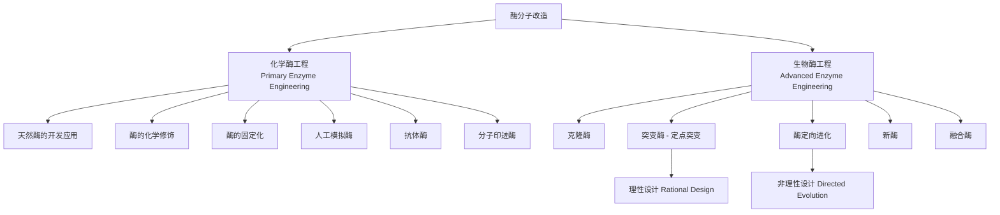

## 6.2 化学酶工程

### 6.2.1 酶分子化学修饰

**定义**：通过化学基团的引入或除去，使蛋白质共价结构发生改变，从而改变酶的某些特性和功能的过程。

**酶化学修饰的原理**：
1. 增强酶天然构象的稳定性与耐热性
2. 保护酶活性部位与抗抑制剂
3. 维持酶功能结构的完整性与抗蛋白水解酶
4. 消除酶的抗原性及稳定酶的微环境

**酶分子修饰的意义**：
1. **提高酶的活力**（Activity）
2. **增强酶的稳定性**（Stability）
3. **降低或消除酶的抗原性**（Immunological property）
4. **研究和了解酶分子结构与功能的关系**（Structure）

**酶的结构基础**：
```
全酶（Holoenzyme）= 酶蛋白 + 辅因子

酶蛋白结构层次：
活性部位 → 必需残基 → 催化基团
                       → 底物结合基团
                       → 接触残基
                       → 辅助残基
        → 结构残基
        → 非贡献残基
```

> 📷 参见图片：`../酶工程资料/PPT_images/7化学酶工程/slide7_img4.png`

#### 6.2.1.1 酶分子化学修饰的方法

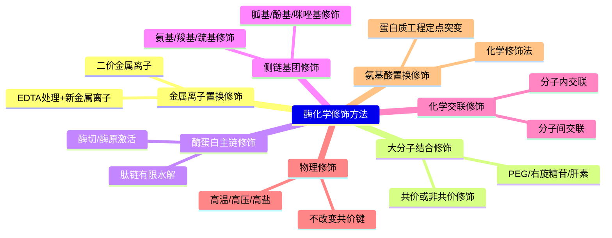

**（1）金属离子置换修饰**

**定义**：通过改变酶分子中所含的金属离子，使酶的特性和功能发生改变的方法。

**适用范围**：只适用于本来在结构中含金属离子的酶

**操作方法**：
$$酶液 \xrightarrow{加入EDTA} 透析或超滤 \xrightarrow{加入不同金属离子} 置换后酶$$

**置换后结果**：
- 酶活性降低或完全失活
- 酶活性提高或稳定性增加

**常用金属离子**：二价金属离子

> 📷 参见图片：`../酶工程资料/PPT_images/7化学酶工程/slide16_img9.png`

**（2）酶的大分子修饰**

**非共价修饰**：使用能与酶非共价相互作用的添加物（如PEG、右旋糖苷等），通过氢键固定在酶分子表面，保护酶的活力。添加物如多元醇、多糖、多聚氨基酸、多胺能通过调节酶微环境来保护酶的活力。

**共价修饰**：用可溶性大分子（PEG、右旋糖苷、肝素、羧甲基纤维素等）通过共价键连接于酶分子表面，形成覆盖层。

**大分子共价修饰的步骤**：
1. **修饰剂的选择**：选择合适的水溶性大分子（PEG、右旋糖苷、Ficoll、环状糊精等）
2. **修饰剂的活化**：使修饰剂带上可与酶分子反应的活化基团
3. **修饰反应**：在一定温度、pH下反应，使活化基团与酶分子侧链基团以共价键结合
4. **分离**：通过凝胶层析等方法分离不同修饰度的酶分子

**PEG的结构**：$HO-(CH_2-CH_2-O)_n-H$，两亲性高分子化合物（既亲水又亲有机溶剂）

**实例——大分子修饰SOD的效果对比**：

| 酶 | 半衰期 | 相对稳定性 |
|----|:------:|:----------:|
| 天然SOD | 6 min | 1 |
| 右旋糖酐-SOD | 7 h | 70 |
| Ficoll(低分子量)-SOD | 14 h | 140 |
| Ficoll(高分子量)-SOD | 24 h | 240 |
| **聚乙二醇-SOD** | **35 h** | **350** |

**实例**：
- 每分子核糖核酸酶与6.5分子的右旋糖酐结合，酶活力提高到原有的**2.25倍**
- 每分子胰凝乳蛋白酶与11分子右旋糖酐结合，酶活力提高到原有的**5.1倍**

> 📷 参见图片：`../酶工程资料/PPT_images/7化学酶工程/slide17_img10.png`至`slide21_img12.png`

**（3）酶蛋白主链修饰（肽链有限水解修饰）**

利用酶分子主链的切断和连接，改变酶分子的化学结构及其空间结构。

**主要方法**：酶切/酶原激活法

**实例**：胃蛋白酶原 → 胃蛋白酶（切除部分肽段后被激活）

> 📷 参见图片：`../酶工程资料/PPT_images/7化学酶工程/slide30_img18.png`

**（4）酶蛋白侧链基团修饰**

用小分子化合物对酶蛋白侧链基团进行修饰，引起副键改变，使酶分子空间结构发生变化。

**常用修饰剂**：

| 修饰基团 | 常用修饰剂 | 作用 |
|---------|-----------|------|
| **氨基** | 二硝基氟苯、醋酸酐、二硫化碳、O-甲基异脲 | 脱氨基或共价结合屏蔽 |
| **羧基** | 乙醇-盐酸、碳化二亚胺 | 酯化、酰基化 |
| **胍基** | 环已二酮、乙二醛、苯乙二醛 | 缩合生成稳定的杂环 |
| **巯基** | 二硫苏糖醇、巯基乙醇 | 破坏二硫键 |
| **酚基** | 四硝基甲烷 | 碘化、硝化或琥珀酰化 |
| **咪唑基** | 各类修饰剂 | 修饰组氨酸残基 |
| **吲哚基** | 各类修饰剂 | 修饰色氨酸残基 |
| **甲硫氨酸残基** | 各类修饰剂 | 修饰甲硫基 |

**分子内交联剂**：双功能试剂（二氨基丁烷、戊二醛、已二胺等），与酶分子内两个侧链基团反应，在分子内共价交联。

> 📷 参见图片：`../酶工程资料/PPT_images/7化学酶工程/slide32_img19.png`至`slide42_img28.png`

**（5）变性诱导构象重建**

**原理**：酶的变性、复性实验
- 特定条件下复性（非天然条件或有底物类似物、抑制剂等存在）
- 酶将折叠成所需的特殊结构，产生新的性状

**前沿**：Keyes实验室的"BIO-SYN-CAT™"技术，包括三个基本环节：微扰、诱导和修饰、交联

> 📷 参见图片：`../酶工程资料/PPT_images/7化学酶工程/slide43_img29.png`、`slide44_img30.png`

**（6）物理修饰**

**定义**：通过物理因素（高温、高压、高盐、极端pH等）改变酶分子空间构象，从而改变酶的特性和功能。

**特点**：不改变酶的组成单位及其基团，酶分子的共价键不发生改变，只是副键发生某些变化和重排。

**意义**：了解不同物理条件下酶分子空间构象的改变情况。

> 📷 参见图片：`../酶工程资料/PPT_images/7化学酶工程/slide46_img31.png`

**（7）氨基酸置换修饰**

将肽链上的某一个氨基酸换成另一个氨基酸。

**两种途径**：
1. **化学修饰法**：由于可用试剂的限制，获得的种类少，难度大，成本高，专一性差
2. **蛋白质工程**：利用基因操作技术（定点突变），最常用

**经典实例**：Bender等利用化学修饰法将枯草杆菌蛋白酶活性中心的丝氨酸转换为半胱氨酸，修饰后该酶失去对蛋白质和多肽的水解能力，却出现了催化硝基苯酯等底物水解的活性。

> 📷 参见图片：`../酶工程资料/PPT_images/7化学酶工程/slide47_img30.png`、`slide48_img31.png`

### 6.2.2 酶分子修饰的条件与效果

**修饰条件控制**：
1. **pH与离子强度**：pH决定了酶蛋白分子中反应基团的解离状态，解离状态不同，反应性能也不同
2. **温度与时间**：严格控制温度和时间可减少非专一性修饰反应
3. **酶与修饰剂的比例**

**修饰后性质变化**：

| 性质 | 变化趋势 |
|------|---------|
| **热稳定性** | 通常有较大提高 |
| **抗原性** | PEG和人血清白蛋白消除效果明显 |
| **对失活因子抵抗力** | 对蛋白酶、抑制剂有一定抵抗能力 |
| **半衰期** | 体内半衰期有效延长 |
| **最适pH** | 大部分酶发生变化，可能更接近生理pH |
| **Km值** | 多数酶Vm不变，部分酶Km变大 |

> 📷 参见图片：`../酶工程资料/PPT_images/7化学酶工程/slide51_img32.png`、`slide52_img33.png`

**天然酶和修饰酶的最适pH对比**：

| 酶 | 修饰剂 | 天然酶最适pH | 修饰酶最适pH |
|---|--------|:-----------:|:-----------:|
| 糜蛋白酶 | 白蛋白/PEG/肝素 | 8.0~10.5 | 7.4~9.0 |

### 6.2.3 酶的人工模拟（Artificial Enzyme/模拟酶/酶模型）

**定义**：根据酶作用的原理，模拟酶的活性中心和催化机理，用有机化学和生物学的方法合成具有专一催化功能的新型催化剂。

**理论基础**：
- 酶的作用机制
- 超分子化学（Supramolecular Chemistry）
- "主-客体"化学（Host-Guest Chemistry）：主体与客体通过配位键或其他次级键形成稳定复合物

**设计要点**：
1. 酶模型应为底物提供良好的微环境
2. 催化基团必须相对于结合点尽可能同底物的功能团相接近
3. 模型应具有足够的水溶性，并在接近生理条件下保持其催化活性

**模拟酶的分类**：

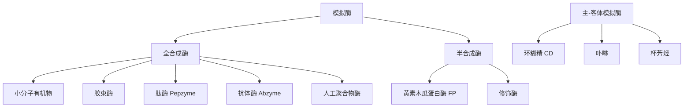

**（1）环糊精模拟酶**
- β-环糊精（β-CD）具有疏水空腔，可模拟酶的结合部位
- 将催化基团引入环糊精，获得具有催化功能的模拟酶

**（2）肽酶（Pepzyme）**
- 模拟天然酶活性部位而人工合成的具有催化活性的多肽

**（3）胶束酶**
- 胶束在水溶液中提供疏水微环境，类似于酶的结合部位
- 将催化基团（咪唑、硫醇、羟基等）共价或非共价连接于胶束上

> 📷 参见图片：`../酶工程资料/PPT_images/7化学酶工程/slide59_img34.png`至`slide68_img40.png`

### 6.2.4 抗体酶（Abzyme）

**概述**：具有催化功能的抗体分子，在其可变区赋予了酶的属性。

**酶与抗体的差别**：
- 酶：能与反应过渡态选择性结合的催化性物质
- 抗体：和基态分子结合的催化性物质

**抗体酶催化的反应类型**：
1. **酰基转移反应**
2. **重排反应**
3. **氧化还原反应**
4. **金属螯合反应**
5. **磷酸酯水解反应**
6. **磷酸酯闭环反应**
7. **光诱导反应**（光聚合反应、光裂解反应）

**抗体酶的制备方法**：

| 方法 | 原理 |
|------|------|
| **诱导法** | 以过渡态类似物为半抗原免疫动物，经杂交瘤技术产生单克隆抗体 |
| **引入法（修饰法）** | 在已有抗体中引入催化基团 |
| **拷贝法** | 以抗独特型抗体作为催化抗体 |

**研究展望**：
1. 研究酶作用机理，获得蛋白质结构与功能间关系的一般规律
2. 获得一类新型的蛋白酶
3. 催化天然酶不能催化的反应

> 📷 参见图片：`../酶工程资料/PPT_images/7化学酶工程/slide69_img41.png`至`slide84_img46.png`

### 6.2.5 分子印迹酶（Molecularly Imprinted Enzyme）

**分子印迹技术**：制备对某一化合物具有选择性的聚合物（MIP）的过程。该化合物称为印迹分子或模板分子。

**具体过程**：
$$模板结合 \rightarrow 聚合 \rightarrow 去除模板$$

**形成的聚合物内保留有与印迹分子形状大小完全一样的孔穴**。

**分子印迹方法**：

| 方法 | 作用方式 |
|------|---------|
| **自组装法** | 非共价相互作用 |
| **预组织法** | 可逆共价结合 |
| **金属螯合法** | 金属螯合作用 |

**表面分子印迹**：
- 无机物为载体的表面印迹
- 固体材料的表面修饰
- 蛋白质的表面印迹

**分子印迹酶的性质**：遵循米氏方程，催化活力依赖反应速度常数

**印迹策略**：
1. **印迹底物及其类似物**：将催化基团定位在印迹空腔的合适位置
2. **印迹过渡态类似物**：用过渡态类似物作印迹分子，聚合物结合反应过渡态，降低活化能

**生物印迹**：以天然生物材料（如蛋白质和糖类物质）为骨架进行分子印迹，产生特异性识别空腔。

> 📷 参见图片：`../酶工程资料/PPT_images/7化学酶工程/slide85_img47.png`至`slide96_img52.png`

## 6.3 生物酶工程（分子酶工程学）

**三个研究热点**：
1. 利用基因工程技术大量生产酶制剂（**克隆酶**）
2. 通过基因定点突变和体外分子定向进化对天然酶蛋白进行改造（**突变酶**）
3. 通过基因和基因片段的融合构建双功能融合酶（**融合酶**）

### 6.3.1 酶基因的克隆和异源表达

**操作步骤**：
1. 从基因组或cDNA文库中获取目的基因
2. 将基因插入表达载体
3. 转化宿主细胞（大肠杆菌、酵母、芽孢杆菌等）
4. 诱导表达
5. 纯化重组酶

**理想宿主应具备的条件**：遗传稳定、表达效率高、易于培养、蛋白水解酶缺陷

**基因工程菌的稳定性问题**：
- 质粒的"分离不稳定性"和"结构不稳定性"
- 需要信号肽（10个亲水AA + 20~30个疏水AA）促进蛋白外泌

**解决重组酶稳定性问题的三个途径**：
1. 选择蛋白酶基因缺失的变异株作为受体细胞
2. 同时克隆蛋白酶抑制基因
3. 促进基因表达产物的加速分泌

### 6.3.2 酶分子的定向改造

**两种设计策略**：
1. **合理设计（Rational Design）**——定点突变：需要知道酶蛋白的一级结构及编码序列，以及蛋白质空间结构知识
2. **定向进化（Directed Evolution）**——非理性设计：不需了解三维结构

**定点突变方法**：
- 化学全合成法
- 限制性内切核酸酶酶切片段取代法
- **寡核苷酸引物指导的定点突变**（最常用）

### 6.3.3 酶定向进化

**基本原理**：模拟自然进化过程，通过随机突变和定向选择，获得性能优良的突变酶。

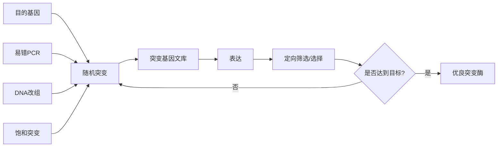

**自然进化 vs 实验室进化**：

| 特征 | 自然进化 | 实验室进化（定向进化） |
|------|---------|-------------------|
| 速度 | 缓慢（百万年） | 快速（数月到数年） |
| 突变方式 | 自发突变 | 诱导突变（易错PCR等） |
| 重组 | 自然重组 | DNA改组（Shuffling） |
| 选择 | 自然选择 | 人工定向选择 |

**定向进化的突变方法**：
1. **易错PCR（Error-prone PCR）**：在PCR过程中使用低保真度DNA聚合酶
2. **DNA改组（DNA Shuffling）**：将多个同源基因片段随机重组
3. **饱和突变（Saturation Mutagenesis）**：在特定密码子位点引入所有可能的氨基酸
4. **临时模板随机嵌合技术（RACHITT）**

**筛选方法**：
- 基于微量滴定板的筛选
- 基于荧光激活细胞分选（FACS）的筛选
- **基于高通量液滴微流控的筛选系统**（最新）

### 6.3.4 酶蛋白理性设计

**前提**：了解酶的三维结构和催化机制

**步骤**：
1. 酶蛋白结构的预测（同源建模、从头预测、分子动力学模拟、AlphaFold等）
2. 确定待改造的氨基酸位点
3. 定点突变
4. 突变酶的功能鉴定

### 6.3.5 融合酶

将两种或多种酶（或功能域）的基因融合，表达出具有多种催化功能或新功能的融合蛋白。

**应用**：
1. 构建多酶复合体，实现**底物通道效应**（Substrate Channeling）
2. 融合亲和标签便于纯化
3. 融合报告基因便于检测

---

# 第七章 非水相酶催化

## 7.1 概述

### 7.1.1 传统观念的转变

传统上认为**水是酶催化反应的最佳介质**。然而，许多有机反应中水存在以下问题：
- 有机底物在水中的溶解性差
- 大规模去除水繁琐且昂贵（高沸点、高蒸发热）
- 副反应（水解、消旋、聚合）

**转向非水相催化的原因**：
1. 有机合成中需要有机溶剂
2. 氧的参与需求
3. 探索新的反应类型
4. 减少微生物污染
5. 发挥酶的多种优势（选择性、温和条件等）

### 7.1.2 非水酶学的发展历史

| 年份 | 研究者 | 贡献 |
|------|--------|------|
| 1930s | Bourquelot | 首次证明酶在乙醇或丙酮中具有活性 |
| 1977 | Buckland, Martinek | 重新发现微生物细胞、游离酶、固定化酶在有机溶剂中的催化活性 |
| **1984** | **Klibanov** | **里程碑论文**：首次报道非水相介质中脂肪酶的催化行为及热稳定性（Science, 224, 1249-1251） |
| 2001 | Klibanov | 综述：在单相有机溶剂中改进酶的特性（Nature, 409, 241-246） |

**非水酶学（Non-aqueous Enzymology）**：传统酶学中迅速产生的一个全新分支。

### 7.1.3 非水酶学研究的三个主要方面

1. **基本理论研究**：影响非水介质中酶催化的主要因素以及非水介质中酶学性质
2. **结构功能研究**：阐明非水介质中酶的催化机制，建立和完善非水酶学的基本理论
3. **应用研究**：利用上述理论指导非水介质中酶催化反应的应用

## 7.2 非水相酶催化反应介质体系

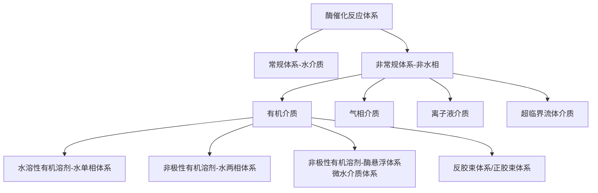

### 7.2.1 有机介质体系的四种类型

**（1）与水互溶的有机溶剂-水单相体系**
- 有机溶剂与水形成均匀的单相溶液
- 酶、底物和产物都能溶解

**（2）非极性有机溶剂-水两相体系**
- 由含有溶解酶的水相和一个非极性的有机溶剂相组成
- 催化反应在水相或两相界面进行
- 底物浓度受分配系数影响
- 底物更疏水时 → 产物方向移动（平衡偏移）

**（3）非极性有机溶剂-酶悬浮体系（微水介质体系）**
- 用非极性有机溶剂取代大量水
- 固体酶悬浮在有机相中
- 仍含**必需结合水**（Essential Water，一般<2%）
- 是最常用的非水催化体系

**存在形式**：
- 固定化酶悬浮在有机介质中
- 酶粉悬浮在有机介质中
- PEG修饰酶溶解在有机介质中

**（4）反胶束体系**
- 表面活性剂在有机溶剂中形成纳米级含水"微胶囊"
- 酶被包裹在反胶束的微小水池中

> 📷 参见图片：`../酶工程资料/PPT_images/8非水相催化/slide16_img6.png`

### 7.2.2 有机相酶反应的优点

1. **增加反应物的溶解度**：疏水性底物可溶于有机溶剂
2. **改变反应平衡方向**：有利于合成反应（如酯合成、肽合成）
3. **易于分离水和溶剂**：简化产物纯化
4. **增强酶的稳定性**：热稳定性、储存稳定性提高
5. **改变酶的选择性**：底物专一性、立体选择性、区域选择性变化
6. **可催化水中不可能进行的反应**
7. **酶可能表现出分子记忆行为**

> 📷 参见图片：`../酶工程资料/PPT_images/8非水相催化/slide9_img3.png`

## 7.3 有机介质中酶促反应的影响因素

### 7.3.1 水的影响

**水的作用**：
- **必需水（Essential Water）** = **结合水**：维持酶催化活性所必需的最少水量
- **溶剂水**：影响酶分子空间构象

**（1）水对酶分子空间构象的影响**
水通过氢键和疏水作用维持酶分子的天然构象。去除过多水会导致酶构象改变甚至失活。

**（2）水对酶催化反应速率的影响**
- 在特定有机介质体系中，催化速度达到最大时的含水量为**最适含水量**
- 三种酶在有机溶剂中的催化活力随含水量增加而增加

> 📷 参见图片：`../酶工程资料/PPT_images/8非水相催化/slide20_img9.png`、`slide21_img10.png`

**（3）水活度（Thermodynamic Water Activity, aw）**——Halling 1989
$$a_w = P/P_0$$
- $P$：体系中水的蒸气压
- $P_0$：同温下纯水的蒸气压

**最适水含量 vs 最佳水活度**：
- 最适水含量随着溶剂极性的增加而**增加**
- 最佳水活度与溶剂的极性大小**没有关系**
- **用水活度作为参数研究水对酶催化作用的影响更为准确**

> 📷 参见图片：`../酶工程资料/PPT_images/8非水相催化/slide22_img11.png`、`slide23_img12.png`

**（4）水对反应平衡及立体选择性的影响**
- 水活度不变，反应平衡基本不变
- 可根据产物需求调节水活度调控反应平衡
- 在微水催化体系中，水活度影响酶的催化选择性

**水含量的调控方法**：
- 酶和底物溶液分别在一定水活度的气氛中预平衡
- 使用不同饱和盐溶液获得不同水活度

> 📷 参见图片：`../酶工程资料/PPT_images/8非水相催化/slide26_img13.png`

### 7.3.2 有机溶剂的影响

**溶剂选择原则**：
- 溶剂极性（**log P值**）：通常log P > 4的疏水性溶剂更适合酶催化
- 溶剂与水的不可混溶性
- 对底物和产物的溶解能力
- 对酶的毒性

**log P值**：溶剂在辛醇/水两相中的分配系数的对数，是衡量溶剂极性的重要参数。

### 7.3.3 固定化对有机介质中酶催化的影响

1. 提高酶在有机介质中的催化活性
2. 改善酶在有机介质中的分散程度
3. 影响非水体系中酶的催化动力学
4. 提高酶在有机介质中的操作稳定性

### 7.3.4 酶的形态对有机介质中酶催化的影响

1. 固态酶粉悬浮在有机介质中
2. 酶结合在固定化载体上悬浮于有机介质中
3. 修饰酶溶解在有机溶剂中
4. 在两相催化体系中，酶以溶解形式处于水相
5. 交联酶晶体及交联酶聚集体悬浮于有机介质中

### 7.3.5 温度对有机介质中酶催化的影响

低水有机介质中酶的**热稳定性显著增强**（构象刚性增加）。

**实例——不同介质中酶的热稳定性比较**：

| 酶 | 水溶液中半衰期 | 有机溶剂中半衰期 |
|---|:-------------:|:----------------:|
| 猪胰脂肪酶 | <2 min at 100℃（buffer） | **12 h at 100℃（三丁酸甘油酯）** |
| 溶菌酶 | 8 min at 100℃（buffer） | **140 h at 100℃（环己烷）** |
| 胰凝乳蛋白酶 | <1 min at 100℃（buffer） | **270 min at 100℃（辛烷）** |
| 核糖核酸酶 | <10 min at 90℃（buffer） | **>6 h at 110℃（壬烷）** |

> 📷 参见图片：`../酶工程资料/PPT_images/8非水相催化/slide39_img16.png`

## 7.4 有机介质中酶的性质

### 7.4.1 酶活性的变化

**酶在有机溶剂中活力低的原因及解决方法**：

| 原因 | 解决方法 |
|------|---------|
| 扩散限制 | 增加搅拌速度；降低酶的颗粒大小 |
| 封闭活性中心 | 用结晶酶替代 |
| 构象改变 | 使用冻干保护剂；制备与两亲性物质络合的酶 |
| 底物脱离溶剂束缚能力差 | 选择合适的溶剂 |
| 过渡态不稳定化 | 选择与过渡态有利相互作用的溶剂 |
| 构象柔性降低 | 使aw最适化；使用疏水溶剂 |
| 亚最适pH | pH记忆；使用有机相缓冲液 |

**提高酶在有机溶剂中活性的方法**：
1. 充分水合（有机溶剂中1% v/v水）
2. 在最大活性pH下冻干
3. 使用冻干保护剂（多元醇、酚类、KCl等）

> 📷 参见图片：`../酶工程资料/PPT_images/8非水相催化/slide42_img18.png`至`slide45_img21.png`

### 7.4.2 酶稳定性的变化

**热稳定性提高**：有机介质中缺少引起酶分子失活变性的水分子，水分子会引起Asn和Gln的脱酰胺、Cys的氧化、二硫键的破坏等。

**实例**：

| 酶 | 溶剂/条件 | 半衰期 |
|---|----------|:------:|
| 猪胰脂肪酶 | 三丁酸甘油酯 | >26 h |
| 猪胰脂肪酶 | 水，pH 7.0 | <2 min |
| 脂蛋白脂肪酶 | 甲苯，90℃，400 h | 活力剩余40% |
| 酸性磷酸酶 | 正十六烷，80℃ | 8 min |
| 酸性磷酸酶 | 水，70℃ | 1 min |

### 7.4.3 pH记忆（Molecular Memory）

酶在有机溶剂中"记住"了它最后所处水相的pH值。冻干前溶液的pH值决定了酶在有机溶剂中的活性。

**实例**：枯草杆菌蛋白酶从含有竞争性抑制剂的溶液中冻干后，在无水溶剂中的活性可提高**100倍**，并具有不同的底物专一性和稳定性。

### 7.4.4 酶底物专一性的改变

**相对专一性**：
- 在极性较强的有机溶剂中，疏水性较强的底物容易反应
- 在极性较弱的有机溶剂中，疏水性较弱的底物容易反应

**对映体选择性（Enantioselectivity）**：
$$K_{LD} = \frac{(K_{cat}/K_m)_L}{(K_{cat}/K_m)_D}$$

- $K_{LD}$ = 立体选择系数，越大表示对映体选择性越强

**区域选择性（Regioselectivity）**：
$$K_{rs} = \frac{(K_{cat}/K_m)_1}{(K_{cat}/K_m)_2}$$

- 酶可选择底物分子中某一区域的基团优先反应

> 📷 参见图片：`../酶工程资料/PPT_images/8非水相催化/slide51_img23.png`至`slide53_img25.png`

### 7.4.5 反应平衡方向的移动

在水中倾向于水解的反应，在有机溶剂中可能转向合成方向。

**实例——有机溶剂中酶促合成多肽**：

| 酶 | 合成产物 | 有机溶剂 | 合成收率 |
|---|---------|---------|:--------:|
| 枯草杆菌蛋白酶 | 核糖核酸酶 | 90%甘油 | 50% |
| 无色杆菌蛋白酶 | 人胰岛素 | 30% DMF和乙醇 | 80% |
| 羧肽酶 | 牛胰核糖核酸酶 | 90%甘油 | 50% |
| 嗜热杆菌蛋白酶 | 天冬甜味素 | 乙酸乙酯 | — |

> 📷 参见图片：`../酶工程资料/PPT_images/8非水相催化/slide54_img26.png`、`slide55_img27.png`

## 7.5 非水相酶催化的应用

### 7.5.1 酶催化反应类型

| 反应类型 | 主要酶 | 实例 |
|---------|-------|------|
| **合成反应** | 脂肪酶 | 有机酸和醇类的酯合成 |
| | 蛋白酶 | 合成多肽 |
| **转移反应** | 脂肪酶 | 各种酯类的转酯反应 |
| **醇解反应** | 假单胞脂肪酶 | 酸酐醇解为二酸单酯 |
| **氨解反应** | 脂肪酶 | 氨解为酰氨和醇 |
| **异构反应** | 消旋酶 | 异构体化合物的转化 |
| **氧化还原反应** | 单加氧酶 | 二甲基苯酚氧化反应 |

### 7.5.2 C-O键的形成（酯合成和转酯反应）

酯酶和脂肪酶可催化：
1. **酯合成反应**：$RCOOH + R'OH \rightleftharpoons RCOOR' + H_2O$
2. **转酯反应**：$RCOOR_1 + R_2OH \rightleftharpoons RCOOR_2 + R_1OH$
3. 合成手性化合物，酶的立体选择性主要选择立体异构的醇

### 7.5.3 C-N键的形成（肽合成）

蛋白酶在有机溶剂中催化肽键合成。

### 7.5.4 C-C键的形成

醛缩酶、羟腈酶等可催化C-C键形成。

### 7.5.5 氧化还原反应

- 氧化反应：单加氧酶、漆酶
- 还原反应：醇脱氢酶

### 7.5.6 主要应用领域

| 酶 | 催化反应 | 应用 |
|---|---------|------|
| 脂肪酶 | 肽合成 | 含D-氨基酸肽合成 |
| | 酯合成 | 醇与有机酸合成酯类 |
| | 聚合 | 二酯的选择性聚合 |
| | 酰基化 | 醇的酰基化 |
| 蛋白酶 | 肽合成 | 合成多肽 |
| 羟基化酶 | 氧化反应 | 羟基化反应 |

---

# 第八章 酶反应器与酶传感器

## 8.1 酶反应器（Enzyme Reactor）

### 8.1.1 生物反应器概述

**定义**：生物反应器（Bioreactor）是指有效利用生物反应机能的系统（或场所）。

**设计目标**：使产品的质量最高，生产成本最低。

**评价标准**：反应器生产能力的大小和产品质量的高低。

**生物反应器的基本要求**：
1. 所用生物催化剂应具有较高的比活和酶浓度（或细胞浓度）
2. 能用电脑自动检测和调控，获得最佳反应条件
3. 具有良好的传质和混合性能
4. 具有最佳的无菌条件

**历史简介**：
- **古代**：酿酒、制醋的容器——最初的生物反应器
- **20世纪40年代**：发酵罐（Fermenter）迅速发展
- **20世纪70年代**：Atkinson提出"生化反应器（Biochemical Reactor）"
- **20世纪80年代**："生物反应器（Bioreactor）"术语大量出现

**分类**：
1. **酶反应器**：以游离酶或固定化酶、固定化细胞作为生物催化剂进行酶促反应的装置
2. **细胞反应器**：利用增殖细胞内的酶系将培养基中的成分转化为产品的装置

### 8.1.2 酶反应器的定义

以酶或固定化酶作为催化剂进行酶促反应的装置称为**酶反应器（Enzyme Reactor）**。

**作用**：以尽可能低的成本，按一定速度由规定的反应物制备特定的产物。

**与化学反应器相比**：在低温、低压下发挥作用，耗能和产能较少
**与发酵反应器相比**：不表现自催化方式（即细胞的连续再生）

> 📷 参见图片：`../酶工程资料/PPT_images/9酶反应器/slide5_img2.png`

### 8.1.3 酶反应器的主要类型

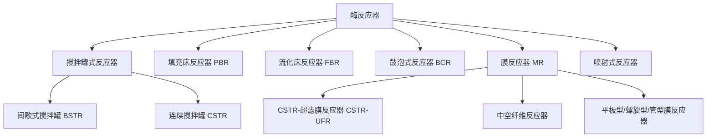

**（1）间歇式酶反应器（Batch Stirred Tank Reactor, BSTR）**

底物与酶一次性投入反应器内，产物一次性取出。

- **优点**：装置简单，造价较低，传质阻力很小，反应能迅速达到稳态
- **缺点**：操作麻烦，固定化酶反复回收使用时易失活
- **适用**：常用于游离酶，工业上很少用于固定化酶

> 📷 参见图片：`../酶工程资料/PPT_images/9酶反应器/slide14_img7.png`

**（2）连续流搅拌罐式酶反应器（Continuous Stirred Tank Reactor, CSTR）**

以恒定流速连续流入底物溶液，同时以相同流速输出反应液。

- **优点**：混合良好，各部分组成相同，与输出成分一致
- **缺点**：搅拌桨剪切力大，易打碎磨损固定化酶颗粒

> 📷 参见图片：`../酶工程资料/PPT_images/9酶反应器/slide15_img8.png`

**（3）填充床反应器（Packed Bed Reactor, PBR）——固定床反应器**

将颗粒状或片状固定化酶填充于其中构成。**当前工业上多数采用此类反应器**。

- **操作特点**：底物以恒定速度通过固定化酶床层，流动状态接近活塞流（PFR）
- **优点**：高效，易操作，结构简单
- **缺点**：传质系数和传热系数较低，底物含颗粒或粘度较大时不宜采用

> 📷 参见图片：`../酶工程资料/PPT_images/9酶反应器/slide16_img9.png`

**（4）流化床反应器（Fluidized Bed Reactor, FBR）**

装有较小颗粒的垂直塔式反应器，底物以一定速度由下向上流过，使固定化酶颗粒在浮动状态下进行反应。

- **优点**：传热传质良好，可用于处理高粘度和含固体颗粒的底物，适合需供气体或排放气体的反应
- **缺点**：需保持一定流速，运转成本高，难于放大，颗粒易机械破损，酶浓度不高

> 📷 参见图片：`../酶工程资料/PPT_images/9酶反应器/slide17_img10.png`

**（5）鼓泡式反应器（Bubble Column Reactor, BCR）**

底部有气体分散装置，适用于有气体吸收或产生的生物反应。

- **结构简单**，操作容易，剪切力小
- **混合效果好**，传质传热效率高

> 📷 参见图片：`../酶工程资料/PPT_images/9酶反应器/slide18_img11.png`

**（6）膜反应器（Membrane Reactor, MR）**

将酶催化反应与半透膜的分离作用组合在一起。

**形式**：平板型、螺旋型、管型、中空纤维型、转盘型（中空纤维反应器最常用）

**CSTR-超滤膜反应器**：在CSTR出口处设置超滤器，可将小分子产物与大分子酶和底物分开

- **优点**：结构紧凑，反应与分离一体化，利于连续化生产
- **缺点**：易发生浓差极化引起膜孔阻塞，清洗较困难

> 📷 参见图片：`../酶工程资料/PPT_images/9酶反应器/slide19_img12.png`、`slide21_img14.png`

**（7）喷射式反应器**

利用高压蒸汽的喷射作用实现酶与底物的混合，进行高温短时催化反应。

**适用**：游离酶的连续催化反应，适用于某些耐高温酶

> 📷 参见图片：`../酶工程资料/PPT_images/9酶反应器/slide22_img15.png`

### 8.1.4 各种酶反应器的特点比较

| 反应器类型 | 操作方式 | 适用的酶 | 主要特点 |
|-----------|---------|---------|---------|
| **搅拌罐式(STR)** | 分批/流加/连续 | 游离酶、固定化酶 | 设备简单，操作容易，混合均匀，传质阻力小 |
| **填充床(PBR)** | 连续 | 固定化酶 | 结构简单，酶密度大，效率高，工业最常用 |
| **流化床(FBR)** | 分批/流加/连续 | 固定化酶 | 传质传热好，不易堵塞，适合高粘度底物 |
| **鼓泡式(BCR)** | 分批/流加/连续 | 游离酶、固定化酶 | 简单，剪切力小，适合有气体参与的反应 |
| **膜反应器(MR)** | 连续 | 游离酶、固定化酶 | 反应分离一体化，但易堵塞 |
| **喷射式** | 连续 | 游离酶 | 高温短时反应，适合耐高温酶 |

### 8.1.5 酶反应器的选型

**（1）根据酶的应用形式选择**

**游离酶反应器的选择**：
- 最常用：搅拌罐式反应器
- 有气体参与：鼓泡式反应器
- 价格较高：游离酶膜反应器
- 耐高温：喷射式反应器

**固定化酶反应器的选择**：
- 通常采用连续操作形式
- 根据固定化酶的形状、颗粒大小和稳定性选择
- PBR适合颗粒状固定化酶
- FBR适合小颗粒且需良好传质的固定化酶

**（2）根据酶反应动力学性质选择**：
- 酶与底物的混合程度
- 底物浓度对反应速度的影响
- 反应产物对酶的反馈抑制作用
- 酶催化作用的温度条件

**（3）根据底物或产物的理化性质选择**

### 8.1.6 酶反应器的设计

**基本步骤**：
1. 确定酶反应器的类型
2. 生产工艺参数及技术指标的确定
3. 物料衡算
4. 热量衡算
5. 设备材料的选择
6. 反应器结构设计
7. 反应器数目计算

**物料衡算内容**：
- 计算底物用量
- 产物转化率 Yp/s
- 产物收得率 R
- 反应液总体积 Vt
- 酶用量
- 反应器数目 Qp

**生产能力**：单位时间（h）和单位反应器体积（L）所生产的产物量（g）

### 8.1.7 酶反应器的操作

**操作条件的确定与调控**：
1. 反应温度的确定与调节控制
2. pH值的确定与调节控制
3. 底物浓度的确定与调节控制
4. 酶浓度的确定与调节控制
5. 反应液混合程度的调节控制
6. 物料流加速率的调节控制
7. 微生物污染的控制

**操作注意事项**：
1. 保持操作稳定性
2. 防止酶的变性失活
3. 防止微生物污染——主要措施：
   - 保证生产环境的清洁卫生
   - 反应器使用前后进行清洗和消毒处理
   - 严格管理，经常检测
   - 必要时在反应器入口处安装过滤器

## 8.2 酶传感器（Biosensor）

### 8.2.1 概述

**定义**：生物传感器（Biosensor）是用生物活性物质做敏感器件（分子识别元件），配以适当的换能器（Transducer）所构成的分析工具。

**工作原理**：
$$待测物 \xrightarrow{扩散} 固定化生物敏感膜 \xrightarrow{分子识别} 生化反应 \xrightarrow{换能器} 电信号 \xrightarrow{放大输出} 待测物浓度$$

> 📷 参见图片：`../酶工程资料/PPT_images/9酶反应器/slide35_img6.png`

**生物传感器的组成部分**：

**分子识别元件（生物敏感膜）**：

| 类型 | 生物活性材料 |
|------|-------------|
| **酶膜** | 各种酶类 |
| **全细胞膜** | 微生物、真菌、动植物细胞 |
| **组织膜** | 动植物组织切片 |
| **细胞器膜** | 线粒体、叶绿体 |
| **免疫功能膜** | 抗原、抗体、酶标抗原等 |

**换能器（信号转换器）**：

| 生物反应信息 | 换能器的选择 |
|------------|-------------|
| 离子变化 | 电流型、电压型ISE、阻抗计 |
| 质子变化 | ISE、场效应晶体管 |
| 气体分压变化 | 气敏电极、场效应晶体管 |
| 热效应 | 热敏电极 |
| 光效应 | 光纤、光敏管、荧光计 |
| 色效应 | 光纤、光敏管 |
| 质量变化 | 压电晶体 |
| 电荷密度变化 | 阻抗计 |
| 溶液密度变化 | 表面等离子体共振 |

**生物传感器的优点**：
1. 测定过程简单迅速
2. 体积小，可实现连续在位监测
3. 响应快、样品用量少，可反复多次使用
4. 成本低，便于推广普及

### 8.2.2 生物传感器的分类

**按输出信号产生方式分类**：
- 生物亲和型生物传感器
- 代谢型或催化型生物传感器

**按器件法分类**：
- 生物电极
- 半导体生物传感器
- 光生物传感器
- 热生物传感器
- 压电晶体生物传感器

**按分子识别元件分类**：
1. **酶传感器（Enzyme Sensor）**
2. **微生物传感器（Microbial Sensor）**
3. **免疫传感器（Immunosensor）**
4. **组织传感器（Tissue Sensor）**
5. **细胞器传感器（Organelle Sensor）**

### 8.2.3 酶传感器的类型及检测原理

**（一）酶电极传感器**

**（1）电位型酶电极**
- 离子选择电极：对特定离子选择性响应（H⁺、K⁺、Na⁺、Ca²⁺等）
- 氧化还原电极（零类电极）

**（2）电流型酶电极**
**优点**：输出与被测物浓度呈线性关系（非对数），灵敏度更高

**葡萄糖电极——经典实例**：
$$β-D-葡萄糖 + O_2 \xrightarrow{葡萄糖氧化酶} D-葡萄糖酸-1,5-内酯 + H_2O_2$$
$$葡萄糖 + 醌 + H_2O \rightarrow 葡萄糖酸 + 氢醌$$
$$氢醌 \xrightarrow{铂电极} 醌 + 2H^+ + 2e^-$$

**Clark氧电极**：由铂阴极、Ag/AgCl阳极、KCl电解质和透气膜构成，广泛用于生物传感器。

**酶电极实例**：

| 电极类型 | 酶 | 检测物质 | 检测原理 |
|---------|-----|---------|---------|
| 葡萄糖电极 | 葡萄糖氧化酶 | 葡萄糖 | 耗氧量/H₂O₂ |
| 脲电极 | 脲酶 | 尿素 | NH₄⁺ |
| 氨基酸电极 | 氨基酸氧化酶 | 氨基酸 | 耗氧量 |
| 乳酸电极 | 乳酸氧化酶 | 乳酸 | H₂O₂ |
| 青霉素电极 | 青霉素酶 | 青霉素 | pH变化 |

**（二）离子敏场效应晶体管酶传感器（ISFET）**

原理：用敏感膜取代金属极，敏感膜对溶液中离子有选择作用，调制ISFET的漏电流变化，检测离子活度。

**（三）热敏电阻酶传感器**

检测酶促反应产生的热量变化。

**（四）光纤酶传感器**

检测酶促反应引起的光吸收、荧光或化学发光变化。

**（五）声波酶传感器**

检测质量变化（压电晶体）。

### 8.2.4 生物传感器的应用实例

1. **手掌型葡萄糖分析仪**：上海工业微生物所（1993年研制，1995年获国家新产品证书）
2. **SBA-40C生物传感分析仪**：谷氨酸-葡萄糖双功能分析仪，在我国发酵工厂普及应用
3. **SBA-60型生物传感在线分析系统**：为发酵自动控制提供新平台

### 8.2.5 生物传感器的发展趋势

1. **实用化、商品化**
2. **微型化、集成化和多功能化**
3. **智能化**
4. **芯片化**

> 📷 参见图片：`../酶工程资料/PPT_images/9酶反应器/` 整套31张图片

---

# 第九章 酶的应用

## 9.1 酶在医药领域中的应用

### 9.1.1 在分析检测及疾病诊断方面的应用

- **酶联免疫吸附测定（ELISA）**：酶标抗体检测抗原
- **血糖检测**：葡萄糖氧化酶试纸
- **血脂检测**：胆固醇氧化酶、脂肪酶
- **心肌酶谱**：CK、LDH同工酶检测
- **酶电极传感器**：实时监测血糖、乳酸等

### 9.1.2 在疾病治疗方面的应用

| 酶 | 治疗用途 |
|----|---------|
| **链激酶/尿激酶** | 溶血栓（急性心肌梗塞、脑血栓） |
| **L-天冬酰胺酶** | 抗白血病（消耗血中天冬酰胺，抑制癌细胞生长） |
| **超氧化物歧化酶(SOD)** | 抗炎、抗氧化、抗衰老 |
| **胰酶** | 助消化（胰腺功能不全） |
| **溶菌酶** | 抗菌消炎 |
| **脲酶** | 尿毒症治疗（降低血尿素） |
| **胶原酶** | 椎间盘突出治疗 |

### 9.1.3 在药物生产方面的应用

- **半合成抗生素**：6-APA（青霉素酰化酶）、7-ACA（头孢菌素酰化酶）
- **手性药物合成与拆分**：脂肪酶、酯酶
- **甾体药物转化**

## 9.2 酶在食品工业中的应用

| 酶 | 应用领域 | 功能 |
|----|---------|------|
| **α-淀粉酶** | 酿造、焙烤、制糖 | 淀粉液化 |
| **糖化酶（葡萄糖淀粉酶）** | 制糖 | 糖化 |
| **葡萄糖异构酶** | 制糖 | 高果糖浆生产 |
| **果胶酶** | 果汁加工 | 果汁澄清 |
| **蛋白酶** | 啤酒、肉品、乳品 | 澄清、嫩化、凝乳 |
| **脂肪酶** | 乳品、油脂 | 增香、酯交换 |
| **纤维素酶** | 果蔬加工、酿造 | 细胞壁降解 |
| **β-半乳糖苷酶（乳糖酶）** | 乳品 | 乳糖水解 |

## 9.3 酶在农业领域中的应用

- **农产品保鲜与加工**
- **农产品质量检测**（酶标仪检测农药残留）
- **饲料生产**：纤维素酶、植酸酶、木聚糖酶
- **抗性作物新品种培育**

## 9.4 酶在轻化工领域中的应用

| 领域 | 酶 | 应用 |
|------|----|------|
| **洗涤剂** | 碱性蛋白酶、脂肪酶、纤维素酶 | 去污、护色 |
| **皮革加工** | 蛋白酶、脂肪酶 | 脱毛、软化 |
| **纺织** | 纤维素酶 | 生物抛光、牛仔布水洗 |
| **造纸** | 脂肪酶、漆酶、纤维素酶 | 脱树脂、漂白、废纸脱墨 |
| **生物能源** | 纤维素酶、淀粉酶 | 燃料乙醇生产 |
| **环保** | 漆酶、过氧化物酶 | 废水处理、污染物降解 |

## 9.5 酶在生物技术方面的应用

- **分子生物学工具酶**：限制性内切酶、DNA连接酶、DNA聚合酶、逆转录酶
- **基因工程**：各种修饰酶
- **蛋白质组学**：胰蛋白酶用于蛋白质组分析
- **mRNA药物研发生产**：加帽酶、聚合酶

---

# 知识图谱总览

## 1. 酶工程完整知识体系图谱

```mermaid
graph TB
    title[酶工程知识体系] --> intro[第一章 绪论]
    title --> mech[第二章 酶催化反应机理及动力学]
    title --> prod[第三章 酶制剂的生产]
    title --> sep[第四章 酶的分离纯化]
    title --> immob[第五章 酶的固定化]
    title --> chem[第六章 化学酶工程与生物酶工程]
    title --> nonaq[第七章 非水相酶催化]
    title --> reactor[第八章 酶反应器与酶传感器]
    title --> app[第九章 酶的应用]

    intro --> bio[生物催化-工业生物技术]
    intro --> def[酶工程定义与内容]
    intro --> hist[发展简史]
    intro --> class[EC分类六大类]
    intro --> assay[酶活力测定]
    intro --> industri[酶制剂工业概况]

    mech --> active[活性中心]
    mech --> models[锁钥与诱导契合]
    mech --> catalysis[七大催化机制]
    mech --> michaelis[米氏方程与Km]
    mech --> multi[多底物动力学]
    mech --> inhibitor[抑制剂类型]
    
    prod --> regulation[操纵子-诱导/阻遏]
    prod --> catabolic[分解代谢物阻遏]
    prod --> microbe[产酶微生物筛选]
    prod --> medium[培养基设计]
    prod --> ferment[发酵工艺条件]
    prod --> methods[分批/连续/补料发酵]
    prod --> equipment[发酵罐设备]

    sep --> disruption[细胞破碎]
    sep --> extraction[酶提取方法]
    sep --> precipitation[沉淀分离-盐析]
    sep --> centrifugation[离心分离]
    sep --> membrane[膜分离-MF/UF/RO]
    sep --> chromatography[层析-凝胶/离子交换/亲和]
    sep --> electrophoresis[电泳分离]
    sep --> crystallization[浓缩干燥结晶]

    immob --> adsorption[吸附法-物理/离子]
    immob --> entrapment[包埋法-格子/微囊]
    immob --> covalent[共价结合-重氮化/戊二醛]
    immob --> crosslink[交联法]
    immob --> cell[细胞固定化]
    immob --> evaluation[评价指标-半衰期]
    immob --> property[性质变化-pH/Km]

    chem --> chem_mod[化学修饰七法]
    chem --> mimic[模拟酶-CD/胶束/肽酶]
    chem --> abzyme[抗体酶-过渡态类似物]
    chem --> imprint[分子印迹-MIP]
    chem --> cloning[克隆与异源表达]
    chem --> evolution[定向进化-易错PCR/改组]
    chem --> rational[理性设计-定点突变]
    chem --> fusion[融合酶]

    nonaq --> media_types[有机/气相/超临界]
    nonaq --> water_effect[水活度aw]
    nonaq --> stability[热稳定性大幅提高]
    nonaq --> selectivity[选择性改变]
    nonaq --> equilibrium[平衡移动-合成方向]
    nonaq --> applications[酯合成/肽合成/手性拆分]

    reactor --> bstr_reactor[间歇搅拌釜BSTR]
    reactor --> cstr_reactor[连续搅拌釜CSTR]
    reactor --> pbr_reactor[填充床PBR]
    reactor --> fbr_reactor[流化床FBR]
    reactor --> membrane_reactor[膜反应器MR]
    reactor --> biosensor[酶传感器]
    reactor --> design[选型设计]

    app --> medicine[医药-诊断/治疗/生产]
    app --> food[食品-淀粉/蛋白/果胶]
    app --> agriculture[农业-饲料/保鲜]
    app --> chemical[轻化工-洗涤/纺织/造纸]
    app --> environment[环保-废水处理]
    app --> energy[能源-生物燃料]
    app --> biotech[生物技术-工具酶/mRNA]
```

## 2. 酶的生产与应用全流程图谱

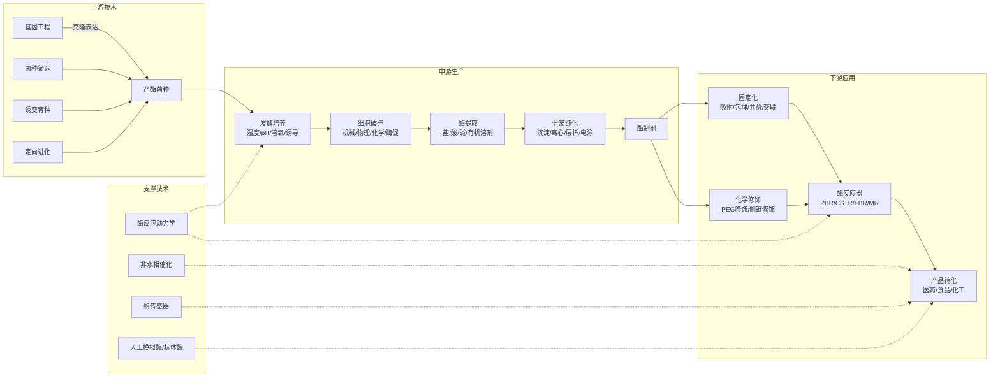

## 3. 酶高效催化七大机制图谱

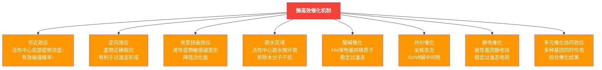

## 4. 能量图示——酶降低活化能

```mermaid
graph LR
    A[起始态<br/>反应物] -->|活化能Ea<br/>(无酶)| B[过渡态]
    A -->|活化能Ea'<br/>(有酶)| B
    B --> C[终态<br/>产物]
    A --> D{能量轴}
    D --> E[反应过程]
```

## 5. 酶固定化方法选择决策树

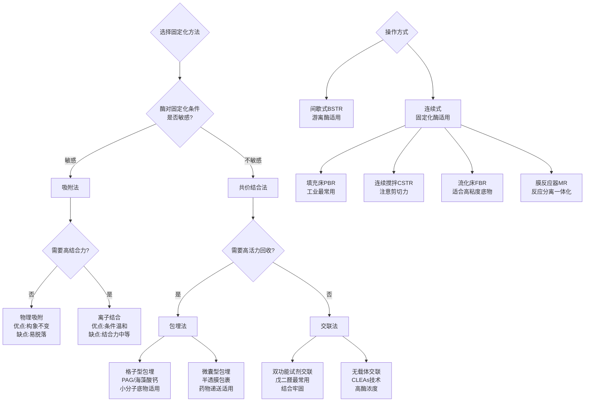

## 6. 酶抑制剂作用机制分类图谱

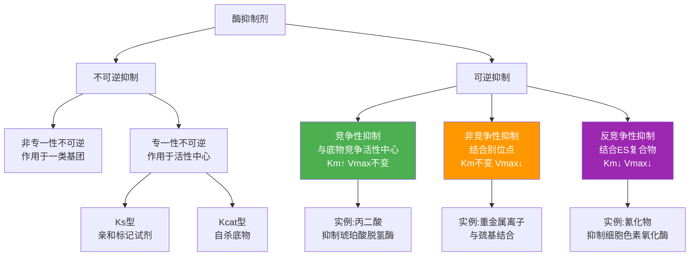

## 7. 非水相催化反应体系选择图谱

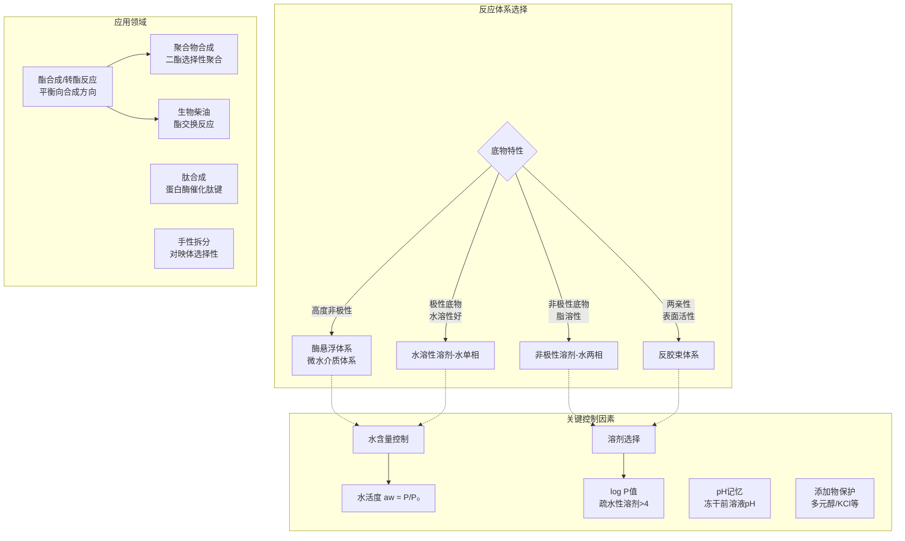

## 8. 生物酶工程——酶分子改造策略

```mermaid
graph LR
    subgraph 非理性设计[Directed Evolution]
        start(天然酶基因) --> A[随机突变<br/>易错PCR]
        A --> B[基因文库]
        B --> C[表达]
        C --> D[筛选<br/>高通量/液滴微流控]
        D --> E{达到目标?}
        E -->|否| A
        E -->|是| result1[优良突变酶]
        
        A2[多同源基因] --> F[DNA改组<br/>Shuffling]
        F --> B
    end
    
    subgraph 理性设计[Rational Design]
        start2(已知三维结构) --> G[定点突变设计<br/>选择氨基酸位点]
        G --> H[定点突变<br/>寡核苷酸引物法]
        H --> I[突变酶表达]
        I --> J[功能鉴定]
        J --> result2[改良酶]
    end
    
    subgraph 融合酶
        start3(多个酶基因) --> K[基因融合]
        K --> L[融合酶表达]
        L --> M[多催化功能]
    end
```

---

# 附录

## 附录A：常用术语中英文对照

| 中文 | English |
|-----|---------|
| 酶工程 | Enzyme Engineering |
| 生物催化 | Biocatalysis |
| 生物反应器 | Bioreactor |
| 生物传感器 | Biosensor |
| 固定化酶 | Immobilized Enzyme |
| 固定化细胞 | Immobilized Cell |
| 固定化原生质体 | Immobilized Protoplast |
| 活性中心 | Active Site |
| 米氏常数 | Michaelis Constant (Km) |
| 转换数 | Turnover Number (Kcat) |
| 诱导契合 | Induced Fit |
| 锁钥模型 | Lock and Key Model |
| 过渡态 | Transition State |
| 活化能 | Activation Energy |
| 抑制剂 | Inhibitor |
| 竞争性抑制 | Competitive Inhibition |
| 非竞争性抑制 | Non-competitive Inhibition |
| 操纵子 | Operon |
| 阻遏蛋白 | Repressor |
| 诱导剂 | Inducer |
| 分解代谢物阻遏 | Catabolite Repression |
| 盐析 | Salting Out |
| 超滤 | Ultrafiltration (UF) |
| 微滤 | Microfiltration (MF) |
| 反渗透 | Reverse Osmosis (RO) |
| 凝胶过滤层析 | Gel Filtration Chromatography |
| 离子交换层析 | Ion Exchange Chromatography |
| 亲和层析 | Affinity Chromatography |
| 非水相催化 | Non-aqueous Catalysis |
| 水活度 | Water Activity (aw) |
| pH记忆 | pH Memory |
| 定向进化 | Directed Evolution |
| 定点突变 | Site-directed Mutagenesis |
| DNA改组 | DNA Shuffling |
| 酶反应器 | Enzyme Reactor |
| 填充床反应器 | Packed Bed Reactor (PBR) |
| 流化床反应器 | Fluidized Bed Reactor (FBR) |
| 连续搅拌釜反应器 | Continuous Stirred Tank Reactor (CSTR) |
| 抗体酶 | Abzyme |
| 分子印迹 | Molecular Imprinting |
| 交联酶聚集体 | Cross-linked Enzyme Aggregates (CLEAs) |

## 附录B：关键公式汇总

**1. 米氏方程**：
$$v = \frac{V_{max}[S]}{K_m + [S]}$$

**2. Lineweaver-Burk双倒数方程**：
$$\frac{1}{v} = \frac{K_m}{V_{max}} \cdot \frac{1}{[S]} + \frac{1}{V_{max}}$$

**3. Km定义**：
$$K_m = \frac{K_{-1} + K_2}{K_1}$$

**4. Kcat（转换数）**：
$$K_{cat} = \frac{V_{max}}{[E]}$$

**5. 催化效率**：
$$\text{催化效率} = \frac{k_{cat}}{K_m}$$

**6. 盐析方程式（Cohn方程）**：
$$log S = \beta - K_s I$$

**7. 硫酸铵饱和度调整（饱和溶液法）**：
$$V = V_0 \frac{S_2 - S_1}{1 - S_2}$$

**8. 相对离心力**：
$$RCF = 1.12 \times 10^{-5} \cdot N^2 \cdot r$$

**9. 凝胶分配系数**：
$$K_d = \frac{V_e - V_0}{V_i}$$

**10. 水活度**：
$$a_w = \frac{P}{P_0}$$

**11. 立体选择系数**：
$$K_{LD} = \frac{(K_{cat}/K_m)_L}{(K_{cat}/K_m)_D}$$

**12. 酶结合效率**：
$$\text{结合效率} = \frac{\text{加入总酶活力} - \text{上清液酶活力}}{\text{加入总酶活力}} \times 100\%$$

## 附录C：参考资料

### 课程教材
1. 《酶工程》（第五版）韩双艳、郭勇主编，科学出版社，2024
2. 《酶工程》（第三版）陈守文主编
3. 《酶工程原理与技术》郭勇主编，高等教育出版社，2005年9月第一版
4. 《酶与酶工程》袁勤生、赵健主编，华东理工大学出版社
5. 《酶工程》罗贵民主编，化学工业出版社，2002年5月第一版
6. 《酶和酶工程》罗九甫，上海交通大学出版社，1996年11月第一版

### 生物化学参考
7. 《生物化学》（上册）朱圣庚主编
8. 王镜岩《生物化学》

### 经典文献
9. Klibanov, A.M. (1984). Enzymic catalysis in organic media at 100℃. *Science*, 224, 1249-1251.
10. Klibanov, A.M. (2001). Improving enzymes by using them in monophasic organic solvents. *Nature*, 409, 241-246.
11. Stephan Herrera (2004). Industrial biotechnology – a chance at redemption. *Nature Biotech*, 22(6), 671-5.

### 数据库与网络资源
- NCBI: http://www.ncbi.nlm.nih.gov
- CNKI: http://www.cnki.net
- ScienceDirect: http://elsevier.lib.tsinghua.edu.cn
- Springer LINK: http://springer.lib.tsinghua.edu.cn
- Novozymes: http://www.novozymes.com
- ProQuest Digital Dissertations

---

> **编制说明**：本综合资料（详细版）整合自西北农林科技大学"酶工程"课程教学PPT（8章，766张幻灯片，含482张课件图片）、《酶工程（第三版）》陈守文（目录及前50页完整内容）、《酶工程（第五版）》韩双艳郭勇（完整目录）、《生物化学（上册）》朱圣庚（酶相关章节）等多源资料。
>
> 按酶工程学科体系系统化编排，包含**知识图谱（Mermaid图表）15张**，**关键公式12个**，**数据表格60+个**，全面覆盖酶工程的核心知识体系。内容深度覆盖：酶学基础理论、催化机理与动力学、发酵生产与调控、分离纯化全流程、固定化技术与评价、化学与生物酶工程、非水相催化与应用、反应器设计与选型。
>
> **图片索引**：文中标注的图片路径均相对于本文件所在目录。图片原始文件位于 `../酶工程资料/PPT_images/` 目录下，按章节和幻灯片编号组织，共计482张。
