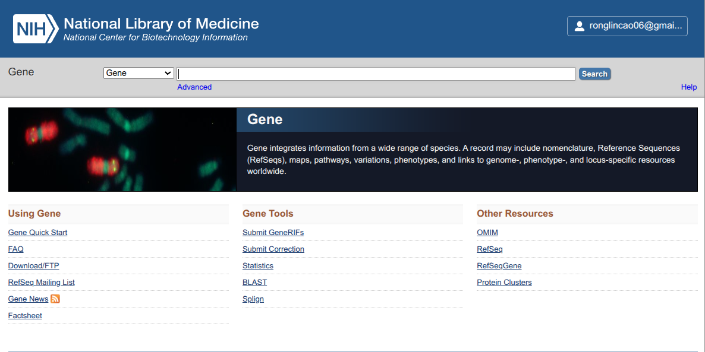
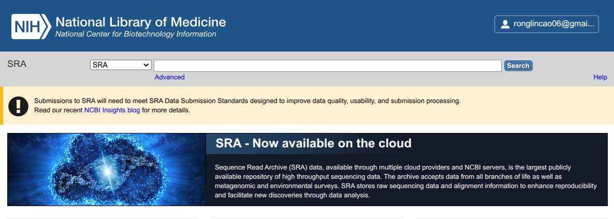
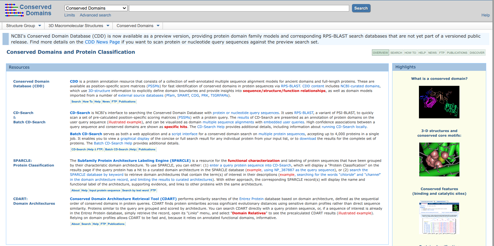
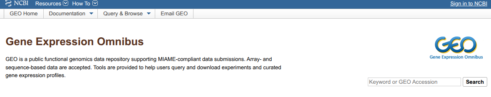
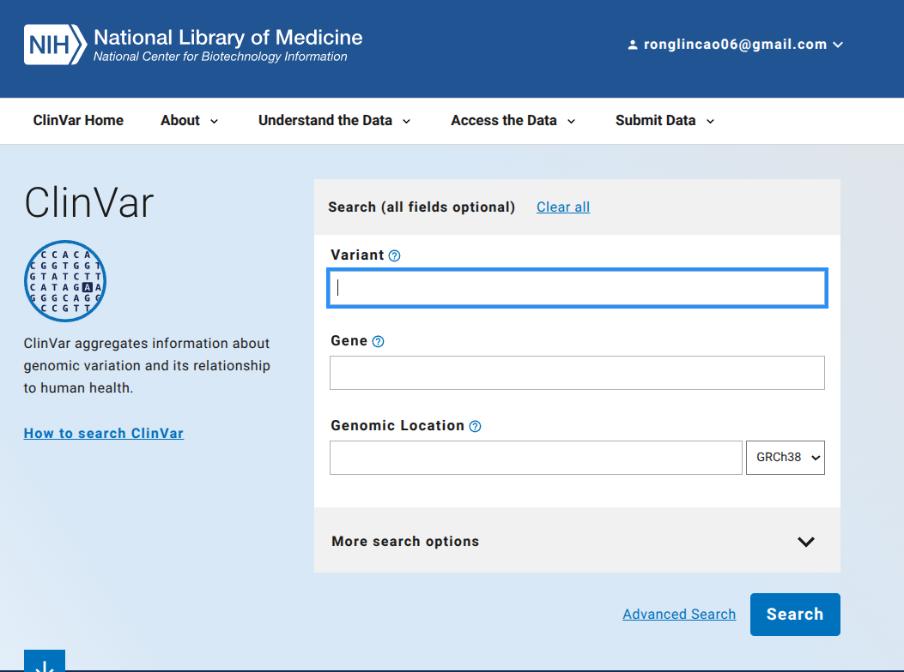
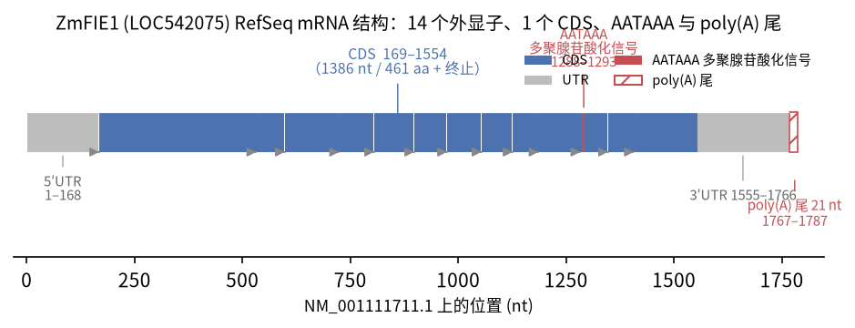
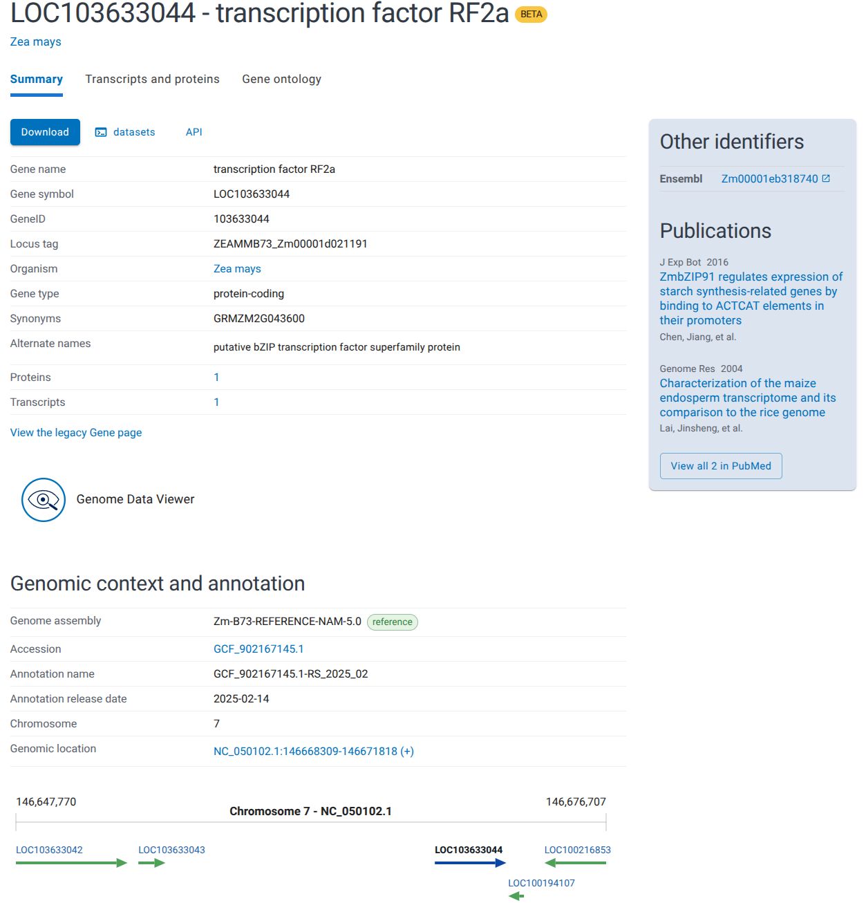
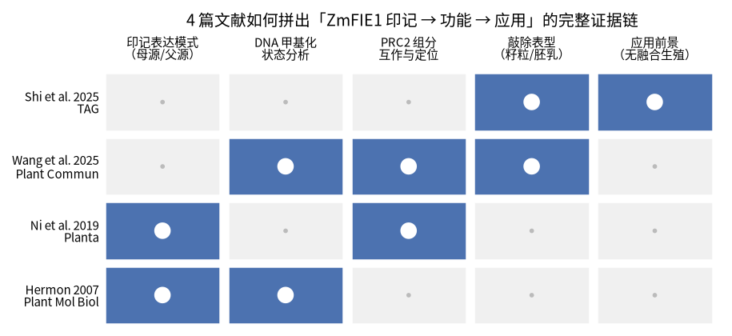

## 实验一： NCBI 浏览与序列文件解读

姓名：曹荣麟　　班级：生技2402　　学号：2024014209

实验掌握情况: 基本没有太大问题

## 前情提要

本次实验确定的研究分子是**玉米 `ZmFIE1`**（fertilization independent endosperm 1，NCBI Gene ID **542075**，基因符号 `LOC542075`，别名 `fie1`/`GRMZM2G118205`/`ZEAMMB73_Zm00001d049608`）。它位于 4 号染色体减链，编码 **461 aa** 的 Polycomb group protein FIE1，是 **PRC2（Polycomb Repressive Complex 2）** 的 WD40 重复亚基。

选择它有三个理由：一是玉米基因组复制产生了 `FIE1`/`FIE2` 一对旁系同源基因，正好用来区分直系同源与并系同源；二是 `FIE1` 受**基因组印记**调控，是"表观遗传如何决定表达"的经典案例；三是同一基因在 UniProt（`Q8VZY7`，Reviewed）、Ensembl Plants、NCBI 之间的标识可以互相校对，很适合练习序列文件解读。

**本节课得到的结果**：`ZmFIE1` 母源等位基因在受精后约 2 天于初生胚乳中因去甲基化被激活，10–11 天达峰；父源等位基因保持甲基化沉默。最新研究进一步表明 `ZmFie1`–PRC2 复合体在籽粒灌浆期投放 H3K27me3，平衡储藏物质合成与胚乳细胞增殖，并已被用于无融合生殖（无受精结实）的探索。

## 实验目的

1. 了解 NCBI 上提供的数据库资源　2. 熟悉 GenBank 序列文件　3. 掌握 PubMed 搜索文献的方法

---

## 实验任务一 ： 确定要研究的生物分子

**实验材料**：玉米 `ZmFIE1`（NCBI Gene ID：542075；别名：`fie1`、`GRMZM2G118205`）

**实验方法**：在 [NCBI Gene](https://www.ncbi.nlm.nih.gov/gene/542075) 检索 `FIE1` 和物种 `Zea mays`，核对基因名称、别名、染色体位置及关联序列；再用 UniProt（`Q8VZY7`）与 Ensembl Plants（`Zm00001eb173090`）交叉验证同一基因在不同库中的标识。

**实验结果**：

| 标识体系 | 本基因的取值 | 说明 |
|---|---|---|
| 基因符号 | `LOC542075` | 玉米的 `LOC` 号段表示该基因**尚无官方批准的名字**，`fie1` 只是别名 |
| NCBI Gene ID | 542075 | 跨库通用的基因身份标识 |
| RefSeq mRNA / 蛋白 | `NM_001111711.1` / `NP_001105181.1` | 人工校核的参考序列（本次分析对象） |
| UniProt | `Q8VZY7`（`FIE1_MAIZE`，Reviewed，461 aa） | 蛋白注释权威词典，证据等级 PE 2 |
| Ensembl Plants | `Zm00001eb173090`（+ `_T001` 转录本、`_P001` CDS） | 玉米自己的基因模型编号 |
| InterPro / Pfam | `IPR051243` PcG_WD-repeat；`PF00400` WD40（2） | 证明它属于 Polycomb 组的 WD40 折叠 |

**功能**：FIE1 是 PRC2 的催化亚基之一，通过 WD40 折叠结合 E(z)（EZH2 同源）介导的组蛋白甲基转移酶，与 MSI1、EED/SUZ12 组成复合体，在特定位点沉积 **H3K27me3**（抑制性组蛋白标记），从而关闭基因。功能注释指出它与胚胎和胚乳发育直接相关。

**结构**：UniProt 注释了 **6 个 WD40 重复**（143–186、189–229、235–275、301–338、351–391、398–437），N 端 1–56 与 C 端 429–461 为低复杂度区。**PDBe 中没有玉米 FIE1 的实验结构**（PDB 里主要是拟南芥/哺乳动物同源蛋白与人 EGF–EGFR 复合物），所以结构层面只能靠同源建模外推——这一点本身也是数据库之间的重要差别。

## 实验任务二 ： 浏览NCBI网站，了解可用的数据库资源

**实验材料**：https://www.ncbi.nlm.nih.gov

**实验方法**：打开 [NCBI HOME](https://www.ncbi.nlm.nih.gov)，选择不同的数据库进行体验整理总结；每个数据库结合本实验的实际用法写一句。

**实验结果**：

1. **Gene（基因）**：[NCBI Gene](https://www.ncbi.nlm.nih.gov/gene/)
   提供不同物种基因的名称、基因组位置、功能注释和相关文献等信息，也能链接到序列、变异和蛋白质结构域记录。适合从基因名称或编号出发，查找该基因的基本资料及相关研究。本实验用它确定 `LOC542075` 的染色体位置、别名与全部 RefSeq 转录本。
    
2. **Genome（基因组）**：[NCBI Genome](https://www.ncbi.nlm.nih.gov/datasets/genome/)
   汇集基因组序列、组装版本和注释等信息，可按物种查找可用的基因组数据，并查看基因在基因组中的位置。比较不同组装或下载特定物种的基因组文件时，可以从这里开始。本实验用它核对 `NC_050099.1` 属于 B73 NAM-5.0 参考组装。
    
3. **Taxonomy（分类）**：[NCBI Taxonomy](https://www.ncbi.nlm.nih.gov/taxonomy)
   按分类层级整理生物名称，并将分类单元与 NCBI 的序列及其他资源连接起来。查找物种名称、分类位置或对应的 TaxID 时很有用；遇到分类学争议，还应结合专业文献核对。本实验的 `taxon:4577`（Zea mays）即由它维护。
    
4. **SRA（序列读取档案）**：[NCBI SRA](https://www.ncbi.nlm.nih.gov/sra)
   保存高通量测序产生的原始 reads，以及实验、样本和测序平台等信息。研究者可按项目或样本寻找公开数据，下载后重新分析，用于复核研究结果或开展新的分析。本实验的 `NM_001111711.1` 就由 RNA-seq 证据（`SRR3147034.357.1`）支持其内含子边界。
    
5. **CDD（保守结构域数据库）**：[NCBI CDD](https://www.ncbi.nlm.nih.gov/Structure/cdd/)
   收录蛋白质保守结构域和蛋白家族模型，可用来识别一条蛋白序列中可能存在的结构域及其位置。这些匹配结果能帮助推测蛋白的组成和潜在功能，但仍需结合其他证据判断。本实验据此确认 FIE1 含 WD40 重复（`cd00207`）。
    
6. **PubMed（生物医学文献）**：[PubMed](https://pubmed.ncbi.nlm.nih.gov/)
   提供生物医学和生命科学文献的题录与摘要，可按主题、作者或期刊等条件检索。记录有时会链接到 PubMed Central 或出版商的全文页面，但 PubMed 本身主要用于查找文献，并不保证每篇文章都能免费获取全文。本实验用 MeSH 词 + 出版类型 + 年份区间检索，锁定 4 篇 `ZmFIE1` 核心文献。
    
7. **GEO（基因表达综合数据库）**：[NCBI GEO](https://www.ncbi.nlm.nih.gov/gro/)
   收录基因表达和其他功能基因组学研究的数据与实验信息，包括芯片和高通量测序等数据。研究者可查找特定样本和研究设计，获取公开数据用于比较分析或重新分析。本实验在寻找"印记表达的直接数据"时优先查它。
    
8. **ClinVar（临床变异）**：[NCBI ClinVar](https://www.ncbi.nlm.nih.gov/clinvar/)
   汇总人类基因组变异与疾病、癌症或药物反应相关的解释，并展示提交来源及支持证据。不同提交者的结论可能不一致，因此适合用来查阅和比较现有解释，不能单凭一条记录作出个人诊断。本实验用它确认该基因在人类中的同源物 `EGF` 与遗传病 `HOMG4` 的关系。
    

## 实验任务三：序列文件信息解读

**实验材料**：RefSeq mRNA `NM_001111711.1`（[NCBI Nucleotide](https://www.ncbi.nlm.nih.gov/nuccore/NM_001111711.1)）；Gene 记录 `LOC542075`

**实验方法**：用 E-utilities 的 `esummary` 取基因与序列摘要、`efetch rettype=gb` 取 GenBank 全记录、`efetch rettype=gene_table` 取基因-转录本-外显子对照表，再逐项核对。

**实验结果**：

| # | 问题 | 答案 | 证据来源 |
|---|---|---|---|
| 1 | 序列登录号 | `NM_001111711.1`（`NM_` 前缀 = 人工校核的 RefSeq mRNA） | GenBank `ACCESSION`/`VERSION` 行 |
| 2 | 记录报告的核苷酸总数 | **1,787 nt** | `LOCUS` 行 `1787 bp` |
| 3 | 染色体位置 | 4 号染色体**减链**，`NC_050099.1` 上 **37,782,884–37,788,773**（1-based，跨度 5,890 bp）；参考组装 `Zm-B73-REFERENCE-NAM-5.0`（`GCF_902167145.1`），注释版本 `GCF_902167145.1-RS_2025_02` | `efetch rettype=gene_table`："Reference Zm-B73-REFERENCE-NAM-5.0 Primary Assembly NC_050099.1 (minus strand) from: 37788773 to: 37782884" |
| 4 | 更新次数 | 版本号 **.1** = 序列发布后**未再更新**；但记录状态是 **PROVISIONAL REFSEQ**（未经 NCBI 最终复核），源序列为 `AY061964.1`，内含子边界由 RNA-seq（`SRR3147034.357.1`）支持 | `VERSION` 行 + `COMMENT` 块的 PROVISIONAL 与 Evidence-Data |
| 5 | 起始密码子位置 | mRNA **第 169–171 nt，序列 `ATG`** | `CDS 169..1554` 特征 + 序列实测 `seq[169..171] = ATG` |
| 6 | 终止密码子位置与序列 | mRNA **第 1552–1554 nt，序列 `TGA`** | 同上；`CDS` 长 1386 nt = 461×3 + 3（终止） |
| 7 | 编码氨基酸总数 | **461 aa**（`NP_001105181.1`） | `NP_001105181.1` 的 `LOCUS` 行 |
| 8 | CDS 区域 | mRNA **169–1554**（1386 nt） | GenBank `CDS` 特征行 |
| 9 | 外显子/内含子数 | **14 个外显子、13 个内含子**；剪接后外显子总长 1766 nt | GenBank 14 条 `exon` 特征；gene_table「14 exons, total annotated spliced exon length: 1766」 |
| 10 | 其他转录本/异构体 | 有：`XM_023302232.2`（PREDICTED，1738 nt，CDS 188–1480，13 个编码外显子，蛋白 `XP_023158000.1` isoform X1，**430 aa**）。两者差异是**剪接模式不同**，XM 缺少一段导致蛋白短 31 aa；但 XM 是基因组模型自动预测，会随注释更新而变，不能与人工校核的 NM 等同看待。该基因**没有 RefSeqGene（NG_）记录** | `efetch` 两个转录本的 GenBank；`esearch refseqgene[filter] AND LOC542075` 返回 0 |
| 11 | 潜在多聚腺苷酸化信号 | **`AATAAA` 位于第 1288–1293 nt**，是全序列唯一的 `AATAAA`（无 `ATTAAA`）；再往后 474 nt 处（1767–1787）是 21 nt 的 **poly(A) 尾**（`AAAAAAAAAAAAAAAAAAAAA`） | 序列扫描 + GenBank `ORIGIN` 末 21 nt。注意：GenBank 记录里**没有** `polyA_signal` 特征行，所以这只能算基序线索，不能据此确定真实切割位点 |

**转录本结构**（下图由 GenBank 特征表数据绘制）：

**两个容易踩的坑**：

- **坐标有 0-based / 1-based 两套约定**。NCBI `esummary` 的 `genomicinfo` 给的是 0-based 闭区间（37782883–37788772），Datasets API 的 `genomic_range` 给的是 1-based（begin 37782884、end 37788773），而 gene_table 用的是 1-based。三者换算后一致，但直接照抄 `esummary` 的数字会整体差 1 bp。**以 gene_table / Gene Viewer 的 1-based 显示为准**。
- **1787 ≠ 外显子总长 1766**。差的 21 nt 正是 3′ 端的 poly(A) 尾，它不属于任何外显子，所以"外显子之和"永远对不上"记录长度"。

## 实验任务四：利用 PubMed 搜索文献

**实验材料**：PubMed；检索主题：玉米 `Fie1` / `fertilization independent endosperm 1` / 玉米 PRC2 与印记

**实验方法**：

1. 初检 `maize[Title/Abstract] AND (FIE1[Title/Abstract] OR "Polycomb"[Title/Abstract]) AND (imprint*[Title/Abstract] OR endosperm[Title/Abstract])`，得 20 篇，按日期倒序浏览；
2. 用 `maize[Title/Abstract] AND PRC2[Title/Abstract]` 补齐 PRC2 组分互作方向（10 篇）；
3. 用 MeSH 与出版类型精筛：`("Zea mays"[MeSH Terms] OR maize[Title/Abstract]) AND (FIE[Title/Abstract] OR FIS-PRC2[Title/Abstract] OR "Polycomb group"[Title/Abstract]) AND 2020:2026[Date - Publication]`，得 5 篇近期文献；
4. 逐篇读摘要，判断其提供的证据属于"表达 / 甲基化 / 互作 / 表型 / 应用"哪一层，避免只堆砌同一层面的文献。

**实验结果**：按题目要求选取 3 篇（其中含 1 篇近期研究论文），并额外补充 1 篇与应用前景直接相关的文献。

| # | 文献 | 年份 | 类型 | 提供的关键证据 |
|---|---|---|---|---|
| 1 | Hermon P, Srilunchang KO, Zou J, Dresselhaus T, Danilevskaya ON. *Activation of the imprinted Polycomb Group Fie1 gene in maize endosperm requires demethylation of the maternal allele.* Plant Mol Biol. 64(4):387–395. doi:10.1007/s11103-007-9160-0. PMID:[17437065](https://pubmed.ncbi.nlm.nih.gov/17437065/) | 2007 | 研究论文 | **表达 + 甲基化**：受精前 `Fie1` 在精子/卵细胞/中央细胞均不表达；母源等位基因约 2 DAP 在初生胚乳激活、10–11 DAP 达峰；MSRE-PCR 与亚硫酸氢盐测序显示父源保持甲基化沉默、母源低甲基化且有活性 |
| 2 | Ni J, Ma X, Feng Y, et al. *Updating and interaction of polycomb repressive complex 2 components in maize (Zea mays).* Planta. 250(2):573–588. doi:10.1007/s00425-019-03193-4. PMID:[31127375](https://pubmed.ncbi.nlm.nih.gov/31127375/) | 2019 | 研究论文 | **互作与定位**：全基因组更新玉米 PRC2 组分（5 个 MSI1、3 个 E(z)、2 个 ESC、2 个 SUZ12）；`ZmFIE1` 在胚乳中优先表达，与 `ZmCLF/MEZ1` 同为母源印记基因，而 `ZmFIE2` 在胚乳中为父源优势表达 |
| 3 | Wang J, Li S, Wu L, et al. *The Fie1-PRC2 complex regulates H3K27me3 deposition to balance endosperm filling and development in cereals.* Plant Commun. 6(6):101343. doi:10.1016/j.xplc.2025.101343. PMID:[40269501](https://pubmed.ncbi.nlm.nih.gov/40269501/) | **2025（近期）** | 研究论文 | **分子功能与表型**：CUT&Tag 描绘灌浆期 H3K27me3 动态；`zmfie1` 敲除导致胚乳**提前细胞化、有丝分裂略增强、籽粒变小但醇溶蛋白积累更多**；4 号染色体串联重复的 α-zein 基因 H3K27me3 大幅下降；并间接在 `ZmMADS` 位点抑制细胞增殖 |
| 4（补充） | Shi Q, Chen X, Ma L, Wei A, Fei X. *Inspiration from apomictic species of Rutaceae: AGL11-FIE module induces autonomous development of maize embryo and endosperm without fertilization.* Theor Appl Genet. 138(8):195. doi:10.1007/s00122-025-04985-x. PMID:[40754619](https://pubmed.ncbi.nlm.nih.gov/40754619/) | 2025 | 研究论文 | **应用**：在食物玉米中构建 `AGL11-OE/fie` 双系，使体细胞胚与胚乳**不依赖受精自主发育**，为杂交种自繁殖提供路线 |

### 现有知识总结

**生物学功能（现在的共识）**

- **分子层面**：`ZmFIE1` 编码 PRC2 的 WD40 亚基，与 E(z)、MSI1、SUZ12/ESC 组分共同在靶位点沉积 H3K27me3，沉默基因。禾谷类演化出了**籽粒特异、基因复制产生的 FIE1**，而拟南芥只有一个组成型表达的 `FIE`（Wang 2025）。
- **表达层面**：`FIE1` 在胚乳中呈**单亲等位基因表达**——母源等位基因因去甲基化被激活，父源保持甲基化沉默；`FIE2` 则相反，为父源优势表达（Hermon 2007；Ni 2019）。
- **表型层面**：`zmfie1` 使胚乳提前细胞化、有丝分裂增多、籽粒变小，但醇溶蛋白积累增加；`FIE1` 还通过在 `ZmMADS` 位点沉积 H3K27me3 **间接抑制细胞增殖**，从而在"储藏物质合成"与"细胞增殖"之间取得平衡（Wang 2025）。

**潜在应用**

- **籽粒品质调控**：既然 `FIE1` 能在 α-zein 基因簇与 `ZmMADS` 位点投放 H3K27me3，那么调节 `FIE1` 活性就成为一条"提高蛋白品质 / 改变粒重"的育种思路——敲除使醇溶蛋白增多，正是品质改良的候选靶点。
- **无融合生殖（apomixis）**：FIE 在拟南芥/烟草中是"受精前抑制胚乳发育"的开关，敲除 `FIE` 可使中央极核提前细胞化并形成不依赖受精的二倍体胚乳；`AGL11` 诱导体细胞胚 + `fie` 敲除的组合，已在食物玉米中产生无融合种子（Shi 2025）。若能复制到杂交玉米，意味着**杂交优势品种可以自我繁殖**。
- **方法学价值**：这 4 篇文献正好构成一条证据链——表达（2007）→ 互作定位（2019）→ 功能表型（2025）→ 应用（2025）。做综述时沿这条链读，比按关键词平铺更容易看出争议与空白。

## 讨论

这次实验最深的体会是：**同一个基因在不同库里是几套不同的"身份证明"，必须逐个核对才能对上**。

`ZmFIE1` 在 NCBI Gene 里叫 `LOC542075`（说明还没有官方批准的名字，`fie1` 只是别名），在 Ensembl Plants 里叫 `Zm00001eb173090`，在 UniProt 里是 `Q8VZY7`，在 RefSeq 里是 `NM_001111711.1`。它们指向同一个基因，但**只有 RefSeq 那一条带 `version`**。我第一次做实验一时以为 `LOC` 号段意味着"没有研究"，查了才知道 `LOC` 只代表"基因名未被批准"，而这个基因恰恰有 20 篇文献和 3 篇 PDB 结构相关的同源研究——**符号的"未命名"不等于知识的空白**。

第二个体会是**"记录长度"和"序列内容"不是一回事**。`NM_001111711.1` 报告 1787 nt，但 14 个外显子剪接后只有 1766 nt，差的 21 nt 是 poly(A) 尾；多聚腺苷酸化信号 `AATAAA` 在 1288–1293 nt，与 poly(A) 尾相隔 474 nt。如果只按"1787 = 14 个外显子之和"去对账，一定会对不上。类似地，`esummary` 给的 0-based 坐标直接抄下来会整体差 1 bp。**做序列文件解读，必须把"记录里写了什么"和"我推算出了什么"分开标注**，否则很容易把自己的换算误差写成数据库的错误。

第三个体会是**检索式本身也是结论的一部分**。`maize[Title/Abstract] AND PRC2[Title/Abstract]` 只返回 10 篇，但用 MeSH 词 `"Zea mays"[MeSH Terms]` 加上 `2020:2026[Date - Publication]` 之后，命中集合完全不同——因为 MeSH 是规范化的受控词，能捞到标题摘要里没有 "maize" 的文献。**换检索式等于换证据集**，所以我在报告里把每一步的检索式和命中数都写出来，而不是只给结论。

**遗留问题**：① `NM_001111711.1` 仍是 PROVISIONAL RefSeq，`AY061964.1` 源序列的 5′/3′ 端是否完整需要回溯原始文献；② `XM_023302232.2` 的剪接模式与 NM 相差一段，需要用 GT-AG 边界核对是否属于真实的内含子变化还是注释模型的边界差异；③ 玉米 FIE1 缺乏实验解析的三维结构，结构层面的判断目前只能依赖 InterPro/Pfam 与同源建模。

## 附：产出文件

- `notes/生信实验/01/生物信息学实验报告_1_曹荣麟-2024014209_1.md`（本报告）与同名 PDF
- `notes/生信实验/01/records/`（原始记录：GenBank 全记录、`gene_table`、Gene esummary、Datasets、UniProt 扁平文件、4 篇 PubMed 摘要）
- `notes/生信实验/01/data/`（数据表与作图配置）、`notes/生信实验/01/charts/`（可交互图）
- 库内归档：[[vault/实验记录/2026-10-25-194000-生信实验一 NCBI浏览与序列文件解读|实验记录]] · [[vault/方法/生信分析/05_基因记录与序列文件解读|方法笔记]] · [[vault/项目/生信实验课程/生信实验课程-项目概览|项目概览]]
