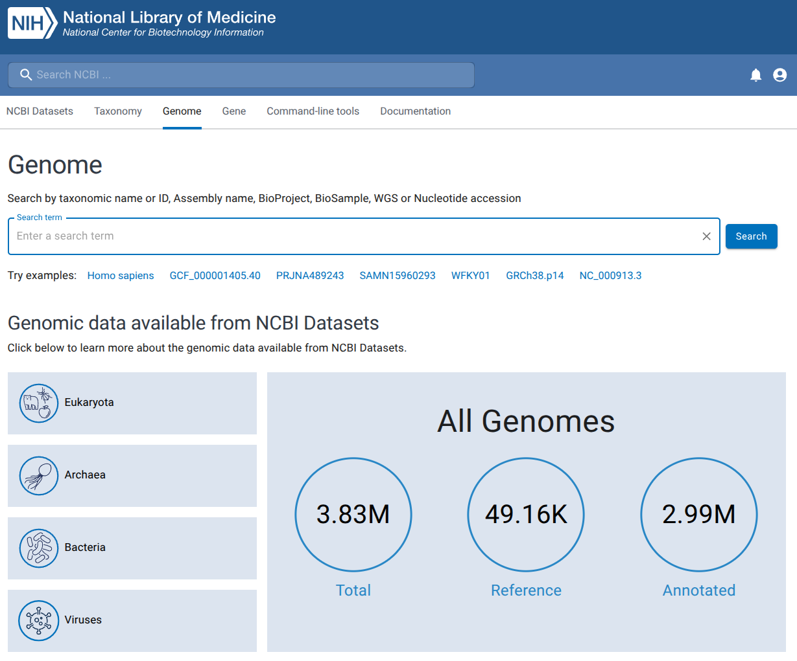
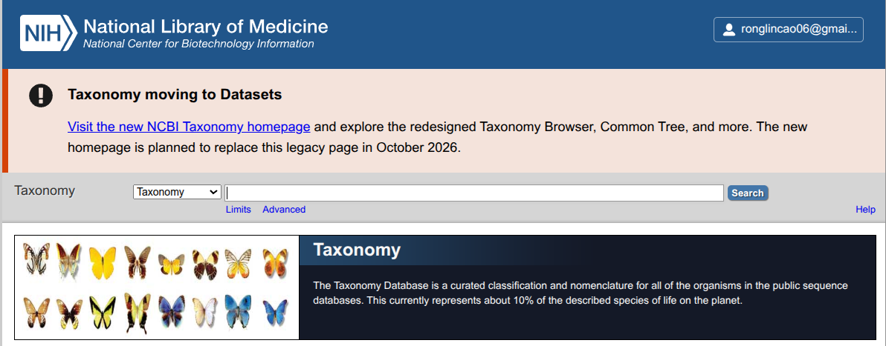

## 实验一： NCBI 浏览与序列文件解读

姓名：曹荣麟 班级：生技2402

实验掌握情况: 基本没有太大问题

## 前情提要：
经过前期的生物信息学理论课的学习，我们掌握了一部分数据库的使用方法和介绍，这节课程展开实践

## 实验目的：

1. 了解 NCBI 上提供的数据库资源

2. 熟悉 GenBank 序列文件

3. 掌握 PubMed搜索文献的方法

## 实验任务一 ： 确定要研究的生物分子

实验材料：玉米 `ZmFIE1`（NCBI Gene ID：542075；别名：`fie1`、`GRMZM2G118205`）

实验方法：

在 [NCBI Gene](https://www.ncbi.nlm.nih.gov/gene/542075) 中检索 `FIE1` 和物种 `Zea mays`，核对基因名称、别名、染色体位置及关联序列。

实验结果：

NCBI 将该基因记录为 **fertilization independent endosperm 1（LOC542075）**，位于玉米第 4 号染色体负链。其编码蛋白为 Polycomb group protein FIE1，是 Polycomb 抑制复合体 2（PRC2）相关组分。玉米存在重复的 `fie1` 与 `fie2` 基因，两者的表达模式和基因组印记调控不同。

文献报道，`Fie1` 在受精前的雌、雄配子及中央细胞中未检测到表达；受精后约 2 天，母源等位基因在初生胚乳中被激活，约 10–11 天达到较高表达。胚乳中父源等位基因保持甲基化并沉默，而母源等位基因低甲基化并表达，说明其表达受基因组印记和 DNA 甲基化调控。FIE1 与胚乳发育相关；不应将其与原稿中的玉米 bZIP/醇溶蛋白调控基因混为一谈。

> 标识核对：原稿中的 `Zm00001eb318740` / `XM_008654730.4` 与本次指定的 `ZmFIE1` 不是同一条 NCBI 基因记录；本报告以下序列分析均改用 `LOC542075` 的 RefSeq 记录。

## 实验任务二 ： 浏览NCBI网站，了解可用的数据库资源

实验材料：https://www.ncbi.nlm.nih.gov 

实验方法：
打开[NCBI HOME][https://www.ncbi.nlm.nih.gov] ，选择不同的数据库进行体验整理总结

实验结果：
1. **Gene（基因）**：[NCBI Gene](https://www.ncbi.nlm.nih.gov/gene/)
   提供不同物种基因的名称、基因组位置、功能注释和相关文献等信息，也能链接到序列、变异和蛋白质结构域记录。适合从基因名称或编号出发，查找该基因的基本资料及相关研究。
    
2. **Genome（基因组）**：[NCBI Genome](https://www.ncbi.nlm.nih.gov/datasets/genome/)
   汇集基因组序列、组装版本和注释等信息，可按物种查找可用的基因组数据，并查看基因在基因组中的位置。比较不同组装或下载特定物种的基因组文件时，可以从这里开始。
    
3. **Taxonomy（分类）**：[NCBI Taxonomy](https://www.ncbi.nlm.nih.gov/taxonomy)
   按分类层级整理生物名称，并将分类单元与 NCBI 的序列及其他资源连接起来。查找物种名称、分类位置或对应的 TaxID 时很有用；遇到分类学争议，还应结合专业文献核对。
    
4. **SRA（序列读取档案）**：[NCBI SRA](https://www.ncbi.nlm.nih.gov/sra)
   保存高通量测序产生的原始 reads，以及实验、样本和测序平台等信息。研究者可以按项目或样本寻找公开数据，下载后重新分析，用于复核研究结果或开展新的分析。 
    
5. **CDD（保守结构域数据库）**：[NCBI CDD](https://www.ncbi.nlm.nih.gov/Structure/cdd/)
   收录蛋白质保守结构域和蛋白家族模型，可用来识别一条蛋白序列中可能存在的结构域及其位置。这些匹配结果能帮助推测蛋白的组成和潜在功能，但仍需结合其他证据判断。
    
6. **PubMed（生物医学文献）**：[PubMed](https://pubmed.ncbi.nlm.nih.gov/)
   提供生物医学和生命科学文献的题录与摘要，可按主题、作者或期刊等条件检索。记录有时会链接到 PubMed Central 或出版商的全文页面，但 PubMed 本身主要用于查找文献，并不保证每篇文章都能免费获取全文。
    
7. **GEO（基因表达综合数据库）**：[NCBI GEO](https://www.ncbi.nlm.nih.gov/geo/)
   收录基因表达和其他功能基因组学研究的数据与实验信息，包括芯片和高通量测序等数据。研究者可以查找相关样本和研究设计，获取公开数据用于比较分析或重新分析。
    
8. **ClinVar（临床变异）**：[NCBI ClinVar](https://www.ncbi.nlm.nih.gov/clinvar/)
   汇总人类基因组变异与疾病、癌症或药物反应相关的解释，并展示提交来源及支持证据。不同提交者的结论可能不一致，因此适合用来查阅和比较现有解释，不能单凭一条记录作出个人诊断。
    
## 实验任务三：序列文件信息解读

实验材料：[NCBI Gene：LOC542075](https://www.ncbi.nlm.nih.gov/gene/542075)；RefSeq mRNA：[NM_001111711.1](https://www.ncbi.nlm.nih.gov/nuccore/NM_001111711.1)

实验方法：

1. 在 [NCBI Gene](https://www.ncbi.nlm.nih.gov/gene/542075) 查询玉米 `FIE1`，记录 Gene ID、染色体位置及关联转录本。
2. 在 [NCBI Genome Data Viewer](https://www.ncbi.nlm.nih.gov/gdv/browser/gene/?id=542075) 查看其基因组位置；位置需连同参考组装版本记录。
3. 在 [NCBI Nucleotide](https://www.ncbi.nlm.nih.gov/nuccore/NM_001111711.1) 打开 RefSeq mRNA 的 GenBank 格式记录，读取序列长度、CDS、外显子、蛋白质登录号和版本信息。
4. 在 NCBI Gene 的序列/转录本列表核对其他转录本记录。

实验结果：

1. 基因记录为 Gene ID **542075**（`LOC542075`，别名 `FIE1`、`GRMZM2G118205`）。本次采用的人工整理 RefSeq mRNA 登录号为 **NM_001111711.1**，全长 **1,787 nt**；该记录标注为 provisional RefSeq，源序列为 AY061964.1。
2. 当前 Gene 摘要将该基因定位于玉米第 4 号染色体负链；在 `NC_050099.1` 参考序列上的区间为 **37,782,883–37,788,772**（坐标按 NCBI 当前注释记录）。不同参考组装的坐标不可直接混用。
3. NM_001111711.1 的 CDS 位于 mRNA 第 **169–1554 nt**，起始密码子为第 **169–171 nt 的 ATG**，终止密码子为第 **1552–1554 nt 的 TGA**。编码蛋白登录号为 **NP_001105181.1**，蛋白长度 **461 aa**（不含终止密码子）。
4. GenBank 记录列出 **14 个外显子、13 个内含子**。外显子在成熟 mRNA 上的区间为：1–167、168–531、532–597、598–723、724–804、805–897、898–973、974–1053、1054–1125、1126–1185、1186–1282、1283–1346、1347–1406、1407–1766。成熟 mRNA 坐标不是基因组坐标；查看基因组外显子位置时应以对应组装的 Gene Viewer/GenBank 注释为准。
5. NCBI 还列有预测转录本变体 **XM_023302232.2（transcript variant X1）**，对应预测蛋白 **XP_023158000.1（isoform X1）**。该 mRNA 长 **1,738 nt**，CDS 为 188–1480 nt，预测蛋白较短（430 aa）；该记录由基因组模型自动预测，不应与人工整理的 NM 记录视为同等证据。两者的转录本/CDS 边界及编码蛋白长度不同。
6. 在 NM_001111711.1 序列中可检出潜在多聚腺苷酸化信号 **AATAAA**，位于第 **1288–1293 nt**。这是序列基序注释线索，不能仅凭该基序确定实际切割和加尾位点。

> 注：原稿中的 XM_008654730.4、Gene ID 103633044 及其坐标/序列截图属于另一基因，已从本任务结果中移除。提交前请在 NCBI Gene Viewer 和 Nucleotide 页面重新截取与 `LOC542075`、`NM_001111711.1` 对应的界面截图，以免沿用错误基因的图片。

## 实验任务四：利用 PubMed 搜索文献

实验材料：[PubMed](https://pubmed.ncbi.nlm.nih.gov/)；检索主题：玉米 `Fie1` / `fertilization independent endosperm 1`。

实验方法：

1. 在 PubMed 中分别检索 `Fie1 maize`、`fertilization independent endosperm 1 Zea mays`，并结合基因记录中的 GeneRIF/关联文献核对结果。
2. 选择与本基因功能直接相关的研究，记录题名、作者、期刊、年份、DOI 和 PMID，并根据摘要概括研究问题与主要结论。

实验结果：

检索到与本基因直接相关的文献：

Hermon P, Srilunchang KO, Zou J, Dresselhaus T, Danilevskaya ON. Activation of the imprinted Polycomb Group Fie1 gene in maize endosperm requires demethylation of the maternal allele. *Plant Molecular Biology*. 2007;64(4):387–395. doi:[10.1007/s11103-007-9160-0](https://doi.org/10.1007/s11103-007-9160-0). PMID:[17437065](https://pubmed.ncbi.nlm.nih.gov/17437065/).

文献摘要显示，研究比较了玉米 `Fie1` 与 `Fie2` 的表达，并分析 DNA 甲基化与 `Fie1` 母源表达的关系。作者报告 `Fie1` 在受精后约 2 天开始于初生胚乳表达，约 10–11 天达到高峰；胚乳中的父源等位基因保持甲基化并沉默，母源等位基因低甲基化并表达。作者据此提出，母源等位基因去甲基化与 `Fie1` 的胚乳印记表达相关。以上为文献报道，不是本次实验直接获得的实验数据。

## 讨论

本次通过 NCBI Gene、Nucleotide 和 PubMed 将 `ZmFIE1` 的基因记录、序列记录与相关文献对应起来。检索过程中发现，基因符号、数据库 Gene ID 和序列登录号是不同层级的标识，不能因为都指向玉米基因就互相替代。原稿中的 `Zm00001eb318740` 与 `XM_008654730.4` 指向另一条基因记录，因此不能继续用于解释 `FIE1` 的序列或功能；本报告改以 Gene ID 542075 及其关联 RefSeq 记录为依据。

序列记录显示，人工整理的 NM_001111711.1 与自动预测的 XM_023302232.2 在长度和 CDS 边界上不同，说明分析时需要查看 RefSeq 记录类型、版本号及其证据，而不能只抄录 accession。PubMed 文献进一步提供了 Fie1 母源等位基因去甲基化与胚乳印记表达的研究证据。需要注意，数据库注释和文献结论均有适用范围：基因组坐标依赖参考组装，预测转录本可能随注释更新而变化，文献摘要也不能替代对全文方法和数据的评估。

通过本次实验，我进一步熟悉了用 Gene ID 定位基因、从 Nucleotide 读取 GenBank 特征表，以及用 PMID/DOI 回溯文献的方法。后续整理报告时，应先核对基因身份和参考组装，再填写序列长度、CDS、外显子及功能结论，避免把相似的基因符号或旧报告中的序列信息沿用到新对象。

[NCBI]: https://www.ncbi.nlm