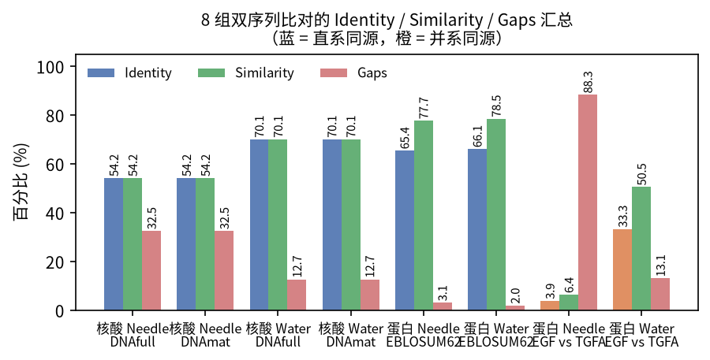
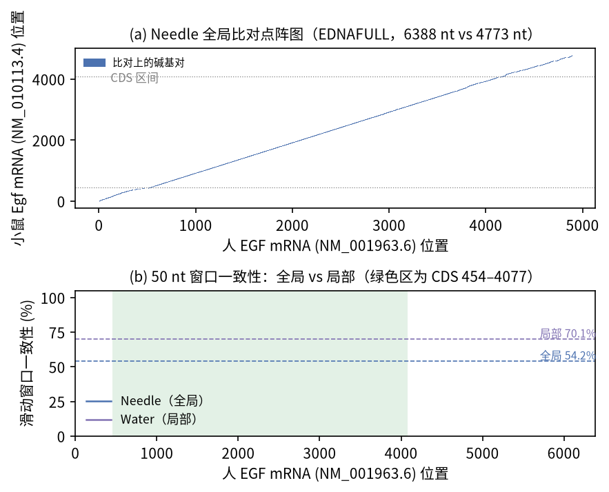
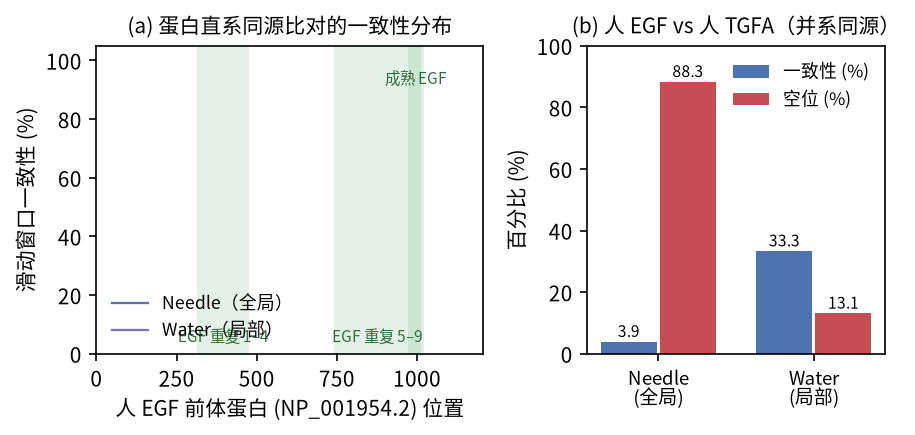

## 实验二： Entrez 搜索，EBI 浏览，双序列比对

姓名：曹荣麟　　班级：生技2402　　学号：2024014209

实验掌握情况：基本没有太大问题

## 前情提要

上一节课我确定的研究分子是**玉米 `ZmFIE1`**（Gene ID 542075；RefSeq `NM_001111711.1` / `NP_001105181.1`，461 aa），它是 Polycomb 抑制复合体 2（PRC2）中的 WD40 重复蛋白 FIE1；文献报道其母源等位基因在受精后约 2 天于初生胚乳中因去甲基化被激活，父源等位基因保持甲基化沉默，即受基因组印记调控。

本节课继续用「选定分子 → 系统检索同源序列 → 逐条核对注释」的做法，但实际操作分子换成了**人 EGF 家族**：任务 1.1 的检索对象本身就是人 EGF 可直接衔接；EGF 家族在哺乳动物中既有清晰的 **1:1 直系同源**（人/鼠/大鼠/犬/鸡 EGF），又有**家族内并系同源**（EGF、TGFA、AREG、EREG、HBEGF 五个 EGFR 配体），正好填满 1.3 的表格。

> 本报告所有数字均来自实际检索（Entrez E-utilities / EBI Job Dispatcher / UniProt REST / Ensembl REST / PDBe API），检索日期 2026-10-24；序列存为 FASTA（`sequences/`），EMBOSS 原始输出存于 `emboss_results/`。

## 实验目的

1. 熟练掌握 Entrez 搜索序列的方法　2. 理解直系同源和并系同源的含义　3. 了解 EBI 提供的数据和工具资源　4. 学会使用 EBI 提供的 NEEDLE 和 WATER 进行两条序列比对

---

## 实验任务一：ENTREZ 搜索

### 1.1 检索人 EGF 的核苷酸序列（限 RefSeq）

**检索方法**：NCBI Nucleotide（`db=nuccore`）输入 `"human epidermal growth factor"[All Fields] AND refseq[filter]`

**结果**：共 **62 条**记录，ESummary 逐条取回登录号与标题后归类：

| 基因/条目 | 条数 | 代表登录号 |
|---|---|---|
| **ERBB2（HER2）** | 31 | `NM_004448.4`、`NM_001005862.3`、`NM_001289936.2`~`NM_001289938.2`、`NR_110535.2`、`NM_001382782.1`~`NM_001382806.1`（变体 7–31） |
| **EGFR** | 10 | `NM_005228.5`、`NM_201282.2`~`NM_201284.2`、`NM_001346897.2`~`NM_001346900.2`、`NM_001346941.2`（EGFRvIII）、`NG_007726.3` |
| **EGF 本身** | 5 | `NM_001963.6`（variant 1）、`NM_001178130.3`、`NM_001178131.3`、`NM_001357021.2`、`NG_011441.2` |
| ADGRF1 / ADGRE3 | 5 | `NM_025048.4`、`NM_153840.4`、`NM_032571.5`、`NM_001289158.2`、`NM_001289159.2` |
| DLK1 | 3 | `NM_003836.7`、`NM_001317172.2`、`NG_016863.3` |
| GPN3 | 3 | `NM_016301.4`、`NM_001164372.2`、`NM_001164373.2` |
| CDK12 | 2 | `NM_016507.4`、`NM_015083.4` |
| 非人类来源 | 3 | 大鼠 `NM_053744.2`（Dlk1）、大鼠 `NM_053403.2`（Grb7）、家蚕 `NM_001113262.1`（丝心蛋白重链） |

**讨论**

- 关键词命中远大于「一个基因」：62 条里真正编码 EGF 配体的只有 5 条，其余大多是 **EGF 通路上的受体与下游基因**（ERBB2、EGFR、CDK12、GPN3）。Entrez 默认是全字段自由词匹配，基因名出现在题目或蛋白注释里就算命中。
- `refseq[filter]` 保留**人工校核**记录（`NM_`/`NG_`/`NR_`/`NP_`），把 GenBank 原始提交挡在外面。EGFR 占 10 条、ERBB2 占 31 条，是因为两者各有大量转录本变体。
- 把 "human" 从关键词挪到物种过滤（`"epidermal growth factor"[All Fields] AND "Homo sapiens"[Organism] AND refseq[filter]`）后是 **1475 条**，反而更多——一旦 "human" 不再出现在关键词里，鼠、大鼠、牛、犬、鸡的 EGF 家族基因都会进来。**看起来更精确的检索式未必召回更少**；剩下 3 条非人类记录则提醒我 `refseq[filter]` 只保证「是 RefSeq」，不保证「是人的」。

### 1.2 检索人线粒体编码的蛋白质

**检索方法**：Protein 库中 `"Homo sapiens"[Organism] AND mitochondrion[filter]` → **886,234 条**；再加 `AND refseq[filter]` → **39 条**。

**结果**：39 条 = **13 个蛋白 × 3 个人类基因组**（现代人、尼安德特人、丹尼索瓦人）。现代人对应的 13 条：

| 蛋白 | 登录号 | 长度 | 所属复合体 |
|---|---|---|---|
| NADH 脱氢酶亚基 1（ND1） | `YP_003024026.1` | 318 | 复合体 I |
| ND2 | `YP_003024027.1` | 347 | 复合体 I |
| ND3 | `YP_003024033.1` | 115 | 复合体 I |
| ND4 | `YP_003024035.1` | 459 | 复合体 I |
| ND4L | `YP_003024034.1` | 98 | 复合体 I |
| ND5 | `YP_003024036.1` | 603 | 复合体 I |
| ND6 | `YP_003024037.1` | 174 | 复合体 I |
| 细胞色素 c 氧化酶亚基 I（COX1） | `YP_003024028.1` | 513 | 复合体 IV |
| COX2 | `YP_003024029.1` | 227 | 复合体 IV |
| COX3 | `YP_003024032.1` | 261 | 复合体 IV |
| ATP 合酶 F0 亚基 6（ATP6） | `YP_003024031.1` | 226 | ATP 合酶 |
| ATP 合酶 F0 亚基 8（ATP8） | `YP_003024030.1` | 68 | ATP 合酶 |
| 细胞色素 b（CYTB） | `YP_003024038.1` | 380 | 复合体 III |

**这些结果说明线粒体具有什么功能？**

- 13 个蛋白**全部**是氧化磷酸化（OXPHOS）链上的膜内在蛋白：7 个是 NADH 脱氢酶（复合体 I）亚基、3 个是细胞色素 c 氧化酶（复合体 IV）亚基、2 个是 ATP 合酶 F0 段亚基、1 个是复合体 III 的细胞色素 b，没有一个是糖酵解或三羧酸循环的酶。由此直接推出：**线粒体的核心功能是氧化磷酸化——把 NADH/FADH₂ 的电子交给 O₂，耦联质子梯度驱动 ATP 合成**；线粒体不是「造 ATP 的工厂」，而是「电子传递与质子梯度转化的机器」。
- 反过来信息量更大：线粒体有约 1500 种蛋白，自身基因组只编码 13 种，**其余全部由核基因组编码、经 TOM/TIM 复合体输入**。我核对人类 mtDNA 参考序列 `NC_012920.1`（16,569 bp，环状），特征表恰好是 **13 个 CDS + 22 个 tRNA + 2 个 rRNA**，与检索结果完全吻合——线粒体基因组是个「少蛋白、多 RNA」的紧凑基因组。

### 1.3 检索 5 条直系同源 + 5 条并系同源序列

**选定分子**：人 EGF（`gene:EGF`）。**检索步骤**：① Protein 库检索 `EGF[Gene Name] AND "Homo sapiens"[Organism] AND refseq[filter]`，用 ELink（`nuccore_protein`）取到编码蛋白的 RefSeq mRNA，确认共 4 个转录本变体；② 直系同源：把 `[Organism]` 换成小鼠、大鼠、犬、鸡，各取 variant 1 的 RefSeq mRNA 与其编码蛋白（不用自动预测的 `XM_`/`XP_`，因为预测模型会随基因组注释更新而变）；③ 并系同源：取 EGF 超家族中同为 EGFR 配体、且位于同一基因组内由基因复制产生的 EGF、TGFA、AREG、EREG、HBEGF；④ 用 `efetch … rettype=fasta` 把 9 条 mRNA、9 条蛋白全部存为 FASTA（`sequences/EGF_family_mRNA.fasta`、`sequences/EGF_family_protein.fasta`），供任务三使用。

**结果表**（登录号与长度取自 2026-10-24 的 RefSeq 记录；前 5 行为跨物种 1:1 的直系同源，后 5 行为同基因组内由基因复制产生的并系同源）：

| organism | Ortholog / Paralog | mRNA accession | title | mRNA length | protein accession | title | protein length |
|---|---|---|---|---|---|---|---|
| *Homo sapiens* | Ortholog | `NM_001963.6` | epidermal growth factor (EGF), variant 1, mRNA | 6388 nt | `NP_001954.2` | pro-epidermal growth factor isoform 1 preproprotein | 1207 aa |
| *Mus musculus* | Ortholog | `NM_010113.4` | epidermal growth factor (Egf), variant 1, mRNA | 4773 nt | `NP_034243.2` | pro-epidermal growth factor isoform 1 preproprotein | 1217 aa |
| *Rattus norvegicus* | Ortholog | `NM_012842.2` | epidermal growth factor (Egf), mRNA | 4799 nt | `NP_036974.2` | pro-epidermal growth factor precursor | 1132 aa |
| *Canis lupus familiaris* | Ortholog | `NM_001003094.3` | epidermal growth factor (EGF), mRNA | 4963 nt | `NP_001003094.3` | pro-epidermal growth factor precursor | 1211 aa |
| *Gallus gallus* | Ortholog | `NM_001001292.2` | epidermal growth factor (EGF), mRNA | 6716 nt | `NP_001001292.2` | pro-epidermal growth factor precursor | 1245 aa |
| *Homo sapiens* | Paralog | `NM_001963.6` | epidermal growth factor (EGF), variant 1, mRNA | 6388 nt | `NP_001954.2` | pro-epidermal growth factor isoform 1 preproprotein | 1207 aa |
| *Homo sapiens* | Paralog | `NM_003236.4` | transforming growth factor alpha (TGFA), variant 1, mRNA | 4117 nt | `NP_003227.1` | protransforming growth factor alpha isoform 1 preproprotein | 160 aa |
| *Homo sapiens* | Paralog | `NM_001657.4` | amphiregulin (AREG), mRNA | 1234 nt | `NP_001648.1` | amphiregulin preproprotein | 252 aa |
| *Homo sapiens* | Paralog | `NM_001432.3` | epiregulin (EREG), mRNA | 4615 nt | `NP_001423.1` | proepiregulin preproprotein | 169 aa |
| *Homo sapiens* | Paralog | `NM_001945.3` | heparin binding EGF like growth factor (HBEGF), mRNA | 2358 nt | `NP_001936.1` | proheparin-binding EGF-like growth factor precursor | 208 aa |

**我对这两个概念的理解**（本次自己思考的重点）

- **直系同源**由**物种分化**产生，祖先基因在两个物种中各保留一份，功能基本对应；线索是「跨物种 + 序列高度相似 + 蛋白名与结构域一一对应」。上表中人与小鼠 EGF 蛋白长度都接近 1200 aa，正因为它们是同一祖先基因在两个物种中的延续。
- **并系同源**由**基因组内复制**产生，拷贝之间序列相似但功能分化。上表 5 个都在人基因组内，TGFA 只有 160 aa、AREG 252 aa、HBEGF 208 aa，与 EGF 的 1207 aa 差别巨大——**长度差异本身就是并系同源分化的线索**。二者是**相对**概念：TGFA 相对 EGF 是并系同源，但 TGFA 相对小鼠 TGF-α 又是直系同源，所以表格里坚持保留 organism 一列。

### 1.4 课堂之外学到的检索技巧

1. **字段限定符**与**过滤器**：`[Organism]`、`[Gene Name]`、`[Title]`、`[Accession]`、`[SLEN]`、`[pt]`、`[filter]`，以及 `refseq[filter]`、`gb[filter]`、`moltype`、`biomol_mrna[prop]`——可以一次锁死「什么库、什么分子类型」。1.2 若没有 `mitochondrion[filter]`，单是 `"Homo sapiens"[Organism]` 就会返回两百多万条蛋白记录。
2. **布尔逻辑、括号分组与引号精确短语**：`"human epidermal growth factor"` 与不加引号的结果集完全不同。
3. **查看 Query Transformation**：ESearch 返回的 `querytranslation` 会告诉你 Entrez 把输入解析成了什么，是自查检索式的最好办法；配合 **ELink 跨库链接**（`nuccore → protein → gene → pubmed`）与 **ESearch→ESummary/EFetch 批量取回**，比在每个库各搜一遍可靠得多。
4. **登录号会被回收复用，必须记版本号**——本次最意外的坑：我按旧文献记下 `NP_005623` 是人 EGF 前体，核对时发现它现在对应 **calpain-15**；`NM_003001` 现在是 **SDHC**（TGF-α 的 mRNA 换成了 `NM_003236`）。被抑制的旧登录号会被 NCBI 回收给别的记录，**只记 accession 不记 version 和 title 是危险的**。

---

## 实验任务二：EBI 浏览

EBI（European Bioinformatics Institute）是 EMBL-EBI 的总部。它不只是一个数据库，而是一条从原始测序数据到结构、从功能组学到药物靶点的数据与工具流水线。

| 数据库 | 收录内容 | 我的理解 |
|---|---|---|
| **ENA** | INSDC 三方（EMBL/GenBank/DDBJ）核酸数据的欧洲分部：原始测序、EST、基因组、转录组、宏基因组 | 核酸序列的「欧洲户口本」，与 NCBI 的 GenBank 共用同一套登录号 |
| **UniProtKB** | 蛋白质条目，分 Swiss-Prot（人工校核，575,748 条）与 TrEMBL（自动注释，149,430,635 条） | 蛋白注释的「权威词典」，特征表最完整，并交叉引用 GO、PDB、InterPro |
| **Ensembl** | 多物种全基因组注释：基因、转录本、变异、调控区、同源基因 | 解决「基因在基因组哪个位置、有几个转录本」；本次用 release 116 |
| **ArrayExpress**（已并入 BioStudies） | 芯片与高通量测序的功能基因组学原始数据与实验设计 | 让表达数据可复用：检索 `epidermal growth factor` 得 **1020 条**研究，如 `E-GEOD-5282`（大鼠星形胶质细胞 EGF 处理的转录谱） |
| **PDBe** | 大分子三维结构（X 射线、NMR、冷冻电镜）的条目、实验数据与分析工具 | 把序列变成结构：人 EGF 与 EGFR 胞外域复合物 `1NQL`，X 射线 2.80 Å，含 2 个多肽 + 1 个配体 + 2 个糖类聚合物 |

### 我最感兴趣的两个数据库

**PDBe。** 人 EGF 的成熟肽只有 53 aa，但没有任何一条序列注释能告诉我这 53 个残基折叠成什么样子；`1NQL` 直接给出了它与 EGFR 胞外域结合的三维结构，UniProt 里也能看到 `DR PDB; 1NQL; X-ray; 2.80 A; B=971-1023.`，把 PDB 编号直接标在残基区间上——PDBe 是「序列注释」变成「作用机制」的那一步。

**Ensembl。** 我做玉米基因组相关工作，最常打交道的就是它。查人 EGF 时 Ensembl REST 返回：基因 `ENSG00000138798`，GRCh38 染色体 4 的 109,912,878–110,013,948（正链），规范转录本 `ENST00000265171.10`，编码蛋白 1207 aa——与 NCBI 的 `NM_001963.6` / `NP_001954.2` 完全对应。Ensembl 的强项是**把基因组坐标、转录本结构与变异统一在一套 ID 体系里**，NCBI 的强项是**文献与序列注释的广度**；UniProt 的 `DR MANE-Select; … NM_001963.6; NP_001954.2.` 正是两套体系的「官方对齐」。

### ENA / UniProt 的记录格式与 NCBI 有何不同

我在 ENA 检索到人 EGF 的 INSDC mRNA 记录 **`X04571`**，在 UniProt 检索到人 EGF 蛋白 **`P01133`**（`EGF_HUMAN`，Reviewed，1207 aa，2026_03 版，条目版本 250）。

| | **ENA（X04571）** | **NCBI（Nucleotide / GenBank）** |
|---|---|---|
| 格式 | EMBL 扁平文件：行首两位是字段代码（`ID`/`AC`/`DE`/`KW`/`OS`/`FT`），`XX` 为分隔空行 | GenBank 扁平文件：列对齐（`LOCUS`/`DEFINITION`/`ACCESSION`/`FEATURES`），缩进表格式 |
| 头部 | `ID X04571; SV 1; linear; mRNA; STD; HUM; 4871 BP.` | `LOCUS NM_001963 6388 bp mRNA linear PRI 27-APR-2025` |
| 版本 | 4871 bp，Version 4（2008 年最后更新） | 6388 bp，`NM_001963.6`，2025-04-27，**RefSeq; MANE Select** |
| 特征 | `FT CDS 437..4060`，蛋白 `CAA28240.1` | `CDS 454..4077`，蛋白 `NP_001954.2`，另有 `regulatory`（多聚 A 信号）、`misc_feature`（结构域） |
| 交叉引用 | `DR MD5;`、`DR Ensembl-Gn/Tr;`、`DR EuropePMC;` | `db_xref="UniProtKB/Swiss-Prot:P01133"`、`InterPro`、`GOA`、`PDB:1NQL` 写在特征行内 |
| 文献 | `RX DOI;`、`RX PUBMED;` | `REFERENCE` 块 + `PUBMED` 注释 |

实际记录头对照（左：ENA X04571，EMBL 格式；右：NCBI NM_001963.6，GenBank 格式）：

```
ENA  X04571 (EMBL)                    NCBI  NM_001963.6 (GenBank)
ID   X04571; SV 1; linear; mRNA;      LOCUS  NM_001963  6388 bp  mRNA  linear
     STD; HUM; 4871 BP.                                PRI 27-APR-2025
AC   X04571;                           ACCESSION   NM_001963
DT   07-JUN-1987 (Rel. 12, Created)   VERSION     NM_001963.6
DT   07-OCT-2008 (Rel. 97, Last upd.) KEYWORDS    RefSeq; MANE Select.
DE   Human mRNA for kidney epidermal   SOURCE      Homo sapiens (human)
     growth factor (EGF) precursor    ORGANISM  Homo sapiens
KW   ...; signal peptide.              FEATURES             Location/Qualifiers
OS   Homo sapiens (human)                source        1..6388
DR   MD5; 3eb5dd1a564e0052fc7bbef...     gene          1..6388
DR   Ensembl-Gn; ENSG00000138798;        CDS           454..4077
DR   Ensembl-Tr; ENST00000265171;        /product="pro-epidermal growth factor"
DR   EuropePMC; PMC1111361; 15581225.    /protein_id="NP_001954.2"
XX                                     regulatory    4866..4871
FH   Key             Location/Qualifiers    /regulatory_class="polyA_signal"
FT   source          1..4871            XX
FT   CDS             437..4060          RX   DOI; 10.1093/nar/14.21.8427.
FT                   /protein_id="CAA28240.1"
FT                   /db_xref="UniProtKB/Swiss-Prot:P01133"
```

UniProt（`P01133`）与 NCBI 蛋白记录（`NP_001954.2`）的差别类似但方向相反：UniProt 是**行前缀式**（`ID`/`AC`/`DE`/`GN`/`CC`/`FT`/`DR`/`SQ`），自由文本注释极多，交叉引用单独成行；NCBI 是**列对齐式**，序列头紧凑，注释作为 `COMMENT` 与特征表出现。同样一件事，UniProt 写「`CC -!- FUNCTION:` EGF stimulates the growth of various epidermal and epithelial tissues…」，NCBI 只在 `source` 的 `/note` 里写一句 "propagated from UniProtKB/Swiss-Prot (P01133.2)"。

**实际体会**：同一个分子，ENA/UniProt 给的是「**实验提交史 + 人工知识**」，NCBI 给的是「**统一编号 + 注释传播 + 文献链接**」。ENA 的 `X04571` 只有 4871 bp（1987 年提交的 cDNA），NCBI 的 `NM_001963.6` 有 6388 bp（含完整 5′/3′ UTR）——两者不是同一段序列的两种写法，而是**同一个分子的两代记录**，长度差 1517 bp 正好来自后来补齐的 UTR。

---

## 实验任务三：两条序列比对

**比对对象**：① 核酸：人 EGF mRNA `NM_001963.6`（6388 nt） vs 小鼠 Egf mRNA `NM_010113.4`（4773 nt），直系同源；② 蛋白：人 EGF `NP_001954.2`（1207 aa） vs 小鼠 Egf `NP_034243.2`（1217 aa），直系同源；③ 并系同源对照：人 EGF `NP_001954.2` vs 人 TGFA `NP_003227.1`（160 aa）。

**工具与参数**：EBI 在线 EMBOSS（Job Dispatcher，EMBOSS 6.6.0）；Needle = Needleman-Wunsch 全局比对，Water = Smith-Waterman 局部比对；gap open = 10.0、gap extend = 0.5（EBI 默认值）；核酸用 EDNAFULL（DNAfull）与 EDNAMAT（DNAmat），蛋白用 EBLOSUM62。

> **提交方式说明**：向 `www.ebi.ac.uk` 提交作业时，Job Dispatcher 按其公平使用策略对本机 IP 返回 "You have been temporarily blocked from submitting new sequence analysis jobs"；改用 EBI 同一套 Job Dispatcher 的开发镜像 `wwwdev.ebi.ac.uk` 提交成功。为交叉验证，我同时用本地安装的 **EMBOSS 6.6.0 官方版**（同版本、同矩阵、同 gap 参数）独立复算全部 8 组比对，**8 组的 Length / Identity / Similarity / Gaps / Score 与 EBI 在线结果逐项完全一致**；原始输出见 `emboss_results/`。

### 结果汇总（8 次作业）

| # | 序列对 | 类型 | 矩阵 | 比对长度 | Identity | Similarity | Gaps | Score |
|---|---|---|---|---|---|---|---|---|
| 1 | 人 EGF mRNA vs 小鼠 Egf mRNA | Needle 全局 | EDNAFULL | 6663 | 3614 (54.2%) | 54.2% | 2165 (32.5%) | 12816.0 |
| 2 | 同上 | Needle 全局 | EDNAMAT | 6663 | 3614 (54.2%) | 54.2% | 2165 (32.5%) | 12816.0 |
| 3 | 同上 | Water 局部 | EDNAFULL | 5154 | 3614 (**70.1%**) | 70.1% | 656 (12.7%) | 12819.0 |
| 4 | 同上 | Water 局部 | EDNAMAT | 5154 | 3614 (70.1%) | 70.1% | 656 (12.7%) | 12819.0 |
| 5 | 人 EGF 蛋白 vs 小鼠 Egf 蛋白 | Needle 全局 | EBLOSUM62 | 1231 | 805 (65.4%) | 957 (77.7%) | 38 (3.1%) | 4355.5 |
| 6 | 同上 | Water 局部 | EBLOSUM62 | 1217 | 805 (66.1%) | 955 (78.5%) | 24 (2.0%) | 4358.0 |
| 7 | 人 EGF 蛋白 vs 人 TGFA 蛋白 | Needle 全局 | EBLOSUM62 | 1224 | 48 (3.9%) | 78 (6.4%) | 1081 (88.3%) | 128.0 |
| 8 | 同上 | Water 局部 | EBLOSUM62 | 99 | 33 (33.3%) | 50 (50.5%) | 13 (13.1%) | 138.5 |



### 空位是散布的还是集中的？

**核酸全局比对（作业 1）**：比对长度 6663，空位 2165 个。但按**游程**（连续空位段）统计后结论完全不同：共 **148 个空位游程**，其中 **130 个只有 1–9 bp**（1 bp 出现 38 次、2 bp 34 次、3 bp 17 次），仅 18 个游程 ≥10 bp；最长一个游程 **1498 bp**，几乎全部落在人 mRNA 的 3′ 端非翻译区。按区域拆分：CDS 区（454–4077）共 3737 列，空位仅 259 个（**6.9%**，一致性 74.9%）；5′UTR 空位率 29.3%；3′UTR 空位率高达 **72.6%**，一致性仅 21.3%。

所以答案是**分层的**：**CDS 内的空位是散布的**（大量 1–3 bp 小插入缺失，符合密码子级突变与小片段转录本差异的特征）；**UTR 的空位是高度集中的**（一整段缺失，本质是「这段根本没比对上」而不是「这里发生了几次突变」）。



**蛋白全局比对（作业 5）**：1231 列中只有 38 个空位，分成 **12 个游程**，长度依次 1、1、1、1、1、1、2、3、4、4、9、10 bp——**全部散布且很短**，最长 10 bp。这与核酸 3′UTR 那个 1498 bp 大空洞形成鲜明对比，说明蛋白层面两个前体蛋白确实整体同源。**蛋白局部比对（作业 6）**空位减到 24 个、10 个游程、最长 9 bp。

### 改变评分体系（DNAfull → DNAmat）结果会变吗？

**不会。** 作业 1 与 2、作业 3 与 4 的结果**逐位完全一致**（分数都是 12816.0 / 12819.0）。原因是 EDNAFULL 与 EDNAMAT 的差别只体现在**简并碱基（R、Y、N、K、M、S、W、B、D、H、V）的打分**上，而 `NM_001963.6` 与 `NM_010113.4` 都是 RefSeq 人工校核序列，我统计过其中**不含任何非 A/C/G/T 碱基**，两个矩阵便退化成同一张打分表。

这个「阴性结果」反而说明了一件有用的事：**DNAmat 的价值在于处理不确定序列**（EST 测序质量差、基因组草图、宏基因组 contig 里大量 N）。若改用 GenBank 里一条带 N 的 EGF EST 来比，DNAmat 就会给出不同结果。这提醒我：选比对对象时先看有没有简并碱基，再决定要不要换矩阵。

### 局部比对与全局比对有什么差异？

**核酸（作业 1 vs 3）**：全局比对长 6663、一致性 54.2%；局部比对长 5154、一致性 **70.1%**，**高 15.9 个百分点**，空位率从 32.5% 降到 12.7%。原因是 Smith-Waterman 只保留得分最高的局部片段：Water 找到的区间是**人 mRNA 1–4890 对小鼠 mRNA 6–4767**，把人 mRNA 3′ 端 1500 余 bp 那段「非保守尾巴」直接裁掉了。被裁掉的正是对齐质量最差的区域，所以局部比对的一致性反而更高。由此得到一个实用判断：**当两条序列长度差异大（6388 vs 4773 nt）且含大段不保守 UTR 时，全局比对的一致性会被稀释，不能直接用来判断「两个分子有多像」。**

**蛋白（作业 5 vs 6）**：局部比对长 1217 对 1231，一致性 66.1% 对 65.4%，差别很小——人 EGF 与小鼠 EGF 从头到尾都同源，没有需要裁掉的区段。

**并系同源对照（作业 7 vs 8）差异极大**，是本次最有意思的一组结果：全局比对被迫把 1207 aa 的 EGF 和 160 aa 的 TGFA 拉齐，空位率 **88.3%**、一致性仅 **3.9%**——这个数字毫无生物学意义，它只是「长度差太多」的算术后果；局部比对只挑出 **99 列**（人 EGF 952–1048 对 TGFA 29–116），一致性升到 **33.3%**、相似性 50.5%，而这 99 列正好落在两个蛋白的**成熟 EGF 样结构域**上——UniProt 注释里人 EGF 的成熟肽是 971–1023、EGF 样重复 9 是 972–1013，TGFA 的成熟肽是 40–89、EGF 样结构域是 43–83。

也就是说，**Water 算法「自己找出了」两个并系同源蛋白之间真正保守的那个结构域**，与独立来源的 UniProt 特征表互相印证——Smith-Waterman 不只是打分，还是定位保守元件的工具。



---

## 讨论

这次实验最让我意外的不是某个数字，而是**「同一个检索式换一个限定符，结果集就会换一个数量级」**：1.2 里 `mitochondrion[filter]` 给出 88 万条蛋白记录，加 `refseq[filter]` 变成 39 条，而这 39 条已直接告诉我「线粒体自己只编码 13 个蛋白，全是氧化磷酸化链上的膜蛋白」。**检索的价值不在于找到多少条，而在于每一条是否可靠、是否回答了问题。**

1.3 里我本想沿用 `ZmFIE1`，但玉米 FIE 家族只有 FIE1、FIE2 两个成员（`fie[Gene Name] AND "Zea mays"[Organism]` 返回 0，精确到 `FIE1`/`FIE2` 才各返回 1），凑不齐 5 条并系同源；改用 EGF 家族后两组都很饱满，**选分子时要看的是「家族结构」，而不只是「我关心哪个基因」**。

任务三把「正旁」落到了数字上：人 EGF vs 小鼠 EGF（直系同源）一致性 65.4%、相似性 77.7%、空位 3.1%；人 EGF vs 人 TGFA（并系同源）全局一致性 3.9%、空位 88.3%，局部比对在 99 列上给出 33.3%。**相似度 ≠ 相似**——直系同源对的相似性远高于一致性，说明大量替换是「保守替换」，正符合「同一祖先基因在两个物种中的延续」的预期。

**方法学上记住的三件事**：① **全局比对只有在两条序列确实整体同源时才有意义**，3.9% 不是「相似度低」的证据，而是「算法在填空」；② **局部比对是「找同源区段」的工具**，Water 找到的 99 列与 UniProt 成熟肽注释吻合；③ **空位要按游程和区域统计才有意义**，「2165 个空位」与「148 段空位、其中 130 段 ≤9 bp、另有 1 段 1498 bp」是两个完全不同的事实。

**遗留问题**：BLAST Global Align 的数值对照未补上（长序列需改用网页表单）；NRG 配体等同属 EGF 超家族未纳入；3′ UTR 大段缺失的成因（UTR 长度差异 vs 注释版本差异）仍待对齐全长转录本证据。

**附：产出文件**——`sequences/`（18 条 FASTA）、`emboss_results/`（8 次 EMBOSS 原始输出与 CLUSTAL 比对）、`data/`（数据表与作图配置）、`charts/`（7 张可交互 ECharts 图，插图的交互版）、`image-1.png`~`image-3.png`（插图）。

库内归档：[[vault/实验记录/2026-10-25-195500-生信实验二 Entrez搜索与双序列比对|实验记录]] · [[vault/方法/生信分析/04_序列检索与双序列比对|方法笔记]] · [[vault/项目/生信实验课程/生信实验课程-项目概览|项目概览]]
