>[!warning] 版本提示
>本书为 **2006 年第 1 版**。现行考试依据是 **《信息系统管理工程师教程（第 2 版）》**（清华社 2024-10，20 章），
>两版**重合极少**：第 1 版的第 1–6 章（硬件/操作系统/语言/配置/数据结构/多媒体）在第 2 版已被删除或压缩。
>本页仅作**扩展参考**，备考请以 [[知识体系]]（第 2 版官方考纲）为准。

# 第1章 计算机硬件基础

本章主要介绍计算机硬件的基础知识，包括计算机基本组成，中央处理器、存储器、I/O设备等主要部件的性能和基本工作原理，以及计算机体系结构、计算机存储系统等内容。

## 1.1 计算机基本组成

自 1946 年世界上出现第一台计算机以来，计算机的硬件结构和软件系统都已发生了惊人的变化。但就其基本组成而言，仍为冯·诺伊曼型计算机的设计思想。即一个完整的计算机硬件系统由：运算器、控制器、存储器、输入设备和输出设备 5 大部分组成。如图 1-1 所示。

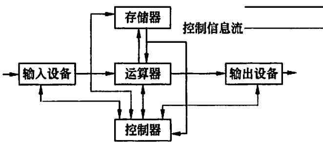  
图1-1 计算机的基本组成

其中运算器与控制器合称为中央处理器。内存储器和中央处理器合在一起称为主机。在计算机硬件系统中不属于主机的设备都属于外部设备，简称外设，包括输入、输出设备及外存储器。

\- 运算器。进行算术和逻辑运算的部件，运算数据以二进制格式给出，它可从存储器取出或来自输入设备，运算结果或写入存储器，或通过输出设备输出；

\- 控制器。协调整个计算机系统的正常工作。它主要包括指令寄存器、指令译码及时序控制等部件；运算器与控制器一般又称为中央处理部件（Central Processing Unit，CPU），它是计算机的核心部件。

\- 存储器。存放数据和程序的部件，它通过地址线和数据线与其他部件相连。

\- 输入/输出部件。包括各类输入/输出设备及相应的输入/输出接口。

## 1. 运算器

运算器是计算机中用于信息加工的部件。它能对数据进行算术逻辑运算。算术运算按算术规则进行运算，如加、减、乘、除及它们的复合运算。逻辑运算一般泛指非算术性运算，例如：比较、移位、逻辑加、逻辑乘、逻辑取反及"异或"操作等。

运算器通常由算术逻辑运算部件（ALU）和一些寄存器组成。如图 1-2 所示是一个最简单的运算器示意图。ALU 是具体完成算术逻辑运算的部件。寄存器主要用于存放操作数、结果及操作数地址。累加器除了存放参加运算的操作数外，在连续运算中，还用于存放中间结果和最终结果。寄存器的数据一般是从存储器中取得，累加器的最后结果也应存放到存储器中。现代计算机的运算器中用多个寄存器，如 8 个、16 个、32 个或者更多，构成一个通用寄存器组，以减少访问存储器的次数，提高运算器的速度。

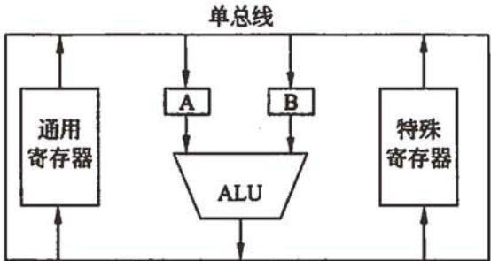  
图 1-2 运算器简单示意图

## 2. 控制器

控制器是指挥、协调计算机各大部件工作的指挥中心。控制器工作的实质就是解释、执行指令。它每次从存储器中取出一条指令，经分析译码，产生一串微操作命令，发向各个执行部件并控制各部件，使整个计算机连续地、有条不紊地工作。

为了使计算机能够正确执行指令，CPU 必须能够按正确的时序产生操作控制信号，这是控制器的主要任务。

如图 1-3 所示，控制器主要由下列部分组成。

(1) 程序计数器 (PC)。又称指令计数器或指令指针 (IP)，在某些类型的计算机中用来存放正在执行的指令地址；在大多数机器中则存放要执行的下一条指令的地址。指令地址的形成有两种可能：一是顺序执行的情况，每执行一条指令，程序计数器加"1"以形成下条指令的地址。该加"1"计数的功能，有的机器是 PC 本身具有的，也有的机器是借用运算器完成的；二是在某些条件下，需要改变程序执行的顺序，这常由转移类指令形成转移地址送到 PC 中，作为下条指令的地址。

(2) 指令寄存器 (IR)。用以存放现行指令, 以便在整个指令执行过程中, 实现一条

指令的全部功能控制。

（3）指令译码器。又称操作码译码器，它对指令寄存器中的操作码部分进行分析解释，产生相应的控制信号提供给操作控制信号形成部件。

（4）脉冲源及启停控制线路。脉冲源产生一定频率的脉冲信号作为整个机器的时钟脉冲，是周期、节拍和工作脉冲的基准信号。启停线路则是在需要的时候保证可靠地开放或封锁时钟脉冲，控制时序信号的发生与停止，实现对机器的启动与停机。

（5）时序信号产生部件。以时钟脉冲为基础，产生不同指令相对应的周期、节拍、工作脉冲等时序信号，以实现机器指令执行过程的时序控制。

（6）操作控制信号形成部件。综合时序信号、指令译码信息、被控功能部件反馈的状态条件信号等，形成不同指令所需要的操作控制信号序列。

(7) 中断机构。实现对异常情况和某些外来请求的处理。

（8）总线控制逻辑。实现对总线信息传输的控制。

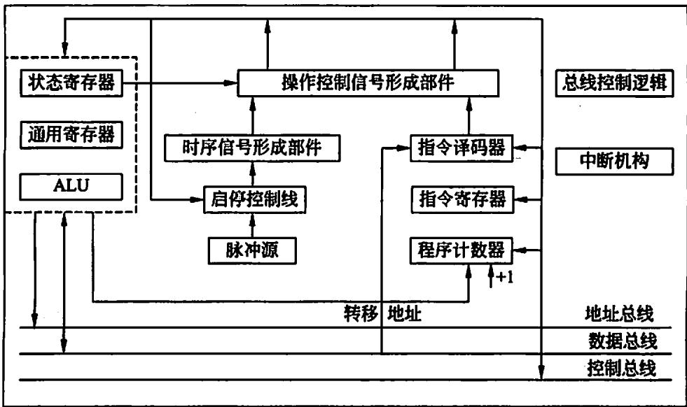  
图1-3 控制器组成图

## 1.1.2 存储器

存储器是存放二进制形式信息的部件。在计算机中它的主要功能是存放程序和数据。程序是计算机操作的依据，数据是计算机操作的对象。不论是程序和数据，在存储器中都以二进制形式的"1"或"0"表示，统称为信息。我们可以对存储器中的内容进行读或写操作。

按存储器在计算机中的功能分类：

(1) 高速缓冲存储器 (Cache)。目前由双极型半导体组成, 构成计算机系统中的一个高速小容量存储器。其存取速度能接近 CPU 的工作速度, 用来临时存放指令和数据。

（2）主存储器。主存储器是计算机系统中的重要部件，用来存放计算机运行时的大量程序和数据，主存储器目前一般用 MOS 半导体存储器构成。

CPU 能够直接访问的存储器称内存储器，高速缓存和主存都是内存储器。在配置了高速缓存的计算机内，主存储器和高速缓存之间要不断交换数据。

如果计算机没有配置高速缓存，内存储器就是主存储器，两个名称可以换用。

(3) 辅助存储器。辅助存储器又称外存储器。外存储器主要由磁表面存储器组成, 近年来, 光存储器应用已很广泛, 渐渐成为一种重要的辅助存储器。外存储器的内容需要调入主存后才能被 CPU 访问。外存储器的特点是容量大, 所以可存放大量的程序和数据。

## 1.1.3 常用 I/O 设备

## 1. 输入输出设备概述及分类

输入输出设备（又称外围设备）是计算机系统与人或其他设备之间进行信息交换的装置。输入设备的功能是把数据、命令、字符、图形、图像、声音和电流、电压等信息，变成计算机可以接收和识别的二进制数字代码，供计算机进行运算处理。输出设备的功能是把计算机处理的结果，变成人最终可以识别的数字、文字、图形、图像和声音等信息，打印或显示出来，以供人们分析与使用。

由于计算机技术的迅速发展与应用领域的不断扩大，输入输出设备种类日益增多，所处理的信息类型也不断增加。输入输出设备智能化程度越来越高，从而使得输入输出的速度、精度、质量、可靠性以及应用的灵活性，方便性不断提高。

输入输出设备有多种分类的方法。如果按信息的传输方向来分可以分成输入、输出与输入/输出三类设备。

## (1) 输入设备

键盘、鼠标、光笔、触摸屏、跟综球、控制杆、数字化仪、扫描仪、语言输入、手写汉字识别、以及光学字符阅读机（OCK）等。这类设备又可以分成两类：采用媒体输入的设备和交互式输入设备。采用媒体输入的设备如纸带输入机、卡片输入机、光学字符阅读机等，这些设备把记录在各种媒体（如纸带、卡片……）上的信息送入计算机。一般成批输入，输入过程中使用者不作干预。交互式设备有键盘、鼠标、触屏、光屏、跟踪对球等。这些设备由使用者通过操作直接输入信息，不借助于记录信息的媒体。输入信息可立即显示在屏幕上，操作员可以即时进行删除、修改、移动等操作。交互式输入设备是近年来研究的热门话题之一，通过它们以建立人机之间的友好界面。

## (2) 输出设备

显示器、打印机、绘图仪、语音输出设备，以及卡片穿孔机、纸带穿孔机等。将计算机输出的数字信息转换成模拟信息，送往自动控制系统进行过程控制，这种数模转换设备

也可以视为一类输出设备。

## (3) 输入输出设备

磁盘机、磁带、可读/写光盘、CRT终端、通信设备等。这类设备既可以输入信息，又可以输出信息。

输入输出设备如果按功能分，也可以分成以下3类。

## ① 用于人机接口

键盘、鼠标、显示器、打印机等。这类设备用于人机交互信息，且操作员往往可以直接加以控制。这类设备又可以称为字符型设备，或面向字符的设备，即输入输出设备与主机交换信息以字符为单位，这时主机对外设的控制方法往往不同于其他类型设备。

## ② 用于存储信息

磁盘、光盘、磁带机等。这类设备用于存储大容量数据，作为计算机的外存储器使用。这类设备又可以称为面向信息块的设备，即主机与外设交换信息时不以字符为单位，而以由几十或几百个字节组成的信息块为单位，这时主机对外设的控制也不同于字符型设备。

## ③ 机一机联系

通信设备（包括调制解调器）、数/模、模/数转换设备，主要用于机一机通信。

## 2. 输入设备

输入设备最常用的是键盘与鼠标。

## (1) 键盘

键盘是由一组按键和相应的键盘控制器组成的输入设备，其功能是使用者可通过击各键向计算机输入数据、程序和命令等，是计算机不可缺少的最常用输入设备。按键开关的作用是将操作员的按键动作转换成与该按键对应的字符或控制功能的电信号。按键开关可归纳成两类：一类是触点式按键，它借助由机械簧片构成的触点开关的接通或断开，来产生电信号；另一类是非触点式开关，利用电压、电流或电磁场的变化产生输出信号。计算机中基本上使用后一类开关。

键盘控制器由一些逻辑电路或单片机组成，其功能是进行扫描，判断按键的位置，然后将键盘上的位置码转换成相应的 ASCII 码，输入计算机。由于键盘控制器的构成方式不同，键盘可以分成编码键盘和非编码键盘两类。

键盘上也可以输入如汉字等非西文字符，这由各种汉字输入法自行定义。键盘位置码输入计算机，经过汉字输入软件的处理，转换成该汉字所对应的内码，再进行显示、存储等其他操作。

## (2) 鼠标器

鼠标器（mouse）是一种相对定位设备。它不像键盘那样能进行字符或数字的输入，主要是在屏幕上定位或画图用。它在计算机上的应用要比键盘晚，随着计算机图形学与图像处理技术的发展，鼠标得以广泛应用。

鼠标器是由于其外形如老鼠而得名，通过电缆与主机相连接。鼠标器在桌上移动，其底部的传感器检测出运动方向和相对距离，送入计算机，控制屏幕上的鼠标光标作相应移动，对准屏幕上的图标或命令，按下鼠标上的相应按钮，完成指定的操作。

根据鼠标器所采用传感器技术的不同，鼠标器可以分成两类：机械式与光电式。

\- 机械式鼠标器：其底部有一个圆球，鼠标移动时，圆球滚动带动与球相连的圆盘。圆盘上的编码器把运动方向与距离送给主机，经软件处理，控制光标作相应移动。该类鼠标器简单，使用方便，但容易磨损，精度差。

\- 光电式鼠标器：其底部无圆球，而是由光敏元件和光源组成。使用时，光源发射光线在网格上反射后为光敏器件所接收，测出移动方向和距离，送入计算机，控制光标的移动。这类鼠标器精度高，可靠性好，但要有专门的网格板。

鼠标器与主机相连有两种方式，通过总线接口或通信接口。总线接口需要鼠标接口板，通信接口则是把鼠标器接在通信口上。目前大部分个人计算机把鼠标器接在串行通信口COM1或COM2上。

## 3. 输出设备

## (1) 打印机

打印机是计算机系统中最基本的输出设备。由于打印机打印结果直观、易阅读，便于永久保存，且由于目前打印机的打印质量不断提高，能打印单色或彩色的高清晰度的文字、图形或图像。目前使用的打印机，以印字原理可以分成击打式打印机和非击打式打印机两类，以输出方式又可分为串行打印机和并行打印机两种。

## ① 击打式打印机

击打式打印机是以机械力量击打字锤从而使字模隔着色带在纸上打印出字来的设备，这是最早研制成功的计算机打印设备。该类设备按字锤或字模的构成方式来分，又可以分成整字形击打印设备和点阵打印设备两类。

整字形击打设备利用完整字形的字模每击打一次印出一完整字形。这类设备的优点是印字美观自然，可同时复印数份。缺点是噪音大，印字速率低，字符种类少，无法打印汉字或图形，且易磨损，这类打印设备若按字模载体的形态分，又可以分成球形、菊花瓣形、轮式、鼓式等打印机。点阵式击打设备是利用多根针经色带在纸上打印出点阵字符的印字设备，它又称为针式打印机。目前有7针、9针、24针或48针的印字头。这类打印设备结构简单，印字速度快，噪声小，成本低，且可以打印汉字或图形、图像，是目前仍在广泛使用的一类打印设备。

## ② 非击打式印字机

非击打式印字机是一种利用物理的（光、电、热、磁）或化学的方法实现印刷输出的设备。与击打式打印设备不同，这类设备的印字头不与纸或其他媒体接触，或虽接触但无击打动作。这类设备打印无噪声，印字速度快，可以打印汉字、图形与图像等，不少设备还可以实现彩色打印。由于该类设备价格已逐步降低，所以深受用户欢迎。

非击打式印字机还可以分成多种类型：

\- 激光印字机：是利用激光打印出精美文字和图片的一种输出设备。激光印字机印刷速度快，印字质量好，噪音低，分辨率高，印刷输出成本低，这是目前应用最广泛的一种非击打式印字机。

\- 喷墨打印机：是利用喷墨头喷射出可控的墨滴从而在打印纸上形成文字或图片的一种设备。这也是目前应用较多的一种打印输出设备。

\- 热敏打印机：有热印纸式和热转印式两种。利用印字头上多个电热元件在特殊的热敏纸上瞬时加热形成字符的设备叫热敏纸打印机；利用转印色带将字符转印到纸上的设备叫热转印打印机。热敏打印机可以印刷出色彩精美逼真的图像。

(2) 显示器。

显示器是用来显示数字、字符、图形和图像的设备，它由监视器和显示控制器组成，是计算机系统中最常用的输出设备之一。

监视器由阴极射线管（CRT）、亮度控制电路（控制栅）、以及扫描偏转电路（水平/垂直扫描偏转线圈）等部件构成，工作原理如图1-4所示。

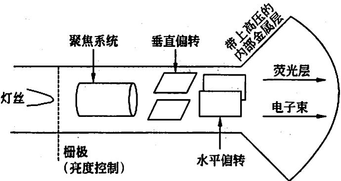  
图 1-4 监视器工作原理

由热发射产生的电子流在真空中在几千伏高压的影响下射向 CRT 前部，控制栅的电压决定有多少电子被允许通过，经过聚焦的电子束在水平与垂直偏转电路控制下射向屏幕，轰击涂有荧光粉的 CRT 屏幕，产生光点。通过控制栅电压强弱的控制，达到控制光点有无的目的，从而形成显示图像。

在光栅扫描显示器中，为了保证屏幕上显示的图像不产生闪烁，图像必须以50帧/秒至70帧/秒的速度进行刷新。这样，固定分辨率的图形显示器其行频、水平扫描周期、每像素读出时间，均有一定要求。例如当分辨率为 $640 \times 480$ 时，且假定水平回扫期和垂直回扫期各占水平扫描周期和垂直扫描周期的 $20\%$ 。

则行频为 480 线 ÷ 80/100 × 50 帧/s = 30kHz

水平扫描周期 HC=1/30kHz=33μs

每一像素读出时间为 $33\mu s \times 80\% \div 640 = 40 \sim 50ns$

若分辨率提高到 $1024 \times 768$ ，帧频为 60 帧/秒，则行频提高到 57.6kHz，水平扫描周期 HC=17.4μs，每像素读出时间减少到 13.6μs。从这里可以清楚看到，分辨率越高，为保证图像不闪烁，则时间要求越高（每一像素读出、显示的时间越短），成本也随之迅速上升。另外，光栅扫描显示器的扫描方式还可以分成逐行扫描与隔行扫描方式两种。

## 1.2 计算机的系统结构

围绕着如何提高指令的执行速度和计算机系统的性能价格比，出现了多种计算机的系统结构，如流水线处理机、并行处理机、多处理机及精简指令系统计算机等。尽管这些计算机在结构上有较大的改进，但仍没有突破冯·诺伊曼型计算机的体系结构，都是基于并行处理技术来提高计算机速度。为此，本节先介绍并行处理的概念及计算机系统的分类，然后分别简要介绍流水线处理机、并行处理机、多处理机，最后介绍精简指令系统计算机。

## 1.2.1 并行处理的概念

所谓并行性，是指计算机系统具有可以同时进行运算或操作的特性，它包括同时性与并发性两种含义。同时性指的是两个或两个以上的事件在同一时刻发生，并发性指的是两个或两个以上的事件在同一时间间隔发生。计算机系统中提高并行性的措施多种多样，就其基本思想而言，可归纳为如下3条途径：

(1) 时间重叠。在并行性概念中引入时间因素, 即多个处理过程在时间上相互错开,轮流重叠地使用同一套硬件设备的各个部分, 以加快硬件周转时间而赢得速度。因此时间重叠可称为时间并行技术。

(2) 资源重复。在并行性概念中引入空间因素, 以数量取胜的原则, 通过重复设置硬件资源, 大幅度提高计算机系统的性能。随着硬件价格的降低, 这种方式在单处理机中广泛使用, 而多处理机本身就是实施 "资源重复" 原理的结果。因此资源重复可称为空间并行技术。

（3）资源共享。这是一种软件方法，它使多个任务按一定时间顺序轮流使用同一套硬件设备。例如多道程序、分时系统就是遵循"资源共享"原理而产生的。资源共享既降低了成本，又提高了计算机设备的利用率。

上述三种并行性反映了计算机系统结构向高性能发展的自然趋势：一方面在单处理机内部广泛采用多种并行性措施，另一方面发展各种多计算机系统。

计算机的基本工作过程是执行一串指令，对一组数据进行处理。通常，把计算机执行的指令序列称为"指令流"，指令流调用的数据序列称为"数据流"，把计算机同时可处理的指令或数据的个数称为"多重性"。根据指令流和数据流的多重性可将计算机系统分为下列4类（S-single、单一的，I-instruction、指令，M-multiple、多倍的，D-data、数据）。

(1) 单指令流单数据流 (SISD): 这类计算机的指令部件一次只对一条指令进行译码, 并且只对一个操作部件分配数据。传统的单处理机属于 SISD 计算机。

（2）单指令流多数据流（SIMD）：这类计算机有多个处理单元，它们在同一个控制部件的管理下执行同一指令，但向各个处理单元分配各自需要的不同数据。并行处理机属于这类计算机。

（3）多指令流单数据流（MISD）：这类计算机包含有多个处理单元，按多条不同指令的要求对同一数据及其中间结果进行不同的处理。这类计算机实际上很少见。

（4）多指令流多数据流（MIMD）：这类计算机包含有多个处理机、存储器和多个控制器，实际上是几个独立的 SISD 计算机的集合，它们同时运行多个程序并对各自的数据进行处理。多处理机属于这类计算机。

## 1.2.2 流水线处理机系统

计算机中的流水线是把一个重复的过程分解为若干个子过程，每个子过程与其他子过程并行进行。由于这种工作方式与工厂中的生产流水线十分相似，因此称为流水线技术。流水线技术是一种非常经济、对提高计算机的运算速度非常有效的技术。采用流水线技术只需增加少量硬件就能把计算机的运算速度提高几倍，成为计算机中普遍使用的一种并行处理技术。从本质上讲，流水线技术是一种时间并行技术。

一条指令的执行过程可以分为多个阶段（或子过程），具体分法随计算机不同而不同。图 1-5（a）中把一条指令的执行过程分成以下 3 个阶段：

（1）取指令。按照指令计数器的内容访问主存储器，取出一条指令送到指令寄存器。

（2）指令分析。对指令操作码进行译码，按照给定的寻址方式和地址字段中的内容形成操作数的地址，并用这个地址读取操作数。

（3）指令执行。根据操作码的要求，完成指令规定的功能，即把运算结果写到通用寄存器或主存中。

<table><tr><td>取指k</td><td>分析k</td><td>执行k</td><td>取指k+1</td><td>分析k+1</td><td>执行k+1</td></tr></table>

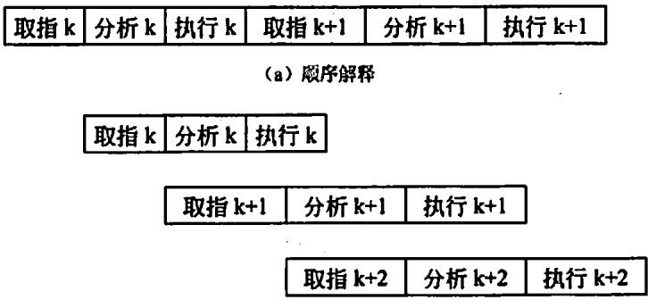  
(b) 重叠解释的一种方式  
图 1-5 指令的顺序执行和重叠执行

若假定图 1-5（a）中取指令、分析指令和执行指令的时间相同，均为 t，则完成 n 条指令所需时间 T1 为：

$$
\mathrm{T} 1 = \mathrm{n} ^ {*} 3 \mathrm{t} = 3 \mathrm{nt}
$$

若将一条指令的各个操作步与其后指令(一条或若干条)的各个操作步适当重叠执行, 即形成指令执行的流水线, 若假定图 1-5(b) 中取指令、分析指令和执行指令的时间相同, 均为 $t$ ,则完成 $n$ 条指令所需时间 T2 为:

$$
\mathrm{T} 2 = 3 \mathrm{t} + (\mathrm{n} - 1) \mathrm{t} = (\mathrm{n} + 2) \mathrm{t}
$$

传统的串行执行方式，优点是控制简单，节省设备。主要的缺点有两个：一是处理机执行指令的速度很慢，只有当上一条指令全部执行完毕后下一条指令才能够开始执行，即在任何时刻，处理机中只有一条指令在执行；二是功能部件的利用率很低，如取指令时主存是忙碌的，而指令执行部件是空闲的。而执行指令时指令执行部件是忙碌的，而主存又是空闲的。

采用重叠执行方式后带来了两个优点：一是程序的执行时间大大缩短；二是功能部件的利用率明显提高。主存基本上可以处于忙碌状态，其他功能部件的利用率也得到提高。但是为此需要付出一定的代价，即需要增加一些硬件，控制过程也变得复杂一些。指令重叠执行方式实际上就是指令流水线，指令流水线是多条指令并行执行的一种实现技术。

## 1.2.3 并行处理机系统

## 1. 并行处理机的基本概念

并行处理机也称为阵列式计算机，它将大量重复设置的处理单元按一定方式互连成阵列，在单一控制部件（Control Unit，CU）控制下对各自所分配的不同数据并行执行同一指令规定的操作，是操作并行的 SIMD 计算机。它采用资源重复的措施开发并行性，是以 SIMD（单指令流多数据流）方式工作的。并行处理机的基本结构和操作模型，如图 1-6 所示。

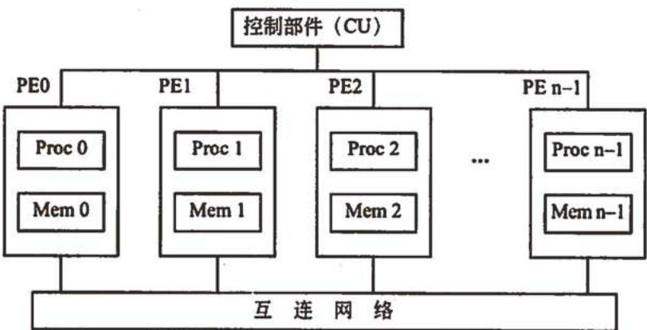  
图 1-6 并行处理机结构

并行处理机通常由一个控制器 CU、N 个处理器单元（Processing Element，PE）（包括处理器和存储模块）以及一个互连网络部件（IN）组成。

## 2. 并行处理机的主要特点

（1）并行处理机是以单指令流多数据流方式工作的。

（2）并行处理机采用资源重复方法引入空间因素，即在系统中设置多个相同的处理单元来开发并行性，这与利用时间重叠的向量流水线处理机是不一样的。此外，它利用的是并行性中的同时性，所有处理单元必须同时进行相同操作。

（3）并行处理机是以某一类算法为背景的专用计算机。这是由于并行处理机中通常都采用简单、规整的互连网络来实现处理单元间的连接操作，从而限定了它所适用的求解算法类别。因此，对互连网络设计的研究就成为并行处理机研究的重点之一。

（4）并行处理机的研究必须与并行算法的研究密切结合，以使它的求解算法的适应性更强一些，应用面更广一些。

（5）从处理单元来看，由于结构都相同，因而可将并行处理机看成是一个同构型并行机。但它的控制器实质上是一个标量处理机，而为了完成 I/O 操作以及操作系统的管理，尚需一个前端机，因此实际的并行处理机系统是由上述三部分构成的一个异构型多处理机系统。

## 1.2.4 多处理机系统

## 1. 多处理机系统的基本概念

流水线处理器通过若干级流水的时间并行技术来获得高性能。并行处理器由多台处理机组成，每台处理机执行相同的程序。这两类处理器都是执行单个程序，可对向量或数组进行运算。这种系统结构能高效地执行适合于 SIMD 的程序，所以这类处理器对某些应用问题非常有效。但是有些大型题目在这种 SIMD 结构的处理器上运行并不那么有效，原因是这类问题没有对结构化数据进行重复运算的操作，它所要求的操作通常是非结构化的而且是不可预测的。要想解决这类问题并保持高性能，只能在多处理机结构中寻找出路。

多处理机的系统结构由若干台独立的计算机组成，每台计算机能够独立执行自己的程序。Flynn 称这种结构为 MIMD（多指令流多数据流）结构。在多处理机系统中，处理机与处理机之间通过互连网络进行连接，从而实现程序之间的数据交换和同步。

图 1-7 给出了多处理机系统的一般模型。系统中有 n 个处理机（PI 到 Pn），它们通过一个处理机存储器互连网络（PMIN）连接到一个共享的主存储器上，这些处理机之间通过共享主存储器进行通信。处理机间还可以有一个处理机互连网络（PPIN），PPIN 通常用来从一台处理机向处理机发送中断信号，以达到进程同步的目的。此外，这些处理机还通过处理机-I/O 互连网络（PIOIN）同各 I/O 设备连接。有时为了使系统简单，可以把全部 I/O 设备连接在一台 I/O 处理机或少数几台处理机上。

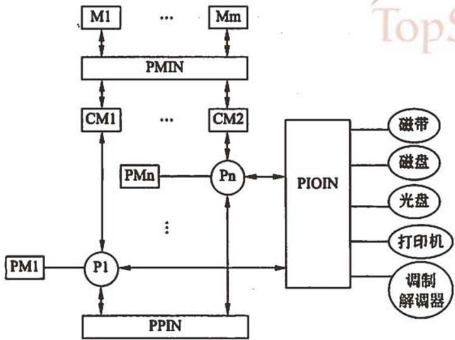  
图 1-7 多处理机系统模型

## 2. 多处理机的特点

多处理机属于 MIMD 计算机，它和 SIMD 计算机的并行处理机相比，有很大的差别。它们的本质差别在于并行性级别的不同：多处理机要实现任务或作业一级的并行，而并行处理机只实现指令一级的并行。下面通过与并行处理机的比较，进一步说明多处理机系统的特点。

(1) 结构灵活性。并行处理机的结构主要是针对数组向量处理算法而设计的。结构特点是: 处理单元 (PE) 数目很多甚至上万, 但只需设置有限和固定的互连网络, 即可满足一批并行性很高的算法的需要。而多处理机需要有较强的通用性。这就要求多处理机能适应更为多样的算法, 具备更为灵活多变的系统结构以实现各种复杂的计算机间互联模式,同时还要解决共享资源的冲突问题。目前, 多处理机中处理单元的数目还不可能做得很多。

(2) 程序并行性。并行处理机实现操作一级的并行, 其并行性存在于指令内部, 一条指令可以同时对整个数组进行处理, 再加上系统具有的专用性特点, 就使程序并行性的识别较易实现。在多处理机中, 并行性存在于指令外部, 即表现在多个任务之间, 再加上系统通用性的要求, 就使程序并行性的识别难度增大。因此, 它必须利用多种途径, 如算法、程序语言、编译、操作系统以至指令、硬件等, 尽量挖掘潜在的并行性。

(3) 并行任务派生。并行处理机依靠单指令流对多数据流实现并行操作, 即通过指令本身就可以启动多个 PE 并行工作。但多处理机处于多指令流操作方式, 一个程序中就存在多个并发的程序段, 需要采用专门的指令来表示并发关系, 因此一个任务开始执行时能够派生出与它并行执行的另一些任务。如果任务数多于处理机数, 多余的任务就进入排队器等待。

（4）进程同步。并行处理机仅有一个控制部件 CU，自然是同步的。而多处理机执行不同的指令，工作进度不会也不必保持相同。如果某个处理机先做完，那么就要停下来等待。当然如果发生数据相关和控制相关，那么处理机也要停下来等待。因此，在多处理机系统中要采取特殊的同步措施来确保程序按所要求的正确顺序进行。

（5）资源分配和进程调度。并行处理机的 PE 是固定的，采用屏蔽手段可改变实际参加操作的 PE 数目。多处理机执行并发任务，需要的处理机数目不固定，各个处理机进入或退出任务的时刻不相同，所需共享资源的品种、数量又随时变化。因此提出了资源分配和进程调度问题，它对整个系统的效率有很大的影响。

## 1.2.5 CISC/RISC 指令系统

目前许多计算机的指令系统可包含几百条指令，十多种寻址方式，这对简化汇编语言设计、提高高级语言的执行效率是有利的。这些计算机被称为复杂指令集计算机（Complex Instruction Set Computer, CISC）。

使指令系统越来越复杂的出发点有以下几点：

（1）使目标程序得到优化：例如设置数组运算命令，把原来要用一段程序才能完成的功能，只用一条指令来实现。

(2) 给高级语言提供更好的支持: 高级语言和一般的机器语言之间有明显的语义差别。改进指令系统, 设置一些在语义上接近高级语言语句的指令, 就可以减轻编译的负担, 提高编译效率。

（3）提供对操作系统的支持：操作系统日益发展，其功能也日趋复杂，这就要求指令系统提供越来越复杂的功能。

但是，复杂的指令系统使得计算机的结构也越来越复杂，这不仅增加了计算机的研制周期和成本，而且难以保证其正确性，有时还可能降低系统的性能。实践证明，各种指令的使用频率相当悬殊，在如此庞大的指令系统中，只有算术逻辑运算、数据传送、转移、子程序调用等几十条基本指令才是经常使用的，它们在程序中出现的概率占到80%以上，而需要大量硬件支持的复杂指令的利用率却很低，造成了硬件资源的大量浪费。

精简指令系统计算机（RISC）的着眼点不是简单地放在简化指令系统上，而是通过简化指令使计算机的结构更加简单合理，从而提高机器的性能。RISC 与 CISC 比较，其指令系统的主要特点如下。

（1）指令数目较少，一般都选用使用频度最高的一些简单指令。

（2）指令长度固定，指令格式种类少，寻址方式种类少。

(3) 大多数指令可在一个机器周期内完成。

（4）通用寄存器数量多，只有存数/取数指令访问存储器，而其余指令均在寄存器之间进行操作。

RISC 与 CISC 技术两者的主要区别在于设计思想上的差别，RISC 的设计思想是：将那些不是最频繁使用的功能（指令）由软件来加以实现，这样就可以优化硬件，并可使其执行得更快。采用 RISC 技术后，由于指令系统简单，CPU 的控制逻辑大大简化，芯片上可设置更多的通用寄存器，指令系统也可以采用速度较快的硬连线逻辑来实现，且更适合于采用指令流水技术，这些都可以使指令的执行速度进一步提高。指令数量少，固然使编译工作量加大，但由于指令系统中的指令都是精选的，编译时间少，反过来对编译程序的优化又是有利的。CISC 和 RISC 技术都在发展，两者都各有自己的优点和缺点。但是 RISC 技术作为一种新的设计思想，无疑对计算机的发展将产生重大影响。

## 1.3 计算机存储系统

## 1.3.1 存储系统概述及分类

存储系统由存放程序和数据的各类存储设备及有关的软件构成，是计算机系统的重要组成部分，用于存放程序和数据。有了存储器，计算机就具有记忆能力，因而能自动地进行操作。存储系统分为内存储器和外存储器，两者按一定的结构有机地组织在一起，程序和数据按不同的层次存放在各级存储器中，而整个存储系统具有较好的速度、容量和价格等方面的综合性能指标。

## 1. 高速缓冲存储器（Cache）

目前由双极型半导体组成，构成计算机系统中的一个高速小容量存储器。其存取速度能接近 CPU 的工作速度，用来临时存放指令和数据。

## 2. 主存储器

主存储器是计算机系统中的重要部件，用来存放计算机运行时的大量程序和数据，主存储器目前一般由 MOS 半导体存储器构成。

CPU 能够直接访问的存储器称为内存储器，高速缓存和主存都是内存储器。在配置了高速缓存的计算机内，主存储器和高速缓存之间要不断交换数据。

如果计算机没有配置高速缓存，内存储器就是主存储器，两个名称可以换用。

## 3. 辅助存储器

辅助存储器又称外存储器。外存储器主要由磁表面存储器组成，近年来，光存储器应用已很广泛，渐渐成为一种重要的辅助存储器。外存储器的内容需要调入主存后才能被CPU访问。外存储器的特点是容量大，所以可存放大量的程序和数据。

## 1.3.2 存储器层次结构

采用单一工艺制造的存储器很难同时满足大容量、高速度和低成本的要求。比如双极型半导体存储器的存取速度快，但是难以构成大容量存储器。而大容量、低成本的磁表面存储器的存取速度又远低于半导体存储器，并且难以实现随机存取。

所谓存储系统的层次结构就是把各种不同容量和不同存取速度的存储器按一定的结构有机地组织在一起，程序和数据按不同的层次存放在各级存储器中，而整个存储系统具有较好的速度、容量和价格等方面的综合性能指标。

图 1-8 是存储系统层次结构示意图，该系统由三类存储器构成。主存和辅存构成一个层次，高速缓存和主存构成另一个层次。

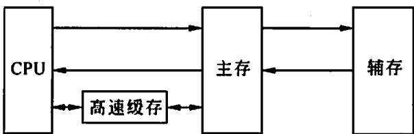  
图 1-8 存储系统层次结构

## 1. "高速缓存—主存"层次

这个层次主要解决存储器的速度问题。在早期的计算机中，CPU与主存在速度上非常接近。例如IBM704计算机的CPU周期为 $12\mu \mathrm{s}$ ，其主存的存取周期也为 $12\mu \mathrm{s}$ ，随着所采用的器件和工艺的改进，CPU的速度提高很快，目前CPU的机器周期可达几个毫微秒甚至更短，而主存的存取周期则由于种种因素的限制，只能达到几十甚至几百毫微秒。因而CPU和主存之间在速度上存在一定差距，主存的工作速度限制了整机运行速度的提高。为了减少两者速度差别所造成的影响，首先在CPU内设置通用寄存器组，尽量减少CPU对内存的访问。然而，CPU寄存器数目不可能太多（一般只有几个或几十个），要根本解决存储器的速度问题，需要在CPU与主存之间再增设一级存储器，称为高速缓冲存储器。

## 2. "主存—辅存"层次

这个层次主要解决存储器的容量问题。在一段时间内，中央处理器运行的程序和使用的数据只是整个存储系统存储信息的一小部分，这部分程序和数据处于"活动"的状态，而其他大部分程序和数据则处于暂时不被使用的"静止"状态，因此可以把正在被CPU使用的"活动"的程序和数据放在主存中，其余信息则存放在容量大、但速度较慢的辅存中。当某时刻CPU需要用到存放在辅存中的某些信息时，可通过有关的I/O操作将这部分信息从辅存中调往主存。反之，原存放在主存中而现在暂时不用的部分信息也可以从主存中调往辅存，以备后用。这样，程序仍能得到较快的执行速度，而主存容量不足这一缺陷则由辅存的大容量来弥补。因此，具有"主存—辅存"层次的存储系统是一个既具有主存的存取速度又具有辅存的大容量低成本特点的一个存储器总体。

## 1.3.3 主存储器

## 1. 主存储器基本组成

半导体读写存储器简称 RWM，习惯上也称为 RAM。半导体 RAM 具有体积小、存取速度快等优点，因而适合作为内存储器使用。按工艺不同可将半导体 RAM 分为双极型 RAM和 MOS 型 RAM 两大类，这里以静态 MOS 存储器芯片为例介绍其组成。

静态 MOS 存储器芯片由存储体、读写电路、地址译码和控制电路等部分组成。

## (1) 存储体（存储矩阵）

存储体是存储单元的集合。在容量较大的存储器中往往把各个字的同一位组织在一个集成片中。

## (2) 地址译码器

地址译码器把用二进制表示的地址转换为译码输入线上的高电位，以便驱动相应的读写电路。地址译码有两种方式：一种是单译码方式，适用于小容量存储器；另一种是双译码方式，适用于容量较大的存储器。

## (3) 驱动器

在双译码结构中，一条 X 方向的选择线要控制在其上的各个存储单元的字选线，所以负载较大，需要在译码器输出后加驱动器。

## (4) I/O 控制

它处于数据总线和被选用的单元之间，用以控制被选中单元的读出或写入，并具有放大信息的作用。

## (5) 片选控制

一个存储芯片的容量往往满足不了计算机对存储器容量的要求，所以需将一定数量的芯片按一定方式连接成一个完整的存储器。在访问某个字时，必须"选中"该字所在的芯片，而其他芯片不被"选中"。因而每个芯片上除了地址线和数据线外，还有片选控制信号。在地址选择时，由芯片外的地址译码器的输入信号以及它的一些控制信号，如"访存控制"来产生片选控制信号，选中要访问的存储字所在的芯片。

## (6) 读/写控制

根据 CPU 给出的信号是读命令还是写命令，控制被选中存储单元的读写。

## 2. 存储器主要技术指标

## (1) 存储容量

存储容量是指每个存储芯片所能存储的二位制位数。主存储存储器按8位二进制位或其倍数划分存储单元，故存储容量通常以字节（8位）为单位。主存容量大则可以运行比较复杂的程序，并可存入大量信息，可利用更完善的软件支撑环境。所以，计算机处理能力的大小在很大程度上取决于主存容量的大小。

## (2) 存取速度

存储器的速度可用访问时间、存储周期或频宽来描述。

访问时间一般用读出时间 $T_{A}$ 及写入时间 $T_{W}$ 来描述。 $T_{A}$ 是从存储器接到读命令以后至信息被送到数据总线上所需的时间。 $T_{W}$ 是将一个字写入存储器所需的时间。

存取周期是存储器进行一次完整的读写操作所需要的全部时间，也就是存储器进行连续读写操作所允许的最短间隔时间。一般用 $T_{M}$ 表示，它直接关系到计算机的运算速度。

一般有 $T_{M}>T_{A}$ ， $T_{M}>T_{W}$ ， $T_{M}$ 的单位常采用微秒或毫微秒。

存储器的频宽 B 表示存储器被连续访问时，可以提供的数据传送速率，通常用每秒钟传送信息的位数（或字节数）来衡量。

## (3) 可靠性

存储器的可靠性用平均故障间隔时间 MTBF 来描述，它可理解为两次故障之间的平均时间间隔。显然。MTBF 越长，表示可靠性越高。

## 1.3.4 高速缓冲存储器

高速缓冲存储器是一种采用和 CPU 工艺相类似的半导体器件构成的存储装置，其速度可与 CPU 相匹配，但容量较小，只能存放一小段程序和数据。由于程序具有局部性，在短时间内程序和数据各自相对集中在一小块存储区内。因此在一小段时间内 CPU 可以不必访问主存，而访问速度较快的高速缓冲存储器，从而提高了指令的执行速度。

在高档微机中为了获得更高的效率，不仅设置了独立的指令高速缓冲存储器和数据高速缓冲存储器，还把高速缓冲存储器设置成二级或三级。高速缓存通常由双极型半导体存储器或SRAM组成。地址映像以及和主存数据交换机构全由硬件实现，并对程序员透明。

目前，访问高速缓冲存储器的时间一般为访问主存时间的 1/4\~1/10。由于半导体器件成本下降很快，高速缓冲存储器存储器已在大、中、小及微型机上普通采用。如图 1-9 所示为高速缓冲存储器的基本结构图，主存和高速缓冲存储器均是模块化的（例如以页为单位），并且两者之间交换数据以页为单位进行。CPU 访存地址送到高速缓冲存储器，经相联存储映

像表的地址映射变换，如果 CPU 要访问的内容在高速缓冲存储器中，则称为"命中"，则从高速缓冲存储器中读取数据送 CPU；如果 CPU 要访问的内容不在高速缓冲存储器中，则称为"不命中"或"失靶"，则 CPU 送来地址直接到主存中读取数据。这时，访存地址是同时送到高速缓冲存储器和主存中的。如果访问"未命中"，除了本次访问对主存进行存取外，主存和高速缓冲存储器之间还要通过多字宽通路交换数据。主存内容在写入高速缓冲存储器过程中，如果高速缓冲存储器已满，要按某种替换策略将高速缓冲存储器中一页调出写回主存。这

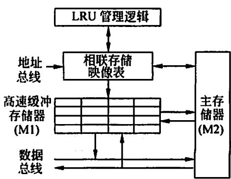  
图 1-9 高速缓冲存储器基本结构图

种替换算法可以是最近最少使用算法（LRU）或其他算法，这由相应的管理逻辑来实现。

## 1.3.5 辅助存储器

辅助存储器用于存放当前不立即使用的信息。一旦需要，辅存便与主存成批交换数据，或将信息从辅存调入主存，或将信息从主存调出到辅存。目前常用的辅助存储器包括磁带存储器、磁盘存储器及光盘存储器，这类存储器的最大特点是存储容量大、可靠性高、价格低，在脱机的情况下可以永久地保存信息。下面先介绍磁盘和磁带存储器，它们统称为磁表面存储器，然后介绍光盘存储器。

## 1. 磁表面存储器的存储原理

## (1) 磁层和磁头

磁表面存储器中信息的存取，主要由磁层和磁头来完成。磁层是存放信息的介质，它由非矩形剩磁特性的导磁材料（如氧化铁、镍钴合金等）构成。将用这种材料制成的磁胶涂敷或镀在载磁体上，其厚度通常为0.1\~5μm，以记录信息。载磁体可以是金属合金（硬质载磁体）或者是塑料（软质载磁体）。

为了获得良好的技术性能，磁层材料的剩磁（BR）要大（读出信息大），矫顽力HC要合适，才能有足够的抗干扰能力和使用较小的写电流。磁层厚度要薄，才能提高记录密度。此外对生成磁层的工艺、机械性能等也有一定的要求。

磁头是实现"磁—电"和"电—磁"转换的元件。它是由高导磁率的软磁性材料（如坡莫合金和具有高频特性的铁氧体）做成铁芯，在铁芯上开有缝隙并绕有线圈。当载磁体与磁头作相对运动时，当写磁头线圈通以磁化电流，则可将信息写到磁层上。当读磁头通过磁层上某一磁化单位而形成磁通回路时，磁通的变化使线圈两端产生感应电势，形成读出信号。

## (2) 磁表面存储器的读写过程

在磁表面存储器中，一般都是磁头固定，而磁层（载磁体）作高速回转或匀速直线运动。在这种相对运动中，通过磁头（其缝隙对准磁层）进行信息存取。

\- 信息写入过程。磁头写线圈中通以写电流脉冲，此电流在铁芯中生成磁场，其磁头缝隙处的磁场穿过磁层中一微小区域，使该区域磁层以一定方向磁化，而写电流脉冲消失后，磁层仍保持该方向的剩磁（+BR或-BR），这就是信息的写入过程。

\- 信息读出过程。读出时，磁头与磁层同样作相对运动。当磁层中某一记录单元运动到磁头缝隙下面时，磁头与磁层便产生磁交连。由于磁头中的磁阻比其周围空气的磁阻小得多，便在磁头中产生较大的磁通变化，在读线圈的两端产生较大的感应电势 E，经读出放大电路整形和放大后成为读出信号。

## 2. 磁盘存储器

磁盘存储器是一种以磁盘或磁盘组为存储介质的记录装置，又叫磁盘机。它具有记录密度高、容量大、速度快等优点，是目前计算机存储系统中使用最普遍的一种辅助存储器，它的分类如图 1-10 所示。

## (1) 硬磁盘存储器

硬磁盘存储器的逻辑结构如图 1-11 所示。它主要由磁记录介质、磁盘驱动器、磁盘控制器三大部分组成。磁盘控制器包括控制逻辑、时序电路、"并→串"转换和"串→并"转换电路。磁盘驱动器包括读写电路、读\写转换开关、读写磁头与磁头定位伺服系统。

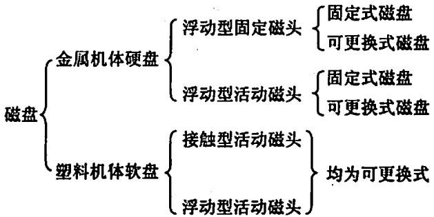  
图1-10 磁盘的分类

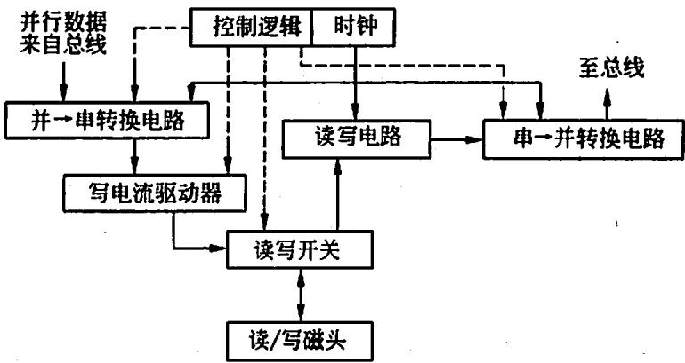  
图 1-11 硬磁盘逻辑结构

(2) 软磁盘存储器。

软磁盘存储器与硬磁盘存储器的差别包括：

\- 硬盘（温盘）转速高，磁头与磁层不接触；而软盘转速低，磁头与磁层接触。

\- 大多数硬盘采用固定盘组，软盘单片使用。

\- 硬盘系统价格高，存储量大，存取速度快；软盘价廉，存储量小，存取速度较慢。

\- 硬盘盘片不可拆卸，一般不能互换，软盘是可拆卸的且可互换。

## 3. 磁带存储器

磁带有许多种，按带宽分有 1/4 英寸和 1/2 英寸；按带长分有 2400 英尺、1200 英尺和 600 英尺；按外形分有开盘式和盒式磁带；按记录密度分有 800 位/英寸、1600 位/英寸、6250 位/英寸；按带面并行的磁道数分有 9 道、16 道等。

## 4. 光盘存储器

光盘存储器是一种采用聚焦激光束在盘形介质上高密度地记录信息的存储装置。具有记录密度高、存储容量大、信息保存寿命长、工作稳定可靠、环境要求低等特点，现已广泛应用于存储各种数字化信息，包括工作站、大型数据系统、办公自动化系统中的文件、声音和图像的存档与检索等领域，是磁盘机的重要后援设备。

按读写类型来分，目前光盘一般可分为只读型、一次写入型和可重写型三种。

## 1.4 计算机应用领域

由于计算机的高速性和准确性以及采用数字化的编码方式，为计算机的广泛使用奠定了基础。计算机诞生50多年来，计算机应用的发展大致可以分成三个阶段。计算机出现初期（20世纪50年代初到末）为第一阶段，这时计算机所处理的大都是科学计算和工程计算问题，计算量大，而数据量相对较少，应用方式采用批处理方式，使用人员也只是一些经过训练的专家。50年代末到70年代初为第二阶段。这时计算机开始在企业中应用，数据处理问题日益增多，这类问题数据量大，输入输出频繁，计算量相对较少，致使运算部件经常处于空闲状态，为使宝贵的计算机资源得以充分利用，提高计算机使用效率，其应用方式出现了分时处理方式和交互作用方式。使用人员普遍采用高级语言，解题环境得以改善，利用计算机的解题水平显著提高。70年代微型机出现与80年代微型机的大发展，计算机应用进入了第三个阶段。这时，计算机得以进入各行各业和千家万户，大大加速了计算机的普及与应用，出现了个人计算方式。90年代以来，计算机网络蓬勃发展，特别是Internet的出现，大量计算机联入网中，扩展和加速了信息的流通，增强了社会的协调与协作能力，使计算机应用方式向分布式和集群式计算发展。

概括起来，计算机信息处理技术包括了对各种信息媒体的获取、表示、加工与表现方法和技术，大致有以下几个方面内容。

## 1.4.1 科学计算

这是计算机最早的应用领域。在现代科学研究和工程技术中，有各种复杂的数学问题，如果由人工计算，不但耗时费力，而且难以及时提供准确的数据。计算机的高速度、大容量等特性为解决这些庞大、复杂的计算问题提供了可能。

在气象预报，天文研究，水利设计，原子结构分析，生物分子结构分析，人造卫星轨道计算，宇宙飞船的研制等许多方面，都显示出计算机独特的优势。

## 1.4.2 信息管理

管理信息系统是由人、计算机和管理规则等组成，以采集、加工、维护和使用信息为主要功能的人-机系统。例如金融、财会、经营、管理、教育、科研、医疗、人事、档案、物资等各方面都有大量的信息需要及时分析和处理，以便为决策提供依据。虽然在这方面应用中计算公式并不复杂，但数据量极大，在当今信息爆炸的时代，人工已难以胜任这一重任，计算机则成为信息管理的重要工具。该系统一般以数据库管理系统为核心，以其他软件和网络系统为支撑环境，而用户则通过专门的人机交互界面，进行数据的查询、修改等操作，并实现统计分析、规划、决策等功能。在信息管理方面，我们正经历着从单项事务的电子数据处理，向以数据库为基础的管理信息系统，及以数据库、模型库和方法库为基础的决策支持系统发展的过程，并且呈现出系统集成化、结构分布化、信息多元化、功能智能化等趋势。

## 1.4.3 计算机图形学与多媒体技术

图形与图像使人一目了然，它是人们认识世界的主要媒体之一，因此计算机图形学与数字图像处理技术始终是计算机应用技术中一个重点研究领域之一。计算机图形学研究如何在计算机内建立真实物体或虚拟物体的模型，并通过图形设备将这些模型转化为可视的二维或三维图形。关键技术有造型技术、人机交互技术、彩色生成与处理、真实感图形生成、动画绘制以及科学计算可视化等。多媒体技术是计算机对文本、图形、图像、声音、动画及视频信息进行综合处理，建立有机联系，并集成为一个交互性很强的系统的一门技术。其研究内容包括多媒体信息的计算机内部编码表示、输入输出的软硬件控制、软件管理及数据操作的基本环境以及为应用创作人员提供有效的非语言化的编程工具和环境等。

计算机辅助设计（CAD）是利用计算机帮助设计人员进行电路设计、建筑设计、机械设计、飞机设计等设计工作，提高设计速度和质量。计算机辅助教学（CAI）是利用计算机作为教学媒体和工具，帮助教师提高教学质量和效益的过程。它正在引起教育方法、教育思想以至教育体制的变革。

## 1.4.4 语言与文字的处理

语言与文字是人类文化交流的最主要工具，它们的处理技术直接影响到计算机在各个领域的应用及社会的信息化进程。其主要内容包括语言与文字在计算机内部的编码表示法、其输入与输出方法、文档的编辑排版、文字和语言的自动识别与合成以及自然语言的理解和机器翻译等。对于中国、日本、韩国等采用东方文字（汉字）的国家，汉字的计算机内部编码、汉字的输入/输出、软件的汉化等技术，经过十几年的努力，也已取得了突破性的进展。中文文字处理、电子出版印刷、中文全文信息检索、印刷体与手写体汉字识别、中文语音识别和合成、中外文机器翻译等方面也成果斐然，这对推动计算机在我国等东方文字国家的应用起到了非常积极的作用。

## 1.4.5 人工智能

人工智能（AI）是计算机应用的一个广阔的新领域。科学工作者正在研究如何使计算机模拟人脑，去进行理解、学习、分析、推理等各种高级思维活动，使计算机具有更多的人类智能，能够识别环境，适应环境，自动获取知识，解决问题，以便利用计算机在某些领域实现脑力劳动的自动化。

随着计算机技术的发展，计算机应用技术从最初的数值计算已逐渐渗透到人类活动的各个领域，其服务的对象从面向专业人员扩展到面向大众、面向社会。计算机应用系统也由最初的单机系统向集成化、网络化、智能化的方向发展。反过来，也正由于计算机应用的需要，推动了计算机技术的不断创新与发展。

## 选择题

1. 计算机输出设备的功能是\_\_\_\_。

A）将计算机运算的二进制结果信息打印输出

B）将计算机内部的二进制信息显示输出

C) 将计算机运算的二进制结果信息打印输出和显示输出

D）将计算机内部的二进制信息转换为人和设备能识别的信息显示输出

1. 下列关于进程间通信的描述中，不正确的是\_\_\_\_。

A）进程互斥是指每次只允许一个进程使用临界资源

B) 进程控制是通过原语实现的

C) P、V 操作是一种进程同步机制

D）管程不是一种进程高级通信机制

## 思考题

1. 计算机由哪五部分组成？各部分的基本功能是什么？

2. 计算机系统中提高并行处理的措施有哪些?

3. CISC/RISC 指令系统的区别与联系？

4. 计算机存储器层次结构及目的？

5. 计算机的主要应用领域包括哪些？
