>[!warning] 版本提示
>本书为 **2006 年第 1 版**。现行考试依据是 **《信息系统管理工程师教程（第 2 版）》**（清华社 2024-10，20 章），
>两版**重合极少**：第 1 版的第 1–6 章（硬件/操作系统/语言/配置/数据结构/多媒体）在第 2 版已被删除或压缩。
>本页仅作**扩展参考**，备考请以 [[知识体系]]（第 2 版官方考纲）为准。

# 第2章 操作系统知识

本章主要介绍操作系统的基础知识，包括操作系统概念、作用、类型以及处理机管理、存储管理、设备管理、文件管理、作业管理等基本管理功能。

## 2.1 操作系统简介

计算机系统包括硬件和软件两个组成部分。硬件是所有软件运行的物质基础；软件能充分发挥硬件潜能和扩充硬件功能，完成各种系统及应用任务，两者互相促进、相辅相成、缺一不可。图 2-1 给出了一个计算机系统的软硬件层次结构。其中，每一层具有一组功能并提供相应的接口，接口对层内掩盖了实现细节，对层外提供了使用约定。

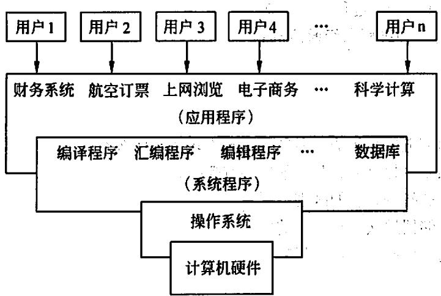  
图 2-1 计算机系统软硬件层次结构

硬件层提供了基本的可计算性资源，包括处理器、寄存器、存储器，以及可被使用的各种 I/O 设施和设备，是操作系统和上层软件赖以工作的基础。

操作系统层对计算机硬件作首次扩充和改造，主要完成资源的调度和分配，信息的存取和保护，并发活动的协调和控制等许多工作。操作系统是其他软件的运行基础，并为编译程序和数据库系统等系统程序的设计者提供了有力支持。系统程序层的工作基础建立在操作系统改造和扩充过的计算机上，利用操作系统提供的扩展指令集，可以较为容易地实现各种各样的语言处理程序、数据库管理系统和其他系统程序。

应用层解决用户不同的应用问题，应用程序开发者借助于程序设计语言来表达应用问题，开发各种应用程序，既快捷又方便。而最终用户则通过应用程序与计算机交互来解决应用问题。

## 2.1.1 操作系统的定义与作用

操作系统（Operating system，OS）的出现、使用和发展是近40年来计算机软件的一个重大进展。尽管操作系统尚未有一个被普遍接受的定义，但普遍认为：操作系统是管理软硬件资源、控制程序执行，改善人机界面，合理组织计算机工作流程和为用户使用计算机提供良好运行环境的一种系统软件。操作系统有两个重要的作用。

## 1. 通过资源管理，提高计算机系统的效率

操作系统还是计算机系统的资源管理者。在计算机系统中，能分配给用户使用的各种硬件和软件设施总称为资源。资源包括两大类：硬件资源和信息资源。其中，硬件资源分为处理器、存储器、I/O设备等，I/O设备又分为输入型设备、输出型设备和存储型设备；信息资源则分为程序和数据等。操作系统的重要任务之一是有序地管理计算机中的硬件、软件资源，跟踪资源使用状况，满足用户对资源的需求，协调各程序对资源的使用冲突，为用户提供简单、有效的资源使用方法，最大限度地实现各类资源的共享，提高资源利用率，从而使得计算机系统的效率有很大提高。

## 2. 改善人机界面，向用户提供友好的工作环境

操作系统紧靠着计算机硬件并在其基础上提供了许多新的设施和能力，从而使用户能够方便、可靠、安全、高效地操纵计算机硬件和运行自己的程序。例如，改造各种硬件设施，使之更容易使用；提供原语或系统调用，扩展指令系统；操作系统还合理组织计算机的工作流程，协调各个部件有效工作，为用户提供一个良好的运行环境。经过操作系统改造和扩充过的计算机不但功能更强，使用也更为方便，用户可以直接调用操作系统提供的许多功能，而无须了解许多软硬件使用细节。

## 2.1.2 操作系统的功能及特征

## 1. 操作系统的特征

操作系统的主要特性有三条：并发性、共享性和异步性。

（1）并发性（Concurrence）。指两个或两个以上的运行程序在同一时间间隔段内同时执行。操作系统是一个并发系统，并发性是它的重要特征，它应该具有处理多个同时执行的程序的能力。发挥并发性能够消除计算机系统中部件和部件之间的相互等待，有效改善系统资源的利用率，改进系统的吞吐率，提高系统效率。

（2）共享性（sharing）。指操作系统中的资源（包括硬件资源和信息资源）可被多个并发执行的进程所使用。出于经济上的考虑，一次性向每个用户程序分别提供它所需的全部资源不但是浪费的，有时也是不可能的。现实的方法是让多个用户程序共用一套计算机系统的所有资源，因而必然会产生共享资源的需要。

共享性和并发性是操作系统两个最基本的特征，它们互为依存。一方面，资源的共享是因为运行程序的并发执行而引起的，若系统不允许运行程序并发执行，自然也就不存在资源共享问题。另一方面，若系统不能对资源共享实施有效的管理，必然会影响到运行程序的并发执行，甚至运行程序无法并发执行，操作系统也就失去了并发性，导致整个系统效率低下。

（3）异步性（Asynchronism），或称随机性。在多道程序环境中，允许多个进程并发执行，由于资源有限而进程众多，多数情况，进程的执行不是一贯到底，而是"走走停停"，系统中的进程何时执行？何时暂停？以什么样的速度向前推进？进程总共要多少时间执行才能完成？这些都是不可预知的，或者说该进程是以异步方式运行的，异步性给系统带来了潜在的危险，有可能导致与时间有关的错误，但只要运行环境相同，操作系统必须保证多次运行作业，都会获得完全相同的结果。

## 2. 操作系统的功能

资源管理是操作系统的一项主要任务，而控制程序执行、扩充及其功能、屏蔽使用细节、方便用户使用、组织合理工作流程、改善人机界面等都可以从资源管理的角度去理解。下面就从资源管理的观点来了解操作系统具有的几个主要功能。

（1）处理器管理。处理器管理的第一项工作是处理中断事件，硬件只能发现中断事件，捕捉它并产生中断信号，但不能进行处理。配置了操作系统，就能对中断事件进行处理。

处理器管理的第二项工作是处理器调度。在单用户单任务的情况下，处理器仅为一个用户的一个任务所独占，处理器管理的工作十分简单。但在多道程序或多用户的情况下，组织多个作业或任务执行时，就要解决处理器的调度、分配和回收等问题。

近年来设计出各种各样的多处理器系统，处理器管理就更加复杂。为了实现处理器管理的功能，操作系统引入了进程（process）的概念，处理器的分配和执行都是以进程为基本单位；随着并行处理技术的发展，为了进一步提高系统并行性，使并发执行单位的粒度变细，操作系统又引入了线程（thread）的概念。

（2）存储管理。存储管理的主要任务是管理存储器资源，为多道程序运行提供有力的支撑。存储管理的主要功能包括：存储分配（存储管理将根据用户程序的需要给它分配存储器资源）；存储共享（存储管理能让主存中的多个用户程序实现存储资源的共享，以提高存储器的利用率）；存储保护（存储管理要把各个用户程序相互隔离起来互不干扰，更不允许用户程序访问操作系统的程序和数据，从而保护用户程序存放在存储器中的信息不被破坏）；存储扩充（由于物理内存容量有限，难于满足用户程序的需求，存储管理还应该能从逻辑上来扩充内存储器，为用户提供一个比内存实际容量大得多的编程空间，方便用户的编程和使用）。

（3）设备管理。设备管理的主要任务是管理各类外围设备，完成用户提出的 I/O 请求，加快 I/O 信息的传送速度，发挥 I/O 设备的并行性，提高 I/O 设备的利用率；以及提供每种设备的设备驱动程序和中断处理程序，向用户屏蔽硬件使用细节。为实现这些任务，设备管理应该具有以下功能：提供外围设备的控制与处理；提供缓冲区的管理；提供外围设备的分配；提供共享型外围设备的驱动；实现虚拟设备。

（4）文件管理。上述三种管理是针对计算机硬件资源的管理。文件管理则是对系统的信息资源的管理。在现代计算机中，通常把程序和数据以文件形式存储在外存储器上，供用户使用，这样，外存储器上保存了大量文件，对这些文件如不能采取良好的管理方式，就会导致混乱或破坏，造成严重后果。为此，在操作系统中配置了文件管理，它的主要任务是对用户文件和系统文件进行有效管理，实现按名存取；实现文件的共享、保护和保密，保证文件的安全性；并提供给用户一套能方便使用文件的操作和命令。

（5）作业管理。作业管理的功能包括任务、界面管理、人机交互、图形界面、语音控制和虚拟现实等。其目的是为用户提供一个使用系统的良好环境，使用户能有效地组织自己的工作流程，并使整个系统能高效地运行。

（6）网络与通信管理。计算机网络源于计算机与通信技术的结合，近20年来，从单机与终端之间的远程通信，到今天全世界成千上万台计算机联网工作，计算机网络的应用已十分广泛。联网操作系统至少应具有以下管理功能。网上资源管理功能：计算机网络的主要目的之一是共享资源，网络操作系统应实现网上资源的共享，管理用户应用程序对资源的访问，保证信息资源的安全性和一致性；数据通信管理功能：计算机联网后，站点之间可以互相传送数据，进行通信，通过通信软件，按照通信协议的规定，完成网络上计算机之间的信息传送；网络管理功能包括故障管理、安全管理、性能管理、记账管理和配置管理。

## 2.1.3 操作系统的类型

## 1. 批处理操作系统

过去，在计算中心的计算机上一般所配置的操作系统采用以下方式工作：用户把要计算的应用问题编成程序，连同数据和作业说明书一起交给操作员，操作员集中一批作业，并输入到计算机中。然后，由操作系统来调度和控制用户作业的执行。通常，采用这种批量化处理作业方式的操作系统称为批处理操作系统（batch operating system）。

批处理操作系统根据一定的调度策略把要求计算的算题按一定的组合和次序执行，从而，系统资源利用率高，作业的吞吐量大。批处理系统的主要特征是：

（1）用户脱机工作。用户提交作业之后直至获得结果之前不再和计算机及作业交互。因而，作业控制语言对脱机工作的作业来说是必不可少的。这种工作方式对调试和修改程序是极不方便的。

（2）成批处理作业。操作员集中一批用户提交的作业，输入计算机成为后备作业。后备作业由批处理操作系统一批批地选择并调入主存执行。

（3）多道程序运行。按预先规定的调度算法，从后备作业中选取多个作业进入主存，并启动它们运行，实现了多道批处理。

（4）作业周转时间长。由于作业进入计算机成为后备作业后要等待选择，因而作业从进入计算机开始到完成并获得最后结果为止所经历的时间一般相当长，一般需等待数小时至几天。

## 2. 分时操作系统

在批处理系统中，用户不能干预自己程序的运行，无法得知程序运行情况，对程序的调试和排错不利。为了克服这一缺点，便产生了分时操作系统。

允许多个联机用户同时使用一台计算机系统进行计算的操作系统称分时操作系统（Time Sharing Operating System）。其实现思想如下：每个用户在各自的终端上以问答方式控制程序运行，系统把中央处理器的时间划分成时间片，轮流分配给各个联机终端用户，每个用户只能在极短时间内执行，若时间片用完，而程序还未做完，则挂起等待下次分得时间片。这样一来，每个用户的每次要求都能得到快速响应，每个用户获得好像自己独占了这台计算机的印象。实质上，分时系统是多道程序的一个变种，不同之处在于每个用户都有一台联机终端。

今天，分时操作系统成为最流行的一种操作系统，几乎所有的现代通用操作系统都具备分时系统的特征。分时操作系统具有以下特性：

（1）同时性。若干个终端用户同时联机使用计算机，分时就是指多个用户分享使用同一台计算机。每个终端用户感觉上好像自己独占了这台计算机。

（2）独立性。终端用户彼此独立，互不干扰，每个终端用户感觉上好像自己独占了这台计算机。

（3）及时性。终端用户的立即型请求（即不要求大量 CPU 时间处理的请求）能在足够快的时间之内得到响应。这一特性与计算机 CPU 的处理速度、分时系统中联机终端用户数和时间片的长短密切相关。

（4）交互性。人机交互，联机工作，用户直接控制其程序的运行，便于程序的调试和排错。

## 3. 实时操作系统

实时操作系统（Real Time Operating System）是指当外界事件或数据产生时，能够接收并以足够快的速度予以处理，其处理的结果又能在规定的时间内控制监控的生产过程或对处理系统做出快速响应，并控制所有实行任务协调一致运行的操作系统。由实时操作系统控制的过程控制系统，较为复杂，通常由4部分组成：

（1）数据采集。它用来收集、按收和录入系统工作必需的信息或进行信号检测。

（2）加工处理。它对进入系统的信息进行加工处理，获得控制系统工作必需的参数或做出决定，然后，进行输出、记录或显示。

（3）操作控制。它根据加工处理的结果采取适当措施或动作，达到控制或适应环境的目的。

（4）反馈处理。它监督执行机构的执行结果，并将该结果馈送至信号检测或数据接收

部件，以便系统根据反馈信息采取进一步措施，达到控制的预期目的。

## 2.2 处理机管理

## 2.2.1 进程的基本概念

进程的概念是操作系统中最基本、最重要的概念。它是多道程序系统出现后，为了刻画系统内部出现的动态情况，描述系统内部各道程序的活动规律而引进的一个新概念，所有的多道程序设计操作系统都建立在进程的基础上。操作系统专门引入进程的概念，从理论角度看，是对正在运行的程序过程的抽象；从实现角度看，则是一种数据结构，目的在于清晰地刻画动态系统的内在规律，有效管理和调度进入计算机系统主存储器运行的程序。

进程的定义也是多种多样的，国内学术界较为一致的看法是：进程是一个具有一定独立功能的程序关于某个数据集合的一次运行活动（1978年全国操作系统学术会议）。从操作系统管理的角度出发，进程由数据结构以及在其上执行的程序（语句序列）组成，是程序在这个数据集合上的运行过程，也是操作系统进行资源分配和保护的基本单位。它具有如下属性：

(1) 结构性。进程包含了数据集合和运行于其上的程序。

（2）共享性。同一程序同时运行于不同数据集合上时，构成不同的进程。或者说，多个不同的进程可以共享相同的程序。

(3) 动态性。进程是程序在数据集合上的一次执行过程, 是动态概念, 同时, 它还有生命周期, 由创建而产生, 由撤销而消亡; 而程序是一组有序指令序列, 是静态概念, 所以, 程序作为一种系统资源是永久存在的。

（4）独立性。进程既是系统中资源分配和保护的基本单位，也是系统调度的独立单位（单线程进程）。凡是未建立进程的程序，都不能作为独立单位参与运行。通常，每个进程都可以各自独立的速度在 CPU 上进行。

（5）制约性。并发进程之间存在着制约关系，进程在进行的关键点上需要相互等待或互通消息，以保证程序执行的可再现性和计算结果的唯一性。

(6) 并发性。进程可以并发地执行。

## 2.2.2 进程的状态和转换

## 1. 三态模型

一个进程从创建而产生至撤销而消亡的整个生命周期，可以用一组状态加以刻画，为了便于管理进程，一般来说，按进程在执行过程中的不同状况至少定义 3 种不同的进程状态：

(1) 运行（running）态。占有处理器正在运行。

（2）就绪（ready）态。指具备运行条件，等待系统分配处理器以便运行。

（3）等待（wait）态。又称为阻塞（blocked）态或睡眠（sleep）态，指不具备运行条件，正在等待某个事件的完成。

一个进程在创建后将处于就绪状态。每个进程在执行过程中，任一时刻当且仅当处于上述三种状态之一，同时，在一个进程执行过程中，它的状态将会发生改变。图 2-2 表示进程的状态转换。

运行状态的进程将由于出现等待事件而进入等待状态，当等待事件结束之后等待状态的进程将进入就绪状态，而处理器的调度策略又会引起运行状态和就绪状态之间的切换。引起进程状态转换的具体原因如下：

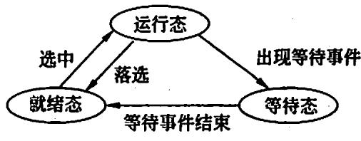  
图 2-2 进程三态模型及其状态转换

运行态——等待态：等待使用资源，如等待外设传输，等待人工干预。

等待态——就绪态：资源得到满足，如外设传输结束，人工干预完成。

运行态——就绪态：运行时间片到，出现有更高优先权进程。

就绪态——运行态：CPU 空闲时选择一个就绪进程。

## 2. 五态模型

在一个实际的系统里进程的状态及其转换比上节叙述的会复杂一些，例如引入专门的新建态（new）和终止态（exit）。图 2-3 给出了进程五态模型及其转换的示意图。

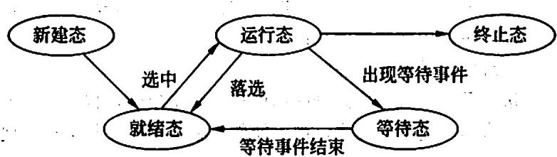  
图 2-3 进程五态模型及其状态转换

引入新建态和终止态对于进程管理来说是非常有用的。新建态对应于进程刚刚被创建的状态。创建一个进程要通过两个步骤，首先，是为一个新进程创建必要的管理信息；然后，让该进程进入就绪态。此时进程将处于新建态，它并没有被提交执行，而是在等待操作系统完成创建进程的必要操作。必须指出的是，操作系统有时将根据系统性能或主存容量的限制推迟新建态进程的提交。

类似地，进程的终止也要通过两个步骤，首先，是等待操作系统进行善后；然后，退出主存。当一个进程到达了自然结束点，或是出现了无法克服的错误，或是被操作系统所终结，或是被其他有终止权的进程所终结，它将进入终止态。进入终止态的进程以后不再执行，但依然保留在操作系统中等待善后。一旦其他进程完成了对终止态进程的信息抽取

## 2.2.3 进程的描述

## 1. 进程的组成

当一个程序进入计算机的主存储器进行计算就构成了进程，主存储器中的进程到底是如何组成的？操作系统中把进程物理实体和支持进程运行的环境合称为进程上下文(context)。当系统调度新进程占有处理器时，新老进程随之发生上下文切换。因此，进程的运行被认为是在上下文中执行。简单地说，一个进程映像（Process Image）包括：

（1）进程程序块，即被执行的程序，规定了进程一次运行应完成的功能。通常它是纯代码，作为一种系统资源可被多个进程共享。

（2）进程数据块，即程序运行时加工处理对象，包括全局变量、局部变量和常量等的存放区以及开辟的工作区，常常为一个进程专用。

（3）系统/用户堆栈，每一个进程都将捆绑一个系统/用户堆栈。用来解决过程调用或系统调用时的地址存储和参数传递。

(4) 进程控制块, 每一个进程都将捆绑一个进程控制块, 用来存储进程的标志信息、现场信息和控制信息。进程创建时, 建立一个 PCB; 进程撤销时, 回收 PCB, 它与进程一一对应。

用户进程在虚拟内存中的组织如图 2-4 所示。

## 2. 进程控制块

进程控制块是操作系统中最为重要的数据结构，每个进程控制块包含了操作系统管理所需的所有进程信息，进程控制块的集合事实上定义了一个操作系统的当前状态。当系统创建一个进程时，就为它建立一个PCB，当进程执行结束便回收它占用的PCB。操作系统是根据PCB来对并发执行的进程进行控制和管理的，借助于进程控制块进程才能被调度执行。

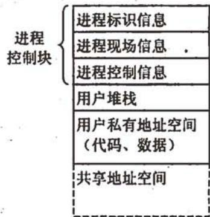  
图 2-4 用户进程在虚拟内存中的组织

一般说，进程控制块包含三类信息：

（1）标识信息。用于唯一地标识一个进程，常常分为由用户使用的外部标识符和被系统使用的内部标识号两种。

（2）现场信息。用于保留一个进程在运行时存放在处理器现场中的各种信息，任何一个进程在让出处理器时必须把此时的处理器现场信息保存到进程控制块中，而当该进程重新恢复运行时也应恢复处理器现场。常用的现场信息包括通用寄存器的内容、控制寄存器（如PSW寄存器）的内容、用户堆栈指针、系统堆栈指针等。

（3）控制信息。用于管理和调度一个进程。常用的控制信息包括：进程的调度相关信息，进程组成信息、进程间通信相关信息、进程在二级存储器内的地址、CPU资源的占用

和使用信息、进程特权信息、资源清单。

## 2.2.4 进程的同步与互斥

在多道程序设计系统中，同一时刻可能有许多进程，这些进程之间存在两种基本关系：竞争关系和协作关系。

第一种是竞争关系，系统中的多个进程之间彼此无关，它们并不知道其他进程的存在。例如，批处理系统中建立的多个用户进程，分时系统中建立的多个终端进程。由于这些进程共用了一套计算机系统资源，因而，必然要出现多个进程竞争资源的问题。当多个进程竞争共享硬设备、变量、表格、链表、文件等资源时，可能导致处理出错。

## (1) 进程的互斥（Mutual Exclusion）

是解决进程间竞争关系的手段。指若干个进程要使用同一共享资源时，任何时刻最多允许一个进程去使用，其他要使用该资源的进程必须等待，直到占有资源的进程释放该资源。临界区管理可以解决进程互斥问题。

第二种是协作关系，某些进程为完成同一任务需要分工协作。

## (2) 进程的同步（synchronization）

是解决进程间协作关系的手段。指一个进程的执行依赖于另一个进程的消息，当一个进程没有得到来自于另一个进程的消息时则等待，直到消息到达才被唤醒。

不难看出，进程互斥关系是一种特殊的进程同步关系，即逐次使用互斥共享资源。

## 1. 生产者-消费者问题

下面通过例子来进一步阐明进程同步的概念。著名的生产者-消费者（Producer-Consumer）问题是计算机操作系统中并发进程内在关系的一种抽象，是典型的进程同步问题。在操作系统中，生产者进程可以是计算进程、发送进程；而消费者进程可以是打印进程、接收进程等。解决好了生产者-消费者问题就解决好了一类并发进程的同步问题。

生产者-消费者问题表述如下：有 n 个生产者和 m 个消费者，连接在一个有 k 个单位缓冲区的有界缓冲上，故又叫有界缓冲问题。其中，pi 和 cj 都是并发进程，只要缓冲区未满，生产者 pi 生产的产品就可投入缓冲区；类似地，只要缓冲区不空，消费者进程 cj 就可从缓冲区取走并消耗产品。

可以把生产者-消费者问题的算法描述如下。

```txt
var k:integer;
type item:any;
buffer:array[0..k-1] of item;
in,out:integer:=0;
counter:integer:=0;
process producer
while (TRUE)    /* 无限循环
    produce an item in nextp;    /* 生产一个产品
```

```c
if (counter==k) sleep(); /* 缓冲满时，生产者睡眠
buffer[in]:=nextp; /* 将一个产品放入缓冲区
in:=(in+1) mod k; /* 指针推进
counter:=counter+1; /* 缓冲内产品数加1
if (counter==1) wakeup (consumer); /* 缓冲为空了，加进一件产品并唤醒消费者

process consumer
while (TRUE) /* 无限循环
if (counter==0) sleep(); /* 缓冲区空，消费者睡眠
nextc:=buffer[out]; /* 取一个产品到nextc
out:=(out+1) mod k; /* 指针推进
counter:=counter-1; /* 取走一个产品，计数减1
if (counter==k-1) wakeup (producer); /* 缓冲满了，取走一件产品并唤醒生产者
consume thr item in nextc; /* 消耗产品
```

其中，假如一般的高级语言都有 sleep() 和 wakeup() 这样的系统调用。从上面的程序可以看出，算法是正确的，两进程顺序执行结果也正确。但若并发执行，就会出现错误结果，出错的根源在于进程之间共享了变量 counter，对 counter 的访问未加限制。

生产者和消费者进程对 counter 的交替执行会使其结果不唯一。例如，counter 当前值为 8，如果生产者生产了一件产品，投入缓冲区，拟做 conuter 加 1 操作。同时消费者获取一个产品消费，拟做 counter 减 1 操作。假如两者交替执行加或减 1 操作，取决于它们的进行速度，counter 的值可能是 9，也可能是 7，正确值应为 8。

操作系统实现进程同步的机制称为同步机制，它通常由同步原语组成。不同的同步机制采用不同的同步方法，迄今已设计出许多同步机制，最常用的同步机制：信号量及 PV，管程。

## 2. 记录型信号量与 PV 操作

1965 年荷兰的计算机科学家 E.W.Dijkstra 提出了新的同步工具——信号量和 P、V 操作。他将交通管制中多种颜色的信号灯管理交通的方法引入操作系统，让两个或多个进程通过信号量（semaphore）展开交互。信号量仅能由同步原语对其进行操作，原语是操作系统中执行时不可中断的过程，即原子操作（Atomic Action）。Dijkstra 发明了两个同步原语：P 操作和 V 操作（荷兰语中"测试（Proberen）"和"增量（verhogen）"的头字母。利用信号量和 P、V 操作既可以解决并发进程的竞争问题，又可以解决并发进程的协作问题。

使用 PV 操作实现同步时，对共享资源的管理分散在各个进程之中，进程能直接对共享变量进行处理，因此，难以防止有意或无意的违法同步操作，而且容易造成程序设计错误。如果能把有关共享变量的操作集中在一起，就可使并发进程之间的相互作用更为清晰，更容易编写出正确的并发程序。

## 3. 管程

在 1974 年和 1975 年，霍尔（Hoare）和汉森（Brinch Hansen）提出了一个新的同步机制——管程。把系统中的资源用数据结构抽象地表示出来，因此，对资源的管理就可用数据及在其上实施操作的若干过程来表示；对资源的申请和释放通过过程在数据结构上的操作来实现。而代表共享资源的数据及在其上操作的一组过程就构成了管程，管程被请求和释放资源的进程所调用。

管程是一种程序设计语言结构成分，便于用高级语言来书写，它和信号量有同等的表达能力。管程是由若干公共变量及其说明和所有访问这些变量的过程所组成的；进程可以互斥地调用这些过程；管程把分散在各个进程中互斥地访问公共变量的那些临界区集中了起来。管程可以作为语言的一个成分，采用管程作为同步机制便于用高级语言来书写程序，也便于程序正确性验证。

## 2.2.5 死锁

## 1. 死锁的概念

计算机系统中有许多独占资源，它们在任一时刻都只能被一个进程使用，如磁带机、键盘、绘图仪等独占型外围设备，或进程表、临界区等软件资源。两个进程同时向一台打印机输出将导致一片混乱，两个进程同时进入临界区将导致数据错误乃至程序崩溃。正因为这些原因，所有操作系统都具有授权一个进程独立访问某一资源的能力。一个进程需要使用独占资源必须通过以下的次序。

(1) 申请资源。

(2) 使用资源。

(3) 归还资源。

若申请时资源不可用，则申请进程等待。对于不同的独占资源，进程等待的方式是有差异的，如申请打印机资源、临界区资源时，申请失败将意味着阻塞申请进程；而申请打开文件资源时，申请失败将返回一个错误码，由申请进程等待一段时间之后重试。值得指出的是，不同的操作系统对于同一种资源采取的等待方式也是有差异的。

在许多应用中，一个进程需要独占访问不止一种资源。而操作系统允许多个进程并发执行共享系统资源时，此时可能会出现进程永远被阻塞的现象。例如，两个进程分别等待对方占有的一个资源，于是两者都不能执行而处于永远等待，这种现象称为"死锁"。

下面举一死锁的例子来加深对其理解：竞争资源产生死锁。

设系统有打印机、读卡机各一台，它们被进程 P 和 Q 共享。两个进程并发执行，它们按下列次序请求和释放资源。

<table><tr><td>进程P</td><td>进程Q</td></tr><tr><td>请求读卡机</td><td>请求打印机</td></tr><tr><td>请求打印机</td><td>请求读卡机</td></tr><tr><td>释放读卡机</td><td>请求读卡机</td></tr><tr><td>释放打印机</td><td>释放打印机</td></tr></table>

它们执行时，相对速度无法预知，当出现进程P占用了读卡机，进程Q占用了打印机后，进程P又请求打印机，但因打印机被进程Q占用，故进程P处于等待资源状态；这时，进程Q执行，它又请求读卡机，但因读卡机被进程P占用而也只好处于等待资源状态。它们分别等待对方占用的资源，致使无法结束这种等待，产生了死锁。

## 2. 死锁产生的条件

系统产生死锁必定同时保持四个必要条件：

（1）互斥条件（Mutual Exclusion） 进程应互斥使用资源，任一时刻一个资源仅为一个进程独占，若另一个进程请求一个已被占用的资源时，它被置成等待状态，直到占用者释放资源。

（2）占有和等待条件（Hold and Wait）一个进程请求资源得不到满足而等待时，不释放已占有的资源。

（3）不剥夺条件（No Preemption）任一进程不能从另一进程那里抢夺资源，即已被占用的资源，只能由占用进程自己来释放。

（4）循环等待条件（Circular Wait）存在一个循环等待链，其中，每一个进程分别等待它前一个进程所持有的资源，造成永远等待。

只要能破坏这四个必要条件之一，死锁就可防止。

## 2.3 存储管理

存储管理是操作系统的重要组成部分，它负责管理计算机系统的重要资源——主存储器。由于任何程序、数据必须占用主存空间后才能执行，因此存储管理直接影响系统的性能。主存储空间一般分为两部分：一部分是系统区，存放操作系统以及一些标准子程序，例行程序等；另一部分是用户区，存放用户的程序和数据等。存储管理主要是对主存储器中的用户区域进行管理，当然也包括对辅存储器的管理。目的是要尽可能地方便用户使用和提高主存储器的效率。具体地说，存储管理有下面几个方面的功能。

(1) 主存储空间的分配和回收。

(2) 地址转换和存储保护。

(3) 主存储空间的共享。

(4) 主存储空间的扩充。

## 2.3.1 存储器的层次

目前，计算机系统均采用分层结构的存储子系统，以便在容量大小、速度快慢、价格高低诸因素中取得平衡点，获得较好的性能价格比。计算机系统的存储器可以分为寄存器、高速缓存、主存储器、磁盘缓存、固定磁盘、可移动存储介质等7个层次结构。如图2-5所示，越往上，存储介质的访问速度越快，价格也越高。其中，寄存器、高速缓存、主存储器和磁盘缓存均属于操作系统存储管理的管辖范畴，掉电后它们存储的信息不再存在。固定磁盘和可移动存储介质属于设备管理的管辖范畴，它们存储的信息将被长期保存。而磁盘缓存本身并不是一种实际存在的存储介质，它依托于固定磁盘，提供对主存储器存储空间的扩充。

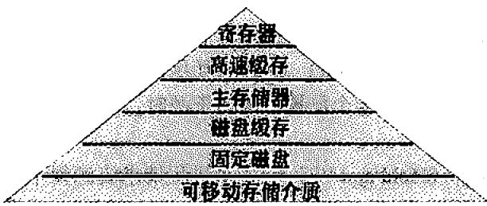  
图 2-5 计算机系统存储器的层次

可执行的程序必须被保存在计算机的主存储器中，与外围设备交换的信息一般也依托于主存储器地址空间。由于处理器在执行指令时主存访问时间远大于其处理时间，寄存器和高速缓存被引入以加快指令的执行。

寄存器是访问速度最快但最昂贵的存储器，它的容量小，一般以字（word）为单位。一个计算机系统可能包括几十个甚至上百个寄存器，用于加速存储访问速度，如寄存器存放操作数，或用地址寄存器加快地址转换速度。

高速缓存的容量稍大，其访问速度快于主存储器，利用它存放主存中一些经常访问的信息可以大幅度提高程序执行速度。

由于程序在执行和处理数据时存在顺序性、局部性、循环性和排他性，因此在程序执行时有时并不需要把程序和数据全部调入内存，而只需先调入一部分，待需要时逐步调入。这样，计算机系统为了容纳更多的算题数，或是为了处理更大批量的数据，就可以在磁盘上建立磁盘缓存以扩充主存储器的存储空间。算题的程序和处理的数据可以装入磁盘缓存，操作系统自动实现主存储器和磁盘缓存之间数据的调进调出，从而向用户提供了比实际主存存储容量大得多的存储空间。

## 2.3.2 地址转换与存储保护

用户编写应用程序时，是从 0 地址开始编排用户地址空间的，把用户编程时使用的地址称为逻辑地址（相对地址）。而当程序运行时，它将被装入主存储器地址空间的某些部分，此时程序和数据的实际地址一般不可能同原来的逻辑地址一致，把程序在内存中的实际地址称为物理地址（绝对地址）。相应地构成了用户编程使用的逻辑地址空间和用户程序实际运行的物理地址空间。

为了保证程序的正确运行，必须把程序和数据的逻辑地址转换为物理地址，这一工作称为地址转换或重定位。地址转换有两种方式，一种方式是在作业装入时由作业装入程序实现地址转换，称为静态重定位；另一种方式是在程序执行时实现地址转换，称为动态重定位。动态重定位必须借助于硬件的地址转换部件实现。

## 2.3.3 分区存储管理

分区存储管理的基本思想是给进入主存的用户进程划分一块连续存储区域，把进程装分区存储管理的基本思想是给进入主存的用户进程划分入该连续存储区域，使各进程能并发执行，这是能满足多道程序设计需要的最简单的存储管理技术。

## 1. 固定分区管理

固定分区（fixed partition）存储管理如图 2-6 所示，是预先把可分配的主存储器空间分割成若干个连续区域，每个区域的大小可以相同，也可以不同。

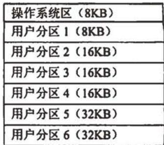

为了说明各分区的分配和使用情况，存储管理需设置一张"主存分配表"，该表如图 2-7 所示。

图 2-6 固定分区存储管理示意图

<table><tr><td>分区号</td><td>起始地址</td><td>长度</td><td>占用标志</td></tr><tr><td>1</td><td>8KB</td><td>8KB</td><td>0</td></tr><tr><td>2</td><td>16KB</td><td>16KB</td><td>Job1</td></tr><tr><td>3</td><td>32KB</td><td>16KB</td><td>0</td></tr><tr><td>4</td><td>48KB</td><td>64KB</td><td>0</td></tr><tr><td>5</td><td>64KB</td><td>32KB</td><td>Job2</td></tr><tr><td>6</td><td>96KB</td><td>32KB</td><td>0</td></tr></table>

图 2-7 固定分区存储管理的主存分配表

主存分配表指出各分区的起始地址和长度，表中的占用标志位用来指示该分区是否被占用了，当占用的标志位为"0"时，表示该分区尚未被占用。进行主存分配时总是选择那些标志为"0"的分区，当某一分区分配给一个作业后，则在占用标志栏填上占用该分区的作业名，如图2-8所示，第2、5分区分别被作业Job1和Job2占用，而其余分区为空闲。

## 2. 可变分区管理

可变分区（Variable Partition）存储管理是按作业的大小来划分分区。系统在作业装入主存执行之前并不建立分区，当要装入一个作业时，根据作业需要的主存量查看主存中是否有足够的空间，若有，则按需要量分割一个分区分配给该作业；若无，则令该作业等待主存空间。由于分区的大小是按作业的实际需要量来定的，且分区的个数也是随机的，所以可以克服固定分区方式中的主存空间的浪费，有利于多道程序设计，实现了多个作业对内存的共享，进一步提高了内存资源利用率。

随着作业的装入、撤离，主存空间被分成许多个分区，有的分区被作业占用，而有的分区是空闲的。当一个新的作业要求装入时，必须找一个足够大的空闲区，把作业装入该区，如果找到的空闲区大于作业需要量，则作业装入后又把原来的空闲区分成两部分，一部分被作业占用了；另一部分又分成为一个较小的空闲区。当一个作业运行结束撤离时，它归还的区域如果与其他空闲区相邻，则可合成一个较大的空闲区，以利于大作业的装入。采用可变分区方式的主存分配示例如图2-8所示。

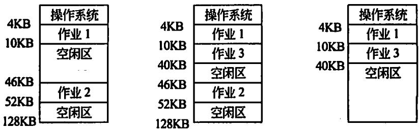  
图2-8 可变分区存储管理的主存分配示例

常用的可变分区管理的分配算法有：

（1）最先适用分配算法：对可变分区方式可采用最先适用分配算法，每次分配时，总是顺序查找未分配表或链表，找到第一个能满足长度要求的空闲区为止。分割这个找到的未分配区，一部分分配给作业，另一部分仍为空闲区。这种分配算法可能将大的空间分割成小区，造成较多的主存"碎片"。作为改进，可把空闲区按地址从小到大排列在未分配表或链表中，于是为作业分配主存空间时，尽量利用了低地址部分的区域，而可使高地址部分保持一个大的空闲区，有利于大作业的装入。

（2）最优适应分配算法：可变分区方式的另一种分配算法是最优适应分配算法，它是从空闲区中挑选一个能满足作业要求的最小分区，这样可保证不去分割一个更大的区域，使装入大作业时比较容易得到满足。采用这种分配算法时可把空闲区按长度以递增顺利排列，查找时总是从最小的一个区开始，直到找到一个满足要求的分区为止。按这种方法，在回收一个分区时也必须对分配表或链表重新排列。

（3）最坏适应分配算法：最坏适应分配算法是挑选一个最大的空闲区分割给作业使用，这样可使剩下的空闲区不至于太小，这种算法对中、小作业是有利的。

## 2.3.4 分页式存储管理

## 1. 分页式存储管理的基本原理

用分区方式管理的存储器，每道程序总是要求占用主存的一个或几个连续存储区域，作业或进程的大小仍受到分区大小或内存可用空间的限制，因此，有时为了接纳一个新的作业而往往要移动已在主存的信息。这不仅不方便，而且开销不小。采用分页存储器既可免去移动信息的工作，又可尽量减少主存的碎片。分页式存储管理的基本原理如下：

（1）页框：物理地址分成大小相等的许多区，每个区称为一块（又称页框 Page Frame）。

（2）页面：逻辑地址分成大小相等的区，区的大小与块的大小相等，每个区称一个页

面（page）。

（3）逻辑地址形式：与此对应，分页存储器的逻辑地址由两部分组成（页号和单元号）。逻辑地址格式如下：

<table><tr><td>页号</td><td>单元号</td></tr></table>

采用分页式存储管理时，逻辑地址是连续的。所以，用户在编制程序时仍只需使用顺序的地址，而不必考虑如何去分页。由地址结构和操作系统管理的需要来决定页面的大小，从而，也就确定了主存分块的大小。用户进程在内存空间中每个页框内的地址是连续的，但页框和页框之间的地址可以不连续。存储地址由连续到离散的变化，为以后实现程序的"部分装入、部分对换"奠定了基础。

(4) 页表和地址转换: 在进行存储分配时, 总是以块 (页框) 为单位进行分配, 一个作业的信息有多少页, 那么在把它装入主存时就给它分配多少块。但是, 分配给作业的主存块可以是不连续的, 即作业的信息可按页分散存放在主存的空闲块中, 这就避免了为得到连续存储空间而进行的移动。那么, 当作业的程序和数据被分散存放后, 作业的页面与分给的页框如何建立联系呢? 页式虚拟地址如何变换成页框物理地址呢? 作业的物理地址空间由连续变成分散后, 如何保证程序正确执行呢? 采用的办法是动态重定位技术, 让程序的指令执行时作地址变换, 由于程序段以页为单位, 所以, 给每个页设立一个重定位寄存器, 这些重定位寄存器的集合便称为页表 (Page Table)。页表是操作系统为每个用户作业建立的, 用来记录程序页面和主存对应页框的对照表, 页表中的每一栏指明了程序中的一个页面和分得的页框的对应关系。通常为了减少开销, 不是用硬件, 而是在主存中开辟存储区存放页表, 系统中另设一个页表主存起址和长度控制寄存器 (Page Table Control Register), 存放当前运行作业的页表起址和页表长, 以加快地址转换速度。每当选中作业运行时, 应进行存储分配, 为进入主存的每个用户作业建立一张页表, 指出逻辑地址中页号与主存中块号的对应关系, 页表的长度随作业的大小而定。同时页式存储管理系统还建立一张作业表, 将这些作业的页表进行登记, 每个作业在作业表中有一个登记项。作业表和页表的一般格式如图 2-9 所示。然后, 借助于硬件的地址转换部件, 在作业执行过程中按页动态定位。调度程序在选择作业后, 从作业表的登记项中得到被选中作业的页表始址和长度, 将其送入硬件设置的页表控制寄存器。地址转换时, 就可以从页表控制寄存器中找到相应的页表, 再以逻辑地址中的页号为索引查页表, 得到对应的块号, 根据关系式:

$$
\text { 绝对地址 } = \text { 块号 } \times \text { 块长 } + \text { 单元号 }
$$

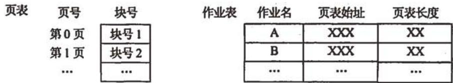  
图 2-9 页表和作业表的一般格式  

计算出欲访问的主存单元的地址。因此，虽然作业存放在若干个不连续的块中，但在作业执行中总是能按正确的地址进行存取。

## 2. 相联存储器和快表

页表可以存放在一组寄存器中，地址转换时只要从相应寄存器中取值就可得到块号，这虽然方便了地址转换，但硬件花费代价太高，如果把页表放在主存中就可降低计算机的成本。但是，当要按给定的逻辑地址进行读/写时，必须访问两次主存。第一次按页号读出页表中相应栏内容的块号，第二次根据计算出来的绝对地址进行读/写，降低了运算速度。

为了提高运算速度，通常都设置一个专用的高速存储器，用来存放页表的一部分，这种高速存储器称为相联存储器（Associative Memory），存放在相联存储器中的页表称为快表。相联存储器的存取时间是远小于主存的，但造价高，故一般都是小容量的，例如 Intel 80486 的快表为 32 个单元。

根据程序执行局部性的特点，即它在一定时间内总是经常访问某些页，若把这些页登记在快表中，无疑将大大加快指令的执行速度。快表的格式如下：

<table><tr><td>页号</td><td>块号</td></tr><tr><td>…</td><td>…</td></tr><tr><td>页号</td><td>块号</td></tr></table>

它指出已在快表中的页及其对应主存的块号。有了快表后，绝对地址形成的过程是，按逻辑地址中的页号查快表，若该页已登记在快表中，则由块号和单元号形成绝对地址；若快表中查不到对应页号，则再查主存中的页表而形成绝对地址，同时将该页登记到快表中。当快表填满后，又要在快表中登记新页时，则需在快表中按一定策略淘汰一个旧的登记项，最简单的策略是"先进先出"，总是淘汰最先登记的那一页。

采用相联存储器的方法后，地址转换时间大大下降。假定访问主存的时间为 $100 \times 10^{-9}$ s，访问相联存储器的时间为 $20 \times 10^{-9}$ s，相联存储器为 32 个单元时查快表的命中率可达 90%，于是按逻辑地址进行存取的平均时间为：

$$
(100 + 20) \times 90 \% + (100 + 100 + 20) \times (1 - 90 \%) = 130 \times 10 ^ {- 9} \mathrm{s}
$$

比两次访问主存的时间 $100 \times 10^{-9} \mathrm{~s} \times 2 + 20 = 220 \times 10^{-9} \mathrm{~s}$ 下降了四成多。

同样，整个系统也只有一个相联存储器，只有占用 CPU 者才占有相联存储器。在多道程序中，当某道程序让出处理器时，应同时让出相联存储器。由于快表是动态变化的，所以让出相联存储器时应把快表保护好以便再执行时使用。当一道程序占用处理器时，除置页表控制寄存器外还应将它的快表送入相联存储器。

## 2.3.5 分段式存储管理的基本原理

分段式存储管理是以段为单位进行存储分配，为此提供如下形式的两维逻辑地址：

段号：段内地址

在分页式存储管理中，页的划分——即逻辑地址划分为页号和单元号是用户不可见的，连续的用户地址空间将根据页框架（块）的大小自动分页；而在分段式存储管理中，地址结构是用户可见的，即用户知道逻辑地址如何划分为段号和单元号，用户在程序设计时，每个段的最大长度受到地址结构的限制，进一步，每一个程序中允许的最多段数也可能受到限制。例如，PDP-11/45 的段址结构为：段号占 3 位，单元号占 13 位，也就是一个作业最多可分 8 段，每段的长度可达 8KB。

分段式存储管理的实现可以基于可变分区存储管理的原理，为作业的每一段分配一个连续的主存空间，而各段之间可以不连续。在进行存储分配时，应为进入主存的每个用户作业建立一张段表，各段在主存的情况可用一张段表来记录，它指出主存储器中每个分段的起始地址和长度。同时段式存储管理系统包括一张作业表，将这些作业的段表进行登记，每个作业在作业表中有一个登记项。作业表和段表的一般格式如图2-10所示。

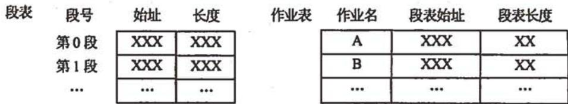  
图 2-10 段表和作业表的一般格式

段表表目实际上起到了基址/限长寄存器的作用。作业执行时通过段表可将逻辑地址转换成绝对地址。由于每个作业都有自己的段表，地址转换应按各自的段表进行。类似于分页存储器那样，分段存储器也设置一个段表控制寄存器，用来存放当前占用处理器的作业的段表始址和长度。段式存储管理的地址转换和存储保护流程如图2-11所示。

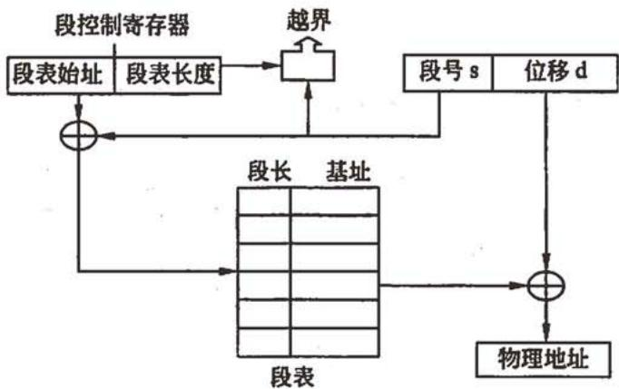  
图 2-11 分段式存储管理的地址转换和存储保护

## 2.3.6 虚拟存储管理基本概念

在前面介绍的各种存储管理方式中，必须为作业分配足够的存储空间，以装入有关作业的全部信息，当然作业的大小不能超出主存的可用空间，否则这个作业是无法运行的。但当把有关作业的全部信息都装入主存储器后，作业执行时实际上不是同时使用全部信息的，有些部分运行一遍便再也不用，甚至有些部分在作业执行的整个过程中都不会被使用到（如错误处理部分）。进程在运行时不用的，或暂时不用的，或某种条件下才用的程序和数据，全部驻留于内存中是对宝贵的主存资源的一种浪费，大大降低了主存利用率。于是，提出了这样的问题：作业提交时，先全部进入辅助存储器，作业投入运行时，能否不把作业的全部信息同时装入主存储器，而是将其中当前使用部分先装入主存储器，其余暂时不用的部分先存放在作为主存扩充的辅助存储器中，待用到这些信息时，再由系统自动把它们装入到主存储器中，这就是虚拟存储器的基本思路。如果"部分装入、部分对换"这个问题能解决的话，那么当主存空间小于作业需要量时，这个作业也能执行；更进一步，多个作业存储总量超出主存总容量时，也可以把它们全部装入主存，实现多道程序运行。这样，不仅使主存空间能充分地被利用，而且用户编制程序时可以不必考虑主存储器的实际容量，允许用户的逻辑地址空间大于主存储器的绝对地址空间。对于用户来说，好像计算机系统具有一个容量很大的主存储器，把它称做为"虚拟存储器"（Virtual Memory）。

对虚拟存储器的定义如下：具有部分装入和部分对换功能，能从逻辑上对内存容量进行大幅度扩充，使用方便的一种存储器系统。实际上是为扩大主存而采用的一种设计技巧。虚拟存储器的容量与主存大小无关。虚拟存储器的实现对用户来说是感觉不到的，他们总以为有足够的主存空间可容纳他的作业。

## 2.4 设备管理

现代计算机系统中配置了大量外围设备。一般说，计算机的外围设备分为两大类：一类是存储型设备，如磁带机、磁盘机等。以存储大量信息和快速检索为目标，它在系统中作为主存储器的扩充，所以，又称为辅助存储器；另一类是输入输出型设备，如显示器、卡片机、打印机等。它们把外界信息输入计算机，把运算结果从计算机输出。

为了方便用户使用各种外围设备，设备管理要达到提供统一界面、方便使用、发挥系统并行性，提高 I/O 设备使用效率等目标。为此，设备管理通常应具有以下功能：

(1) 外围设备中断处理。

(2) 缓冲区管理。

(3) 外围设备的分配。

(4) 外围设备驱动调度。

## 2.4.1 I/O 硬件原理

作为操作系统的设计者，立足点主要是针对如何利用 I/O 硬件的功能为程序设计提供一个方便用户的实用接口，而并非研究 I/O 硬件的设计、制造和维护。

## 1. 输入/输出系统

通常把 I/O 设备及其接口线路、控制部件、通道和管理软件称为 I/O 系统，把计算机的主存和外围设备的介质之间的信息传送操作称为输入输出操作。按照输入输出特性，I/O 设备可以划分为输入型外围设备、输出型外围设备和存储型外围设备三类。

## 2. 输入/输出控制方式

输入输出控制在计算机处理中具有重要的地位，为了有效地实现物理 I/O 操作，必须通过硬、软件技术，对 CPU 和 I/O 设备的职能进行合理分工，以调解系统性能和硬件成本之间的矛盾。按照 I/O 控制器功能的强弱以及和 CPU 之间联系方式的不同，可把 I/O 设备的控制方式分为四类：询问方式、中断方式、DMA 方式、通道方式。

## 3. 询问方式

询问方式又称为程序直接控制方式，在这种方式下，输入输出指令或询问指令测试一台设备的忙闲标志位，决定主存储器和外围设备是否交换一个字符或一个字。询问方式的主要缺点在于一旦 CPU 启动 I/O 设备，便不断查询 I/O 的准备情况，终止了原程序的执行。CPU 在反复查询过程中，浪费了宝贵的 CPU 时间；另一方面，I/O 准备就绪后，CPU 参与数据的传送工作，此时 CPU 也不能执行原程序，可见 CPU 和 I/O 设备串行工作，使主机不能充分发挥效率，外围设备也不能得到合理使用，整个系统的效率很低。

## 4. 中断方式

中断机构引入后，外围设备有了反映其状态的能力，仅当操作正常或异常结束时才中断中央处理机。实现了一定程度的并行操作，这叫程序中断方式。

## 5. DMA 方式

虽然程序中断方式消除了程序查询方式的忙式测试，提高了 CPU 资源的利用率，但是在响应中断请求后，必须停止现行程序转入中断处理程序并参与数据传输操作。如果 I/O 设备能直接与主存交换数据而不占用 CPU，那么，CPU 资源的利用率还可提高，这就出现了直接存储器存取（Direct Memory Access，DMA）方式。

在 DMA 方式中，主存和 I/O 设备之间有一条数据通路，在主存和 I/O 设备之间成块传送数据过程中，不需要 CPU 干预，实际操作由 DMA 直接执行完成。

目前，在小型、微型机中的快速设备均采用这种方式，DMA 方式线路简单，价格低廉，但功能较差，不能满足复杂的 I/O 要求。因而，在中大型机中使用通道技术。

## 6. 通道方式

通道方式是 DMA 方式的发展，它又进一步减少了 CPU 对 I/O 操作的干预，是对多个数据块，而不是仅仅一个数据块，及有关管理和控制的干预。同时，为了获得中央处理器和外围设备之间更高的并行工作能力，也为了让种类繁多，物理特性各异的外围设备能以标准的接口连接到系统中，计算机系统引入了自成独立体系的通道结构。通道的出现是现代计算机系统功能不断完善，性能不断提高的结果，是计算机技术的一个重要进步。

通道又称输入输出处理器。它能完成主存储器和外围设备之间的信息传送，与中央处理器并行地执行操作。采用通道技术主要解决了输入输出操作的独立性和各部件工作的并行性。由通道管理和控制输入输出操作，大大减少了外围设备和中央处理器的逻辑联系。从而，把中央处理器从琐碎的输入输出操作中解放出来。

## 2.4.2 I/O 软件原理

I/O 软件的总体设计目标是：高效率和通用性。高效率是不言而喻的，在改善 I/O 设备的效率中，最应关注的是磁盘 I/O 的效率。通用性意味着用统一标准的方法来管理所有设备，为了达到这一目标，通常，把软件组织成一种层次结构，低层软件用来屏蔽硬件的具体细节，高层软件则主要向用户提供一个简洁、规范的界面。

为了合理、高效地解决以上问题，操作系统通常把 I/O 软件组织成以下四个层次。

(1) I/O 中断处理程序（底层）。

(2) 设备驱动程序。

(3) 与设备无关的操作系统 I/O 软件。

（4）用户层 I/O 软件。

## 1. 输入/输出中断处理程序

中断是应该尽量加以屏蔽的概念，应该放在操作系统的底层进行处理，以便其余部分尽可能少地与之发生联系。

当一个进程请求 I/O 操作时，该进程将被挂起，直到 I/O 操作结束并发生中断。当中断发生时，中断处理程序执行相应的处理，并解除相应进程的阻塞状态。

输入输出中断的类型和功能如下：

（1）通知用户程序输入输出操作沿链推进的程度。此类中断有程序进程中断。

（2）通知用户程序输入输出操作正常结束。当输入输出控制器或设备发现通道结束、控制结束、设备结束等信号时，就向通道发出一个报告输入输出操作正常结束的中断。

（3）通知用户程序发现的输入输出操作异常，包括设备出错、接口出错、I/O 程序出错、设备特殊、设备忙等，以及提前中止操作的原因。

（4）通知程序外围设备上重要的异步信号。此类中断有注意、设备报到、设备结束等。当输入输出中断被响应后，中断装置交换程序状态字引出输入输出中断处理程序。

## 2. 设备驱动程序

设备驱动程序中包括了所有与设备相关的代码。每个设备驱动程序只处理一种设备，或者一类紧密相关的设备。

笼统地说，设备驱动程序的功能是从与设备无关的软件中接收抽象的请求并执行。一条典型的请求是读第 n 块。如果请求到来时驱动程序空闲，则它立即执行该请求。但如果它正在处理另一条请求，则它将该请求挂在一个等待队列中。

执行一条 I/O 请求的第一步，是将它转换为更具体的形式。例如对磁盘驱动程序，它包含：计算出所请求块的物理地址、检查驱动器电机是否在运转、检测磁头臂是否定位在正确的柱面等。简而言之，它必须确定需要哪些控制器命令以及命令的执行次序。

一旦决定应向控制器发送什么命令，驱动程序将向控制器的设备寄存器中写入这些命令。某些控制器一次只能处理一条命令，另一些则可以接收一串命令并自动进行处理。

## 3. 与硬件无关的操作系统 I/O 软件

尽管某些 I/O 软件是设备相关的，但大部分独立于设备。设备无关软件和设备驱动程序之间的精确界限在各个系统都不尽相同。对于一些以设备无关方式完成的功能，在实际中由于考虑到执行效率等因素，也可以考虑由驱动程序完成。

下面罗列了一般由设备无关软件完成的功能：

(1) 对设备驱动程序的统一接口。

(2) 设备命名。

(3) 设备保护。

(4) 提供独立于设备的块大小。

(5) 缓冲区管理。

(6) 块设备的存储分配。

(7) 独占性外围设备的分配和释放。

(8) 错误报告。

设备无关软件的基本功能就是执行适用于所有设备的常用 I/O 功能，并向用户层软件提供一个一致的接口。

## 4. 用户空间的 I/O 软件

尽管大部分 I/O 软件属于操作系统，但是有一小部分是与用户程序链接在一起的库例程，甚至是在核心外运行的完整的程序。系统调用，包括 I/O 系统调用通常先是库例程调用。如下 C 语言程序语句：

$$
\text { count } = \text { write(fd,   buffer,   nbytes); }
$$

中，所调用的库函数 write 将与程序链接在一起，并包含在运行时的二进制程序代码中。这一类库例程显然也是 I/O 系统的一部分。

此类库例程的主要工作是提供参数给相应的系统调用并调用之。但也有一些库例程，它们确实做非常实际的工作，例如格式化输入输出就是用库例程实现的。C 语言中的一个例子是 printf 函数，它的输入为一个格式字符串，其中可能带有一些变量，它随后调用 write，输出格式化后的一个 ASCII 码串。与此类似的 scanf，它采用与 printf 相同的语法规则来读取输入。标准 I/O 库包含相当多的涉及 I/O 的库例程，它们作为用户程序的一部分运行。

## 2.4.3 Spooling 系统

外围设备联机操作（Simultaneous Peripheral Operations On Line, Spooling），简称为Spooling系统或假脱机系统。所谓Spooling技术实际上是用一类物理设备模拟另一类物理设备的技术，是使独占使用的设备变成多台虚拟设备的一种技术，也是一种速度匹配技术。

如图 2-12 所示为 Spooling 系统的组成和结构。为了实现联机同时外围操作功能，必须具有能将信息从输入设备输入到辅助存储器缓冲区域的"预输入程序"；能将信息从辅助存储器输出缓冲区域输出到输出设备的"缓输出程序"以及控制作业和辅助存储器缓冲区域之间交换信息的"井管理程序"。

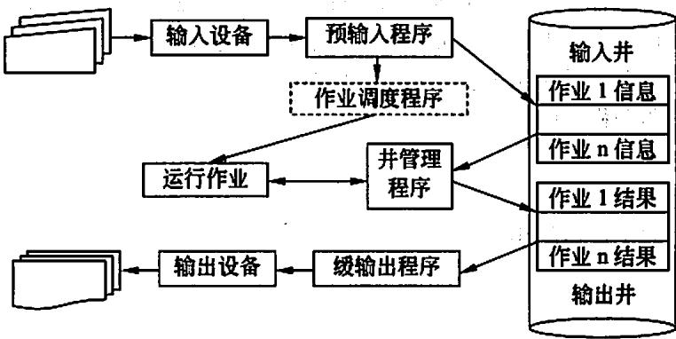  
图 2-12 Spooling 系统的组成和结构

为了存放从输入设备输入的信息以及作业执行的结果，系统在辅助存储器上开辟了输入井和输出井。"井"是用作缓冲的存储区域，采用井的技术能调节供求之间的矛盾，消除人工干预带来的损失。

预输入程序的主要任务是控制信息从输入设备输入到输入井存放，并填写好输入表以便在作业执行中要求输入信息量，可以随时找到它们的存放位置。

系统拥有一张作业表用来登记进入系统的所有作业的作业名、状态、预输入表位置等信息。每个用户作业拥有一张预输入表用来登记该作业的各个文件的情况，包括设备类、信息长度及存放位置等。

输入井中的作业有 4 种状态:

（1）输入状态：作业的信息正从输入设备上预输入。

(2) 收容状态：作业预输入结束但未被选中执行。

（3）执行状态：作业已被选中，它可从输入井读取信息可向输出井写信息。

（4）完成状态：作业已经撤离，该作业的执行结果等待缓输出。

作业表指示了哪些作业正在预输入，哪些作业已经预输入完成，哪些作业正在执行等。作业调度程序根据预定的调度算法选择收容状态的作业执行，作业表是作业调度程序进行作业调度的依据，是 Spooling 系统和作业调度程序共享的数据结构。

## 2.4.4 磁盘调度

磁盘是可供多个进程共享的设备。当多个进程都请求访问磁盘时，为了保证信息的安全，系统每一时刻只允许一个进程启动磁盘进行 I/O 操作，其余的进程只能等待。因此，操作系统应采用一种适当的调度算法，使各进程对磁盘的平均访问（主要是寻道）时间最小。磁盘调度分为移臂调度和旋转调度两类，首先是进行移臂调度，然后再进行旋转调度。由于访问磁盘最耗时的是寻道时间，因此磁盘调度的目标应使磁盘的平均寻道时间最少。

## 1. 移臂调度

移臂调度有若干策略，"电梯调度"算法是简单而实用的一种算法。按照这种策略每次总是选择沿臂的移动方向最近的那个柱面；如果沿这个方向没有访问的请求时，就改变臂的移动方向，使用移动频率极小化。每当要求访问磁盘时，操作系统查看磁盘机是否空闲。如果空闲就立即移臂，然后将当前移动方向和本次停留的位置都登记下来。如果不空，就让请求者等待并把它要求访问的位置登记下来，按照既定的调度算法对全体等待者进行寻查定序，下次按照优化的次序执行。如果有多个盘驱动器的请求同时到达时，系统还必须有优先启动哪一个盘组的 I/O 请求决策。

## 2. 旋转调度算法

当移臂定位后，有多个进程等待访问该柱面时，应如何决定这些进程的访问顺序？这就是旋转调度所要考虑的问题；显然系统应该选择延迟时间最短的进程对磁盘的扇区进行访问。当有若干等待进程请求访问磁盘上的信息时，旋转调度应考虑如下情况：

（1）进程请求访问的是同一磁道上的不同编号的扇区。

(2) 进程请求访问的是不同磁道上的不同编号的扇区。

（3）进程请求访问的是不同磁道上具有相同编号的扇区。

对于（1）和（2）的情况，旋转调度总是让首先到达读写磁头位置下的扇区先进行传送操作；对于（3）的情况，旋转调度可以任选一个读写磁头位置下的扇区进行传送操作。

## 2.5 文件管理

文件系统是操作系统中负责存取和管理信息的模块，它用统一的方式管理用户和系统信息的存储、检索、更新、共享和保护，并为用户提供一整套方便有效的文件使用和操作方法。对于用户来说，可按自己的愿望并遵循文件系统的规则来定义文件信息的逻辑结构，由文件系统提供"按名存取"来实现对用户文件信息的存储和检索。可见，使用者在处理他的信息时，只需关心所执行的文件操作及文件的逻辑结构，而不必涉及存储结构。

## 2.5.1 文件与文件系统

## 1. 文件的基本概念

文件是由文件名字标识的一组相关信息的集合。文件名是字母或数字组成的字母数字串，它的格式和长度因系统而异。

组成文件的信息可以是各式各样的：一个源程序、一批数据、各类语言的编译程序都可以各自组成一个文件。文件可以按各种方法进行分类，如按用途可分成：系统文件、库文件和用户文件；按保护级别可分成：只读文件、读写文件和不保护文件；按信息流向可分成：输入文件、输出文件和输入输出文件等。

## 2. 文件的命名

文件是一个抽象机制，它提供了一种把文件保存在磁盘上而且便于以后读取的方法，用户不必了解信息存储的方法、位置以及存储设备实际运作方式等细节。在这一抽象机制中最重要的是文件命名，当一个进程创建一个文件时必须给出文件名字，以后这个文件将独立于进程存在直到它被显式地删除；当其他进程要使用这一文件时必须显式地指出该文件名字；操作系统也将根据该文件名字对文件进行保护。

## 3. 文件类型

在现代操作系统中，对于文件乃至设备的访问都是基于文件进行的，例如，打印一批数据就是向打印机设备文件写数据，从键盘接收一批数据就是从键盘设备文件读数据。操作系统一般支持以下几种不同类型的文件：

（1）普通文件：即前面所讨论的存储在外存储设备上的数据文件。

（2）目录文件：管理和实现文件系统的系统文件。

（3）块设备文件：用于磁盘、光盘或磁带等块设备的 I/O。

（4）字符设备文件：用于终端、打印机等字符设备的 I/O。

一般来说，普通文件包括 ASCII 文件或者二进制文件，ASCII 文件由多行正文组成，在 DOS、Windows 等系统中每一行以回车换行结束，整个文件以 CTRL+Z 结束；在 Unix 等系统中每一行以换行结束，整个文件以 CTRL+D 结束。ASCII 文件的最大优点是可以原样显示和打印，也可以用通常的文本编辑器进行编辑。另一种正规文件是二进制文件，它往往有一定的内部结构，组织成字节的流，如可执行文件是指令和数据的流，记录式文件是逻辑记录的流。

## 4. 文件系统

对文件系统本身来说，必须采用特定的数据结构和有效算法，实现文件的逻辑结构到存储结构的映射，实现对文件存储空间和用户信息的管理，提供多种存取方法。

所以，文件系统面向用户的功能是：

(1) 文件的按名存取。

(2) 文件目录建立和维护。

(3) 实现从逻辑文件到物理文件的转换。

(4) 文件存储空间的分配和管理。

(5) 提供合适的文件存取方法。

(6) 实现文件的共享、保护和保密。

(7) 提供一组可供用户使用的文件操作。

为了实现这些功能，操作系统必须考虑文件目录的建立和维护、存储空间的分配和回收、数据的保密和监护、监督用户存取和修改文件的权限、在不同存储介质上信息的表示方式、信息的编址方法、信息的存储次序、以及怎样检索用户信息等问题。

## 5. 文件的存取

从用户使用观点来看，关心的是数据的逻辑结构，即记录及其逻辑关系，数据独立于物理环境；从系统实现观点来看，数据则被文件系统按照某种规则排列和存放到物理存储介质上。那么，输入的数据如何存储？处理的数据如何检索？数据的逻辑结构和数据物理结构之间怎样接口？谁来完成数据的成组和分解操作？这些都是存取方法的任务。存取方法是操作系统为用户程序提供的使用文件的技术和手段。

## (1) 顺序存取

按记录顺序进行读 / 写操作的存取方法称为顺序存取。固定长记录的顺序存取是十分简单的。读操作总是读出下一次要读出的文件的下一个记录，同时，自动让文件记录读指针推进，以指向下一次要读出的记录位置。如果文件是可读可写的。再设置一个文件记录指针，它总指向下一次要写入记录的存放位置，执行写操作时，将一个记录写到文件末端。允许对这种文件进行前跳或后退 N（整数）个记录的操作。顺序存取主要用于磁带文件，但也适用于磁盘上的顺序文件。

## (2) 直接存取

很多应用场合要求以任意次序直接读写某个记录，例如，航空订票系统，把特定航班的所有信息用航班号作标识，存放在某物理块中，用户预订某航班时，需要直接将该航班的信息取出。直接存取方法便适合于这类应用，它通常用于磁盘文件。

## (3) 索引存取

第三种类型的存取是基于索引文件的索引存取方法。由于文件中的记录不按它在文件中的位置，而按它的记录键来编址，所以，用户提供给操作系统记录键后就可查找到所需记录。通常记录按记录键的某种顺序存放，例如，按代表键的字母先后次序来排序。对于这种文件，除可采用按键存取外，也可以采用顺序存取或直接存取的方法。信息块的地址都可以通过查找记录键而换算出来。实际的系统中，大都采用多级索引，以加速记录查找过程。

## 2.5.2 文件目录

## 1. 文件目录的概念

文件系统怎样实现文件的"按名存取"？如何查找文件存储器中的指定文件？如何有效地管理用户文件和系统文件？文件目录便是用于这些操作的重要手段。文件系统的基本功能之一就是负责文件目录的建立、维护和检索，要求编排的目录便于查找、防止冲突，目录的检索方便迅速。

有了文件目录后，就可实现文件的"按名存取"。每一个文件在文件目录中登记一项。文件目录项一般应该包括以下内容：

（1）有关文件存取控制的信息。如文件名、用户名、授权者存取权限：文件类型和文件属性，如读写文件、执行文件、只读文件等。

（2）有关文件结构的信息。文件的逻辑结构，如记录类型、记录个数、记录长度、成组因子数等。文件的物理结构，如记录存放相对位置或文件第一块的物理块号，也可指出文件索引的所在位置。

（3）有关文件管理的信息。如文件建立日期、文件最近修改日期、访问日期、文件保留期限、记账信息等。

有了文件目录后，就可实现文件的"按名存取"。当用户要求存取某个文件时，系统查找目录项并比较文件名就可找到所寻文件的目录项。然后，通过目录项指出的文件名就可找到所寻文件的目录项，然后通过目录项指出文件的文件信息相对位置或文件信息首块物理位置等就能依次存取文件信息。

## 2. 一级目录结构

如图 2-13 所示，最简单的文件目录是一级目录结构，在操作系统中构造一张线性表，

与每个文件有关的属性占用一个目录项就成了一级目录结构。单用户微型机操作系统 CP/M 的软盘文件便采用这一结构，每个磁盘上设置一张一级文件目录表，不同磁盘驱动器上的文件目录互不相关。文件目录表由长度为 32 字节的目录项组成，目录项 0 称目录头，记录有关文件目录表的信息，其他每个目录项又称文件控制块。文件目录中列出了盘上全部文件的有关信息。CP/M 操作系统中文件目录项

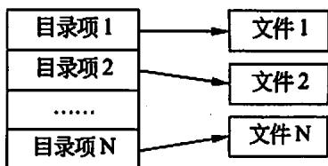  
图 2-13 一级目录结构示意图

包括：盘号、文件名、扩展名、文件范围、记录数、存放位置等。

一级文件目录结构存在若干缺点：一是重名问题，它要求文件名和文件之间有一一对应关系，但要在多用户的系统中，由于都使用同一文件目录，一旦文件名用重，就会出现混淆而无法实现按名存取。如果人为地限制文件名命名规则，对用户来说又极不方便；二是难以实现文件共享，如果允许不同用户使用不同文件名来共享同一个文件，这在一级目录中是很难实现的，为了解决上述问题，操作系统往往采用二级目录结构，使得每个用户有各自独立的文件目录。

## 3. 二级目录结构

在二级目录中，第一级为主文件目录，它用于管理所有用户文件目录，它的目录项登记了系统接受的用户的名字及该用户文件目录的地址。第二级为用户文件目录，它为该用户的每个文件保存一登记栏，其内容与一级目录的目录项相同。每一用户只允许查看自己的文件目录。图2-14是二级文件目录结构示意。当一个新用户作业进入系统执行时，系统为其在主文件目录中开辟一个区域的地址填入主文件目录中的该用户名所在项。当用户需要访问某个文件时系统根据用户名从主文件目录中找出该用户的文件目录的物理位置，其余的工作与一级文件目录类似。

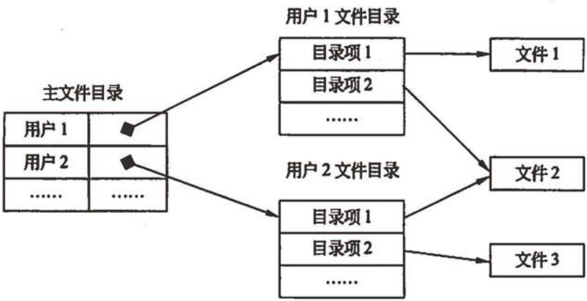  
图 2-14 二级目录结构示意图

采用二级目录管理文件时，因为任何文件的存取都通过主文件目录，于是可以检查访问文件者的存取权限，避免一个用户未经授权就存取另一个用户的文件，使用户文件的私有性得到保证，实现了对文件的保密和保护。

## 4. 树型目录结构

二级目录的推广形成了多级目录。每一级目录可以是下一级目录的说明，也可以是文件的说明，从而，形成了层次关系。多级目录结构通常采用树型结构，它是一棵倒立的有根的树，树根是根目录；从根向下，每一个树枝是一个子目录；而树叶是文件。树型多级目录有许多优点：较好地反映现实世界中具有层次关系的数据集合和较确切地反映系统内部文件的分支结构；不同文件可以重名，只要它们不在同一末端的子目录中，易于规定不同层次或子树中文件的不同存取权限，便于文件的保护、保密和共享等。

## 2.5.3 文件的结构和组织

文件的组织是指文件中信息的配置和构造方式，通常应该从文件的逻辑结构和组织及文件的物理结构和组织两方面加以考虑。文件的逻辑结构和组织是从用户观点出发，研究用户概念中的抽象的信息组织方式，这是用户能观察到的，可加以处理的数据集合。由于数据可独立于物理环境加以构造，所以称为逻辑结构。文件的物理结构和组织是指逻辑文件在物理存储空间中的存放方法和组织关系。这时，文件被看作物理文件，即相关物理块的集合。文件的存储结构涉及块的划分、记录的排列、索引的组织、信息的搜索等许多问题。

## 1. 文件的逻辑结构

文件的逻辑结构分两种形式：一种是流式文件，另一种是记录式文件。

## (1) 流式文件

流式文件指文件内的数据不再组成记录，只是依次的一串信息集合，也可以看成是只有一个记录的记录式文件。这种文件常常按长度来读取所需信息，也可以用插入的特殊字符作为分界。为了简化系统，大多数现代操作系统对用户仅仅提供流式文件，记录式文件往往由高级语言或简单的数据库管理系统提供。

## (2) 记录式文件

记录式文件内包含若干逻辑记录，逻辑记录是文件中按信息在逻辑上的独立含意划分的一个信息单位，记录在文件中的排列可能有顺序关系，但除此以外，记录与记录之间不存在其他关系。在这一点上，文件有别于数据库。根据记录的长度可分为定长和不定长两类：定长记录（格式 F）指一个记录式文件中所有的逻辑记录都具有相同的长度，同时所有数据项的相对位置也是固定的。定长记录由于处理方便、控制容易，在传统的数据处理中普遍采用。定长记录可以成组或不成组，成组时除最末一块外，每块中的逻辑记录数为一常数。

变长记录（格式 V）指一个记录式文件中，逻辑记录的长度不相等，但每个逻辑记录的长度处理之前能预先确定。有两种情况会造成变长记录：包含一个或多个可变的长度的数据项；包含了可变数目的定长数据项。

## 2. 文件的物理结构

文件系统往往根据存储设备类型、存取要求、记录使用频度和存储空间容量等因素提供若干种文件存储结构。用户看到的是逻辑文件，处理的是逻辑记录，按照逻辑文件形式去存储，检索和加工有关的文件信息，也就是说数据的逻辑结构和组织是面向应用程序的。然而，这种逻辑上的文件总得以不同方式保存到物理存储设备的存储介质上去，所以，文件的物理结构和组织是指逻辑文件在物理存储空间中存放方法和组织关系。

## (1) 顺序文件

将一个文件中逻辑上连续的信息存放到存储介质的依次相邻的块上便形成顺序结构，这类文件叫顺序文件，又称连续文件。显然，这是一种逻辑记录顺序和物理记录顺序完全一致的文件，通常，记录按出现的次序被读出或修改。

顺序文件的基本优点是：顺序存取记录时速度较快。顺序文件的主要缺点是：建立文件前需要能预先确定文件长度，以便分配存储空间；修改、插入和增加文件记录有困难；对直接存储器作连续分配，会造成少量空闲块的浪费。

## (2) 连接文件

连接结构的特点是使用连接字，又叫指针来表示文件中各个记录之间的关系。如图2-15所示，第一块文件信息的物理地址由文件目录给出，而每一块的连接字指出了文件的下一个物理块。通常，连接字内容为0时，表示文件至本块结束。这种文件叫连接文件，又称串联文件。

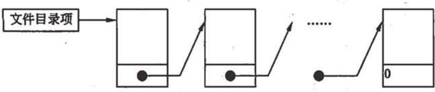  
图 2-15 连接文件结构示意图

指向其他数据的连接表示是计算机程序设计的一种重要手段，是表示复杂数据关系的一种重要方法，使用指针可以将文件的逻辑记录顺序与它所在存储空间联系起来。

## (3) 索引结构

索引结构是实现非连续存储的另一种方法，适用于数据记录保存有随机存取存储设备上的文件。如图2-16所示，它使用了一张索引表，其中每个表目包含一个记录的键及其记录数据的存储地址，存储地址可以是记录的物理地址，也可以是记录的符号地址，这种类型的文件称为索引文件。通常，索引表的地址可由文件目录指出，查阅索引表先找到的相应记录键，然后获得数据存储地址。

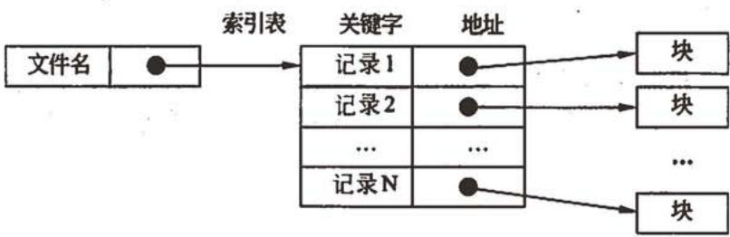  
图 2-16 索引文件结构示意图

索引文件在文件存储器上分两个区：索引区和数据区。访问索引文件需两步操作：第一步查找文件索引，第二步以相应键登记项内容作为物理或符号地址而获得记录数据。这样，至少需要两次访问辅助存储器，但若文件索引已预先调入主存储器，那么就可减少一次内外存信息交换。

索引结构是连接结构的一种扩展，除了具备连接文件的优点外，还克服了它只能作顺序存取的缺点，具有直接读写任意一个记录的能力，便于文件的增加、删除和修改。索引文件的缺点是：增加了索引表的空间开销和查找时间，索引表的信息量甚至可能远远超过文件记录本身的信息量。

## 2.5.4 文件的共享和保护

## 1. 文件的保护

文件保护是指防止文件被破坏，它包括两个方面：一是防止系统崩溃所造成的文件破坏；二是防止其他用户的非法操作所造成的文件破坏。

为防止系统崩溃造成文件破坏，定时转储是一种经常采用的方法，系统的管理员每隔一段时间，或一日、或一周、或一月、或一个期间，把需要保护的文件保存到另一个介质上，以备数据破坏后恢复。如一个单位建立了信息系统，往往会准备多个磁带，以便数据库管理员每天下班前把数据库文件转储到磁带上，这样即使出现了数据库损坏，最多只会丢失一天的数据。由于需要备份的数据文件可能非常多，增量备份是必需的，为此操作系统专门为文件设置了档案属性，用以指明该文件是否被备份过。

至于要防止其他用户的非法操作所造成的文件破坏，这往往通过操作系统的安全性策略来实现，其基本思想是建立如下的三元组。

(用户、对象、存取权限)

其中：

（1）用户是指每一个操作系统使用者的标识。

（2）对象在操作系统中一般是文件，因为操作系统把对资源的统一到文件层次，如通过设备文件使用设备、通过 socket 关联文件使用进程通信等。

（3）存取权限定义了用户对文件的访问权，如读、写、删除、创建、执行等。一个安全性较高的系统权限划分得较多较细。

要实现这一机制必须建立一个如图 2-17 所示的存取控制矩阵，它包括两个维，一维列出所有用户名，另一维列出全部文件，矩阵元素的内容是一个用户对于一个文件的存取权限，如用户 1 对文件 1 有读权 R，用户 3 对文件 1 既有读权 R，又有写权 W 和执行权 X。

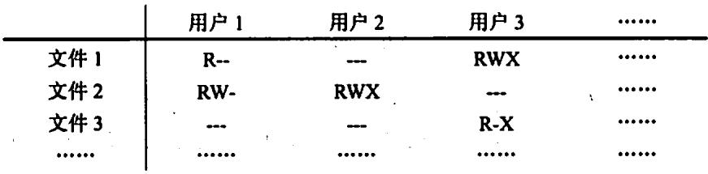  
图2-17 存取控制矩阵

## 2. 文件的保密

文件保密的目的是防止文件被窃取。主要方法有设置密码和使用密码。

密码分成两种：文件密码是用户为每个文件规定一个密码，它可写在文件目录中并隐蔽起来，只有提供的密码与文件目录中的密码一致时，才能使用这个文件。另一种是终端密码，由系统分配或用户预先设定一个密码，仅当回答的密码相符时才能使用该终端。但是它有一个明显的缺点，当要回收某个用户的使用权时，必须更改密码，而更改后的新密码又必须通知其他的授权用户，这无疑是不方便的。

使用密码是一种更加有效的文件保密方法，它将文件中的信息翻译成密码形式，使用时再解密。在网络上进行数据传输时，为保证安全性，经常采用密码技术；进一步还可以对在网络上传输的数字或模拟信号采用脉码调制技术，进行硬加密。

## 2.6 作业管理

## 2.6.1 作业及作业管理的概念

## 1. 作业

作业（Job）是用户提交给操作系统计算的一个独立任务。一般每个作业必须经过若干个相对独立又相互关联的顺序加工步骤才能得到结果，其中，每一个加工步骤称一个作业步（Job Step），例如，一个作业可分成编译、连接装配和运行三个作业步，往往上一个作业步的输出是下一个作业步的输入。作业由用户组织，作业步由用户指定，一个作业从提交给系统，直到运行结束获得结果，要经过提交、收容、执行和完成四个阶段。

## 2. 作业管理

作业管理可以采取脱机和联机两种方式运行。采用脱机控制方式，它提供一个作业控制语言，用户使用作业控制语言书写作业说明书，它是按规定格式书写的一个文件，把用户对系统的各种请求和对作业的控制要求集中描述，并与程序和数据一起提交给系统（管理员）。计算机系统成批接受用户作业输入，把它们放到输入井，然后在操作系统的管理和控制下执行。在联机方式下，操作系统为用户提供了一组联机命令，用户可以通过终端键入命令，将自己想让计算机干什么的意图告诉计算机，以控制作业的运行过程。因此整个作业的运行过程是需要人工干预的。

当一个作业被操作系统接受，就必须创建一个作业控制块，并且这个作业在它的整个生命周期中将顺序地处于以下四个状态，如图 2-18 所示。

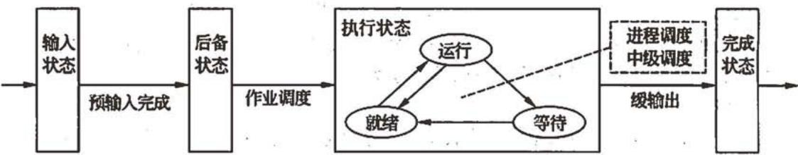  
图 2-18 作业状态及其转换

（1）输入状态：此时作业的信息正在从输入设备上预输入。

(2) 后备状态: 此时作业预输入结束但尚未被选中执行。

（3）执行状态：作业已经被选中并构成进程去竞争处理器资源以获得运行。

（4）完成状态：作业已经运行结束，正在等待缓输出。

## 2.6.2 作业调度

对成批进入系统的用户作业，按一定的策略选取若干个作业使它们可以获得处理器运行，这项工作称为作业调度。常用的作业调度算法包括以下几种。

## 1. 先来先服务算法

先来先服务（First Come，First Served）算法是按照作业进入系统的先后次序来挑选作业，先进入系统的作业优先被挑选。这种算法容易实现，但效率不高，只顾及到作业等候时间，而没考虑作业要求服务时间的长短。显然这不利于短作业而优待了长作业，或者说有利于 CPU 繁忙型作业不利于 I/O 繁忙型作业。

## 2. 最短作业优先算法

最短作业优先（Shortest Job First）算法是以进入系统的作业所要求的 CPU 时间为标准，总是选取估计计算时间最短的作业投入运行。这一算法也易于实现，但效率也不高，它的主要弱点是忽视了作业等待时间。由于系统不断地接受新作业，而作业调度又总是选择计算时间短的作业投入运行；因此，使进入系统时间早但计算时间长的作业等待时间过长，会出现饥饿现象。

## 3. 响应比最高者优先（HRN）算法

先来服务算法与最短作业优先算法都是比较片面的调度算法。先来先服务算法只考虑作业的等候时间而忽视了作业的计算时间，而最短作业优先算法恰好与之相反，它只考虑用户估计的作业计算时间而忽视了作业的等待时间。响应比最高者优先算法是介乎这两种算法之间的一种折衷的算法，既考虑作业等待时间，又考虑作业的运行时间，这样既照顾了短作业又不使长作业的等待时间过长，改进了调度性能。把作业进入系统后的等待时间与估计运行时间之比称做响应比，定义：

响应比 = 已等待时间/估计计算时间

显然，计算时间短的作业容易得到较高的响应比，因为，这时分母较小，使得 HRN 较高，因此本算法是优待短作业的。但是，如果一个长作业在系统中等待的时间足够长后，由于分子足够大，使得 HRN 较大，那么它也将获得足够高的响应比，从而可以被选中执行，不至于长时间地等待下去，饥饿的现象不会发生。

## 4. 优先数法

这种算法是根据确定的优先数来选取作业，每次总是选择优先数高的作业。规定用户作业优先数的方法是多种多样的。一种是由用户自己提出作业的优先数。有的用户为了自己的作业尽快地被系统选中就设法提高自己作业的优先数，这时系统可以规定优先数越高则需付出的计算机使用费就越多，以作限制。另一种是由系统综合考虑有关因素来确定用户作业的优先数。例如，根据作业的缓急程度作业的类型，作业计算时间的长短、等待时间的多少、资源申请情况等来确定优先数。确定优先数时各因素的比例应根据系统设计目标分析这些因素在系统中的地位而决定。上述确定优先数的方法称为静态优先数法；如果在作业运行过程中，根据实际情况和作业发生的事件动态地改变其优先数，称为动态优先数法。

## 2.6.3 多道程序设计

在早期的单道批处理系统中，内存中仅有单作业在运行，致使系统中仍有许多资源空闲，设备利用率低，系统性能较差。如图 2-19 所示，当 CPU 工作时，外部设备不能工作；而外部设备工作时，CPU 必须等待。

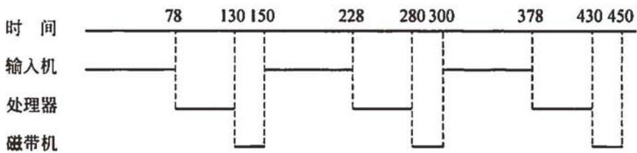  
图 2-19 单道算题运行时处理器的使用效率

多道程序设计（multiprogramming）是指允许多个程序同时进入一个计算机系统的主存储器并启动进行计算的方法。从宏观上看，多道程序都处于运行过程中，但都未运行完成；从微观上看，各道程序轮流占用 CPU，交替地执行。引入多道程序设计技术的根本目的是提高 CPU 的利用率，充分发挥系统部件的并行性。

操作系统中引入多道程序设计的好处：一是提高了 CPU 的利用率，二是提高了内存和 I/O 设备的利用率，三是改进了系统的吞吐率，四是充分发挥了系统的并行性。其主要缺点是作业周转时间延长。

## 选择题

1. 进程是操作系统中一个重要的概念。下列有关进程的叙述中，错误的是\_\_\_\_。

A）进程是指程序处于一个执行环境中在一个数据集上的运行过程

B）系统资源的分配主要是按进程进行的

C）进程在执行过程中通常会不断地在就绪、运行和阻塞这3种状态之间进行转换

D）在 Windows 98 中，所有的进程均在各自的虚拟机中进行，即进程的数目等于虚拟机的数目

1. 在信号量 P、V 操作中，对信号量执行一次 P 操作，意味着要求 \_\_\_\_。
A）使用一个资源 B）分配一个资源
C）释放一个资源 D）共享一个资源

2. 某单道批处理系统中有四个作业 JOB1、JOB2、JOB3 和 JOB4，它们到达输入井的时刻和所需要的运行时间如下表所示。

<table><tr><td>作业</td><td>进入系统时间</td><td>估计运行时间(分钟)</td></tr><tr><td>JOB1</td><td>8:30</td><td>80</td></tr><tr><td>JOB2</td><td>8:50</td><td>20</td></tr><tr><td>JOB3</td><td>9:20</td><td>40</td></tr><tr><td>JOB4</td><td>9:30</td><td>35</td></tr></table>

假设 9:30 开始作业调度, 按照最高响应比作业优先算法, 首先被调度的作业是 \_\_\_\_。

A) JOB1 B) JOB2

C) JOB3 D) JOB4

## 思考题

1. 操作系统的主要功能包括哪些？

2. 试比较批处理和分时操作系统的不同点？

3. 进程最基本的状态有哪些？哪些事件可能引起不同状态之间的转换？

4. 试说明进程的互斥和同步两个概念之间的区别。

5. 什么是临界区和临界资源？对临界区管理的基本原则是什么？

6. 试比较分页式存储管理和分段式存储管理。

7. 简述各种 I/O 控制方式及其主要优缺点。

8. 叙述 Spooling 系统和作业调度的关系。

9. 什么叫"按名存取"？文件系统是如何实现按名存取文件的？
