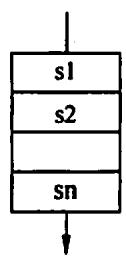
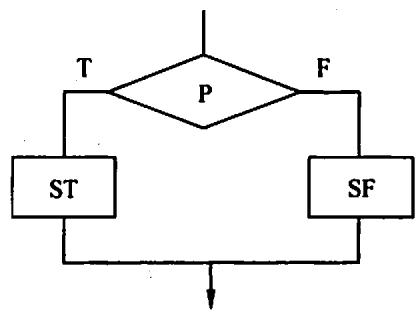
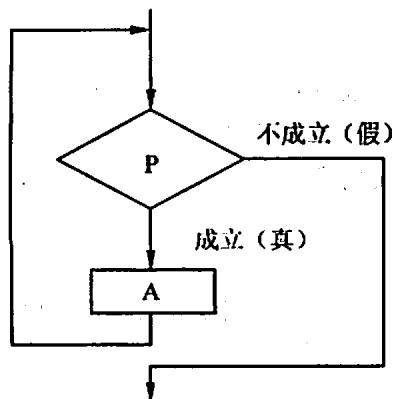
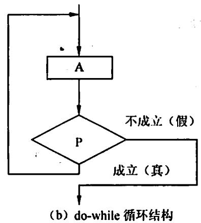
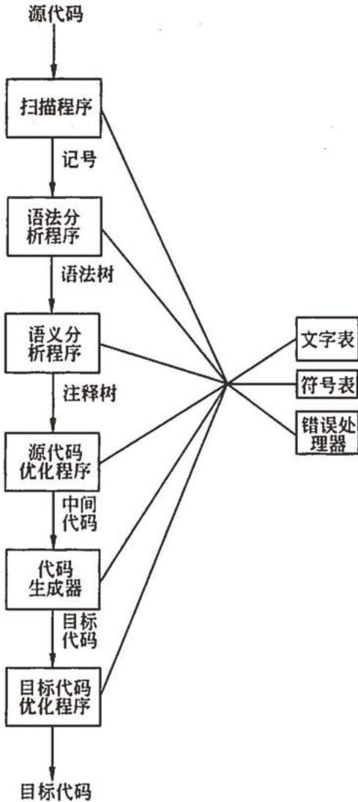

>[!warning] 版本提示
>本书为 **2006 年第 1 版**。现行考试依据是 **《信息系统管理工程师教程（第 2 版）》**（清华社 2024-10，20 章），
>两版**重合极少**：第 1 版的第 1–6 章（硬件/操作系统/语言/配置/数据结构/多媒体）在第 2 版已被删除或压缩。
>本页仅作**扩展参考**，备考请以 [[知识体系]]（第 2 版官方考纲）为准。

# 第3章 程序设计语言

本章主要是程序设计语言基础知识，包括基本概念、基本成分、汇编语言、编译原理、解释原理等方面概括性的介绍。

## 3.1 程序设计语言基础知识

## 3.1.1 程序设计语言基本概念

程序设计语言是为了书写计算机程序而人为设计的符号语言，用于对计算过程进行描述、组织和推导。程序设计语言的广泛使用始于1957年，经过四十多年的发展，目前世界上流行的程序设计语言有上百种之多，程序设计语言的演化速度已经超越了运行它们的机器。

下面即是程序设计语言的演进过程，同时也表明其分为低级语言和高级语言两大类。低级语言包括机器语言和汇编语言，它们都是面向机器的语言，用这种语言编制的程序只适用于某种特定类型的计算机。高级语言又包括面向过程的语言和面向问题的语言。

## 1. 机器语言

机器语言是用二进制代码表示的计算机能直接识别和执行的一种机器指令的集合。它是计算机的设计者通过计算机的硬件结构赋予计算机的操作功能。机器语言具有灵活、直接执行和速度快等特点。

用机器语言编写程序，编程人员要首先熟记所用计算机的全部指令代码和代码的涵义。手编程序时，程序员需要自己处理每条指令和每一数据的存储分配和输入输出，还得记住编程过程中每步所使用的工作单元处在何种状态。现在，除了计算机生产厂家的专业人员外，绝大多数程序员已经不再去学习机器语言了。

## 2. 汇编语言

为了克服机器语言难读、难编、难记和易出错的缺点，人们就用与代码指令实际含义相近的英文缩写词、字母和数字等符号来取代指令代码（如用 ADD 表示运算符号"+"的机器代码），于是就产生了汇编语言。所以说，汇编语言是一种用助记符表示的仍然面向机器的计算机语言，汇编语言亦称符号语言。汇编语言由于是采用了助记符号来编写程序，比用机器语言的二进制代码编程要方便些，在一定程度上简化了编程过程。汇编语言的特点是用符号代替了机器指令代码，而且助记符与指令代码一一对应，基本保留了机器语言的灵活性。使用汇编语言能面向机器并较好地发挥机器的特性，得到质量较高的程序。

汇编语言中由于使用了助记符号，用汇编语言编制的程序送入计算机，计算机不能像用机器语言编写的程序一样直接识别和执行，必须通过预先放入计算机的"汇编程序"的加工和翻译，才能变成能够被计算机识别和处理的二进制代码程序。用汇编语言等非机器语言书写好的符号程序称源程序，运行时汇编程序要将源程序翻译成目标程序。目标程序是机器语言程序，它一经被安置在内存的预定位置上，就能被计算机的CPU处理和执行。

汇编语言像机器指令一样，是硬件操作的控制信息，因而仍然是面向机器的语言，使用起来还是比较繁琐费时，通用性也差。汇编语言是低级语言。但是，汇编语言用来编制系统软件和过程控制软件，其目标程序占用内存空间少，运行速度快，有着高级语言不可替代的用途。

## 3. 高级语言

不论是机器语言还是汇编语言都是面向硬件的具体操作的，语言对机器的过分依赖，要求使用者必须对硬件结构及其工作原理都十分熟悉，非计算机专业人员是难以做到的，对于计算机的推广应用是不利的。计算机事业的发展，促使人们去寻求一些与人类自然语言相接近且能为计算机所接受的语意确定、规则明确、自然直观和通用易学的计算机语言。这种与自然语言相近并为计算机所接受和执行的计算机语言称高级语言。高级语言是面向用户的语言，每一种高级（程序设计）语言，都有自己人为规定的专用符号、英文单词、语法规则和语句结构（书写格式）。高级语言与自然语言（英语）更接近，而与硬件功能相分离（彻底脱离了具体的指令系统），便于广大用户掌握和使用。高级语言的通用性强，兼容性好，便于移植。

高级语言主要是相对于汇编语言而言，它并不是特指某一种具体的语言，而是包括了很多编程语言。它又可分为面向过程的语言和面向问题的语言，前者在编程时不仅要告诉计算机"做什么"，而且要告诉计算机"怎么做"，如 Basic, Pascal, Fortran, C 等高级语言。后者只要告诉计算机做什么，如 Lisp, Prolog 等高级语言，也常称为人工智能语言。

## 3.1.2 程序设计语言的基本成分

## 1. 数据成分

程序语言的数据成分指的是一种程序语言的数据类型。数据对象总是对应着应用系统中某些有意义的东西，数据表示则指定了程序中值的组织形式。数据类型用于代表数据对象，同时还可用于检查表达始终对运算的应用是否正确。

数据是程序操作的对象，具有存储类别、类型、名称、作用域和生存期等属性，使用时要为它分配内存空间。数据名称由用户通过标识符命名，标识符是由字母、数字和称为下划线的特殊符号"\_"组成的标记：类型说明数据占用内存的大小和存放形式：存储类别说明数据在内存中的位置和生存期；作用域则说明可以使用数据的代码范围；生存期说明数据占用内存的时间范围。从不同角度可将数据进行不同的划分。

## (1) 常量和变量

按照程序运行过程中数据的值能否改变，将数据分为常量和变量。常量的分类包括有整型常量、实型常量、字符常量、符号常量。

## 变量包括两个主要要素

① 变量名，每个变量都必须有一个名字——变量名，变量命名遵循标识符命名规则。

② 变量值，在程序运行过程中，变量值存储在内存中。在程序中，通过变量名来引用变量的值。

## (2) 全局量和局部量

按数据的作用域范围，可分为全局量和局部量。系统为全局变量分配的存储空间在程序运行的过程中一般是不改变的。而为局部变量分配的存储单元是动态改变的。

## (3) 数据类型

按照数据组织形式的不同可将数据分为基本类型、构造类型、指针类型和空类型四种。

## (4) 基本类型

分为整型、实型（又称浮点型）、字符型和枚举型四种。

## (5) 构造类型

分为数组类型、结构类型和共用类型三种。

## (6) 指针类型

一个变量的地址称为该变量的指针，指针变量是指专门用于存储其他变量地址的变量。指针变量的值就是变量的地址。指针与指针变量的区别，就是变量值与变量的区别。

## (7) 空类型

指空值或无意义的值。

## 2. 运算成分

程序语言的运算成分指明允许使用的运算符号及规则。大多数程序设计语言的基本运算可分为算术运算、关系运算和逻辑运算，有些语言如 C（C++）还提供位运算。运算符号的使用与数据类型密切相关。为了确保运算结果的惟一性，运算符号要规定优先级和结合性。

## 3. 控制成分

控制成分指明语言允许表达的控制结构，程序员使用控制成分来构造程序中的控制逻辑。理论上已经表明，可计算问题的程序都可以用顺序、选择和循环这三种控制结构来描述。

## (1) 顺序结构

在顺序结构程序中，各语句（或命令）是按照位置的先后次序，顺序执行的，且每个语句都会被执行到，执行顺序示意图如图 3-1 所示。

## (2) 选择结构

选择结构提供了在两种或多种分支中选择其中一个的逻辑。基本的选择结构是通过指定一个关系表达式 P，然后根据关系表达式的值来决定控制流走程序块 ST 或 SF。从两个分支中选择一个执行，示意图如图 3-2 所示。

  
图3-1 顺序结构

  
图3-2 选择结构

## (3) 循环结构

循环结构描述了重复计算的过程，通常由三个部分组成：初始化、需要重复计算的部分和重复的条件。其中初始化部分有时在控制的逻辑结构中并无显式表示。重复结构主要有两种形式：while型重复结构和do-while型重复结构。While型结构的逻辑含义是首先计算关系表达式P，若为真则执行需要重复的程序块A，然后再计算关系表达式P，以决定是否继续。do-while型结构的逻辑含义是先执行需要重复的程序块A，然后计算关系表达式P，若为真则继续执行程序块A，然后再来计算关系表达式P，以决定是否继续；示意图如图3-3所示。

  
(a) while 循环结构

  
图3-3 循环结构

## 4. 函数

C 语言由一个或多个函数组成，每个函数都有名字标示，其中 main 函数是作为程序运

行的起点。函数是程序模块的主要成分，它是一段具有独立功能的程序。

## (1) 函数定义

函数的定义描述了函数做什么和怎么做，因此任何函数（包括主函数 main()）都是由函数说明和函数体两部分组成。函数定义的一般格式如下：

函数体

函数说明包括函数返回值的数据类型、函数名字和函数运行时所需的参数及类型。函数所实现的功能在函数体中详细定义。根据函数是否需要参数，可将函数分为无参函数和有参函数两种，形式参数表列举了函数调用者提供的参数的个数、类型和顺序，是函数实现功能时所必需的。无参函数则以 void 说明。C 语言的函数兼有其他语言中的函数和过程两种功能，从这个角度看，又可把函数分为有返回值函数和无返回值函数两种。

## (2) 函数调用

当需要在一个函数（称为主调函数）中使用另一个函数（称为被调函数）实现的功能时，便以函数名字进行调用，称为函数调用。在使用一个函数时，只要知道如何调用就可以了，不需要关心被调函数的内部实现。因此，主调函数需要知道被调函数的名字、返回值和需要向被调函数传递的参数（个数、类型和顺序）等信息。

函数调用的一般形式为：函数名（实参表）；

C 函数的参数传递全部采用传值，它没有 Pascal 中的变量形参，所以只能传递实参变量的值，而不能隐含传地址。传值调用实际上重新复制了一个副本给形参，因此，可以把函数形参看作是局部变量。传值的好处是传值调用不会改变调用函数实参变量的内容，因此，可避免不必要的副作用。

在 C 程序的执行过程中，通过函数调用可以实现函数定义时描述的功能。函数体若调用自身，则称为递归调用。

下述程序段为函数调用的简单例子。

```c
void swap ( int x, int y )
{int temp;
temp = x; x = y; y = temp;
}
函数调用：
main()
{int a = 2, b = 3;
```

swap (a, b);

}

## 3.2 程序编译、解释系统

## 3.2.1 程序的编译及解释

计算机并不能直接地接受和执行用高级语言编写的源程序，源程序在输入计算机时，通过"翻译程序"翻译成机器语言形式的目标程序，计算机才能识别和执行。

这种 "翻译" 通常有两种方式，即编译方式和解释方式。编译方式是：事先编好一个称为编译程序的机器语言程序，作为系统软件存放在计算机内，当用户由高级语言编写的源程序输入计算机后，编译程序便把源程序整个地翻译成用机器语言表示的与之等价的目标程序，然后计算机再执行该目标程序，以完成源程序要处理的运算并取得结果。解释方式是：源程序进入计算机时，解释程序边扫描边解释做逐句输入逐句翻译，计算机一句句执行，并不产生目标程序。Pascal、Fortran、Cobol 等高级语言执行编译方式；Basic 语言则以执行解释方式为主；而 Pascal、C 语言是能书写编译程序的高级程序设计语言。

## 3.2.2 编译程序基本原理

编译程序的功能是指在应用源程序执行之前，就将程序源代码"翻译"成目标代码（机器语言），因此其目标程序可以脱离其语言环境独立执行，使用比较方便、效率较高。但应用程序一旦需要修改，必须先修改源代码，再重新编译生成新的目标文件（\*.OBJ）才能执行，只有目标文件而没有源代码，修改很不方便。现在大多数的编程语言都是编译型的，例如 Visual C++、Visual Foxpro、Delphi 等。

编译程序大致分为 6 个阶段（phase），如图 3-4 所示，它们执行不同的逻辑操作。将这些阶段设想为编译器中一个个单独的片断是很有用的，尽管在应用中它们是经常组合在一起的，但它们确实是作为单独的代码操作来编写的。

## 3.2.3 解释程序基本原理

解释程序的执行方式类似于日常生活中的"同声翻译"，应用程序源代码一边由相应语言的解释器"翻译"成目标代码（机器语言），一边执行，因此效率比较低，而且不能生成可独立执行的可执行文件，应用程序不能脱离其解释器，但这种方式比较灵活，可以动态地调整、修改应用程序。解释程序基本上执行与编译程序相同的功能，只是方式上不同而已。解释程序按顺序翻译并执行每一条源程序语句。解释程序的优点是当语句出现语法错误时，可以立即引起程序员注意，而程序员在程序开发期间就能进行校正。解释程序的缺点是不能像编译程序那样充分地利用计算机资源。

  
图 3-4 编译过程

解释执行的语言因为解释器不需要直接同机器码打交道所以实现起来较为简单、而且便于在不同的平台上面移植，这一点从现在的编程语言解释执行的居多就能看出来，如 Visual Basic、Visual Foxpro、Power Builder、Java 等。编译执行的语言因为要直接同 CPU 的指令集打交道，具有很强的指令依赖性和系统依赖性，但编译后的程序执行效率要比解释语言高得多，现在的 Visual C/C++、Delphi 等都是很好的编译语言。

对于解释语言与编译语言所编制出来的代码在安全性上而言，可以说是各有优缺点。曾经在 Windows 下跟踪调试过 VB 程序的一般都知道，程序代码 99% 的时间里都是在 VBRUNxx 里转来转去，根本看不出一个所以然来。这是因为跟踪的是 VB 的解释器，要从解释器中看出代码的目的是什么是相当困难的。但解释语言有一个致命的弱点，那就是解释语言的程序代码都是以伪码的方式存放的，一旦被人找到了伪码与源码之间的对应关系，就很容易做出一个反编译器出来，源程序等于被公开了。而编译语言因为直接把用户程序编译成机器码，再经过优化程序的优化，很难从程序返回到源程序的状态，但对于熟悉汇编语言的解密者来说，也很容易通过跟踪代码来确定某些代码的用途。

## 选择题

float \*Pf, 此 C 语言语句定义了\_\_\_\_类型变量。

A）整数 B）浮点数

C）指针 D）数组

## 思考题

1. 程序设计语言包括哪些基本类别？

2. 程序设计语言的控制逻辑结构包括哪几种？

3. 编译程序包括哪些基本过程？它们的主要功能？

4. 编译程序与解释程序的区别及联系？
