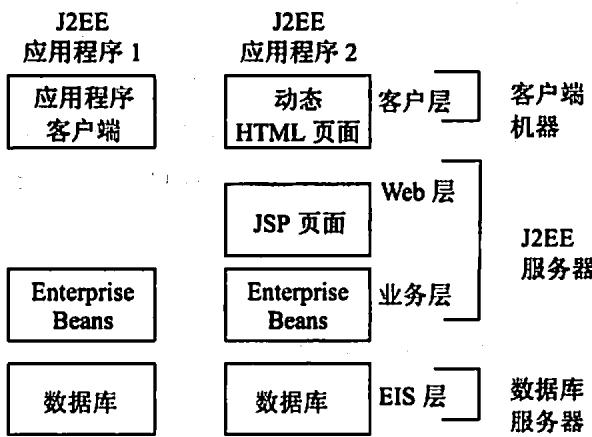
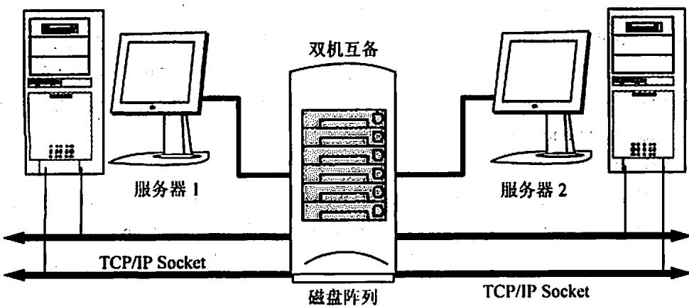
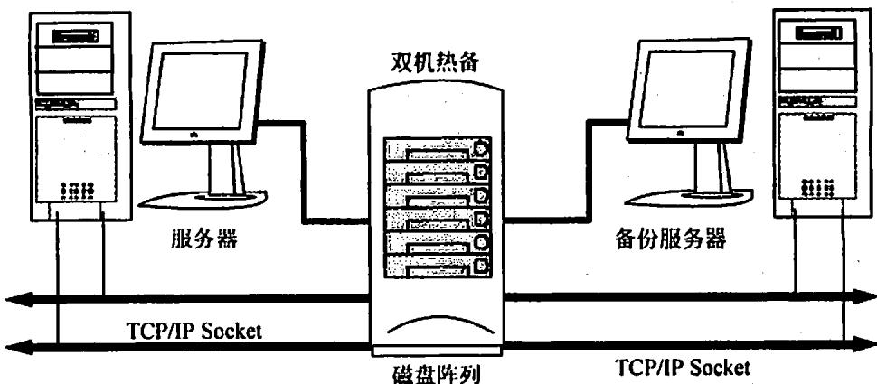
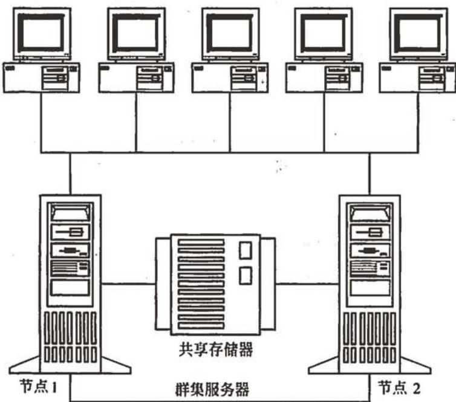
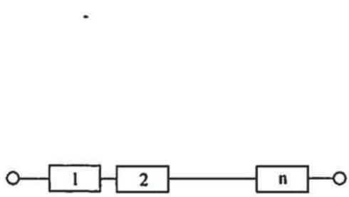
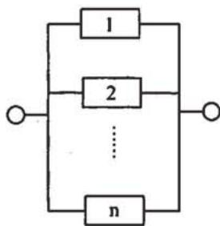
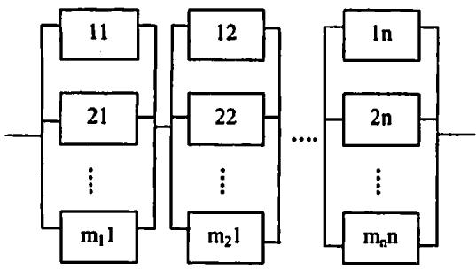
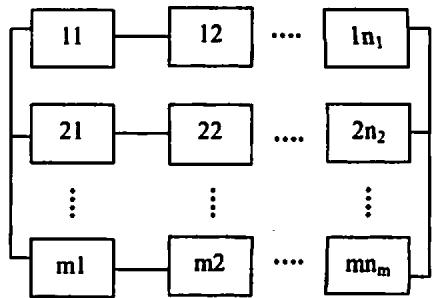

>[!warning] 版本提示
>本书为 **2006 年第 1 版**。现行考试依据是 **《信息系统管理工程师教程（第 2 版）》**（清华社 2024-10，20 章），
>两版**重合极少**：第 1 版的第 1–6 章（硬件/操作系统/语言/配置/数据结构/多媒体）在第 2 版已被删除或压缩。
>本页仅作**扩展参考**，备考请以 [[知识体系]]（第 2 版官方考纲）为准。

# 第4章 系统配置和方法

本章主要包括三部分内容，系统架构、配置方式、处理模式等系统配置技术；性能定义和评估等系统性能；可靠性的定义和设计。

## 4.1 系统配置技术

## 4.1.1 系统架构

## 1. 客户机/服务器系统

C/S（Client/Server）结构，即大家熟知的客户机和服务器结构。它是软件系统体系结构，通过它可以充分利用两端硬件环境的优势，将任务合理分配到客户机端和服务器端来实现，降低了系统的通信开销。目前大多数应用软件系统都是客户机/服务器形式的两层结构，由于现在的软件应用系统正在向分布式的 Web 应用发展，Web 和客户机/服务器应用都可以进行同样的业务处理，应用不同的模块共享逻辑组件；因此，内部的和外部的用户都可以访问新的和现有的应用系统，通过现有应用系统中的逻辑可以扩展出新的应用系统。这也就是目前应用系统的发展方向。

## 2. 浏览器/服务器系统

B/S（Browser/Server）结构即浏览器和服务器结构。它是随着 Internet 技术的兴起，对 C/S 结构的一种变化或者改进的结构。在这种结构下，用户工作界面是通过 WWW 浏览器来实现，极少部分事务逻辑在前端（浏览器）实现，但是主要事务逻辑在服务器端（服务器）实现，形成所谓三层 3-tier 结构。这样就大大简化了客户端电脑载荷，减轻了系统维护与升级的成本和工作量，降低了用户的总体成本（TCO）。以目前的技术看，局域网建立 B/S 结构的网络应用，并通过 Internet/Intranet 模式下数据库应用，相对易于把握，成本也是较低的。它是一次性到位的开发，能实现不同的人员，从不同的地点，以不同的接入方式（如 LAN，WAN，Internet/Intranet 等）访问和操作共同的数据库；它能有效地保护数据平台和管理访问权限，服务器数据库也很安全。

## 3. 多层分布式系统（Multi-tier System）

(1) 概念。

随着中间件与 Web 技术的发展，三层或多层分布式应用体系越来越流行。在多层体系中，各层次按照以下方式进行划分，实现明确分工：

① 瘦客户：提供简洁的人机交互界面，完成数据的输入/输出。

② 业务服务：完成业务逻辑，实现客户与数据库对话的桥梁。同时，在这一层中，还应实现分布式管理、负载均衡、Fail/Recover、安全隔离等。

③ 数据服务：提供数据的存储服务。一般就是数据库系统。

(2) 多层系统主要特点。

## 多层系统主要特点是

\- 安全性。中间层隔离了客户直接对数据服务器的访问，保护了数据库的安全。

\- 稳定性。对于要求 $24 \times 7$ 工作的业务系统，多层分布式体系提供了更可靠的稳定性。一是中间层缓冲 Client 与数据库的实际连接，使数据库的实际连接数量远小于 Client 应用数量。当然，连接数越少，数据库系统就越稳定。二是 Fail/Recover 机制能够在一台服务器宕机的情况下，透明地把客户端工作转移到其他具有同样业务功能的服务上。

\- 易维护。由于业务逻辑在中间服务器，当业务规则变化后，客户端程序基本不做改动。

\- 快速响应。通过负载均衡以及中间层缓存数据能力，可以提高对客户端的响应速度。

\- 系统扩展灵活。基于多层分布体系，当业务增大时，可以在中间层部署更多的应用服务器，提高对客户端的响应，而所有变化对客户端透明。

(3) 多层系统举例。

目前最为流行的两类多层应用架构为 Sun 的 J2EE 和 Microsoft.Net，下面简单介绍 J2EE 的多层架构。

  
图 4-1 J2EE 多层应用架构

## (4) 客户层

客户层用于与企业信息系统的用户进行交互以及显示根据特定商务规则进行计算后的结果。基于 J2EE 规范的客户端可以是基于 Web 的，也可以是不基于 Web 的独立（Stand Alone）应用程序。

在基于 Web 的 J2EE 客户端应用中，用户在客户端启动浏览器后，从 Web 服务器中下载 Web 层中的静态 HTML 页面或由 JSP 或 Servlets 动态生成的 HTML 页面。

在不基于 Web 的 J2EE 客户端应用中，独立的客户端应用程序可以运行在一些基于网络的系统中，例如手持设备或汽车电话等。同样，这些独立的应用也可以运行在客户端的 Java Applet 中。这种类型的客户端应用程序可以在不经过 Web 层的情况下直接访问部署在 EJB 容器（EJB Container）中的 EJB 组件。

## (5) Web 层

J2EE 规范定义的 Web 层由 JSP 页面、基于 Web 的 Java Applets 以及用于动态生成 HTML 页面的 Servlets 构成。这些基本元素在组装过程中通过打包来创建 Web 组件。运行在 Web 层中的 Web 组件依赖 Web 容器来支持诸如响应客户请求以及查询 EJB 组件等功能。

## (6) 业务层

在基于 J2EE 规范构建的企业信息系统中，将解决或满足特定业务领域商务规则的代码构建成为业务层中的 Enterprise JavaBean（EJB）组件。EJB 组件可以完成从客户端应用程序中接收数据、按照商务规则对数据进行处理、将处理结果发送到企业信息系统层进行存储、从存储系统中检索数据以及将数据发送回客户端等功能。

部署和运行在业务层中的 EJB 组件依赖于 EJB 容器来管理诸如事务、生命期、状态转换、多线程及资源存储等。这样由业务层和 Web 层构成了多层分布式应用体系中的中间层。

## (7) 企业信息系统层

在企业应用系统的逻辑层划分中，企业信息系统层通常包括企业资源规划（ERP）系统、大型机事务处理（Mainframe Transaction Processing）系统、关系数据库系统（RDMS）及其他在构建J2EE分布式应用系统时已有的企业信息管理软件。

## 4.1.2 系统配置方法

企业在计划购买、部署引进高端系统时必须考虑到任何解决方案在计划内外的宕机成本，对于关键应用来说宕机所造成的损失甚至超过系统的直接购买成本！造成系统宕机的原因是多方面的，除了突发性的天灾人祸之外，计划内的维护和升级同样是造成停机时间的主要因素。计划内的停机并不意味着它们不应算作停机时间，任何时候的系统离线，都会使企业由于无法满足客户的要求而产生较大的损失。因此，尽最大可能减少计划内外的停机时间已成为关键业务领域追求的主要目标。研究系统配置的主要目的就是提高系统的可用性、鲁棒性，下面简单介绍几种常用的系统配置方法。

## 1. 双机互备

所谓双机热备援就是两台主机均为工作机，在正常情况下，两台工作机均为信息系统提供支持，并互相监视对方的运行情况，如图 4-2 所示。当一台主机出现异常时，不能支持信息系统正常运营，另一主机则主动接管（Take Over）异常机的工作，继续主持信息的运营，从而保证信息系统能够不间断的运行，而达到不停机的功能（Non-Stop），但正常运行主机的负载（Loading）会有所增加。此时必须尽快将异常机修复，以缩短故障时间。

  
图4-2 双机互备

切换时机（Take Over）如下：

（1）系统软件或应用软件造成服务器宕机。

（2）服务器没有宕机，但系统软件或应用软件工作不正常。

（3）SCSI 卡损坏，造成服务器与磁盘阵列无法存取数据。

（4）服务器内硬件损坏，造成服务器宕机。

(5) 服务器不正常关机。

## 2. 双机热备

所谓双机热备份就是一台主机为工作机(Primary Server)，另一台主机为备份机(Standy Server)，如图4-3所示。在系统正常情况下，工作机为信息系统提供支持，备份机监视工作机的运行情况（工作机也同时监视备份机是否正常，有时备份机因某种原因出现异常，工作机可尽早通知系统管理员解决，确保下一次切换的可靠性）。当工作机出现异常，不能支持信息系统运营时，备份机主动接管（Take Over）工作机的工作，继续支持信息的运营，从而保证信息系统能够不间断地运行（Non-Stop）。宕工作机经过修复正常后，系统管理员通过管理命令或经由以人工或自动的方式将备份机的工作切换回工作机；也可以激活监视程序，监视备份机的运行情况，此时，原来的备份机就成了工作机，而原来的工作机就成了备份机。

  
图4-3 双机热备

切换时机与双机互备的情况相同。

## 3. 群集系统

## (1) 群集系统的概念

对应用程序基础结构进行相应设计，将若干服务器集合为一个独立且统一的群集，可在用户或管理员无需知道群集中有多个服务器的情况下实现对计算负荷的共享，使服务器对用户和应用程序表现为虚拟统一计算资源；如图 4-4 所示。

  
图4-4 群集概念示意

群集系统中的各个服务器既是其他服务器的主系统，又是其他服务器的热备份系统。在某个服务器由于故障或计划停机而无法使用时，通过确保群集中其他服务器可以承担工作负载，群集服务器可以实现提高可用性的目标。此类群集可避免向访问该群集的用户或应用程序所提供服务的损失，还可透明进行服务器转移而不为用户所知。此外，可以使用群集增强可伸缩性。服务器群集可以在当前性能级别支持更多用户，或通过向多个服务器分散工作负载来提高当前数量的用户的应用程序性能。群集技术不同于双机热备技术，二者本质上的区别是能否实现并行处理和某节点失效后的应用程序的平滑接管。此外，双机热备技术只是在两台服务器上实现的。

## (2) 群集服务优点

① 高可用性。使用群集服务，资源的所有权，如磁盘驱动器和 IP 地址将自动地从有故障的服务器上转到可用的服务器上。当群集中的系统或应用程序出现故障时，群集软件将在可用的服务器上重启失效的应用程序，或将失效节点上的工作分配到剩余的节点上。结果是用户只是觉得服务暂时停顿了一下。

② 修复返回。当失效的服务器连回来时，群集服务将自动在群集中平衡负荷。

③ 易管理性。可以使用群集管理器来管理群集（如同在同一个群集中），并管理应用程序（就像它们运行在同一个服务器上）。可以通过拖放群集对象，在群集里的不同服务器移动应用程序。也可以通过同样的方式移动数据。可以通过这种方式来手工地平衡服务器负荷，卸载服务器，从而方便地进行维护。可以从网络的任意地方的节点和资源处，监视群集的状态。

④ 可扩展性。群集服务可进行调整，以满足不断增长的需求。当群集的整体负荷超过群集的实际能力时，可以添加额外的节点。

## 4. 容错服务器

容错服务器目前已经开始大规模渗透到一些对服务器可靠性、可用性要求更为苛刻的行业，具有容错技术，能提供不间断服务的容错服务器正在冲击目前的双机热备和集群技术。

容错服务器是通过 CPU 时钟锁频，通过对系统中所有硬件的备份，包括 CPU、内存和 I/O 总线等的冗余备份，通过系统内所有冗余部件的同步运行，实现真正意义上的容错。系统任何部件的故障都不会造成系统停顿和数据丢失。目前很多容错系统是基于 IA 架构的服务器，与 Windows 2000 完全兼容，实现以前只有在 RISC 系统上才能实现的容错。这种容错技术在 IA 服务器上的实现，将 IA 服务器的可靠性提高到了 99.999%，同时服务器的运行是不间断的，也就是 100%。

双机热备份和容错服务器的定位稍微有些不同，这是由两者实现的可用性差别决定的。双机热备份一般可以实现99.9%的可用性，容错服务器可以实现99.999%的可用性。这样，双机热备份大多应用在业务连续性不是很严格的行业，比如说公安系统、部队系统或者个别的制造企业，这些行业的应用允许数据有一小段时间的中断。而如交通、金融证券等要求高的行业则是容错服务器的天下了。

容错服务器是趋势，信息数据的爆炸性增长以及业务连续性的需求不断增加，都有力地证明容错服务器会是以后的一个发展趋势。双机备份方式由于需要至少2台服务器，导致在软件采购（操作系统、中间件、双机备份软件等）、软件维护升级、系统硬件升级都需要比单机容错方式多 1 倍的额外投入，而且在双机备份软件出现故障后，其维修的难度是业界众所周知的，对客户和代理商都会带来很大的困难。因此虽然单机容错服务器的硬件成本高于双机备份方式的硬件投入，其总成本（TCO）却远远低于双机备份方式的成本。

## 4.1.3 系统处理模式

## 1. 集中式及分布式计算

自上世纪 50 年代后期开始，人们及各种组织机构以迅速增长的速度使用计算机来管理信息。限于技术条件，早期的计算机都非常庞大且非常昂贵，任何机构都不可能为其成员提供整个计算机的使用，主机一定是共享的，它被用来存储和组织数据，集中控制和管理整个系统。所有用户都是通过系统的终端设备将数据录入到主机中处理，或者是将主机中的处理结果，通过集中控制的输出设备取出来。通过专用的通信服务器，系统也可以构成一个集中式的网络环境，使一台主机可以为多个配有 I/O 设备的终端用户（包括远程用户）服务。这就是早期的集中式计算机网络，一般也称为集中式计算模式。

集中式计算模式最典型的特征是：通过主机系统形成大部分的通信流程，构成系统的所有通信协议都是系统专有的，大型主机在系统中占据着绝对的支配作用，所有控制和管理功能都由主机来完成。

随着计算机技术的不断发展，尤其是大量功能先进的个人计算机的问世，使每一个人都可以完全控制自己的计算机，进行所希望的作业处理。以个人计算机（PC）方式呈现的计算能力发展成为独立的平台，导致了一种新的计算结构——分布式计算模式的诞生。

分布式计算模式与以前的集中式有很大的区别，它对计算机网络的发展起到了决定性的影响。一般认为，从八十年代到今天，分布式计算经历了三个阶段：

第一阶段称为桌上计算（Desktop Computing）。它属于 PC 分布式计算的初级阶段。几乎所有简单的多用户微机系统和以低版本 DOS 为核心的共享硬盘系统均为该阶段的内容。

第二阶段为工作组计算（Workgroup Computing）。用户在这个网络环境中，可以共享打印机及服务器的硬盘资源，并能够访问多种主机资源，获得各种通信服务。

第三阶段为网络计算（Network Computing）。这种网络环境提供了更多的开放性、更高的效能、可靠性、保密性以及对各种标准的支持；它对用户提供了透明的服务，用户可以将各类主机、网络工作站和通信服务器作为一个整体。

## 2. 批处理及实时处理

批处理（Batch Processing）是定期的周期性的收集源文件，然后进行成批处理。如银行存款处理，白天一天所收到的存款单等到下班后一起交给数据处理部门，由他们进行累加和其他分析。这里处理周期就是一天。

批处理的优缺点：当要处理大量的数据时批处理是一种比较经济的方法。每笔业务处理时没有必要翻动主文件。错开白天的时间，计算机可以在晚上处理，能充分利用计算机的资源。计算机的速度不一定很高，计算机档次和设备费用可以大大降低。但批处理确有很多缺点，主文件经常是过时的，打出的报告也是这样，马上查出当前的情况也是不可能的。所以，许多业务转向实时处理。某些实时处理系统中还保留着某些业务的批处理。

实时处理在处理业务时是及时的处理完这笔业务后，主文件已经进行了更新，因而这时的统计数据就反映现时的真实情况。实时处理也叫做联机处理（Online Transaction Processing, OLTP）。这时数据只要输入，记录、转换、更新主文件一气呵成，响应顾客的查询也是即时的。

实时处理的优点：实时处理能及时处理、及时更新和及时响应顾客。因而在要求及时的情况下，只有实时系统能满足要求。实时处理缺点是由于联机，直接存取必须采取特殊的措施保护数据库，以及时防止病毒和闯入者。在许多实时系统中，也使用磁带来控制日记和恢复文件。因而在设备上要付出高成本。所以实时优点必须和它的成本、安全的问题相平衡，现在由于技术的发展，要更好的满足顾客需求，越来越多的公司欢迎实时处理。

批处理与实时处理的特性对比如表4-1所示。

表 4-1 批处理与实时处理对比

<table><tr><td>特性</td><td>批处理</td><td>实时处理</td></tr><tr><td>业务处理</td><td>记录业务数据累计成批,排序周期处理</td><td>数据产生立即处理</td></tr><tr><td>文件更新</td><td>批处理时</td><td>业务处理时</td></tr><tr><td>响应时间(周转时间)</td><td>几小时或几天</td><td>几秒钟</td></tr></table>

## 3. Web 计算

随着 Internet 的不断普及和技术的进步，使得以浏览器作为用户界面进行分布式计算成为可能，这种基于网络浏览器的分布式计算方式通常被称为 Web 计算(Web Computing)。作为一种新兴的网络计算方式，Web 计算是对分布式计算的一种扩展，它的出现最终将分布式计算扩展到 Internet 之上。分布式对象和网络技术的集成称为对象 Web，由此可以构造分布式系统模型，这已成为现代 Web 计算的基础。Web 作为互联网最普遍的应用，成千上万的个人计算机通过它达到互通互访，这促使科学家们寄望 Web 计算来将无数闲散的 CPU 通过 Web 利用起来，以提供高效且廉价的计算。

Web 计算也可以视为协同计算的一种形式，在其中广泛分布且为数众多的匿名用户（称为"志愿者"）协作进行由各自独立的小任务组合成的庞大计算集合。一个 Web 计算项目的执行，本质上这样的：感兴趣的志愿者在特定的 Web 计算服务器上进行注册。随后，每个注册的志愿者时常访问这个站点来获取需要计算的任务。完成任务后的某时，志愿者返回任务结果并获取一个新的任务。这样的循环一直进行下去直到计算任务完成。

作为一种新兴的计算方式，Web 计算虽然隶属于分布式计算方式，但与传统的 C/S 结构的计算方式，以及当前的网格计算、对等计算等概念都具有一定的区别和联系。Web 计

算的魅力主要体现在以下一些方面：

## (1) 统一的用户界面

任何用户只要拥有浏览器，并可以顺利上网，就可以接受 Web 计算提供的服务，而不用顾及 Web 计算方式具体实现的细节，因此这种计算方式又被称为 B/S 结构的计算方式。而对于 C/S 结构的计算方式来说，则必须要为用户开发定制的用户端系统。统一的用户界面成为 Web 计算廉价性的基石。

## (2) 经济性、可维护性

B/S 结构是一种瘦客户机模式，因此 Web 计算对硬件配置的要求比较低，同时，由于系统没有涉及到用户端系统，因此，升级和维护只需要集中于服务器端。B/S 结构的升级、维护成本则相对的要低得多，即使是三层 C/S 结构的瘦客户模式，其升级、维护的成本也无法与之相比。

## (3) 鲁棒性

HTTP 协议的应用使得 Web 计算方式可以同时为更多的用户提供服务，并可以根据需要对系统进行扩展，体现出很好的系统鲁棒性；同时当某台应用服务器发生故障或失效时，分布式系统会自动把该应用服务器正在处理的事务请求移交给另外一台工作正常的服务器。

## (4) 可伸缩性

借用分布式技术，Web 计算将复杂的业务处理分割成相互之间可交互调用和通信的若干业务功能部件或对象，并可将其分配到多个网络互联的应用服务器中实现负荷分担。这样一来 Web 计算方式将全部操作分散到系统的各个部分，最大限度地平衡系统负载，从而可以使系统的运行更加稳定。

## (5) 兼容性

由于对象可以建成与现有系统接合的方式，所以分布式对象是可以与现有系统一道工作的。一个对象如果具有现有系统的接口，就可以在分布式系统中调用以前的程序。同时，使用分布式对象时，不必重建传统的应用程序。这样便大大加快了系统的开发速度，也节省了大量资金。

## (6) 安全性

严密的安全管理。Web 计算中，对业务处理对象的调用和数据库的存取权限是按层次设置的。即使外部入侵者突破了客户机层的安全防线，若在应用服务器层中备有另外的安全机构，系统也可阻止入侵者进入其他部分。

## (7) 适应网络的异构、动态环境

所有终端的计算都是通过网络浏览器进行的，能跨越多个平台进行，能很好适应网络的异构环境；分布的 Web 计算对象可访问不同的后台服务器数据库，适合多种异构数据库环境，达到分布数据开放的效果。

## 4.1.4 系统事务管理

## 1. 事务的概念

所谓事务是用户定义的一个数据库操作序列，这些操作要么全做要么全不做，是一个不可分割的工作单位。事务和程序是两个概念。一般地讲，一个程序中包含多个事务。例如，在关系数据库中，一个事务可以是一条 SQL 语句、一组 SQL 语句或整个程序。

事务的开始与结束可以由用户显式控制。如果用户没有显式地定义事务，则由 DBMS 按默认规定自动划分事务。在 SQL 语言中，定义事务的语句有三条：

## BEGIN TRANSACTION

COMMIT

## ROLLBACK

事务通常是以 BEGIN TRANSACTION 开始，以 COMMIT 或 ROLLBACK 结束。COMMIT 表示提交，即提交事务的所有操作。具体地说就是将事务中所有对数据库的更新写回到磁盘上的物理数据库中去，事务正常结束。ROLLBACK 表示回滚，即在事务运行的过程中发生了某种故障，事务不能继续执行，系统将事务中对数据库的所有已完成的操作全部撤销，滚回到事务开始时的状态。这里的操作指对数据库的更新操作。

事务具有 4 个特性：原子性（atomicity）、一致性（consistency）、隔离性（isolation）和持续性（durability），这四个特性也简称为 ACID 特性。

## (1) 原子性

事务是数据库的逻辑工作单位，事务中包括的诸操作要么都做，要么都不做。

## (2) 一致性

事务执行的结果必须是使数据库从一个一致性状态变到另一个一致性状态。因此当数据库只包含成功事务提交的结果时，就说数据库处于一致性状态。如果数据库系统运行中发生故障，有些事务尚未完成就被迫中断，这些未完成事务对数据库所做的修改有一部分已写入物理数据库，这时数据库就处于一种不正确的状态，或者说是不一致的状态。

## (3) 隔离性

一个事务的执行不能被其他事务干扰。即一个事务内部的操作及使用的数据对其他并发事务是隔离的，并发执行的各个事务之间不能互相干扰。

## (4) 持续性

持续性也称永久性（permanence），指一个事务一旦提交，它对数据库中数据的改变就应该是永久性的。接下来的其他操作或故障不应该对其执行结果有任何影响。

事务是恢复和并发控制的基本单位。所以下面的讨论均以事务为对象。

## 2. 事务的并发控制

事务可以一个一个地串行执行，即每个时刻只有一个事务运行，其他事务必须等到这个事务结束以后方能运行。事务在执行过程中需要不同的资源，有时需要 CPU，有时需要存取数据库，有时需要 I/O，有时需要通信。如果事务串行执行，则许多系统资源将处于空闲状态。因此，为了充分利用系统资源发挥数据库共享资源的特点，应该允许多个事务并行地执行。在单处理机系统中，事务的并行执行实际上是这些并行事务的并行操作轮流交叉运行。这种并行执行方式称为交叉并发方式（Interleaved Concurrency）。当多个用户并发地存取数据库时就会产生多个事务同时存取同一数据的情况。若对并发操作不加控制就可能会存取和存储不正确的数据，破坏数据库的一致性。所以数据库管理系统必须提供并发控制机制。并发控制机制是衡量一个数据库管理系统性能的重要标志之一。

事务是并发控制的基本单位，保证事务 ACID 特性是事务处理的重要任务，而事务 ACID 特性可能遭到破坏的原因之一是多个事务对数据库的并发操作造成的。为了保证事务的隔离性和数据库的一致性，DBMS 需要对并发操作进行正确调度。这些就是数据库管理系统中并发控制机制的责任。并发操作带来的数据不一致性包括三类。丢失修改、不可重复读和读"脏"数据。产生上述三类数据不一致性的主要原因是并发操作破坏了事务的隔离性。并发控制就是要用正确的方式调度并发操作，使一个用户事务的执行不受其他事务的干扰，从而避免造成数据的不一致性。

封锁是实现并发控制的一个非常重要的技术。所谓封锁就是事务 T 在对某个数据对象例如表、记录等操作之前，先向系统发出请求，对其加锁。加锁后事务 T 就对该数据对象有了一定的控制，在事务 T 释放它的锁之前，其他的事务不能更新此数据对象。

确切的控制由封锁的类型决定。基本的封锁类型有两种：排它锁（Exclusive Locks，简称 X 锁）和共享锁（Share Locks，S 锁）。

排它锁又称为写锁。若事务 T 对数据对象 A 加上 X 锁，则只允许 T 读取和修改 A，其他任何事务都不能再对 A 加任何类型的锁，直到 T 释放 A 上的锁。这就保证了其他事务在 T 释放 A 上的锁之前不能再读取和修改 A。

共享锁又称为读锁。若事务 T 对数据对象 A 加上 S 锁，则事务 T 可以读 A 但不能修改 A，其他事务只能再对 A 加 S 锁，而不能加 X 锁，直到 T 释放 A 上的 S 锁。这就保证了其他事务可以读 A，但在 T 释放 A 上的 S 锁之前不能对 A 做任何修改。

尽管数据库系统中采取了各种保护措施来防止数据库的安全性和完整性被破坏，保证并发事务的正确执行，但是计算机系统中硬件的故障、软件的错误、操作员的失误以及恶意的破坏仍是不可避免的，这些故障轻则造成运行事务非正常中断，影响数据库中数据的正确性，重则破坏数据库，使数据库中全部或部分数据丢失，因此数据库管理系统必须具有把数据库从错误状态恢复到某一已知的正确状态（亦称为一致状态或完整状态）的功能，这就是数据库的恢复。恢复子系统是数据库管理系统的一个重要组成部分，而且还相当庞大，常常占整个系统代码的百分之十以上。数据库系统所采用的恢复技术是否行之有效，不仅对系统的可靠程度起着决定性作用，而且对系统的运行效率也有很大影响，是衡量系统性能优劣的重要指标。

事务内部的故障有的是可以通过事务程序本身发现，有的是非预期的，不能由事务程序处理的。事务内部更多的故障是非预期的，是不能由应用程序处理的。如运算溢出、并发事务发生死锁而被选中撤销该事务、违反了某些完整性限制等。以后，事务故障仅指这类非预期的故障。

事务故障意味着事务没有达到预期的终点（commit 或者显式的 rollback），因此，数据库可能处于不正确状态。恢复程序要在不影响其他事务运行的情况下，强行回滚（rollback）该事务，即撤销该事务已经做出的任何对数据库的修改，使得该事务好像根本没有启动一样。这类恢复操作称为事务撤销（undo）。

发生系统故障时，一些尚未完成的事务的结果可能已送入物理数据库，从而造成数据库可能处于不正确的状态。为保证数据一致性，需要清除这些事务对数据库的所有修改。恢复子系统必须在系统重新启动时让所有非正常终止的事务回滚，强行撤销（undo）所有未完成事务。

另一方面，发生系统故障时，有些已完成的事务可能有一部分甚至全部留在缓冲区，尚未写回到磁盘上的物理数据库中，系统故障使得这些事务对数据库的修改部分或全部丢失，这也会使数据库处于不一致状态，因此应将这些事务已提交的结果重新写入数据库。所以系统重新启动后，恢复子系统除需要撤销所有未完成事务外，还需要重做（redo）所有已提交的事务，以将数据库真正恢复到一致状态。

## 4.2 系统性能

## 4.2.1 系统性能定义和指标

计算机系统性能指标以系统响应时间和作业吞吐量为代表。响应时间（Elapsed Time）是指用户从输入信息到服务器完成任务给出响应的时间，即计算机系统完成某一任务（程序）所花费的时间，比如存储器访问、输入/输出等待、操作系统开销等。作业吞吐量是整个服务器在单位时间内完成的任务量。假定用户不间断地输入请求，则在系统资源充裕的情况下，单个用户的吞吐量与响应时间成反比，即响应时间越短，吞吐量越大。为了缩短某一用户或服务的响应时间，可以分配给它更多的资源。性能调整就是根据应用要求和服务器具体运行环境和状态，改变各个用户和服务程序所分配的系统资源，充分发挥系统能力，用尽量少的资源满足用户要求，达到为更多用户服务的目的。

计算机性能的其他常用指标还包括 MIPS（Million Instruction Per Second）和 MFLOPS（Million Floating-point Instruction Per Second）。

(1) MIPS=指令数/(执行时间×1000000)。

其主要特点如下：

① MIPS 大小和指令集有关，不同指令集的计算机间的 MIPS 不能比较。

② 在同一台计算机上 MIPS 是变化的，因程序不同而变化。

③ 有时 MIPS 指标会出现矛盾。

④ 主要适用于带有硬件浮点处理器的计算机。

⑤ MIPS 中，除包含运算指令外，还包含取数、存数、转移等指令在内。

⑥ MIPS 只适宜于评估标量机。

⑦ 相对 MIPS 指相对参照机而言的 MIPS，通常用 VAX-11/780 机处理能力为 1MIPS。

(2) MFLOPS=浮点指令数/(执行时间×1000000)。

① 与机器和程序有关。

② 测量浮点运算时，比 MIPS 准确。

③ MFLOPS 比较适宜于评估向量计算机。

④ MFLOPS 与 MIPS 关系：1MFLOPS≈3MIPS。

⑤ MFLOPS 仅仅只能用来衡量计算机浮点操作的性能，而不能体现计算机的整体性能。例如编译程序，不管计算机的性能有多好，它的 MFLOPS 不会太高。

⑥ MFLOPS 是基于操作而非指令的，所以它可以用来比较两种不同的计算机。

⑦ MFLOPS 依赖于操作类型。例如 100% 的浮点加要远快于 100% 的浮点除。

⑧ 单个程序的 MFLOPS 值并不能反映计算机的性能。

## 4.2.2 系统性能评估

计算机性能评价技术可用于开发中和开发后的系统评价。主要包括三种技术：分析技术、模拟技术、测量技术。

## 1. 分析技术

分析技术是在一定假设条件下，计算机系统参数与性能指标参数之间存在着某种函数关系，按其工作负载的驱动条件列出方程，用数学方法求解。其特点是具有理论的严密性，节约人力和物力，可应用于设计中的系统。它的数学工具主要是利用排队论模型进行分析。

## 2. 模拟技术

模拟技术首先是对于被评价系统的运行特性建立系统模型，按系统可能有的工作负载特性建立工作负载模型；随后编写模拟程序，模仿被评价系统的运行；设计模拟实验，依照评价目标，选择与目标有关因素，得出实验值，再进行统计、分析。其特点在于可应用于设计中或实际应用中的系统，可与分析技术相结合，构成一个混合系统。分析和模拟技术最后均需要通过测量技术验证。

## 3. 测量技术

测量技术则是对于已投入使用的系统进行测量，通常采用不同层次的基准测试程序评估。其评估层次包括实际应用程序、核心程序、合成测试程序三个层次，但必须均为国际性组织认可的程序，同时需要对评估结果进行分析和统计以保证其准确性。

常用的国际认可的用来测试机器性能的测试基准测试程序（按评价准确性递减的顺序）：

(1) 实际的应用程序方法。

运行例如 C 编译程序、Tex、字处理软件、CAD 工具等。

(2) 核心基准程序方法。

从实际的程序中抽取少量关键循环程序段，并用它们来评价计算机的性能。

(3) 简单基准测试程序。

简单基准测试程序通常只有 10\~100 行而且运行结果是可以预知的。

(4) 综合基准测试程序。

为了体现平均执行而人为编制的，类似于核心程序，没有任何用户真正运行综合基准测试程序。

## 4.3 系统可靠性

## 4.3.1 可靠性定义和指标

计算机系统的硬件故障通常是由元器件的失效引起的。对元器件进行寿命试验并根据实际资料统计得知，元器件的可靠性可分为三个阶段。首先，器件工作处于不稳定期，失效率较高；第二阶段，器件进入正常工作期，失效率最低，基本保持常数；第三阶段，元器件开始老化，失效率又重新提高；这就是所谓的"浴盆模型"。因此，应保证在计算机中使用的元器件处于第二阶段。在第一阶段，对元器件应进行老化筛选，而到了第三个阶段则应淘汰计算机。

计算机系统的可靠性用平均无故障时间（MTTF）来度量，即计算机系统平均能够正常运行多长时间，才发生一次故障。系统的可靠性越高，平均无故障时间越长。可维护性用平均维修时间（MTTR）来度量，即系统发生故障后维修和重新恢复正常运行平均花费的时间。系统的可维护性越好，平均维修时间越短。

计算机系统的可用性定义为：MTTF/(MTTF+MTTR)×100%。由此可见，计算机系统的可用性定义为系统保持正常运行时间的百分比。这里涵盖了衡量计算机系统的三个重要指标，即可靠性、可维护性、可用性。可用性高不仅意味着设备和系统故障频率低，还意味着故障后的不可用时间很短，能给用户提供更多正常使用的时间。人们常常对可靠性与可用性之间的差异产生误解，两者的定义似乎非常相似。但是两者有一个重要的差别，那就是系统是可维修的还是不可维修的。可靠性通常低于可用性，因为可靠性要求系统在[0, t]的整个时间段内必须正常运行；而对于可用性，要求就没有那么高，系统可以发生故障，然后在时间段[0, t]内修复。

## 4.3.2 计算机可靠性模型

计算机系统是一个复杂系统，而且影响其可靠性的因素相当之多，很难直接对其进行可靠性分析。但通过建立适当的数学模型，把大系统分割成若干子系统，可以简化其分析过程。常见的系统可靠性数学模型有以下三种。

## 1. 串联系统可靠性

串联系统是组成系统的所有单元中任一单元失效就会导致整个系统失效的系统。图4-5为串联系统的可靠性框图。假定各单元是统计独立的，则其可靠性数学模型为：

$$
R _ {a} = \prod_ {i = 1} ^ {n} R _ {i} (i = 1, 2, \dots , n)
$$

式中， $R_{a}$ ——系统可靠度； $R_{i}$ ——第i单元可靠度。

## 2. 并联系统可靠性

并联系统是组成系统的所有单元都失效时才失效的系统。图 4-6 为并联轴系统的可靠性框图。假定各单元是统计独立的，则其可靠性数学模型为

$$
\mathrm{R} _ {\mathrm{a}} = 1 - \prod_ {\mathrm{i} = 1} ^ {\mathrm{n}} \mathrm{F} _ {\mathrm{i}} = 1 - \prod_ {\mathrm{i} = 1} ^ {\mathrm{n}} (1 - \mathrm{R} _ {\mathrm{i}}) (\mathrm{i} = 1, 2, \dots , \mathrm{n})
$$

式中 $R_{a}$ ——系统可靠度；

$F_{i}$ ——第 i 单元不可靠度：

$R_{i}$ ——第 i 单元可靠度。

  
图 4-5 串联系统

  
图 4-6 并联系统

并联系统对提高系统的可靠度有显著的效果。

## 3. 混联系统

混联系统的两个典型情况为串并联系统如图 4-7 所示和并串联系统如图 4-8 所示。

串并联系统的数学模型为 $R_{s} = \prod_{j=1}^{n}\left[1 - \prod_{i=1}^{m_{j}}(1 - R_{ij})\right]$ ，当各单元可靠度都相等，均为 $R_{ij} = R$ ，且 $m_{1} = m_{2} \cdots = m_{n} = m$ ，则 $R_{s} = \left[1 - (1 - R)^{m}\right]^{n}$ 。

并串联系统的数学模型为 $R_{s}=1-\prod_{i=1}^{m}(1-\prod_{j=1}^{n_{j}}R_{ij})$ ，当各单元可靠度都相等，均为 $R_{ij}=R$ ，

且 $n_{1}=n_{2}=\cdots=n_{m}=n$ ，则 $R_{s}=1-(1-R^{n})^{m}$ 。

一般串并联系统的可靠度，对单元相同的情况，高于并串联系统的可靠度。

  
图 4-7 串并联系统

  
图 4-8 并串联系统

提高计算机的可靠性一般采取两项措施：

（1）提高元器件质量，改进加工工艺与工艺结构，完善电路设计。

（2）发展容错技术，使得在计算机硬件有故障的情况下，计算机仍能继续运行，得出正确的结果。

## 选择题

MTBF（平均无故障时间）和 MTTR（平均故障修复时间）分别表示计算机系统的可靠性和可用性，下列\_\_\_\_选项表示系统可靠性高和可用性好。

A）MTBF 高，MTTR 高 B）MTBF 高，MTTR 低

C）MTBF 低，MTTR 高 D）MTBF 低，MTTR 低

## 思考题

1. 系统配置的双机互备、双机热备的概念及区别？

2. 试述 Browser/Server 架构与 Client/Server 架构相比而具有的优缺点。

3. 事务 ACID 特性及保证这些特性的主要措施？

4. Web 计算及其主要优势在何处？

5. 计算机性能评价的主要方法和指标是什么？
