>[!warning] 版本提示
>本书为 **2006 年第 1 版**。现行考试依据是 **《信息系统管理工程师教程（第 2 版）》**（清华社 2024-10，20 章），
>两版**重合极少**：第 1 版的第 1–6 章（硬件/操作系统/语言/配置/数据结构/多媒体）在第 2 版已被删除或压缩。
>本页仅作**扩展参考**，备考请以 [[知识体系]]（第 2 版官方考纲）为准。

# 第5章 数据结构与算法

21 世纪以来，计算机科学和软硬件技术得到了飞速的发展，计算机应用领域也从最初的科学计算逐步发展到了人类活动的各个领域，人们已经认识到，计算机知识已成为人类当代文化的一个重要组成部分。今天，计算机的应用已经渗透到了生活中的各个领域，无处不在。要开发出一种性能良好的软件，不仅需要根据实际的需要掌握至少一种适合的计算机高级语言或者软件开发工具，也要通过比较和分析选出较好的设计方案才可以，这正是数据结构和算法要解决的问题。

本章通过对数据结构的基础、线性表、栈、数组、树和图以及算法的描述和评价等内容，简要介绍了数据结构和算法的基础知识。

## 5.1 数据结构与算法简介

## 5.1.1 什么是数据结构

随着计算机技术的飞速发展，再把计算机简单地看作是进行数值计算的工具，把数据仅理解为纯数值性的信息，就显得太狭隘了。现代计算机科学的观点，是把计算机程序处理的一切数值的、非数值的信息，乃至程序统称为数据（Data），而电子计算机则是加工处理数据（信息）的工具。

由于数据的表示方法和组织形式直接关系到程序对数据的处理效率，而系统程序和许多应用程序的规模很大，结构相当复杂，处理对象又多为非数值性数据。因此，单凭程序设计人员的经验和技巧已难以设计出效率高、可靠性强的程序。于是，就要求人们对计算机程序加工的对象进行系统的研究，即研究数据的特性以及数据之间存在的关系——数据结构（Date Structure）。

计算机解决一个具体问题时，大致需要经过下列几个步骤：首先要从具体问题中抽象出一个适当的数学模型，然后设计一个解此数学模型的算法（Algorithm），最后编出程序、进行测试、调整直至得到最终解答。寻求数学模型的实质是分析问题，从中提取操作的对象，并找出这些操作对象之间含有的关系，然后用数学的语言加以描述。

计算机算法与数据的结构密切相关，算法无不依附于具体的数据结构，数据结构直接关系到算法的选择和效率。

## 5.1.2 数据结构基本术语

下面介绍一下数据结构的常用名词和术语的含义。

数据（Data）是人们利用文字符号、数字符号以及其他规定的符号对现实世界的事物及其活动所做的抽象描述。

数据元素（Data Element）简称元素，是数据的基本单位，通常作为一个整体进行考虑和处理。对于一个文件而言，每个记录就是它的数据元素；对于一个字符串而言，每个字符就是它的数据元素。数据和数据元素是相对而言的。有时，一个数据元素可以由若干个数据项（Data Item）组成。

数据记录（Data Record）简称记录，它是数据处理领域组织数据的基本单位，数据中的每个数据元素在许多应用场合被组织成记录的结构。一个数据记录由一个或多个数据项组成，每个数据项可以是简单数据项，也可以是组合数据项。

关键项（Key Item）指的是在一个表或者文件中，若所有记录的某个数据项的值都不同，也就是每个值能唯一标识一个记录时，则可以把这个数据项作为记录的关键数据项，简称关键项。其中关键项的每一个值称做所在记录的关键字（Key Word 或 Key）。

数据处理（Data Processing）是指对数据进行查找、插入、删除、合并、排序、统计、简单计算、转换、输入、输出等的操作过程。

数据结构（Data Structure），简单地说，指数据以及相互之间的关系。它是研究数据元素（Data Element）之间抽象化的相互关系和这种关系在计算机中的存储表示（即所谓数据的逻辑结构和物理结构），并对这种结构定义相适应的运算，设计出相应的算法，而且确保经过这些运算后所得到的新结构仍然是原来的结构类型。

数据类型（Data Type）是对数据的取值范围、每一数据的结构以及允许施加操作的一种描述。换言之，它是一个值的集合和定义在这个值集上的一组操作的总称。

数据对象（Data Object）简称对象，是性质相同的数据元素的集合，是数据的一个子集。如 25 为一个整形数据对象，'A' 为一个字符数据对象等。

除了上述常见概念之外，数据结构还有许多别的概念，例如算法、线性结构、集合、图、树等，这些都将在以后的章节中一一介绍。

## 5.1.3 算法描述

算法（algorithm）就是解决特定问题的方法。描述一个算法可以采用文字描述，也可以采用传统流程图、N-S 图或 PAD 图等。作为一个算法应该具备以下 5 个特性：

\- 有穷性。一个算法必须在执行有穷步之后结束。

\- 确定性。算法的每一步都应该具有确切的含义，没有二义性。

\- 可行性。算法的每一步都必须是可行的。

\- 输入。一个算法可以有0个或者0个以上的输入量。

\- 输出。一个算法执行结束后至少要有一个输出量，表示算法对输入量进行运算和处理的结果。

注意，算法和程序是有区别的——程序未必能满足有穷性。在本书中，只讨论满足动态有穷的程序，因此"算法"和"程序"是通用的。

算法可以借助各种工具描述出来。一个算法可以是用自然语言、数字语言或约定的符号来描述，也可以用计算机高级程序语言来描述，如流程图、Pascal 语言、C 语言、伪代码或决策表等。下面以从 n 个元素中查找最大值为例，来讲解用流程图和伪代码这两种常见方法对算法的不同描述：

## (1) 用流程图描述算法

从 n 个整数元素中查找出最大值，若用流程图描述如图 5-1 所示。

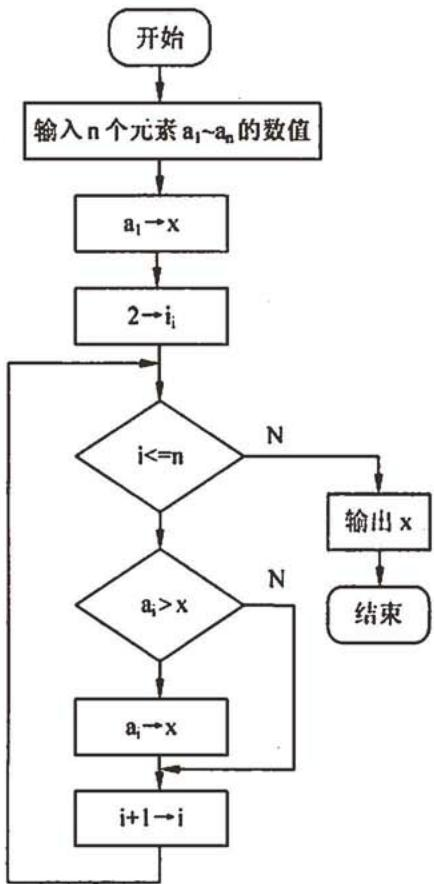  
图 5-1 用流程图描述算法

(2) 用伪代码描述算法。

除了可以用流程图描述之外，还可以用伪代码来进行描述。

<div class="mineru-algorithm" style="white-space: pre-wrap; font-family:monospace;">
$X \leftarrow a[0]$ 
for $i \leftarrow 1$ To n
do
	if (a[i] &gt; x)
	then $x \leftarrow a[i]$ ;
</div>

## 5.1.4 算法评价

一般地说，设计一个"好"的算法应该考虑达到以下目标。

（1）正确性（correctness）。算法应该是满足具体问题的需求。

（2）可读性（readability）。算法主要是为了便于人的阅读和交流。可读性好的算法有利于人的理解。

（3）健壮性（robustness）。指的是，当输入数据非法时，算法也能适当地做出反应或对它进行处理，而不会产生莫名其妙的输出结果。

（4）效率和低存储量需求。效率指的是算法执行的时间。对于同一个问题，执行时间短的算法效率高。存储量需求指的是算法执行过程中所需要的最大存储空间。

一个算法的复杂性的高低体现在运行该算法所需要的计算机资源的多少上，所需资源越多，该算法的复杂性越高；反之，所需资源越少，该算法的复杂性越低。其中最重要的就是算法的时间复杂性和空间复杂性。

一般情况下，算法中的基本操作重复执行的次数是问题规模 n 的某个函数 $f(n)$ ，算法的时间量度记作

$$
\mathrm{T} (\mathbf {n}) = \mathrm{O} (\mathbf {f} (\mathbf {n}))
$$

它表示随问题规模 n 的增大，算法执行时间的增长率和 f（n）的增长率相同，称做算法的渐进时间复杂度（Asymptotic Time Complexity），简称时间复杂度。被称为问题的基本操作的原操作应是其重复执行次数和算法的执行时间成正比的原操作。语句的频度（Frequency Count）指的是该语句重复执行的次数。

和算法的时间复杂度类似的，空间复杂度（Space Complexity）指的是算法所需存储空间的量度，记作：

$$
\mathbf {S} (\mathbf {n}) = \mathbf {O} (\mathbf {f} (\mathbf {n}))
$$

其中，n 为问题的规模或大小。根据算法的时间复杂度和空间复杂度，可以对算法进行评价。

## 5.1.5 算法与数据结构的关系

在计算机领域，一个算法实质上是针对所处理的问题的需要，在数据的逻辑结构和存储结构的基础上施加的一种运算。由于数据的逻辑结构和存储结构不是唯一的，在很大程度上可以由用户自行选择和设计，所以处理同一问题的算法也并不是唯一的。况且，即使是相同的逻辑结构和存储结构，算法的设计思想和技巧也不一定相同，编写出来的算法也

大不相同。

学习数据结构就是要学会根据数据处理问题的需要，为待处理的数据选择合适的逻辑结构和存储结构，进而按照结构化、模块化以及面向对象的程序设计方法设计出比较满意的算法。

## 5.2 线性表

## 5.2.1 线性表的定义和逻辑结构

线性表（linear\_list）是最常用且最简单的一种数据结构。一个线性表是 n 个数据元素的有限序列。一个数据元素可以由若干个数据项（item）组成，通常称为记录（record），含有大量记录的线性表又被称为文件（file）。设序列中第 i 个元素为 $a_{i}$ （ $1 \leqslant i \leqslant n$ ），则线性表一般表示为：

$$
\left(a _ {1}, a _ {2}, \dots , a _ {i - 1}, a _ {i}, a _ {i + 1}, \dots , a _ {n}\right)
$$

其中， $a_{i-1}$ 在 $a_{i}$ 的前面，称为 $a_{i}$ 的直接前驱元素。 $a_{i+1}$ 在 $a_{i}$ 的后面称为 $a_{i}$ 的直接后继元素。线性表中元素的个数 n ( $n \geqslant 0$ ) 称为线性表的长度。当 n=0 时，线性表成为空表。

一个线性表也可以用标志符来命名，例如用 A 命名上面的线性表，则：

$$
A = \left(a _ {1}, a _ {2}, \dots , a _ {i - 1}, a _ {i}, a _ {i + 1}, \dots , a _ {n}\right)
$$

用二元组表示为：

$$
\text { linear\_list } = (A, R)
$$

其中：

数据对象 $A=\{a_{i}\mid1\leqslant i\leqslant n,n\geqslant0,a_{i}$ 为数据元素

数据关系 $R = \{<a_{i}, a_{i+1} > | 1 \leqslant i \leqslant n-1\}$

对应的逻辑结构如图 5-2 所示:

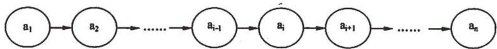  
图 5-2 线性表的逻辑结构

线性表是一个非常灵活的数据结构，对线性表的数据元素不仅可以访问，还可以对其进行诸如插入、删除等操作。因此，线性表的抽象数据类型包括了数据对象和数据关系两大部分，抽象数据类型的线性表定义如下所示：

```txt
ADT LinearList {
```

数据对象： $D=\{a_{1}\mid a_{1}$ 属于数据元素， $i=1,2,\cdots,n,n\geq0\}$

数据关系： $R1=\{<a_{i}, a_{i+1}> | a_{i}, a_{i+1} \in D, i=1, \ldots, n-1\}$

<div class="mineru-algorithm" style="white-space: pre-wrap; font-family:monospace;">
$\mathrm{LOC}(\mathbf{a}_{i+1}) = \mathrm{LOC}(\mathbf{a}_i) + \mathbf{k};$ 也就是说： $\mathrm{LOC}(\mathbf{a}_i) = \mathrm{LOC}(\mathbf{a}_1) + (\mathrm{i}-1)*\mathbf{k};$
</div>

基本操作：

```txt
InitList (&L); //初始化空线性表 L
DestroyList (&L); //销毁线性表 L
ClearList (&L); //消除数据表 L 内的所有元素
ListEmpty (L); //检查线性表 L 是否为空，为空则返回 true
ListLength (L); //返回线性表 L 的数据元素个数
GetElement (L,i); //返回线性表 L 的第 i 个元素
LocateElement (L,e); //返回 L 中第一个与 e 的值相等的数据元素的位置
PriorElement (L,e); //返回 L 中第一个与 e 值相等的数据元素的前一个元素值
NextElement (L,e); //返回 L 中第一个与 e 值相等的数据元素的后一个元素值
TraverseList (&L); //遍历线性表 L
Update (&L,i,e); //将线性表 L 的第 i 个元素值更改为 e
InsertPrior (&L,i,e); //在线性表 L 的第 i 个元素的前面插入值 e
InsertNext (&L,i,e); //在线性表 L 的第 i 个元素的后面插入值 e
Delete (&L,i); //删除线性表 L 的第 i 个元素
Sort (&L); //给线性表 L 排序
}ADT LinearList
```

## 5.2.2 线性表的顺序存储结构

线性表的存储结构有顺序、链接、散列等多种方式，顺序存储结构是其中最简单、最常见的一种。线性表的顺序存储结构就是用一组地址连续的存储单元依次存储线性表中的所有元素。因此，假设一个线性表中的每个元素需要占用 k 个存储单元，并且以该元素的第一个存储单元的地址作为该元素的存储位置。线性表中的第 i 个元素和第 i+1 个元素的存储位置有如下关系：

线性表的特点就在于它为线性表中相邻元素赋以了相邻的存储位置。只要确定了线性表的起始位置，就可以获得线性表的任意元素的存储位置。它的顺序存储结构图如图 5-3 所示。

为了便于线性表的操作，可以用记录类型来定义一个线性表 List:

```c
#define n 100 //线性表存储空间初始分配量
#define k 10 //分配增量
Typedef struct{
    ElemType *elem; //基址
    int length; //长度
    int size; //存储容量
}List;
```

下面给出在顺序存储方式下，线性表操作的具体实现：

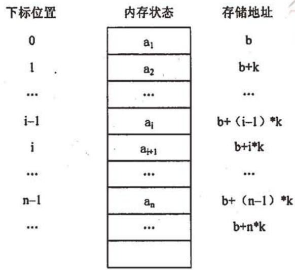  
图 5-3 线性表的存储结构图

## 初始化线性表

```c
Status InitList (List &L)
{
    L.elem = (ElemType *)malloc(LIST_INIT_SIZE*sizeof(ElemType));
    if (!L.elem) return OK; // 存储分配失败
    L.length = 0; // 空表长度为 0
    L.size = n; // 初始存储容量
    return OK;
}
```

删除线性表的所有元素

```txt
Void ClearList(List &L)
{
    L.length=0;
}
```

检查线性表是否为空

```txt
bool ListEmpty(List &L)
{
    return (L.length==0);
}
```

## 5.2.3 线性表的链式存储结构

线性表的顺序存储结构使得线性表的存储位置可以用一个简单、直观的公式来表示，但是在插入或删除操作的时候，需要移动大量的元素，十分不便。链式存储结构弥补了它的这个缺点。链式存储结构的特点是可以用一组任意的存储单元来存储线性表中的元素的存储结构，这些存储单元可以连续，也可以不连续。所以，为了表示数据元素 $a_{i}$ 与它的直接后继元素 $a_{i+1}$ 的逻辑关系，除了元素 $a_{i}$ 的基本信息之外，还存储了一个可以指明它的直接后继元素 $a_{i+1}$ 的存储位置的内容。它们共同组成 $a_{i}$ 的存储映像，称为结点（node）。存储元素 $a_{i}$ 的信息，被称为数据域，存储直接后继元素的存储位置的域，被称为指针域。n 个结点 $(a_{i}(1 \leqslant i \leqslant n))$ 组成一个链表，也就是线性表 $(a_{1}, a_{2}, \cdots, a_{n})$ 的链式存储结构。其结构示意图如图 5-4 所示。

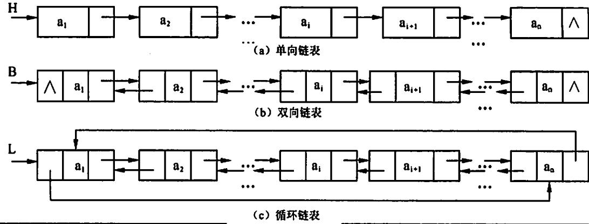  
图5-4 链表的结构

图 5-4 分别画出了链表的三种不同链式存储结构。若一个指针域的值为空，则在图形中通常用符号 "∧" 表示，由于线性表中的第一个元素没有前驱元素，最后一个元素没有后继元素，所以用 "∧" 表示。

循环链表是另一种形式的链式存储结构，它的特点是表中的最后一个结点的指针域指向头结点，整个链表形成一个环状结构，从表中任意一个结点出发都可以到达其他节点。操作与线性链表基本一致。

## 5.3 栈和队列

## 5.3.1 栈的定义和实现

栈（Stack）是一种特殊的线性表，是限定仅在表尾进行插入或者删除操作的线性表。进行插入和删除的那一端称为栈顶（top），另一端称为栈底（bottom）。栈的插入操作和删

除操作也分别简称进栈和出栈。

如果栈中有 n 个结点 $\{k_{0}, k_{1}, k_{2}, \cdots, k_{n-1}\}$ ， $k_{0}$ 为栈底， $k_{n-1}$ 是栈顶，则栈中结点的进栈如果栈中有 n 个结点 $\{k_{0}, k_{1}, k_{2}, \cdots, k_{n-1}\}$ ， $k_{0}$ 为栈底，顺序为 $k_{0}, k_{1}, k_{2}, \cdots, k_{n-1}$ ，而出栈的顺序为 $k_{n-1}, k_{n-2}, \cdots, k_{1}, k_{0}$ ，如图 5-5 所示。

栈的主要操作是栈的初始化、插入和删除运算、判断栈是否为空以及读取栈顶结点的值等操作。栈的类型的描述如下：

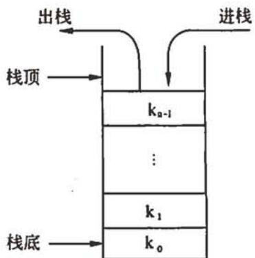

```c
ADT sequence_stack {
数据集合 K: K={k₁, k₂, ..., kₙ}, n > 0, K 中的元素是
datatype 类型
数据关系 R: R = {r} 栈底
    r = { <k₁, k₁₊₁> | i = 1, 2, ..., n - 1}
基本操作:
void init_sequence_stack(sequence_stack *st)
(顺序存储) 初始化
int is_empty_stack(sequence_stack st)
判断栈（顺序存储）是否为空
void print_sequence_stack(sequence_stack st)
打印栈（顺序存储）的结点值
datatype get_top(sequence_stack st)
取得栈顶（顺序存储）结点值
void push(sequence_stack *st, datatype x)
栈（顺序存储）的插入操作
void pop(sequence_stack *st)
栈（顺序存储）的删除操作
} ADT sequence_stack
```  

图5-5 栈

和顺序表类似，栈的实现方式一般也有两种：顺序存储和链式存储。下面主要介绍顺序栈。由于栈的顺序存储方式就是在顺序表的基础上对插入和删除操作限制，使得它们仅能在顺序表的同一端进行，所以同顺序表一样也可用一维数组表示。一般地，可以设定一个足够大的一维数组存储栈，数组中下标为0的元素就是栈底，对于栈顶，可以设一个指针top指示它。为了方便，设定top所指的位置是下一个将要插入的结点的存储位置，这样，当top=0时就表示是一个空的栈。一个栈的几种状态以及在这些状态下栈顶指针top和栈中结点的关系如图5-6所示。

栈的顺序存储结构用 C 语言描述如下:

```c
#define MAXSIZE 100
typedef int datatype;
```

```c
typedef struct {
    datatype a[MAXSIZE];
    int top;
} sequence_stack;
```

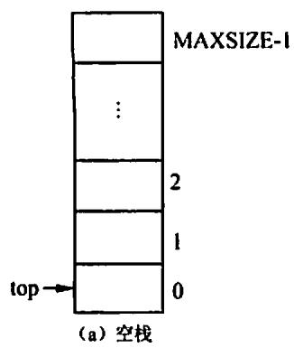

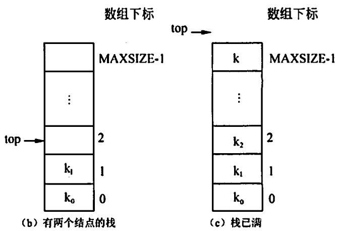  
图5-6 栈的状态

顺序存储栈的几个基本操作的具体实现，具体如下所示：

```c
//栈（顺序存储）初始化
void init_sequence_stack(sequence_stack *st)
{ st->top=0; }
//判断栈（顺序存储）是否为空
int is_empty_stack(sequence_stack st)
{ return (st.top? 0:1); }
//取得栈顶（顺序存储）结点值
datatype get_top(sequence_stack st)
{ if (empty_stack(st)) {printf("\n栈是空的!");exit(1);} else return st.a[st.top-1];
}
//栈（顺序存储）的插入操作
void push(sequence_stack *st, datatype x)
{ if (st->top==MAXSIZE)
{ printf("\nThe sequence stack is full!");exit(1);} 
st->a[st->top]=x;
st->top++;
}
//栈（顺序存储）的删除操作
void pop(sequence_stack *st)
```

```lisp
if (st->top==0)
{printf("\nThe sequence stack is empty!");exit(1);}
st->top--;
}
```

## 5.3.2 表达式求值

表达式求值是程序设计语言编译中的一个最基本问题。它的实现方法是栈的一个典型的应用实例。

在计算机中，任何一个表达式都是由操作数（operand）、运算符（operator）和界限符（delimiter）组成的。其中操作数可以是常数，也可以是变量或常量的标识符；运算符可以是算术运算体符、关系运算符和逻辑符；界限符为左右括号和标识表达式结束的结束符。在本节中，仅讨论简单算术表达式的求值问题。在这种表达式中只含加、减、乘、除四则运算，所有的运算对象均为单变量。表达式的结束符为"#"。

表达式一般分为中缀表达式和后缀表达式，具体如下：

## 1. 中缀表达式

中缀表达式是通常使用的一种表达式，中缀表达式的计算规则如下。

（1）括号内的操作先执行，括号外的操作后执行。如有多层括号，则先执行内层括号内的操作，再执行外括号内的操作。

(2) 先乘除，后加减。

（3）在有多个乘除或加减运算可选择时，按从左到右的顺序执行，即优先级相同的操作符按先后次序进行。

## 2. 后缀表达式

后缀表达式中只有操作数和操作符，它不再含有括号，操作符在两个操作数之后。它的计算规则非常简单，严格按照从左向右的次序依次执行每一个操作。每遇到一个操作符，就将前面的两个操作数执行相应的操作。

## 5.3.3 队列

队列（queue）是一种只允许在一端进行插入，而在另一端进行删除的线性表，它是一种操作受限的线性表。在表中只允许进行插入的一端称为队尾（rear），只允许进行删除的一端称为队头（front）。队列的插入操作通常称为入队列或进队列，而队列的删除操作则称为出队列或退队列。当队列中无数据元素时，称为空队列。队头元素总是最先进队列的，也总是最先出队列；队尾元素总是最后进队列，因而也是最后出队列。这种表是按照先进先出（FIFO，first in first out）的原则组织数据的，因此，队列也被称为"先进先出"表。下面用 C 语言描述队列类型为：

ADT sequence\_queue {

数据集合 K: $K=\{k_{1}, k_{2}, \cdots, k_{n}\}, n \geqslant 0$ ，K 中的元素是 datatype 类型

```c
数据关系 R: R={r}
r={<k₁, k₁+1>| i=1,2,…,n-1}
基本操作:
void init_sequence_queue(sequence_queue *sq)
    队列（顺序存储）初始化
int is_empty_sequence_queue(sequence_queue sq)
    判断队列（顺序存储）是否为空
void print_sequence_queue(sequence_queue sq)
    打印队列（顺序存储）的结点值
datatype get_first(sequence_queue sq)
    取得队列（顺序存储）的队首结点值
void insert_sequence_queue(sequence_queue *sq, datatype x)
    队列（顺序存储）插入操作
void delete_sequence_queue(sequence_queue *sq)
    队列（顺序存储）的删除操作
} ADT sequence_queue;
```

队列分为链队列和循环队列。链队列主要采取顺序存储方式，下面主要介绍链队列的顺序存储。队列的顺序存储在 C 语言中可以用一维数组表示，为了标识队首和队尾，需要附设两个指针 front 和 rear, front 指示的是队列中最前面，即队首结点在数组中元素的下标，rear 指示的是队尾结点在数组中元素的下标的下一个位置，也就是说 rear 指示的是即将插入的结点在数组中的下标。图 5-7 所示的是队列的几种状态：

队列的顺序存储结构用 C 语言描述如下:

```c
#define MAXSIZE 100
typedef int datatype;
typedef struct {
    datatype a[MAXSIZE];
    int front;
    int rear;
} sequence_queue;

下面介绍顺序队列的基本运算操作：
(1) 初始化队列。
int initQueue (sqqueue *q)
{ /*创建一个空队列由指针 q 指出*/
    if ((q = (sqqueue*)malloc(sizeof(sqqueue)) == NULL) return FALSE;
    q->front = -1;

```

```txt
q->rear=-1;
return TRUE;
}
```

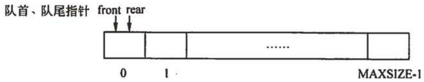  
·（a）初始状态-空队列

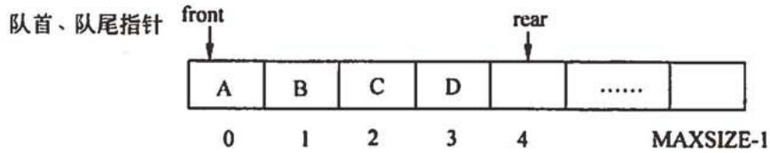  
(b) 连续插入几个结点后的状态

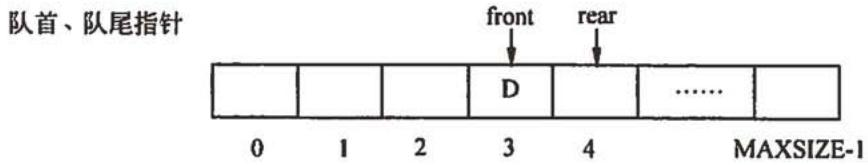  
(c) 连续删除几个结点后的状态-此时队列中只有一个结点  
图5-7 队列的状态

(2) 入队列操作。

```txt
int append (sqqueue *q, Elemtype x)
```

/\*将元素 x 插入到队列 q 中，作为 q 的新队尾\*/

```c
if (q->rear>=MAXNUM-1) return FALSE; /*队列满*/
q->rear++;
q->queue[q->rear]=x;
return TRUE;
```

(3) 出队列操作。

```c
Elemtype delete (sqqueue *q)
{ /*若队列 q 不为空，则返回队头元素*/
    Elemtype x;
    if (q->rear==q->front) return NULL; /*队列空*/
    x=q->queue[++q->front];
```

```scss
return x;
}
```

链队列还有链式存储结构，与顺序表的链式存储结构类似。循环队列的操作与链队列相似，这里就不再累述了。

## 5.4 数组和广义表

## 5.4.1 数组

数组是大家都已经很熟悉的一种数据类型，几乎所有高级语言程序设计中都设定了数组类型。数组可以看成是线性表的推广，数组的每个元素由一个值和一组下标确定，在数组中，对于每组有定义的下标都存在一个与之相对应的值；而线性表是有限结点的有序集合，若将其每个结点的序号看成下标，线性表就是一维数组（向量）；当数组为多维数组时，其对应线性表中的每个元素又是一个数据结构而已。数组使用时需要的内存空间远远大于普通变量的空间，所以按内存开辟空间的时机来划分数组，在程序编译时开辟内存区的数组称为静态数组，运行时根据需要开辟内存区的数组称做动态数组。简单来说，使用数值常量或符号常量定义下标的数组为静态数组，首先声明一个没有下标的数组名，然后在使用时再次声明数组的下标，称为动态数组。用 C 语言来描述数组如下：

<div class="mineru-algorithm" style="white-space: pre-wrap; font-family:monospace;">
ADT array {
	数据对象： $j_{i}=0,\cdots,b_{i}-1,\quad i=1,2,\cdots,n$ 
	D={ $a_{j1j2\cdots jn}$ | n&gt;0 称为数组的维数， $b_{i}$ 是数组第 i 维的长度， $j_{i}$ 是数组元素的第 i 维下标， $a_{j1j2\cdots jn} \in ElemSet$ }
	数据关系 R={ $R_{1},R_{2},\cdots,R_{n}$ }
	Ri={&lt; $a_{j1\cdots ji\cdots jn},a_{j1\cdots ji+1\cdots jn}&gt;$ | 0≤ $j_{k}$ ≤ $b_{k}-1,1$ ≤ k≤n 且 k≠i,0≤ $j_{i}$ ≤ $b_{i}-2,a_{j1\cdots ji\cdots jn},a_{j1\cdots ji+1\cdots jn} \in D,i=2,\cdots,n$ }
	基本操作：
	1.Initarray (A, n, index1,index2, …, index n)
	新建立一个 n 维数组 A
	2.Destroyarray (A)
	若数组 A 已经存在，则销毁数组 A，将其占用的空间收回。
	3.Value (A, index1,index2, …, index n, x)
	取出 A[index1][index2]…[index n] 数组元素的值存入变量 x.
	4.Assign (A, e, index1,index2, …, index n)
	将表达式 e 的值赋给数组元素 A[index1][index2]…[index n].
} ADT array
</div>

由于数组一般不做插入或删除操作，也就是说，一旦建立了数组，则结构中的数组元素个数和元素之间的关系就不再发生变动，即它们的逻辑结构就固定下来了，不再发生变化。因此，一般采用顺序存储结构表示数组。多维数组的顺序存储有两种形式：以列序为主序和以行序为主序。

## 1. 存放规则

行优先顺序也称为低下标优先或左边下标优先于右边下标。具体实现时，按行号从小到大的顺序，先将第一行中元素全部存放好，再存放第二行元素，第三行元素，依次类推……

在 Basic 语言、Pascal 语言、C/C++ 语言等高级语言程序设计中，都是按行优先顺序存放的。例如，对刚才的 $A_{m \times n}$ 二维数组，可用如下形式存放到内存： $a_{00}, a_{01}, \cdots, a_{0n-1}, a_{10}, a_{11}, \cdots, a_{1n-1}, \cdots, a_{m-10}, a_{m-11}, \cdots, a_{m-1n-1}$ 。即二维数组按行优先存放到内存后，变成了一个线性序列（线性表）。

因此，可以得出多维数组按行优先存放到内存的规律：最左边下标变化最慢，最右边下标变化最快，右边下标变化一遍，与之相邻的左边下标才变化一次。因此，在算法中，最左边下标可以看成是外循环，最右边下标可以看成是最内循环。

## 2. 地址计算

由于多维数组在内存中排列成一个线性序列，因此，若知道第一个元素的内存地址，如何求得其他元素的内存地址？可以将它们的地址排列看成是一个等差数列，假设每个元素占1个字节，元素 $a_{ij}$ 的存储地址应为第一个元素的地址加上排在 $a_{ij}$ 前面的元素所占用的单元数，而 $a_{ij}$ 的前面有i行（0\~i-1）共i×n个元素，而本行前面又有j个元素，故 $a_{ij}$ 的前面一共有i×n+j个元素，设 $a_{00}$ 的内存地址为LOC（ $a_{00}$ ），则 $a_{ij}$ 的内存地址按等差数列计算为LOC（ $a_{ij}$ ）=LOC（ $a_{00}$ ）+（i×n+j）×l。同理，三维数组 $A_{m\times n\times p}$ 按行优先存放的地址计算公式为：LOC（ $a_{ijk}$ ）=LOC（ $a_{000}$ ）+（i×n×p+j×p+k）×l。

## 5.4.2 广义表的定义和存储结构

广义表是5.2节提到的线性表的推广。线性表中的元素仅限于原子项，即不可以再分，而广义表中的元素既可以是原子项，也可以是子表（即另一个线性表）。它是 $n \geqslant 0$ 个元素 $a_{1}, a_{2}, \cdots, a_{n}$ 的有限序列，其中每一个 $a_{i}$ 或者是原子，或者是一个子表。广义表通常记为 $LS = (a_{1}, a_{2}, \cdots, a_{n})$ ，其中LS为广义表的名字，n为广义表的长度，每一个 $a_{i}$ 为广义表的元素。但在习惯中，一般用大写字母表示广义表，小写字母表示原子。

广义表一般表示为：

（1）用 $LS=(a_{1}, a_{2}, \cdots, a_{n})$ 形式，其中每一个 $a_{i}$ 为原子或广义表。

例如： $A=(b,c)$ ; $B=(a,A)$ 都是广义表。

(2) 将广义表中所有子表写到原子形式，并利用圆括号嵌套。

例如：上面提到的广义表 A、B 可以描述为：

A (b,c); B (a,A (b,c))

(3) 将广义表用树和图来描述, 一个广义表的深度指的是该广义表展开后所含括号的层数。例如, $\mathbf{A} = (\mathbf{b}, \mathbf{c})$ 的深度为 1, $\mathbf{B} = (\mathbf{A}, \mathbf{d})$ 的深度为 2, $\mathbf{C} = (\mathbf{f}, \mathbf{B}, \mathbf{h})$ 的深度为 3; 如图 5-8 所示。

由于广义表的元素类型不一定相同，因此，难以用顺序结构来存储表中的元素，通常采用链接存储方法来存储广义表中元素，并称之为广义链表。广义表需要两种结构的结点，一种是表结点，表示列表：一种是原子节点，表示原子。一个表结点可以由标志域、指示表头的指针域和指示表尾的指针域组成；而原子结点由标志域和值域组成，如图5-9所示。

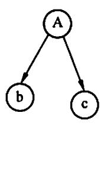

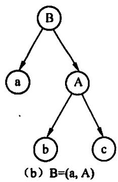  
图5-8 广义表的深度

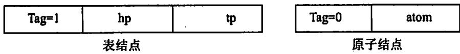  
图5-9 广义表的结构

数据类型描述如下：

```c
Typedef enum{Atom, List}ElemTag; // atom == 0 原子，list == 1 子表
Typedef struct node
{ ElemTag tag; // 公共部分，用于区分原子结点和表结点
Union{
    AtomType atom;
    struct { struct node *hp, *tp; } ptr;
    // ptr 表结点指针域
};
} *List;
```

广义表的存储结构如图 5-10 所示。

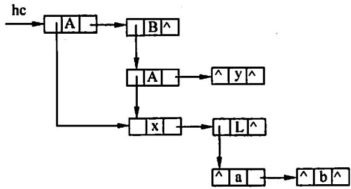  
图 5-10 广义表的存储结构

## 5.5.1 树的定义

树（tree）是 n（n≥0）个结点的有限集。n=0 的树称为空树；当 n≠0 时，树中的结点应该满足以下两个条件：

（1）有且仅有一个特定的结点称之为根。

(2) 其余结点分成 $m (m \geqslant 0)$ 个互不相交的有限集合 $T_{1}, T_{2}, \cdots, T_{m}$ , 其中每一个集合又都是一棵树, 称 $T_{1}, T_{2}, \cdots, T_{m}$ 为根结点的子树。

以上定义是一个递归定义，它反映了树的固有特性，因为一棵树是由根和它的子树构成，而子树又是由子树的根和更小的子树构成。如图5-11所示的树中，A是根结点，其余结点分成三个互不相交的子集： $S_{1}=\{B,E,F\},S_{2}=\{C\},S_{3}=\{D,G,H,I,J,K\}$ ，这三个集合分别构成了A的三棵子树；在S3构成的子树中，D是根结点，D又具有三棵子树，这三棵子树的根结点分别是G，H和I；对于结点G和I，它们的子树均为空。

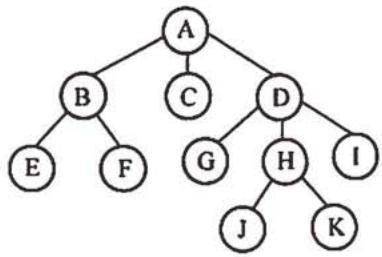  
图5-11 树

图中树的表示类似于自然界中一棵倒长的树，"树型结构"由此得名，这种表示方法比较形象、直观，因而容易为人们所接受，是树的一种最常用的表示方法。树型结构除以上表示方法外，还有括号表示法、凹入表示法和嵌套集合表示形式。图5-12给出了图5-11中树的这三种表示形式。

$$
\mathrm{A} (\mathrm{B} (\mathrm{E}, \mathrm{F}), \mathrm{C}, \mathrm{D} (\mathrm{G}, \mathrm{H} (\mathrm{J}, \mathrm{K}), \mathrm{I}))
$$

(a) 括号表示法  
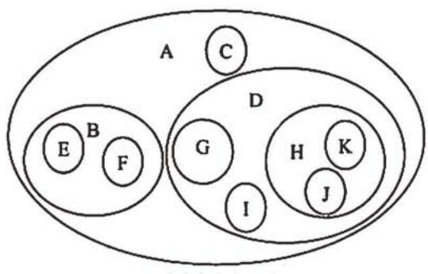  
(b) 嵌套集合表示法  
图5-12 树的表示

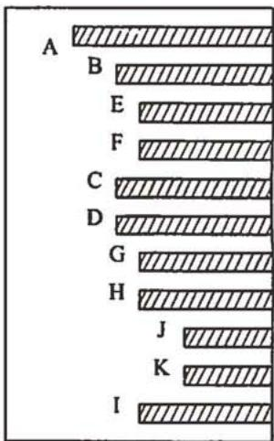  
(c) 凹入表示法

在图 5-11 的树中，采用线段连接两个相关联的结点，如 A 和 B，D 和 H 等。其中 A 和 D 是上端结点，B 和 H 是下端结点。称 A、D 分别是 B、H 的双亲（或父母或前件），B 和 H 分别为 A 和 D 的子女（或孩子或后件）。由于 E 和 F 的双亲为同一结点，称 E 和 F 互为兄弟。在任何一棵树中，除根结点外，其他任何一个结点有且仅有一个双亲，有 0 个或多个子女，且它的子女恰巧为其子树的根结点。将一结点拥有的子女数称为该结点的度，树中所有结点度的最大值称为树的度。称树中连接两个结点的线段为树枝。在树中，若从结点 $K_{i}$ 开始沿着树枝自上而下能到达结点 $K_{j}$ ，则称从 $K_{i}$ 到 $K_{j}$ 存在一条路径，路径的长度等于所经过的树枝的条数。在图 5-11 中，从结点 A 到结点 J 存在一条路径，路径的长度为 3；从 D 到 K 也存在一条路径，路径的长度为 2。将从树根到某一结点 $K_{i}$ 的路径中 $K_{i}$ 前所经过的所有结点称为 $K_{i}$ 的祖先；反之，以某结点 $K_{i}$ 为根的子树中的任何一个结点都称为 $K_{i}$ 的子孙。图 5-11 中，A、D、H 均为 J 和 K 的祖先，而 G、H、I、J 和 K 均为 D 的子孙。

树中结点的层次：从树根开始定义，根结点为第一层，根的子女结点构成第二层，依次类推，若某结点 $K_{j}$ 位于第 i 层，则其子女就位于第 $i+1$ 层。称树中结点的最大层次数为树的深度或高度。图 5-11 中，A 结点位于第一层，B、C、D 位于第 2 层，E、F、G、H 和 I 位于第三层等，整棵树的高度为 4。

如果树中任意结点的子树均看成是从左到右有次序的，不能随意交换，则称该树是有序树；否则称之为无序树。如图 5-13 所示的两棵树，若看成是有序树，它们是不等价的；若看成是无序树，两者相等。

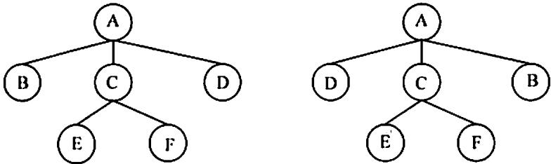  
图5-13 树

由 $m(m \geqslant 0)$ 棵互不相交的树构成的集合称为森林。森林和树的概念十分相近，每个结点的子树的集合即为一个森林；而在森林中的每棵树之上加一个共同的根，森林就成为了一棵树。

二叉树（Binary Tree）是另一种树型结构，它的特点是每个结点至多只有两棵子树，在二叉树中不存在度大于2的结点，并且二叉树的子树有左右之分，它的次序是不能任意颠倒的。

## 5.5.2 树的存储结构

存储结构的选择不仅要考虑数据元素如何存储，更重要的是要考虑数据元素之间的关系如何体现。根据数据元素之间关系的不同表示方式，常用的树存储结构主要有三种：双亲表示法、孩子表示法和孩子兄弟表示法。本节主要讨论树的双亲表示法，如图 5-14 所示。

在树中，除根结点没有双亲外，其他每个结点的双亲是唯一确定的。因此，根据树的这种性质，存储树中结点时，应该包含两个信息：结点的值 data 和体现结点之间相互关系的属性——该结点的双亲 parent。借助于每个结点的这两个信息便可唯一地表示任何一棵树。这种表示方法称为双亲表示法，为了查找方便，可以将树中所有结点存放在一个一维数组中，具体类型定义如下。

```c
# define MAXSIZE 100    /*树中结点个数的最大值*/
typedef char datatype;    /*结点值的类型*/
typedef struct node    /*结点的类型*/
{
    datatype data;
    int parent;    /*结点双亲的下标*/
} node;
typedef struct tree
{
    node treelist[MAXSIZE];    /*存放结点的数组*/
    int length, root;    /* 树中实际所含结点的个数及根结点的位置*/
} tree;    /* 树的类型*/
```

其中 datatype 应根据结点值的具体类型给出定义，在此假设为字符型。这里值得一提的是，根结点在树中有着与其他结点不同的地位，树根的位置是非常关键的，正如单链表中抓住了表头指针，就掌握了整个链表一样，树中只要知道树根在哪里，便可以访问到树中所有的结点，因此树的存储结构中要特别考虑根结点的存储。

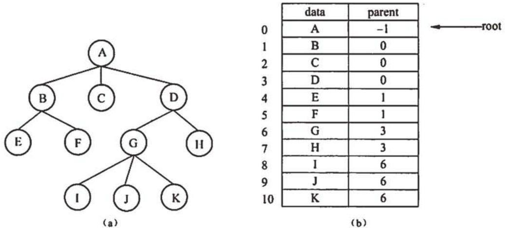  
图5-14 树的表示

其中 parent 的值为 -1 表示结点的双亲不存在。本树中 root 域的值为 0，表示树的根结点存放在数组的第一个元素中。

## 5.5.3 树的遍历

所谓树的遍历，指按某种规定的顺序访问树中的每一个结点一次，且每个结点仅被访问一次。根据根结点的访问位置不同，树的遍历可以分为前序遍历和后序遍历；又由于树具有层次性，遍历树中结点时可以按层次自上而下访问每个结点，因此树的遍历方式分为以下三种：

## 1. 树的前序遍历

首先访问根结点，再依次按前序遍历的方式访问根结点的每一棵子树。

## 2. 树的后序遍历

首先按后序遍历的方式访问根结点的每一棵子树，然后再访问根结点。

## 3. 树的层次遍历

首先访问第一层上的根结点，然后从左到右依次访问第二层上的所有结点，再以同样的方式访问第三层上的所有结点……最后访问树中最低一层的所有结点。

如图 5-15 所示的树对其进行三种遍历的结果分别为：前序遍历的结果——ABCEFHIGD；后序遍历的结果——BEHIFGCDA；层次遍历的结果——ABCDEFGHI。

显然，树的前序遍历和后序遍历的定义具有递归性，因此采用递归方式实现树的前、后序遍历算法十分方便，只要按照其各自规定的顺序，访问根结点时就输出根结点的值，访问子树时进行递归调用即可。以下以指针方式的孩子表示法作为树的存储结构，分别给出树的前序遍历和后序遍历算法的实现。

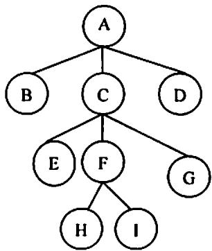  
图5-15 树

## 4. 树的前序遍历的递归算法

```c
void preorder ( tree p )    /*p 为指向树根结点的指针*/
{
    int i;
    if (p!=NULL)    /*树不为空*/
    {
    printf("%c",p->data);    /*输出根结点的值*/
    for (i=0;i<m;++i)    /*依次递归实现各子树的前序遍历*/
    preorder(p->child[i]);
    }
}
```

## 5. 树的后序遍历的递归算法

```c
void postorder ( tree p )    /*p 为指向树根结点的指针*/
{
    int i;
    if    (p!=NULL)    /*树不为空*/
    {
    for (i=0;i<m;++i)    /*依次递归实现各子树的后序遍历*/
    postorder(p->child[i]);
    printf("%c",p->data);    /*输出根结点的值*/
    }
}
```

## 5.6 图

## 5.6.1 图的定义和术语

图是由一个非空的顶点集合和一个描述顶点之间多对多关系的边（或弧）集合组成的一种数据结构，它可以形式化地表示为：

$$
\mathrm{图} = (\mathrm{V}, \mathrm{E})
$$

其中 $V=\{x|x|$ 某个数据对象集，它是顶点的有穷非空集合； $E=\{(x,y)|x,y|V\}$ 或 $E=\{<x,y>|x,y|V$ 且 Path $(x,y)$ ，它是顶点之间关系的有穷集合，也称为边集合，PathP $(x,y)$ 表示从 x 到 y 的一条单向通路。

通常，也将图 G 的顶点集和边集分别记为 V（G）和 E（G）。E（G）可以是空集，若 E（G）为空，则图 G 只有顶点而没有边。

若图 G 中的每条边都是有方向的，则称 G 为有向图。在有向图中，一条有向边是由两个顶点组成的有序对，有序对通常用尖括号表示。例如，有序对有向边 $<v_{i}, v_{j}>$ 表示一条由 $v_{i}$ 到 $v_{j}$ 的有向边。有向边又称为弧，也称为边弧，边弧的始点 $v_{i}$ 称为弧尾（Tail），边弧的终点 $v_{j}$ 称为弧头（Head）。若图 G 中的每条边都是没有方向的，则称 G 为无向图。无向图中的边均是顶点的无序对，无序对通常用圆括号表示。

## 5.6.2 图的存储结构

设 $G = (V, E)$ 是有 $n(n^3 1)$ 个顶点的图，在图的邻接矩阵表示法中，可用两个表格分别存储数据元素（顶点）的信息和数据元素之间的关联（边）信息。通常用一维数组（顺序表）存储数据元素的信息，用二维数组（邻接矩阵）存储数据元素之间的关系。

$$
\mathbf {A} [ \mathbf {i}, \mathbf {j} ] = \left\{ \begin{array}{l l} 1: & \text { 若 } (\mathbf {v _ {i}}, \mathbf {v _ {j}}) \text { 或 } <   \mathbf {v _ {i}}, \mathbf {v _ {j}} > \text { 是 } \mathbf {E} (\mathbf {G}) \text { 中的边 } \\ 0: & \text { 若 } (\mathbf {v _ {i}}, \mathbf {v _ {j}}) \text { 或 } <   \mathbf {v _ {i}}, \mathbf {v _ {j}} > \text { 不是 } \mathbf {E} (\mathbf {G}) \text { 中的边 } \end{array} \right.
$$

给定图 $G=(V,E)$ ，其中 $V(G)=\{v_{0},\cdots,v_{i},\cdots,v_{n-1}\}$ ，G 邻接矩阵（Adjacency Matrix）是表示顶点之间相邻关系的矩阵，G 的邻接矩阵是具有如下性质的 n 阶方阵：

```c
# define n 6    /* 图的顶点数 */
# define e 8    /* 图的边（弧）数 */
typedef char vextype;    /* 顶点的数据类型 */
typedef float adjtype;    /* 权值类型 */
typedef struct
{    vextype vexs[n];
    adjtype arcs[n][n];
}graph;
```

若图中顶点信息是 0 至 n-1 的编号，则仅需令权值为 1，存储一个邻接矩阵就可以表示图。若是网络，则 adjtype 为权的类型。由于无向图或无向网络的邻接矩阵是对称的，故可采用压缩存储的方法，仅存储下三角阵（不包括对角线上的元素）中的元素即可。显然，邻接矩阵表示法的空间复杂度 $S(n) = O(n^{2})$ 。

## 5.6.3 图的遍历

给定图 G=(V, E) 和 V(G) 中的某一顶点 v，从 v 出发访问 G 中其余顶点，且使每个顶点位置仅被访问一次，这一过程称为图的遍历。

深度优先遍历和广度优先遍历是最为重要的两种遍历图的方法，它们对无向图和有向图均适用。

## 1. 深度优先遍历

深度优先搜索（Depth-First Search）的基本思想是：对于给定的图 $G = (V, E)$ ，首先将 V 中每一个顶点都标记为未被访问，然后，选取一个源点将 v 标记为已被访问，再递归地用深度优先搜索方法，依次搜索 v 的所有邻接点 w。若 w 未曾访问过，则以 w 为新的出发点继续进行深度优先遍历。如果从 v 出发有路的顶点都已被访问过，则从 v 的搜索过程结束。此时，如果图中还有未被访问过的顶点（该图有多个连通分量或强连通分量），则再任选一个未被访问过的顶点，并从这个顶点开始做新的搜索。上述过程一直进行到 V 中所有顶点都已被访问过为止。

## 2. 广度优先遍历

图的广度优先遍历的基本思想是：给定图 $G = (V, E)$ ，从图中某个源点 v 出发，在访问了顶点 v 之后，接着就尽可能先在横向搜索 v 的所有邻接点。在依次访问 v 的各个未被访问过的邻接点 $w_{1}, w_{2}, \cdots, w_{k}$ 之后，分别从这些邻接点出发依次访问与 $w_{1}, w_{2}, \cdots, w_{k}$ 邻接的所有未曾访问过的顶点。依此类推，直至图中所有和源点 v 有路径相通的顶点都已访问过为止，此时从 v 开始的搜索过程结束。若 G 是连通图，则遍历完成；否则，在图 G 中另选一个尚未访问的顶点作为新源点继续上述的搜索过程，直至图 G 中所有顶点均已被访问为止。采用广度优先搜索法遍历图的方法称为图的广度优先遍历。

为确保先访问的顶点其邻接点亦先被访问，在搜索过程中可使用队列来保存已访问过的顶点。当访问 v 和 u 时，这两个顶点相继入队，此后，当 v 和 u 相继出队时，分别从 v 和 u 出发搜索其邻接点 $v_{1}, v_{2}, \cdots, v_{s}$ 和 $u_{1}, u_{2}, \cdots, u_{t}$ ，对其中未访者进行访问并将其入队。这种方法是将每个已访问的顶点入队，保证了每个顶点至多只有一次入队。

## 选择题

1. 双链表的每个结点中包括两个指针：link1 指向结点的后继结点，link2 指向结点的前驱结点。现要将指针 q 指向的新结点插入到指针 p 指向的双链表结点之后，下面的操作序列哪一个是正确的？（）
A）q↑。link1:=p↑。link1;p↑。link1:=q;
q↑。link2:=p;q↑。link1↑。link2:=q;
B）q↑。link1:=p↑。link;q↑。link2:=p;
q↑。link1↑。link2:=q;p↑。link1:=q;
C）q↑。link2:=p;p↑。link1:=q;
q↑。link1:=p↑。link1;q↑。link1↑。link2:=q;
D）q↑。link2:=p;q↑。link:=p↑。link1;
p↑。link1:=q;q↑。link1↑。link2:=q;

2. 在顺序表（2,5,7,10,14,15,18,23,35,41,52）中，用二分法查找关键码值 12，所需的关键码比较次数为（）。  
A) 2 B) 3  
C) 4 D) 5

## 思考题

1. 请简述数据结构与算法的关系。

2. 用学过的算法的知识，编写把一个字符串插入到另一个字符串的某个位置的算法。

3. 论述题: 要求设计一个学生试卷成绩输入、查询和成绩单输出系统（简称 SRS）的数据结构和算法要点。问题描述如下：

要输入到 SRS 系统中的每一份试卷成绩反映一个学生选修一门课程的考试结果, 它包括以下数据项: 学号、姓名、课程名、成绩。由于实行了灵活的选课制度, 所以每个学生选修多少门课程, 选修哪些课程都可以不同。要输入的多份试卷成绩并未按任何数据项排列顺序, 它们以任意的顺序被输入到系统中来。SRS 系统要具有以下功能: ①试卷成绩插入, 将试卷成绩逐个插入到 SRS 系统的数据结构中。②学生成绩查询, 给出学号查找该学生所选修的各门课程的考试成绩。③成绩单输出。按学号递增的顺序依次输出所有学生的学号、姓名，及其所选修的各门课程的课程名和成绩。（为简单起见，假设上述所有工作都在计算机内存中进行。）请设计 SRS 系统的数据结构和算法要点，使上述三项操作都有较高的执行效率。从以下方面阐述你的设计：

① SRS 系统的数据结构

② SRS 系统的算法要点

③ 简单陈述上述设计的理由
