>[!warning] 版本提示
>本书为 **2006 年第 1 版**。现行考试依据是 **《信息系统管理工程师教程（第 2 版）》**（清华社 2024-10，20 章），
>两版**重合极少**：第 1 版的第 1–6 章（硬件/操作系统/语言/配置/数据结构/多媒体）在第 2 版已被删除或压缩。
>本页仅作**扩展参考**，备考请以 [[知识体系]]（第 2 版官方考纲）为准。

# 第7章 网络基础知识

随着经济和计算机网络技术的发展，计算机网络逐渐走进人们的生活。现在，许多家庭和单位都组建了计算机网络，例如家庭网络、办公室网络和校园网络，还有许多商业性质的网吧等。作者编写本章的目的是为了使读者能够自己组建和管理计算机网络，掌握计算机网络技术的基本知识，了解组建网络所需的硬件设备和软件，以及连接 Internet 的方法。全章由浅入深、循序渐进地介绍了计算机网络的基础和原理，组建局域网的软硬件的选择、安装和设置，以及局域网与 Internet 的连接。

## 7.1 网络的基础知识

## 7.1.1 计算机网络的概念和分类

对 "计算机网络" 这个概念，我们并不陌生，现代社会充斥着计算机网络，干什么事情都离不开网络。然而究竟什么才是 "计算机网络" 呢？随着计算机网络本身的发展，人们提出了各种不同的观点，对它的定义也在不断变迁。

1969 年美国国防部研究计划局（ARPA）主持研制的 ARPAnet 计算机网络投入运行，在此之后，世界各地计算机网络的建设便如雨后春笋般迅速地发展起来。计算机网络的产生和演变过程经历了从简单到复杂、从低级到高级、从单机系统到多机系统的发展过程。早期的计算机系统是高度集中的，所有的设备安装在单独的大房间中，后来出现了批处理和分时系统，分时系统所连接的多个终端必须紧接着主计算机。50 年代中后期，许多系统都将地理上分散的多个终端通过通信线路连接到一台中心计算机上，这样就出现了第一代计算机网络。

第一代计算机网络是以单个计算机为中心的远程联机系统。典型应用是由一台计算机和全美范围内2000多个终端组成的飞机订票系统。人们把一台计算机的外部设备包括CRT控制器和键盘，无CPU内存，称为终端。随着远程终端的增多，在主机前增加了前端机FEP当时，人们把计算机网络定义为"以传输信息为目的而连接起来，实现远程信息处理或近一步达到资源共享的系统"，但这样的通信系统已具备了通信的雏形。

第二代计算机网络是以多个主机通过通信线路互联起来，为用户提供服务，兴起于60年代后期，典型代表是美国国防部高级研究计划局协助开发的ARPAnet。主机之间不是直接用线路相连，而是接口报文处理机IMP转接后互联的。IMP和它们之间互联的通信线路一起负责主机间的通信任务，构成了通信子网。通信子网互联的主机负责运行程序，提供资源共享，组成了资源子网。两个主机间通信时对传送信息内容的理解，信息表示形式以及各种情况下的应答信号都必须遵守一个共同的约定，称为协议。在 ARPA 网中，将协议按功能分成了若干层次，如何分层，以及各层中具体采用的协议的总和，称为网络体系结构，体系结构是个抽象的概念，其具体实现是通过特定的硬件和软件来完成的。70 年代至 80 年代中期第二代网络得到迅猛的发展。第二代网络以通信子网为中心。这个时期，网络概念为"以能够相互共享资源为目的互联起来的具有独立功能的计算机之集合体"，形成了计算机网络的基本概念。

第三代计算机网络是具有统一的网络体系结构并遵循国际标准的开放式和标准化的网络。ISO 在 1984 年颁布了 OSI/RM，该模型分为七个层次，也称为 OSI 七层模型，公认为新一代计算机网络体系结构的基础。为普及局域网奠定了基础。70 年代后，由于大规模集成电路出现，局域网由于投资少，方便灵活而得到了广泛的应用和迅猛的发展，与广域网相比有共性，如分层的体系结构，又有不同的特性，如局域网为节省费用而不采用存储转发的方式，而是由单个的广播信道来连接网上计算机。

第四代计算机网络从 80 年代末开始，局域网技术发展成熟，出现光纤及高速网络技术，多媒体，智能网络，整个网络就像一个对用户透明的大的计算机系统，发展为以 Internet 为代表的互联网。这才是今天意义上的计算机网络。

CCITT 认为，网络就是一些结点和链路的集合。它提供两个或多个规定点的连接，以便于在这些点之间建立通信。计算机网络就是相互联接、彼此独立的计算机系统的集合。相互连接指的是两台或多台计算机通过信道互连，从而可以进行通信；彼此独立则强调的是在网络中，计算机之间不存在明显的主从关系，即网络中的计算机不具备控制其他计算机的能力，每台计算机都具有独立的操作系统。计算机网络的实现了数据通信、资源共享、集中管理以及分布式处理，为现代社会带来了极大的方便。

从定义中，可以看出，计算机网络涉及到三个方面的问题：

(1) 至少两台计算机互联。

(2) 通信设备与线路介质。

（3）网络软件，通信协议和 NOS

只有满足上面的条件的网络才能成为计算机网络。用于计算机网络分类的标准很多，如拓扑结构，应用协议等。

网络的拓扑结构指网络中结点（设备）和链路（连接网络设备的信道）的几何形状。按照网络的拓扑结构来分类，可以分为总线状、环状、树状、网状、星状、混合状等，如图7-1所示。

按照网络的覆盖范围，可以将计算机网络划分为：局域网、城域网、广域网、互联网等。其中，局域网（LAN）用于将有限范围内（如一个实验室、一幢大楼、一个校园）的各种计算机、终端与外部设备互连成网。城域网（MAN）指的是城市地区网络，它是介于广域网与局域网之间的一种高速网络。广域网（WAN）也称为远程网，它所覆盖的地理范围从几十公里到几千公里。互联网（Internet）又因其英文单词"Internet"的谐音，称为"因特网"。在互联网应用如此发展的今天，它已是人们每天都要打交道的一种网络，无论从地理范围，还是从网络规模来讲它都是最大的一种网络，就是常说的Web、WWW和万维网等多种叫法。从地理范围来说，它可以是全球计算机的互联，这种网络的最大的特点就是不定性。从技术的观点来看，按照覆盖范围对网络进行分类不是一种十分严谨的方法。

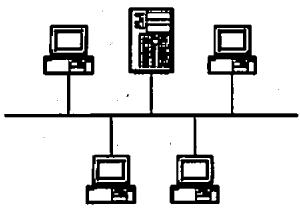  
总线状

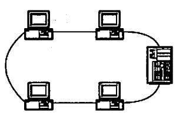  
环状

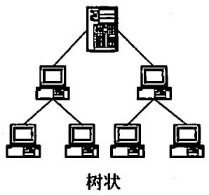

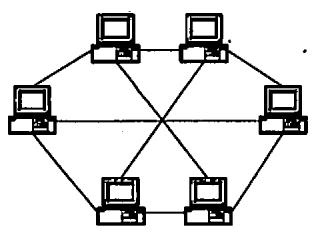  
网状

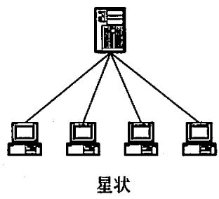

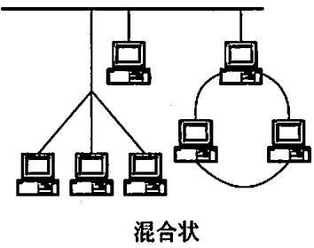  
图 7-1 网络的拓扑结构

## 7.1.2 计算机网络的组成

在介绍计算机网络的组成前，先介绍几个常见的概念。

## 1. 结点

结点（Node），也称为"站"，一般是指网络中的计算机。结点可分为访问结点和转接结点两类。

## 2. 线路

在两个结点间承载信息流的信道称为线路（line）。线路可以是采用电话线、电缆、光纤等有线信道，也可以是无线电信道。

## 3. 链路

链路（link）指的是从发信点到收信点（即从信源到信宿）的一串结点和线路。链路通信是指端到端的通信。

计算机网络从逻辑结构上可以分成两部分：负责数据处理、向网络用户提供各种网络资源及网络服务的外层用户资源子网和负责数据转发的内层通信子网。通信子网由分组交换结点（简记为 R）及连接这些结点的链路组成，负责在主机（Host，H）间传输分组。资源子网由连在网上的主机构成，为网上用户提供共享资源，入网途径和方法。局域网中的每台主机都通过网卡连接到传输介质上，网卡负责在各个主机间传递数据，显然，网卡和传输介质构成了局域网的通信子网，而主机集合则构成了资源子网。用户子网指的是由主计算机、终端、通信控制设备、连网外设、各种软件资源等组成。通信子网分为点对点通信子网和广播式通信子网。它主要有三种组织形式：结合型、专用型和公用型，如图 7-2 所示。

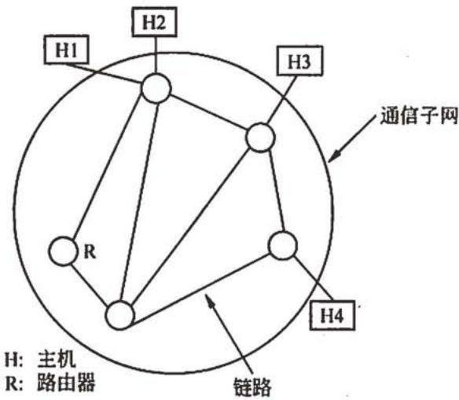  
图 7-2 网络的组织形式

计算机网络也可以看作是在物理上分布的相互协作的计算机系统。其硬件部分除了单体计算机、光纤、同轴电缆以及双绞线等传输媒体之外，还包括插入计算机中用于收发数据分组的各种通信网卡（在操作系统中，这些网卡不当成一种外部设备），把多台计算机连接到一起的集线器（hub，该设备近年正逐步被相应的交换机取代），扩展带宽和连接多台计算机用的交换机（switch）以及负责路径管理、控制网络交通情况的路由器或ATM交换机等。其中路由器或ATM交换机是构成广域网络的主要设备，而交换机和集线则是构成局域网络的主要设备。这些设备都可看作一种专用的计算机。

综上所述，计算机网络是一个由不同传输媒体构成的通信子网，与这个通信子网连接的多台地理上分散的具有唯一地址的计算机，将数据划分为不同长度分组进行传输和处理的协议软件以及应用系统所组成的传输和共享信息的系统。

## 7.2 计算机网络体系结构与协议

计算机网络系统是由各种各样的计算机和终端设备通过通信线路连接起来的复杂系统。在这个系统中，由于计算机类型、通信线路类型、连接方式、同步方式、通信方式等的不同，给网络各结点的通信带来诸多不便。要使不同的设备真正以协同方式进行通信是十分复杂的。要解决这个问题，势必涉及通信体系结构设计和各厂家共同遵守约定标准等问题，也就是计算机网络体系结构和协议问题。

## 7.2.1 计算机网络体系结构

1974 年，美国 IBM 公司首先公布了世界上第一个计算机网络体系结构（SNA，System Network Architecture），凡是遵循 SNA 的网络设备都可以很方便地进行互连。1977 年 3 月，国际标准化组织 ISO 的技术委员会 TC97 成立了一个新的技术分委会 SC16 专门研究 "开放系统互连"，并于 1983 年提出了开放系统互连参考模型，即著名的 ISO 7498 国际标准（我国相应的国家标准是 GB 9387），记为 OSI/RM。

在 OSI 中采用了三级抽象：参考模型（即体系结构）、服务定义和协议规范（即协议规格说明），自上而下逐步求精。OSI/RM 并不是一般的工业标准，而是一个为制定标准用的概念性框架。经过各国专家的反复研究，在 OSI/RM 中，采用了如表 7-1 所示的七个层次的体系结构。

表 7-1 OSI/RM 七层协议模型

<table><tr><td>层号</td><td>名称</td><td>英文名称</td><td>主要功能简介</td></tr><tr><td>7</td><td>应用层</td><td>Application Layer</td><td>作为与用户应用进程的接口,负责用户信息的语义表示,并在两个通信者之间进行语义匹配,它不仅要提供应用进程所需要的信息交换和远地操作,而且还要作为互相作用的应用进程的用户代理来完成一些为进行语义上有意义的信息交换所必须的功能</td></tr><tr><td>6</td><td>表示层</td><td>Presentation Layer</td><td>对源站点内部的数据结构进行编码,形成适合于传输的比特流,到了目的站再进行解码,转换成用户所要求的格式并保持数据的意义不变。主要用于数据格式转换</td></tr><tr><td>5</td><td>会话层</td><td>Session Layer</td><td>提供一个面向用户的连接服务,它给合作的会话用户之间的对话和活动提供组织和同步所必须的手段,以便对数据的传送提供控制和管理。主要用于会话的管理和数据传输的同步</td></tr><tr><td>4</td><td>传输层</td><td>Transport Layer</td><td>从端到端经网络透明地传送报文,完成端到端通信链路的建立、维护和管理</td></tr><tr><td>3</td><td>网络层</td><td>Network Layer</td><td>分组传送、路由选择和流量控制,主要用于实现端到端通信系统中中间结点的路由选择</td></tr><tr><td>2</td><td>数据链路层</td><td>Data Link Layer</td><td>通过一些数据链路层协议和链路控制规程,在不太可靠的物理链路上实现可靠的数据传输</td></tr><tr><td>1</td><td>物理层</td><td>Physical Layer</td><td>实现相邻计算机结点之间比特数据的透明传送,尽可能屏蔽掉具体传输介质和物理设备的差异</td></tr></table>

OSI/RM 模型本身不是网络体系结构的全部内容，它并未确切地描述用于各层的协议和服务，它仅仅说明了每一层应该做什么。不过，OSI 已经为各层制定了标准，但它们并不是参考模型的一部分，而是作为单独的国际标准公布的。

## 1. 物理层

物理层涉及到通信在信道上传输的原始比特流。这里的设计主要是处理机械的、电气的和过程的接口，以及物理层下的物理传输介质等问题。

## 2. 数据链路层

数据链路层的主要任务是加强物理层传输原始比特的功能，使之对网络层呈现为一条无错线路。数据链路层要解决的另一个问题是流量控制。通常流量控制和出错处理同时完成。如果线路能用于双向传输数据，数据链路软件还必须解决发送双方数据帧竞争线路的使用权问题。广播式网络在数据链路层还要处理共享信道访问的问题。数据链路层的一个特殊子层——介质访问子层，就是专门处理这个问题的。

## 3. 网络层

网络层关系到子网的运行控制，其中一个关键问题是确定分组从源端到目的端如何选择路由。如果在子网中同时出现过多的分组，它们将相互阻塞通路，形成瓶颈。此类拥塞控制也属于网络层的范围。网络层还常常设有记账功能。它还必须解决异种网络的互连问题。在广播网络中，选择路由问题很简单，因此网络层很弱，甚至不存在。

## 4. 传输层

传输层的基本功能是从会话层接收数据，并且在必要时把它分成较小的单元，传递给网络层，并确保达到对方的各段信息正确无误，传输层使会话层不受硬件技术变化的影响。传输层也要决定向会话层，最终向网络用户提供了什么样的服务。采用哪种服务是在建立连接时确定的。传输层是真正的从源到目标"端到端"的层。源端机上的某程序，利用报文头和控制报文与目标机上的类似程序进行对话。

除了将几个报文流多路复用到一条通道上，传输层还必须解决跨网络连接的建立和拆除。另外，还需要进行流量控制，主机之间的流量控制和路由器之间的流量控制不同。

## 5. 会话层

会话层允许不同计算机上的用户建立会话关系。会话层服务之一是管理对话。会话层允许信息同时双向传输，或任一时刻只能单向传输。另一种会话服务是同步。会话层在数据流中插入检查点。每次网络崩溃后，仅需要重传最后一个检查点以后的数据。

## 6. 表示层

表示层以下的各层只关心可靠地传输比特流，而表示层关心的是所传输信息的语法和语义。表示层服务的一个典型例子是对数据编码。为了让采用不同表示方法的计算机之间能进行通信，交换中使用的数据结构可以用抽象的方式来定义，并且使用标准的编码方式。表示层管理这些抽象数据结构，并且在计算机内部表示法和网络的标准表示法之间进行转换。

## 7. 应用层

应用层包含大量人们普遍需要的协议。例如，定义一个抽象的网络虚拟终端，而对每一种终端类型，都写一段软件来把网络虚拟终端映射到实际的终端。另一个应用层功能是文件传输。此外还有电子邮件、远程作业输入、名录查询和其他各种通用和专用的功能。

OSI/RM 模型的概念比较抽象，它并没有规定具体的实现方法和措施，更未对网络的性能提出具体的要求，它只是一个为制定标准用的概念性框架。OSI/RM 七层协议模型上、下大，中间小，这是因为最高层要和各种类型的应用进程接口，而最低层要和各种类型的网络接口，因此上、下两头标准特别多，而中间几层标准就稍简单些。有些层的任务过于繁重，如数据链路层和网络层，有些层的任务又太轻，如会话层和表示层。

常见的计算机网络体系结构，除了 OSI 结构外，还有 TCP/IP 结构，其模型如图 7-3 所示。

这里，就不详细介绍 TCP/2P 协议中各层的作用了，有兴趣的读者可以去查阅相关书籍。

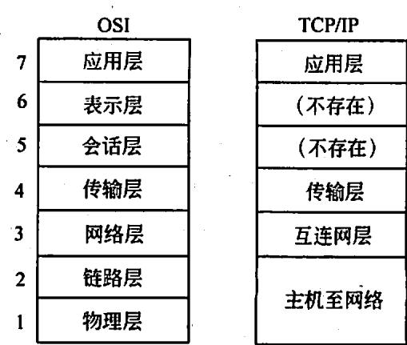  
图 7-3 TCP/IP 模型

## 7.2.2 TCP/IP 协议

TCP/IP（Transmission Control Protocol/Internet Protocol）是国际互联网络事实上的工业标准，ARPANET 最初设计的 TCP 称为网络控制程序 NCP，在上面传送的数据单位是报文（Message），实际上就是现在的 TPDU。随着 ARPANET 逐渐变成了 Internet，子网的可靠性也就下降了，于是 NCP 就演变成了今天的 TCP。与 TCP 配合使用的网络层协议是 IP。TCP/IP 是一组通信协议的代名词，是由一系列协议组成的协议簇。它本身指两个协议集：TCP 为传输控制协议，IP 为互连网络协议。TCP/IP 协议是常见的一种协议，它主要包括下列协议：

## (1) 远程登录协议（Telnet）

Telnet 协议是用来登录到远程计算机上，并进行信息访问，通过它可以访问所有的数据库、联机游戏、对话服务以及电子公告牌，如同与被访问的计算机在同一房间中工作一样，但只能进行字符类操作和会话。

## (2) 文件传输协议（FTP）

这是文件传输的基本协议，有了 FTP 协议就可将文件上传，也可从网上得到许多应用程序和信息（下载），有许多软件站点就是通过 FTP 协议来为用户提供下载任务的，俗称 FTP 服务器。最初的 FTP 程序是工作在 Unix 系统下的，而目前的许多 FTP 程序是工作在 Windows 系统下的。FTP 程序除了完成文件的传送之外，还允许用户建立与远程计算机的连接，登录到远程计算机上，并可在远程计算机上的目录间移动。

## (3) 简单邮件传输协议（SMTP）

SMTP 是 TCP/IP 协议族的一个成员, 这种协议认为计算机是永久连接在 Internet 上的,而且认为网络上的计算机在任何时候都是可以被访问的。它适用于永久连接在 Internet 的计算机，但无法使用通过 SLIP/PPP 协议连接的用户接收电子邮件。解决这个问题的办法是在邮件计算机上同时运行 SMTP 和 POP 协议的程序，SMTP 负责邮件的发送和在邮件计算机上的分拣和存储，POP 协议负责将邮件通过 SLIP/PPP 协议连接传送到用户的计算机上。

## 7.3 计算机网络传输

## 7.3.1 数据通信模型

一般认为信息是人对现实世界事物存在方式或运动状态的某种认识。表示信息的形式可以是数值、文字、图形、声音、图像以及动画等。数据是把事件的某些属性规范化后的表现形式，它能被识别，也可以被描述，例如十进制数、二进制数、字符等。信号是数据的具体物理表现，具有确定的物理描述，例如电压、磁场强度等。

在数据通信系统中，人们关注得更多的是数据和信号。信号可以是模拟的也可以是数字的。与信号的分类相对应，信道也分为传输模拟信号的模拟信道和传送数字信号的数字信道两大类。

数据可以是模拟的也可以是数字的。模拟是与连续相对应的，模拟数据是取某一区间的连续值，而模拟信号是一个连续变化的物理量。数字是与离散相对应的，数字数据取某一区间内有限个离散值，数字信号取几个不连续的物理状态来代表数字。

模拟信号和数字信号的区别如图 7-4 所示。

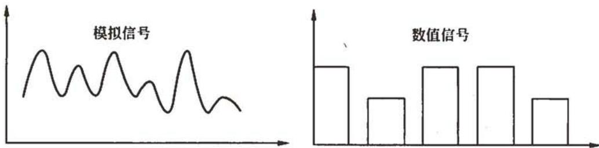  
图 7-4 模拟信号和数值信号

使用数字信号传输数据时，数字信号几乎要占有整个频带。终端设备把数字信号转换成脉冲电信号时，这个原始的电信号所固有的频带，称为基本频带，简称基带。在信道中直接传送基带信号时，称为基带传输。采用模拟信号传输数据时，往往只占有有限的频谱，对应基带传输将其称为频带传输。

在计算机网络中，数据通信系统的任务是：把数据源计算机所产生的数据迅速、可靠、准确地传输到数据宿（目的）计算机或专用外设。从计算机网络技术的组成部分来看，一个完整的数据通信系统，一般由以下几个部分组成：数据终端设备，通信控制器，通信信

道，信号变换器，如图 7-5 所示。

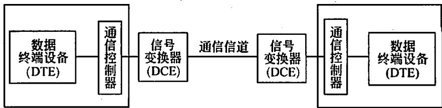  
图 7-5 数据通信模型系统

数据终端设备，即数据的生成者和使用者，它根据协议控制通信的功能。最常见的数据终端设备就是网络中的计算机。此外，数据终端设备还可以是网络中的专用数据输出设备，如打印机等。

通信控制器除进行通信状态的连接、监控和拆除等操作外，还可接收来自多个数据终端设备的信息，并转换信息格式。如计算机内部的异步通信适配器（UART）、数字基带网中的网卡就是通信控制器。

通信信道是信息在信号变换器之间传输的通道，如电话线路等模拟通信信道、专用数字通信信道、宽带电缆（CATV）和光纤等。

信号变换器把通信控制器提供的数据转换成适合通信信道要求的信号形式，或把信道中传来的信号转换成可供数据终端设备使用的数据，最大限度地保证传输质量。在计算机网络的数据通信系统中，最常用的信号变换器是调制解调器和光纤通信网中的光电转换器。信号变换器和其他的网络通信设备又统称为数据通信设备（DCE），DCE为用户设备提供入网的连接点。

上述的各项一起构成了数据通信模型。

数据通信模型按照数据信息在传输链路上的传送方向，可以作如下分类：

（1）单工通信：信号只能向一个方向传送，如广播。

（2）半双工通信：信息的传递可以是双向的，如对讲机。

（3）全双工通信：通信的双方可以同时发送和接收信息。

数据通信的主要技术指标如下所示。

## 1. 波特率

波特率又称为码元速率，是指单位时间内所传送的信号"波形"的个数，单位为波特（Baud），计算公式为：

$$
\mathbf {B} = 1 / \mathbf {T} (\text { baud })
$$

式中，T 为波形周期。

## 2. 比特率

比特率又称位速率，是指单位时间内所传送的二进制位数。单位为位/秒（bps）。计算

公式为：

$$
\mathrm{S} = \text { B   l   o   g } 2 \mathrm{N}
$$

式中，B 为波特率，N 为一个波形的有效状态数。

## 3. 带宽

带宽是指介质能传输的最高频率和最低频率之间的差值，带宽通常用 Hz 表示。

## 4. 信道容量

信道容量指信道传送信息的最大能力。

## 5. 误码率

误码率是指二进制数字信号在传送过程中被传错的概率。计算公式为：

Pe = 传错的比特数 / 传送的总比特数

## 6. 信道延迟

信道延迟是指信号在信道中传播时，从信源端到信宿端的时间差。

## 7.3.2 数据通信编码

数字通信系统的任务是传输数字信息，数字信息可能来自数据终端设备的原始数据信号，也可能来自模拟信号经数字化处理后的脉冲编码信号。一般的，传输数字信息的方法是按传输波形来分类的。如何把数字信息用电信号的波形表示出来呢？一般采用基带方式和4B/5B编码，这里主要介绍基带方式。

数字信号是离散的，每个脉冲代表一个信号单元，或称码元。在计算机网络中主要用二进制的数据信号，可用两种码元分别代表二进制数字符号1和0，也称为二元码。表示二进制数字的码元的形式不同，便产生出不同的编码方案。编码方式分为单极性码、双极性码和曼切斯特码。

单极性码表示信号的电压或电流是单极性的，即逻辑"1"用高电平或正向电流表示，而逻辑"0"用零电平表示。它分为不归零型（NRZ）和归零型（RZ）两种，归零码（Return to Zero）指的是一个码元中，正电平到零电平的转换边表示0，而从负电平到零电平的转换边表示1。它的特点是噪声抑制特性比较好。不归零码（Non-Return to Zero）是在不归零码中，电平在两个码元间翻转表示1，不翻转表示0。它的特点是实现简单，费用低，如图7-6所示，这是最简单的用微机简单串行接口即能产生和检测的信号形式。

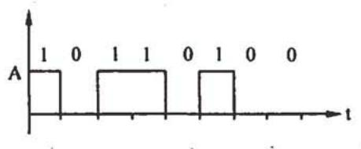  
(a) 单极性不归零码

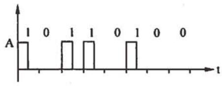  
(b) 单极性归零码  
图 7-6 单极性码

双极性码指的是用正负电平来分别代表逻辑 "1" 和逻辑 "0"。同样也有归零型和不归零型之分，如图 7-7 所示。

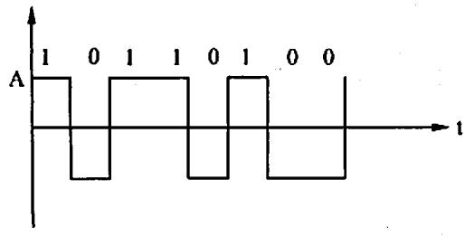  
(a) 双极性不归零码

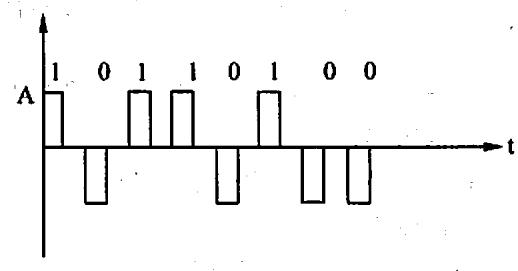  
(b) 双极性归零码  
图7-7 双极性码

常用的 RS-232 就是一种典型的不归零型双极性二元码接口电路。比起单极性码来，双极性码的可靠性要高，抗干扰性强。

在每一个码元时间间隔内，当发送0时，在间隔的中间时刻电平从低向高跳变；当发送1时，在间隔的中间时刻电平从高向低跳变，这类码被称为曼切斯特码。这类码元的特点是在每一码元的时间间隔内，至少有一次跳变。改进一下，在每一个码元的时间间隔内，无论发送1还是0，在间隔的中间都有电平的跳变，但发送1时，间隔开始时刻电平不跳变，发送0时，间隔开始时刻电平会跳变。这类编码被称为差分曼切斯特码。它具有良好的抗干扰性能，如图7-8所示。

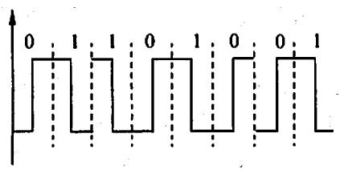  
(a) 曼彻斯特码

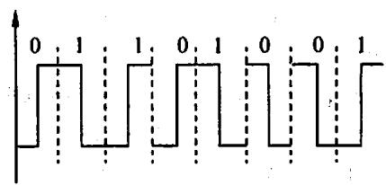  
(b) 差分曼彻斯特码  
图7-8 曼切斯特码

目前，曼彻斯特码和差分曼彻斯特码的应用很普遍，已成为局域网的标准编码。

模拟信号通常由某一个频率或几个频率组成，它占用一个固有的频带，所以称为频带传输。数据编码方式根据调制参数的不同可分为幅移键控法、频移键控法、相移键控法三种方式。幅移键控法（Amplitude-Shift Keying，ASK）的调频方式是用基带信号来控制载波的振幅变化。频移键控法（Frequency-Shift Keying，FSK）的调频方式是用基带信号来控制载波的频率变化。相移键控法（Phase-Shift Keying，PSK）的调频方式是用基带信号来控制载波的相位变化。这里就不再具体介绍了。

## 7.3.3 传输介质

网络传输介质是网络中传输数据、连接各网络结点的实体，常见的网络传输介质有双绞线、同轴电缆、光缆等3种。其中，双绞线是经常使用的传输介质，它一般用于星状网络中，同轴电缆一般用于总线状网络，光缆一般用于主干网的连接。

## 1. 双绞线

双绞线是将一对或一对以上的双绞线封装在一个绝缘外套中而形成的一种传输介质（如图 7-9（a）所示），是目前局域网最常用的一种布线材料。双绞线中的每一对都是由两根绝缘铜导线相互缠绕而成的，这是为了降低信号的干扰程度而采取的措施。双绞线一般用于星状网络的布线连接，两端安装有 RJ-45 头（接口），连接网卡与集线器，最大网线长度为 100 米，如果要加大网络的范围，在两段双绞线之间可安装中继器，最多可安装 4 个中继器，如安装 4 个中继器连接 5 个网段，最大传输范围可达 500 米。

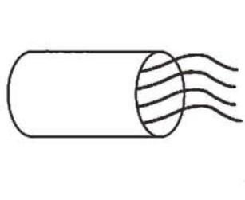  
(a) 双绞线

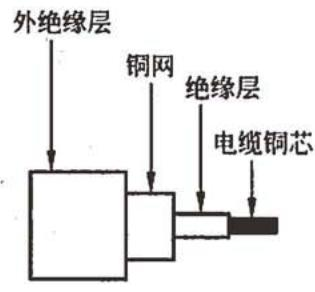  
(b) 同轴电缆  
图 7-9 网络传输介质

双绞线主要是用来传输模拟声音信息的，但同样适用于数字信号的传输，特别适用于较短距离的信息传输。在传输期间，信号的衰减比较大，并且产生波形畸变。采用双绞线的局域网的带宽取决于所用导线的质量、长度及传输技术。只要精心选择和安装双绞线，就可以在有限距离内达到每秒几百万位的可靠传输率。当距离很短，并且采用特殊的电子传输技术时，传输率可达100\~155Mbps。

双绞线分为分为非屏蔽双绞线（UTP）和屏蔽双绞线（STP）。目前市面上出售的 UTP 分为 3 类，4 类，5 类和超 5 类四种。STP 分为 3 类和 5 类两种，STP 的内部与 UTP 相同，外包铝箔，抗干扰能力强、传输速率高但价格昂贵。

## 2. 同轴电缆

同轴电缆是由一根空心的外圆柱导体（铜网）和一根位于中心轴线的内导线（电缆铜芯）组成，并且内导线和圆柱导体及圆柱导体和外界之间都是用绝缘材料隔开，如图 7-9（b）所示。它的特点是抗干扰能力好，传输数据稳定，价格也便宜，同样被广泛使用，如闭路电视线等。

同轴电缆按直径的不同，可分为粗缆和细缆两种：

（1）粗缆：传输距离长，性能好但成本高、网络安装、维护困难，一般用于大型局域网的干线，连接时两端需要安装终接器。

（2）细缆：与 BNC 网卡相连，两端装 50 欧的终端电阻。用 T 型头，T 型头之间最小 0.5 米。细缆网络每段干线长度最大为 185 米，每段干线最多接入 30 个用户。如采用 4 个中继器连接 5 个网段，网络最大距离可达 925 米。细缆安装较容易，造价较低，但日常维护不方便，一旦一个用户出故障，便会影响其他用户的正常工作。

同轴电缆还可以根据传输频带的不同，分为基带同轴电缆和宽带同轴电缆两种类型，其中基带传送数字信号，信号占整个信道，同一时间内能传送一种信号。宽带可以传送不同频率的信号。

## 3. 光缆

光缆是由一组光导纤维组成的用来传播光束的细小而柔韧的传输介质。与其他传输介质相比较，光缆的电磁绝缘性能好，信号衰变小，频带较宽，传输距离较大。光缆主要是在要求传输距离较长，用于主干网的连接。光缆通信由光发送机产生光束，将电信号转变为光信号，再把光信号导入光纤，在光缆的另一端由光接收机接收光纤上传输来的光信号，并将它转变成电信号，经解码后再处理。光缆的传输距离远、传输速度快，是局域网中传输介质的姣姣者。光缆的安装和连接需由专业技术人员完成。

现在有两种光缆：单模光缆和多模光缆。单模光缆的纤芯直径很小，在给定的工作波长上只能以单一模式传输，传输频带宽，传输容量大。多模光缆是在给定的工作波长上，能以多个模式同时传输的光纤，与单模光纤相比，多模光纤的传输性能较差。

光缆是数据传输中最有效的一种传输介质，它有频带较宽、不受电磁干扰、衰减较小、中继器的间隔较长等优点。

## 7.3.4 多路复用技术

在同一介质上，同时传输多个有限带宽信号的方法，被称为多路复用技术（multiple-xing）。它的方法主要有以下两种。

## 1. 频分多路复用（Frequency-Division Multiplexing，FDM）

当介质的有效带宽超过被传输的信号带宽时，可以把多个信号调制在不同的载波频率上，从而在同一介质上实现同时传送多路信号，即将信道的可用频带（带宽）按频率分割多路信号的方法划分为若干互不交叠的频段，每路信号占据其中一个频段，从而形成许多个子信道（见图7-10）；在接收端用适当的滤波器将多路信号分开，分别进行解调和终端处理，这种技术称为频分多路复用。

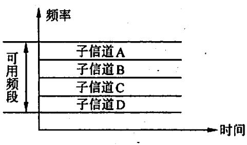  
图 7-10 FDM 子信道示意图

## 2. 时分多路复用（Time-Division Multiplexing, TDM）

TDM 是将传输时间划分为许多个短的互不重叠的时隙, 而将若干个时隙组成时分复用帧, 用每个时分复用帧中某一固定序号的时隙组成一个子信道, 每个子信道所占用的带宽相同, 每个时分复用帧所占的时间也是相同的 (如图 7-11 所示), 即在同步 TDM 中, 各路时隙的分配是预先确定的时间且各信号源的传输定时是同步的。

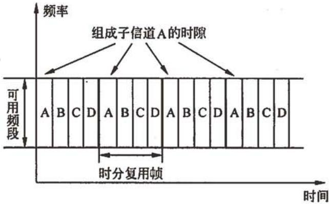  
图 7-11 TDM 子信道示意图

## 7.3.5 数据交换技术

主要的数据交换技术有以下几种：

## 1. 线路交换（Circuit Switching）

线路交换就是通过网络中的结点在两个站之间建立一条专用的通信线路。最普通的线路交换例子是电话系统。线路交换方式的通信包括线路建立、数据传送、线路拆除三种方式。它实时性好，但是呼叫时间大大长于数据传送时间，通信带宽不能充分利用，效率相对较低。

## 2. 报文交换（Message Switching）

报文交换是采用存储转发的方式来传输数据，它不需要在两个站点之间建立一条专用的通信线路。它的线路利用率较高，一个报文可以送到多个目的站点，但是传输延迟较长。

## 3. 分组交换（Packet Switching）

分组交换类似于报文交换，但每次只能发送其中一个分组。分组交换的传输时间短，传输延迟小，可靠性好，开销小，灵活性高。

## 这三种交换如图 7-12 所示

除了上面三种数据交换技术外，还有数字语音插空技术（Digital Speech Interpolation, DSI）、帧中继（Frame Relay）、异步传输模式（Asynchronous Transfer Mode, ATM）等数据交换技术。

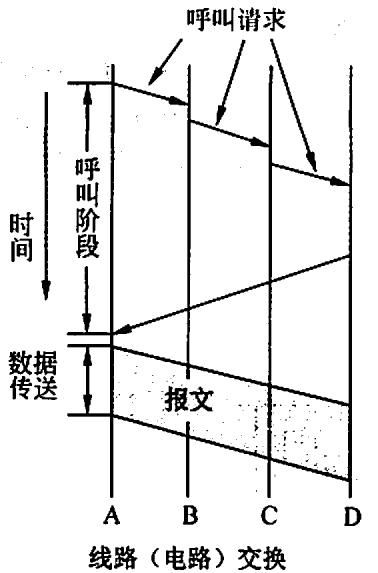

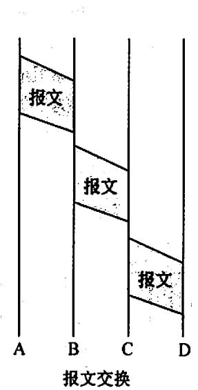

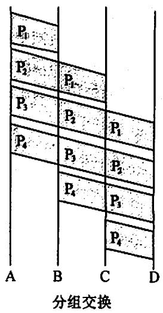  
图 7-12 常见的数据交换技术

## 7.3.6 差错控制与流量控制

差错控制编码就是对网络中传输的数字信号进行抗干扰编码，目的是为了提高数字通信系统的容错性和可靠性，它在发送端被传输的信息码元序列中，以一定的编码规则附加一些校验码元，接收端利用该规则进行相应的译码，译码的结果有可能发现差错或纠正差错。

在差错控制码中，检错码是指能自动发现出现差错的编码，纠错码是指不仅能发现差错而且能够自动纠正差错的编码。当然，检错和纠错能力是用信息量的冗余和降低系统的效率为代价来换取的。

目前常用的差错控制编码有两类：奇偶检验码和循环冗余码。奇偶校验码是一种最简单也是最基本的检错码，一维奇偶校验码的编码规则是把信息码元先分组，在每组最后加一位校验码元，使该码中1的数目为奇数或偶数，奇数时称为奇校验码，偶数时称为偶校验码。循环冗余码（Cyclic Redundancy Code，CRC）是目前在计算机网络通信及存储器中应用最广泛的一种校验编码方法，它所约定的校验规则是：让校验码能为某一约定代码所除尽；如果除得尽，表明代码正确；如果除不尽，余数将指明出错位所在位置。

流量控制是一种协调发送站和接收站工作步调的技术，其发送速率不超过接收方的速率。它主要有 X-ON/X-OFF、DTE-DCE 流控和滑动窗口协议三种方式。X-ON / X-OFF 方案中使用 X-ON / X-OFF 一对控制字符来实现流量控制。DTE-DCE 流控是实现 DTE-DCE 接口之间流量控制的机制。滑动窗口协议的主要思想是允许连续发送多个被给予顺序编号的帧，而无需等待应答。

局域网 LAN 不是纯计算机网络，从广义上讲，计算机化的电话交换机也属于 LAN。它支持多对多的通信，即连在 LAN 中的任何一个设备都能与网上的任何其他设备直接进行通信。它的"设备"是广义的，包括在传输介质上的任何设备。它的地域范围是适中的，通常在 10km 之内。它是通过物理信道通信的，其信道以适中的数据速率传输信息。

按拓扑结构分，局域网可分成总线状、树状、环状和星状。按使用介质分，可分为有线网和无线网两类。

## 7.4.1 局域网的介质访问控制方式

局域网的介质访问控制方式主要有载波侦听多路访问/冲突检测法、令牌环访问控制方式、令牌总线访问控制方式三种方式，下面分别介绍。

## 1. 载波侦听多路访问/冲突检测法

载波侦听多路访问（CSMA，Carrier Sense Multiple Access）是一种适合于总线型结构的具有信道检测功能的分布式介质访问控制方法，其控制手段称为"载波侦听"。

实际上，当一个站开始发送信息时，检测到本次发送有无冲突的时间很短，它不超过该站点与距离该站点最远站点信息传输时延的2倍。假设A站点与距离A站最远B站点的传输时延为T（如图7-13所示），那么2T就作为一个时间单位。

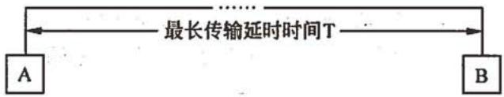  
图 7-13 传输延时示意图

CSMA/CD 又被称为 "先听后讲，边听边讲"，其具体工作过程概括如下：

（1）先侦听信道，如果信道空闲则发送信息。

(2) 如果信道忙, 则继续侦听, 直到信道空闲时立即发送。

（3）发送信息后进行冲突检测，如发生冲突，立即停止发送，并向总线上发出一串阻塞信号（连续几个字节全是1），通知总线上各站点冲突已发生，使各站点重新开始侦听与竞争。

(4) 已发出信息的各站点收到阻塞信号后, 等待一段随机时间, 重新进入侦听发送阶段。

CSMA/CD 的发送过程可描述如图 7-14 所示。

CSMA 按其算法的不同存在非-坚持 CSMA、P-坚持 CSMA、I-坚持 CSMA 三种方式。

## 2. 令牌环访问控制方式

令牌环是一种适用于环状网络的分布式介质访问控制方式，已由 IEEE802 委员会建议

成为局域网控制协议标准之一，即 IEEE802.5 标准。

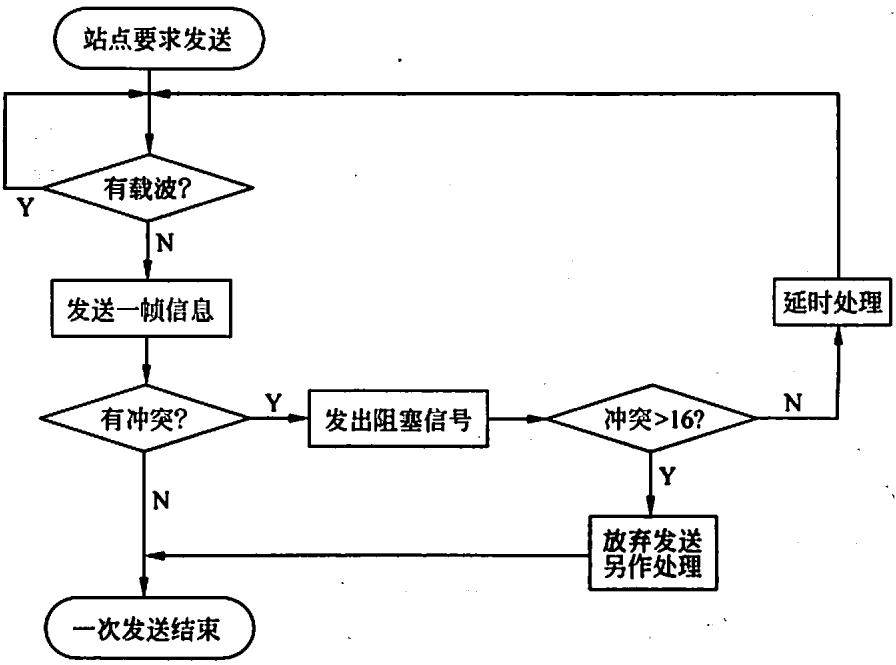  
图 7-14 CSMA/CD 发送过程流程图

在令牌环网中，令牌也叫通行证，它具有特殊的格式和标记。令牌有"忙（Busy）"和"空闲（Free）"两种状态。具有广播特性的令牌环访问控制方式，还能使多个站点接收同一个信息帧，同时具有对发送站点自动应答的功能。其访问控制过程如图7-15所示。

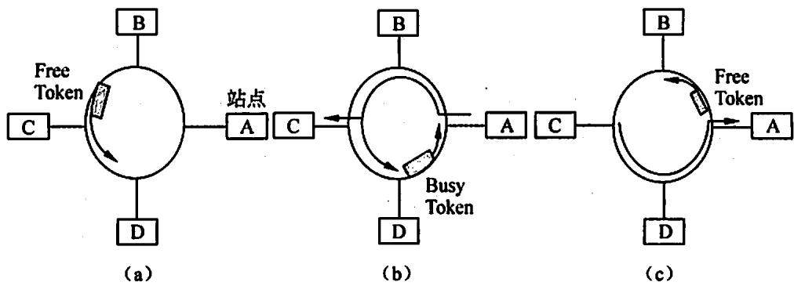  
图 7-15 令牌环访问控制传送过程

## 3. 令牌总线访问控制方式

令牌总线访问控制方式（Token-Bus）是在综合了 CSMA/CD 访问控制方式和令牌环访问控制方式的优点基础上形成的一种介质访问控制方式。

令牌总线控制方式主要用于总线型或树型网络结构中。该方式是在物理总线上建立一个逻辑环。如图7-16所示，一个总线结构网络，如果指定每一个站点在逻辑上相互连接的前后地址，就可构成一个逻辑环，如图中 $\mathrm{A} \rightarrow \mathrm{B} \rightarrow \mathrm{D} \rightarrow \mathrm{E} \rightarrow \mathrm{A}$ （C站点没有连入令牌总线中）。

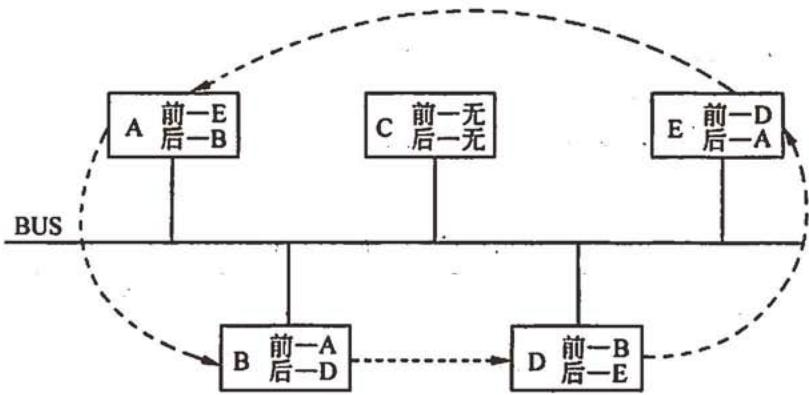  
图 7-16 总线结构中的令牌环

## 7.4.2 局域网的组网技术

局域网的组网技术根据局域网的不同主要有以太网、快速以太网、千兆位以太网、令牌环网络、FDDI光纤环网、ATM局域网等几种，下面介绍部分常见的组网技术。

## 1. 以太网

以太网（Ethernet）是由美国 Xerox 公司和 Stanford 大学联合开发并于 1975 年提出的，目的是为了把办公室工作站与昂贵的计算机资源连接起来，以便能从工作站上分享计算机资源和其他硬件设备。1983 年 IEEE802 委员会公布的 802.3 局域网络协议（CSMA/CD），基本上和 Ethernet 技术规范一致，于是，Ethernet 技术规范成为世界上第一个局域网的工业标准。它的主要技术规范如下。

\- 拓扑结构：总线型。

\- 介质访问控制方式：CSMA/CD。

\- 传输速率：10Mbps。

\- 传输介质：同轴电缆（50Ω）或双绞线。

\- 最大工作站数：1024个。

\- 最大传输距离：2.5km（采用中继器）。

\- 报文长度：64\~1518 Byte（不计报文前的同步序列）。

它主要有两种组网方法：

（1）细缆以太网（10BASE-2）：采用0.2英寸50Ω的同轴电缆作为传输介质，传输速率为 10Mbps。10BASE-2 使用网卡自带的内部收发器（MAU）和 BNC 接口，采用 T 形接头就可将两端的工作站通过细缆连接起来，组网开销低，连接方便。

（2）双绞线以太网（10BASE-T）：使用非屏蔽双绞线电缆来连接的传输速率为 10Mbps 的以太网。

## 2. 快速以太网

快速以太网是在传统以太网基础上发展的，因此它不仅保持相同的以太帧格式，而且还保留了用于以太网的 CSMA/CD 介质访问控制方式。由于快速以太网的速率比普通以太网提高了 10 倍，所以快速以太网中的桥接器、路由器和交换机都与普通以太网不同，它们具有更快的速度和更小的延时，100BASE-T 与 10BASE-T 的比较见表 7-1。

表 7-1 100BASE-T 与 10BASE-T 的比较

<table><tr><td>比较项目</td><td>100BASE-T</td><td>10BASE-T</td></tr><tr><td>速率</td><td>100Mbps</td><td>10Mbps</td></tr><tr><td>支持标准</td><td>IEEE802.3U</td><td>IEEE802.3</td></tr><tr><td>介质访问控制方式</td><td>CSMA/CD</td><td>CSMA/CD</td></tr><tr><td>拓扑结构</td><td>星型</td><td>总线、星型</td></tr><tr><td>支持的介质</td><td>UTP 和光纤</td><td>同轴电缆、UTP 和光纤</td></tr><tr><td>集线器/站点</td><td>100m</td><td>100m</td></tr></table>

快速以太网的拓扑结构如图 7-17 所示。

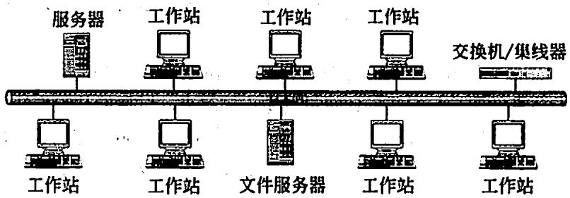  
图 7-17 快速以太网的网络拓扑结构图

## 3. 令牌环网络

令牌环网络（Token-Ring）系统在 1985 年由 IBM 公司率先推出。令牌环网的拓扑结构为环状，采用专用的令牌环介质访问控制方式，传输介质为屏蔽双绞线（STP）、非屏蔽双绞线（UTP）或者光纤，传输速率为 4Mbps 或者 16Mbps。

令牌环网络系统遵循 IEEE802.2 和 IEEE802.5 标准，在传输效率、实时性、地理范围等网络性能上都优于采用 CSMA/CD 介质访问控制方式的以太网。

令牌环网络的覆盖范围没有限制，但站点数却受到一定限制。使用 STP 时可连接 2\~260 台设备，而使用 UTP 时只能连接 2\~72 台设备。令牌环网络的原理图如图 7-18 所示。

## 4. FDDI 光纤环网

FDDI，即光纤分布式数据接口，是以光纤传输介质的局域网标准，由美国国家标准协会 ANSI X3T9.5 委员会制定。FDDI 采用主、副双环结构，主环进行正常的数据传输，副环为冗余的备用环。

一个 FDDI 一般包括光纤、工作站、集线器和网卡等部分。在 FDDI 上所连接的工作站有双附接站（DAS）和单附接站（SAS）两类。凡是要直接连接到 FDDI 网上的设备，都应配置 FDDI 网卡。FDDI 网卡分为双附接网卡和单附接网卡两种。

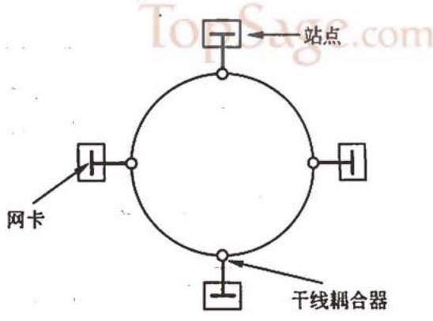  
图 7-18 令牌环网的原理图

## 7.5 网络的管理与管理软件

当前计算机网络的发展特点是规模不断扩大，复杂性不断增加，异构性越来越强。一个网络往往由若干个大大小小的子网组成，集成了多种网络系统（NOS）平台，并且包括了不同厂家、公司的网络设备和通信设备等。同时，网络中还有许多网络软件提供各种服务。随着用户对网络性能要求的提高，如果没有一个高效的管理系统对网络系统进行管理，那么就很难保证向用户提供令人满意的服务。作为一种很重要的技术，网络管理对网络的发展有着很大的影响，并已成为现代信息网络中最重要的问题之一。

任何一个系统都需要管理，只是根据系统的大小、复杂性的高低，管理在整个系统中的重要性也就有重有轻。网络也是一个系统。1969年世界上第一个计算机网络——ARPANET 就有一个相应的管理系统。随后的一些网络结构，如 IBM 的 SNA、DEC 的 DNA、SUN 的 AppleTalk 等，也都有相应的管理系统。不过，虽然网络管理很早就有，却一直没有得到应有的重视。这是因为当时的网络一是规模较小，二来复杂性不高，一个简单的网络管理系统就可以满足网络正常管理的需要，因而对其研究较少。但随着网络的发展，规模逐渐增大，复杂性增加，以前的网络管理技术已不能适应网络的迅速发展。

## 7.5.1 网络的管理

一般说来，网络管理就是通过某种方式对网络状态进行调整，使网络能正常、高效地运行。其目的很明确，就是使网络中的各种资源得到更加高效的利用，当网络出现故障时能及时作出报告和处理，并协调、保持网络的高效运行等。网络管理的结构如图7-19所示。

网络管理包含五部分：网络性能管理、网络设备和应用配置管理、网络利用和计费管理、网络设备和应用故障管理以及安全管理。ISO 建立了一套完整的网络管理模型，其中包含了以上五部分的概念性定义，它们保证一个网络系统正常运行的基本功能。

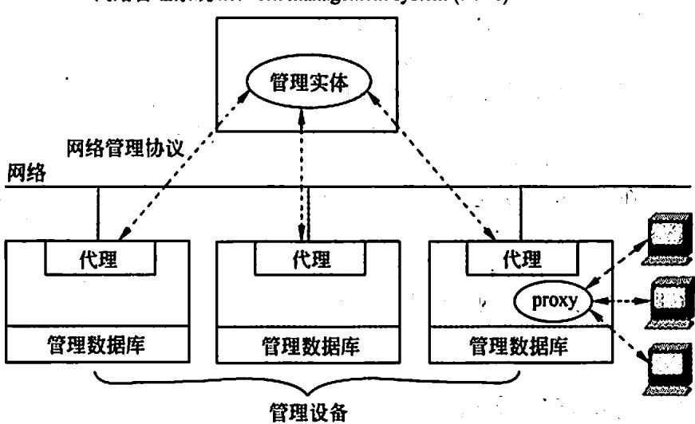  
图 7-19 网络管理的结构

## 1. 性能管理

衡量及利用网络性能，实现网络性能监控和优化。网络性能变量包括网络吞吐量、用户响应次数和线路利用。它指的是一种网络容量规划（Capacity Planning）过程，提供基于账单的使用，帮助理解流量的服务质量，并向客户/用户提供报告以遵循服务等级协议（SLA），从而使网络管理端获取有关网络的补充信息。

网络性能管理由两部分组成：一组功能单元，预计和报告网络设备行为以及网络或网络元素的效力；一组子功能单元，包括收集统计信息、维护和检查历史日志、决定自然条件和人为条件下的系统性能以及改变操作的系统模型。

## 2. 配置管理

监控网络和系统配置信息，从而可以跟踪和管理各种版本的硬件和软件元素的网络操作。主要涉及网络设备（网桥、路由器、工作站、服务器、交换机及其他）的设置、转换、收集和修复等信息。网络配置管理的目标是节约用户时间并降低网络设备误配置引起的网络故障。目前，基本上有两种主要的网络配置工具：一种是由设备供应商提供的工具；另一种是由第三方公司提供的工具。

## 3. 计费管理

衡量网络利用、个人或小组网络活动，主要负责网络使用规则和账单等。

## 4. 故障管理

负责监测、日志、通告用户，（一定程度上可能）自动解决网络问题，以确保网络的高效运行，这是因为故障可能引起停机时间或网络退化等。故障管理在 ISO 网络管理单元中是使用最为广泛的一个部分。含盖了诸如检测、隔离、确定故障因素、纠正网络故障等功能。设立故障管理的目标是提高网络可用性，降低网络停机次数并迅速修复故障。典型的故障管理系统遵循以下步骤：

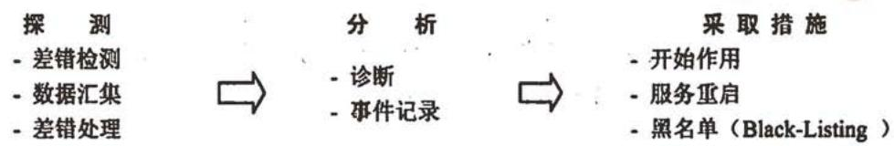

## 5. 安全管理

控制网络资源访问权限，从而不会导致网络遭到破坏。只有被授权的用户才有权访问敏感信息。主要涉及访问控制和网络资源管理。

访问控制管理指的是安全性处理过程，即妨碍或促进用户或系统间的通信，支持各种网络资源如计算机、Web 服务器、路由器或任何其他系统或设备间的相互作用。认证过程主要包含认证和自主访问控制（Discretionary Access Control）。

安全审计是安全管理中访问控制过程的一部分。审计系统可以追踪到特殊登录用户以及其访问资源。代理服务器和防火墙是安全管理中的两个特定访问控制系统，主要用于防止公共网络如因特网成员访问内部网络资源。

常见的网络管理协议主要有由 IETF 定义的简单网络管理协议（SNMP），远程监控（RMON）是 SNMP 的扩展协议；另一种是由 ISO 定义的通用管理信息协议（CMIP）。典型地，网络管理系统包括两部分：探测器 Probe（或代理），主要负责收集众多网络结点上的数据；控制台 Console，主要负责集合并分析探测器收集的数据，提取有用信息和报告。

## 7.5.2 网络管理软件

网络管理的需求决定网管系统的组成和规模，任何网管系统无论其规模大小，基本上都是由支持网管协议的网管软件平台、网管支撑软件、网管工作平台和支撑网管协议的网络设备组成。其中网管软件平台提供网络系统的配置、故障、性能及网络用户分布方面的基本管理，也就是说，网络管理的各种功能最终会体现在网管软件的各种功能的实现上，软件是网管系统的"灵魂"，是网管系统的核心。

网管软件的功能可以归纳为三个部分：体系结构、核心服务和应用程序。

首先，从基本的框架体系方面，网管软件需要提供一种通用的、开放的、可扩展的框架体系。为了向用户提供最大的选择范围，网管软件应该支持通用平台，也就是通用操作系统。如既支持 UNIX 操作系统，又支持 Windows NT 操作系统。网管软件既可以是分布式的体系结构，也可以是集中式的体系结构，实际应用中一般采用集中管理子网和分布式管理主网相结合的方式。同时，网管软件是在基于开放标准的框架的基础上设计的，它应该支持现有的协议和技术的升级。开放的网络管理软件可以支持基于标准的网络管理协议，如 SNMP 和 CMIP，也必须能支持 TCP/IP 协议族及其他的一些专用网络协议。

其次，网管软件应该能够提供一些核心的服务来满足网络管理的部分要求。核心服务是一个网络管理软件应具备的基本功能，大多数的企业网络管理系统都用到这些服务。各厂商往往通过提供重要的核心服务来增加自己的竞争力。他们通过改进底层系统来补充核心服务，也可以通过增加可选组件对网管软件的功能进行扩充。核心服务的内容很多，包括网络搜索、查错和纠错、支持大量设备、友好操作界面、报告工具、警报通知和处理、配置管理等。

此外，为了实现特定的事务处理和结构支持，网管软件中有必要加入一些有价值的应用程序，以扩展网管软件的基本功能。这些应用程序可由第三方供应商提供，网管软件集成水平的高低取决于网络管理系统的核心服务和厂商产品的功能。常见网管软件中的应用程序主要有：高级警报处理、网络仿真、策略管理和故障标记等。

由上面的介绍可以看出：体系结构、核心服务和应用程序三者之间是相互联系、密不可分的。体系结构提供一个系统平台，一个多种资源有机联系的场所；核心服务提供最基本、最重要的服务，就像生活中维持人正常生存的部分；应用程序满足具体的、个性化的需求，有如生活中不同人的不同习惯和爱好。

## 7.6 网络安全

随着互联网的飞速发展，网络安全问题已经越来越受到大家广泛的关注，各种病毒花样繁多、层出不穷：系统、程序、软件的安全漏洞越来越多；黑客们通过不正当手段侵入他人电脑，非法获得信息资料，给正常使用互联网的用户带来不可估计的损失。由于目前网络经常受到人为的破坏，因此，网络必须有足够强的安全措施。

## 7.6.1 计算机网络的安全问题

计算机网络安全就其本质而言是网络上的信息安全。从广义上讲，凡是涉及到网络上信息的保密性、完整性、可用性、真实性和可控性的相关技术和理论，都是网络安全的研究领域。简单来讲，网络安全包括：系统不被侵入、数据不丢失以及网络中的计算机不被病毒感染三大方面。完整的网络安全要求：

\- 运行系统安全

\- 网络上系统信息的安全

\- 网络上信息传播的安全

\- 网络上信息内容的安全

网络安全应具有保密性、完整性、可用性、可控性以及可审查性几大特征。网络的安全层次分为物理安全、控制安全、服务安全和协议安全。

## 1. 物理安全

物理安全包括：自然灾害、物理损坏、设备故障、意外事故、人为的电磁泄漏、信息泄漏、干扰他人、受他人干扰、乘机而入、痕迹泄露、操作失误、意外疏漏、计算机系统机房环境的安全漏洞等。

## 2. 控制安全

控制安全包括：计算机操作系统的安全控制、网络接口模块的安全控制、网络互联设备的安全控制等。

## 3. 服务安全

服务安全包括：对等实体认证服务、访问控制服务、数据加密服务、数据完整性服务、数据源点认证服务、禁止否认服务等。

## 4. TCP/IP 协议安全

TCP/IP 协议安全主要用于解决: TCP/IP 协议数据流采用明文传输、源地址欺骗 (Source address spoofing) 或 IP 欺骗 (IP spoofing)、源路由选择欺骗 (Source Routing spoofing)、路由信息协议攻击 (RIP Attacks)、鉴别攻击 (Authentication Attacks)、TCP 序列号欺骗攻击 (TCP SYN Flooding Attack)、易欺骗性 (Ease of spoofing) 等。

计算机网络的安全威胁主要表现在：非授权访问、信息泄漏或丢失、破坏数据完整性、拒绝服务攻击、利用网络传播病毒、使用者的人为因素、硬件和网络设计的缺陷、协议和软件自身的缺陷以及网络信息的复杂性等方面。

下面介绍一些常见的信息安全技术。

## 7.6.2 数据的加密与解密

随着计算机网络不断渗透到各个领域，密码学的应用也随之扩大。数字签名、身份鉴别等都是由密码学派生出来的新技术和应用。

在计算机上实现的数据加密, 其加密或解密变换是由密钥控制实现的。密钥 (Keyword) 是用户按照一种密码体制随机选取, 它通常是一随机字符串, 是控制明文和密文变换的唯一参数。

密码技术除了提供信息的加密解密外，还提供对信息来源的鉴别、保证信息的完整和不可否认等功能，而这三种功能都是通过数字签名实现。数字签名的原理是将要传送的明文通过一种函数运算（Hash）转换成报文摘要（不同的明文对应不同的报文摘要），报文摘要加密后与明文一起传送给接受方，接受方将接受的明文产生新的报文摘要与发送方的发来报文摘要解密比较，比较结果一致表示明文未被改动，如果不一致表示明文已被篡改。

数据加密技术是为提高信息系统及数据的安全性和保密性，防止秘密数据被外部破译所采用的主要技术手段之一，也是网络安全的重要技术。

根据密钥类型不同将现代密码技术分为两类：一类是对称加密（秘密钥匙加密）系统，另一类是公开密钥加密（非对称加密）系统。

对称钥匙加密系统是加密和解密均采用同一把秘密钥匙，而且通信双方都必须获得这把钥匙，并保持钥匙的秘密。它的安全性依赖于以下两个因素。第一，加密算法必须是足够强的，仅仅基于密文本身去解密信息在实践上是不可能的；第二，加密方法的安全性依赖于密钥的秘密性，而不是算法的秘密性，因此，没有必要确保算法的秘密性，而需要保证密钥的秘密性。对称加密系统的算法实现速度极快。因为算法不需要保密，所以制造商可以开发出低成本的芯片以实现数据加密。这些芯片有着广泛的应用，适合于大规模生产。对称加密系统最大的问题是密钥的分发和管理非常复杂、代价高昂。比如对于具有n个用户的网络，需要 $n(n-1)/2$ 个密钥，在用户群不是很大的情况下，对称加密系统是有效的。但是对于大型网络，当用户群很大，分布很广时，密钥的分配和保存就成了大问题。对称加密算法另一个缺点是不能实现数字签名。

公开密钥加密系统采用的加密钥匙（公钥）和解密钥匙（私钥）是不同的。由于加密钥匙是公开的，密钥的分配和管理就很简单，比如对于具有 n 个用户的网络，仅需要 2n 个密钥。公开密钥加密系统还能够很容易地实现数字签名。因此，最适合于电子商务应用需要。在实际应用中，公开密钥加密系统并没有完全取代对称密钥加密系统，这是因为公开密钥加密系统是基于尖端的数学难题，计算非常复杂，它的安全性更高，但它的实现速度却远赶不上对称密钥加密系统。在实际应用中可利用二者的各自优点，采用对称加密系统加密文件，采用公开密钥加密系统加密"加密文件"的密钥（会话密钥），这就是混合加密系统，它较好地解决了运算速度问题和密钥分配管理问题。因此，公钥密码体制通常被用来加密关键性的、核心的机密数据，而对称密码体制通常被用来加密大量的数据。

## 7.6.3 防火墙技术

防火墙是指设置在不同网络（如可信任的企业内部网和不可信的公共网）或网络安全域之间的一系列部件的组合，以防止发生不可预测的、潜在破坏性的侵入。实际上，它包含着一对矛盾（或称机制）：一方面它限制数据流通，另一方面它又允许数据流通。

作为内部网络与外部公共网络之间的第一道屏障，防火墙是最先受到人们重视的网络安全产品之一。虽然从理论上看，防火墙处于网络安全的最底层，负责网络间的安全认证与传输，但随着网络安全技术的整体发展和网络应用的不断变化，现代防火墙技术已经逐步走向网络层之外的其他安全层次，不仅要完成传统防火墙的过滤任务，同时还能为各种网络应用提供相应的安全服务。另外还有多种防火墙产品正朝着数据安全与用户认证、防止病毒与黑客侵入等方向发展。

常见的防火墙主要有数据包过滤型防火墙、应用级网关型防火墙、代理服务型防火墙、复合型防火墙等几种类型。典型的防火墙包括过滤器、链路级网关和应用级网关或代理服务器，如图 7-20 所示。

安装防火墙的作用在于弥补网络服务的脆弱性、控制对网络的存取、集中的安全管理、网络使用情况的记录及统计。但是它仍然有局限性，对于下列情况，它不能防范：绕过防火墙的攻击、来自内部变节者和不经心的用户带来的威胁、变节者或公司内部存在的间谍将数据复制到软盘、传送已感染病毒的软件或文件等。

在使用防火墙前，应该设计好防火墙的规则。它包括下列内容：防火墙的行为准则（拒绝没有特别允许的任何服务、允许没有特别拒绝的任何服务）、机构的安全策略、费用、系统的组件或构件。

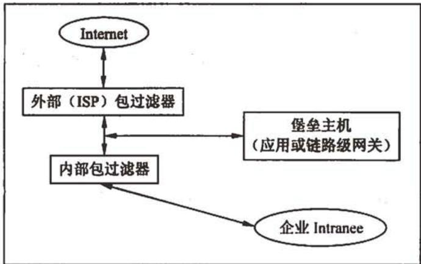  
图 7-20 防火墙的组成

## 7.6.4 网络安全协议

下面介绍几种常见的网络安全协议。

## 1. SSH (Secure Shell)

由芬兰的一家公司开发的。通过使用 SSH，可以把所有传输的数据进行加密，抵御"中间人"攻击，而且也能够防止 DNS 和 IP 欺骗。由于传输的数据是经过压缩的，所以还可以加快传输的速度。

SSH 由客户端和服务端的软件组成的。从客户端来看，SSH 提供两种级别的安全验证：基于密码的安全验证和基于密匙的安全验证。

## 2. PKI (Public Key Infrastructure)

PKI 体系结构采用证书管理公钥，通过第三方的可信机构 CA，把用户的公钥和用户的其他标识信息（如名称、E-mail、身份证号等）捆绑在一起，在 Internet 网上验证用户的身份，PKI 体系结构把公钥密码和对称密码结合起来，在 Internet 网上实现密钥的自动管理，保证网上数据的机密性、完整性。一个典型、完整、有效的 PKI 应用系统至少应具有：公钥密码证书管理、黑名单的发布和管理、密钥的备份和恢复、自动更新密钥以及自动管理历史密钥等几部分。

## (1) SET (Secure Electronic Transaction)

SET 安全电子交易协议是由美国 Visa 和 MasterCard 两大信用卡组织提出的应用于 Internet 上的以信用卡为基础的电子支付系统协议。它采用公钥密码体制和 X.509 数字证书标准，主要应用于 B to C 模式中保障支付信息的安全性。SET 协议本身比较复杂，设计比较严格，安全性高，它能保证信息传输的机密性、真实性、完整性和不可否认性。

(2) SSL (Secure socket Layer & Security Socket Layer).

安全套接层协议（SSL）是网景（Netscape）公司提出的基于 Web 应用的安全协议，包括：服务器认证、客户认证（可选）、SSL 链路上的数据完整性和 SSL 链路上的数据保密性。对于电子商务应用来说，使用 SSL 可保证信息的真实性、完整性和保密性。但由于 SSL 不对应用层的消息进行数字签名，因此不能提供交易的不可否认性，这是 SSL 在电子商务中使用的最大不足。

## 7.7 网络性能分析与评估

网络性能分析主要涉及网络的 QoS、SLA 和网络流量性能测评等三个方面。下面分别介绍这些评价指标。

## 7.7.1 服务质量 QoS

服务质量（Quality of Service，QoS）指的是网络提供更高优先服务的一种能力，包括专用带宽、抖动控制和延迟（用于实时和交互式流量情形）、丢包率的改进以及不同 WAN、LAN 和 MAN 技术下的指定网络流量等，同时确保为每种流量提供的优先权不会阻碍其他流量的进程。服务等级协议（Service-Level Agreement，SLA）是关于网络服务供应商和客户间的一份合同，其中定义了服务类型、服务质量和客户付款等术语。

QoS 技术涉及以下三个方面：

（1）QoS 识别和标志技术：主要是调整网络单元之间从终端到终端的服务质量，这是通过数据包流量分类和预留带宽完成的。识别流量的一般方法包括访问控制表（ACLs）、策略路由技术、承诺访问速率（CAR）以及基于网络应用的识别（NBAR）。

（2）单一网络单元中的 QoS：包括拥塞控制、队列管理、链接效率等技术和分层/流量监管工具。

（3）QoS 策略、管理和计费功能：主要控制和管理终端到终端的网络流量，包括配置网络设备如 RMON 探测器。当获取网络流量及目标应用程序时，需要采用 QoS 技术来提高服务质量。通过测试目标应用程序的响应可以知道该过程是否达到 QoS 标准。

## 7.7.2 服务等级协议（SLA: Service-level agreement）

服务等级协议是关于网络服务供应商和客户间的一份合同，其中定义了服务类型、服务质量和客户付款等术语。典型的 SLP 包括以下项目：

\- 客户带宽极限。

\- 分配给客户的最小带宽。

\- 能同时服务的客户数目。

\- 在可能影响用户行为的网络变化之前的通知安排。

\- 拨入访问可用性。

\- 运用统计学。

\- 服务供应商支持的最小网络利用性能，如 $99.9\%$ 有效工作时间或每天最多为1分钟的停机时间。

\- 各类客户的流量优先权。

\- 客户技术支持和服务。

\- 惩罚规定，为服务供应商不能满足 SLP 需求所指定。

## 7.7.3 流量管理

流量管理主要涉及网络带宽控制和分配、通信延迟的降低和拥塞控制的最小化。流量管理通常又称为流量编整或流量工程。流量管理和流量工程的提出目标是用于高效管理网络资源，并为用户提供需要的带宽和服务等级。很多先进的统计技术诸如排队论（Queuing Theory）常用来预测大型电信网络诸如电话网络或因特网的工程师行为。以下是关于流量管理、编整和工程等方面的常见规则：

（1）应用程序：识别和分类特定类型的网络流量，将每种特定流量只限制于特定的带宽。例如，可以基于宏观特征进行分类，如流量协议（IP、IPX、AppleTalk、DECNet）、端口、使用的应用程序、与主机的连接方式等。此外流量也可以根据流内容进行分类，而不考虑流宏观特征。

(2) 用户: 设置每个用户流量限制, 以确保所有用户对网络流量的公平共享使用, 也可为特殊用户设置确保带宽。例如, 可以决定使用的用户规则, 将通向/来自每个用户的流量限制为 $512 \mathrm{Kbps}$ 。

（3）优先权管理：定义不同类型流量的相对重要性或优先权。只有当优先权较高的应用程序不需要带宽时，优先权较低的流量才允许获取带宽。

流量管理系统基本特征包括：

\- 容量规划。

\- 流量测量和建模。

\- 监控所有网络设备、应用程序相和服务端口的访问和响应时间。

\- 监控带宽利用和差错状况的接口流量。

\- 监控 SNMP 启用设备（投票选举和陷阱接收）。

\- 监控设备 Sys-Logs。

报告性能、负载平衡、服务等级协议等的系统，其中包含诸如 QoS、带宽分配等参数。

## 7.7.4 网络性能评价指标体系

除上述指标外，还可以从如表 7-2 的指标中来评价网络性能。

表 7-2 网络性能指标

<table><tr><td>类别</td><td>指标</td></tr><tr><td rowspan="7">网络设施</td><td>网络设备</td></tr><tr><td>网络出口速度</td></tr><tr><td>网络结构</td></tr><tr><td>每百人计算机拥有量</td></tr><tr><td>联网率</td></tr><tr><td>线路利用率</td></tr><tr><td>线路容量</td></tr><tr><td rowspan="2">网络管理</td><td>网管系统使用</td></tr><tr><td>网络日志管理</td></tr><tr><td>网络故障应急方案与措施</td><td>方案制定</td></tr><tr><td>网络管理</td><td>方案实施</td></tr><tr><td rowspan="2">网络运行状态监控</td><td>总体监控</td></tr><tr><td>事件响应</td></tr><tr><td>网络故障与处理</td><td>网络故障率</td></tr><tr><td rowspan="2">网络与信息安全投入</td><td>网络与信息安全投入</td></tr><tr><td>占信息化总投入比重</td></tr><tr><td>网络安全</td><td>防火墙安装与配置</td></tr><tr><td rowspan="3">安全系统</td><td>邮件加密系统</td></tr><tr><td>邮件防病毒网关</td></tr><tr><td>虚拟专网的建立</td></tr></table>

## 7.8 因特网基础知识及其应用

Internet 是互联的网络集合，英文单词 internet 代表网络互联之意，首字母为大写时，Internet 则专指互联网，中文译作因特网。给 Internet 下一个确切的定义很难，一般认为，它是指通过各种通信介质和数据通信网，将世界各地的计算机局域网、广域网连接起来，共同遵守传输控制协议/互联网协议（Transfer Control Protocol/Internet Protocol, TCP/IP），从而构成的世界范围内的网际网，或者叫做网络的集合。从信息资源的观点来看，Internet 是一个集各个领域、各个学科的各种信息资源为一体，并供上网用户共享的数据资源网。它广泛地用于世界各地的大学、科研院所、政府机关、公司企业和个人用户的互联。

实际应用的互联网常常是通过广域网将局域网相互连接而成的集合。所谓广域网是跨越很大地区的一种网，通常包含多个省，甚至一个国家。它是多个局域网通过广域网中的通信子网互相连接而成的互联网。通信子网的作用是将信息从一台主机传到另一台主机，它由通信线路和路由器组成。单个主机或局域网上的主机间通过路由器进行通信。

因特网常见的网络连接设备有网卡、网桥、生成树网桥、源路由网桥、路由器、中继器、集线器、交换机等。

## 1. IP 地址

IP 地址具有固定、规范的格式。TCP/IP 协议规定，每个地址由 32 位二进制数组成，分成四段，其中每 8 位构成一段，这样每段所能表示的十进制数的范围最大不超过 255，段与段之间用 "." 隔开。

为了便于表达和识别，IP 地址是以十进制数形式表示的，每 8 位一组，用一个十进制数来表示，0\~255。在 TCP/IP 协议中，IP 地址主要分为三类：A 类、B 类、C 类。

在 Internet 上有成千百万台主机，每台上网的计算机都有一个 IP 地址，它就像用户在网上的身份证，要查看自己 IP 地址可在 Windows 9x 的系统中单击 "开始" → "运行" → 敲入 "winipcfg" → 按回车键，就可显示自己所用的计算机的 IP 地址。IP 地址不是随机的，它跟电话号码有些类似，即处在某一网络范围的所有计算机都有相同的地址前缀。

每个 IP 地址可以分为两个组成部分：网络号标识和主机号标识。网络号标识确定了某一主机所在的网络，主机号标识确定了在该网络中特定的主机。根据适用范围的不同，IP 地址分成若干类，主要依据是网络号和主机号的数量。通常，IP 地址分为三类：

A类:

<table><tr><td>0</td><td>1</td><td>8</td><td>16</td><td>31</td></tr><tr><td>0</td><td>网络号</td><td colspan="3">主机号</td></tr></table>

A 类 IP 地址用 8 位来标识网络号，24 位标识主机号。最前面一位为 "0"，这样 A 类 IP 地址所能表示的网络数范围为 0\~127，第一段数字范围为 1\~126。每个 A 类地址可连接 16387064 台主机，Internet 有 126 个 A 类地址。只要见到第一段数字为 1\~126 格式的 IP 地址，都属于 A 类地址。A 类 IP 地址通常用于大型网络。

B类:

<table><tr><td>1</td><td>0</td><td>网络号</td><td>主机号</td></tr></table>

一个 B 类 IP 地址由 2 个字节（16 位）的网络地址和 2 个字节（16 位）的主机地址组成，网络地址的最高位必须是 "10"，因此，第一段数字范围为 128\~191。每个 B 类地址可连接 64516 台主机，Internet 有 16256 个 B 类地址。通常，B 类 IP 地址适用于中等规模的网络，例如各地区和网络管理中心。

C类:

<table><tr><td>1</td><td>1</td><td>0</td><td>网络号</td><td>主机号</td></tr></table>

C 类地址是由 3 个字节（24 位）的网络地址和 1 个字节（8 位）的主机地址组成，网络地址的最高位必须是 "110"，因此第一段数字范围为 192\~223。例如前面所举的两例都属 C 类 IP 地址。每个 C 类地址可连接 254 台主机，Internet 有 2054512 个 C 类地址。C 类

IP 地址一般适用于校园网等小型网络。

在上面三类 IP 地址中，由于 A 类 IP 地址的网络号数目有限，因此现在能够申请到的仅是 B 类（同样紧缺）或 C 类两种。当某个单位申请 IP 地址时，实际上申请到的是一个网络号，而主机号由该单位或公司自行确定分配，只要无重复的主机号即可。

除了上面三类主要的 IP 地址外，还有两类不常用的保留地址：D 类和 E 类地址。

D类地址用于多点播送。第一个字节以"1110"开始，第一个字节的数字范围为224\~239，是多点播送地址，用于多目的地信息的传输。部分留给Internet体系结构委员会IAB作为备用。其中全零"0.0.0.0"地址对应于当前主机，全"1"的IP地址"255.255.255.255"是当前子网的广播地址。

E 类地址：以 "11110" 开始，即第一段数字范围为 240\~254。E 类地址保留，仅作实验和开发用。

另外还有几种用作特殊用途的 IP 地址：

主机号全部设为"0"的IP地址称为网络地址，如129.45.0.0就是B类网络地址。

主机号部分全设为"1"（即255）的IP地址称之为广播地址，如129.45.255.255就是B类的广播地址。

网络号不能以十进制"127"作为开头，在地址中数字127留给诊断使用。如127.1.1.1用于回路测试，同时网络号的第一个8位组也不能全置为"0"，全置"0"表示本地网络。网络号部分全为"0"和全部为"1"的IP地址被保留使用。

近年来，随着 Internet 用户数目的急剧增长，可供分配的 IP 地址数目也日益减少。大部分 B 类地址均已分配，目前只有 C 类地址尚可分配，原有 32 位长度的 IP 地址的使用已经显得相当紧张，新的 128 位长度的 IP 地址方案将会缓解目前 IP 地址的紧张状况。

## 2. 子网掩码（Subnet Mask）

从 IP 的地址构造可以清楚地看出，只有有限的对全世界有用的网络地址数。如果拥有一个网络地址（如一个 C 类地址 210.34.168.X），则只能用它来唯一标识一个物理网络，而这个网络允许最多有 255 个结点。如果有多个物理网络，每个网络中的结点数却较少，那么，可以采用子网的划分技术，用部分的结点数作为子网数来代替。

如 C 类地址 210.34.168.X，用结点数的前 2 位作为子网数，则可以区分 4 个子网了，而每个子网中最多可以有 63 个结点（结点数剩 6 位了）：

用二进制来说明：

$$
\begin{array}{l l l l} 1 1 0 1 0 0 1 0 & 0 0 1 0 0 0 1 0 & 1 0 1 0 1 0 0 0 & 0 0 x x x x x x \\ 1 1 0 1 0 0 1 0 & 0 0 1 0 0 0 1 0 & 1 0 1 0 1 0 0 0 & 0 1 x x x x x x \\ 1 1 0 1 0 0 1 0 & 0 0 1 0 0 0 1 0 & 1 0 1 0 1 0 0 0 & 1 0 x x x x x x \\ 1 1 0 1 0 0 1 0 & 0 0 1 0 0 0 1 0 & 1 0 1 0 1 0 0 0 & 1 1 x x x x x x \end{array}
$$

那么，如何告知 IP 对寻址规则的修改呢？那就是使用子网掩码。子网掩码用于区分 IP 地址的网络数部分和结点数部分，即前多少位是网络数，后多少位是结点数。

方法是：与 IP 地址一样，也采用 32 位的二进制数，由两部分组成，前面一部分为全 1，后面一部分为全 0，1 的个数表示对应的 IP 地址中网络数的位数，0 的个数表示对应 IP 地址中结点数的位数。即由与 IP 地址对应的网络数部分全取 1，结点数部分全取 0 组成。

如 IP 地址 210.34.168.11，即二进制 11010010 00100010 10101000 00001011；子网掩码为 255.255.255.0，即二进制 11111111 11111111 11111111 00000000；表示 IP 的前三个字节（24 位：210.34.168）为网络数，最后一个字节（8 位：十进制 11）为结点数。

若子网掩码为 255.255.255.192，即二进制 11111111 11111111 11111111 11000000，则表示 IP 的前 24 位为网络数，接着 2 位为子网数，后 6 位为结点数了。也就是用了原结点数的前二位作为子网数了，一个网络变成四个子网，但子网内结点数的范围变小了。

## 7.8.2 DNS 和代理服务器

## 1. DNS

在 Internet 上，对于众多的以数字表示的一长串 IP 地址，人们记忆起来是很困难的。为了便于网络地址的分层管理和分配，因而采用了域名管理系统，引入域名的概念。通过为每台主机建立 IP 地址与域名之间的映射关系，用户在网上可以避开难于记忆的 IP 地址，而使用域名来唯一标识网上的计算机。

为了使计算机的域名与其 IP 地址正确地对应起来，使用户只要输入主机的名称，就可以很快地将其转换成 IP 地址，在 Internet 上有许多域名服务器来负责域名到 IP 地址的转换。从 1983 年起，Internet 开始采用一种树状、层次化的主机命名系统，即域名系统 DNS，如图 7-21 所示。

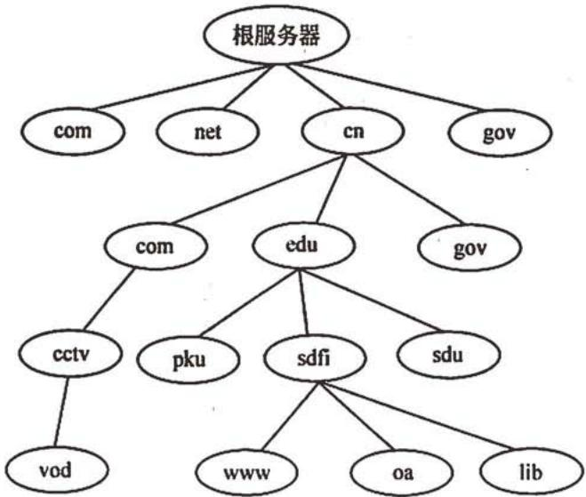  
图 7-21 DNS 域名系统  

域名系统 DNS 是一个遍布在 Internet 上的分布式主机信息数据库系统，采用客户机/服务器的工作模式。域名系统的基本任务是将文字表示的域名，如 <www.sdfi.edu.cn> 翻译成 IP 协议能够理解的 IP 地址格式，如 210.44.128.101，亦称为域名解析。域名解析的工作通常由域名服务器来完成。

要把计算机接入 Internet，必须获得网上唯一的 IP 地址和对应的域名。按照 Internet 上的域名管理系统规定，在 DNS 中，域名采用分层结构，由自底向上所有标记组成的字符串，标记之间用 "." 分隔。对于入网的每台计算机都有类似结构的域名，即：

## 计算机主机名．机构名．网络名．顶级域名

同 IP 地址格式类似，域名的各部分之间也用 "." 隔开。一般来说，域名分为三级，其格式为：商标名（或企业名）。单位性质代码。国家代码。作为中国国内企业，一般采用：企业名。com. cn 的格式。

一台计算机只能有一个 IP 地址，但是却可以有多个域名。

## 2. 代理服务器

普通的因特网访问是一个典型的客户机与服务器结构：用户利用计算机上的客户端程序，向浏览器发出请求，远端 WWW 服务器程序响应请求并提供相应的数据。而 Proxy（代理）处于客户机与服务器之间，对于服务器来说，Proxy 是客户机，Proxy 提出请求，服务器响应；对于客户机来说，Proxy 是服务器，它接受客户机的请求，并将服务器上传来的数据转给客户机。它的作用很像现实生活中的代理服务商。因此 Proxy Server 的中文名称就是代理服务器。

Proxy Server 的工作原理是：当客户在浏览器中设置好 Proxy Server 后，使用浏览器访问所有 WWW 站点的请求都不会直接发给目的主机，而是先发给代理服务器，代理服务器接受了客户的请求以后，由代理服务器向目的主机发出请求，并接受目的主机的数据，存放于代理服务器的硬盘中，然后再由代理服务器将客户要求的数据发给客户。

代理服务器具有可以提高访问速度、相当于防火墙、通过代理服务器可以访问一些不能直接访问的网站并使得安全性提高。

要设置代理服务器，必须先知道代理服务器地址和端口号，然后在 IE 或 NC 的代理服务器设置栏中填入相应地址和端口号就可以了。假设有一个代理服务器的地址是 Proxy.net.net，端口号是 3000，在 IE 中的配置方法是使用"查看"菜单的"Internet 选项"→"连接"→"代理服务器"，然后在"通过代理服务器访问 Internet"选项前面的复选框中打上钩，在"地址框"中填入代理服务器地址，如本例中假设代理服务器地址是 proxy.net.net，再在"端口"框中填上端口号 3000，单击一下最下方的"应用"按钮，再单击"确定"，设置完成。下次再使用 IE 时用户就会发现，无论浏览什么网站，IE 总是先与代理服务器连接。

## 7.8.3 万维网服务

WWW 全称为 World Wide Web，中文名为万维网或环球信息网，是以超文本标记语言（HTML）和超文本传输协议（HTTP）为基础，由全球各种形式的信息（文本、图片、声音、动画和多媒体等）组成的分布式超媒体信息查询系统。这些信息以网页的形式分布存储在世界各地的 Web 服务器上，就是通常所说的网站（站点），用户只需要有一个浏览器就可以非常方便地访问 Web 站点，获得所需的信息。

## 1. 超文本方式和超媒体

要想了解 WWW，首先必须了解超文本（Hypertext）与超媒体（Hypermedia）的基本概念，因为它们是 WWW 的信息组织形式，也是 WWW 实现的关键技术之一。

超文本方式将菜单集成于文本信息之中，采用指针连接的网状交叉索引方式，对不同来源的信息加以链接，形成了一个非线性的网状结构。超媒体是超文本的进一步扩展，是超文本与多媒体的组合。简单的讲，就是在超媒体中，允许信息结点不仅仅能够链接文本信息，还能够链接多媒体信息（图像、音频、视频、动画和程序等）。事实上，人们并不严格区分超文本与超媒体，二者的界限已经很模糊，通常所指的超文本一般也包括超媒体的概念。

## 2. HTML 语言

有了超文本与超媒体的信息组织思想，那么如何具体实现呢？富于想象力的英国物理学家蒂姆在计算机网络中找到了超文本超媒体思想的实现机制，他开发了一种全新的文档语言——HTML 语言。

HTML 语言（Hyper Text Markup Language，又称超文本标记语言），它是一种标识性的语言，由一些特定符号和语法组成，对 Web 页的内容、格式及 Web 页中的超级链接进行描述。HTML 语言是一种专用的编程语言，用于编制要通过 WWW 显示的超文本文件页面（也就是网页）。它标注简单明了，功能强大，不仅可以编写普通的文本信息，而且还可以编辑声音、图形、视频等多媒体信息。HTML 文件是纯文本文件，它在浏览器中被解释执行，无需编译，与多种操作平台兼容。

## 3. HTTP 协议

要将网页传输到本地浏览器中，这就需要依靠 HTTP 协议。HTTP 协议（Hyper Text Transfer Protocol，超文本传输协议）是 Web 服务器与客户浏览器之间的信息传输协议，用于从 WWW 服务器传输超文本到本地浏览器，属于 TCP/IP 模型应用层协议。

## 4. URL

在 Internet 中有如此众多的 Web 服务器，每台服务器又包含很多的页面，如何找到想要的页面呢？这就需要使用统一资源定位器——URL(Uniform Resource Locators)，用 URL 来唯一的标识某个网络资源，实际上也就是网页的地址。它指出用什么方法、去什么地方、访问哪个文件。不论身处何地、用哪种计算机，只要输入同一个 URL 地址，就会连接到相同的网页。现在几乎所有 Internet 的文件或服务都可以用 URL 表示。

URL 地址由双斜线分成两大部分，前一部分指出访问方式，后一部分指明文件或服务

所在服务器的地址及具体存放位置。URL 的具体表示方法为：

协议：//主机地址[：端口号]/路径/文件名

例如：URL 地址 <http://www.microsoft.com/downloads/search.asp>

其中，HTTP 指的是访问方式，即要使用 HTTP 协议进行访问；<www.microsoft.com> 指的是要访问的服务器的主机名（在本例中即域名，也可换成 IP 地址）；/downloads 指的是要访问的页面的路径；/search.asp 指的是最终访问的文件名。

## 5. WWW 浏览器

浏览器就是用来浏览信息的，它可以说是网上冲浪的"帆板"。有了浏览器，用户只需要通过点击鼠标或者键盘输入网页地址就可以轻松地获得 Internet 上丰富的资源信息。

目前，最流行的全图形界面的浏览器有两种：微软公司出品的 Microsoft Internet Explorer（IE）和网景公司出品的 Netscape。

## 7.8.4 因特网其他服务

除了 WWW 服务外，因特网还有一些其他的常见服务。

## 1. 电子邮件

电子邮件（Electronic Mail，E-mail），是传统邮件的电子化，它最早出现在 ARPANET 中。电子邮件（E-mail）是 Internet 提供的最主要的应用之一，它已经成为世界上最快的邮局，成为倍受欢迎的通信方式。电子邮件通过 Internet 传送，可在几秒钟之内传到世界各地，不受时间、气候和地理的限制，而且可以附加传送计算机文件、图像、声音和视频等多种信息。与传统的信件相比，电子邮件具有速度快、价格低的优点。

电子邮件系统是一种新型的信息系统，是通信技术和计算机技术结合的产物。它是一种"存储转发式"的服务，属异步通信方式，这正是电子邮件系统的核心。利用存储转发可进行非实时通信，信件发送者可随时随地发送邮件。接收者可随时打开计算机读取信件，不受时空限制。在这里，"发送"邮件意味着将邮件放到收件人的信箱中，而"接收"邮件则意味着从自己的信箱中读取信件，信件在信箱之间进行传递和交换，也可以与另一个邮件系统进行传递和交换，信箱实际上是由文件管理系统支持的一个实体。因为电子邮件是通过邮件服务器MailServer来传递文件的。通常MailServer是执行多任务操作系统Unix的计算机，它提供24小时的电子邮件服务，用户只需向MailServer管理人员申请一个信箱账号，就可使用这项快速的邮件服务了。

与普通信件一样，电子邮件也需要地址。这个地址就是在 Internet 电子信箱的地址。电子邮件地址就是用户在 ISP 所开设的邮件账号加上 POP3 服务器的域名。例如：liuhy@sdfi.edu.cn，在此地址中"liuhy"是用户名，也就是用户在 ISP 所提供的 POP3 服务器上所注册的电子邮件账号，"sdfi.edu.cn"是 POP3 服务器的域名。中间用 "@" 分隔，表示 "at" 的意思。用户发送电子邮件时，必须给出接收方的电子邮件地址。

电子邮件的传输则是通过电子邮件简单传输协议 SMTP(Simple Mail Transfer Protocol) 这一系统软件来实现的。SMTP 协议是 TCP/IP 的一部分，它用于描述邮件是如何在 Internet 上传输的。遍布全球的邮件服务器根据 SMTP 协议来发送和接收邮件，SMTP 就像 Internet 上的通用语言一样，负责处理邮件服务器之间的消息传递。

电子邮件的发送由简单邮件传输协议（SMTP）服务器来完成。它好比是邮局的邮筒，将信投入后，由邮局定时发送。接收邮件由邮局协议（POP3）服务器来完成，来信都存放于此，用户通过电子邮件软件来取信。

当用户写好电子邮件后，可通过电子邮件软件（Outlook 等）将它发送出去。电子邮件软件使用 SMTP 协议和 TCP/IP 协议将用户的邮件打包后，加上信件头送到用户所设置的 Internet 服务商（ISP）的 SMTP 服务器上。然后 SMTP 服务器根据用户所写的电子邮件地址，通过路由器按照当前网络传输的情况，寻找一条最不拥挤的路由，将邮件传输给下一个 SMTP 服务器。该服务器也如法炮制，将邮件一直传送到接收方用户的 ISP 所提供的 POP3 服务器中，并保存在以接收方用户开设的信箱中。接收方用户可以通过电子邮件软件打开自己在 POP3 服务器上的信箱，来接收电子邮件。

## 2. 搜索引擎

Internet 是一个庞大的信息海洋，要想从中找出自己所需的信息并不是一件容易的事，应运而生的搜索引擎可帮了我们的大忙。

搜索引擎是指为用户提供信息检索服务的程序，通过服务器上特定的程序把 Internet 上的所有信息分析、整理并归类，以帮助用户在 Internet 中搜索所需要的信息。当用户通过搜索引擎查找信息时，搜索引擎就会对用户的需求产生响应，并根据查找的关键字检索数据库，最后将与搜索标准匹配的站点列表返回给用户。用户可以从列表中选择需要的网站，单击链接即可进入相应的页面。搜索引擎也是一类网站，它们一般都具备分类主题查询和关键字查询两种功能：

## - 按内容分类逐级检索

分类检索是从搜索首页按照树型的主题分类逐层单击来查找所需信息的方法。

## - 使用关键字检索

关键字检索就是由用户指定一些词语（这些词语称为关键字），搜索引擎自动搜索和这些词语相关的网站，并按照匹配的程度由高到低排列输出给用户。使用关键字检索的核心是如何选择合适的关键字，不同的搜索引擎提供的查询方法并不完全相同。

对于经常上网查阅资料的用户来说，记住一些好的搜索网站是很重要的，在这里给大家介绍几个常用的搜索网站。

\- <http://www.google.com/google> 搜索引擎

\- <http://dir.sohu.com/> 搜狐分类搜索引擎

\- <http://cn.yahoo.com/> 中文雅虎

\- <http://search.sina.com.cn/> 新浪搜索

\- <http://search.163.com/> 网易搜索引擎

\- <http://www.baidu.com/> 百度搜索

## 3. 文件传输服务 FTP

FTP 是英文 File Transfer Protocol（文件传输协议）的缩写，用于两台计算机间的文件互传。同大多数 Internet 服务一样，FTP 也是一个客户机/服务器系统，用户通过一个客户机的 FTP 程序连接至远程计算机，通过客户机程序向服务器程序发出命令，服务器程序执行用户所发出的命令。例如，用户发出一条命令，要求服务器向用户传送某个文件的一份副本，服务器会响应这条命令，将指定文件送至用户的计算机。客户机程序代表用户接收到这个文件，将其存放在用户目录中。

虽然通过 WWW 服务可以进行简单的文件上传和下载功能，如发邮件时上传某个附件或下载某个驱动程序文件，但不能满足计算机之间批量和快捷传输文件的要求。FTP 便是解决这一问题的应用，如上传网页，下载程序等。

用 FTP 传输文件，本来用户事先应在远程计算机系统注册，但后来为了便于大家获取资源，FTP 在互联网上有一种特殊的也是非常广泛的应用是匿名 FTP（Anonymous FTP）。通过 Internet，任何用户可以使用一个公用的 FTP 账号（通常账号名是 anonymous）去获得一些公用资源。由于 FTP 操作简单实用，开放性强，且能充分利用 Internet 来进行信息传递与交流，所以目前越来越多的 FTP 服务器连入 Internet，这样越来越多的资源就可以通过匿名 FTP 来获得。

使用 FTP 可以通过多种模式传输文件，大多数系统（包括 Unix 系统）有两种模式：文本模式（ASCII）和二进制模式（BIN/IMAGE）。

文本模式传输时，会调整文件的内容，把文件解释成接收文件的计算机能够识别的ASCII码格式，例如将EOF转换为回车键和换行符。而二进制不转换或格式化字符。二进制模式比文本模式传输速度快，并且可以传输所有ASCII值。使用FTP传输文件时，应注意确保使用正确的传输模式，按文本模式传输二进制文件将导致错误。目前大多数FTP工具均支持自动模式，会自动为用户选择正确的文件传输模式。

可以下载相应的下载软件，如 cuteftp 等，来进行下载和上传。

## 4. 新闻组服务（Newsgroup）

新闻组/讨论组/公告牌系统能使网上的用户与其他人在望上交流思想、公布公众注意事项、寻求帮助等。

实际上 Internet 提供的服务远远不止这些，还有软件上传或下载服务、各类信息查询、网上聊天室、网上寻呼机（OICQ、ICQ 等）、BBS 电子公告栏、免费个人主页空间、网上游戏、网上炒股、网上购物或商务活动、短信服务、视频会议和多媒体娱乐（VOD 点播，网上直播，MP3、Flash 欣赏等）等，而且随着 Internet 的飞速发展，每天都在诞生新的服务，虽然 Internet 提供的服务越来越多，但这些服务一般都是基于 TCP/IP 协议的。

## 思考题

1. 什么是网络？并简述网络的分类及组成。

2. 解释 IP 地址和子网掩码的概念。

3. 请简述网络的七层协议模型。

4. 请简述局域网的组网技术。

5. 简述网络性能的评价指标体系。

6. 简述一下因特网常见的服务和软件。

7. 网络常见的管理软件有哪些？请举例说明网络是如何管理的。

8. 请论述网络是如何通信和传输的？

9. 试着论述一下网络应如何设置来保证网络的安全。
