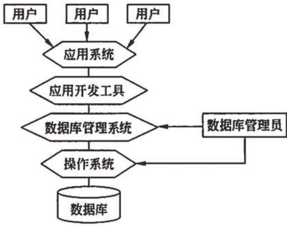
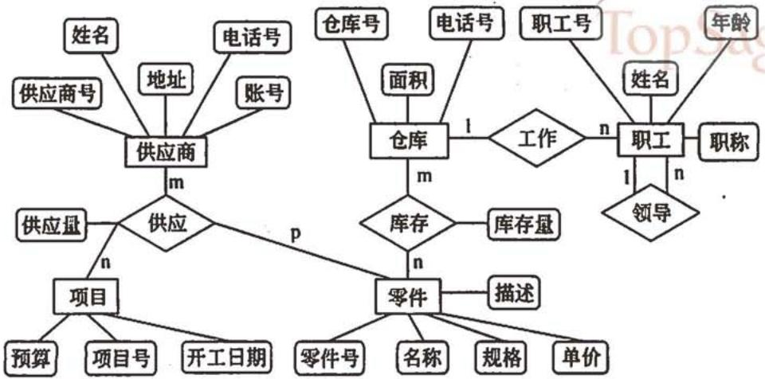
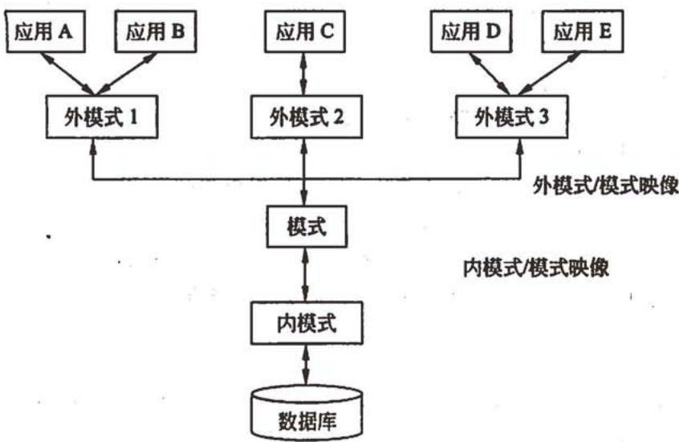
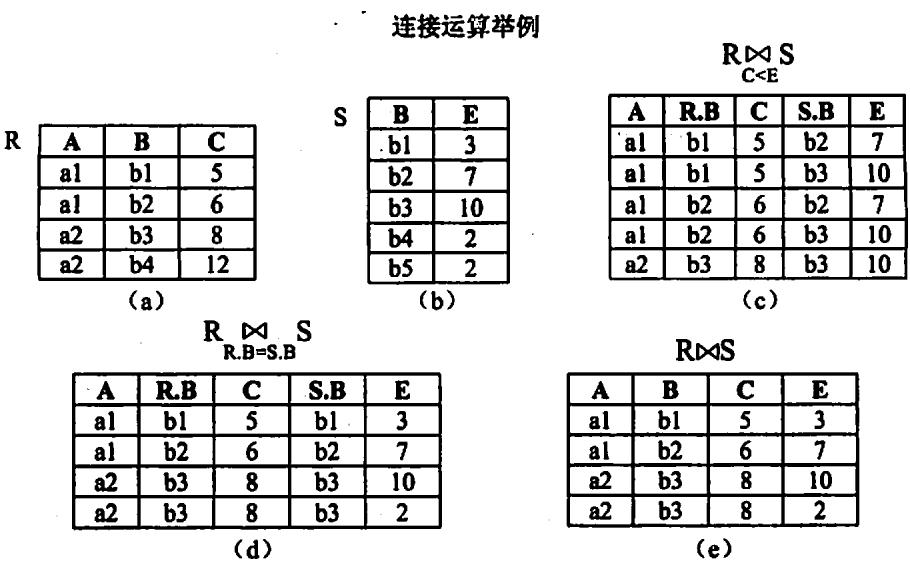

>[!warning] 版本提示
>本书为 **2006 年第 1 版**。现行考试依据是 **《信息系统管理工程师教程（第 2 版）》**（清华社 2024-10，20 章），
>两版**重合极少**：第 1 版的第 1–6 章（硬件/操作系统/语言/配置/数据结构/多媒体）在第 2 版已被删除或压缩。
>本页仅作**扩展参考**，备考请以 [[知识体系]]（第 2 版官方考纲）为准。

# 第8章 数据库技术

信息资源是各个部门的重要财富和资源，随着信息技术的迅猛发展，信息资源的重要性日益突出。数据库技术是用来进行数据管理的技术，负责存储和处理信息资源，是信息系统的核心和基础。同时，数据库的建设规模、数据库信息量的大小和使用频度也已经成为了衡量一个国家信息化程度的重要标志。

## 8.1 数据库技术基础

## 8.1.1 数据库系统概述

数据管理是指对数据进行分类、组织、编码、存储、检索和维护。数据管理技术经历了人工管理、文件系统、数据库系统三个阶段。数据库技术是应数据管理任务的需要而产生的。

数据、数据库、数据库管理系统和数据库系统是与数据库技术密切相关的四个基本概念。

## 1. 数据（Data）

数据是数据库中存储的基本对象。它不仅仅是指数字，广义地说，文字、图形、图像、声音、记录、语言等描述事物的符号都是数据，可以经过数字化后存入计算机。所以，可以如下定义数据：数据是描述事物的符号记录。

## 2. 数据库（DataBase，DB）

数据库是存在于计算机存储设备上的用来存放数据的仓库，人们可以运用数据库技术科学地保存并管理大量的复杂的数据，提高信息资源的利用率。可以如下定义数据库：数据库是长期储存在计算机内的、有组织的、可共享的数据集合。数据库的特征是：数据库中的数据按一定的数据模型组织、描述和储存，具有较小的冗余度、较高的数据独立性和易扩展性，并可为各种用户共享。

## 3. 数据库管理系统（DataBase Management System，DBMS）

数据在数据库中是按照一定的格式存放的，为了更加高效地获取和维护数据，可以利用数据库管理系统来科学地组织和存储数据。数据库管理系统是位于用户与操作系统之间的一层数据管理软件。

## 4. 数据库系统（DataBase System，DBS）

数据库系统是指在计算机系统中引入数据库后的系统，一般由数据库、数据库管理系统（及其开发工具）、应用系统、数据库管理员和用户构成，如图8-1所示。在一般不引起混淆的情况下，通常把数据库系统简称为数据库。

  
图 8-1 数据库系统

与人工管理和文件系统相比，数据库系统的特点主要有以下四个方面。

① 数据结构化：数据结构化是数据库与文件系统的根本区别。

② 数据的共享高，冗余度低，易扩充：数据库系统从整体角度看待和描述数据，数据不再面向某个应用而是面向整个系统，数据可以被多个用户、多个应用共享使用。

③ 数据独立性高：数据独立性包括数据的物理独立性和数据的逻辑独立性。

④ 数据由 DBMS 统一管理和控制。

## 8.1.2 数据模型

模型是现实世界特征的模拟和抽象，而数据模型（Data Model）也是一种模型，是对现实世界数据特征的抽象。现有的数据库系统均是基于某种数据模型的。根据模型应用的不同目的，可以将模型划分为两类：第一类是概念模型（也称信息模型），它是按用户的观点来对数据和信息建模，主要用于数据库设计；另一类是数据模型，主要包括网状模型、层次模型、关系模型等，它是按计算机系统的观点对数据建模，主要用于DBMS的实现。数据模型是数据库系统的核心和基础，各种计算机上实现的DBMS软件都是基于某种数据模型的。

## 1. 数据模型的组成要素

数据模型是严格定义的一组概念的集合，这些概念精确地描述了系统的静态特性、动态特性和完整性约束条件。因此数据模型通常有数据结构、数据操作和数据的约束条件三个组成要素。

(1) 数据结构。数据结构是所研究的对象类型的集合。这些对象是数据库的组成成分，包括两类，一类是与数据类型、内容、性质有关的对象；一类是与数据之间联系有关的对象。数据结构是刻画一个数据模型性质最重要的方面。因此在数据库系统中，人们通常按照其数据结构的类型来命名数据模型。例如层次结构、网状结构和关系结构的数据模型分别命名为层次模型、网状模型和关系模型。数据结构是对系统静态特性的描述。

（2）数据操作。数据操作是指对数据库中各种对象（型）的实例（值）允许执行的操作的集合，包括操作及有关的操作规则。数据库主要有检索和更新（包括插入、删除、修改）两大类操作。数据模型必须定义这些操作的确切含义、操作符号、操作规则以及实现操作的语言。数据操作是对系统动态特性的描述。

（3）数据的约束条件。数据的约束条件是一组完整性规则的集合。而数据库的完整性是指数据的正确性和相容性，例如，学生学号必须唯一、性别只能是男或女、本科学生的年龄的取值范围为14\~30的整数。完整性规则是给定的数据模型中数据及其联系所具有的制约和依存规则，用以限定符合数据模型的数据库状态以及状态的变化，以保证数据的正确、有效、相容。

## 2. 概念模型和 E-R 图

(1) 基本概念。

\- 实体：客观存在并可相互区别的事物。实体可以是具体的人、事、物，也可以是抽象的概念或联系。

\- 属性（Attribute）：实体所具有的某一特征。一个实体可以由若干个属性来刻画。

\- 码（Key）：唯一标识实体的属性集。

\- 域（Domain）：属性的取值范围。

\- 实体型（Entity Type）：具有相同属性的实体必然具有共同的特征和性质。用实体名及其属性名集合来抽象和刻画同类实体，称为实体型。

\- 实体集（Entity Set）：同型实体的集合。

\- 联系（Relationship）：分为实体（型）内部的联系和实体（型）之间的联系。实体内部的联系通常是指组成实体的各属性之间的联系。实体之间的联系通常是指不同实体集之间的联系。两个实体型之间的联系可以分为：一对一联系（记为1:1）、一对多联系（1:n）和多对多联系（m:n）。

(2) 概念模型的表示方法。

概念模型的表示方法很多，其中最为著名最为常用的是实体-联系方法（E-R 方法，也称为 E-R 模型），该方法用 E-R 图来描述现实世界的概念模型。在 E-R 图中，实体用矩形表示，矩形框内写明实体名；属性用椭圆形表示，并用无向边将其与相应的实体连接起来；联系用菱形表示，菱形框内写明联系名，并用无向边分别与有关实体连接起来，同时在无向边旁标上联系的类型（1:1，1:n 或 m:n）。同时，如果联系具有属性，则这些属性也要用无向边与该联系连接起来。

如图 8-2 所示就是用 E-R 图来表示某个工厂物资管理的概念模型。

  
图 8-2 工厂物资管理 E-R 图

仓库、零件、供应商、项目、职工是物资管理所涉及到的实体。每个实体都有若干属性，例如，仓库的属性是仓库号、面积和电话号码。实体之间具有联系，这些联系分别是：①仓库和零件的多对多联系，一个仓库可以存放多种零件，一种零件可以存放在多个仓库当中，库存量表示某种零件在某个仓库中的数量。②仓库和职工之间的一对多联系，一个仓库有多个职工当仓库保管员，一个职工只能在一个仓库工作。③职工之间的一对多联系，即职工之间具有领导-被领导关系，例如仓库主任领导若干保管员，一个保管员被一个仓库主任领导。④供应商、项目和零件三者之间具有多对多联系，一个供应商可以供给若干项目多种零件，每个项目可以使用不同供应商供应的零件，每种零件可由不同供应商供给。

可以看出，实体-联系方法是抽象和描述现实世界的有力工具。用 E-R 图表示的概念模型独立于具体的 DBMS 所支持的数据模型，它是各种数据模型的共同基础，比数据模型更一般、更抽象、更接近现实世界。

## 3. 最常用的数据模型

目前，数据库领域中最常用的数据模型有四种：层次模型、网状模型、关系模型、面向对象模型。其中层次模型和网状模型统称为非关系模型。

## (1) 层次模型

层次模型是数据库系统中最早出现的数据模型，用树型结构来表示各类实体以及实体间的联系。在数据库中定义满足下面两个条件的基本层次联系的集合为层次模型：①有且只有一个结点没有双亲结点，这个结点成为根结点；②根以外的其他结点有且只有一个双亲结点。层次数据库系统只能直接处理一对多（包括一对一）的实体联系，但在现实世界中很多联系是非层次的（例如一个结点具有多个双亲时），层次模型在处理多对多联系时，必须首先将其分解成一对多联系，分解方法有冗余结点法和虚拟结点法，但这两种处理方法较笨拙。

(2) 网状模型。

在数据库中，把满足以下两个条件的基本层次联系集合成为网状模型：①允许一个以上的结点无双亲；②一个结点可以有多于一个的双亲。网状模型比层次模型更具普遍性，层次模型是网状模型的一个特例。可以看出，与层次模型不同，网状模型中子女结点与双亲结点的联系可以不唯一，因此，要为每个联系命名，并指出与该联系有关的双亲记录和子女记录。

此类模型的结构复杂，当应用环境扩大时，数据库将变得复杂，最终用户难以掌握。记录之间的联系通过存取路径实现，用户必须了解系统结构的细节，才能在应用程序的编写中选择到适当的路径，加重了编程的负担。

## (3) 关系模型

关系模型是目前最重要的一种数据模型，关系数据库系统（例如著名的 DB2、Oracle、Ingres、Sybase、Informix 等）采用关系模型为数据的组织方式。关系模型与层次模型和网状模型不同，它建立在严格的数学概念的基础之上，应用数学方法来处理数据库中的数据。在用户观点下，关系模型中数据的逻辑结构是一张二维表，由行和列组成。关系模型概念单一，无论实体还是实体间的联系都是用关系表示，数据结构简单清晰，用户易懂易用。存取路径对用户透明，数据独立性高、安全保密性好，且简化了数据库开发工作。如图 8-3 所示是关系模型数据结构的示例。

学生登记表

<table><tr><td>学号</td><td>姓名</td><td>性别</td><td>系名</td><td>生日</td></tr><tr><td>9902</td><td>张军</td><td>男</td><td>法学</td><td>1983.7.3</td></tr><tr><td>9905</td><td>李华</td><td>女</td><td>社会学</td><td>1982.6.8</td></tr><tr><td>…</td><td>…</td><td>…</td><td>…</td><td>…</td></tr></table>

图 8-3 关系模型数据结构

一个关系对应一张表，它表示的关系可描述为如下。

学生（学号，姓名，性别，系名，生日）

在关系模型中，实体间的联系都是用关系来表示。图 8-3 所示的学生、课程、选课的多对多联系在关系模型中可以表示为：

学生（学号，姓名，性别，系名，生日）

课程（课程号，课程名，学分）

选修（学号，课程号，成绩）

## 8.1.3 数据库系统结构

考查数据库系统结构可以从多种层次或角度来进行：从数据库管理系统角度来看，数据库系统通常采用三级模式结构，这是数据库管理系统内部的系统结构；从数据库最终用户角度来看，数据库系统的结构分为集中式结构、分布式结构、客户/服务器结构和并行结构，这是数据库系统外部的体系结构。

数据库系统的三级模式结构是指数据库系统是由外模式、模式和内模式三级构成，图 8-4 所示。

  
图 8-4 据库系统的三级模式结构

模式也称逻辑模式，是数据库中全体数据的逻辑结构和特征的描述，是所有用户的公共数据视图。一个数据库只有一个模式，它是数据库系统模式结构的中间层，与数据的物理存储细节和硬件环境无关，也与具体的应用程序、具体的开发工具及程序设计语言无关，它是数据库数据在逻辑级上的视图。数据库模式以某一种数据模型为基础，统一综合地考虑了所有用户的需求，并将这些需求有机地结合成一个逻辑整体。外模式也称子模式或用户模式，它是数据库用户能够看见和使用的局部数据的逻辑结构和特征的描述，是数据库用户的数据视图，是与某一应用有关的数据的逻辑表示。外模式经常是模式的子集，当不同的用户在需求等方面要求不同的时候，其外模式描述是不同的。一个数据库可以有多个外模式，同一个外模式可以为某一用户的多个应用系统使用，但一个应用程序只能使用一个外模式。内模式也称存储模式，它是数据物理结构和存储方式的描述，是数据在数据库内部的表示方式。一个数据库只有一个内模式。

(2) 数据库系统的二级映像功能。

为了在内部实现三级模式的联系和转换，数据库管理系统在这三级模式之间提供了两层映像：外模式/模式映像、模式/内模式映像。对于每一个外模式，数据库系统都有一个外模式/模式映像，定义该外模式与模式之间的对应关系，该映像通常包含在各自外模式的描述中。当模式改变时，数据库管理员对各个外模式/模式映像作相应改变，可以使外模式保持不变。由于应用程序是依据数据的外模式编写的，所以应用程序不需要修改，这就保证了数据与程序的逻辑独立性。由于数据库中模式和内模式都是唯一的，所以模式/内模式映像也是唯一的，它定义了数据库全局逻辑结构与存储结构之间的对应联系，该映像定义通常包含在模式描述中。当数据库的存储结构改变了，数据库管理员对模式/内模式作相应改变，则模式可以不变，从而应用程序也不必改变，这就保证了数据与程序的物理独立性。

## 2. 数据库系统体系结构

如前所述，从数据库最终用户角度来看，数据库系统的结构分为集中式结构、分布式结构、客户/服务器结构和并行结构，这是数据库系统外部的体系结构。

## (1) 集中式数据库系统

分时系统环境下的集中式数据库系统结构诞生于20世纪60年代中期，当时的硬件和操作系统的条件决定了这种体系结构成为当时的首选结构。这种系统中，不但数据是集中的，数据的管理也是集中的。数据库系统的所有功能都集中在DBMS所在的计算机上。目前，大多数关系DBMS产品都是从这种系统结构发展起来的，这种系统现在仍然有人使用。

## (2) 客户/服务器数据库系统

客户/服务器结构的工作原理是，客户端的用户请求被传送到数据库服务器，数据库服务器进行处后，只将结果返回给用户（而不是整个数据）。客户/服务器结构显著减少了网络上的数据传输量，提高了系统的性能、吞吐量和负载能力，这种结构的数据库往往更加开放（多种不同的硬件和软件平台、数据库应用开发工具），应用程序具有更强的可移植性，同时也可以减少软件维护开销。

## (3) 分布式数据库系统

随着计算机网络通信的迅速发展，以及地理位置上分散的公司、团体和组织对数据库更广泛应用的需求，基于集中式数据库系统成熟的技术上，产生了发展了分布式数据库系统。对于分布式数据库系统，可以如下定义：分布式数据库是由一组数据组成的，这组数据分布在计算机网络的不同计算机上，网络中的每个结点具有独立处理的能力（称为场地自治），可以执行局部应用。同时，每个结点也能通过网络通信子系统执行全局应用。分布式数据库系统分布在网络的不同计算机上，既具有高度的自治性，更要强调各场地系统间的协作性。从用户角度看，一个分布式数据库系统逻辑上如同一个集中式数据库系统，用户可以在任何一个场地执行全局应用和局部应用。

## 8.2 关系数据库的数据操作

## 8.2.1 关系数据库

## 1. 关系模型概述

关系模型由关系数据结构、关系操作集合和关系完整性约束三部分组成。关系模型的数据结构单一, 现实世界的实体以及实体间的各种联系均用关系来表示。在用户看来, 关系模型中数据的逻辑结构是一张二维表。关系模型中常用的关系操作包括选择、投影、连接、除、并、交、差等查询操作, 和增加、删除、修改操作两大部分。早期的关系操作能力通常用关系代数和关系演算来表示, 关系代数是用对关系的运算来表达查询要求的方式, 关系演算是用谓词来表达查询要求的方式。另外还有一种介于关系代数和关系演算之间的语言 SQL, 它不仅具有丰富的查询功能, 而且具有数据定义和数据控制功能, 是关系数据库的标准语言。

## 2. 关系数据结构及形式化定义

## 首先介绍一些概念

（1）域（Domain）：域是一组具有相同数据类型的值的集合。

(2) 笛卡尔积 (Cartesian Product): 给定一组域 D1, D2, …, Dn, 这些域中可以有相同的。D1, D2, …, Dn 的笛卡尔积为: D1×D2×…×Dn = {(d1, d2, …, dn) |di∈Di, i=1, 2, …, n} 其中每一个元素 (d1, d2, …, dn) 叫做一个 n 元组或简称元组。元素中的每一个值 di 叫做一个分量。笛卡尔积可以用来表示二维表, 表中的每行对应一个元组, 每列对应一个域。

(3) 关系 (Relation): $D_{1} \times D_{2} \times \cdots \times D_{n}$ 的子集叫做在域 $D_{1}, D_{2}, \cdots, D_{n}$ 上的关系, 表示为 $R (D_{1}, D_{2}, \cdots, D_{n})$ , 这里 $R$ 表示关系的名字, $n$ 是关系的目或度 (Degree), 关系中的每个元素是关系中的元组。

关系是笛卡尔积的有限子集，所以关系也是一个二维表，表的每行对应一个元组，表的每列对应一个域。一个元组就是该关系所涉及的属性集的笛卡尔积的一个元素。由于在笛卡尔积的定义中，域是可以相同的，所以为了加以区分，必须对每个列起一个名字，称之为属性，n目关系必须有n个属性。若关系中的某一属性组的值能够唯一标识一个元组，则称该属性组为候选码（Candidate Key）。若一个关系有多个候选码，则选定其中之一为主码（Primary Key）。主码的各个属性称为主属性（Prime Attribute）。不包含在任何候选码中的属性称为非码属性（Non-key Attribute）。当关系模式的所有属性组是这个关系模式的候选码时，称为全码（All-Key）。

## 3. 关系的完整性

## (1) 实体完整性

若属性 A 是基本关系 R 的主属性，则属性 A 不能取空值。也就是说基本关系得所有主属性都不能取空值，而不仅是主码整体不能取空值。

## (2) 参照完整性

现实世界中的实体之间往往存在某种联系，在关系模型中实体之间的联系用关系描述，这样就会存在着关系间的引用。例如，学生、课程、选课三个关系如下：

学生（学号，姓名，性别，专业）

课程（课程号，课程名，教师，学分）

选课（学号，课程号，成绩）

它们之间是多对多联系，存在着属性的引用，即选课关系引用了学生关系的主码和课程关系的主码，如画线所示。在选课关系中必须满足：①选课关系中的"学号"值必须是确实存在的学生的学号，即在学生关系中有该学生的记录；②选课关系中"课程号"也必须确实存在，即课程关系中有该课程的记录。也就是说，选课关系中某些属性的取值需要参照其他关系的属性的取值。

设 F 是基本关系 R 的一个或一组属性，但不是关系 R 的码。如果 F 与基本关系 S 的主码 KS 相对应，则称 F 是基本关系 R 的外码，并称基本关系 R 为参照关系，基本关系 S 为被参照关系或目标关系，关系 R 和 S 不一定是不同的关系。在上例中，"学号"和"课程号"是选课关系的外码，学生关系和课程关系是被参照关系，选课关系是参照关系。

参照完整性规则：若属性（或属性组）F 是基本关系 R 的外码，它与基本关系 S 的主码 KS 相对应（关系 R 和 S 不一定是不同的关系），则对于 R 中每个元组在 F 上的值或者取空值或者等于 S 中某个元组的主码值。

## (3) 用户定义的完整性

用户定义的完整性就是针对某一具体关系数据库的约束条件。例如属性的取值范围、属性间必须满足一定的函数关系等。

## 8.2.2 关系运算

关系代数是一种传统的表达方式，用对关系的运算来表达查询。关系代数的运算对象是关系，运算结果也是关系。关系代数的运算符有集合运算符、专门的关系运算符、算术比较符和逻辑运算符。集合运算符包括 $\bigcup$ （并）、-（差）、 $\bigcap$ （交）；专门的关系运算符包括 $\times$ （广义笛卡尔积）、 $\sigma$ （选择）、 $\Pi$ （投影）、 $\bowtie$ （连接）、÷（除）；比较运算符包括 $>$ （大于）、 $\geqslant$ （大于等于）、<（小于）、 $\leqslant$ （小于等于）、=（等于）、 $\neq$ （不等于）；逻辑运算符包括 $\neg$ （非）、 $\wedge$ （与）、 $\vee$ （或）。按运算符的不同可将关系代数的运算分为传统的集合运算和专门的关系运算。

首先引入几个记号：

（1）设定一个关系模式 R ( $A_{1}, A_{2}, \cdots, A_{n}$ )，它的一个关系为 R。 $t \in R$ 表示 t 是 R 的一个元组， $t[A_{i}]$ 表示元组 t 中相应于属性 $A_{i}$ 的一个分量。

（2）设定 $A=\{A_{i1},A_{i2},\cdots,A_{ik}\}$ ，其中 $A_{i1},A_{i2},\cdots,A_{ik}$ 是 $A_{1},A_{2},\cdots,A_{n}$ 中的一部分，则 A 称为属性列或域列。 $t[A]=(t[A_{i1}],t[A_{i2}],\cdots,t[A_{ik}])$ 表示元组 t 在属性列 A 上各个分量的集合。 $\overline{A}$ 表示在 $\{A_{1},A_{2},\cdots,A_{n}\}$ 中去掉 $\{A_{i1},A_{i2},\cdots,A_{ik}\}$ 后剩余的属性组。

（3）设 R 为 n 目关系，S 为 m 目关系， $t_{r} \in R$ ， $t_{s} \in S$ ， $t_{r}t_{s}$ 称作元组的连接，它是 $n+m$ 列元组，其中前 n 个分量是 R 中的一个 n 元组，后 m 个分量是 S 中的一个 m 元组。

（4）设定一个关系 R (X, Z)，X 和 Z 是属性组，当 t[X]=x 时，x 在 R 中的象集为 $Z_{x}=\{t[Z]|t\in R,t[X]=x\}$ ，它表示 R 中属性组 X 上值为 x 的诸元组在 Z 上分量的集合。

## 1. 传统的集合运算

传统的集合运算将关系看成元组的集合，运算从关系的水平方向（行）来进行，包括并、差、交、广义笛卡尔积四种运算。

Student

设关系 R 和关系 S 都是 n 目关系并且相应属性取自同一个域。则关系 R 与关系 S 的并记作 $R \cup S = \{t \mid t \in R \vee t \in S\}$ ，结果由属于 R 或者属于 S 的元组组成；关系 R 与关系 S 的差记作 $R - S = \{t \mid t \in R \wedge t \notin S\}$ ，结果由属于 R 而不属于 S 的所有元组组成；关系 R 与关系 S 的交记作 $R \cap S = \{t \mid t \in R \wedge t \in S\}$ ，结果由既属于 R 又属于 S 的元组组成。并、交、差的结果都是 n 目关系。

## 2. 专门的关系运算

专门的关系运算不仅涉及行而且涉及列，包括选择、投影、连接、除等。

设一个学生-课程数据库，包括学生关系、课程关系和选修关系，如图 8-5 所示，下面的例题都基于这三个关系。

<table><tr><td>学号 Sno</td><td>姓名 Sname</td><td>性别 Ssex</td><td>系名 Sdept</td><td>年龄 Sage</td></tr><tr><td>03131005</td><td>张军</td><td>男</td><td>CS</td><td>19</td></tr><tr><td>02111008</td><td>李华</td><td>女</td><td>IS</td><td>20</td></tr><tr><td>01132016</td><td>赵红</td><td>女</td><td>MA</td><td>21</td></tr><tr><td>01131023</td><td>宋云</td><td>男</td><td>CS</td><td>21</td></tr></table>

Course

<table><tr><td>课程号 Cno</td><td>课程名 Cname</td><td>先行课 Cpno</td><td>学分 Ccredit</td></tr><tr><td>1</td><td>数据处理</td><td></td><td>2</td></tr><tr><td>2</td><td>数学分析</td><td></td><td>4</td></tr><tr><td>3</td><td>数据结构</td><td>4</td><td>4</td></tr><tr><td>4</td><td>Java 语言</td><td>1</td><td>2</td></tr><tr><td>5</td><td>操作系统</td><td>1</td><td>4</td></tr><tr><td>6</td><td>数据库</td><td>3</td><td>4</td></tr></table>

<table><tr><td>学号 Sno</td><td>课程号 Cno</td><td>成绩 Grade</td></tr><tr><td>03131005</td><td>2</td><td>85</td></tr><tr><td>03131005</td><td>3</td><td>90</td></tr><tr><td>01132016</td><td>5</td><td>95</td></tr><tr><td>01132016</td><td>6</td><td>90</td></tr></table>

图 8-5 学生-课程数据库

## (1) 选择

选择是在关系 R 中选择满足给定条件的诸元组，记作 $\sigma_{\mathrm{F}}(\mathbb{R})=\{t|t\in\mathbb{R}\wedge\mathrm{F}(t)\}=\text{'真'}$ ，其中 F 表示选择条件的逻辑表达式（F 由逻辑运算符 $\neg$ 、 $\wedge$ 、 $\vee$ 连接各算术表达式组成，算术表达式的基本形式为 $X_{1}\theta Y_{1}$ ，其中 $\theta$ 表示比较运算符， $X_{1}$ 、 $Y_{1}$ 是属性名或常量，或简单函数，属性名也可以用它的序号来代替），取值"真"或"假"。选择运算其实是从关系 R 中选取一些元组，这些元组可以使逻辑表达式 F 取值为真。选择运算是从行的角度进行的。

例 1: 查询计算机系（CS）全体学生

$$
\sigma_ {\mathrm{Sdept} = ^ {\prime} \mathrm{CS} ^ {\prime}} (\text { Student }) \text { 或 } \sigma_ {5 = ^ {\prime} \mathrm{CS} ^ {\prime}} (\text { Student })
$$

其中"5"是Sdept的属性序号。

## (2) 投影

关系 R 上的投影是指从关系 R 中选取若干属性列并组成一个新的关系，记作 $\pi_{A}(R)=\{t[A]|t\in R\}$ 。投影运算是从列的角度进行的。

例 2：查询学生的学号和姓名。

$$
\pi_ {\mathrm{Sno}, \mathrm{Sname}} (\text { Student }) \text { 或 } \pi_ {2, 5} (\text { Student })
$$

注意：由于投影之后取消了原关系中的某些列，所以可能会出现重复的行，应取消这些相同的行。所以投影之后不但取消原关系中的某些列，还取消了某些元组。

(3) 连接。

连接是从两个关系的笛卡尔积中选取属性间满足一定条件的元组，记作 $\mathbf{R} \bowtie \mathbf{S} = \{\widehat{t_r t_s} | t_r \in \mathbb{R} \wedge t_s \in S \wedge t_r[A] \theta t_s[B]\}$ ，其中 A 和 B 分别是 R 和 S 上的属性组， $\theta$ 是比较运算符。连接运算从 R 和 S 的广义笛卡尔积 R×S 中选取一些元组，这些元组在 A 属性组上的值与在 B 属性组上的值满足比较关系 $\theta$ 。连接操作是从行的角度进行的运算。

当θ为"="时的连接运算称为等值连接，等值连接是比较重要和常用的一种连接运算。另外一种重要并且常用的连接运算是自然连接。自然连接是一种特殊的等值连接，它要求两个关系中进行比较的分量必须是相同的属性组，并且在结果中把重复的属性列去掉，即当R和S具有相同的属性组A，自然连接可记作： $R \times S \left\{ t_{r} t_{s} \mid t_{r} \in R \wedge t_{s} \in S \wedge t_{r}[A] = t_{s}[A] \right\}$ 。由于在自然连接中还要把重复的列去掉，所以是同时从行和列的角度进行运算。

例 3：设有两个关系 R 和 S，如图 8-6（a）和（b）， $R \bowtie_{C \leq E} S$ 的结果如图 8-6（c），等值连接 $R \bowtie_{R.B = S.B} S$ 的结果如图 8-6（d），自然连接 $R \bowtie S$ 的结果如图 8-6（e）。

  
图8-6 连接运算

## 8.2.3 关系数据库标准语言（SQL）

## 1. SQL 的功能与特点

SQL 是介于关系代数与关系演算之间的结构化查询语言，但是它的功能不仅仅是查询，还可以用来进行数据操作、数据定义和数据控制。此外，用户不必了解存取路径，只需提出"做什么"，存取路径的选择及 SQL 语句的操作过程由系统自动完成，减轻了用户的负担且提高了数据独立性。

SQL 语言是关系数据库的标准语言。目前，绝大多数流行的关系型数据库管理系统都采用 SQL 语言标准。虽然很多数据库对 SQL 语句进行了再开发和扩展，但是标准的 SQL 命令（包括 Select、Insert、Update、Delete、Create 和 Drop）仍然可以被用来完成几乎所有的数据库操作。

SQL 语言是采用面向集合的操作方式，操作对象、查找结果可以是元组的集合，并且一次插入、删除、更新操作的对象也可以是元组的集合。此外，SQL 语言既是自含式语言（独立地用于联机交互的使用方式，用户在终端键盘上直接键入 SQL 命令对数据库进行操作）又是嵌入式语言（SQL 语句中可以嵌入到高级语言程序中，例如 C、COBOL、Fortran），在两种不同的使用方式下，SQL 语言的语法结构基本上是一致的。

SQL 语言支持数据库三级模式结构，外模式对应于视图和部分基本表，模式对应于基本表，内模式对应于存储文件。基本表是本身独立存在的表，一个或多个基本表对应一个存储文件，一个表可以带若干个索引，索引也存放在存储文件中，存储文件的逻辑结构组成了关系数据库的内模式。视图是从一个或几个基本表导出的表，它是一个虚表，本身不独立存储在数据库中，数据库中只存放视图的定义，而视图相应的数据仍存放在导出视图的基本表中。用户可以用 SQL 语言对基本表和视图进行操作。

## 2. 数据定义

SQL 的数据定义功能包括定义表、定义视图和定义索引，由于视图是基于基本表的虚表，索引是依附于基本表的，所以 SQL 通常不提供视图定义和索引定义的修改操作，用户只能先将它们删除然后再重建。SQL 的数据定义语句有：CREATE TABLE（创建表）、DROP TABLE（删除表）、ALTER TABLE（修改表）、CREATE VIEW（创建视图）、DROP VIEW（删除视图）、CREATE INDEX（创建索引）、DROP INDEX（删除索引）。

(1) 定义、删除、修改基本表。

① 定义基本表。

表格由若干列所组成，创建表格时应当定义列并分配字段属性。定义基本表的指令是：

$$
\text { CREATE   TABLE } <   \text { 表名 } > (<   \text { 列名 } > <   \text { 数据类型 } > [ \text { 列级完整性约束条件 } ]
$$

$$
[, <   \text {列名} > <   \text {数据类型} > [ \text {列级完整性约束条件} ] ] \dots
$$

$$
[, <   \text { 表级完整性约束条件 } > ])
$$

其中<表名>是所要定义的基本表的名字，建表的同时可以定义与改表有关的完整性约束条件。一些常用的数据类型：

\- CHAR (n): 一个长度为 n 的固定长度字符串。

\- VARCHAR (n): 一个长度不大于 n 的长度可变的字符串。

\- INT: 全字长二进制整数。

\- DECIMAL (p[,q]): 压缩十进制数，共 p 位，小数点后有 q 位，0≤q≤p≤15，q=0 时可以省略不写。

② 删除基本表。

删除基本表的指令为：

```txt
DROP TABLE<表名>
```

基本表一旦删除，表中的数据、表的索引和视图都将自动删除。

(2) 建立与删除索引。

用户可以根据需要在基本表上建立一个或多个索引，这是加快查询速度的有效手段。一般来说，数据库管理员（DBA）或建表的人来完成建立与删除索引的工作，用户不必（也不能）选择索引，系统在存取数据时会自动选择合适的索引作为存取路径。

## 3. 数据操作

(1) 查询。

在众多的 SQL 命令中，SELECT 语句是使用最频繁的。SELECT 语句主要是用来对数据库进行查询并返回符合用户查询标准的结果数据，一般的格式如下：

SELECT [ALL|DISTINCT]<目标列表达式>[,<目标列表达式>]…

FROM<表名或视图名>[,<表名或视图名>]…

[WHERE<条件表达式>]

[GROUP BY<列名 1>[HAVING<条件表达式>]]

```sql
[ORDER BY<列名 2>[ASC|DESC]];
```

SELECT 语句中位于 SELECT 关键字之后的列名用来决定哪些列将作为查询结果返回。用户可以按照自己的需要选择任意列，还可以使用通配符"\*"来设定返回表格中的所有列。SELECT 语句中位于 FROM 关键字之后的表格名称用来决定将要进行查询操作的目标表格。SELECT 语句中的 WHERE 子句用来规定哪些数据值或哪些行将被作为查询结果返回或显示。如果有 GROUP 子句则将结果按<列名 1>的值进行分组，该属性值相等的元组作为一个组（通常会在每组中应用集函数），当 GROUP 子句带 HAVING 短语则只输出满足指定条件的组。如果有 ORDER 子句，则结果表还要按<列名 2>的值升序或降序排列。

① 单表查询。

单表查询是只涉及一个表的查询。

\- 选择表中的若干列

例 1: 查询 Student 表中全体学生的姓名和年龄。

```sql
SELECT Sname, Sage
FROM Student;
```

\- 选择表中的若干元组

例 2: 查询选修了课程的学生的学号。

```sql
SELECT Sno
FROM SC;
```

此时的查询结果有重复值，因为 03131005 和 01132016 两位学生都选了多门课，具有多条选课记录，所以若想取消重复的行，可以指定 DISTINCT 短语（没指定 DISTINCT 短语时，默认值为 ALL）：

```sql
SELECT DISTINCT Sno
FROM SC;
```

在 WHERE 条件从句中可以使用以下一些运算符来设定查询标准：比较（=，>，<，>=，<=，!=，<>，!>，!<；NOT+上述比较运算符=、确定范围(BETWEEN AND, NOT BETWEEN AND)、确定集合(IN, NOT IN)、字符匹配(LIKE, NOT LIKE)、空值(IS NULL, IS NOT NULL)、多重条件（AND, OR）。谓词 IN 可以用来查找属性属于指定集合的元组。

LIKE 运算符在 WHERE 条件从句中也非常重要，它的功能非常强大，通过使用 LIKE 运算符可以设定只选择与用户规定格式相同的记录。其一般的语法格式是：

[NOT] LIKE '<匹配串>' [ESCAPE '<换码字符>' ]

其含义是查找指定的属性列值与<匹配串>相匹配的元组。匹配串可以是一个完整的字符串，也可以含有通配符"%"（代表任何长度的字符串）和"\_"（代表任意单个字符）。

例 3: 查询所有姓张的学生的姓名和性别。

```sql
SELECT Sname, Ssex
FROM Student
WHERE Sname LIKE '张'';
```

此时满足条件的可以是三个字的名字或两个字的名字。若想限定在两个字的名字则使用'张\_\_'，限定在三个字的名字则使用'张\_\_\_\_'（注意：一个汉字要占两个字符的位置）。若要查询所有不姓张的学生的姓名和性别，则可以使用 NOT LIKE 谓词。此外，"%"和"\_"可以同时使用，例如"\_A%B"。若用户要查询的字符串本身含有"%"或"\_"，则可以使用 ESCAPE '<换码字符>' 对通配符进行转义。

## - 对查询结果进行排序

若想对查询结果进行排序，则可以使用 ORDER BY 子句按照一个或多个属性列的升序（ASC）或降序（DESC）来对查询结果进行排序。注意，空值可以当作无穷大，在升序排列时最后显示，在降序排列时最先显示。

例 4：查询选修了 6 号课程的学生的学号和成绩，按分数高低排列结果。

```sql
SELECT Sno,Grade
FROM SC
WHERE Cno='6'
ORDER BY Grade DESE;
```

## - 使用集函数

SQL 提供的集函数有:

```txt
COUNT ([DISTINCT|ALL]*) 统计元组的个数
COUNT ([DISTINCT|ALL]<列名>) 统计一列当中值的个数
SUM ([DISTINCT|ALL]<列名>) 计算一列（数值型的列）中所有值的总和
AVG ([DISTINCT|ALL]<列名>) 计算一列（数值型的列）中所有值的平均值
MAX ([DISTINCT|ALL]<列名>) 找出一列中的最大值
MIN ([DISTINCT|ALL]<列名>) 找出一列中的最小值
```

其中，DISTINCT 短语表示取消查询结果中的重复值，ALL（ALL 为默认值）表示不取消重复值。

例 5：查询 6 号课程的平均成绩。

```sql
SELECT AVG (Grade)
FROM SC
WHERE Cno='6';
```

## - 对查询结果分组

GROUP BY 子句表示将查询结果按某一列或多列的值进行分组，值相等的为一组。

例 6：查询选修了 4 门以上课程的学生的学号。

```sql
SELECT Sno
FROM SC
GROUP BY Sno
HAVING COUNT(*) >3;
```

本例中先用 GROUP BY 字句将元组按照 Sno 分组，相同学号的记录为一组（即一个学生的所有选课记录为一组），再用集函数 COUNT 对每组计数（即计算每个学生选课的门数）。HAVING 短语指定选择组的条件，只有选课门数大于 3 的组才符合要求。

注意，WHERE 子句与 HAVING 短语的区别在于作用对象不同，WHERE 子句作用于基本表或视图，从中选择符合条件的元组，而 HAVING 短语作用于组，从中选择符合条件的组。

## ② 连接查询

前面所讲的查询都是针对一个表进行的，若一个查询同时涉及两个或两个以上的表，则称为连接查询。

## - 等值与非等值连接查询

连接查询中用来连接两个表的条件成为连接条件或连接谓词，一般形式为：

[<表名1>.]<列名1><比较运算符>[<表名2>.]<列名2>

比较运算符主要有：=、>、<、>=、<=、!=。

此外，还可以使用如下的形式：

[<表名 1>.] <列名 1> BETWEEN [<表名 2>.] <列名 2> AND [<表名 2>.] <列名 3>

连接运算符为"="时，称为等值连接，其他情况称为非等值连接。连接谓词中的列名称为连接字段，连接条件中的连接字段类型必须是可比的（不必是相同的）。

例 7：查询每个学生的基本信息及其选课的情况。

```sql
SELECT Student.*, SC.*
FROM Student, SC
WHERE Student.Sno=SC.Sno;
```

查询的结果为:

<table><tr><td>Student.Sno</td><td>Sname</td><td>Ssex</td><td>Sdept</td><td>Sage</td><td>SC.Sno</td><td>Cno</td><td>Grade</td></tr><tr><td>03131005</td><td>张军</td><td>男</td><td>CS</td><td>19</td><td>03131005</td><td>2</td><td>85</td></tr><tr><td>03131005</td><td>张军</td><td>男</td><td>CS</td><td>19</td><td>03131005</td><td>3</td><td>90</td></tr><tr><td>01132016</td><td>赵红</td><td>女</td><td>MA</td><td>21</td><td>01132016</td><td>5</td><td>95</td></tr><tr><td>01132016</td><td>赵红</td><td>女</td><td>MA</td><td>21</td><td>01132016</td><td>6</td><td>90</td></tr></table>

可以看出，查询结果中有两列学号列，此时使用自然连接则可以将重复的属性列去掉。

```sql
SELECT Student.Sno, Sname, Ssex, Sage, Sdept, Cno, Grade
FROM Student, SC
WHERE Student.Sno=SC.Sno;
```

由于 Sname, Ssex, Sage, Sdept, Cno 和 Grade 属性列在 Student 表和 SC 表中是唯一的，所以引用时不用加上表名前缀，而 Sno 在两个表中都存在，所以需要加上表名前缀。

## - 自身连接

连接操作不仅是在两个表之间进行，也可以是一个表与自身进行连接。

例 8：查询每门课程的间接先修课。

为 Course 表取两个表名 ONE 和 TWO。

```sql
SELECT ONE.Cno, TWO.Cpno
FROM Course ONE, Course TWO
HERE ONE.Cpno=TWO.Cno;
```

结果为：

<table><tr><td>Cno</td><td>Cpno</td><td>Cno</td><td>Cpno</td></tr><tr><td>3</td><td>1</td><td>6</td><td>4</td></tr></table>

## - 外连接

先看一个例子。

例 9：查询每个学生的基本信息及其选课情况，对没有选课的同学只输出其基本信息。

```sql
SELECT Student.Sno, Sname, Ssex, Sage, Sdept, Cno, Grade
FROM Student, SC
WHERE Student.Sno=SC.Sno(*);
```

此时，为了实现对没有选课的同学只输出其基本信息，可以使用外连接，即在连接谓词的某一边加上"\*"，符号"\*"所在的表（本例中是SC表）就好像增加了一个"万能"的行（全部由空值组成），它可以与另一个表（本例中是Student表）中所有不满足连接条件的元组进行连接。

## - 复合条件连接

复合条件连接就是在 WHERE 子句里有多个连接条件。

例 10：查询每个学生学号、姓名、系名、选修的课程的名字、学分和成绩。

```sql
SELECT Student.Sno, Sname, Sdept, Cname, Ccredit, Grade
FROM Student, SC, Course
WHERE Student.Sno=SC.Sno AND SC.Cno=Course.Cno
```

## ③ 集合查询

由于 SELECT 语句的查询结果是元组的集合，因此可以对多个 SELECT 语句的查询结果进行集合操作，包括并操作（UNION）、交操作（INTERSECT）和差操作（MINUS）。但标准 SQL 中没有直接提供集合交操作和集合差操作，这时可以用其他方法来实现。

例11：查询选修了课程1或课程2的学生学号。

```sql
SELECT Sno
FROM SC
WHERE Cno='1'
UNION
```

```sql
SELECT Sno
FROM SC
WHERE Cno='2';
```

(2) 数据更新。

SQL 语句中的数据更新包括插入数据、修改数据和删除数据这三条语句。

① 插入数据。

\- 插入单个元组

插入单个元组时，INSERT 语句的格式为：

```sql
INSERT
INTO<表名>[(<属性列1>[,<属性列2>...)]]
VALUES (<常量1>[,<常量2>] ...);
```

实现将一个新的元组插入表名所指定的表中，新记录中属性列 1 的值为常量 1，属性 2 的值为常量 2，依此类推。在新记录中，INTO 子句中没有出现的属性列取空值，但表的定义中指明 NOT NULL 的属性列不能取空值。若 INTO 子句中没有指定任何列名，则新记录在每个属性上都必须有值。

例 1：插入一条选课记录（'02111008', '6')。

```sql
INSERT
INTO SC(Sno, Cno)
VALUES('02111008', '6');
```

\- 插入子查询结果

子查询不仅可以嵌套在 SELECT 语句中，还可以嵌套在 INSERT 语句中，将查询出来的批量数据插入到表中。

插入子查询结果时，INSERT 语句的格式为：

```txt
INSERT
```

INTO<表名> [(<属性列 1>[,<属性列 2>…)] ]

子查询；

例 2: 对每一个系, 求学生的平均年龄, 并把结果存入数据库。

对于这道题，首先要在数据库中建立一个有两个属性列的新表，其中一列存放系名，另一列存放相应系的学生的平均年龄。

```sql
CREATE TABLE Deptage
(Sdept CHAR(15)
Avgage SMALLINT);
```

然后对数据库的 Student 表按系分组求平均年龄，再把系名和平均年龄存入新表中。

```sql
INSERT
INTO Deptage(Sdept, Avgage)
SELECT Sdept, AVG(Sage)
FROM Student
GROUP BY Sdept;
```

② 修改数据。

修改操作语句的一般格式为：

```sql
UPDATE <表名>
SET <列名> = <表达式>[,<列名> = <表达式>] ...
[WHERE <条件>];
```

语句的功能是修改指定的表中满足 WHERE 子句条件的元组，SET 子句给出<表达式>的值用于取代相应属性列原来的值，若省略了 WHERE 子句，则修改表中所有元组。

例 3：将所有学生的年龄加一岁。

```sql
UPDATE Student
SET Sage=Sage+1;
```

本例修改了表中多个元组的值。

例 4：将计算机系的学生所有成绩置零。

```sql
UPDATE SC
SET Grade=0
WHERE 'CS'=
(SELECT Sdept
FROM Student
WHERE Student.Sno=SC.Sno);
```

本例中带有子查询。

③ 删除数据。

删除语句的一般格式为：

```sql
DELETE
FROM <表名>
[WHERE <条件>];
```

删除语句的功能是从指定的表中删除满足 WHERE 子句条件的所有元组，若省略 WHERE 子句，则删除表中的所有元组（但表的定义还在数据字典中），删除语句只删除表的数据，不删除表的定义。

例 5: 删除所有计算机系学生的选课记录。

```sql
DELETE
FROM SC
WHERE 'CS' =
(SELECT Sdept
FROM Student
WHERE Student.Sno=SC.Sno);
```

本例是带子查询的删除语句。

④ 触发控制。

触发器是一种特殊的存储过程，它通过事件触发而执行，可通过存储过程名来直接调用存储过程。触发器的主要特点是：①数据库程序员声明的事件（可以是插入、删除或修改）发生的时候，触发器被激活；②触发器被事件激活时，先测试触发条件，条件成立时，DBMS 执行与该触发器相连的动作（该动作可以阻止事件发生，也可以撤销事件），条件不成立时，响应该事件的触发器什么都不做。

## 数据库触发器有以下的作用

\- 可以基于数据库的值使用户具有操作数据库的某种权利。可以基于时间限制用户的操作，例如每学期开课以后不再允许学生选课。可以基于数据库中的数据限制用户的操作，例如某门课到达了选课人数上限后则不再允许学生选该门课程。

\- 审计用户操作数据库的语句，把用户对数据库的更新写入审计表。

\- 实现非标准的数据完整性检查和约束。触发器可产生比规则更为复杂的限制。与规则不同，触发器可以引用列或数据库对象。例如，触发器可回退任何企图吃进超过自己保证金的期货。提供可变的默认值。

\- 实现复杂的非标准的数据库相关完整性规则。触发器可以对数据库中相关的表进行连环更新。例如，在修改或删除时，进行级联修改或删除其他表中的与之匹配的行。触发器还能够拒绝或回退那些破坏相关完整性的变化，取消试图进行数据更新的事务。

\- 自动计算数据值，如果数据的值达到了一定的要求，则进行特定的处理。例如当公司的账号上的资金低于5万元则立即给财务人员发送警告数据。

## 4. 数据控制

SQL 数据控制功能包括事务管理功能和数据保护功能，即数据库的恢复、并发控制和数据库的安全性、完整性控制。某个用户对某类数据具有何种操作权利是一个政策问题，数据库管理系统的功能是保证这些决定的执行，把授权的决定告诉系统并把授权结果存入数据字典，当用户提出操作请求时，根据已有的授权情况决定是否执行操作请求。

## 5. 嵌入式 SQL

以上介绍的 SQL 语言是作为独立语言在终端交互方式下使用的, 是面向集合的描述性语言，是非过程性的。而许多事务处理应用都是过程性的，需要根据不同的条件来选择执行不同的任务，这就需要将 SQL 语言嵌入到某种高级语言中使用，这种方式下使用的 SQL 语言称为嵌入式 SQL，而嵌入 SQL 的高级语言称为主语言或宿主语言。在两种使用方式下，SQL 语言的语法结构基本一致。

对宿主型数据库语言 SQL，DBMS 目前采用较多的是预编译的方法，即由 DBMS 的预处理程序对源程序进行扫描，识别出 SQL 语句，把它们转换成主语言调用语句，以使主语言编译程序能识别它，最后由主语言的编译程序将整个源程序编译成目标码。

## 8.3 数据库管理系统

## 8.3.1 数据库管理系统概述

## 1. DBMS 的目标

从计算机软件系统的构成来看，DBMS 是介于用户和操作系统之间的一组软件，它实现对共享数据的有效组织、管理和存取。由于 DBMS 实现的硬件资源和软件环境不同，所以 DBMS 的功能和性能就会有差异。但所有的 DBMS 都应该尽量满足以下系统目标：用户界面友好、功能完备、效率高、结构清晰和开放性。

## 2. DBMS 的基本功能和特征

围绕数据，DBMS 应有如下几方面的基本功能：

（1）数据库定义：数据库定义包括对数据库的结构进行描述（包括外模式、模式、内模式的定义）、数据库完整性的定义、安全保密定义（例如用户密码、级别、存取权限）、存取路径（如索引）的定义，这些定义存储在数据字典中，是DBMS运行的基本依据。

（2）数据存取：提供用户对数据的操作功能，如对数据库数据的检索、插入、修改和删除，这部分内容已经在前面讲述过。

（3）数据库运行管理：数据库运行管理是指 DBMS 运行控制和管理功能。包括了多用户环境下的事务管理和自动恢复、并发控制和死锁检测（或死锁防止）、安全性检查和存取控制、完整性检查和执行、运行日志的组织管理等。这些功能可以保证数据库系统的正常运行，将在后面的小节里讲述。

（4）数据组织、存储和管理：DBMS 要分类组织、存储和管理各种数据，包括数据字典、用户数据、存取路径等。要确定以何种文件结构和存取方式在存储级上组织这些数据，如何实现数据之间的联系，其基本目标是提高存储空间利用率和方便存取，提供多种存取方法（如索引查找、HASH 查找、顺序查找等）提高存取效率。

（5）数据库的建立和维护：包括数据库的初始建立、数据的转换、数据库的转储和恢复、数据库的重组织和重构造以及性能监测分析等功能。

(6) 其他功能：包括 DBMS 与网络中其他软件系统的通信功能。

## 3. 几种常用 Web 数据库

在 Web 服务器中，信息以文本或图像文件的形式进行存储，单纯的 www 查询速度慢，检索机制弱，而专用的数据库系统能够对大批量数据进行有序的、有规则的组织与管理，给出查询条件后很快就能得到查询结果，所以要将 Web 技术与数据库技术有机结合。Web 数据库利用浏览器作为用户输入接口来输入所需要的数据，浏览器将这些数据传送给网站，网站再对数据进行处理（例如，将数据写入后台数据库，或者查询后台数据库），然后网站将操作结果传回给浏览器。网站的后台数据库就是 Web 数据库。通过 Web 访问数据库的优点是：借用现成的浏览器软件，无需开发数据库前端；标准统一，开发过程简单；交叉平台支持。

Web 数据库的环境由硬件元素和软件元素组成。硬件元素包括：Web 服务器、客户机、数据库服务器、通信网络（Internet）。软件元素包括：①客户端必须有能够解释执行 HTML 代码的浏览器（例如 IE，Netscape 等）；②Web 服务器中必须具有能自动生成 HTML 代码的程序（例如 ASP，CGI 等）；③具有能自动完成数据操作指令的数据库系统（例如 Access，SQL Server 等）。

常见的 Web 数据库产品有：Microsoft SQL Server、Oracle Universal Server、Informix Universal Server 和 IBM DB2 通用数据库。下面介绍其中的几种：

SQL Server 开发不同类型的应用程序，其中包括：分布式数据库应用程序、数据仓库、Internet 和 Intranet 应用、管理工具、SQL Server 数据库系统。SQL Server 的优点是：管理方便、并发控制能力强、编程接口丰富、伸缩性强、充分利用 BackOffice 资源、多线程体系结构。

Oracle Universal Server 的优点是：①支持任何的数据类型；②支持广泛的平台；③支持广泛的网络协议；④稳固及可靠的资料存储与管理；⑤支持大量的数据存取；⑥内建 Web 服务器。

使用 IBM 的 DB2 的 Universal Database 所建立的基于 www 的数据库具有以下特性: ①支持多种平台; ②支持多 CPU 以及并行处理; ③支持多媒体类型的数据; ④使用 DB2 的连接, DB2UniversalDatabase 可以作为 Web 和网站后台服务器的网关, 然后在 www 网上传送数据; ⑤支持 JAVA 以及 JDBC, 因此可以在 Web 与数据库之间, 提供安全的资料传输, 而不怕被别人利用网络监控程序窃取资料。

## 8.3.2 数据库系统的控制功能

数据库恢复技术和并发控制都是事务处理技术，所以在这里首先介绍一下事务的概念。事务是用户定义的一个数据库操作序列，这些操作要么全做要么全不做，是一个不可分割的工作单位，是数据库应用程序的基本逻辑单元。例如，在关系数据库中，一个事务可以是一条 SQL 语句、一组 SQL 语句或整个程序，但事务和程序是两个概念，一般来说，一个程序中可以包括多个事务。事务的开始和结束可以由用户显式控制或由 DBMS 按默认

规定自动划分事务。

在 SQL 语言中,事务通常以 BEGIN TRANSACTION 开始,以 COMMIT 或 ROLLBACK 结束。COMMIT 表示提交,即提交事务的所有操作,将事务中所有对数据库的更新写回到磁盘上的物理数据库中,事务正常结束。ROLLBACK 表示回滚,即在事务运行的过程中发生了某种故障,事务不能继续执行下去,系统将事务中对数据库的所有已完成的操作全部撤销,滚回到事务开始时的状态。

事务具有四个特性：原子性（atomicity）、一致性（consistency）、隔离性（isolation）、持续性（durability），这四个特性简称 ACID 特性。原子性是指事务是数据库的逻辑工作单位，事务中的所有操作要么都做要么都不做。事务执行的结果必须是使数据库从一个一致性状态变到另一个一致性状态，当数据库只包含成功事务提交的结果时，就说数据库处于一致性状态。如果数据库系统运行中发生了故障，有些尚未完成的事务被迫中断，若这些未完成事务对数据库所做的修改有一部分已经写入物理数据库，则这时数据库就处于一种不一致的状态。隔离性是指一个事务的执行不能被其他事务干扰，即一个事务内部的操作及使用的数据对其他并发事务是隔离的，并发执行的各个事务之间不能互相干扰。持续性也称永久性，指一个事务一旦提交，它对数据库中的改变就应该是永久性的，接下来的其他操作或者故障不应该对其执行结果产生任何影响。

## 1. 数据库恢复技术

尽管数据库系统采取了各种保护措施来防止数据库的安全性和完整性被破坏，保证并发事务正确执行，但计算机系统的硬件故障、软件错误、操作员失误和恶意破坏等仍然不可避免，所以数据库管理系统还必须具有把数据库从错误状态恢复到某一已知的正确状态的功能，这就是数据库的恢复。

数据库系统中可能发生的故障可以大致分为如下几类：事物内部的故障、系统故障、介质故障和计算机病毒。

## (1) 恢复的实现技术

恢复机制涉及两个关键问题：如何建立冗余数据；如何利用冗余数据实施数据库的恢复。建立冗余数据最常用的技术是数据转储和登录日志文件。

转储即 DBA 定期将整个数据库复制到磁带或另一个磁盘上保存起来的过程，这些备用的数据文本称为后备副本或后援副本。当数据库遭到破坏时，将后备副本装入，将系统恢复到转储时的状态，若要恢复到故障发生时的状态则需要重新运行转储后的所有更新事务。

日志文件是用来记录事务对数据库的更新操作的文件，有两种格式供数据库系统采用：以记录为单位的日志文件和以数据块为单位的日志文件。以记录为单位的日志文件包括各个事务的开始标记、结束标记和所有更新操作，每个日志记录的内容主要包括事务标识、操作的类型、操作对象、更新前数据的旧值和更新后数据的新值。以数据块为单位的日志文件记录的内容包括事务标识和被更新的数据块，由于已将更新前的整个块和更新后的整个块都放入日志文件中，所以操作的类型和操作对象等信息就不用放入日志记录中了。

登记日志文件时必须严格按照并发事务执行的时间次序来登记，且要先写日志文件后写数据库。

在一个数据库系统中，数据转储和登录日志文件这两种方法是一起使用的。

## (2) 恢复策略

当系统运行过程中发生故障，利用数据库后备副本和日志文件可以将数据库恢复到故障前的某个一致性状态。不同故障的恢复方法也不同。

## ① 事务故障的恢复

事务故障是指事务在运行至正常终点前被终止，此时数据库可能出于不正确的状态，恢复程序要在不影响其他事务运行的情况下强行回滚（ROLLBACK）改事务，即撤销该事务已经做出的任何对数据库的修改，使得事务好像完全没有启动一样。事务故障的恢复由系统自动完成。恢复的步骤是：

\- 反向（从后向前）扫描日志文件，查找该事务的更新操作。

\- 对该事务的更新操作执行逆操作，也就是将日志记录更新前的值写入数据库。如果记录中是插入操作，则相当于作删除操作，如果记录中是删除操作则做插入操作，若是修改操作则相当于用修改前的值代替修改后的值。

\- 继续反向扫描日志文件，查找该事务的其他更新操作，并作同样处理。

\- 如此处理下去，直到读到了此事务的开始标记，事务故障恢复就完成了。

② 系统故障的恢复。

系统故障是指造成系统停止运转的任何事件，使得系统要重新启动。例如，特定类型的硬件错误、操作系统故障、DBMS代码错误、突然停电等。这类故障影响正在运行的所有事务，但不破坏数据库。此时主存内容（尤其是缓冲区中的内容）都被丢失，所有运行事务都非正常终止，有些已完成的事务可能有部分甚至全部留在缓冲区中尚未写入磁盘，为了保证一致性，应将这些事务已提交的结果重新写入数据库；此外，一些尚未完成的事务结果可能已经送入物理数据库，为了保证一致性，需要清除这些事务对数据库的所有修改。系统故障的恢复是由系统在重新启动时自动完成的，此时恢复子系统撤销所有未完成的事务并重做（redo）所有已提交的事务。具体的步骤是：

\- 正向（从头到尾）扫描日志文件，找出故障发生前已经提交的事务（这些事务既有 BEGIN TRANSACTION 记录，也有 COMMIT 记录），将其事务标识记入重做（REDO）队列。同时找出故障发生时尚未完成的事务（这些事务只有 BEGIN TRANSACTION 记录，无相应的 COMMIT 记录），将其事务标识记入撤销（UNDO）队列。

\- 反向扫描日志文件，对每个 UNDO 事务的更新操作执行逆操作，也就是将日志记录中更新前的值写入数据库。

\- 正向扫描日志文件，对每个 REDO 事务重新执行日志文件登记的操作，也就是将日志记录中更新后的值写入数据库。

③ 介质故障的恢复。

系统故障常称为软故障，介质故障称为硬故障。硬故障是指外存故障，例如磁盘损坏、磁头碰撞，瞬时强磁场干扰等。这类故障将破坏数据库或部分数据库，并影响正在存取这部分数据的所有事务，日志文件也被破坏。这类故障比前两类故障发生的可能性要小，但是破坏性最大。恢复方法是重装数据库，然后重做已完成的事务，具体的步骤是：

\- 装入最新的数据库后备副本，使数据库恢复到最近一次转储时的一致性状态。

\- 装入相应的日志文件副本，重做已完成的事务。

介质故障的恢复需要 DBA 的介入，DBA 只需重装最近转储的数据库副本和有关的各日志文件副本，然后执行系统提供的恢复命令，具体的恢复操作仍由 DBMS 完成。

## 2. 并发控制

数据库是一个共享资源，可供多个用户使用，允许多个用户同时使用的数据库系统称为多用户数据库系统。在单处理机系统中，事务的并行执行实际上是这些并行事务的并行操作轮流交叉运行；在多处理机系统中，每个处理机可以运行一个事务，多个处理机可以同时运行多个事务，实现多个事务真正的并行运行。本节讨论的是以单处理机系统为基础的，这些理论可以推广到多处理机的情况。

当多个用户并发地存取数据库时就会产生多个事务同时存取同一数据的情况，若并发操作不加控制，就可能会存取和存储不正确的数据，破坏数据库的一致性。并发操作带来的数据不一致性包括三类：丢失修改、不可重复读和读"脏"数据。丢失修改是指两个事务T1和T2读入同一数据并修改，T2提交的结果破坏了T1提交的结果，导致T1的修改被丢失。不可重复读是指事务T1读取数据后，事务T2执行更新操作，使T1无法再现前一次读取结果，具体来讲还包括三种情况：①事务T1读取某一数据后，事务T2对其做了修改，当事务T1再次读该数据时得到与前一次不同的值；②事务T1按一定条件从数据库中读取了某些数据记录后，事务T2删除了其中部分记录，当T1再次按相同的条件读取数据时发现某些记录已经消失了；③事务T1按一定条件从数据库中读取某些数据记录后，事务T2插入了一些记录，当T1再次按照相同条件读取数据时发现多了一些记录。读"脏"数据是指事务T1修改某一数据并将其写回磁盘，事务T2读取同一数据后，T1由于某种原因被撤销，这时T1修改过的数据恢复原值，T2读到的数据就与数据库中的数据不一致，即T2读到了"脏"数据。

## (1) 封锁

并发控制的主要技术是封锁，所谓封锁就是事务 T 在对某个数据对象（例如表、记录等）操作之前，先向系统发出请求对其加锁，加锁后事务 T 就对该数据对象有了一定的控制，在事务 T 释放它的锁之前，其他事务不能更新此数据对象。

基本的封锁类型有两种：排它锁（简称 X 锁）和共享锁（简称 S 锁）。排它锁又称写锁，若事务 T 对数据对象 A 加上 X 锁，则只允许 T 读取和修改 A，其他任何事务都不能再对 A 加任何类型的锁，直到 T 释放 A 上的锁，这就保证了其他事务在 T 释放 A 上的锁之前就不能再读取和修改 A。共享锁又称读锁，若事务 T 对数据对象 A 加上 S 锁，则事务 T 可以读 A 但不能修改 A，其他事务只能在对 A 加 S 锁，而不能加 X 锁，直到 T 释放 A 上的 S 锁，这就保证了其他事务可以读 A，但在 T 释放 A 上的 S 锁之前不能对 A 做任何修改。

## (2) 封锁协议

运用 X 锁和 S 锁这两种基本封锁时，还需要约定一些规则（例如何时申请 X 锁或者 S 锁、持锁时间、何时释放等），这些规则称为封锁协议。下面介绍的封锁协议对封锁方式规定不同的封锁规则，在不同程度上解决了对并发操作的不正确调度所带来的问题。

一级封锁协议是：事务 T 在修改数据 R 之前必须先对其加上 X 锁，直到事务结束（包括正常结束和非正常结束）时才释放。一级封锁协议可防止丢失修改，并保证事务 T 是可恢复的。在这一级的封锁协议中，如果仅仅是读数据而不对其修改的话，是不需要加锁的，所以他不能保证可重复读和不读"脏"数据。

二级封锁协议是：一级封锁协议加上事务 T 在读取数据 R 之前必须先对其加上 S 锁，读完后即可释放 S 锁。这就防止了丢失修改，还可以进一步防止读"脏"数据，但它不能保证可重复读。

三级封锁协议是：一级封锁协议加上事务 T 在读取数据 R 之前必须先对其加 S 锁，直到事务结束才释放。这就防止了丢失修改和不读"脏数据"，还进一步防止了不可重复读。

两段锁协议是：对任何数据进行读写之前必须对该数据加锁，在释放了一个封锁之后，事务不再申请和获得任何其他封锁。这就缩短了持锁时间，提高了并发性，同时解决了数据的不一致性。

## (3) 活锁和死锁

举个例子来说明活锁的概念，如果事务 T1 封锁了数据 R，事务 T2 又请求封锁 R，于是 T2 等待。若 T3 也请求封锁 R，当 T1 释放了 R 上的锁之后系统首先批准了 T3 的请求，而 T2 仍等待。之后 T4 又请求封锁 R，当 T3 释放了 R 上的封锁后系统批准了 T4 的请求，如此继续下去，T2 有可能永远等待，这就形成了活锁。避免活锁的简单方法是采用先来先服务的策略。

举例来说明死锁的概念，如果事务 T1 封锁了数据 R1，T2 封锁了数据 R2，然后 T1 又请求封锁 R2，因为 T2 已经封锁了 R2，所以 T1 等待 T2 释放 R2。接着 T2 又申请封锁 R1，而 T1 已经封锁了 R1，T2 则只能等待 T1 释放 R1 上的锁。这样就出现了这样的情况，即 T1 在等待 T2，而 T2 又在等待 T1，T1 和 T2 两个事务永远不能结束，这就形成了死锁。目前在数据库中解决死锁问题主要有两种方法，一个是采取一定的措施来预防死锁的发生，另一个是允许发生死锁，并采用一定手段定期诊断系统中是否有死锁，如果发现了死锁则立即解除掉。

## ① 死锁的预防

死锁的预防通常有两种方法：一次封锁法和顺序封锁法。

一次封锁法要求每个事务必须一次把所有要使用的数据全部加锁，否则就不能继续执行。这个方法虽然能够有效地防止死锁的发生，但是将全部要用到的数据加锁扩大了封锁的范围，降低了系统的并发度。此外，数据库中的数据不断变化，难以精确地确定每个事务要封锁的数据对象，为此只能扩大封锁范围并将所有可能要封锁的数据对象加锁，这就进一步降低了并发度。

顺序封锁法是预先对数据对象规定一个封锁顺序，所有事务都按这个顺序实行封锁。例如在 B 树结构的索引中，可规定封锁的顺序必须是从根结点开始，然后是下一级的子女结点，逐级封锁。顺序封锁法可以有效地防止死锁，但也同样存在问题。第一，数据库系统中封锁的数据对象极多，并且随着数据的插入、删除等操作不断变化，维护这样的资源的封锁顺序非常困难；第二，事务很事先确定每个事务要封锁的全部对象，因此也就很难按规定的顺序施加封锁。

因此在数据库中广为采用的预防死锁的策略并不很适合数据库的特点，而 DBMS 在解决死锁问题上普遍采用的是诊断并解除死锁的方法。

## ② 死锁的诊断与解除

数据库系统中死锁的诊断与解除的方法与操作系统类似，一般使用超时法或事务等待图法。

超时法是指如果一个事务的等待时间超过了规定的时限，就认为发生了死锁。超时法实现起来很简单，但它的不足之处是：①可能会误判死锁，事务可能是因为其他原因而使等待时间超过时限，系统会误认为发生了死锁；②如果时限设得太长，死锁发生后就不能及时发现。

事务等待图是一个有向图 G=(T,U)。T 为结点的集合，每个结点表示正在运行的事务，U 为边的集合，每条边表示事务等待的情况。若 T1 等待 T2，则 T1 和 T2 之间划一条从 T1 指向 T2 的有向边。事务等待图动态地反映了所有事务的等待情况。并发控制子系统周期地检测事务等待图，若发现图中存在回路，则表示系统中出现了死锁。

DBMS 的并发子系统一旦检测到系统中存在着死锁，就要设法解除。通常的办法是选择一个代价最小的事务将其撤销（恢复该事务所执行的数据修改操作），释放此事务持有的所有的锁，这样其他的事务就可以运行下去。

## 3. 数据库安全性

数据库的安全性是指保护数据库以防止不合法的使用所造成的数据泄露、更改或破坏。所有的计算机系统都有安全性问题，而在数据库系统中数据集中存放并且被许多最终用户直接共享，从而使安全性问题更为突出。

在一般的计算机系统中，安全措施是一级一级地设置的。用户要求进入计算机系统时，系统首先根据输入用户标识进行用户身份鉴定，对已进入系统的用户，DBMS 还要进行存取控制，只允许用户执行合法操作。操作系统一级也有自己的保护措施。数据最后还可以以密码形式存储到数据库中。

在这里主要讲述 DBMS 的存取控制机制。数据库安全最重要的一点就是确保只授权给有资格的用户访问数据库的权限，同时令所有未被授权的人员无法接近数据。存取控制机制主要包括两部分：①定义用户权限并将用户权限登记到数据字典中，称为安全规则或授权规则；②合法权限检查：每当用户发出存取数据库的操作请求（一般应包括操作类型、操作对象和操作用户信息等信息）后，DBMS 查找数据字典，根据安全性规则进行合法权限检查。

进行存取权限控制时可以为不同的用户定义不同的视图，把数据对象限制在一定的范围内，即通过视图把要保密的数据对无权存取的用户隐藏起来，从而自动地对数据提供一定程度的安全保护。

由于任何系统的安全保护措施都不完美，蓄意盗窃、破坏数据的人总是想方设法打破控制。审计功能把用户对数据库的所有操作自动记录下来放入审计日志中，DBA可以利用审计跟踪的信息，重现导致数据库现有状况的一系列事件，找出非法存取数据的人、时间和内容等。对于高敏感性数据还以采用数据加密技术，即根据一定的算法将原始数据变换为不可直接识别的格式，不知道解密算法的人就无法获知数据的内容。

## 4. 数据库完整性

数据库的完整性是指数据的正确性和相容性。例如学生的性别只能是男或女，百分制的成绩必须取值在0到100之间。为了维护数据库的完整性，DBMS必须提供一种机制来检查数据库中的数据，看其是否满足语义规定的条件。

完整性约束条件的作用对象可以是行、列和关系。行约束主要是记录字段值之间联系的约束条件，例如银行账户的余额应该等于存入金额减去支出金额的值。列约束主要是对列的类型、取值范围、精度、排序、非空值以及不可重复等约束条件。关系约束是表的主码约束、表间的参照完整性约束以及表中记录间的联系约束，例如学生所选的课程必须是课程列表中已经存在的课程。

列级约束、主码约束和参照完整性约束是在数据库定义过程中定义的，对数据库进行修改时，DBMS 提供的完整性约束机制要对数据库定义的约束进行检查，拒绝不符合约束条件的修改动作。

## 选择题

1. E-R 模型设计属于数据库的（ ）。  
A）概念设计 B）逻辑设计  
C）物理设计 D）程序设计

2. 在数据库系统中，事务日志的作用是实现事务的（ ）。  
A）原子性 B）一致性  
C）隔离性 D）持续性

## 思考题

1. 试述数据、数据库、数据库管理系统、数据库系统的概念。试述数据库系统三级模式结构。数据库系统的体系结构有哪几种？数据库管理系统的主要功能有哪些？

2. 试述数据模型的概念、作用和三要素。试述概念模型的作用，并给出三个实际部门的 E-R 图，要求实体型之间具有一对一、一对多和多对多的各种联系。最常用的数据模型有哪些？分别举几个实例来说明。

3. 并发操作可能会产生哪几类数据不一致？用什么方法可以避免各种不一致的情况？
