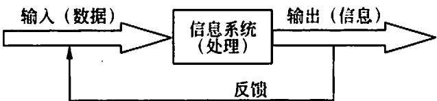
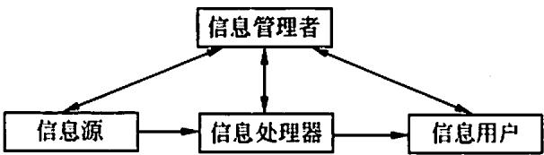
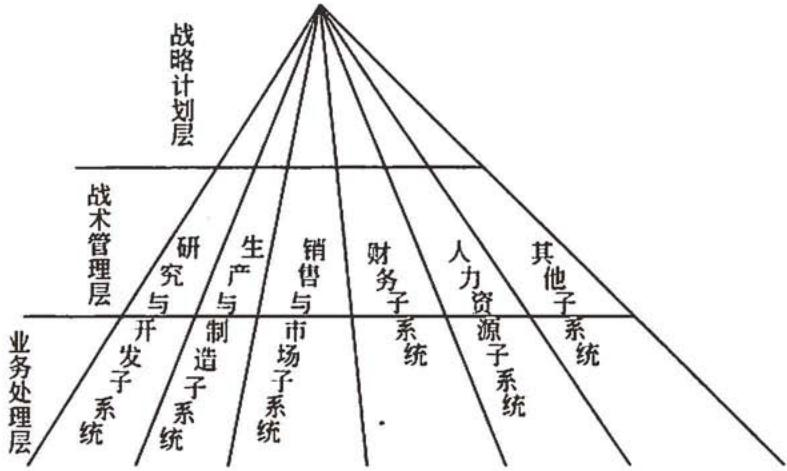
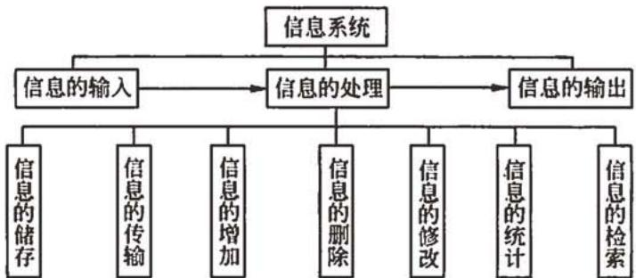
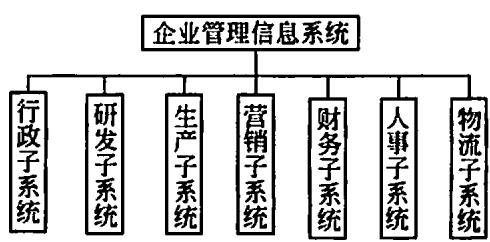
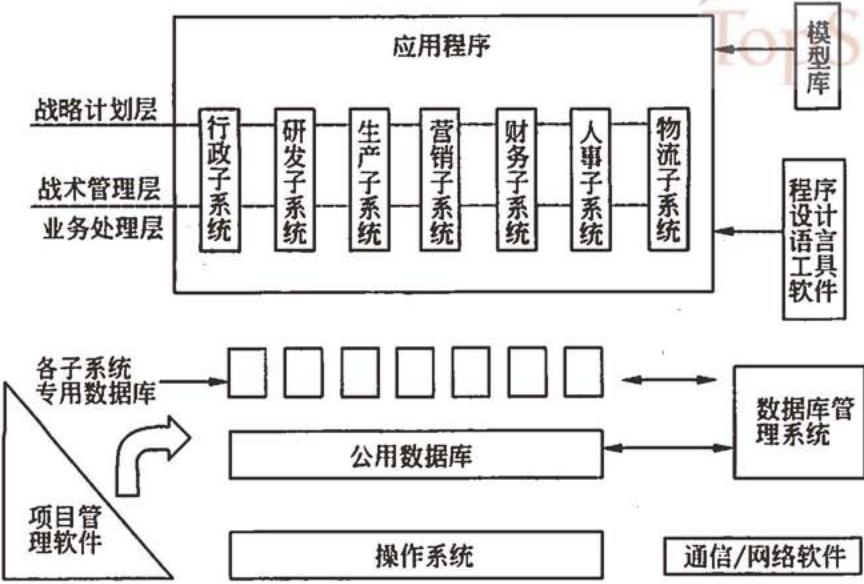
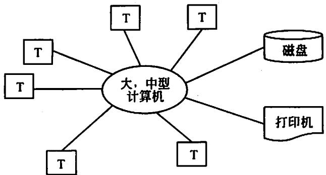
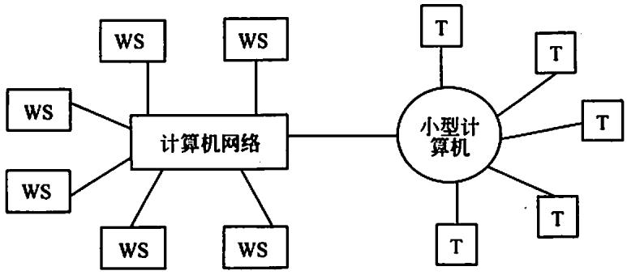
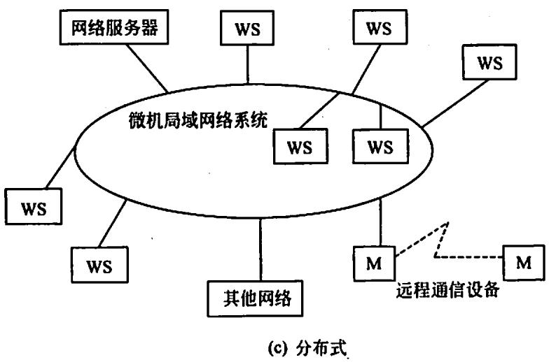

>[!warning] 版本提示
>本书为 **2006 年第 1 版**。现行考试依据是 **《信息系统管理工程师教程（第 2 版）》**（清华社 2024-10，20 章），
>两版**重合极少**：第 1 版的第 1–6 章（硬件/操作系统/语言/配置/数据结构/多媒体）在第 2 版已被删除或压缩。
>本页仅作**扩展参考**，备考请以 [[知识体系]]（第 2 版官方考纲）为准。

# 第10章 信息系统开发的基础知识

当代的信息系统是由于计算机的出现而产生的。在反复不断的探索中信息系统逐渐形成了自己的研究方向和发展分支，建立了自己独特的理论体系和结构框架。其中信息系统的开发一直是人们关注的热点。如果从如何建立一个系统的角度来研究信息系统开发的规律，那么必须了解信息系统的定义、概念、结构等基本知识。本章将对信息系统的概念、结构、类型以及信息系统工程的概念进行简单介绍，然后简单阐述信息系统开发各阶段的内容以及几种系统开发方法，使读者对信息系统开发的基础知识有一个初步了解。

## 10.1 信息系统概述

## 10.1.1 信息系统的概念

系统（system）一词最早出现在古希腊语中，希腊文 sys-tema 指的是由部分组成的整体。从大处来说，整个宇宙是一个系统，一个地球也是一个系统；从小处来说，一个国家、一个组织、一个人都可以称为一个系统。所以系统有大有小，若各组成部分能够互相作用，互相依赖，具有特定的功能，共同组成一个有机整体就是一个系统。也就是说，系统就是由相互作用和互相依赖的若干部分组成的具有特定功能的有机整体。

那么什么是信息系统呢？信息系统权威戈登·戴维斯给信息系统下的定义是：用以收集、处理、存储、分发信息的相互关联的组件的集合，其作用在于支持组织的决策与控制。此定义中，前半部分说明了信息系统的技术构成，称作技术观，后半部分说明了信息系统在组织中的作用，称作社会观，合起来称作社会技术观。

从技术角度来看，信息系统是为了支持组织决策和管理而进行信息收集，处理，储存和传递的一组相互关联的部件组成的系统。包括三项活动如图 10-1 所示。

  
图 10-1 信息系统的三项活动

\- 输入活动：从组织或外部环境中获取或收集原始数据。

\- 处理活动：将输入的原始数据转换为更有意义的形式。

\- 输出活动：将处理后形成的信息传递给人或需要此信息的活动。

反馈：把输出信息返回到组织内相应成员中，组织成员借助于反馈信息来评测或纠正输入阶段的活动。

从以上定义可知如下内容。

（1）信息系统的输入与输出类型明确，即输入是数据，输出是信息。

（2）信息系统输出的信息必定是有用的，即服务于信息系统的目标，它反映了信息系统的功能或目标。

（3）信息系统中，处理意味着转换或变换原始输入数据，使之成为可用的输出信息。处理也意味着计算、比较、变换或为将来使用进行存储。

（4）信息系统中，反馈用于调整或改变输入或处理活动的输出，对于管理决策者来说，反馈是进行有效控制的重要手段。

（5）计算机并不是信息系统所固有的。实际上，在计算机出现之前，信息系统就已经存在，如动物的神经信息系统。

信息系统可以由人工或计算机来完成，后者称为基于计算机的信息系统，也正是我们研究的对象。

## 10.1.2 信息系统的结构

## 1. 信息系统的组成

信息系统为实现组织的目标，对整个组织的信息资源进行综合管理、合理配置与有效利用。其组成包括以下七大部分。

（1）计算机硬件系统。包括主机（中央处理器和内存储器）、外存储器（如磁盘系统，数据磁带系统，光盘系统）、输入设备、输出设备等。

（2）计算机软件系统。包括系统软件和应用软件两大部分。系统软件有计算机操作系统、各种计算机语言编译或解释软件、数据库管理系统等；应用软件可分为通用应用软件和管理专用软件两类。通用应用软件如图形处理、图像处理、微分方程求解、代数方程求解、统计分析、通用优化软件等；管理专用软件如管理数据分析软件、管理模型库软件、各种问题处理软件和人机界面软件等。

（3）数据及其存储介质。有组织的数据是系统的重要资源。数据及其存储介质是系统的主要组成部分。有的存储介质已包含在计算机硬件系统的外存储设备中。另外还有录音、录像磁带、缩微胶片以及各种纸质文件。这些存储介质不仅用来存储直接反映企业外部环境和产、供、销活动以及人、财、物状况的数据，而且可存储支持管理决策的各种知识、经验以及模型与方法，以供决策者使用。

（4）通信系统。用于通信的信息发送、接受、转换和传输的设施如无线、有线、光纤、卫星数据通信设施，以及电话、电报、传真、电视等设备；有关的计算机网络与数据通信的软件。

（5）非计算机系统的信息收集、处理设备。如各种电子和机械的信息采集装置，摄影、录音等记录装置。

（6）规章制度。包括关于各类人员的权力、责任、工作规范、工作程序、相互关系及奖惩办法的各种规定、规则、命令和说明文件；有关信息采集、存储、加工、传输的各种技术标准和工作规范；各种设备的操作，维护规程等有关文件。

（7）工作人员。计算机和非计算机设备的操作、维护人员，程序设计员，数据库管理员，系统分析员，信息系统的管理人员与收集、加工、传输信息的有关人员。

## 2. 信息系统的结构

## 信息系统的概念结构

信息系统从概念上来看是由信息源、信息处理器、信息用户和信息管理者等四大部分组成，它们之间的关系如图 10-2 所示。

  
图 10-2 信息系统的概念结构

信息源是信息的产生地，包括组织内部和外界环境中的信息，这些信息通过信息处理器的传输、加工、存储，为各类管理人员即信息用户提供信息服务，而整个的信息处理活动由信息管理者进行管理和控制，信息管理者与信息用户一起依据管理决策的需求收集信息，并负责进行数据的组织与管理，信息的加工、传输等一系列信息系统的分析、设计与实现，同时在信息系统的正式运行过程中负责系统的运行与协调。

由此可见，信息用户是目标用户，信息系统的一切设计与实现都要围绕信息用户的需求；另一方面，信息管理者由于深谙信息系统的开发规律，则起到了一个明确需求、协调资源和分配资源的角色，显而易见，信息管理者的角色很重要。现在很多企业和组织设立首席信息主管（Chief Information Officer，CIO），既反映了企业对信息资源的重视，也反映了企业家开始重视信息系统的开发规律和运行规律。

## (1) 信息系统的层次结构

由于信息系统是为管理决策服务的，而管理是分层的，可以分为战略计划、战术管理和作业处理三层，因此信息系统也可以从纵向相应分解为三层子系统。在企业内部，纵向层次的划分一般按行政级别划分，比如高级经理信息系统（供副总和董事以上人员使用）、中层经理信息系统（供部门经理，部门主管使用）和作业信息系统（供一般员工使用）。

另一方面，一般管理又是按职能分条进行的，因而在每个层次上又可横向地分为研究与开发子系统、生产与制造子系统、销售与市场子系统、财务子系统、人力资源子系统等。每个子系统都支持业务处理到高层战略计划的不同层次的管理需求，一般来说，业务处理层所处理的数据量很大，加工方法固定，而高层的战略计划处理量较小，加工方法灵活，但比较复杂，因此可以将信息系统看成如图 10-3 所示的金字塔结构。在该图中，横向综合则是按三个层次划分子系统，纵向综合则是按具体的职能划分子系统。

要注意的是，这里是按通常的理解划分为战略层，战术层与作业层三个层次。在企业的实际应用中，到底要划分多少层次还是根据企业的实际来确定。管理学的研究结果说明，如果管理的层次太少，则管理幅度过宽，容易产生各自为政；如果管理的层次太多，则管理幅度过窄，容易产生反应迟钝，滋生官僚主义。

  
图 10-3 信息系统的层次结构

(2) 信息系统的功能结构。

从信息技术的角度来看，信息系统无非是信息的输入、处理和输出等功能。因此，信息系统的功能结构从技术上来看可以表示为如图 10-4 所示的形式。所以，在开发信息系统时必须考虑这些具体功能的实现。有时还必须考虑细节，如信息的检索有指定检索和模糊检索；信息的统计有时要考虑按常规时间段如月、季统计，有时还要考虑按非常规时间段统计，如上月 13 号到本月 13 号的统计等；信息的存储既要考虑实时存储，又要考虑定期转存；信息的增加有时还要考虑让系统自动记录增加的时间点，以便对系统的操作进行追踪，等等。

  
图 10-4 技术角度看信息系统功能结构  

从信息用户的角度来看，信息系统应该支持整个组织在不同层次上的各种功能。各种从信息用户的角度来看，信息系统应该支持整功能之间又有各种信息联系，构成一个有机的整体及系统的业务功能结构。例如，一个企业的内部管理系统可以如图 10-5 所示。

从图中可以看出，企业的信息系统分为 7 个子系统，除了完成各自的特定功能外，这 7 个子系统又有着大量的信息交换关系，其子系统之间的主要数据交换关系构成子系统之间的信息流，使得企业中的各类信息得到充分的共享，从而为企业的生产活动和管理，决策活动提供支持。

  
图 10-5 业务角度看信息系统的功能结构

通过从技术角度和业务角度分析信息系统的功能结构，应该知道，信息系统的实现不是一朝一夕的事情，必须经过长期的努力才能得以实现。因此，在信息系统的建设过程中必须首先进行总体规划，划分出子系统，规划出各子系统的功能及其相互之间的联系，然后再逐步予以实现，其中特别要重视子系统之间的联系。只有这样才能实现信息的共享，发挥信息资源的重要作用。

## (3) 信息系统的软件结构

信息系统是通过计算机、网络和软件协同作用完成一定目标的系统，如果说计算机和网络设备是信息系统的躯干的话，那么，软件则是信息系统的血肉。软件在信息系统中的组织或联系，称为信息系统的软件结构。

信息系统开发与应用中使用到的软件有：操作系统、数据库管理系统、程序设计语言、网络软件、项目管理软件、应用软件以及其他工具软件等。这里应用软件是信息系统的灵魂，工具软件是保证信息系统正常或加速开发、正常或加强维护的手段，如杀毒软件、压缩工具软件、辅助开发工具软件、网络管理软件等。

对于图 10-5 中提到的企业管理信息系统，有着如图 10-6 所示的软件结构。在图中，操作系统、通信与网络软件处于底层，数据库管理系统处于第二层，管理着信息系统的公用数据库和各子系统的专用数据库。在数据库层上则是按照功能划分的七个应用程序子系统，分别是：行政信息子系统、研发信息子系统、生产信息子系统、营销信息子系统、财务信息子系统、人事信息子系统和物流信息子系统。这些信息系统按照层次又可从纵向上分别划分为战略计划，战术管理和业务处理这样三个层次。这些应用子系统程序的执行过程中可以调用公共应用程序和相应的模型、方法。这些公用应用程序和公用模型独立出来，可以提高系统的开发速度，增强系统的可重用性和抗干扰性。应用程序的开发和运行需要程序设计语言以及其他开发工具的支持。在图中的左下角的三角形里，标注的是项目管理软件。之所以在这么一个重要的位置标注，是因为信息系统的开发也是一个项目的事实，一定要用项目管理思想来指导，最好能有相应的项目管理软件对信息系统开发的进度、质量和成本进行把关。

  
图 10-6 信息系统的软件结构

## (4) 信息系统的硬件结构

信息系统的硬件结构，又称为信息系统的物理结构或信息系统的空间结构，是指系统的硬件、软件、数据等资源在空间的分布情况，或者说避开信息系统各部分的实际工作和软件结构，只抽象地考查其硬件系统的拓扑结构。信息系统的硬件结构一般有三种类型：集中式的、分布式的和分布-集中式的，如图 10-7 所示。

图中，T 为终端，WS 为工作站，M 为调制解调器。

## (1) 集中式

信息资源在空间上集中配置的系统称为集中式系统。以配有相应外围设备的单台计算机为基础的系统就是典型的集中式系统。面向终端的多用户系统也是将系统的硬件、软件、数据和主要外围设备集中于一套计算机系统中，分布在不同地点的多个用户通过设在当地的分时终端享用这些资源。距离较远的用户可通过调制解调器和通信线路实现与主机通信。

集中式是信息系统早期的结构，现在已基本上被淘汰。它的优点是：信息资源集中，便于管理；缺点是主机价格昂贵，维护困难，并且运行效率低，一旦出故障，容易造成整个系统的瘫痪。

## (2) 分布-集中式

由于系统内部有某些大而复杂的处理过程，微型机难以胜任，故采用一台或几台小型/超小型计算机作为整个系统的主机和信息处理交换的中枢，外加若干微电脑和网络构成。

分布-集中式的优点是数据部分（需共享的部分）集中，便于管理，各个工作站间相互独立，独立处理各自的业务，必要时又是一个整体，可相互传递信息，共享数据；缺点是因有小型机在内，故价格相对较高，系统维护较困难。

  
(a) 集中式或主机-终端式

  
(b) 分布-集中式

  
图 10-7 信息系统的三种典型硬件结构示意图

## (3) 分布式

利用计算机网络把分布在不同地点的计算机硬件、软件、数据等资源联系在一起服务

于一个共同的目标而实现相互通信和资源共享，就形成了信息系统的分布式结构。

除实现不同地点的硬件、软件、数据等资源共享外，分布式结构的系统的另一个主要特征是各地与计算机网络系统相连的计算机系统既可以在计算机网络系统的统一管理下工作，又可脱离网络环境利用本地信息资源独立工作。

利用计算机局域网可以组成分布式信息系统。服务器中装有网络操作系统、数据库管理系统及其开发工具等，并配有相应的外围设备，如打印机、绘图机、外存储器等。分布在各地的网络结点上的计算机系统在网络操作系统的管理下可以共享网络系统上的信息资源。

分布式结构系统的优点是：可以根据应用需要和存取方式来配置信息资源；有利于发挥用户在系统开发、维护和信息资源管理方面的积极性和主动性，提高了系统对用户需求变更的适应性和对环境的应变能力；系统扩展方便，增加一个网络结点一般不会影响其他结点的工作，系统建设可以采取逐步扩展网络结点的渐进方式，以合理使用系统开发所需的资源；系统的健壮性好，网络上一个结点出现故障一般不会导致全系统瘫痪。

分布式结构系统的缺点是：由于信息资源分散，系统开发、维护和管理的标准、规范不易统一；配置在不同地点的信息资源一般分属信息系统的各子系统，不同子系统之间往往存在利益冲突，管理上协调有一定难度；各地的计算机系统工作条件与环境不一，不利于安全保密措施的统一实施。

现在企业组织结构正朝小型化，扁平化，网络化方向发展，信息系统必须适应这一发展。20世纪80年代以来，随着计算机网络与通信技术的迅速发展，分布式系统已经成为当前信息系统结构的主流模式。有时根据需要，在一个网络系统中可把分布式和集中式两类结构结合起来，网络上部分结点采用集中式（分时终端）结构，其余的按分布式配置。

## 10.1.3 信息系统的主要类型

因为信息系统在企业中的广泛应用，这里主要介绍企业中信息系统的主要类型。一个企业在发展过程中，按不同的发展阶段和管理工作的实际需要，信息系统在某个时期可能侧重于支持某一两个层次的管理决策或管理业务活动。根据信息服务对象的不同，企业中的信息系统可以分为三类。

## 1. 面向作业处理的系统

是用来支持业务处理，实现处理自动化的信息系统。

(1) 办公自动化系统 (Office Automation System, OAS)。它为各种类型的文案工作提供支持。从事这些工作的主要有秘书、会计、文档管理员及其他管理人员, 工作性质主要不是创造信息, 而是应用和处理信息。办公自动化系统的主要目的是通过应用信息技术支持办公室的各项信息处理工作, 协调不同地理分布区域之间、各职能之间和各类工作者之间的信息联系, 提高办公活动的工作效率和质量。典型的办公自动化系统主要通过文字处理、桌面印刷、电子化文档进行文件管理, 通过数字化日历、备忘录进行计划和日程安排, 通过桌面型数据库软件进行数据管理, 通过基于计算机网络的电子邮件、语音信箱、数字

化传真和电视会议等进行信息联络与沟通。

（2）事务处理系统（Transaction Processing System，TPS）。应用信息技术支持企业最基本的。日常的业务处理活动，例如工资核算、销售订单处理、原材料出库、费用支出报销等。

事务处理系统存在于各种基层业务职能中，企业中一些典型的事务处理系统有销售订单处理系统、生产进度报告系统、库存管理系统、费用支出报销系统、账务处理系统、考勤登记系统和人事档案管理系统等。其他类型的组织也存在各种各样的事务处理系统，典型的应用系统有：学校的学籍注册与管理系统、学生选课及成绩登记系统、课程安排系统、银行的储蓄业务处理系统、信用卡发放与结算系统、民航公司的机票预售系统、宾馆的客房预定与消费结算系统、商场的货品盘点系统、POS结算收款系统、机关的公文运转管理系统等。

事务处理系统直接支持业务职能的具体实现，它的有效性和可靠性对组织的业务运行至关重要，一旦发生故障，将会给组织带来直接的经济损失，因此系统在安全性、可靠性方面具有极高的要求。事务处理系统不仅直接支持组织的各项基础业务活动的实现，并且也为组织内各层次的管理人员提供了业务运行状况的第一手资料，同时也是组织中其他各类信息系统的主要信息来源。

（3）数据采集与监测系统（Data Acquiring and Monitoring System，DAMS）。安装于生产现场的自动化在线系统。它将生产过程中的产量、质量、故障信息转换为数字电信号，自动传送给计算机，如化工企业生产过程中的流量、压力、温度监测系统，纺织企业中的织机转速、经停、纬停监测系统等。在此基础上建立的信息系统，保证原始数据的正确性和及时性，省去大量人工录入数据的工作，大大提高管理效率。

## 2. 面向管理控制的系统

是辅助企业管理、实现管理自动化的信息系统。

（1）电子数据处理系统（EDPS）有时又叫数据处理系统（DPS）或事务处理信息系统（TPS），这是支持企业作业运行层日常操作的主要系统。它主要用来进行日常业务的记录、汇总、综合、分类。它的输入往往是原始单据，它的输出往往是分类或汇总的报表。电子数据处理系统是管理信息系统的初级阶段。由于所处理的问题处于较低的管理层，因而问题比较结构化，也就是处理步骤比较固定。

（2）知识工作支持系统（Knowledge Work Support System，KWSS）。支持工程师、建筑师、科学家、律师、咨询专家等知识工作者（Knowledge Worker）的工作。知识工作者的工作主要是创造新的信息和知识，如政策制定、产品创新与设计、公关创意等，这些工作需要信息技术手段的支持，以促进新知识的创造，并将新的知识与技术集成到组织的产品、服务或管理中去。知识工作支持系统要具有强大的数据、图形、图像以及多媒体处理能力，能够在网络化条件下广泛应用多方面信息和情报资源，并为知识工作者提供多方面的知识创造工具和手段。

(3) 计算机集成制造系统 (Computer Integrated Manufacturing System, CIMS)。适用于制造企业, 是一个基于现代管理技术、信息技术、计算机技术、柔性制造技术、自动化技术的新兴领域。它有机地集成了管理信息系统 (MIS)、计算机辅助设计 (CAD)、计算机辅助工艺生产 (CAM) 和柔性制造系统 (FMS), 不仅具有信息采集和处理功能, 而且还具有各种控制功能, 并且集成于一个系统中, 将产品的订货、设计、制造、管理和销售过程, 通过计算机网络综合在一起, 达到企业生产全过程整体化的目的。

## 3. 面向决策计划的系统

（1）决策支持系统（Decision Support System，DSS）。DSS的概念在20世纪70年代提出，并在80年代获得发展。传统的管理信息系统没能给企业带来巨大的效益，人在管理中的积极作用得不到发挥，要求更高层次的系统来直接支持决策，基于这样的原因出现了DSS。DSS是支持决策者解决半结构化决策问题的具有智能作用的人机系统。该系统能够为决策者迅速而准确地提供决策所需的数据、信息和背景材料，帮助决策者明确目标，建立或修改决策模型，提供各种备选方案，对各种方案进行评价和优选，通过人机对话进行分析、比较和判断，为正确决策提供有力支持。

(2) 战略信息系统 (Strategic Information System, SIS)。SIS 是专为企业决策层设计的面向问题的信息系统, 它的主要功能是支持企业形成竞争策略, 使企业获得或保持竞争优势。它通过人性化的 "人机人" 方式设计和战略信息资源规划设计, 来增强决策者的决策水平与控制能力。战略信息系统更为人性化的表现在于, 系统通过可调整的预警条件设置、自动提示等功能, 使决策者对企业面临的市场环境变化风险, 能够更为敏感; 战略信息系统更能通过可调整的系统内部游戏规则 (工作、业务流程等) 设置, 来提高企业决策、管理等各方面的规范性。战略信息系统与前面的 EDPS, DSS 等的重大区别就在于战略信息系统强调的重点从支持企业功能转移到支持形成与实现竞争策略。

（3）管理专家系统（Management Expert System，MES）。专家系统是人工智能与信息系统应用相结合的产物，其任务是研究怎样使计算机模拟人脑所从事的推理、学习、思考与规划等思维活动，解决需要人类专家才能处理的复杂问题，如医疗诊断、气象预报、运输调度和管理决策等问题。管理专家系统是用专家系统技术来解决管理决策中的非结构化问题。

管理专家系统把某个或几个管理决策专家解决某类管理决策问题的经验知识整理成计算机可表示的形式的知识，组织到知识库中，用人工智能程序模拟专家解决这类问题的推理过程，组成推理机，从而能在与管理人员的会话中，像管理专家一样工作，提出高水平的可供选择的决策方案。

## 10.1.4 信息系统对企业的影响

信息系统的出现，对企业的生产过程、管理过程、决策过程都产生了重大影响。尤其是，信息系统促进了企业组织结构的重大变革，下面介绍信息系统对企业组织结构的影响。

企业的组织结构与信息系统存在着相互依赖和相互促进的关系。一般情况下，企业的组织结构是相对稳定的。随着企业间竞争的加剧，对信息系统的要求和依赖越来越高，信息系统从原来的非主导地位逐渐变为主导地位。同时，这种要求和依赖对信息系统的发展起到促进作用。信息系统的应用对组织结构的影响主要体现在以下四个方面：

（1）促使组织结构的扁平化。传统的组织结构大多是集权式金字塔型的层次结构，位于组织高层的领导靠下达命令指挥工作。他们主要从中层领导那里得到关于企业运作情况的信息，却难以得到迅速及时的基层信息。现在的信息系统已能向企业各类管理人员提供越来越多的企业内外部信息以及各种经营分析和管理决策功能。当新信息系统建立后，高层领导可以方便地得到详尽的基层信息，许多决策问题也不必再由上层或专人解决。因此，对中层及基层的管理人员的需要将会减少。这种趋势导致企业决策权力向下层转移并且逐步分散化，从而使企业的组织结构由原来的金字塔型向组织结构扁平化发展。

（2）组织结构更加灵活和有效。企业为了适应市场需求瞬息万变、竞争日益激烈的环境，要求企业通过组织结构的灵活应变，实现对生产的经营管理。处于不同地域的企业部门，分支机构或管理人员可借助有关信息的分析与判断，直接对生产经营问题做出决定。这种组织结构在信息网络的环境下更加灵活和有效，因为它可以消除组织结构中的僵化和滞后效应。还有一些企业采用非固定型组织结构，借助网络和信息系统的支持，迅速建立以产品为中心的组织结构，这种灵活的组织结构使企业能够更加有效地适应市场，提高效益。

（3）虚拟办公室。随着互联网络的发展和移动通信的普及，管理人员可在旅途中处理公务，和同事或上下级进行方便的联系，甚至在家中工作。近年来，一些公司取消了固定办公室，员工们在办公室里没有固定的座位，在任何办公桌上使用计算机就可以工作。这种办公室称为虚拟办公室。有些公司干脆称为虚拟组织。由于现代社会通信和信息交换的方便性，虚拟组织可像实体组织一样进行公司业务运作。

（4）增加企业流程重组的成功率。由于企业外部环境众多因素的快速变化，企业的对策不能仅停留在原管理过程处理速度提高等要求上，而应考虑运作方式及管理过程等的彻底重新设计，其中也包括组织结构的重新设计。这也是"企业流程重组"的起因和基本思想。信息系统除了对企业管理效率的提高和成本的降低具有显著作用外，还有促进企业运作方式和管理过程的变革等更深层次的作用。这些作用是通过遵循信息的规律，采用全新的信息资源开发与利用方式，安排合理的信息流转路径来实现的。因此，信息系统对企业流程重组起到关键作用，它是企业流程重组的技术基础，也是企业流程重组成功的保证。信息系统的建设与企业流程重组同步或交错开展，可以明显地提高企业流程重组的成功率。

## 10.2 信息系统工程概述

## 10.2.1 信息系统工程的概念

信息系统工程是20世纪80年代出现的以建立信息系统为目标的新兴学科，主要研究各级各类信息系统建设和管理中的规律性问题。

信息系统工程是用系统工程的原理、方法来指导信息系统建设与管理的一门工程技术学科。它是一个特定的工程类型，是工程的理论与方法在信息系统领域的应用。

有关信息系统工程的确切含义，信息产业部2002年颁布的《信息系统工程监理暂行规定》特别明确了信息系统工程的概念。该规定指出信息系统工程是指信息化工程建设中的信息网络系统、信息资源系统和信息应用系统的新建、升级、改造工程。其中信息网络系统是指以信息技术为主要手段建立的信息处理、传输、交换和分发的计算机网络系统；信息资源系统是指以信息技术为主要手段建立的信息资源采集、存储、处理的资源系统；信息应用系统是指以信息技术为主要手段建立的各类业务管理的应用系统。

作为系统工程的一个分支，信息系统工程具有系统工程的共同特点，其中，最基本的特点是研究方法的整体性、技术应用上的综合性和管理上的科学化。

研究方法的整体性就是应用系统学中关于整体大于部分之和的思想，不仅把研究对象看成一个整体，而且，把研究过程也看成一个整体。把系统看成是由若干个子系统有机结合的整体来分析与设计。对各子系统的技术要求首先是从实现整个系统技术协调的观点来考虑，从总体协调的需求来制定方案。此外，还要求把所研究的系统放在更大的系统空间或系统环境中去，作为从属于更大系统的组成部分来考虑。对它的所有技术要求，都尽可能从实现与这个更大系统技术协调或适应系统环境的观点来考虑。

技术应用上的综合性就是系统学中的最优化原则，综合应用各种学科和技术领域内所取得的成就，构筑合理的技术结构，使各种技术相互配合而达到系统整体的最优化。对信息系统而言，它是信息科学、系统科学、管理科学、计算机科学、控制理论及通信科学等各领域技术的综合体。对技术的使用来说，并非每个子系统或部件都要有更好的性能才能获得系统的最佳性能。只要技术结构合理，用廉价的一般部件也可能组合出系统的最佳性能。综合不是各种技术的堆砌，而是以最优化为原则，注重各种技术的协调和结构合理。

管理上的科学化就是对工程进行科学管理。一个复杂的信息系统工程客观上总存在两个并行进程，一个是工程技术进程，另一个是对工程技术进程的管理控制进程。后者包括工程的规划、组织、控制、进度安排，对各种方案进行分析、比较和决策，评价选定方案的技术效果等。这些内容称为工程管理。管理的科学化是系统工程的关键。

## 10.2.2 信息系统工程的研究范围

一般认为，信息系统工程的目标是为以计算机和其他信息技术为手段的各类信息系统提供科学的方法、管理手段及有关的工具、标准、规范，其研究范围包括下述5个方面。

（1）信息系统建设与管理的概念、方法、评价、规划、工具、标准等一系列相关问题，即信息系统的系统工程。

（2）依据信息系统工程自身发展的规律和特点，发展和研究实现信息化建设的工程方法。

（3）数据库是信息系统的基础，一方面要研究系统核心的数据库设计与实现，另一方面要研究围绕数据库进行的各种应用软件及其他软件的设计与实现。

（4）总体数据规划，涉及数据的稳定性和共享性的统一。有了数据稳定性，才能实现数据共享，才可以实现一组数据类为多个业务服务；有了共享要求，才有建立稳定的数据管理基础的必要性。

（5）系统集成。信息系统的系统集成，就是应用先进的计算机与通信技术，将支持各个信息"孤岛"的小运行环境，集成统一在一个大运行环境中。需要研究系统集成的原则、方法、技术、工具和有关的标准、规范。

## 10.2.3 信息系统工程的基本方法

信息系统工程的研究是一个多学科领域，主要涉及计算机科学、运筹学、管理科学、社会学、心理学以及政治学等。由于信息系统是一个社会技术系统，因此，信息系统工程的研究方法不能仅限于工程技术方法。目前，信息系统工程的研究方法分为技术方法、行为方法和社会技术系统方法。

技术方法重视研究信息系统规范的数学模型，并侧重于系统的基础理论和技术手段。支持技术方法的学科有计算机科学、管理科学和运筹学。计算机科学涉及计算理论、计算方法和高效的数据存储和访问方法；管理科学着重于管理方法和决策过程的模型的建立；运筹学则强调优化组织的已选参数（如运输，库存控制和交易成本）的数学方法。

行为方法的重点一般不在技术方案上，它侧重在态度、管理和组织政策、行为方面。许多行为问题，如系统的使用程度、实施和创造性设计、不能用技术方法中采用的规范的模型表达。

社会技术系统方法从总体和全面的角度把握信息系统工程。从数据处理系统到管理信息系统再到决策支持系统，信息系统的开发是把计算机科学、数学、管理科学和运筹学的理论研究工作和应用的实践结合起来，并注重社会学、心理学的理论与实践成果。因此，从单一的视角（如技术方法或行为方法）不能有效地把握信息系统的实质，而社会技术系统方法有助于避免对信息系统采取单纯的技术或行为看法。

## 10.3 信息系统开发概述

## 10.3.1 信息系统的开发阶段

## 1. 系统分析阶段

在信息系统开发实践中，经过成功和失败的教训，使人们认识到，为了使开发出来的目标系统能满足实际需要，在着手编程之前，首先必须要有一定的时间用来认真考虑以下问题：

——系统所要求解决的问题是什么？

——为解决该问题，系统应干些什么？

——系统应该怎么去干？

在总体规划阶段，通过初步调查和可行性分析，建立了目标系统的目标，已经回答了上的第一个问题。而第二个问题的解决，正是系统分析的任务，第三个问题则由系统设计阶段解决。

要解决"系统应干些什么"的问题，系统分析人员必须与用户密切协商，这是系统分析工作的特点之一。根据现行信息系统与计算机信息系统各自的特点，认真调查和分析用户需求。所谓用户需求，是指目标系统必须满足的所有性能和限制，通常包括功能要求、性能要求、可靠性要求、安全保密要求以及开发费用、开发周期、可使用的资源等方面的限制。弄清哪些工作交由计算机完成，哪些工作仍由人工完成，以及计算机可以提供哪些新功能。这样就可以在逻辑上规定目标系统目标的功能，而不涉及具体的物理实现，也就解决了"系统应干些什么"的问题。

系统规格说明书是系统分析阶段的最后结果，它通过一组图表和文字说明描述了目标系统的逻辑模型。设计逻辑模型是系统分析工作的另一个特点。逻辑模型包括数据流程图、数据字典、基本加工说明等。它们不仅在逻辑上表示目标系统目标所具备的各种功能，而且还表达了输入、输出、数据存储、数据流程和系统环境等。逻辑模型只告诉人们目标系统要"干什么"，而暂不考虑系统怎样来实现的问题。

简单说来，系统分析阶段是将目标系统目标具体化为用户需求，再将用户需求转换为系统的逻辑模型，系统的逻辑模型是用户需求明确、详细的表示。

## 2. 系统设计阶段

系统设计工作应该自顶向下地进行。首先设计总体结构，然后再逐层深入，直至进行每一个模块的设计。总体设计主要是指在系统分析的基础上，对整个系统的划分（子系统）、设备（包括软、硬设备）的配置、数据的存储规律以及整个系统实现规划等方面进行合理的安排。

## 3. 系统设计的概念

系统设计又称为物理设计，是开发信息系统的第二阶段，系统设计通常可分为两个阶段进行，首先是总体设计，其任务是设计系统的框架和概貌，并向用户单位和领导部门作详细报告并得到认可，在此基础上进行第二阶段——详细设计，这两部分工作是互相联系的，需要交叉进行，下面将这两个部分内容结合起来进行介绍。

系统设计是开发人员进行的工作，他们将系统设计阶段得到的目标系统的逻辑模型转换为目标系统的物理模型，该阶段得到的工作成果——系统设计说明书是下一个阶段系统实施的工作依据。

## 4. 系统设计的主要内容

系统设计的主要任务是进行总体设计和详细设计。下面分别说明它们的具体内容。

（1）总体设计。总体设计包括系统模块结构设计和计算机物理系统的配置方案设计。

① 系统模块结构设计。系统模块结构设计的任务是划分子系统，然后确定子系统的模块结构，并画出模块结构图。在这个过程中必须考虑以下几个问题：如何将一个系统划分成多个子系统。每个子系统如何划分成多个模块。如何确定子系统之间、模块之间传送的数据及其调用关系。如何评价并改进模块结构的质量。

② 计算机物理系统配置方案设计。在进行总体设计时，还要进行计算机物理系统具体配置方案的设计，要解决计算机软硬件系统的配置、通信网络系统的配置、机房设备的配置等问题。计算机物理系统具体配置方案要经过用户单位和领导部门的同意才可进行实施。

（2）详细设计。在总体设计基础上，第二步进行的是详细设计，主要有处理过程设计以确定每个模块内部的详细执行过程，包括局部数据组织、控制流、每一步的具体加工要求等，一般来说，处理过程模块详细设计的难度已不太大，关键是用一种合适的方式来描述每个模块的执行过程，常用的有流程图、问题分析图、IPO图和过程设计语言等；除了处理过程设计，还有代码设计、界面设计、数据库设计、输入输出设计等。

（3）编写系统设计说明书。系统设计阶段的结果是系统设计说明书，它主要由模块结构图、模块说明书和其他详细设计的内容组成。

## 5. 系统实施阶段

当系统分析与系统设计的工作完成以后，开发人员的工作重点就从分析、设计和创造性思考的阶段转入实践阶段。在此其间，将投入大量的人力、物力及占用较长的时间进行物理系统的实施、程序设计、程序和系统调试、人员培训、系统转换、系统管理等一系列工作，这个过程称为系统实施。

## (1) 系统实施的目标

在系统分析与系统设计的阶段中，开发人员为新系统设计了它的逻辑模型和物理模型。系统实施阶段的目标就是把系统设计的物理模型转换成可实际运行的新系统。系统实施阶段既是成功实现新系统，又是取得用户对新系统信任的关键阶段。

## (2) 系统实施的主要内容和步骤

系统实施是一项复杂的工程，信息系统的规模越大，实施阶段的任务越复杂。一般来说，系统实施阶段主要有以下几个方面的工作：物理系统的实施；程序设计；系统调试；人员培训；系统切换。

系统实施首先进行物理系统的实施，要根据计算机物理系统配置方案购买和安装计算机硬、软件系统和通信网络系统(如果购买的时间太早会带来经济上的损失)，还包括计算机机房的准备和设备安装调试等一系列活动，要熟悉计算机物理系统的性能和使用方法，同时进行的工作是程序设计；接着进行的工作是收集有关数据并进行录入工作；然后是系统调试；最后是人员培训和系统切换。

## 6. 系统运行和维护阶段

## (1) 系统运行

系统切换后可开始投入运行，系统运行包括系统的日常操作、维护等。任何一个系统都不是一开始就很好的，总是经过多重的开发、运行、再开发、再运行的循环不断上升的。开发的思想只有在运行中才能得到检验，而运行中不断积累问题是新的开发思想的源泉。

目前我国不够重视运行，运行组织不健全，运行组织级别不够高。随着信息作用的增加，现在国外企业中信息系统的地位越来越高，信息系统的组织也越来越健全和庞大。从信息系统在企业中的地位看，有以下几种形式：

① 为企业的某个业务部门所有。这种运行组织方式是一种古老的组织方式，信息管理部门为企业的某个业务单位所有。它使得信息不能成为全企业的资源，只能为其他单位提供计算能力，地位太低。

② 与企业的部门平行。信息资源可为全企业共享，各单位使用权限相同，信息处理支持决策的能力较弱。

③ 作为企业的参谋中心。这种组织方式有利于信息共享和支持决策，但容易造成脱离群众、服务不好的现象。现在的发展趋势是集散系统，既有全公司的信息中心又在使用计算机较多的部门配置微机。它实际是前两种方式的结合，但一定要加强信息资源管理，否则容易造成分散化。

## (2) 系统运行管理

系统运行管理制度是系统管理的一个重要内容。它是确保系统按预定目标运行并充分发挥其效益的一切必要条件、运行机制和保障措施。通常它应该包括：

① 系统运行的组织机构。它包括各类人员的构成、各自职责、主要任务和管理内部组织结构。

② 基础数据管理。它包括对数据收集和统计渠道的管理、计量手段和计量方法的管理、原始数据管理、系统内部各种运行文件、历史文件（包括数据库文件）的归档管理等。

③ 运行制度管理。它包括系统操作规程、系统安全保密制度、系统修改规程、系统

定期维护制度以及系统运行状态记录和日志归档等。

④ 系统运行结果分析。分析系统运行结果得到某种能够反映企业组织经营生产方面发展趋势的信息，用以提高管理部门指导企业的经营生产的能力。

## (3) 系统维护

系统维护是指在信息系统交付使用后，为了改正错误或满足新的需要而修改系统的过程。

信息系统是一个复杂的人机系统，系统内外环境以及各种人为的、机器的因素都在不断地变化。为了使系统能够适应这种变化，充分发挥软件的作用，产生良好的社会效益和经济效益，就要进行系统维护的工作。

另外，大中型软件产品的开发周期一般为一至三年，运行周期则可达五至十年，在这么长的时间内，除了要改正软件中残留的错误外，还可能多次更新软件的版本，以适应改善运行环境和加强产品性能等需要，这些活动也属于维护工作的范畴。能不能做好这些工作，将直接影响软件的使用寿命。

维护是信息系统生命周期中花钱最多、延续时间最长的活动。有人把维护比成"墙"或"冰山"，以形容它给软件生产所造成的障碍。不少单位为了维护已有的软件，竟没有余力顾及新软件的开发。近年来，从软件的维护费用来看，已经远远超过了系统的软件开发费用，占系统硬、软件总投资的60%以上。典型的情况是，软件维护费用与开发费用的比例为2：1，一些大型软件的维护费用甚至达到了开发费用的40至50倍。

一个系统的质量高低和系统的分析、设计有很大关系，也和系统的维护有很大关系。在维护工作中常见的绝大多数问题，都可归因于软件开发的方法有缺点。在软件生存周期的头两个时期没有严格而又科学的管理和规划，必然会导致在最后阶段出现问题。下面列出维护工作中常见的问题：

① 理解别人写的程序通常非常困难，而且困难程度随着软件配置成分的减少而迅速增加。如果仅有程序代码而没有说明文档，则会出现严重的问题。

② 需要维护的软件往往没有合适的文档，或者文档资料显著不足。认识到软件必须有文档仅仅是第一步，容易理解的并且和程序代码完全一致的文档才真正有价值。

③ 当要求对软件进行维护时，不能指望由开发人员来仔细说明软件。由于维护阶段持续的时间很长，因此，当需要解释软件时，往往原来写程序的人已不在附近了。

④ 绝大多数软件在设计时没有考虑将来的修改。除非使用强调模块独立原理的设计方法，否则修改软件既困难又容易发生差错。

上述种种问题在现有的没采用结构化思想开发出来的软件中，都或多或少地存在着。使用结构化分析和设计的方法进行开发工作可以从根本上提高软件的可维护性。

## 10.3.2 信息系统开发方法

信息系统的开发是一个庞大的系统工程，它涉及到组织的内部结构、管理模式、生产加工、经营管理过程、数据的收集与处理过程、计算机硬件系统的管理与应用、软件系统的开发等各个方面。这就增加了开发一个信息系统的工程规模和难度，需要研究出科学的开发方法和过程化的开发步骤，以确保整个开发过程能够顺利进行。这正是信息系统开发方法的任务。

信息系统开发方法学研究的主要对象是信息系统开发的规律、开发过程的认知体系、分析设计的一般理论以及具体的开发工具和技术等。

下面从方法论的角度，介绍创建信息系统所需的规划方法，包括结构化开发和设计方法（SSA&D），面向对象的开发方法（OO）及原型方法（Phototyping）。

## 1. 结构化系统分析与设计方法（Structured System Analysis and Design, SSA&D）

SSA&D 是在由 Dijkstra 等人提出的结构化程序设计思想基础上发展起来的。它是一种系统化、结构化和自顶向下的系统开发方法。

其基本思想是：用系统的思想，系统工程的方法，按用户至上的原则，结构化、模块化、自顶向下对信息系统进行分析与设计。具体来说，就是先将整个信息系统开发过程划分出若干个相对独立的阶段，如系统规划、系统分析、系统设计、系统实施等。在前三个阶段坚持自顶向下地对系统进行结构化划分。在系统调查或理顺管理业务时，应从最顶层的管理业务入手，逐步深入到最基层。在系统分析，提出新系统方案和系统设计时，先考虑系统整体的优化，然后再考虑局部的优化问题。在系统实施阶段，则应坚持自底向上的逐步实施。

## SSA&D 有如下特点

（1）建立面向用户的观点。强调用户是整个信息系统开发的起源和最终归宿，即用户的参与程度和满意程度是系统成功的关键。

(2) 严格区分工作阶段。强调将整个系统的开发过程分为若干个阶段, 每个阶段都有其明确的任务和目标以及预期要达到的阶段成果。一般不可打乱或颠倒。

(3)结构化、模块化、自顶向下进行开发。在分析问题时,应首先站在整体的角度,将各项具体的业务和组织放到整体中加以考查。自顶向下分析设计:首先确保全局的正确,再一层层地深入考虑和处理局部的问题。

自底向上进行开发：在具体系统实现过程中，一个模块一个模块地进行开发，调试，然后再由几个模块联调（子系统联调），最后是整个系统联调。

(4) 充分预料可能发生的变化。在系统的分析、设计和实现过程中, 都要充分地考虑可能变化的因素。一般可能发生的变化来自于周围环境变化, 来自外部的影响: 如上级主管部门要的信息发生变化等。系统内部处理模式的变化, 如系统内部的组织结构和鼓励体制发生的变化, 工艺流程发生变化, 系统内部管理形式发生变化等。用户要求发生变化: 用户对系统的认识程度不断深化, 又提出更高的要求。

（5）工作文件的标准化和文献化。在系统研制的每一阶段、每一步骤都要有详细的文字资料记载，需要记载的信息是：

\- 系统分析过程中的调研材料。

\- 同用户交流的情况。

\- 设计的每一步方案（甚至包括经分析后淘汰掉的信息和资料）资料要有专人保管，要建立一整套管理、查询制度。

## 2. 原型方法（Prototyping）

原型方法是 20 世纪 80 年代随着计算机软件技术的发展，特别是在关系数据库系统（Relational Data Base System，RDBS）、第四代程序生成语言（4th Generation Language，4GL）和各种系统开发生成环境产生的基础上，提出的一种从设计思想到工具、手段都是全新的系统开发方法。

传统的结构化开发方法强调系统开发每一阶段的严谨性，要求在系统设计和实施阶段之前预先严格定义出完整准确的功能需求和规格说明。然而，对于规模较大或结构较复杂的系统，在系统开发前期，用户往往对未来的新系统仅有一个比较模糊的想法。由于专业知识所限，系统开发人员对某些涉及具体领域的功能需求也不太清楚。虽然可以通过详细的系统分析和定义得到一份较好的规格说明书，却很难做到将整个管理信息系统描述完整，且与实际环境完全相符，很难通过逻辑推断看出新系统的运行效果。因此当新系统建成以后，用户对系统的功能或运行效果往往会觉得不满意。同时随着开发工作的进行，用户会产生新的要求或因环境变化希望系统也能随之作相应更改，系统开发人员也可能因碰到某些意料之外的问题希望在用户需求中有所权衡。总之，规格说明的难以完善和用户需求的模糊性已成为传统的结构化开发方法的重大障碍。

原型方法正是对上述问题进行变通的一种新的系统开发方法。在建筑学和机械设计学中，"原型"指的是其结构、大小和功能都与某个物体相类似的模拟该物体的原始模型。在信息系统开发中，用"原型"来形象地表示系统的一个早期可运行版本，它能反映新系统的部分重要功能和特征。"原型方法"则是利用原型辅助开发系统的一种新方法。原型方法要求在获得一组基本的用户需求后，快速地实现新系统的一个"原型"，用户、开发者及其他有关人员在试用原型的过程中，加强通信和反馈，通过反复评价和反复修改原型系统，逐步确定各种需求的细节，适应需求的变化，从而最终提高新系统的质量。因此可以认为原型方法确定用户需求的策略，它对用户需求的定义采用启发的方式，引导用户在对系统逐渐加深理解的过程中作出响应。

原型法基本思想是凭借着系统分析人员对用户要求的理解，在强有力的软件环境支持下，快速地给出一个实实在在的模型（或称原型、雏形），然后与用户反复协商修改，最终形成实际系统。这个模型大致体现了系统分析人员对用户当前要求的理解和用户想要实现的形式。

原型方法虽然是在研究用户需求的过程中产生的，但更主要的是针对传统结构化方法所面临的困难，因而也面向系统开发的其他阶段和整个过程。由于软件项目的特点，运用原型的目的和开发策略的不同，原型方法可表现为不同的运用方式，一般可分为以下三种类型。

(1) 探索型(Exploratory Prototyping)主要是针对开发目标模糊、用户和开发人员对项目都缺乏经验的情况, 其目的是弄清对目标系统的要求, 确定所期望的特性并探讨多种方案的可行性。

（2）实验型(Experimental Prototyping)用于大规模开发和实现之前考核、验证方案是否合适，规格说明是否可靠。

（3）演化型(Evolutionary Prototyping) 其目的不在于改进规格说明和用户需求,而是将系统改造得易于变化，在改进原型的过程中将原型演化成最终系统。它将原型方法的思想贯穿到系统开发全过程，对满足需求的改动较为适合。

## 3. 面向对象的开发方法（Object Oriented, OO）

从事软件开发的工程师们常常有这样的体会：在软件开发过程中，使用者会不断地提出各种更改要求，即使在软件投入使用后，也常常需要对其做出修改，在用结构化开发的程序中，这种修改往往是很困难的，而且还会因为计划或考虑不周，不但旧错误没有得到彻底改正，又引入了新的错误；另一方面，在过去的程序开发中，代码的重用率很低，使得程序员的效率并不高，为提高软件系统的稳定性、可修改性和可重用性，人们在实践中逐渐创造出软件工程的一种新途径——面向对象方法学。

面向对象方法学的出发点和基本原则是尽可能模拟人类习惯的思维方式，使开发软件的方法与过程尽可能接近人类认识世界、解决问题的方法与过程。由于客观世界的问题都是由客观世界中的实体及实体相互间的关系构成的，因此把客观世界中的实体抽象为对象（Object）。持面向对象观点的程序员认为计算机程序的结构应该与所要解决的问题一致，而不是与某种分析或开发方法保持一致，他们的经验表明，对任何软件系统而言，其中最稳定的成分往往是其相应问题论域（Problem Domain）中的成分。（例如在过去几百年中复式计账的原则未做任何实质性的改变，而其使用的工具早已从鹅毛笔变成了计算机）。

所以，"面向对象"是一种认识客观世界的世界观，是从结构组织角度模拟客观世界的一种方法。一般人们在认识和了解客观现实世界时，通常运用的一些构造法则：

\- 区分对象及其属性，例如区分台式计算机和笔记本计算机。

\- 区分整体对象及其组成部分，例如区分台式计算机的组成（主机、显示器等）。

\- 不同对象类的形成以及区分，例如所有类型的计算机（大、中、小型计算机、服务器、工作站和普通微型计算机等）。

通俗地讲，对象指的是一个独立的、异步的、并发的实体，它能"知道一些事情"（即存储数据），"做一些工作"（即封装服务），并"与其他对象协同工作"（通过交换消息），从而完成系统的所有功能。

因为所要解决的问题具有特殊性，所以对象是不固定的。一个雇员可以作为一个对象，一家公司也可以作为一个对象，到底应该把什么抽象为对象，由所要解决的问题决定。

从以上的简单介绍中可以看出，面向对象所带来的好处是程序的稳定性与可修改性（由于把客观世界分解成一个一个的对象，并且把数据和操作都封装在对象的内部）、可复用性（通过面向对象技术，不仅可以复用代码，而且可以复用需求分析、设计、用户界面等）。

面向对象方法具有下述四个要点：

\- 认为客观世界是由各种对象组成的，任何事物都是对象，复杂的对象可以由比较简单的对象以某种方式组合而成。按照这种观点，可以认为整个世界就是一个最复杂的对象。因此，面向对象的软件系统是由对象组成的，软件中的任何元素都是对象，复杂的软件对象由比较简单的对象组合而成。

\- 把所有对象都划分成各种对象类（简称为类（Class）），每个对象类都定义了一组数据和一组方法，数据用于表示对象的静态属性，是对象的状态信息。因此，每当建立该对象类的一个新实例时，就按照类中对数据的定义为这个新对象生成一组专用的数据，以便描述该对象独特的属性值。例如，荧光屏上不同位置显示的半径不同的几个圆，虽然都是 Circle 类的对象，但是，各自都有自己专用的数据，以便记录各自的圆心位置、半径等。

类中定义的方法，是允许施加于该类对象上的操作，是该类所有对象共享的，并不需要为每个对象都复制操作的代码。

\- 按照子类（或称为派生类）与父类（或称为基类）的关系，把若干个对象类组成一个层次结构的系统（也称为类等级）。

\- 对象彼此之间仅能通过传递消息互相联系。

1. 各种开发方法的比较

从国外最新的统计资料来看，信息系统开发工作的重心向系统调查、分析阶段偏移。系统调查、分析阶段的工作量占总开发量的60%以上。而系统设计和实现环节仅占总开发工作量比率不到40%。

（1）结构化方法。能够辅助管理人员对原有的业务进行清理，理顺和优化原有业务，使其在技术手段上和管理水平上都有很大提高。发现和整理系统调查、分析中的问题及疏漏，便于开发人员准确地了解业务处理过程。有利于与用户一起分析新系统中适合企业业务特点的新方法和新模型。能够对组织的基础数据管理状态、原有信息系统、经营管理业务、整体管理水平进行全面系统的分析。

（2）原型方法。它是一种基于4GL的快速模拟方法。它通过模拟以及对模拟后原型的不断讨论和修改，最终建立系统。要想将这样一种方法应用于大型信息系统的开发过程中的所有环节是根本不可能的，故它多被用于小型局部系统或处理过程比较简单的系统设计到实现的环节。

（3）面向对象方法。它围绕对象来进行系统分析和系统设计，然后用面向对象的工具建立系统的方法。这种方法可以普遍适用于各类信息系统开发，但是它不能涉足系统分析以前的开发环节。

1. 下列哪一种信息系统不属于面向决策的信息系统：\_\_\_\_
A）知识工作支持系统 B）决策支持系统
C）战略信息系统 D）管理专家系统

2. 下列哪项设计内容不属于系统设计阶段？\_\_\_\_
A）总体设计 B）系统模块结构设计
C）程序设计 D）详细设计

## 思考题

1. 信息系统具有哪些结构？详细论述信息系统的功能结构和软件结构。

2. 信息系统有哪些类型？除了对企业组织结构的影响外，信息系统还对企业哪些方面产生了深远的影响？

3. 知识工作支持系统与办公自动化系统有何联系和区别？

4. 比较本书介绍的几种信息系统的开发方法。

5. 简述结构化方法的指导思想。
