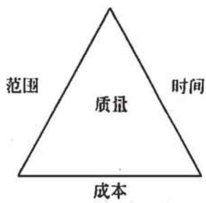

>[!warning] 版本提示
>本书为 **2006 年第 1 版**。现行考试依据是 **《信息系统管理工程师教程（第 2 版）》**（清华社 2024-10，20 章），
>两版**重合极少**：第 1 版的第 1–6 章（硬件/操作系统/语言/配置/数据结构/多媒体）在第 2 版已被删除或压缩。
>本页仅作**扩展参考**，备考请以 [[知识体系]]（第 2 版官方考纲）为准。

# 第11章 信息系统开发的管理知识

由于人类社会的大部分活动都可以按项目来运作，因此项目管理已深入到各行各业，以不同的类型、不同的规模出现。有些项目是指大类，如世行贷款项目、城市建设项目、技术改造项目等；有些项目则是指某项具体任务，如筹办一次 IT 知识竞赛、举办一个 IT 培训班等。

对企业来说，项目管理思想可以指导其大部分生产经营活动。例如，市场调查与研究、市场策划与推广、新产品开发、新技术引进和评价、人力资源培训、劳资关系改善、设备改造或技术改造、融资或投资等，都可以被看成是一个具体项目，通过采用项目小组的方式完成。同样，信息系统的建设也构成了一类项目，必须采用项目管理的思想和方法来指导。本章从介绍信息系统作为一类项目的概念开始，详细介绍了如何在信息系统建设中采用项目管理的思想和方法，尤其是如何在成本、质量和进度方面对信息系统这一类项目进行管理，最后将介绍市场上流行的几类项目管理工具，使读者对信息系统建设中的项目管理有一个大致的了解。

## 11.1 信息系统项目

## 11.1.1 项目的基本概念

什么是项目？简单地说，安排一场演出、开发一种新产品、建一幢大房子都可以被称为一个项目。所谓项目，简单地说，就是在既定的资源和要求的约束下，为实现某种目的而相互联系的一次性工作任务。这个定义包括三层意思：一定的资源约束、一定的目标、一次性任务。这里的资源包括时间资源、经费资源、人力资源等。

对项目的概念有了一定了解的基础上，我们来看一下项目的基本特征。

## 1. 明确的目标

项目是一种有着明确目标——一种期望的产品或希望得到的服务的一次性活动。这里的目标包括几个方面。

（1）时间目标如在规定的时段内或规定的时间点之前完成。

（2）成果目标如提供某种规定的产品、服务或其他成果。

（3）其他需满足的要求包括必须满足的要求和应尽量满足的要求。

目标允许有一个变动的幅度，也就是可以修改的。不过一旦项目目标发生实质性变化，它就不再是原来的项目了，而将产生一个新的项目。

## 2. 独特的性质

每一个项目都是唯一的、独特的。或者项目的成果与其他项目不同；或者项目的成果与其他项目类似，然而其时间和地点，内部和外部的环境，自然和社会条件有别于其他项目，总之项目总是独一无二的，没有两个项目是完全相同的。项目没有可以完全照搬的先例，也不会有完全相同的复制。

## 3. 有限的生命周期

项目有具体的时间计划，它有一个开始时间和目标必须实现的截止日期。虽然不同项目可以划分为不同的具体阶段，不过，大多数项目的生命周期都可以划分为启动、规划、实施、结尾4个阶段。

## 4. 特定的委托人

它既是项目结果的需求者，也是项目实施的资金提供者。他可能是一个人，或一个组织：委托人可能是企业外部的，被称作外部客户，也可能是企业内部的，比如企业内的别的部门，被称作内部客户。不管是外部客户还是内部客户，都是项目的委托人或项目成果的使用者。

## 5. 实施的一次性

一次性是项目与其他常规运作的最大区别。项目有确定的起点和终点，项目不能重复。

## 6. 组织的临时性和开放性

项目开始时要组建项目团队，项目团队在项目进展过程中，其人数、成员、职责在不断变化。某些成员是借调来的，项目终结时团队要解散，人员要转移。参与项目的组织往往有多个，甚至几十个或更多。他们通过协议或合同以及其他的社会关系结合到一起，在项目的不同时段以不同的程度介入项目活动。可以说，项目组织没有严格的边界，是有弹性的、模糊的、开放的。这一点与一般企事业单位和政府机构很不一样。

## 7. 项目的不确定性和风险性

项目以所需的时间估计、成本估计、各种资源的有效性为项目计划的假定条件，这种假定带来了一定程度的不确定性，这种不确定性为项目的实现带来一定的风险。项目是一次性任务，做坏了没有机会重来。项目必须保证成功，因此必须精心设计、精心制作和精心控制，以达到预期目标。

## 8. 结果的不可逆转性

不论结果如何，项目结束了，结果也就确定了。

## 11.1.2 信息系统项目的概念

通过上一节对项目的介绍，我们知道信息系统的建设也是一类项目。因为信息系统的建设符合项目的定义。我们知道，项目的定义中包含三层意思：一定的资源约束、一定的目标、一次性任务。首先，信息系统的建设是一次性的任务，有明确的任务范围和质量要求，有时间和进度的要求，有经费和资源的限制。因此，信息系统的建设是一类项目的建

设过程。

信息系统项目除了具有项目的特征之外，还具有自己的特点。

## 1. 信息系统项目的目标不精确、任务边界模糊，质量要求主要由项目团队定义

在信息系统开发初期，项目团队调研时，客户只能提出一些初步的功能要求，提不出确切的需求。信息系统项目的任务范围在很大程度上取决于项目组所做的系统规划和需求分析。另外，因为大部分客户方都不是从事信息技术的人员，对信息技术的各种性能指标并不熟悉，所以，信息系统项目所应达到的质量要求也更多地由项目组定义，客户则尽可能地进行审查。为了更好地定义或审查信息系统项目的任务范围和质量要求，客户方可以聘请第三方的信息系统监理或咨询机构来监督项目的实施情况。

## 2. 在信息系统项目开发过程中，客户的需求不断被激发，不断地被进一步明确，或者客户需求随项目进展而变化，从而导致项目进度、费用等计划的不断更改

尽管已经做好了系统规划、可行性研究，签订了较明确的技术合同，然而随着项目的进展，客户的需求不断地被激发，被进一步明确，导致程序、界面以及相关文档需要经常被修改。而且在修改过程中又可能产生新的问题，这些问题很可能经过相当长的时间后才会被发现。这就要求项目经理在项目开发过程中不断监控和调整项目计划的执行情况，尤其注重项目的变更管理。

1. 信息系统项目是智力密集、劳动密集型项目，受人力资源影响最大，项目成员的结构、责任心、能力和稳定性对信息系统项目的质量以及是否成功有决定性的影响

信息系统项目工作的技术性很强，需要大量高强度的脑力劳动。尽管近年来信息系统辅助开发工具的应用越来越多，但是项目各阶段还是渗透了大量的手工劳动。这些劳动十分细致、复杂和容易出错，因而信息系统项目既是智力密集型项目，又是劳动密集型项目。并且，由于信息系统开发的核心成果——应用软件是不可见的逻辑实体，如果人员发生流动，对于没有深入掌握软件知识或缺乏信息系统开发实践经验的人来说，很难在短时间内做到无缝地承接信息系统的后续开发工作。

另外，信息系统的开发是项目团队整体的工作，为了高质量的完成项目，要充分发掘项目成员的才能和创新精神，不仅要求他们具有一定的技术水平和工作经验，还要求他们具有良好的心理素质和责任心，尤其要具有团队合作精神。项目经理在项目开发过程中，也应该注重项目成员之间的沟通协调，要将人力放到与进度和成本一样高的地位来看待。

## 11.2 信息系统中的项目管理

美国学者戴维·克兰德指出："在应付全球化的市场变动中，战略管理和项目管理将起到关键性的作用"。战略管理立足于长远和宏观，考虑的是企业的核心竞争力，以及围绕增强核心竞争力的企业流程再造、业务外包和供应链管理等问题；项目管理则立足于一定的时期和相对微观，考虑的是有限的目标、学习型组织和团队合作等问题。

项目管理是一种科学的管理方式。在领导方式上，它强调个人责任，实行项目经理负责制；在管理机构上，它采用临时性动态组织形式——项目小组；在管理目标上，它坚持效益最优原则下的目标管理；在管理手段上，它有比较完整的技术方法。

那么到底什么是项目管理呢？所谓项目管理，就是项目的管理者，在有限的资源约束下，运用系统的观点、方法和理论，对项目涉及的全部工作进行有效地管理。即从项目的投资决策开始到项目结束的全过程进行计划、组织、指挥、协调、控制和评价，以实现项目的目标。

项目管理具有以下基本特点。

(1) 项目管理是一项复杂的工作。一个项目由多个部分组成, 工作将跨越多个组织,需要多学科的知识。项目工作没有或很少有以往的经验可以借鉴; 执行中涉及多个因素,每个因素又常常带有不确定性; 同时, 需要将不同经历、来自不同组织的人员组织在一个临时性的集体内, 在技术性能、成本、进度等较为严格的约束条件下实现目标。这些因素决定了项目管理的复杂性远远高于一般的生产管理。

(2) 项目管理具有创造性。项目是实现创新的事业, 项目管理也就是实现创新的管理。这也是与一般重复性管理的主要区别。创新总是带有探索性的, 有较高的失败率。

（3）项目管理需要集权领导并建立专门的项目组织。项目进行中出现的各种问题往往涉及多个组织部门，要求这些部门能够做出迅速而相互关联的反应。传统的职能组织难以与横向协调的需求相配合，所以需要建立专门组织，它不受现存组织的约束，由不同专业、来自不同部门的人员构成。

（4）项目负责人在项目管理中起着非常重要的作用。项目管理的主要原理之一，就是把一个时间有限、预算有限的事业委托给一个人——项目负责人。他有权独立进行计划、资源分析、协调和控制。他行使着大部分传统职能组织以外的职能。项目负责人必须能够了解、利用和管理项目的技术逻辑方面的复杂性，能够综合各种不同专业观点来考虑问题。除了具备这些技术知识和专业知识之外，项目负责人还必须具备组织能力，能够通过人的因素来熟练地运用技术因素，达到项目目标。也就是说，项目负责人必须使他的组织成为一支工作配合默契、具有积极性和责任心的高效率群体。

目前国际上存在两大项目管理研究体系：其一是以欧洲为首的体系，即国际项目管理协会（International Project Management Association, IPMA），该组织1965年在瑞士注册，是非营利性组织，成员主要是代表各个国家的项目管理研究组织；其二是以美国为首的体系，即美国项目管理协会（Project Management Institute, PMI），成员主要以企业、大学、研究机构的专家为主，IPMA和PMI相比，更注重实践能力。

目前比较流行的项目管理知识体系是美国项目管理协会（PMI）开发的项目管理知识体系（Project Management Bode of Knowledge，PMBOK）。该知识体系把项目管理划分为9个知识领域：范围管理、进度管理、成本管理、质量管理、人力资源管理、沟通管理、采购管理、风险管理和综合管理。我们简单的阐述一下项目管理这9个知识领域的内容（关于 PMBOK 的详细内容请参阅相关书籍及标准)。

## 1. 项目范围管理

要保证项目成功地完成所要求的全部工作，而且只完成所要求的工作。这一知识领域包括：

（1）项目启动：对项目或项目的阶段授权。

（2）范围计划：制定一个书面的范围陈述，作为未来项目决策的基础。

（3）范围定义：把项目应提交的成果进一步分解成为更小、更易管理的组成部分。

（4）范围确认：正式地认可项目满足了范围要求。

（5）范围变更控制：控制项目范围的变更。

## 2. 项目时间管理

要保证项目按时完成。这个知识领域包括：

（1）活动定义：识别出为产生项目提交成果而必须执行的特定活动。

（2）活动排序：识别并记录活动之间的相互依赖关系。

（3）活动时间估计：估计完成每一个活动将需要的工作时间。

（4）制定时间表：分析活动顺序、活动时间的估计和资源需求，建立项目时间表。

（5）时间表控制：控制项目时间表的变更。

## 3. 项目成本管理

要保证项目在批准的预算内完成。这一知识领域包括：

（1）资源计划：决定为执行项目活动所需要的资源的种类（人员、设备、材料）和数量。

（2）成本估算：对于为了完成项目活动所需资源的成本进行估计。

（3）成本预算：把估算的总成本分配到每一个工作活动中。

（4）成本控制：控制项目预算的变更。

## 4. 项目质量管理

要保证项目的完成能够使需求得到满足。这一领域具体包括：

（1）质量计划：找出与项目相关的质量标准，并决定如何满足标准的要求。

（2）质量保证：对项目绩效做经常性地评价，使得有信心达到质量标准的要求。

（3）质量控制：监视特定的项目结果以判定是否满足相关的质量标准，并找出方法来消除不能满足要求的原因。

## 5. 项目人力资源管理

尽可能有效地使用项目中涉及的人力资源。这包括：

（1）组织的计划：识别、记录、指派项目的角色、责任和报告关系。

（2）人员获得：使项目所需的人力资源得到任命并在项目中开始工作。

（3）团队建设：开发个人的和团队的技能来提高项目的绩效。

1. 项目沟通管理：

保证适当、及时地产生、收集、发布、储存和最终处理项目信息。其中包括：

(1) 沟通计划: 决定项目相关者的信息和沟通的需求, 包括谁需要什么信息, 什么时间需要, 以及得到信息的方式。

（2）信息发布：及时地把所需的信息提供给相关者使用。

(3) 绩效报告: 收集、分发绩效信息, 包括状态报告、进度衡量和预测。

(4) 管理上的结束: 产生、收集、分发信息, 使项目或项目阶段正式地结束。

## 7. 项目风险管理

对项目的风险进行识别、分析和响应的系统化的方法，包括使有利的事件机会和结果最大化和使不利的事件的可能和结果最小化。这一知识领域包括：

（1）风险管理计划：决定如何处理并计划项目的风险管理活动。

(2) 风险识别: 决定哪些风险可能会影响项目, 并记录风险的特征。

(3)风险定性分析: 对风险和条件进行定性分析, 根据对项目目标的作用排定优先级。

（4）风险量化分析：度量风险的可能性和后果，并评估它们对项目目标的影响。

(5)风险响应计划: 针对影响项目目标的风险制定过程和方法来增加机会和减少威胁。

（6）风险监视和控制：监视已知的风险，识别新的风险，执行风险减低计划，在整个项目生命周期中评价它们的有效性。

## 8. 项目采购管理

为达到项目范围的要求，从外部企业获得货物和服务的过程。在这一知识领域中包括：

(1) 采购计划: 决定采购的内容和时间。

(2) 邀请计划: 记录产品需求、识别潜在来源。

(3) 邀请: 根据需要获得价格、报价、投标、建议书等。

(4) 来源选择: 从潜在的销售商中进行选择。

(5) 合同管理: 管理与销售商的关系。

(6) 合同结束: 合同的完成和结算, 包括解决任何遗留问题。

## 9. 项目综合管理

保证项目中不同的因素能适当协调。这一领域包括：

(1) 制定项目计划: 集成、协调全部的项目计划内容, 形成一致的、联系紧密的文件。

(2)执行项目计划:通过执行其中的活动来执行项目计划。

(3) 集成的变更控制: 在整个项目中协调变更。

项目作为一个整体，要使各方面的资源能够协调一致，就要特别熟悉项目三角形的概念。所谓项目三角形，是指项目管理中范围、时间、成本三个因素之间的互相影响的关系（如图 11.1 所示）。项目三角形中的范围，除了要考虑对项目直接成果的要求，还要考虑与之相关的在人力资源管理、质量管理、沟通管理、风险管理等方面的工作要求。项目三角形中的成本，主要来自于所需资源的成本，自然也包括人力资源的成本，这些资源可通过不同的方式获得，可以对应不同的成本，对资源的需求与工作范围和工作时间都有直接的联系。质量处于项目三角形的中心。质量会影响三角形的每条边，对三条边中的任何一条所做的更改都会影响质量。质量不是三角形的要素；它是时间、费用和范围协调的结果。

  
图11.1 项目三角形

项目三角形强调的就是这三方面的这种相互影响的紧密关系。为了缩短项目时间，就需要增加项目成本（资源）或减少项目范围；为了节约项目成本（资源），可以减少项目范围或延长项目时间；如果需求变化导致增加项目范围，就需要增加项目成本（资源）或延长项目时间。因此，项目计划的制定过程是一个多次反复的过程，根据各方面的不同要求，不断调整计划来协调它们之间的关系。在项目执行过程中，当项目的某一因素发生变更时，往往会直接影响到其他因素，需要同时考虑一项变更给其他因素造成的影响，项目的控制过程就是要保证项目各方面的因素从整体上能够相互协调。

## 11.3 信息系统开发的管理工具

项目管理的最佳实践离不开好的项目管理工具。有效的项目管理工具能够帮助项目小组将所有的项目及其资源配置融合到统一的项目计划中去。任何新的意料之外的项目都能够被添加到统一的计划当中。但是作为新兴市场，项目管理工具市场还不成熟，推荐的项目管理工具有近百家，谁优谁劣，不容易看清楚，而且风险很大。接下来我们简单介绍几种常用的项目管理工具。

## 11.3.1 Microsoft Project 98/2000

作为桌面项目管理工具，微软的 Microsoft Project Project 98 以其用户界面的友好、操作的灵活性成为 "杀手级" 的应用，在企业中得到了广泛的应用。

在 Microsoft Project Project 98 的基础上，微软公司于 2000 年 4 月推出了 Microsoft Project 2000。目前 Microsoft Project 2000 已经是一个在国际上享有盛誉的通用的项目管理工具，占有 75% 的国际市场份额，适合各个行业进行项目管理。该软件凝集了许多成熟的项目管理现代理论和方法，因此能够高质量地管理各种类型的大、中型项目。比较突出的管理技术如：

\- 时间管理方面：横道图、里程碑、关键路径法（CPM）、计划评审技术（PERT）等。

\- 成本管理方面：自下向上参数估算技术、成本累计曲线（S 曲线）、挣得值评价技术等。

\- 人力资源管理：目标管理、责任矩阵、资源需求直方图等。

\- 风险管理方面：蒙托卡罗模拟法、基础统计技术等。

\- 沟通管理方面：基于电子邮件和Web的项目协调技术等。

Microsoft Project 2000 包括两个部分：Microsoft Project 2000 和 Project 2000 Central。

(1) Microsoft Project 2000 供项目经理使用，进行计划制定、管理和控制。Microsoft

Project 2000 不仅可以快速、准确地建立项目计划，使项目管理者从大量烦琐的计算绘图中解脱出来，而且可以帮助项目经理实现项目进度和成本分析、预测、控制等靠人工根本无法实现的功能，使项目工期大大缩短，资源得到有效利用，提高了经济效益。

（2）Project 2000 Central 包括服务器端和客户端。Microsoft Project 2000 Central 的主要功能包括：

\- 项目成员接受任务。

\- 工作组成员可以看到与他们相关的所有项目中的任务，并对这些任务进行分组、排序和筛选。

\- 查看项目信息，工作组成员可查看整个项目的最新信息。

\- 创建新任务。工作组成员可创建新任务，而且可将这些新任务发送给项目经理，由项目经理合并到项目文件中。

\- 反馈任务的执行情况。项目成员可以反馈任务的完成情况，填报工时、完成百分比等。

\- 工作委托。工作组成员可将任务委托给其他工作组成员，从而项目经理可以将任务发送给工作组组长或领导，再由他们将任务重新分配给各个资源。

另外，微软已经收购了另一项目管理工具供应商 Elabor 公司，准备推出 Microsoft Project 2001。据说，Microsoft Project 2001 将是一个真正的企业级项目管理工具。

## 11.3.2 P3/P3E

Primavera Project Planner（P3）工程项目管理软件是美国 Primavera 公司的产品，是国际上流行的高档项目管理软件，已成为项目管理的行业标准。

P3 软件是全球用户最多的项目进度控制软件，它在如何进行进度计划编制、进度计划优化，以及进度跟踪反馈、分析、控制方面一直起到方法论的作用。P3 软件适用于任何工程项目，能有效地控制大型复杂项目，并可以同时管理多个工程。如同世界上大部分大型工程都使用 P3 进行进度计划编制和进度控制一样，国内绝大部分大型工程也都在使用 P3，譬如三峡、小浪底、二滩等大型水利水电工程。

P3E(Primavera Project Planner for Enterpriser)是在 P3 的基础上开发的企业集成项目管理工具。P3E 的企业项目结构（EPS）使得企业可按多重属性对项目进行随意层次化的组织，使得企业可基于 EPS 层次化结构的任一点进行项目执行情况的财务分析。支持项目级别的真正多用户并发应用。

## P3E 包括 4 个模块

（1）P3E 计划模块：这是 P3E 的主模块，供项目经理使用，进行项目计划制定、管理和控制。采用 Client/Server 模式，数据库可采用 Oracle、MS SQL、InterBase 等。

（2）进度汇报模块（Progress Reporter）：供项目成员使用，用来接收任务分配，反馈任务执行的进度。基于 Web，项目成员可通过浏览器访问。

（3）Primavision 模块：项目经理使用该模块来发布项目计划，计划发布到一个 Intranet 或者 Internet 站点上，允许项目成员和其他感兴趣的人员使用 Web 浏览器察看所有项目信息；

（4）Portfolio Analyst 模块：向项目主管、高层管理者以及项目分析员提供项目总结和跟踪信息，包括丰富的图形、电子数据表和报表等。

P3E 的主要使用对象为大型的建设项目集团公司、大型设计制造企业、大型设计院、大型连续运行装置检修维护、政府投资的系列项目、公共设施系列建设、跨国公司多项目的管理。

## 11.3.3 ClearQuest

在软件开发中功能改进、版本升级变得越来越频繁，软件开发小组成员需要清楚地了解软件更新的全过程，并随时跟踪、调试等。因此，软件项目开发应该被仔细、严格地管理，如果管理不善，开发小组将很难按时、按质按量地完成软件的升级工作。也就是说，软件开发小组要建立一个完整的更新管理系统，以把握整个开发过程中的各种修改并进行详细的记录，该系统能够记录所有类型的要求、详细变更、文档更新，等等。此外，还可以让项目管理人员和开发人员跟踪和分析项目的进度，并提供详细报表。ClearQuest 就是满足以上所有要求的项目管理软件，它由瑞理软件公司提供。它使得管理人员和开发人员可以轻松了解对软件的各种修改，并方便其他开发人员快速加入到项目中来。

另外，ClearQuest 不仅仅是一个灵活的错误修改和跟踪系统，而且还可以随着软件开发的进程进行动态设计，这使得整个开发团队在从开始到结束的全部开发过程中，始终都可以掌握最新的设计和改变，并最终开发出高质量的软件。

ClearQuest 支持 Windows、Unix 和 Web，所以在企业应用中的配置是非常简单的，它可被整合到多平台的商业环境中，并保证所有开发小组的成员可以和同一个错误和修改过程相关联。但是，ClearQuest 不支持 Linux。

ClearQuest 可以和它所处平台上的大多数数据库协同工作，包括 Oracle、IBM UDB、Microsoft SQL Server 和 Access，以及与 ClearQuest 捆绑在一起的 Sybase SQL Anywhere。此外，ClearQuest 还可以和来自瑞理（Rationa）或第三方的开发方案（包括配置管理、自动测试和需求管理等）整合。例如，它可以和瑞理的软件配置管理方案，以及微软的 Visual SourceSafe 无缝整合，这种整合允许开发小组轻松地将修改要求和基本代码相关联。

ClearQuest 易于上手。因为瑞理预先定义好了数量众多的程序、窗口以及关联的规则。如果要更进一步地配置，就要使用 ClearQuest 的 Designer 组件定制单独的数据库域、程序、窗口和规则。ClearQuest 的一个特长就是通过图表或表格的突出显示来有效地实施错误跟踪和修改管理方案。另外，ClearQuest 包含的 Crystal Reports 使得在 ClearQuest 中可以非常容易地实现报表，并且功能强大。

总地来说，ClearQuest 使用简单、功能强大，适用于所有的开发过程。

1. 下列哪项费用不属于运行维护成本？

① 运行费用

② 行政管理费用

③ 维护费用

④ 系统实施费用

1. 说说信息系统项目的特点，并谈谈你对这些特点的理解。

2. 给出项目的定义并说明项目管理三要素之间的关系。

3. 信息系统建设为什么需要全面质量控制，如何实行全面质量控制。
