>[!warning] 版本提示
>本书为 **2006 年第 1 版**。现行考试依据是 **《信息系统管理工程师教程（第 2 版）》**（清华社 2024-10，20 章），
>两版**重合极少**：第 1 版的第 1–6 章（硬件/操作系统/语言/配置/数据结构/多媒体）在第 2 版已被删除或压缩。
>本页仅作**扩展参考**，备考请以 [[知识体系]]（第 2 版官方考纲）为准。

# 第12章 信息系统分析

系统分析是信息系统开发工作中最重要的一环。系统分析的内容主要包括对组织内部整体管理状况和信息处理过程（侧重于具体业务全过程角度）进行分析。在系统分析中扎扎实实地了解实际工作部门的业务情况是一个基础，只有在对业务了解得非常透彻的前提之下才有可能提出新的改进方案。本章将明确系统分析阶段的任务，并介绍系统分析的一般步骤，然后详细介绍系统分析使用的主要方法——结构化分析方法以及系统分析阶段的产出——系统规格说明书，最后将简单介绍一下系统分析的工具——UML方法，使读者对系统分析阶段有一个详细的了解。

## 12.1 系统分析的任务

系统分析是应用系统的思想和方法，把复杂的对象分解成简单的组成部分，并找出这些部分的基本属性和彼此间的关系。

系统分析的主要任务是理解和表达用户对系统的应用需求。通过深入调查，和用户一起充分了解现行系统是怎样工作的，理解用户对现行系统的改进要求和对新系统的要求。在此基础上，把和用户共同理解的新系统用恰当的工具表达出来。其主要任务是：

\- 了解用户需求。通过对现行系统中数据和信息的流程以及系统的功能给出逻辑的描述，得出现行系统的逻辑模型。

\- 确定系统逻辑模型，形成系统分析报告。在调查和分析中得出新系统的功能需求，并给出明确地描述。根据需要与实现可能性，确定新系统的功能，用一系列图表和文字给出新系统功能的逻辑描述，进而形成系统的逻辑模型。完成系统分析报告，为系统设计提供依据。

系统分析阶段的基本任务是：系统分析员和用户在一起，充分理解用户的要求，并把双方的理解用书面文档（系统规格说明书）表达出来。系统分析阶段的工作成果就体现在系统规格说明书中，这是信息系统建设的必备文件。它既是给用户看的，也是下一阶段的工作依据。因此，系统规格说明书既要通俗易懂，又要准确。用户通过系统规格说明书可以了解未来系统的功能，判断它是不是其所要求的系统。系统规格说明书审核通过之后，将成为系统设计的依据和将来验收系统的依据。系统规格说明书在第13.4节有详细介绍。

在信息系统建设中，拟建的信息系统一般不会是一个全新的系统，而是基于一定的原系统（也就是企业的现行系统）开发的。所以，新系统既要源自原系统，又要高于原系统。

也就是说，新系统的功能要更强、效率要更高、使用要更方便。因此，系统分析员要与用户紧密配合，用系统的思想和方法，对企业的业务活动进行全面的调查分析，详细掌握有关的工作流程，分析现行系统的业务流程，指出现行系统的局限性和不足之处，找出制约现行系统的"瓶颈"，确定新系统的基本目标和逻辑功能要求，即提出新系统的逻辑模型。所以系统分析阶段又被称为逻辑设计阶段。这个阶段是整个系统建设的关键阶段，也是信息系统建设与一般工程项目的重要区别所在。

系统分析要回答新系统"做什么"这个关键性的问题。只有明确了问题，才有可能回答"怎么做"，才有可能解决问题；否则，方向不明确，等于无的放矢、吃力不讨好。实际工作中常常有这种情形，即业务人员认为信息系统的开发知识技术人员的事，开发人员根据对用户要求的肤浅理解就匆匆忙忙进行系统设计、编写程序。结果交给用户使用时，用户说"这不是我要的系统"。对系统分析缺乏足够的重视，是导致工期一再延长甚至以失败告终的重要原因，也是系统分析难以进行的主观原因。

系统分析是信息系统开发最重要的阶段，也是最困难的阶段。系统分析的困难主要来自三个方面：问题空间的理解、人与人之间的沟通和环境的不断变化。

由于系统分析员缺乏足够的对象系统的专业知识，在系统调查中往往觉得无从下手，不知道问用户一些什么问题，或者被各种具体数字、大量的资料、庞杂的业务流程搞得眼花缭乱。一个规模较大的系统，反映各种业务情况的数据、报表、账单及业务人员手中各种正规的、非正规的手册、技术资料等，数量相当大。各种业务之间的联系繁杂，不熟悉业务情况的系统分析员往往感到好像处在不见天日的大森林中，各种信息流程像一堆乱麻，不知如何理出头绪，更谈不上分析制约现行系统的"瓶颈"。

另一方面，用户往往缺乏计算机方面的足够知识；不了解计算机能做什么和不能做什么。许多用户虽然精通自己的业务，但往往不善于把业务过程明确地表达出来，不知道该给系统分析员介绍些什么。对一些具体的业务，他认为理所当然就该这样或那样做。尤其是对于某些决策问题，根据他的经验，凭直觉就应该这样或那样做。在这种情况下，系统分析员很难从业务人员那里获得充分有用的信息。如果系统分析员和用户沟通不畅，有时候用户甚至会产生排斥心理，使得系统分析工作尤其困难。

俗话说："隔行如隔山"。系统分析员与用户的知识构成不同、经历不同，使得双方交流十分困难，因而系统调查容易出现遗漏和误解，这些误解和遗漏是系统开发的隐患，会使系统开发偏离正确的方向。

最使系统分析员困惑的是环境的变化。系统分析阶段要通过调查分析，抽象出新系统的概念模型，锁定系统边界、功能、处理过程和信息结构，为系统设计奠定基础。但是，信息系统生存在不断变化的环境中，环境对它不断提出新的要求。只有适应这些要求，信息系统才能生存下去。在系统分析阶段，要完全确定系统模式是困难的，有时甚至是办不到的。

为了克服这些困难，做好系统分析工作，需要系统分析员和用户精诚合作，系统分析员应牢固树立"用户第一"的思想，同时，还要借助一定的技术和工具。这里说的工具是指一些合理的图表，直观的图表可以帮助系统分析员理顺思路，也便于与用户交流。

我们可以看到，在系统开发中系统分析员起着十分重要的作用。系统分析这一重要而艰巨的任务主要由系统分析员承担。他要与各类人员打交道，是用户和技术人员之间的桥梁和"翻译"，并为管理者提供控制开发的手段。而系统分析员的知识水平和工作能力是最为重要的。一个称职的系统分析员不但应具备坚实的信息系统知识，了解计算机技术的发展，而且还必须具备管理科学的知识。缺乏必要的管理科学知识，就没有与各级管理人员打交道的"共同语言"。很难设想，缺乏财务基础知识的人能设计出实用的财务系统。系统分析员应有较强的系统观点和较好的逻辑分析能力，能够从复杂的事物中抽象出系统模型。系统分析员还应具备较好的口头和书面表达能力、较强的组织能力、善于与人共事。总之，系统分析员应是具有现代科学知识的、具有改革思想和改革能力的专家。

## 12.2 系统分析的步骤

系统分析的步骤如下。

（1）现行系统的详细调查。调查是分析与设计的基础。详细调查现行系统的情况和具体结构，并用一定的工具对现行系统进行详尽地描述，这是系统分析最基本的任务。在充分了解现行系统现状的基础上，进一步发现其存在的薄弱环节和问题，为下一步的需求分析和提出新的逻辑设计做好准备。

详细调查应强调用户的参与，部门的业务人员、主管人员、系统分析人员、系统设计人员共同参与。调查工作应从企业组织的管理层开始，逐层向下调查，确保对整个企业的管理工作全面了解。在调查的过程中，要从客观去了解企业的现状和环境，掌握企业存在的问题和薄弱环节。

为了便于分析人员和业务人员之间进行业务交流和分析问题，应尽可能使用各种形象直观的图表工具。调查工作的每一步都要事先计划好，对所有人的工作方法，调查所用的表格和图例都要统一地规范化处理。所有规范化调查结果都应整理后归档。以便以后工作中使用。对于系统实施的重点部分及近期内要先实施的局部系统进行重点调查。

（2）在详细调查的基础上，进行需求分析。需求是指用户要求新系统应具有的全部功能和特性。主要包括：功能需求、性能需求、可靠性需求、安全、保密需求、开发费用和时间，以及资源方面的限制等。

（3）提出新系统的逻辑模型。在调查分析的基础上要创建新系统的逻辑模型，对反应用户需求的新系统应具备的功能进行全面、系统、准确、详细的描述。表达系统逻辑模型需要用到许多工具，如数据流图、数据字典等，在下一节将会详细介绍这些工具。

建模过程还是进一步发现问题、解决问题以及深入分析的过程，凡在建模过程中发现情况不明、数据不全或有矛盾与冲突之处，要做进一步的调查以进行弥补和纠正。

在这一过程中，用户的直接参与起着关键作用。用户对逻辑模型的理解和确认不仅是系统分析工作成功的关键，也是今后系统设计与实施阶段用户与系统建设的其他人员相互支持与配合的基础。

（4）编写系统规格说明书。用比较形式化的术语来表示对软件功能构成的详细描述，系统规格说明书是技术合同说明，是设计和编码的基础，也是测试和验收的依据。

## 12.3 结构化分析方法

## 12.3.1 结构化分析方法的内容

系统分析是保证信息系统质量的第一步，它的任务是艰巨的、复杂的。如何分析用户需求，用什么形式表示系统规格说明书等，都需要有相应的方法、模型、语言和工具来配合。自20世纪70年代以来，逐渐出现了多种适用于系统分析阶段的方法，结构化分析方法就是其中具有代表性的一种方法。

结构化分析（Structured Analysis, SA）方法由美国 yourdon 公司在 20 世纪 70 年代提出，是一种简单实用、使用很广的方法。该方法通常与我们以后要介绍的系统设计阶段的结构化设计（SD）方法衔接起来使用，适用于大型信息系统开发使用。

那么到底什么是结构化分析方法呢？结构化分析方法是一种单纯的自顶向下逐步求精的功能分解方法，它按照系统内部数据传递，以变换的关系建立抽象模型，然后自顶向下逐层分解，由粗到细、由复杂到简单。结构化分析的核心特征是"分解"和"抽象"。"分解"就是把大问题分解成若干个小问题，然后分别解决，从而简化复杂问题的处理。"抽象"就是将一些具有某些相似性质的事物的相同之处概括出来，暂时忽略其不同之处，或者说，抽象是抽象出事物的本质特性而暂时不考虑它们的细节。分解和抽象实质上是一对相互有机联系的概念。自顶向下的过程，即从顶层到第一层再到第二层的过程，被称为"分解"；自底向上的过程，即从第二层到第一层再到顶层的过程，被称为抽象。也就是说，下层是上层的分解，上层是下层的抽象。这种层次分解使我们不必去考虑过多细节，而是逐步了解更多的细节。对于顶层不考虑任何细节，只考虑系统对外部的输入和输出，然后，一层层地了解系统内部的情况。结构化系统分析和设计方法的基本思想是：用系统的思想、系统工程的方法，按用户至上的原则，结构化、模块化、自上而下对信息系统进行分析与设计。主要指导原则有以下几点。

（1）请用户共同参与系统的开发。

（2）在为用户编写有关文档时，要考虑到他们的专业技术水平，以及阅读与使用资料的目的。

（3）使用适当的画图工具做通信媒介，尽量减少与用户交流意见时发生问题的可能性。

（4）在进行系统详细设计工作之前，就建立一个系统的逻辑模型。

（5）采用 "自上而下" 方法进行系统分析和设计，把主要的功能逐级分解成具体的、比较单纯的功能。

（6）采用 "自顶向下" 方法进行系统测试，先从具体功能一级开始测试，解决主要问题，然后逐级向下测试，直到对最低一级具体功能测试完毕为止。

（7）在系统验收之前，就让用户看到系统的某些主要输出，把一个大的负责的系统逐级分解成小的、易于管理的系统，使用户能够尽早看到结果，及时提出意见。

（8）对系统的评价不仅是指开发和运行费用的评价，而且还将是对整个系统生存过程的费用和收益的评价。

结构化分析方法利用图形来表达需求，显得清晰、简明、易于学习和掌握。而且按照自顶向下、逐层分解的方式，不论系统有多复杂、规模有多大，分析工作都可以有条不紊地开展。对于大的系统只需多分解几层，分析的复杂程度并不会随之增大。这也是结构化分析的特点。

结构化分析方法使用了以下几个工具：数据流图、数据字典、实体关系图、结构化语言、判定表和判定树，我们将介绍前4种工具。

## 12.3.2 结构化分析方法的工具

## 1. 数据流图

数据流图（Data Flow Diagram，DFD）是一种最常用的结构化分析工具，它从数据传递和加工的角度，以图形的方式刻画系统内数据的运动情况。数据流图是一种能全面地描述信息系统逻辑模型的主要工具，它可以用少数几种符号综合地反映出信息在系统中的流动、处理和存储的情况。数据流图具有抽象性和概括性。抽象性表现在它完全舍去了具体的物质，只剩下数据的流动、加工处理和存储；概括性表现在它可以把信息中的各种不同业务处理过程联系起来，形成一个整体。无论是手工操作部分还是计算机处理部分，都可以用它表达出来。因此，我们可以采用 DFD 这一工具来描述管理信息系统的各项业务处理过程。

## (1) 数据流图的基本成分

数据流图用到 4 个基本符号，即外部实体、数据流、数据存储和处理逻辑，如图 12-1 所示。

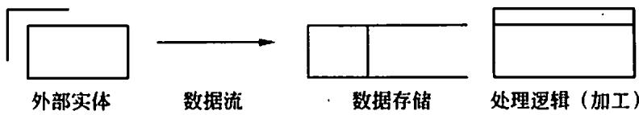  
图 12-1 数据流图的基本成分

① 外部实体。外部实体指不受系统控制，在系统以外又与系统有联系的事物或人，它表达了目标系统数据的外部来源或去处。例如，顾客、职工、供货单位，等等。外部实体也可以是另外一个信息系统。

外部实体用一个正方形，并在其左上角外边另加一个直角来表示，在正方形内写上该外部实体的名称。为了区分不同的外部实体，可以在正方形的左上角用一个字符表示。在数据流图中，为了减少线条的交叉，同一个外部实体在一张数据流图中可以出现多次，这是在该外部实体符号的右下角画斜线，表示重复。若重复的外部实体有多个，则相同的外部实体画数目相同的斜线，如图12-2所示。

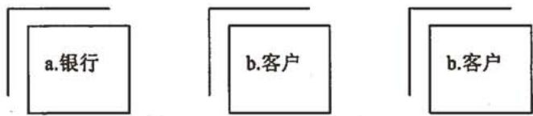  
图 12-2 外部实体

② 数据流。数据流表示数据的流动方向，用一个水平箭头或垂直箭头表示。数据流可以是订单、发票等。数据流一般不会是单纯的数据，而是由一些数据项组成。例如"发票"数据流由品名、规格、单位、单价、数量等数据项组成。

一般来说，对每个数据流要加以简单地描述，使用户和系统设计员能够理解一个数据流的含义。对数据流的描述写在箭头的上方，一些含义十分明确的数据流，也可以不加以说明，如图 12-3 所示。

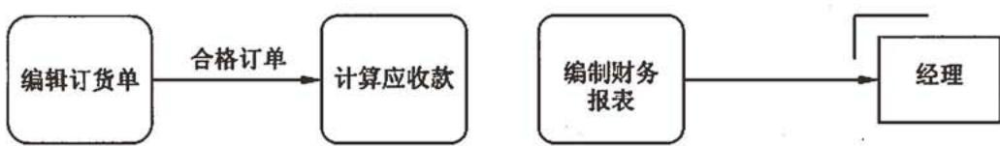  
图12-3 数据流的图示

③ 数据存储。数据存储表示数据保存的地方。这里的"地方"并不是指保存数据的物理地点或物理介质，而是指数据存储的逻辑描述。所以这里的数据存储是逻辑意义上的数据存储环节，即系统信息处理功能需要的，不考虑存储的物理介质和技术手段的数据存储环节。

在数据流图中，数据存储用一个右边开口的长方形条来表示，图形右部填写存储的数据和数据集的名字，名字要恰当，以便用户理解。左边填写该数据存储的标识，用字母 D 和数字组成。同一数据存储可在一张数据流图中出现多次，这时在数据存储符号上画竖线，表示重复。

指向数据存储的箭头，表示送数据到数据存储（存放、改写等）；从数据存储发出的

箭头，表示从数据存储读取数据，如图 12-4 所示。

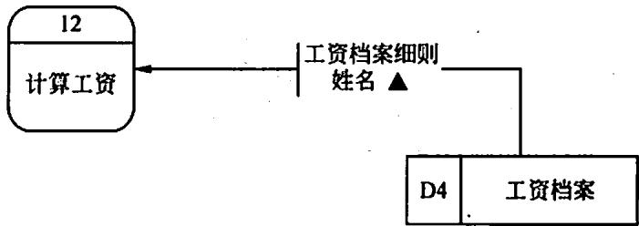  
图12-4 数据存储

④ 处理逻辑（加工）处理逻辑指对数据的逻辑处理功能，也就是对数据的变换功能。它包括两方面的内容：一是改变数据结构；二是在原有数据内容基础上增加新的内容，形成新的数据。

在数据流图中，处理逻辑可以用一个带圆角的长方形来表示，长方形分为三个部分，如图 12-5 所示。

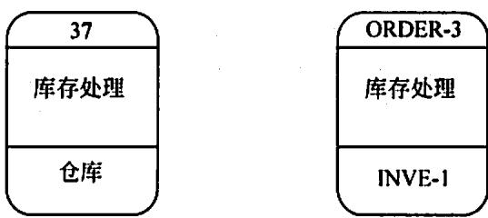  
图12-5 处理逻辑

标识部分用来标明一个功能，一般用字符串表示，如 P1，P1.1 等。

功能描述部分是必不可少的，它直接表达这个处理逻辑的逻辑功能。一般用一个动词加一个作动词宾语的名词表示。不过要恰如其分地表达一个处理的功能，有时候需要下一番功夫。

功能执行部分表示这个功能由谁来完成，可以是一个人，也可以是一个部门，甚至可以是某个计算机程序。

## (2) 数据流图的绘制

由于数据流图在系统建设中的重要作用，绘制数据流图必须坚持正确的原则和运用科学的方法。绘制数据流图应遵循的主要原则如下。

① 确定外部项。一张数据流图表示某个子系统或某个系统的逻辑模型。系统分析人员要根据调查材料，首先识别出那些不受所描述的系统的控制，但又影响系统运行的外部环境，这就是系统的数据输入的来源和输出的去处。要把这些因素都作为外部项确定下来。

确定了系统和外部环境的界面，就可集中力量分析，确定系统本身的功能。

② 自顶向下逐层扩展。信息系统庞大而复杂，具体的数据加工可能成百上千，关系错综复杂，不可能用一两张数据流图明确、具体地描述整个系统的逻辑功能，自顶向下的原则为我们绘制数据流图提供了一条清晰的思路和标准化的步骤。

③ 合理布局。数据流图的各种符号要布局合理，分布均匀、整齐、清晰，使读者一目了然。这才便于交流，避免产生误解。一般要把系统数据主要来源的外部项尽量安排在左方，而要把数据主要去处的外部项尽量安排在右边，数据流的箭头线尽量避免交叉或过长，必要时可用重复的外部项和重复的数据存储符号。

④ 数据流图只反映数据流向、数据加工和逻辑意义上的数据存储，不反映任何数据处理的技术过程、处理方式和时间顺序，也不反映各部分相互联系的判断与控制条件等技术问题。这样，只从系统逻辑功能上讨论问题，便于和用户交流。

⑤ 数据流图绘制过程，就是系统的逻辑模型的形成过程，必须始终与用户密切接触、详细讨论、不断修改，也要和其他系统建设者共同商讨以求一致意见。

## (3) 数据流图的改进

对每个系统都有一个逐步熟悉和深化的过程，因此在画数据流图时难免会有这样或那样的错误，这就需要对数据流图做进一步的改进。一般可从下面两个方面着手。

① 检查数据流图的正确性。

\- 数据是否守恒，即输入数据与输出数据是否匹配。数据不守恒的情况有两种。一种是某个处理过程产生输出数据，但没有输入数据给该处理过程，这肯定是某些数据流被遗漏了。另一种是有输入数据给处理过程，但没有输出数据，这种情况不一定是错误，但必须认真加以推敲：为什么将这些数据输入给这个处理过程，而处理过程却不利用它产生输出？如果确实是不必要的，就可将它去掉，以简化处理逻辑之间的联系。

\- 数据存储的使用是否恰当。在一套数据流图中的任何一个数据存储，必定有流入的数据流和流出的数据流，即写文件和读文件，缺少任何一种都意味着遗漏了某些处理逻辑。

\- 父图和子图是否平衡。父图中某一处理框的输入、输出数据流必须出现在相应的子图中，否则就会出现父图与子图的不平衡。父图和子图的数据流不平衡是一种常见的错误现象。尤其是在对子图进行修改时（如添加或删除某些数据流），必须仔细检查其父图是否要做相应的修改，以保持数据流的平衡。父图与子图的关系，类似于全国地图与各省地图的关系。在全国地图上标出主要的铁路、河流，在各省地图上标得则更详细，除了有全国地图上与该省相关的铁路、河流之外，还有一些次要的铁路、公路、河流等。

\- 任何一个数据流至少有一端是处理框。换句话说，数据流不能从外部实体直接到数据存储，也不能从数据存储直接到外部实体，也不能在外部实体之间或数据存储之间流动。初学者往往容易违反这一规定，常常在数据存储与外部实体之间画数据流。其实，记住数据流是处理功能的输入或输出，就不会出现此类错误。

② 提高数据流图的易理解性。

数据流图是系统分析员进行业务调查，与用户沟通的重要工具。因此，数据流图应该简明易懂。这也有利于后面的设计，有利于对系统规格说明书进行维护。可以从以下几个方面提高易理解性。

\- 简化处理间的联系。结构化分析的基本手段是"分解"，其目的是控制复杂性。合理的分解是将一个复杂的问题分成相对独立的几个部分，每个部分可被单独理解。在数据流图中，将一个处理逻辑分解成若干个子处理逻辑，并使各子处理逻辑尽可能地相对独立、处理逻辑间的数据流尽可能地少、每个处理逻辑的输入和输出数据流数目尽可能地少，这样每一个处理逻辑就比较容易被单独地理解，因而一个复杂的处理逻辑也就被几个较简单的子处理逻辑代替了。

\- 保持分解的均匀性。理想的分解是将一个加工分成大小均匀的几个子加工。如果在一张数据流图上，某几个已经是不必再分解的基本加工，而另一些加工却还要进一步分解三四层，这样的分解就不均匀。不均匀的分解是不容易被理解的。因为其中一些已是细节，而另一些仍然是较高层次上的抽象。在这种情况下应考虑重新分解，应努力避免特别不均匀的分解。

\- 适当命名。给数据流图中的各个成分取一个适当的名字无疑是提高其易理解性的重要手段之一。比如处理框的命名应能准确地表达其功能，理想的命名由一个具体的动词加一个具体的名词（宾语）组成，在下层尤其应该如此。例如"计算总工作量"、"开发票"。而最好将"存储和打印提货单"分成两个。"处理订货单"则不太好，"处理"是空洞的动词，没有说明究竟做什么。如果难以为某个成分取合适的名字，那么往往是分解不当的迹象，这时可以考虑重新分解。

数据流图也常常需要重新分解。例如画到某一层时意识到上一层或上几层所犯的错误，这时就需要对它们重新分解。重新分解可按下述步骤进行：

\- 把需要重新分解的数据流图的所有子图拼接成一张图。

\- 把新拼接成的图分成几个部分，使各部分之间的联系最少。

\- 重新建立父图，即把第②步所得的每一部分画成一个处理框。

\- 重新建立各张子图，这只需要把第②步所得的图沿各个部分边界分开即可。

\- 为所有处理重新命名和编号。

(4) 数据流图举例。

下面我们以高等学校学籍管理系统为例，说明画数据流图的方法。学籍管理是一项十分严肃而复杂的工作。它要记录学生从入学到离校，整个在校期间的情况，学生毕业时把学生的情况提供给用人单位。学校还要向上级主管部门报告学籍的变动情况。

图 12-6 所示概括描述了系统的轮廓、范围，标出了最主要的外部实体和数据流。它是进一步分析的出发点。学籍管理包括学生学习成绩管理、学生奖惩管理、学生异动管理三个部分。由此，图 12-6 可以展开为图 12-7。虚线框是图 12-6 中处理逻辑的放大。下面以"成绩管理"为例，说明逐层分解的思路。

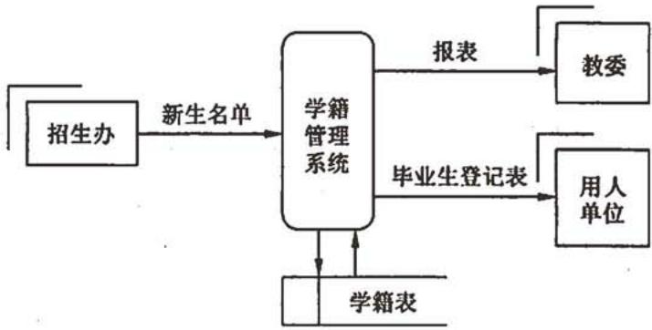  
图 12-6 学箱管理系统顶层图

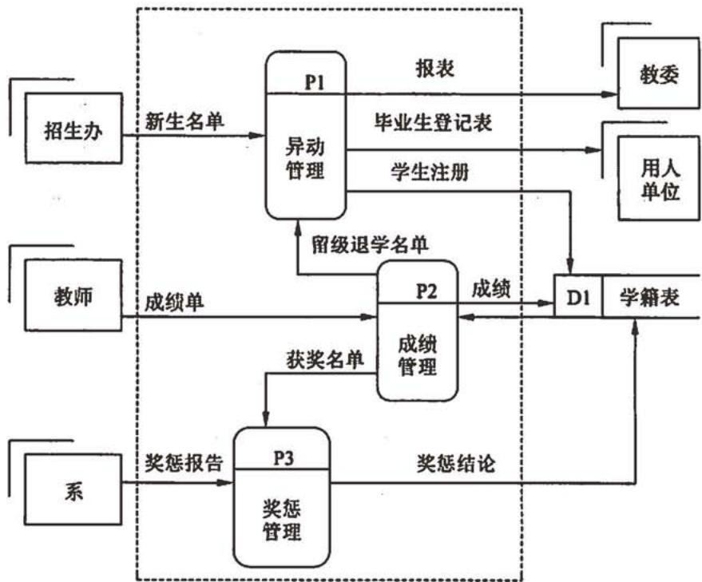  
图 12-7 学籍管理系统的第一层数据流图

某校现在实行校、系两级管理学习成绩。学校教学管理科、系教务员都登记学生成绩。任课教师把学生成绩单一式两份分别送系教务员和学校教学管理科。系教务员根据成绩单登录学籍表，学期结束时，给学生发成绩通知，根据学籍管理条例确定每个学生升级、补考、留级、退学的情况。教学管理科根据收到的成绩单登录教管科存的学籍表，统计各年级各科成绩分布，报主管领导。补考成绩也做类似处理，这样 P2 框扩展成图 12-8。

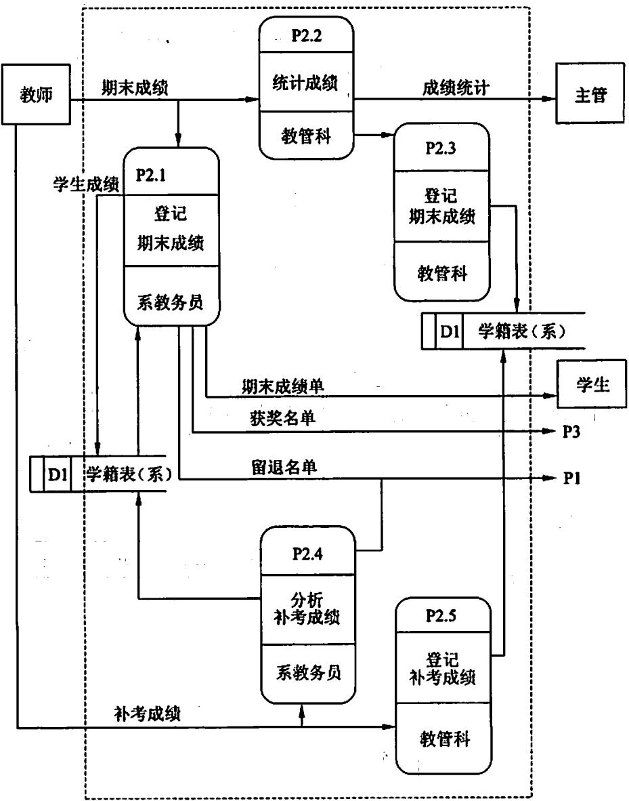  
图 12-8 "成绩管理" 框的展开

在图 12-8 中的一些处理，有的框还需要进一步展开，如 P2.1 框，但在这里我们不再一一展开。

## 2. 数据字典

数据流图描述了系统的分解，即描述了系统由哪几部分组成，各部分之间的联系等，但没有说明系统中各成分的含义。只有当数据流图中出现的每一成分都给出定义之后，也就是使数据流图上的数据流名字、处理逻辑名字等都具有确切地解释之后，才能真正完整、准确地描述一个系统。为此，还需要其他工具对数据流图加以补充说明。

数据字典就是这样的工具。数据字典最初用于数据库管理系统。它为数据库用户、数据库管理员、系统分析员和程序员提供某些数据项的综合信息。这种思想启发了信息系统的开发人员，使他们想到将数据字典引入系统分析。

数据字典是以特定格式记录下来的、对系统的数据流图中各个基本要素（数据流、处理逻辑、数据存储和外部实体）的内容和特征所做的完整的定义和说明。它是结构化系统分析的重要工具之一，是对数据流图的重要补充和说明。

建立数据字典的工作量很大，而且相当繁琐。但这是一项必不可少的工作。数据字典在信息系统开发中具有十分重要的意义，不仅在系统分析阶段，而且在整个开发过程中以及今后的系统运行中都要使用它。

数据字典可以用人工方式建立。事先印好表格，填好后按一定顺序排列，就是一本字典。也可以建立在计算机内，数据字典实际上是关于数据的数据库，这样使用、维护都比较方便。编写数据字典是系统开发的一项重要的基础工作。一旦建立，并按编号排序之后，就是一本可供查阅的关于数据的字典，从系统分析一直到系统设计和实施都要使用它。在数据字典的建立、修正和补充过程中，始终要注意保证数据的一致性和完整性。

## (1) 数据字典的条目

数据字典中有 6 类条目：数据项、数据结构、数据流、数据存储、处理过程和外部实体。不同类型的条目有不同的属性，现分别说明如下：

① 数据项 又被称为数据元素，是系统中最基本的数据组成单位，也就是不可再分的数据单位，如学号、姓名、成绩等。一般分析数据特性应从静态和动态两个方面去进行。但在数据字典中，仅定义数据的静态特性，具体包括：

\- 数据项的名称。名称要尽量反映该元素的含义，便于理解和记忆。

\- 编号。一般由字母和数字组成。

\- 别名。一个数据元素，可能其名称不止一个；若有多个名称，则须加以说明。

\- 简述。有时候名称仍然不能很确切地反映元素的含义，则可以给该数据项加一些描述信息。

\- 数据项的取值范围和取值的含义。指数据元素可能取什么值或每一个值代表的意思。

数据项的取值可分为离散型和连续型两类。如人的年龄是连续型的，取值范围可定义

为 0\~150 岁。而 "婚姻状况" 取值范围是 "未婚、已婚、离异、丧偶"，是离散型的。

一个数据项是离散的，还是连续的，视具体需要而定。例如在一般情况下，我们用岁数表示一个人的年龄，是连续的。但有时，我们只要用"幼年、少年、青年、壮年、老年"表示，或者区分为成年、未成年即可，这时年龄便是离散型的。

\- 数据项的长度。指出该数据项由几个数字或字母组成。如学号，按某校的编法由7个数字组成，其长度就是7个字节。

\- 数据类型。说明取值是字符型还是数字型等。

表 12-1 就是数据项条目的一个例子。数据字典中对 "职工姓名" 数据项的描述。

表 12-1 一个数据项的例子

<table><tr><td>数据项编号</td><td>数据项名称</td><td>别名</td><td>简述</td><td>数据类型</td><td>长度</td><td>取值范围</td></tr><tr><td>a001</td><td>职工姓名</td><td>姓名</td><td>本单位在职职工的身份证姓名</td><td>字符</td><td>6字节</td><td>0~999 999</td></tr></table>

② 数据结构 数据结构描述某些数据项之间的关系。一个数据结构可以由若干个数据项组成；也可以由若干个数据结构组成，还可以由若干个数据项和数据结构组成。在数据字典中对其定义包括：名称；编号；简述；数据结构的组成。例如表 12-2 所示订货单就是由三个数据结构组成的数据结构，表中用 DS 表示数据结构，用 I 表示数据项。

表 12-2 一个的数据结构的例子

<table><tr><td>数据结构编号</td><td>数据结构名称</td><td>简述</td><td>数据结构组成</td></tr><tr><td>DS03-01</td><td>用户订货单</td><td>用户所填用户情况及订货要求等信息</td><td>DS0302+DS03-03+DS03-04</td></tr></table>

如果是一个简单的数据结构，只要列出它所包含的数据项。如果是一个嵌套的数据结构（即数据结构中包含数据结构），则需列出它所包含的数据结构的名称，因为这些被包含的数据结构在数据字典的其他部分已有定义，见表 12-3。

表 12-3 用户订货单的数据结构

<table><tr><td colspan="3">DS03-01: 用户订货单</td></tr><tr><td>DS03-02: 订货单标识I1: 订货单编号I2: 日期</td><td>DS03-03: 用户情况I3: 用户代码I4: 用户名称I5: 用户地址I6: 用户姓名I7: 电话I8: 用户银行I9: 账号</td><td>DS03-04: 配件情况I10: 配件代码I11: 配件名称I12: 配件规格I3: 订货数量</td></tr></table>

③ 数据流 数据流由一个或一组固定的数据项组成。定义数据流时，不仅要说明数据流的名称、组成等，还应指明它的来源、去向和数据流量等。在数据字典中数据流的属性包括：

\- 名称。名称含义应尽量便于理解和记忆。

\- 编号。一般由字母和数字组成。

\- 简述。对该数据流的补充说明。

\- 数据流的来源。数据流可以来自某个外部实体、数据存储或某个处理。

\- 数据流的去向。某些数据流的去处可能不止一个，若有多个去处，则都需要进行说明。

\- 数据流的组成。指数据流所包含的数据结构。一个数据流可包含一个或多个数据结构。若只含一个数据结构，应注意名称的统一，以免产生二义性。

\- 数据流的流通量。指单位时间（每日，每小时等）里的数据传输次数。可以估计平均数或最高、最低流量各是多少。

\- 高峰期流通量。

表 12-4 是一个数据流的例子。

表 12-4 一个数据流的例子

<table><tr><td>数据流编号</td><td>数据流名称</td><td>简述</td><td>数据流来源</td><td>数据流去向</td><td>数据流组成</td><td>数据流量</td><td>高峰流量</td></tr><tr><td>F03-08</td><td>领料单</td><td>车间开出的领料单</td><td>车间</td><td>发料处理模块</td><td>材料编号+材料名称+领用数量+日期+领用单位</td><td>10份/时</td><td>20份/时(上午9:00-11:00)</td></tr></table>

④ 处理逻辑的定义 处理逻辑的定义仅对数据流程图中最底层的处理逻辑加以说明。在数据字典中对其定义包括：处理逻辑名称；编号；简述；输入；处理过程；输出；处理频率，如表 12-5 所示。

表 12-5 一个处理逻辑的例子

<table><tr><td>名称</td><td>编号</td><td>简述</td><td>输入的数据流</td><td>处理</td><td>输出的数据流</td><td>处理频率</td></tr><tr><td>计算电费</td><td>PO2-03</td><td>计算应交纳的电费</td><td>数据流电费价格,来源于数据存储文件价格表;数据流电量和用户类别,来源于处理逻辑“读电表数字处理”和数据存储“用户文件”</td><td>确定该用户类别;确定该用户的收费标准,得到单价;单价和用电量相乘得该用户应交纳的电费</td><td>一是外部实体用户;二是写入数据存储用户电费账目文件</td><td>对每个用户每月处理一次</td></tr></table>

⑤ 数据存储 数据存储在数据字典中只描述数据的逻辑存储结构，而不涉及它的物理组织。在数据字典中对其定义包括：数据存储的编号；名称；简述；组成；关键字；相关的处理。表 12-6 给出了一个数据存储定义的例子。

表 12-6 一个数据存储定义的例子

<table><tr><td>编号</td><td>名称</td><td>简述</td><td>数据存储组成</td><td>关键字</td><td>相关联的处理</td></tr><tr><td>F03-08</td><td>库存账</td><td>存放配件的库存量和单价</td><td>配件编号+配件名称+单价+库存量+备注</td><td>配件编号</td><td>P02, P03</td></tr></table>

⑥ 外部实体定义 外部实体是数据的来源和去向。因此，在数据字典中关于外部实体的条目，主要说明外部实体产生的数据流和传给该外部实体的数据流，以及该外部实体的数量。外部实体的数量对于估计系统的业务量有参考作用，尤其是关系密切的主要外部实体。在数据字典中对外部实体的定义包括：外部实体编号；外部实体名称；简述；输入的数据流；输出的数据流。表 12-7 给出了一个外部实体定义的例子。

表 12-7 一个外部实体定义的例子

<table><tr><td>编号</td><td>名称</td><td>简述</td><td>输入的数据流</td><td>输出的数据流</td></tr><tr><td>S03-01</td><td>用户</td><td>购置本单位配件的用户</td><td>D03-06, D03-08</td><td>D03-01</td></tr></table>

## (2) 数据字典的作用

数据字典实际上是"关于系统数据的数据库"。在整个系统开发过程以及系统运行后的维护阶段，数据字典都是必不可少的工具。数据字典是所有人员工作的依据、统一的标准。它可以确保数据在系统中的完整性和一致性。具体地讲，数据字典有以下作用：

① 按各种要求列表。可以根据数据字典，把所有数据元素、数据结构、数据流、数据存储、处理逻辑、外部实体，按一定的顺序全部列出，保证系统设计时不会遗漏。

如果系统分析员要对某个数据存储的结构进行深入分析，需要了解有关的细节，了解数据结构的组成乃至每个数据元素的属性，数据字典也可提供相应的内容。

② 相互参照，便于系统修改。根据初步的数据流图，建立相应的数据字典。在系统分析过程中，常会发现原来的数据流图及各种数据定义中有错误或遗漏，需要修改或补充。有了数据字典，这种修改就变得容易多了。

例如，在某个库存管理系统中，"商品库存"这个数据存储的结构是：商品编号、商品名、规格、当前库存量。一般来讲，考虑能否满足用户订货，这些数据项就够了。但如果要求库存数量不能少于"安全库存量"，则这些数据项是不够的。这时，在这个结构中就要增加"安全库存量"这个数据项。以前，只要"顾客订货量小于或等于当前库存量"，就认为可以满足用户订货；现在则只有"顾客订货量小于或等于当前库存量且当前库存量大于或等于安全库存量"时才能满足顾客订货。有了数据字典，这个修改就容易了。因为在该数据存储的条目中，记录了有关的数据流，由此可以找到因数据存储的改动而可能影响到的处理逻辑，不至于遗漏而造成不一致。

③ 由描述内容检索名称。对于一个稍微复杂的系统，数据字典的量是相当大的，有时候系统分析员可能没有把握断定某个数据项在数据字典中是否已经定义，或者记不清楚其确切名字，这时可以通过内容查找其名称，就像根据书的内容查询图书的名字一样。

④ 一致性检验和完整性检验。根据各类条目的规定格式，可以检验一下一些问题。

\- 是否存在没有指明来源或去向的数据流。

\- 是否存在没有指明数据存储或所属数据流的数据元素。

\- 处理逻辑与输入的数据元素是否匹配。

\- 是否存在没有输入或输出的数据存储。

(3) 数据字典的编写与管理。

数据字典的内容是随着数据流图自顶向下，逐层扩展而不断充实的。数据流图的修改与完善，将导致数据字典的修改，这样才能保证数据字典的一致性和完整性。数据字典的编写可以有两种方式：手工编写和计算机辅助编写。

手工编写的主要工具是笔和卡片，当然可以辅以计算机文字处理手段。这时计算机只是作为手工书写工具来使用，没有处理数据字典的结构、内容和格式的功能。由于数据字典各条目的定义、说明和分解细化主要靠人的知识、经验和判断，手工编写具有较大的灵活性与适应性，也就是说，可以随着系统分析工作的深入和对用户信息需求的了解的细化而不断充实、修正数据字典的内容。但手工编写效率不高、编辑困难、容易出现疏漏与错误，对数据字典的检验、维护与查询、检索、统计、分析都不方便。

计算机辅助编写数据字典时，计算机以输入的方式接受数据字典各类成分的定义和说明的原始数据，根据规范要求提供编辑、索引、完整性、一致性检查的功能。具有统计、报告、查询功能，可以定义在某些加工中使用、但数据流图上未注明的数据元素。这类计算机辅助工具称为计算机辅助系统工程（Computer-Aided Systems Engineering）工具，或称计算机辅助软件工程（Computer-Aided Software Engineering，CASE）工具。这些 CASE 工具提供 DFD 和 DD 的编制功能，具有图形处理、数据管理和文字编辑的能力，有的还能在系统设计与系统实施阶段提供辅助。

对于计算机辅助编写数据字典来说，最重要的是建立便于输入、查询与维护的数据库，称之为数据字典库。因此，除了采用商品化的 CASE 工具软件辅助编写数据字典外，也可采用通用的开发工具和数据库管理系统来创建数据字典库及相应的编辑、查询与检验程序。

但在开发初期，对于规模不太大的系统，手工编写更方便实惠。

编写数据字典的基本要求是：

\- 对数据流图上各种成分的定义必须明确、唯一、易于理解。命令、编号与数据流图一致，必要时可增加编码，以方便查询、检索、维护和统计报表。

\- 符合一致性和完整性的要求，对数据流图上的成分定义与说明没有遗漏。

\- 数据字典中无内容重复或内容相互矛盾的条目。

\- 数据流图中同类成分的数据字典条目中，无同名异义或异名同义者。

\- 格式规范、风格统一、文字精炼，数字与符号正确。

数据字典的建立，对于系统分析人员、用户或是系统设计人员均有很大好处，他们可以从不同的角度分别从数据字典中得到有关的信息，便于认识整个系统并随时查询系统中的部分信息。随着系统开发工作的不断深入，数据字典所带来的效益也将越来越明显。

为了保证数据的一致性，数据字典必须由专人（数据管理员）管理。其职责就是维护和管理数据字典，保证数据字典内容的完整一致。任何人（包括系统分析员、系统设计员、程序员）要修改数据字典的内容，都必须通过数据管理员。数据管理员要把数据字典的最新版本及时通知有关人员。

## 3. 实体联系图

数据流图描述了系统的逻辑结构，数据流图中的有关处理逻辑及数据流的含义可用数据字典具体定义说明，但是对于比较复杂的数据及其之间的关系，用它们是难以描述的，在这种情况下一般采用实体联系图进行描述。

实体联系图（Entity-Relationship Diagram，ER 图），可用于描述数据流图中数据存储及其之间的关系，最初用于数据库概念设计。

图 12-9 是大学教务管理问题中对教务处进行分析调查后得到的实体联系图。其中，学生档案是有关学生情况的集合，课程档案是有关开设的课程情况集合，注册记录、选课单则分别是学生注册和选课情况的集合。它用简单的图形方式描述了学生和课程等这些教学活动中的数据之间的关系。

在实体联系图中，有实体、联系和属性三个基本成分，如图 12-10 所示。

（1）实体。实体是现实中存在的对象，有具体的，也有抽象的；有物理上存在的，也有概念性的；例如，学生、课程，等等。它们的特征是可以互相区别，否则就会被认为是同一对象。凡是可以互相区别、又可以被人们识别的事、物、概念等统统可以被抽象为实体。数据流图中的数据存储就是一种实体。实体可以分为独立实体和从属实体或弱实体，独立实体是不依赖于其他实体和联系而可以独立存在的实体，如图12-9中的"学生档案"、"课程档案"等，独立实体常常被直接简称为实体；从属实体是这样一类实体，其存在依赖于其他实体和联系，在实体联系图中用带圆角的矩形框表示，例如图12-9中的"注册记录"是从属实体，它的存在依赖于实体"学生档案"，"课程档案"和联系"注册"，"选课单"也是从属实体，它的存在依赖于实体"学生档案"，"课程档案"和联系"选课"。

在以下述说中，为简便起见，将图 12-9 中的实体 "学生档案" 和 "课程档案" 直接称为 "学生" 和 "课程"。

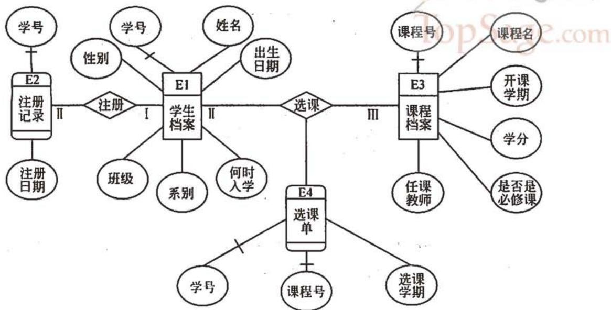  
图 12-9 大学教务处教务管理问题实体联系图

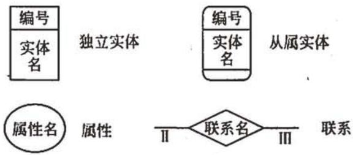  
图 12-10 实体联系图的基本成分

(2) 联系。实体之间可能会有各种关系。例如, "学生" 与 "课程" 之间有 "选课" 的关系。这种实体和实体之间的关系被抽象为联系。在实体联系图中, 联系用联结有关实体的菱形框表示, 如图 12-9 所示。联系可以是一对一 (1:1), 一对多 (1:N) 或多对多 (M:N) 的, 这一点在实体联系图中也应说明。例如在大学教务管理问题中, "学生" 与 "课程" 是多对多的 "选课" 联系。

（3）属性。实体一般具有若干特征，这些特征就被称为实体的属性，例如图 12-9 中的实体 "学生"，具有学号、姓名、性别、出生日期和系别等特征，这些就是它的属性。

联系也可以有属性，例如学生选修某门课程，它既不是学生的属性，也不是课程的属性，因为它依赖于某个特定的学生，又依赖于某门特定的课程，所以它是学生与课程之间的联系"选课"的属性。在图12-9中，联系"选课"的属性被概括在从属实体"选课单"中。联系具有属性这一概念对于理解数据的语义是非常重要的。

在实体联系图中，还有如下关于属性的几个重要概念。

\- 主键，如果实体的某一属性或某几个属性组成的属性组的值能唯一地决定该实体其他所有属性的值，也就是能唯一地标识该实体，而其任何真子集无此性质，则这个属性或属性组被称为实体键。如果一个实体有多个实体键存在，则可从其中选一个最常用到的作为实体的主键。例如实体"学生"的主键是学号，一个学生的学号确定了，那么他的姓名、性别、出生日期和系别等属性也就确定了。在实体联系图中，常在作为主键的属性或属性组与相应实体的连线上加一短垂线表示，如图12-9所示的"学号"。

\- 外键，如果实体的主键或属性（组）的取值依赖于其他实体的主键，那么该主键或属性（组）被称为外键。例如，从属实体"注册记录"的主键"学号"的取值依赖于实体"学生"的主键"学号"，"选课单"的主键"学号"和"课程号"的取值依赖于实体"学生"的主键"学号"和实体"课程"的主键"课程号"，这些主键和属性就是外键。

\- 属性域，属性可以是单域的简单属性，也可以是多域的组合属性。组合属性由简单属性和其他组合属性组成。组合属性中允许包括其他组合属性意味着属性可以是一个层次结构，如图 12-11 所示通信地址就是一种具有层次结构的属性。

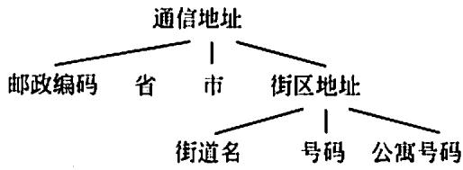  
图 12-11 通信地址属性

\- 属性值，属性可以是单值的，也可以是多值的。例如一个人所获得的学位可能是多值的。当某个属性对某个实体不适应或属性值未知时，可用空缺符 NULL 表示。

在画实体联系图时，为了使得图形更加清晰、易读易懂，可以将实体和实体的属性分开画，并且对实体进行编号，如图 12-12 和图 12-13 所示。

由于人们通常就是用实体、联系和属性这三个概念来理解和描述现实问题的，所以实体联系图非常接近人的思维方式。又因为实体联系图采用简单的图形来表达人们对现实的理解，所以不熟悉计算机技术的用户也都能够接受它，因此实体联系图成为了系统分析员和用户之间沟通的工具。

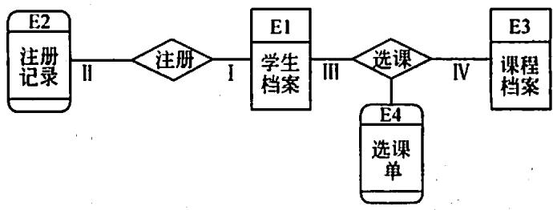  
图12-12 实体联系图

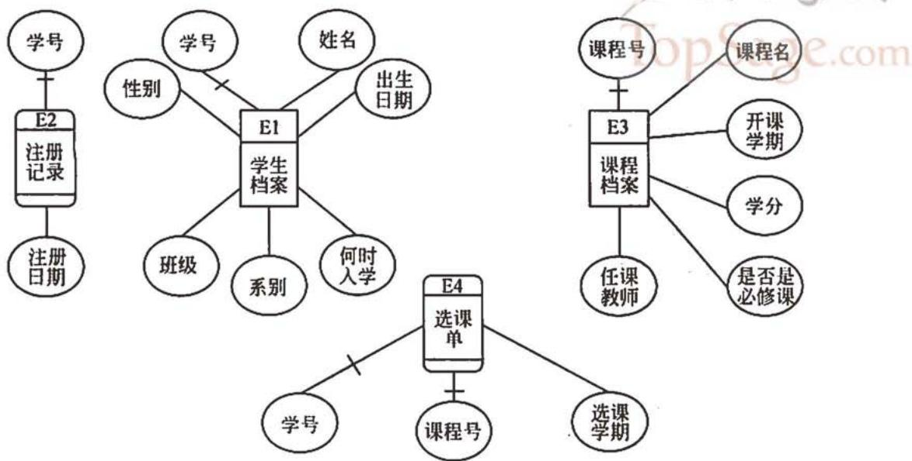  
图12-13 实体属性图

## 4. 描述加工处理的结构化语言

数据流图中所有不进一步分解的加工（处理逻辑），成为基本加工。基本加工是最底层的加工，但并不都在最底层的数据流图中。上层数据流图中某些加工环节不需要进一步分解的，都属于基本加工。基本加工有父项，无子项；而非基本加工均有子项，这是识别基本加工的主要原则。在数据字典中，非基本加工可用基本加工的组合来描述，因而比较简洁。基本加工是实现系统功能的基本组成部分，准确地、清晰地描述基本加工，成为表达系统逻辑功能的关键。

由于基本加工涉及详细的数据处理功能和处理过程，为了做到准确、清晰、简洁，基本加工的描述往往需要多种手段与工具，所用工具有自然语言的文字叙述、结构化语言、决策书、决策表、数学公式或者上述工具的联合使用。接下来我们就介绍一下描述加工处理的结构化语言。

人们常用自然语言描述各种问题。自然语言语义丰富、语法灵活，可描述十分广泛而复杂的问题，表达人们丰富的感情和智慧。但自然语言没有严格的规范，理解上容易产生歧义。在信息处理中人们广泛使用的计算机语言，是一种形式化语言，各种词汇均有严格定义，语法也很严格、规范，但使用的词汇被限制在很小范围内，叙述方式繁琐，难以清晰、简洁地描述复杂问题。结构化语言的特点介于两者之间，没有严格的语法规定，使用的词汇也比形式化的计算机语言广泛，但使用的语句类型很少，结构规范，表达的内容清晰、准确、易理解，不易产生歧义。适于表达数据加工的处理功能和处理过程。

结构化语言使用的语句类型只有以下三种。

\- 祈使语句。

\- 条件语句。

\- 循环语句。

上述语句类型可以嵌套，句中可使用逻辑关系式与数学公式。结构化语言使用的词汇有。

\- 祈使语句中的动词。

\- 数据字典中定义的和系统分析其他正式文件中定义的词汇，主要是名词，也可有部分名词性短语。

\- 表达逻辑关系的词汇。

使用结构化语言的原则是：

\- 语句意义明确，内容具体，文字简炼。不用抽象、笼统、含糊的词，如"做"、"处理"、"信息"等。所有词汇必须在系统分析文件中有确切定义，所有语言必须具有可读性，使人易于理解。

\- 祈使语句中必须有一个动词和一个宾语，分别表示动作的具体内容和动作的对象。尽量不使用形容词和副词。

\- 表达逻辑关系时，只使用"与"、"或"两种运算用词和"等于"、"大于"、"小于"、"大于或等于"和"小于或等于"5种关系词。

\- 语句结构清晰，开始、结束之处明确，嵌套时层次分明。

下面讨论结构化语言三种句型的特点：

\- 祈使语句。祈使语句说明要做什么事，如前所述，一般有一个动词和一个宾语，如：

获取收发数据

计算补充订货量

也有这种结构：

将在库数加收入数

将在库数减发出数

\- 条件语句。条件语句说明在满足一定条件时做什么事。其一般形式为：

<table><tr><td rowspan="3"></td><td>如果</td><td>条件1</td></tr><tr><td>则</td><td>执行A</td></tr><tr><td>否则</td><td>执行B</td></tr><tr><td colspan="3">例如:</td></tr><tr><td rowspan="3"></td><td>如果</td><td>成绩&gt;=60分</td></tr><tr><td>则</td><td>及格人数加一</td></tr><tr><td>否则</td><td>不及格人数加一</td></tr></table>

条件语句中可以嵌套其他语句。如上述结构中执行 A 或执行 B 可以是一组祈使语句，也可以是一个循环语句或是另一个条件语句。

\- 循环语句。循环语句说明在满足某种条件下，继续执行某项处理功能。或者继续执行某项功能直到某个条件满足为止。此语句由两部分组成，第一部分为循环条件，第二部分为重复执行的语句。第二部分的语句，可以是一个或一组祈使语句，也可以是条件语句或循环语句形成的嵌套结构，如：

对于每个库存项目 （循环条件）

获取收入数据

将在库数加收入数据，更新在库数

获取发出数据

将在库数减发出数据，更新在库数

如果 在库数小于或等于临界库存数

则发出补充并订货信号

## 12.4 系统说明书

## 12.4.1 系统说明书的内容

系统说明书是系统分析阶段工作的全面总结，是这一阶段的主要成果。它又是主管人员对系统进入设计阶段的决策依据。只有系统说明书经过系统开发工作的领导部门审查批准后才能进行下一阶段的工作。系统说明书又是后续各阶段工作的主要依据之一。因此系统说明书是整个系统开发工作最重要的文档之一。编写系统说明书是系统开发中一项十分重要的工作。

系统说明书应达到的基本要求是：全面、系统、准确、详实、清晰地表达系统开发的目标、任务和系统功能。

\- 全面，就是要描述整个系统的有关内容，而不只是某个局部。

\- 系统，就是要着重描述系统各部分的相互联系、相互作用，正确处理部分与整体的关系。

\- 准确，就是对系统的目标、任务和各项功能逻辑模型中各种成分都要给以准确的、符合实际的描述，避免错误与疏漏。

\- 详实，就是要详细具体地表达用户需求与系统逻辑功能，给系统设计与实施提供反映实际需求的、可以实现的工作依据。

\- 清晰，就是要表达清楚、无二义、总体上一目了然，每个具体问题又有详细清楚地说明，整个系统说明书结构合理，图文形式简洁、可读性强。便于系统开发人员之间，专业人员与用户之间的交流。

作为系统分析阶段的技术文档，系统说明书通常包括以下三方面的内容：

## 1. 引言

说明项目的名称、目标、功能、背景、引用资料（如核准的计划任务书或合同），文中所用的专业术语等。

## 2. 项目概述

## (1) 项目的主要工作内容

简要说明本项目在系统分析阶段所进行的各项工作的主要内容。这些内容是建立新系统逻辑模型的必要条件，而逻辑模型是书写系统规格说明书的基础。

## (2) 现行系统的调查情况

新系统是在现行系统的基础上建立起来的。设计新系统之前，必须对现行系统进行调查，掌握现行系统的真实情况，了解用户的要求和问题所在。

列出现行系统的目标、主要功能、组织结构、用户要求等，并简要指出主要问题所在。以数据流图为主要工具，说明现行信息系统的概况。

数据字典、判定表、数据立即存取图等往往篇幅较大，可作为系统说明书的附件。但是由它们得到的主要结论（如主要的业务量、总的数据存储量等）应被列在正文中。

## (3) 新系统的逻辑模型

通过对现行系统的分析，找出现行系统的主要问题所在，进行必要的改动，即得到新系统的逻辑模型。

新系统的逻辑模型也要通过相应的数据流图加以说明。数据字典等有变动的地方也要做相应说明。

## 3. 实施计划

（1）工作任务的分解：指对开发中应完成的各项工作按子系统（或系统功能）划分，指定专人分工负责。

（2）进度：指给出各项工作的预定日期和完成日起，规定任务完成的先后顺序及完成的界面。可用 PERT 图或甘特图表示进度。

（3）预算：指逐项列出本项目所需要的劳务以及经费的预算，包括办公费、差旅费、资料费，等等。

## 系统说明书内容指南

1. 引言

## 1.1 摘要

(摘要说明所建议开发的系统的名称、目标和功能。)

1.2 背景

(1) 项目的承担者

(2) 用户

(3) 本系统和其他系统或机构的关系和联系

## 1.3 参考和引用资料

(1) 本项目的经核准的计划任务书或合同、上级机关的批文

(2) 属于本项目的其他已发表的文件

(3) 本文件中各处引用的文件资料

(列出上述文件资料的标题、编号、发表日期和制定单位，说明这些文件资料的来源。)

## 1.4 专门术语定义

(本文件所用到的术语。)

## 2. 项目概述

## 2.1 项目的主要工作内容

（简要地说明本项目在开发中须进行的各项主要工作，这些工作是建立新系统逻辑模型的必要条件，而逻辑模型是书写系统说明书的基础。）

## 2.2 系统需求说明

(新系统是在现行系统的基础上建立起来的。在新系统设计工作开展之前，必须对系统调查清楚，掌握现行系统的真实情况，了解用户的新要求和问题所在。)

## 2.2.1 现行系统的现状调查说明

(列出现行系统的目标、主要功能、用户要求等，并简要指出问题所在。)

## 2.2.2 业务流程说明

（简要说明现行系统现场工作流程和事务流程概况。反映这些业务流程的业务流程图，若需要，可另附。）

## 2.3 系统功能说明

（在现行系统现状调查的基础上，进一步透过具体工作，分析组织内信息、数据流动的路径和过程，真正弄清用户要解决什么问题，明确系统的功能要求。）

## 2.3.1 新系统功能要求

（数据流程图是系统需求的高度概括，是调查研究的重要产物，它源于现行系统，又高于现行系统。这里主要通过数据流程图概况说明系统的功能要求。）

(1) 系统的目标

(从新系统数据流程图的分析中, 说明新系统有哪些目标。)

(2) 新系统的功能要求

(列出新系统的主要功能)

## (3) 验收

(简单说明分析员和用户一起讨论分析的验收是否达到要求。)

## 2.4 系统的数据要求说明

(从数据流程图和数据字典分析逻辑数据结构, 标识每个数据结构中的每个数据项、记录和文件的长度以及它们之间的关系。)

## 2.4.1 系统的数据要求

（这里的数据是指静态数据，即在运行过程中主要作为参考的数据，它们在很长一段时间内不会变化，一般不随运行而改变。）

## (1) 数据项定义

(说明数据项定义中出现的例外情况，列出作为控制或参考的主要数据项。)

(2) 容量

(本系统所有数据项的总长度。)

(3) 用户

(4) 验收

(指出验收情况。)

## 2.4.2 系统的数据要求的粗略估计

## (粗略估算系统在运行过程中动态数据的内容。)

上述工作，再加上环境对系统影响的估计，以及研制时间和人力、物力引起的费用估计，构成系统规格说明书。

## 3. 实施总计划

## 3.1 工作任务的分解

（对于项目开发中应完成的各项工作，按系统功能（或子系统）划分，指定专人（或小组）分工完成，指明每项任务的负责人。）

## 3.2 进度

（给出每项工作任务的预定开始日期和完成日期，规定各项工作任务完成的先后顺序以及每项工作任务完成的界面。）

## 3.3 预算

（逐项列出本开发项目所需要的劳务（包括工作量/人）以及经费的预算（包括办公费、差旅费、资料费等）。）

## 12.4.2 系统说明书的审议

系统说明书是系统分析阶段的技术文档，也是这一阶段的工作报告，是提交审议的一份工作文件。系统说明书一旦被审议通过，则成为有约束力的指导性文件，成为用户与技术人员之间的技术合同，成为下阶段系统设计的依据。因此，系统说明书的编写很重要。它应简明扼要、抓住本质、反映系统的全貌和系统分析员的设想。它的优劣是系统分析员水平和经验的体现，也是他们对任务和情况了解深度的体现。

对系统规格说明书的审议是整个系统研制过程中一个重要的里程碑。审议应由研制人员、企业领导、管理人员、局外系统分析专家共同进行。审议通过之后，系统说明书就将成为系统研制人员与企业对该项目共同意志的体现。作为一个工作阶段，系统分析宣告结束。若有关人员在审议中对所提方案不满意，或者发现研制人员对系统的了解有比较重大的遗漏或误解，就需要返回详细调查，重新分析。也有可能发现条件不具备、不成熟，导致项目中止或暂缓。一般说来，经过认真的可行性分析之后，不应该出现后一种情况，除非情况有重大变动。

## 12.5 系统分析工具——统一建模语言（UML）

## 12.5.1 统一建模语言（UML）的概述

UML（Unified Modeling Language）是一种定义良好、易于表达、功能强大且普遍实用的建模语言。它溶入了软件工程领域的新思想、新方法和新技术。它不仅可以支持面向对象的分析与设计，更重要的是能够有力地支持从需求分析开始的软件开发的全过程。UML 是一种建模语言，而不是一种方法。

UML 由信息系统和面向对象领域的三位著名的方法学家 Grady Booch、Ivar Jacobson 和 Jim Rumbaugh 提出，并得到业界的广泛支持，由 OMG 组织(Object Management Group)采纳作为业界标准。UML 取代了目前软件业众多的分析和设计方法而成为一种标准，成为软件界的第一个统一的建模语言。目前 OMG 已经把 UML 作为公共可得到的规格说明提交给国际标准化组织（ISO）进行国际标准化，UML 最终将正式成为信息技术的国际标准。

## 1. UML 是一种可视化语言

对于很多程序员来说，把实现的思想变成代码，其间没有什么距离可言，就是思考和编码。事实上，对有些事情的处理最好就是直接编码。但是，软件开发并不仅仅是编码，程序员还需要做一些建模。但这其中存在几个问题：一些概念模型容易产生错误的理解，因为并不是每个人都使用相同的语言。一种有代表性的情况是：假设项目开发单位建立了自己的语言，如果你是外来者或是加入项目组的新人，你就难以理解该单位在做什么事情。除非建立了模型（不仅仅是文字的编程语言），否则你就不能够理解软件系统中的某些事情。例如，阅读一个类层次的所有代码，虽可推断出对象的物理分布和可能移动，但也不能直接领会它。如果一个开发者仅写下代码而没有写下他头脑中的模型，一旦他另寻高就，那么这些信息就会永远丢失，最好的情况也只能是通过实现而部分地重建。

针对第一个问题，UML 是一组图形符号，UML 表示法中的每个符号都有明确语义。UML 使一个开发者可以用 UML 绘制一个模型，而另一个开发者（甚至工具）可以无歧义地解释这个模型。针对第二个问题，UML 是一种图形化语言，它用图形建模。针对第三个问题，UML 建立了清晰的模型有利于将来的重建。

## 2. UML 是一种构造语言

UML 不是一种可视化的编程语言，但用 UML 描述的模型可与各种编程语言直接相连。这意味着一种可能性，即可把用 UML 描述的模型映射成编程语言，如 Java、C++ 和

Visual Basic 等，甚至映射成关系数据库的表或面向对象数据库的永久存储。对一个事物，如果表示为图形方式最为恰当，则用 UML；而如果表示为文字方式最为恰当，则用编程语言。

这种映射允许进行正向工程：从 UML 模型到编程语言的代码生成。也可以进行逆向过程：由编程语言代码重新构造 UML 模型。逆向工程并不是魔术。除非你对实现中的信息编码，否则从模型到代码会丢失这些信息。逆向工程需要工具支持和人的干预。把正向代码生成和逆向工程这两种方式结合起来就可以产生双向工程，这意味着既能在图形视图下工作，又能在文字视图下工作，这需要用工具来保持两者的一致性。

除了直接映射之外，UML 具有丰富的表达力，而且无歧义性，这允许直接执行模型，系统地模拟以及对运行系统进行操纵。

## 3. UML 是一种文档化语言

一个健壮的软件组织除了生产可执行的源代码之外，还要给出各种制品。这些制品包括内容如下。

需求

\- 体系结构

\- 设计

\- 源代码

\- 项目计划

\- 测试

\- 原型

\- 发布

依靠于开发背景，有些制品或多或少地比另一些制品要正规些。这些制品不但是项目交付时所要求的，而且无论是在开发期间还是在交付使用后对控制、度量和理解系统也是关键的。

UML 适于建立系统体系结构及其所有的细节文档。UML 还提供了用于表达需求和用于测试的语言。最终 UML 提供了对项目计划和发布管理的活动进行建模的语言。

UML 的目标是:

\- 易于使用、表达能力强、进行可视化建模。

\- 与具体的实现无关，可应用于任何语言平台和工具平台。

\- 与具体的过程无关，可应用于任何软件开发的过程。

\- 简单并且可扩展，具有扩展和专有化机制，便于扩展，无需对核心概念进行修改。

\- 为面向对象的设计与开发中涌现出的高级概念，例如协作框架模式和组件提供支持，强调在软件开发中对架构框架模式和组件的重用。

\- 与最好的软件工程实践经验集成。

\- 可升级，具有广阔的适用性和可用性。

UML 的目的是建模，在 UML 中，建立的模型有三个要素：

\- 事物，事物是对模型中最具有代表性的成分的抽象。

\- 关系，关系把事物结合在一起。

\- 图，图聚集了相关的事物。

1. UML 中的事物

在 UML 中有 4 种事物。

\- 结构事物。

\- 行为事物。

\- 分组事物。

\- 注释事物。

(1) 结构事物。

结构事物是 UML 模型中的静态部分，描述概念或物理元素。共有 7 种结构事物。

① 类(class)是对一组具有相同属性、相同操作、相同关系和相同语义的对象的描述。一个类实现了一个或多个接口。在图形上，把一个类画成一个矩形，通常矩形中写有类的名称、类的属性和类的操作，如图 12-14 所示。

② 接口（interface）是描述了一个类或构件的一个服务的操作集。因此，接口描述元素的外部可见行为。一个接口可以描述一个类或构件的全部行为或部分行为。接口定义了一组操作的描述（即特征标记），而不是操作的实现。在图形上，把一个接口画成一个带有名称的圆。接口很少单独存在，而是通常依附于实现接口的类或构件，如图 12-15 所示。

③ 协作（collaboration）定义了一个交互，它是由一组共同工作以提供某协作行为的角色和其他元素构成的一个群体，这些协作行为大于所有元素的各自行为的总和。因此，协作有结构、行为和维度。一个给定的类可以参与几个协作。这些协作因而表现了系统构成模式的实现。在图形上，把一个协作画成一个通常仅包含名称的虚线椭圆，如图 12-16 所示。

④ 用例（Use Case）是对一组动作序列的描述，系统执行这些动作将产生一个对特定的参与者有价值而且可观察的结果。用例用于对模型中的行为事物结构化。在图形上，把一个用例画成一个实现椭圆，通常仅包含它的名称，如图 12-17 所示。

⑤ 活动类（Active Class）也是一种类，其对象至少拥有一个进程或线程，因此它能够启动控制活动。活动类的对象所描述的元素的行为与其他元素的行为并发，除了这一点之外，它和类是一样的。在图形上，活动类很像类，只是它的外框是粗框，通常它包含名称、属性和操作，如图 12-18 所示。

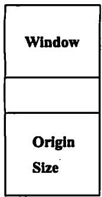  
图12-14 类

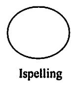  
图12-15 接口

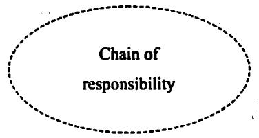  
图12-16 协作

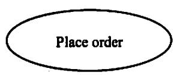  
图12-17 用例

⑥ 组件（component）是可重用的系统片段，具有良好定义接口的物理实现单元。组件包含了系统设计中某些类的实现。组件设计的原则：良好的组件不直接依赖于其他组件，而是依赖于其他组件所支持的接口。这样的好处是系统中的组件可以被支持相同接口的组件所取代。在一个系统中，你将遇到不同类型的部署组件，如 COM+构件和 Java Bean，以及在开发过程中所产生的制品组件，如源代码文件。通常组件是一个描述了一些逻辑元素（如类、接口和协作）的物理包。在图形上，把一个组件画成一个带有小方框的矩形，通常在矩形中只写该组件的名称，如图 12-19 所示。

⑦ 结点（node）是在运行时存在的物理元素，它表示了一种可计算的资源，它通常至少有一些记忆能力和处理能力。一个组件集可以驻留在一个结点内，也可以从一个结点迁移到另一个结点。在图形上，把一个结点画成一个立方体，通常在立方体内只写它的名称，如图 12-20 所示。

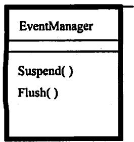  
图12-18 活动类

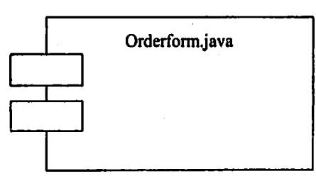  
图12-19 组件

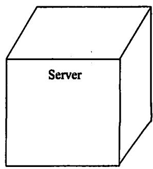  
图12-20 结点

(2) 行为事物。

行为事物是 UML 模型的动态部分，描述了跨越时间和空间的行为，共有两类主要的行为事物。

① 交互（interaction）是这样一种行为，它由在特定语境中共同完成一定任务的一组对象之间交换的消息组成。一个对象群体的行为或单个操作的行为可以用一个交互来描述。交互涉及一些其他元素，包括消息、动作序列（由一个消息所引起的行为）和链（对象间的连接）。在图形上，把一个消息画成一条有向直线，通常在表示消息的线段上总有操作名，如图 12-21 所示。

② 状态机（state machine）是这样一种行为，它描述了一个对象或一个交互在生命期内响应事件所经历的状态序列。单个类或一组类之间协作的行为可以用状态机来描述。一个状态机涉及到一些其他元素，包括状态、转换（从一个状态到另一个状态的流）、事件（触发转换的事物）和活动（对一个转换的响应）。在图形上，把一个状态画成一个圆角矩形，通常在圆角矩形中含有状态的名称及其子状态，如图 12-22 所示。

  
图 12-21 消息

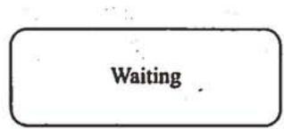  
图12-22 状态

## (3) 分组事物

分组事物是 UML 模型的组织部分。它们是一些由模型分解成的"盒子"。在所有的分组事物中，最主要的分组事物是包。

包（package）是把元素组织成组的机制，这种机制具有多种用途。结构事物，行为事物甚至其他的分组事物都可以放进包内。包不像构件（仅在运行时存在），它纯粹是概念上的（即它仅在开发时存在）。在图形上，把一个包画成一个左上角带有一个小矩形的大矩形，在矩形中通常仅含有包的名称，有时还有内容，如图 12-23 所示。

## (4) 注释事物

注释事物是 UML 模型的解释部分。这些注释事物用来描述，说明和标注模型的任何元素。有一种主要的注释事物，称为注解。注解（note）是一个依附于一个元素或一组元素之上，对它进行约束或解释的简单符号。在图形上，把一个注解画成一个右上角是折角的矩形，其中带有文字或图形解释，如图 12-24 所示。

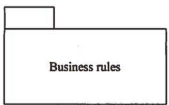  
图12-23 包

  
图12-24 注解

## 2. UML 中的关系

在 UML 中有 4 种关系。

\- 依赖

\- 关联

\- 泛化

\- 实现

① 依赖（dependency）是两个事物间的语义关系，其中一个事物（独立事物）发生变化会影响另一个事物（依赖事物）的语义。在图形上，把一个依赖画成一条可能有方向的虚线，偶尔在其上还有一个标记，如图 12-25 所示。

② 关联（association）是一种结构关系，它描述了一组链，链是对象之间的连接。聚合是一种特殊类型的关联，它描述了整体和部分间的结构关系。在图形上，把一个关联画成一条实线，它可能有方向，偶尔在其上还有一个标记，而且它经常还含有诸如多重性和角色名这样的修饰，如图 12-26 所示。

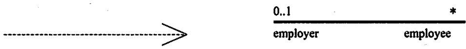  
图12-25 依赖  
图12-26 关联

③ 泛化（generalization）是一种特殊/一般关系，特殊元素（子元素）的对象可替代一般元素（父元素）的对象。用这种方法，子元素共享了父元素的结构和行为。在图形上，把一个泛化关系画成一条带有空心箭头的实线，它指向父元素，如图 12-27 所示。

④ 实现（realization）是类元之间的语义关系，其中的一个类元指定了由另一个类元保证执行的契约。在两种地方要遇到实现关系：一种是在接口和实现它们的类或构件之间；另一种是在用例和实现它们的协作之间。在图形上，把一个实现关系画成一条带有空心箭头的虚线，它是泛化和依赖关系两种图形的结合，如图 12-28 所示。

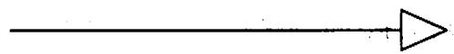

  
图12-27 泛化  
图12-28 实现

## 3. UML 中的图

图（diagram）是一组元素的图形化表示，大多数情况下把图画成顶点（代表事物）和弧（代表关系）的连通图。为了对系统进行可视化，可以从不同的角度画图，这样图是对系统的投影。除了非常微小的系统外，图是系统组成元素的省略视图。有的元素可以出现在所有图中，有的元素可以出现在一些图中（很常见），还有的元素不能出现在图中（很罕见）。在理论上，图可以包含任何事物及其关系的组合。然而，实际上仅存在着少量的常见组合，它们要与5种最有用的组成了软件密集型系统的体系结构的视图相一致。由于这个

原因，UML 中的图可以分为几下几类：

① 第一类是用例图，从用户角度描述系统功能，并指出各功能的操作者。

② 第二类是静态图（Static Diagram），包括类图、对象图和包图。

\- 类图描述系统中类的静态结构。不仅定义系统中的类，表示类之间的联系如关联、依赖、聚合等，也包括类的内部结构（类的属性和操作）。类图描述的是一种静态关系，在系统的整个生命周期都是有效的。

\- 对象图是类图的实例，几乎使用与类图完全相同的标识。它们的不同点在于对象图显示类的多个对象实例，而不是实际的类。一个对象图是类图的一个实例。由于对象存在生命周期，因此对象图只能在系统某一时间段存在。

\- 包由包或类组成，表示包与包之间的关系。包图用于描述系统的分层结构。

③ 第三类是行为图（Behavior Diagram），描述系统的动态模型和组成对象间的交互关系。包括状态图和活动图。

\- 状态图描述类的对象所有可能的状态以及事件发生时状态的转移条件。通常，状态图是对类图的补充。在实际应用时并不需要为所有的类画状态图，仅为那些有多个状态其行为受外界环境的影响并且发生改变的类画状态图。

\- 活动图描述满足用例要求所要进行的活动以及活动间的约束关系，有利于识别并行活动。

④ 第四类是交互图（Interactive Diagram），描述对象间的交互关系。包括顺序图和合作图。

\- 顺序图显示对象之间的动态合作关系，它强调对象之间消息发送的顺序，同时显示对象之间的交互。

\- 合作图描述对象间的协作关系，合作图跟顺序图相似，显示对象间的动态合作关系。除显示信息交换外，合作图还显示对象以及它们之间的关系。如果强调时间和顺序，则使用顺序图；如果强调上下级关系，则选择合作图。这两种图被合称为交互图。

⑤ 第五类是实现图（Implementation Diagram）。包括组件图和配置图。

\- 组件图描述代码部件的物理结构及各部件之间的依赖关系。一个组件可能是一个资源代码部件、一个二进制部件或一个可执行部件。它包含逻辑类或实现类的有关信息。组件图有助于分析和理解部件之间的相互影响程度。

\- 配置图定义系统中软硬件的物理体系结构。它可以显示实际的计算机和设备（用结点表示）以及它们之间的连接关系，也可显示连接的类型及部件之间的依赖性。在结点内部，放置可执行部件和对象以显示结点跟可执行软件单元的对应关系。

使用用例图、类图、对象图、构件图和配置图等 5 个图形建立的模型都是静态的，是标准建模语言 UML 的静态建模机制；使用状态图、活动图、顺序图和协作图等 4 个图形建立的模型或者可以执行，或者可以表示执行时的时序状态或交互关系，是动态的、是标准建模语言 UML 的动态建模机制。因此，标准建模语言 UML 的主要内容也可以被归纳为静态建模机制和动态建模机制两大类。

## 12.5.3 统一建模语言（UML）的建模过程

UML 是一种建模语言而不是方法，这是因为 UML 中没有过程的概念，而过程正是方法的一个重要组成部分。UML 本身独立于过程，这意味着用户在使用 UML 进行建模时，可以选用任何适合的过程。一般采用的建模过程有：瀑布开发模型和迭代递增开发模型。

瀑布开发模型和迭代递增开发模型分别如图 12-29 所示。

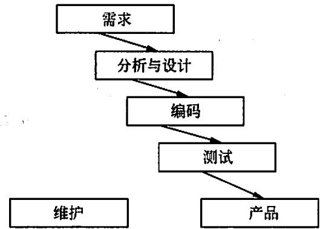  
(a) 瀑布开发模型

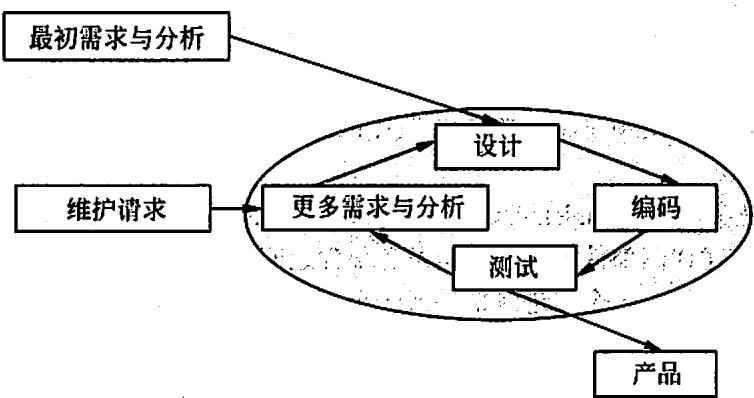  
(b) 迭代递增开发模型  
图 12-29 UML 建模过程的开发模型

我们以采取迭代递增开发模型为例，说明 UML 的建模过程。

\- 需求分析 该阶段产生的最初需求规格说明应当由代表系统最终用户的人员提

供，内容包括系统基本功能需求和对计算机系统的要求。

\- 分析 分析的任务是找出系统的所有需求并加以描述，同时建立模型，以定义系统中的关键领域类，应由系统用户和开发人员合作完成。

分析的第一步是定义用例，以描述所开发系统的外部功能需求。用例分析包括阅读和分析需求说明，此时需要与系统的潜在用户进行讨论。

\- 设计 设计阶段的任务是通过综合考虑所有的技术限制，以扩展和细化分析阶段的模型。设计阶段可以分为两个部分：第一部分是结构设计，结构设计是高层设计，其任务是定义包（子系统），包括包间的依赖性和主要通信机制。我们希望得到尽可能简单和清晰的结构，尽可能地减少各部分之间的依赖，并尽可能的减少双向的依赖关系。一个设计良好的系统结构是系统可扩充和可变更的基础。包实际上是一些类的集合。类图中包括有助于用户从技术逻辑中分离出应用逻辑（领域类），从而减少它们之间的依赖性；第二部分是详细设计，细化包的内容，使编程人员得到所有类的一个足够清晰的描述。详细设计的目的是通过创建新的类图、状态图和动态图（顺序图、协作图和活动图），描述新的技术类，并扩展和细化分析阶段的对象类。

\- 实现 构造或实现阶段是对类进行编程的过程。可以选择某种面向对象对象编程语言（如 Java）作为实现系统的软件环境。Java 很容易实现从逻辑视图到代码部件的映射，因为类到 Java 代码文件之间是一一映射关系。在实现阶段中，可以选取各种图的说明来辅助编程，比如：类图，状态图和动态图等。

\- 测试和配置 完成系统编码后，需要对系统进行测试，它通常包括：单元测试、集成测试、系统测试和验收测试。在单元测试中使用类图和类的规格说明，对单独的类或一组类进行测试；在集成测试中，使用组件图和合作图，对各组件的合作情况进行测试；在系统测试中，使用用例图，以检验所开发的系统是否满足例图所描述的需求。

## 12.5.4 统一建模语言(UML)的应用

UML 的目标是以面向对象图的方式来描述任何类型的系统，具有很宽的应用领域。其中最常用的是建立软件系统的模型，但它同样可以用于描述非软件领域的系统，如机械系统、企业机构或业务过程，以及处理复杂数据的信息系统、具有实时要求的工业系统或工业过程等。总之，UML 是一个通用的标准建模语言，可以对任何具有静态结构和动态行为的系统进行建模。

此外，UML 适用于系统开发过程中从需求规格描述到系统完成后测试的不同阶段。UML 在软件开发不同阶段的应用包括：

## 1. 需求分析阶段

在需求分析阶段，可以用用例来捕获用户需求。通过用例建模，描述对系统感兴趣的外部角色及其对系统（用例）的功能要求。建模的每个用例都指定了客户的需求（他或她需要系统干什么）。

## 2. 系统分析阶段

分析阶段主要关心问题域中的主要概念（如抽象、类和对象等）和机制，需要识别这些类以及它们相互间的关系，并用 UML 类图来描述。为实现用例，类之间需要协作，这可以用 UML 动态模型来描述。在分析阶段，只对问题域的对象（现实世界的概念）建模，而不考虑定义软件系统中技术细节的类（如处理用户接口、数据库、通信和并行性等问题的类）。这些技术细节将在设计阶段引入。

## 3. 系统设计阶段

在设计阶段把分析阶段的结果扩展成技术解决方案，加入新的类来提供技术基础结构。用户接口、数据库操作等分析阶段的领域问题类被嵌入在这个技术基础结构中，设计阶段的结果是构造阶段的详细的规格说明。

## 4. 系统实施阶段

实施是一个独立的阶段，其任务是用面向对象编程语言将来自设计阶段的类转换成实际的代码。在用 UML 建立分析和设计模型时，应尽量避免考虑把模型直接转换成某种特定的编程语言。因为在早期阶段，模型仅仅是理解和分析系统结构的工具，过早考虑编码问题十分不利于建立简单正确的模型。

## 5. 系统测试阶段

UML 模型可作为测试阶段的依据。系统的测试通常分为单元测试、集成测试、系统测试和验收测试几个不同级别。

\- 单元测试是对几个类或一组类的测试，通常由程序员进行。

\- 集成测试集成组件和类确认它们之间是否恰当的协作。

\- 系统测试将系统当成一个黑箱，验证系统是否具备用户所要求的所有功能。

\- 验收测试由客户完成，与系统测试类似，验证系统是否满足所有的需求。

不同的测试小组使用不同的 UML 图作为测试依据：单元测试使用类图和类规格说明；集成测试使用组件图和合作图；系统测试使用用例图来验证系统的行为；验收测试由用户进行，以验证系统测试的结果是否满足在分析阶段确定的需求。

## 思考题

1. 系统分析员的职责是什么？他应具备哪些知识和能力？

2. 用数据流描述到银行存款的过程。

3. 试述数据流图（DFD）的组成与基本符号以及在系统分析中的作用。

4. 结合图 12-7，画出"异动管理"、"奖惩管理"的数据流图。

5. 对所在学校的图书馆出纳台业务进行系统分析：

6. 系统规格说明书包括哪些内容？

7. 述采用迭代递增开发模型建模的过程。

8. 简述 UML 在软件开发不同阶段的应用。
