>[!warning] 版本提示
>本书为 **2006 年第 1 版**。现行考试依据是 **《信息系统管理工程师教程（第 2 版）》**（清华社 2024-10，20 章），
>两版**重合极少**：第 1 版的第 1–6 章（硬件/操作系统/语言/配置/数据结构/多媒体）在第 2 版已被删除或压缩。
>本页仅作**扩展参考**，备考请以 [[知识体系]]（第 2 版官方考纲）为准。

# 第13章 信息系统设计

信息系统的设计主要包括总体设计（或者概要设计）和详细设计两大部分。本章讨论系统设计阶段的任务和内容以及系统设计的方法和工具。

## 13.1 系统设计概述

系统分析阶段要回答的中心问题是系统"做什么"，即要明确系统的功能和用途，为系统的具体设计和实现提供一个逻辑模型。因而系统设计阶段要回答的中心问题就是系统"怎么做"，即如何实现系统规格说明书所规定的系统功能，满足业务的功能处理需求。在进行系统设计时，要根据实际的技术、人员、经济和社会条件确定系统的实施方案，建立起信息系统的物理模型。

## 13.1.1 系统设计的目标

一般来讲，系统设计的目标就是在保证实现系统分析建立的逻辑模型的基础上，尽可能地提高系统的可靠性、运行效率、易更改性、灵活性和经济性，更快、更准、更多地提供资料，拥有更多、更细致的处理功能以及更有效、更科学的管理方法。系统设计主要应当追求以下的目标。

## 1. 系统的可靠性

系统的可靠性是只保证系统正常工作的能力。这是对系统的基本要求，系统在工作时，应当对所有可能发生的情况都予以考虑，并采取适当的防范措施，提高系统的可靠性。系统的可靠性主要分系统硬件和软件的可靠性。衡量系统可靠性的重要指标是系统的平均故障间隔时间（Mean Time Between Failure，MTBF）和平均维护时间（Mean Time To Repair，MTTR）。前者指平均的系统前后两次发生故障的间隔时间，后者指发生故障后平均没修复所需要的时间。系统平均故障间隔时间越长，系统可靠性就越高；系统平均维护时间越短，则说明系统的可维护性就越高。

要提高系统的可靠性需要从多个方面进行考察，采取多种相应的措施，可以选用可靠性较高的设备；在设计中尽可能地避免出错，在程序中设置各种检验措施，防止误操作和非法使用；采取软件和硬件的各种安全保障措施和操作，例如，对输入数据进行完整性检验，建立运行日志和审计跟踪，规定文件存取权限以及定期备份，等等。

## 2. 较高的系统运行效率

系统的运行效率体现在以下三个方面。

\- 处理能力指在单位时间内能够处理的事务数。

\- 处理速度指处理单个事务所耗费的平均时间。

\- 响应时间指从客户端发出处理要求到系统返回处理结果所用的时间。

而影响系统运行效率主要是以下两方面的因素：

\- 系统硬件结构的影响。硬件可利用的资源的多少以及硬件设备的处理能力，比如处理机的运行时间、外部设备的运行时间和通信线路的通信质量好坏等对系统的运行效率都有很大的影响。

\- 计算机处理过程的设计质量的影响。计算机处理过程的设计质量标志着系统设计方案的优劣，也直接影响着系统的运行效率。

## 3. 系统的可变更性

系统在投入运行之后，会因为系统环境的不断变化而遇到这样那样的新问题，进而不可避免地会浮现出一些设计上的缺陷和功能上的不完善。因此在进行系统设计时要充分考虑系统的可变更性，即降低修改和维护系统的难度。对系统的更改是否方便直接关系到系统的生命周期。一个变更性好的系统，维护相对容易、生命周期较长。采取结构化和模块化的设计方式，将会使系统的结构清晰明了，便于系统的维护和修改，提高系统的适应性。

## 4. 系统的经济性

考虑系统的经济性就是指要考虑系统的收益与支出之间的比例关系。系统的设计不是去追求最佳的设计效果，而是一个寻求经济效益和系统产出平衡的可接受的设计方案的过程。

上述系统设计的主要目标相互联系，又彼此制约，有些在一定程度上还会相互冲突，例如对于一个对安全性要求较高的涉及机密信息的信息系统，为了提高该系统的可靠性，就要采取一些校验和控制措施，成本会相应增加，经济性会相对下降；另外，要增强系统的可变更性，可采用模块化的结构，系统的运行效率会有所损失。在进行实际的系统设计时，应当根据系统的具体情况有所侧重。对于涉及机密信息的系统要不惜增加一定成本和损失系统效率来保障系统的可靠性和安全性，而对于实时处理要求较高的订票系统则不妨增加存储的开销，首先保证系统的运行效率。

## 13.1.2 系统设计的原则

## 1. 系统性原则

信息系统是作为统一整体而存在的。因此，在系统设计中，要从整个系统的角度进行考虑。比如，系统的代码要统一、设计规范要标准；传递语言要尽可能一致；对系统的数据采集要做到数出一处，全局共享，使一次输入得到多次利用等。

## 2. 简单性原则

在系统达到预定目标的情况下，应该尽量简单，避免一切不必要的设计。因此在设计过程中，要尽量使输入数据的形式容易理解和掌握，使数据处理过程简化，力求系统结构清晰、合理、保证使用者操作方便，修改容易等。

## 3. 开放性原则

为保持系统的长久生命力，要求系统具有很强的环境适应性。为此，系统应具有较好的开放性和结构的可变性。在系统设计中，应尽量采用模块化结构，提高各模块的独立性，尽可能减少模块间的数据耦合，是各子系统间的数据依赖降至最低限度。这样，既便于模块的修改，又便于增加新的内容，提高系统适应环境变化的能力。

## 4. 管理可接受原则

一个信息系统是否能发挥作用和具有较强的生命力，很大程度上取决于管理是否可接受。这要受业务管理水平、人员素质、传统思想等多方面因素的影响。

## 5. 其他原则

系统设计还应该遵循经济性、安全性的原则。不同类型的信息系统的设计原则应该有所侧重。比如办公自动化系统应该强调可靠性和安全性的原则。对于一个服务性质的公众服务系统又应该强调系统的简单易用原则。

## 13.1.3 系统设计的内容

系统设计的内容和任务因系统目标的不同和处理问题不同而各不同，但一般而言，系统设计包括总体设计（也被称为概要设计）和详细设计。在实际系统设计工作中，这两个设计阶段的内容往往是相互交叉和关联的。

## 1. 总体设计

总体设计也被称为概要设计，是系统开发过程中关键的一步。系统的质量及一些整体特性基本上是由这一步的成果所决定的。总体设计的主要任务是完成对系统总体结构和基本框架的设计。系统总体结构设计包括两方面的内容，系统总体布局设计和系统模块化结构设计。

模块化设计的工作任务包括如下内容。

\- 按需求和设计原则将系统划分为若干功能模块。

\- 决定每个模块的具体功能和职责。

\- 分析和确定模块间的调用关系。

\- 确定模块间的信息传递。

系统总体布局方案包括系统网络拓扑结构设计和系统资源配置设计方案。

## 2. 详细设计

总体设计只是为整个信息系统提供了一个设计思路和框架，框架内的血肉需要系统的设计人员在详细设计这个阶段充实。总体设计完成后，设计人员要向用户和有关部门提交一份详细的报告，说明设计方案的可行程度和更改情况，得到批准后转入系统详细设计。详细设计阶段主要是在总体设计的基础上，将设计方案进一步详细化、条理化和规范化，为各个具体任务选择适当的技术手段和处理方法。系统的详细设计一般包括如下。

## (1) 代码设计

代码设计就是信息分类和编码的工作，是将系统中有某些共同属性或特征的信息归并在一起，并利用便于计算机和人识别和处理的符号来表示这些信息的设计工作。

## (2) 数据库设计

数据库设计就是构建既能客观、准确地反映外部世界，又便于人类大脑认识的概念模型，并在此基础上对数据进行建模，转化为数据库管理系统所支持的数据模型；选择合适的存储结构和存储方法，最终完成数据库的设计工作。

## (3) 输入/输出设计

输入/输出设计主要是对以记录为单位的各种输入输出报表格式的描述。另外，对人机对话格式的设计和输入输出装置的选择也在这一步完成。

## (4) 用户界面设计

用户界面设计是指在用户与系统之间架起一座桥梁。主要内容包括：定义界面形式；定义基本的交互控制形式；定义图形和符号；定义通用的功能键和组合键的含义及其操作内容；定义帮助策略，等等。

## (5) 处理过程设计

总体设计将系统分解为许多模块，并基本决定了每个模块的功能和界面。处理过程设计则定义每个模块的内部执行过程，包括数据的组织、控制流、每一步的具体加工要求和实施细节。通过处理过程设计，为编写程序制定一个周密的计划。一般来说，每一个功能模块都应设计一个处理流程。

## 3. 其他设计任务

详细设计完成以后，也需要编制系统设计文档，主要工作包括系统标准化设计、描述系统设计结果、拟定系统实施方案。

系统标准化设计是指各类数据编码、数据库（文件）和功能模块的命名要有相应规则，符合标准化的要求。另外，为了保证系统安全可靠的运行，还要对数据进行保密设计和可靠性设计。

描述系统设计的结果是编制系统设计说明书、程序设计说明书、系统测试说明书以及各种设计图表等，并将它们汇集成册，交给有关人员和部门审核批准。

拟定系统实施方案是在系统设计结果得到有关人员和部门认可之后，拟定系统实施计划，详细确定实施阶段的工作内容、时间和具体要求。实施方案得到批准后，就可以正式转入系统实施阶段。

## 13.2 结构化设计方法和工具

## 13.2.1 结构化系统设计的基本原则

结构化方法规定了一系列模块的分解协调原则和技术，提出了结构化设计的基础是模块化，即将整个系统分解成相对独立的若干模块，通过对模块的设计和模块之间关系的协调来实现整个软件系统的功能。

## 13.2.2 系统流程图

系统流程图是表达系统执行过程的描述工具。

## 1. 系统流程图的特点

系统流程图的特点在于它着重表达的是数据在系统中传输时所通过的存储介质和工作站点，与物理技术有密切的联系。

系统流程图的缺点在于它不能反映系统结构和每个模块的功能，无法评审系统是否符合用户的逻辑要求，也不可能知道系统的大小，是否易于维护和修改。

1. 绘制系统流程图的主要依据

\- 信息处理的步骤和内容。

\- 每一步骤所涉及的物理过程。

\- 各步骤之间的物理和逻辑关系。

1. 系统流程图常用符号

如图 13-1 所示。

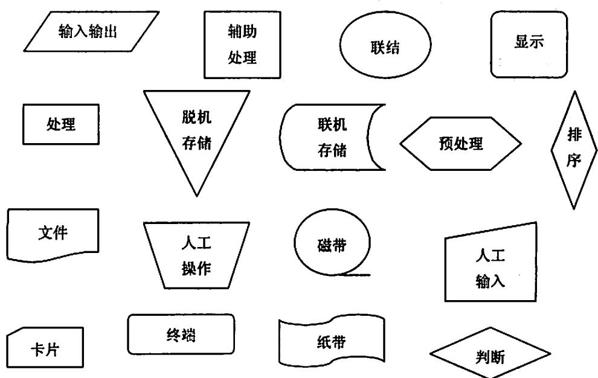  
图13-1 系统流程图主要符号  
如图 13-2 所示是一个描述仓库发料业务流程的系统流程图。

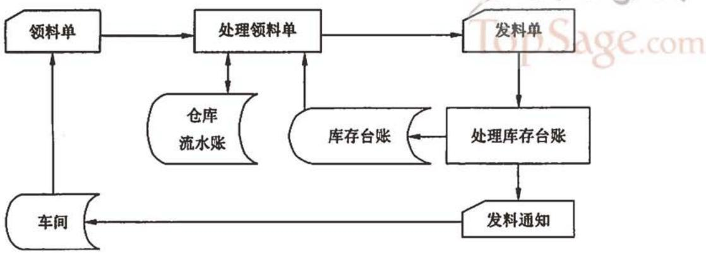  
图 13-2 仓库发料系统流程图

## 13.2.3 模块

模块（module）是通过一个名字就可以调用的一段程序语言。包括输入和输出、逻辑功能、内部数据及其运行程序4部分。输入和输出、逻辑功能是模块的外部特征，说明系统如何从外界获得数据，然后如何处理、如何反馈的过程。运行程序和内部数据是模块的内部特征。模块用程序代码实现，内部数据是仅供该模块引用的数据。

模块一般用长方形表示。模块的名字写在长方形中，名字应该恰如其分地表达着一个模块的功能，如图 13-3 所示。

模块最显著的也是我们所关心的两个特点是抽象性和信息隐蔽性。

图 13-3 模块的表示方法

## 1. 抽象性

从信息系统规划到信息系统的分析和设计是一个抽象程度不断降低的过程。系统可行性分析阶段的抽象层次最高，我们要以概括的方式叙述问题的解决方案；在较低的抽象层次，我们采用过程性的方法对系统进行描述；当系统实现之后，专用术语直接用于系统表述和交流，抽象层次最低。

## 2. 信息隐蔽性

模块的信息隐蔽性指一个模块内所包含的信息（过程和数据），对其他那些不需要这些信息的外部模块的不可获取和不可访问性。因此好的模块可以通过定义一组独立的模块来实现。这些独立的模块彼此之间仅仅交换那些为了完成系统整体功能所必需交换的信息。

## 13.2.4 HIPO技术

## 1. IPO图

IPO 图是一种反映模块的输入、处理和输出的图形化表格。其中 I、P、O 分别代指输入（input）、处理（process）和输出（output）。它描述了模块的输入输出关系、处理内容、模块的内部数据和模块的调用关系，是系统设计的重要成果，也是系统实施阶段编制程序设计任务书和进行程序设计的出发点和依据。IPO 图的内容和形式如图 13-4 所示。

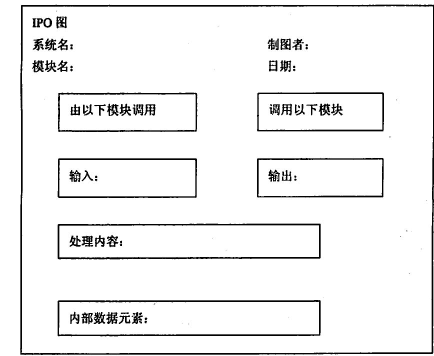  
图13-4IPO图的内容和形式

## 2. HIPO 分层示意图

分层次自顶向下分解系统，将每个模块的输入、处理和输出关系表示出来就得到了HIPO图，如图13-5所示。

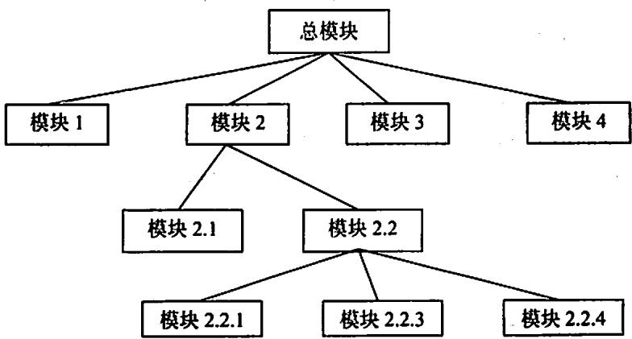  
图13-5 HIPO分层示意图  

控制结构图描述了模块之间的调用方式，体现了模块之间的控制关系。基本调用方式主要有三种：直接调用、条件调用和重复调用，分别如图 13-6 所示。

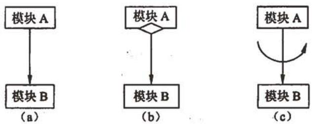  
图 13-6 模块调用方式

如图 13-7 所示的调用方式是双重重复调用，它的含义是外层模块 B、D 被模块 A 每调用一次，内层模块 C 将被模块 A 调用多次。

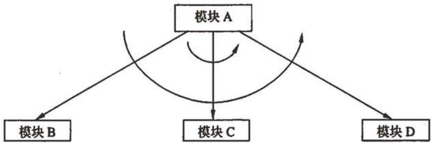  
图 13-7 模块的双重嵌套重复调用

## 13.2.6 模块结构图

结构化设计采用结构图（Structured Chart）描述系统的模块结构及模块间的联系。从数据流图出发，绘制 HIPO 图，再加上控制结构图中的模块控制与通信标志，实际上就构成了模块结构图。

结构图简明易懂，是系统设计阶段最主要的表达工具和交流工具。它可以由系统分析阶段绘制的数据流程图转换而来。但是，结构图与数据流程图有着本质的差别：数据流程图着眼于数据流，反映系统的逻辑功能，即系统能够"做什么"；结构图着眼于控制层次，反映系统的物理模型，即怎样逐步实现系统的总功能。从时间上说，数据流程图在前，控制结构图在后。数据流程图是绘制结构图的依据。总体设计阶段的任务就是要针对数据流程图规定的功能，设计一套实现办法。因此，绘制结构模块图的过程就是完成这个任务的过程。

结构图也不同于程序框图（Flow Chart），后者用于说明程序的步骤，先做什么，再做什么。结构图描述各模块的"责任"，例如一个组织机构图用于描述各个部门的隶属关系与职能。

结构图中的组成部分包括：

\- 模块，用长方形表示。

\- 调用，从一个模块指向另一模块的肩头表示前一个模块调用后一个模块。箭尾的菱形表示有条件地调用，弧形箭头表示循环调用。

\- 数据，带空心圆圈的小箭头表示一个模块传递给另一个模块的数据。

\- 控制信息，带实心圆圈的小箭头表示一个模块传递给另一个模块的控制信息。

模块结构图的层数称为深度。一个层次上的模块总数称为宽度。深度和宽度反映了系统的大小和复杂程度。

如图 13-8 所示是模块结构图的一个例子。该例子描述报表生成系统，从读入数据、经过计算到按一定格式打印出报表的过程。EOF 是结束标志。

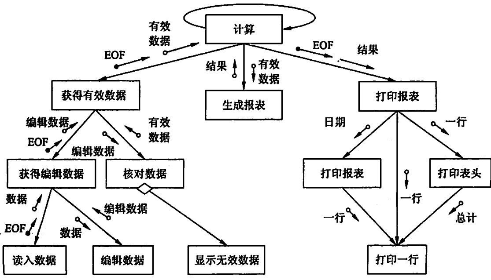  
图13-8 结构模块图

## 13.3 系统总体设计

系统总体结构设计是指整个系统由哪些部分组成，各部分在逻辑上、物理上的相互关系，包括硬件部分和软件部分。

## 13.3.1 系统总体布局方案

系统总体布局是指系统的平台设计，即系统类型、信息处理方式设计、网络系统结构、软硬件配置以及数据资源在空间上的分布设计。

设计出来的系统总体布局方案应当满足处理功能和存储功能的要求，满足系统易用性、可维护性、可扩展性、可变更性和可靠性好的要求，并考虑到系统的经济性。

在进行系统总体布局方案设计时，有若干个问题应当进行考虑，主要包括：

\- 系统类型，集中式还是分布式。

\- 处理方式，根据实际情况采取其中一种，或者混合使用。

\- 数据存储，根据数据量的大小决定何种存储方式，即分布存储还是集中存储。

\- 网络结构，逻辑结构设计，网络协议选择。

\- 硬件配置，考虑机器类型、性能价格指标等。

\- 软件配置，自行开发、外包或者整体购买。

## 1. 系统选型

从信息资源管理的集中程度来看，信息系统包括集中式系统和分布式系统。

(1) 集中式系统。

集中式系统是一种及设备、软件资源和数据于一体的集中式管理系统。主要类型如下。

\- 单机批处理系统。

\- 单机多终端分时系统。

\- 主机-智能终端系统。

集中式系统的优点如下。

\- 管理与维护控制方便。

\- 安全保密性较好。

\- 人员集中使用。

\- 资源利用率高。

其缺点如下。

\- 应用范围与功能受限制。

\- 可变更性、灵活性和扩展性较差。

\- 对终端用户来说，由于集中式系统对用户需求的响应并不很及时，所以不利于调动他们的积极性。

(2) 分布式系统。

分布式系统是一个在若干个地域上分散设置、在逻辑上具有独立处理能力，但在统一的工作规范、技术要求和协议指导下工作、通信和控制的一些相互联系且资源共享的子系统。根据网络组成的规模和方式可以分为局域网形式、广域网形式以及局域网和广域网的

混合形式。

分布式系统的优点主要如下。

\- 资源的分散管理与共享使用，可减轻主机的压力，与应用环境匹配较好。

\- 具有一定的独立性和自治性，利于调动各节点所在部门的积极性。

\- 并行工作的特性使负载分散，因而对主机性能要求降低。

\- 可行性高，个别节点机的故障不会导致整个系统的瘫痪。

\- 可变性、灵活性高，易于调整。

分布式系统也有它的缺点，主要体现如下。

\- 资源的分散管理降低了系统的安全性，并给系统数据的一致性维护带来了困难。

\- 地域上的分散设置，使得系统的维护工作比较困难。

\- 管理分散，加重管理工作的负担。

1. 计算机处理方式

计算机处理方式可以根据系统功能、业务处理的特点、性能/价格比等因素进行考虑选择，其主要处理方式如下。

\- 批处理。

\- 联机实时处理。

\- 联机成批处理。

\- 分布式处理等方式。

\- 混合使用各种方式

1. 数据存储设计及数据库管理系统选型

(1) 数据存储设计。

进行数据存储总体设计的需要考虑的原则包括数据结构的合理性、数据存储的安全性和维护和管理方便性。数据存储总体设计的内容主要如下。

\- 数据存储方式的设计，它包括对各类数据项的规范化逻辑描述，各类数据文件的组织方式以及各类数据文件之间的逻辑关系。

\- 数据存储的规模设计。

\- 数据存储空间的分布。

\- 数据库管理系统的特点。

(2) 数据库管理系统选型。

数据库管理系统的选择是一个关键问题。因为一般信息系统的核心任务是信息的采集、存储、加工处理，选择数据库管理系统时，应着重考虑所选数据库管理系统。

\- 数据存储能力。

\- 数据查询速度。

\- 数据恢复与备份能力。

\- 分布处理能力。

\- 与其他数据库的互联能力。

## 4. 网络系统设计

## (1) 网络计算模式

网络计算模式是指采用的是客户机/服务器（C/S）模式还是浏览器/Web 服务器/数据库服务器（B/W/D）模式。

## (2) 网络拓扑结构

网络拓扑结构一般有总线型、星型、环形、混合型等。在网络选择上应根据应用系统的地域分布、信息流量进行综合考虑。一般来说，应尽量将信息流量最大的应用放在同一网段上。

## (3) 网络的逻辑设计

通常首先按软件将系统从逻辑上分为各个分系统或子系统，然后按需要配备设备，如主服务器、主交换机、分系统交换机、子系统集线器（HUB）、通信服务器、路由器和调制解调器等，并考虑各设备之间的连接结构。

## (4) 网络操作系统

目前，流行的网络操作系统有 Unix、Netware、Windows NT 等。

## 5. 软硬件配置

硬件的配置选择包括计算机主机、外围设备、联网设备，软件包括操作系统数据库管理系统、网络操作系统和其他一些应用软件和中间件产品。进行计算机系统的软硬件及附属设备的配置的总的原则应该是技术上具有先进性、实现上具有可行性、使用上具有灵活性、发展上具有可扩充性和投资上具有受益性。

从系统需求角度看进行软硬件配置选择时要做以下考虑。

## (1) 功能要求

系统配置能满足新系统的各种功能要求，包括联网要求。

## (2) 性能要求

根据用户提出的对系统的处理速度、精确度等要求，确定计算机的运行速度、网络的传输速度等指标。

## (3) 容量要求

根据系统要处理的最大数据量以及若干年以后的发展规划，配置计算机内存、外存容量。

具体的配置项目包括如下内容。

① 操作系统。

单机操作系统、网络操作系统。

② 使用的网络协议。

常用的 TCP/IP、OSI 等。

③ 数据库产品。

说明系统所使用的数据库管理产品，常见的有 Oracle、DB2、Sybase、Microsoft SQLServer、Informix、Foxpro，等。

## (4) 应用软件

罗列信息系统所使用的其他应用软件或中间件产品，说明其功能和相关技术支持。

## 13.3.2 软件系统结构设计的原则

软件总体结构设计的主要任务是将整个系统合理划分成各个功能模块，正确地处理模块之间与模块内部的联系以及它们之间的调用关系和数据联系，定义各模块的内部结构等。总体结构设计的主要原则有：

## 1. 分解-协调原则

解决复杂问题的一个重要原则是把复杂的问题分解成多个易于解决、易于理解的小问题分别进行处理，在处理过程中根据系统的总体要求协调各部分的关系。进行分解的依据如下。

\- 按系统的功能进行分解。

\- 按系统运动和管理活动客观规律进行分解。

\- 按信息处理的方式和手段分解。

\- 按系统的工作规程分解。

\- 按用户的特殊需求进行分解。

\- 按系统开发、维护和变更的方便性进行分解。

协调的主要依据如下。

\- 目标协调。

\- 工作进程协调。

\- 工作规范和技术规范协调。

信息协调。

\- 业务内容协调。

## 2. 信息隐蔽和抽象的原则

上层模块只规定下层模块做什么和所属模块间的协调关系，并不规定怎么做，以保证各模块的相对独立性和内部结构的合理性，使得模块之间层次分明、易于理解、易于实施和维护。

## 3. 自顶向下原则

抓住总的功能目标然后逐层分解。先确定上层模块的功能，再确定下层模块的功能。

## 4. 一致性原则

要保证整个软件设计过程中具有统一的规范、统一的标准、统一的文件模式。

## 5. 面向用户原则

明确每一个模块的功能和模块间的接口，坚决清除多重功能和无用接口。

## 13.3.3 模块结构设计

## 1. 模块独立性

## (1) 模块化

模块化是将系统化分为若干模块的工作。模块化设计可以使整个系统设计简单，结构清晰，可维护性增强。模块化设计的目标是：每个模块完成一个相对独立的特定功能；模块之间的结构简单。简而言之就是要保证模块之间的独立性，提高每个模块的独立程度。

## (2) 模块独立性的度量

功能独立而且和其他模块之间没有过多相互作用和信息传递的模块被称为独立的模块。模块的独立程度可有两个定性标准度量：聚合（cohesion）和耦合（coupling）。聚合衡量模块内部各元素结合的紧密程度。耦合度量不同模块间互相依赖的程度。

\- 聚合，聚合度量模块内部各元素的关系，即其紧凑程度，表现在模块内部各元素为了执行处理功能而组合在一起的程度。模块的聚合有7种不同的类型，其中前三种聚合属于弱聚合。

\- 偶然聚合，如果模块所要完成的动作之间没有任何关系，或者仅仅是一种非常松散的关系，我们就称之为偶然聚合。例如，设计模块 A、B、C 均具有相同的部分代码 $\alpha$ ，则把 $\alpha$ 抽出作为一个单独的公用模块，如图 13-9 所示，这种聚合便被称为偶然聚合。

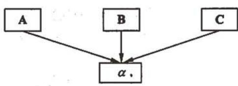  
图13-9 偶然聚合

\- 逻辑聚合，如果一个模块内部的各个组成部分在逻辑上具有相似的处理动作，但是功能上、用途上却彼此无关，则被称为逻辑聚合。

\- 时间聚合，时间聚合又称为经典内聚。如果一个模块内部的各个组成部分所包含的处理动作必须在同一时间内执行，则被称为时间聚合。

\- 过程聚合，模块内部各个组成部分所要完成的动作虽然彼此间没什么关系，但是必须以特定的次序（控制流）执行，这种情况属于过程聚合。

\- 通信聚合，如果一个模块的各个组成部分所完成的动作都使用了同一个输入数据或产生同一输出数据，则被称为通信聚合。

\- 顺序聚合，对于一个模块内部的各个组成部分，如果前一部分处理动作的最后输

出是后一部分处理动作的输入，则被称为顺序聚合。例如，模块 A 由两部分组成，

一部分为编辑，另一部分为输出。编辑部分将其输出数

据作为输出部分的输入，模块A即为顺序聚合模块。

  
图13-10 顺序聚合

如图 13-10 所示。

\- 功能聚合，如果一个模块内部各个组成部分全部属于一个整体，并执行同一功能，且各部分对实现该功能都必不可少，则称该模块为功能聚合模块。

将以上各种类型的模块聚合方式从耦合程度、可修改性、可读性和通用性4个角度进行一下比较，可以得到表13-1。

表 13-1 聚合特性比较

<table><tr><td>聚合形式</td><td>耦合程度</td><td>可修改性</td><td>可读性</td><td>通用性</td></tr><tr><td>偶然聚合</td><td>高</td><td>差</td><td>差</td><td>差</td></tr><tr><td>逻辑聚合</td><td>高</td><td>差</td><td>不好</td><td>差</td></tr><tr><td>时间聚合</td><td>较高</td><td>不好</td><td>一般</td><td>差</td></tr><tr><td>过程聚合</td><td>中</td><td>较好</td><td>较好</td><td>不好</td></tr><tr><td>通信聚合</td><td>较低</td><td>较好</td><td>较好</td><td>不好</td></tr><tr><td>顺序聚合</td><td>低</td><td>好</td><td>好</td><td>较好</td></tr><tr><td>功能聚合</td><td>低</td><td>好</td><td>好</td><td>好</td></tr></table>

在进行模块设计中，应当尽可能提高模块的聚合程度，使每个模块执行单一的功能，以降低模块间的联系，争取获得较高的模块独立性。尤其应该追求模块的功能聚合，如果可能，要将非功能性聚合的模块转化为功能聚合的模块。

\- 耦合，耦合用于度量系统内不同模块之间的互联程度。耦合强弱取决于模块间连接形式及接口的复杂程度。模块之间的耦合程度直接影响系统的可读性、可维护性及可靠性。在系统设计中应改进可能追求松散耦合的系统，因为模块连接越简单，错误传播的可能性就会越大，而且在这样的系统中测试、维护任何一个模块并不需要对其他模块有很多了解。

模块之间的连接形式有数据耦合、控制耦合、公共耦合和内容耦合4种类型。

\- 数据耦合，如果两个模块彼此间通过数据参数（不是控制参数、共公数据结构或外部变量）交换信息，那么这种耦合就是数据耦合。例如，A 模块向子模块 $A_{1}$ 、 $A_{2}$ 传递的是数据信息，构成了数据耦合，如图 13-11 所示。

\- 控制耦合，如果两个模块彼此间传递的信息中有控制信息，那么，这种耦合被称为控制耦合。控制耦合与数据耦合很相似，只是传递参数中一个仅有数据，另一个还包含了控制信息。控制耦合可以通过适当的方式加以避免，如模块的再分解。例如，模块 A 与子模块 $A_{1}$ 、 $A_{2}$ 之间传递的既有数据信息又有控制信息则构成了控制耦合，如图 13-12 所示。

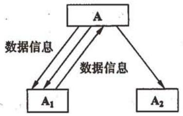  
图13-11 数据耦合

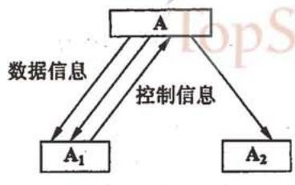  
图13-12 控制耦合

\- 公共耦合，若两个模块之间通过一个公共的数据区域传递信息，则被称为公共耦合或公共数据域耦合。公共数据域实际上就是多个模块公用数据的区域。公共耦合是一种不好的连接形式，尤其当一个公共数据区域被多个模块共同使用时，模块数越多，则其耦合的复杂度越大。这会给数据的保护、维护等带来很大的困难。例如，模块 A、 $A_{2.1}$ 、 $Y_{1}$ 共用公共数据区内的元素，尽管 A 与 $Y_{1}$ 没有联系，但是它们之间存在着公共耦合，如图 13-13 所示。

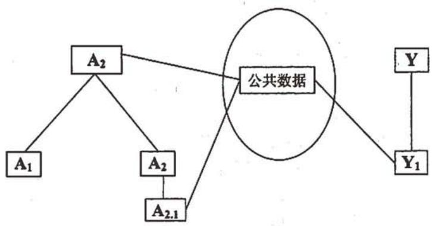  
图13-13 公共耦合

\- 内容耦合，如果一个模块需要涉及另一个模块的内部信息时，则这种耦合成为内容耦合。例如，一个模块访问另一个模块的内部数据；一个模块调用另一个模块的部分程序代码等情况。

对这 4 种类型的耦合的优劣对比可以总结在表 13-2 中。

表 13-2 4 种耦合的优劣对比

<table><tr><td>耦合形式</td><td>可维护性</td><td>错误扩散能力</td><td>可读性</td><td>通用性</td></tr><tr><td>数据耦合</td><td>好</td><td>弱</td><td>好</td><td>好</td></tr><tr><td>控制耦合</td><td>一般</td><td>中</td><td>不好</td><td>一般</td></tr><tr><td>公共耦合</td><td>差</td><td>强</td><td>很差</td><td>很差</td></tr><tr><td>内容耦合</td><td>最差</td><td>最强</td><td>最差</td><td>最差</td></tr></table>

总之，聚合和耦合是相辅相成的两个设计原则，是进行模块设计的有力工具，模块内的高聚合往往意味模块之间的松耦合。要想提高模块内部的聚合性，必须减少模块之间的联系。

## 2. 功能模块设计原则

提高聚合程度，降低模块之间的耦合程度是模块设计应该遵循的最重要的两个原则。但除此之外，系统模块设计的过程中，还应该考虑其他方面的一些要求，遵循如下以下原则。

## (1) 系统分解有层次

首先从系统的整体出发，根据系统的目标以功能划分模块。各个模块即互相配合，又各自具有独立功能，共同实现整个系统的目标。然后，对每个子模块在进一步逐层向下分解，直至分解到最小的模块为止。

## (2) 适宜地系统深度和宽度比例

系统深度是指系统结构中的控制层次。宽度表示控制的总分布，即统一层次的模块总数的最大值。系统的深度和宽度之间往往有一个较为适宜的比例。深度过大说明系统划分过细，宽度过大可能会导致系统管理难度的加大。

## (3) 模块大小适中

模块的大小一般使用模块中所包含的语句的数量多少来衡量。有这样一个参考数字，即模块的语句行数在 50 行\~100 行为最好，最多不超过 500 行。

## (4) 适度控制模块的扇入扇出

模块的扇入指模块直接上级模块的个数，模块的直属下级模块个数即为模块的扇出。

模块的扇入数一般来说越大越好，说明该模块的通用性较强。对扇出而言，过大可能导致系统控制和协调比较困难，过小则可能说明该模块本身规模过大。经验证明，扇出的个数最好是3或4，一般不要超过7，如图13-14所示，模块A的扇出系数为3，模块F的扇入系数为2。

## (5) 较小的数据冗余

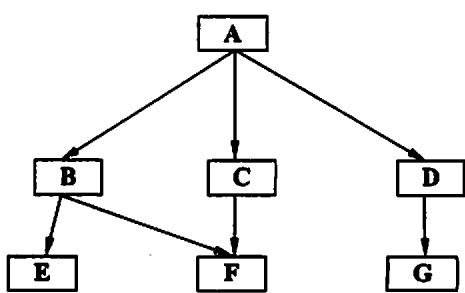

如果模块分解不当，会造成大量的数据冗余，这可能引起相关数据分布在不同的模块中，大量原图 13-14 模块的扇入、扇出

始数据需要调用，大量的中间结果需要保存和传递，以及大量计算工作将要重复进行的情况，可能会降低系统的工作效率。

## 3. 数据流图到模块结构图的变换

结构化系统设计方法与结构化系统分析有着密切的联系。系统分析阶段，用结构化分析方法获得用 DFD 等工具描述的系统说明书。设计阶段则以 DFD 为基础设计系统的模块结构。本节讨论如何从数据流程图导出初始结构图。

数据流程图有两种典型的结构：变换型（transform）结构和事务型（transaction）结构。对这两种结构，可以分别通过变换分析方法和事务分析方法导出标准形式的结构图。采用这些方法时，都是先设计结构图的顶端主模块，然后自顶向下逐步细化，最后得到满足数据流程图要求的系统结构。

## (1) 变换分析

变换结构是一种线性结构。它可以明显地分成逻辑输入、主加工和逻辑输出。图13-15(a)是一个典型的例子。变换分析（Transform Analysis）过程可以分为三步：找出逻辑输入、主加工和逻辑输出；设计顶层模块和第一层模块；设计中、下层模块。下面分别进行讨论。

① 找出系统的逻辑输入、主加工和逻辑输出。

如果设计人员经验丰富，又熟悉系统说明书，则很容易确定系统的主加工。例如，几股数据流的汇合处往往就是系统的主加工。若一时不能确定哪是主加工，可以用下面的方法先确定哪些数据流是逻辑输入，哪些数据流是逻辑输出。

从物理输入端开始，一步步向系统的中间移动，直至这样一个数据流：它已不能再被看作系统的输入，则它的前一个数据流就是系统的逻辑输入。在图 13-15(a) 中，从 "原始数据" 这个数据流开始向中间移动，逐个分析数据流，发现数据流 "P3→P4" 不能再被理解为系统的输入了。因此，数据流 "P2→P3" 是逻辑输入。

同理，从物理输出端开始，逆数据流方向往中间移动，可以确定系统的逻辑输出。介于逻辑输入和逻辑输出之间的加工就是主加工。图 13-15(a) 中的处理框 P3 就是主加工。

当然，实际的数据流程图往往比这个例子复杂，输入、输出数据流都可能有多个。这时，需要对每个输入、输出数据流进行分析，确定相应的逻辑输入、逻辑输出。处于这些逻辑输入、逻辑输出之间的处理框就是主加工。主加工可能包括数据流程图中的多个处理框。

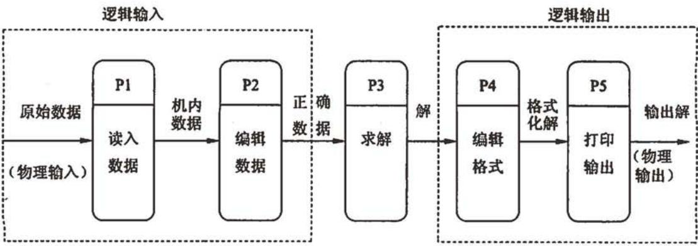  
图13-15 变换分析

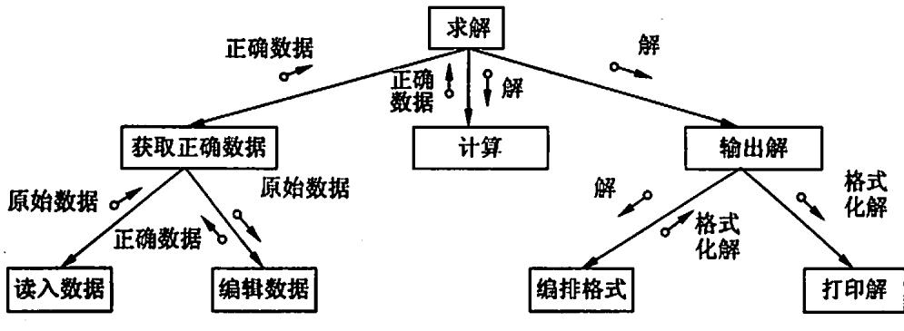  
图 13-15 （续）

从上面的分析过程可以看出，逻辑输入、逻辑输出的划分涉及对数据流的理解。各人的理解不同，结果就有差异，但一般出入不会太大。

## ② 设计顶层模块和第一层模块

找到主加工之后，遵照"自顶向下，逐步加细"的原则，设计各层的模块。每创建一个模块，必须确定该模块的外部特征：模块的功能、与其他模块的界面（调用时传送的信息）。为每个模块起一个名字，这个名字应当恰如其分地反映出这个模块的功能。

系统的主加工就是系统的顶层模块，其功能就是整个系统的功能。

第一层模块按输入、变换、输出等分支来处理：为每一个逻辑输入设计一个输入模块，其功能是为顶层模块提供相应的数据；为每一个逻辑输出设计一个输出模块，它的功能即是输出顶层模块的输出信息；为主加工设计一个变换模块，它的功能就是将逻辑输入变换成逻辑输出。第一层模块与顶层模块之间传送的数据应该同数据流程图相对应。

图 13-15(a)有一个逻辑输入，一个逻辑输出。所以对应结构图第一层模块共三个，即宽度为 3，如图 13-15 所示。

## ③ 设计中、下层模块

对输入、变换、输出模块逐个分解，便可得到初始结构图。

输入模块要为系统提供逻辑输入，一般要进行变换，先确定实现最后变换的变换模块。这个变换模块显然又需要某些输入，对每个这样的输入，对应一个新的输入模块。用类似方法依次分解下去，直到最终的物理输入为止。

对输出模块的分解与上面的办法相似。

对变换模块的分解，目前还没有与上面类似的方法。此时，需要研究数据流程图中相应加工的组成情况。

(2) 事务分析。

图 13-16 是事务型结构的例子。这种结构中，某个加工将它的输入分离成一串平行的数据流，分别执行后面的某些加工。对于这种类型的数据流程图，可以通过事务分析得到相应的结构图。

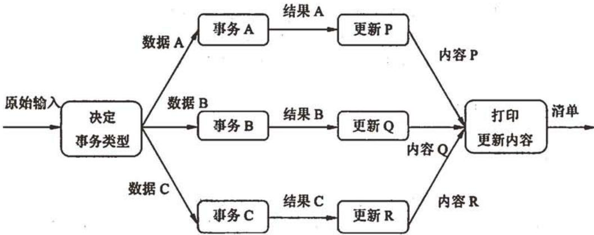  
图 13-16 事务型结构

事务分析也是按"自顶向下，逐步细化"的原则进行的。先设计主模块，其功能就是整个系统的功能。下面有一个"分析模块"和"调度模块"。前者分析事务的类型，后者根据不同的类型调用相应的下层模块。这样得到与图13-16相应的结构图，如图13-17所示。这里作用范围可能在控制范围之外，从而产生控制耦合。对于不太复杂的系统，可以通过采用逐模块判别事务类型来解决这一问题。对于复杂的问题。还得分开设模块。

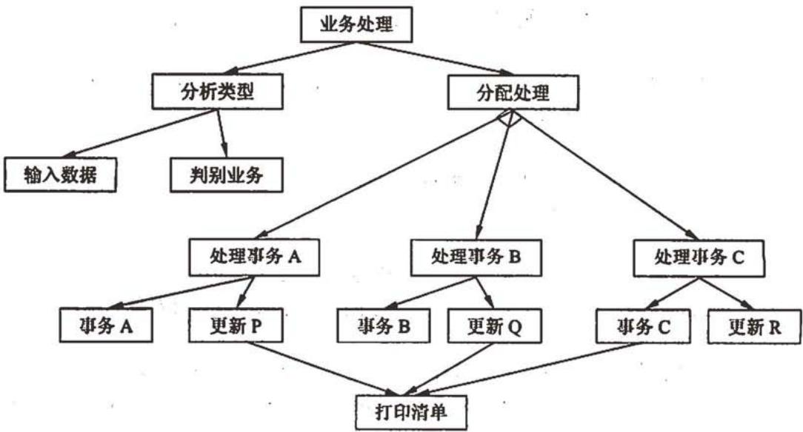  
图 13-17 事务分析

前面讨论了变换分析、事务分析。但实际应用中并非这么典型。这两种分析方法往往交替使用。数据流图的某一个局部可能是变换型，另一个局部可能是事务型，如此等等。这时，一般以变换分析为主，辅以事务分析。各个系统有不同的特点，初始结构图的设计方法也不同。凡是满足系统说明书要求的结构图都可以作为初始结构图。这里称之为初始结构图，是因为数据流图并没有完全反映出用户的要求（如查询要求、控制流），因此，按数据流图导出的结构图还要参照说明、查询分析等文档进行调整。

## 13.4 系统详细设计

## 13.4.1 代码设计

代码是代表系统中客观存在的事物名称、属性或状态的一个或一组有序符号，它应易于计算机和人进行识别和处理。组成代码的符号可以包括数字、字母或者混合组成。代码设计是一个科学管理的问题，设计出一个好的代码方案对于系统的开发工作是一件极为有利的事情。

## 1. 代码的功能

## (1) 唯一标识功能

唯一标识是代码最基本的特征。在一个信息分类代码标准中，一个代码只能唯一地表示一个对象，而一个分类对象只能有一个唯一的代码。对于相同名称的人和物，也可以用不同的代码加以区分，这样便于信息的存储和检索。

## (2) 分类功能

代码可以作为分类对象类别的标识。这是利用计算机进行分类统计的基础。

## (3) 排序功能

当按分类对象产生的时间、所占空间或其他方面的顺序关系分类，并赋予不同的代码时，代码可以作为排序的标识。

## 2. 代码种类

实际应用中，常常根据需要采用两种或两种以上基本代码的组合。根据代码的组织特点和编排方式来分类，一般有以下几种。

## (1) 顺序码

顺序码又被称为系列码，它用一串连续的数字来代表系统的实体或实体属性。顺序码是一种无实义的代码，这种代码只作为分类对象的唯一标识，只代替对象名称，而不提供对象的任何其他信息。

顺序码的优点是短小精悍，易于管理。缺点是不能反映代码对象的特征，代码本身无任何含义。另外，由于代码按顺序排列，新增加的数据只能排在最后，删除数据则要造成空码，缺乏灵活性，所以通常作为其他代码的一个组成部分。

## (2) 区间码

区间码单代码对象的特点把代码分成若干个区段，每一个区段表示代码对象的一个类别。它的优点是信息处理比较可靠，排序、分类、检索等操作易于进行，但这种代码的长度与它分类属性的数量有关，有时可能造成很长的码。

## (3) 助忆码

助忆码用文字、数字或文字数字相结合来描述对象。它用可以帮助记忆的字母和数字来表示代码对象，所以它的优点是直观、便于记忆和使用，甚至可以通过联系帮助记忆，缺点是不利于计算机处理。当代码对象较多时也容易引起联想出错，所以这种代码主要用于数量较少的人工处理系统。

助忆码适用于数据项数目较少的情况（一般少于50个），否则可能引起联想出错。此外，太长的助忆码占用存储容量过多，也不宜使用。

## (4) 缩写码

缩写码把人们习惯使用的缩写直接用于代码，简单、直观，便于记忆和使用。此外，根据代码所选用的符号类型，代码又分为字符码、数字码和混合码。

## 3. 代码设计的原则

## (1) 唯一性

一个对象可能有多个名称，也可按不同的方式对它进行描述，但每个对象只能赋予它一个唯一的代码，每一个代码只能唯一地代表系统中的一个实体或实体属性。例如在人事档案管理中，人的姓名很可能出现重名，为了便于计算机识别，解决的方法就是编制职工号。

## (2) 标准化

代码的设计要尽量采用国际或国内的标准，某些行业的代码还应该遵循行业内部的代码标准。采用标准的代码方案，不仅能够减少代码的工作量，还能一定程度上减少系统更新和维护的工作量，而且能够为今后的信息共享创造条件。

## (3) 规范化

代码的结构、类型和代码格式必须严格统一，同时要有规律性，以便于计算机进行处理。在一个代码体系中，代码结构、类型、编写格式必须统一。规范化和标准化是息息相关的，在一个代码体系中，有关代码标准是代码设计的重要依据，已有的标准必须遵循。

## (4) 合理性

代码设计必须与代码对象的分类体系相适应，以保证代码对代码对象的分类具有表示作用。

## (5) 可扩展性

代码所对应的对象总是在不断的变化之中，因此代码体系本身应留有充分的余地，以备将来不断扩充的需要。当然，备用代码也不能留得过多，那样会增加处理的难度。

## (6) 简单性

代码结构要尽可能简单，尽量缩短代码的长度，以方便利用、提高处理效率，并减少各种差错。

(7) 实用性。

代码应尽可能反映对象的特点，以利于记忆、便于填写。例如，数据库代码名应尽量采用其相应汉字的汉语拼音头一个字母表示。

## 4. 代码设计的步骤

代码设计需要科学的编码思路，进行严谨、全面的调查研究。一般来讲，代码设计可以遵循步骤如下。

## (1) 确定编码对象和范围

罗列要进行编码的对象，划清编码范围。

(2) 调查是否已有标准代码。

遵循标准化原则，在进行代码具体设计之前调查是否已有相关标准。

(3) 确定编排方式和符号类型。

根据代码的使用范围、使用时间等实际情况选择代码的编排方式和代码符号类型。

## (4) 考虑检错功能

代码出错将引发非常难以处理的问题，因此代码必须进行校验。代码校验利用在源代码的基础上增设一位或几位校验位的方式来实现。校验位通过事先规定好的数学方法计算出来。

## (5) 编写代码表

编制代码表并作详细的说明，通知有关部门组织学习，以便正确使用。

## 13.4.2 数据库设计

数据库的设计质量对整个系统的功能和效率有很大的影响。数据库设计的核心问题是：从系统的观点出发，根据系统分析和系统设计的要求，结合选用的数据库管理系统，建立一个数据模式。设计的基本要求是：

\- 符合用户需求，能正确反映用户的工作环境

\- 设计与所选用的 DBMS 所支持的数据模式相匹配

\- 数据组织合理，易操作、易维护、易理解

## 1. 数据库设计步骤

数据库的设计过程可以分为 4 个阶段，即用户需求分析、概念结构设计、逻辑结构设计和物理结构设计。图 13-18 反映和分析了这一设计过程，其中：

\- 用户需求分析是对现实世界的调查和分析

\- 概念结构设计是从现实世界向信息世界的转换。根据用户需求来进行数据库建模，也称为概念模型，常用实体关系模型表示。

\- 逻辑结构设计是从信息世界向数据世界的转化。将概念模型转化为某种数据库管理系统所支持的数据模型。

\- 物理结构设计是为数据模型选择合适的存储结构和存储方法。

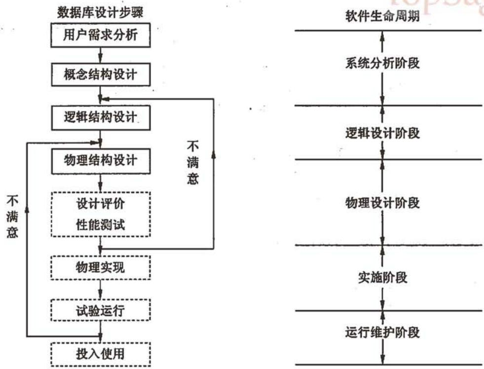  
图 13-18 数据库设计步骤

## 2. 用户需求分析

用户需求分析需要结合具体的业务需求分析，确定信息系统的各类使用者以及管理员对数据及其处理、数据安全性和完整性的要求。主要设计如下三方面：

## (1) 系统应用环境分析

系统应用环境及系统所服务和运行的特殊组织环境。不同业务单位有不同的组织结构和业务工作流程。环境的特殊性将决定数据库的整体设计思路和风格。

## (2) 用户数据需求及加工分析

用户需求及加工分析指用户希望从数据库中获得那些信息以及对信息的处理要求。由此决定数据库中应该存储哪些信息以及对数据需要进行哪些加工处理，包括在处理过程中特定的查询要求、响应时间要求，以及数据安全性、保密性、完整性和一致性等方面的要求，应在此基础上编制数据字典。

## (3) 系统约束条件分析

系统约束条件分析及分析现有系统的规模、结构、资源和地理分布，明确现有系统存在的种种限制或约束，从而使系统设计不至于脱离实际条件，确保系统设计顺利实施。

## 3. 数据库概念结构设计

概念结构设计是指由现实世界的各种客观事物及其联系转化为信息世界中的信息模型的过程，即为数据库的概念结构设计。E-R 模型即实体-联系模型是描述数据库概念结构的有力工具。下面结合实例说明 E-R 模型的构建。

在一个政府部门中存在着多个不同科室，每一个由若干名科员构成，每个科室都有一名主管上级领导，科室公务员负责为前来机关办事的群众提供相关的服务。现分别画出各个科室的 E-R 模型图，再画出整个机关的 E-R 模型。

## 一个科室结构应包括

（1）实体，即上级领导、科室、科员、群众。

（2）实体联系，主管领导与科室之间是一对多的关系，科室与科员之间的联系也是一对多的关系，科员与群众之间是多对多的关系。

(3) 各个实体所具有的属性。

\- 主管上级领导，属性可以有编号、姓名、性别、年龄、职务、任职时间、参加工作时间、入党时间、学历

\- 科室的属性可以包括科室号

\- 科员的属性包括编号、姓名、性别、年龄、职称、参加工作时间、入党时间、学历

\- 群众属性包括服务日期、服务事宜、处理结果

\- 服务，包括服务日期、服务事宜、处理结果

通过以上分析，可以得到如下的 E-R 模型，如图 13-19 所示（部分属性）。

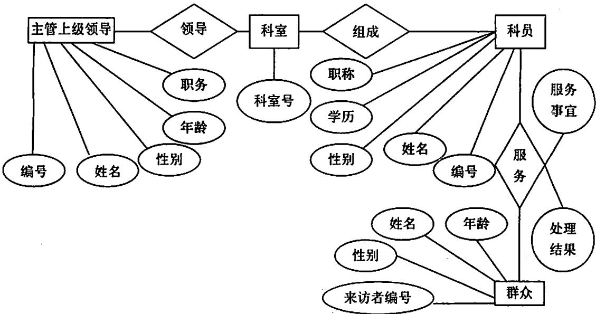  
图 13-19 科室 E-R 模式图

## 4. 数据库逻辑结构设计

逻辑结构设计的任务是要将概念结构设计阶段完成的概念模型转换成能被选定的数据库管理系统支持的数据模型。现行的数据库管理系统一般支持网状、层次和关系三种数据模型中的一种，其中关系型的数据模型在 DBMS 中的应用和支持较为广泛，已成为主流。

下面简单介绍一下由 E-R 模型转换为关系数据模型的转化规则。在关系数据模型下，数据的逻辑结构是一张二维表，每个关系为一张二维表格。E-R 模型转换为关系数据模型的转化规则如下。

\- 每一实体及其属性对应于一个关系模式。实体名作为关系名，实体的属性作为对应关系的属性。所谓关系模式，就是对关系的描述，用关系名（属性1、属性2、属性3，……属性n）来表示。

\- 两两实体之间的联系及其属性一般对应一个关系模式，联系名作为对应的关系名，联系的属性作为对应关系的属性；不带属性的联系可以去掉。

\- 实体和联系中关键字属性在关系模式中仍作为关键字。

图 13-19 中所示的实体关系图可以按照这些转换规则进行转化得到如下对应的关系模型。

\- 主管上级领导，编号、姓名、性别、年龄、职务、任职时间、参加工作时间、入党时间、学历

\- 科室，包括主管上级领导编号、科室号

\- 科员，包括科室号、编号、姓名、性别、年龄、职称、参加工作时间、入党时间、学历

\- 群众，包括来访者编号、姓名、性别、年龄、来访日期、服务事宜

\- 服务，包括受理公务员编号、来访者编号、服务日期、服务事宜、处理结果

不同的系统配备的数据库管理系统性能不同，因而必须结合具体 DBMS 的性能和要求将一般数据模型转换成所选用的数据管理系统支持的数据模型，若选用的 DBMS 支持层次、网络模型，则还要完成从关系模型向层次或网络模型的转换。

## 5. 数据库物理结构设计

数据库的物理设计以逻辑结构设计的结果为输入，结合关系数据库系统的功能和应用环境、存储设备等具体条件为数据模型选择合适的存储结构和存储方法。从而提高数据库的效率。物理结构设计的主要任务如下。

## (1) 确定存储结构

根据用户对数据结构和处理的要求，权衡数据存取时间、空间利用率和维护代价等三方面的利弊，综合考虑存储效率、维护成本等相关因素，从数据库管理系统提供的各种存储结构（例如顺序存储结构、索引存储结构，等等）中，选取合适的结构并加以实现。

## (2) 选择和调整存储路径

数据库必须支持多个用户的多种应用，因此必须提供多个存取入口、多条存取路径，建立多个辅助索引。此过程中需要考虑一些问题，例如如何选取合适的数据项建立索引，如何建立辅助索引从而达到检索效率和存储空间的统一等。

## (3) 确定数据存储位置

按照不同的应用可将数据分为若干个组。根据各组数据利用频率和存储要求的不同，各类数据的存放位置、存储设备以及区域划分都应有所不同。应该把存取频率和存取速度要求较高的数据存储在高速存储器上，把存取频率和存取速度要求较低的数据存储在低速存储器上。

## (4) 确定存储分配

大多数据库管理系统会提供一些存储分配参数，例如溢出区大小、块大小、缓冲区大小和个数等，设计人员应全面考虑这些参数，以进行物理优化。

## (5) 确定数据的完整性与安全性约束

进行物理设计时不仅要考虑所选用数据库管理系统提供的安全机制和完整性约束，还要考虑用户使用制度、应用程序、计算机系统等各个涉及具体应用的方面。

## (6) 考虑数据恢复方案

数据库的物理设计阶段也要考虑数据库的恢复问题，采取必要的物理措施和手段，为突发事件和故障后的恢复做好准备，提供必要的物理工具。

## 13.4.3 输入设计

输入设计是信息系统与用户交互的纽带，它对整个系统的功能、质量有着很大的影响。一个良好的输入界面可以为用户提供良好、便捷、人性化的工作环境，提高人机交互的效率。输入数据时整个数据处理过车功能的基础，它将直接影响处理结果的正确性和最终获得信息的可靠性。输入设计要保证将不合法、不完整和不正确的数据拒之于系统之外。

## 1. 输入设计的原则

## (1) 输入量最小原则

与计算机对数据的处理速度相比，数据录入速度效率低、成本高、出错的概率高。因此，输入设计必须进行数据输入量的控制，在保证满足处理要求的前提下使系统输入量最小。

## (2) 输入延迟最低原则

数据的输入速度往往成为系统运行效率的瓶颈，为提高数据的输入速度，降低输入延迟就将成为关键。

## (3) 输入数据早校验原则

为保证输入数据的正确性，在进行输入设计时必须采用校验方法和验证技术，以防止错误的发生。并且，数据校验应尽量在接近原数据发生地点进行，及早发现错误，及时纠正。

## (4) 输入步骤少转换原则

为提高系统运行效率，应尽量减少输入步骤，避免不必要的输入步骤，保证现有步骤的完备、高效。同时，应当尽量减少不必要的数据转换，输入数据时采用其处理所需的形式，避免数据转换时发生错误。

## (5) 输入过程简单化原则

为用户提供纠错和输入校验功能的同时，必须保证输入过程的简单化，以减轻用户负担，减少发生错误的可能性。

## 2. 输入设计的内容

## (1) 确定输入数据内容

在系统分析阶段已经基本明确系统需要输入哪些数据。输入设计的主要任务是在系统分析的基础上进一步确定所需输入数据的数据项名称、数据类型、数值范围、精度等，使数据输入满足处理要求。

## (2) 确定数据的输入方式

数据输入方式与数据发生地点、时间和处理要求等因素有关。输入方式主要分为脱机输入方式和联机输入方式两种。所谓脱机输入方式，是将数据的输入过程与处理过程分离的输入方式，此时所输入的数据只是存储在一定的载体上，并没有进入系统主数据库。此种方式适合非实时性处理和批处理。

联机输入方式则是数据输入过程和数据处理过程合一的输入方式。数据直接进入系统数据库，系统立即对数据进行处理，并将处理结果反映到数据库中。实时系统一般采用此种输入方式。

## (3) 确定输入数据的记录格式

输入数据的记录格式必须按照便于填写、便于归档保存和便于操作的原则进行设计。为了保证输入的准确性，设计记录格式时可以使用块风格、灰显、选择框、颜色和说明等方法。

## (4) 确定输入数据的正确性校验机制

只有输入数据正确，才能保证处理和输出的正确。因此，对输入数据必须进行正确性校验，保证输入数据的正确性。并且要同时考虑出错数据的改正问题，并建立纠错机制。

## 3. 输入设备

数据必须通过一定的设备才能被输入到系统中，因此，输入设计还需要确定输入设备的类型。随着技术的发展，输入设备的种类越来越多，能够输入到计算机中的信息类型也越来越多。在进行输入设计时，应当根据所需输入数据的类型，从方便用户使用的角度出发，选择合适的输入设备。常用输入设备有键盘、读卡机、磁带机和磁盘机、模拟/数据转换机、光电阅读器以及磁性字体阅读机、语言输入设备、图形数字化仪器、黑白和彩色扫描仪器等。

选择输入设备应考虑如下一些因素：输入的数据量与频度、数据的来源和形式，数据收集环境、输入数据的类型和格式的灵活性、输入的速度和准确性、输入数据的校验方法、纠错的难易程度、可用的设备与相应费用等。

## 4. 数据校验

输入设计中必须考虑到全部输入过程中所可能发生的错误，并建立相应的检验和纠错机制。

(1) 输入错误的种类。

\- 错误的数据内容，由于原始数据填写错误或其他原因引起的数据输入错误。

\- 数据冗余或不足，如数据散失、遗漏或重复等产生的输入错误。

\- 数据的延误，指虽然数据的内容和数据量都是正确的，但由于开票、传送等环节的延误而造成的差错，甚至可能导致输出信息毫无价值。

(2) 数据校验方法。

数据的校验可以由人工直接检查，也可以由计算机程序校验以及人与计算机两者分别处理后再相互查对校验等多种方法实现。常用的校验方法包括：重复校验、视觉校验、分批汇总校验、控制总数校验、数据类型校验、格式校验、逻辑校验、界限校验等。

## (3) 差错的纠正

差错的纠正比校验更困难，也更重要。出错原因不同，纠错方法也不相同。原始数据错误时，应将原始数据送回产生数据的原部门进行修改，不能由输入操作员或原始数据检查员想当然地予以修改。

当有程序自动查错时，由于系统已经处于运行中，恢复也就更为复杂，可分为如下几种方式。

\- 输入数据全部校验并改正后，再做处理。舍弃出错数据。

\- 进行统计调查和分析时可用此种方法。

\- 暂时只处理正确数据，出错数据待修正后再进行处理。

\- 剔除出错数据，出错数据留待下次处理时再一并处理。

(4) 设计出错表。

任何的检验和纠错都不可能做到绝对正确，因此必须建立动态的跟踪机制，对整个数据处理过程进行全程记录。这就要求程序在发现错误时，能自动地打印出出错信息一览表。出错信息一览表可由两种程序打出：一种是以数据校验为目的的程序，另一种是边处理、边做数据校验的程序。建议在信息系统运行中由专人负责对错误信息和改正情况进行收集、记录、保管，以便于查找、核对。

## 5. 输入设计的评价

因为输入模块是用户和系统交互的纽带，而且输入数据又是系统处理对象，因此对输入设计的评价主要从用户使用的方便性和系统运行的高效、安全性两方面进行评价。

输出指系统经过对原始数据的加工处理后，最终产生的结果或提供的信息。输出的结果是用户所直接面对和所需要的，输出的信息满足用户需求的程度是衡量信息系统成败的关键。从系统开发的角度看，输出决定了输入，输入信息必须满足输出的种种要求。

## 1. 输出设计的内容

## (1) 确定输出内容

用户是信息的主要使用者，因此，输出内容设计时首先要确定输出信息的使用方式，如使用者、使用目的、输出速度、频率、使用周期、数量、安全性、有效期、保管方法和份数等。在此基础上，根据用户的使用要求，进一步确定输出信息的名称和形式、输出数据结构、数据类型、数据位数、取值范围、数据完整性，等等。

## (2) 选择输出设备

数据信息必须通过特定的设备才能为用户所接受和利用，输出设备的选择应根据实际情况综合考虑。常用的输出设备及主要用途和特点如表 13-3 所示。

表 13-3 常见输出设备

<table><tr><td>性能类型</td><td>用途</td><td>特点</td><td>速度</td><td>规格</td></tr><tr><td>打印机</td><td>打印报表</td><td>打印功能强</td><td>100~250行/分钟</td><td>打印纸:132×66行160×66行</td></tr><tr><td rowspan="2">卡片输出机</td><td>中间结果</td><td>工作可靠</td><td rowspan="2">100~200张/分钟</td><td rowspan="2">80字符</td></tr><tr><td>卡片保存结果</td><td>便于保存</td></tr><tr><td rowspan="2">显示器</td><td rowspan="2">显示信息</td><td>灵活、功能强</td><td rowspan="2">1000行/分钟</td><td>12~196英寸字符</td></tr><tr><td>人机对话</td><td>240~2191个</td></tr><tr><td rowspan="2">制图仪</td><td rowspan="2">绘制图形</td><td>精度高</td><td rowspan="2">3~60英寸/秒钟</td><td rowspan="2">30×30英寸</td></tr><tr><td>易操作</td></tr><tr><td rowspan="2">缩微胶卷</td><td rowspan="2">输出图形数据</td><td>体积小</td><td rowspan="2">1000~5000行/分钟</td><td>大型</td></tr><tr><td>易保存</td><td>小型</td></tr></table>

## (3) 确定输出信息格式

系统设计阶段应当对数据输出的格式做出说明。输出格式设计必须考虑到用户的要求和习惯，满足用户清晰、美观、易于理解和阅读的要求。常用输出格式主要有以下几种。

\- 报表，以表格的形式提供，常用来表示较为详细信息，如月终、年终的汇总，上级部门要求上缴的统计数字等。

\- 图形，主要有直方图、圆饼图、曲线图、地图等。它适合表示事物的发展趋势，可进行多方面的比较，具有可充分利用大量历史数据等综合信息的表达能力，以及表示方式直观等优点。

\- 图标，图标即赋以特定含义的小图例。常用来表示数据间的比例关系和比较情况，具有易于辨认、无需过多解释等优点。其中，报表是最常用的一种输出形式，其具体格式因用途不同而有所不同，但一般都由表头、表体和表尾三部分组成。表头是标题；表体为表格主体，反映具体内容；表尾部分则是补充说明或脚注。报表的格式应当与系统主体所采用的表格形式相一致，与系统总体风格相一致。

报表的输出可采用不同的形式。供单个用户一次性使用的表格，缺乏保留价值，可直接在显示终端输出；供多个用户多次使用的表格，为满足重复利用的需要，应当打印输出。在打印报表时。应当充分考虑保存时间、装订、归档等要求，确定不同的保存形式、保存份数、存储载体以及物理方面的特殊要求等。

## 2. 输出设计评价

输出设计的设计质量直接关系到信息系统能否为用户提供满意的信息服务。因此，对输出设计进行评价也应当从用户信息使用质量的角度进行。下面是一些应当考虑的方面：

\- 输出设计能否为用户提供及时、准确、全面的信息服务。

\- 输出设计是否充分考虑和利用了各种输出设备的功能。

\- 数据输出格式是否与现行系统相一致，所进行的修改是否有充足的理由并征得了用户的同意。

## 13.4.5 用户接口界面设计

用户接口界面是人和信息系统联系的主要途径。用户可以通过屏幕显示和系统进行对话，向计算机输入有关的数据，控制系统的处理过程，并将计算机的处理结果反映给用户。用户界面是在用户与计算机之间架起的一座桥梁，因此用户界面的清晰、简洁、熟悉程度，将直接影响系统功能的发挥。而且，用户界面的设计好比商品的包装设计、商店的橱窗布置，给用户一个直观的印象。接口界面设计的好坏关系到系统的应用和推广。友好的用户接口界面是构建成功的信息系统的一个不可忽视的要素。

## 1. 接口界面设计的原则

用户界面设计的基本原则是为用户操作着想，而不应只从设计人员方便来考虑。因此，在决定用户框架时，设计人员应考虑如下原则。

## (1) 统一原则

指在类似环境中操作方法和界面风格的类似、协调和一致。

## (2) 简明易学原则

简单明了将更有利于普通用户的使用。尽量体现人性化、智能化，以降低用户的使用难度。界面要符合用户的需要和习惯。

## (3) 灵活原则

用户可以根据需要修改和定制界面方式。当用户修改和扩充系统功能时，系统能够提供动态对话方式作为向导；系统能适时地提供反馈信息、提示信息、帮助信息、出错信息等；系统应该提供友好的学习提示和在线帮助，并为用户提供选择的余地。

## (4) 美观原则

在色彩、图形的设计上要漂亮、悦目、友好。

## (5) 宽容原则

允许用户犯错误，提供逆操作。同时，提供实时的提示信息，帮助用户找到发生错误的可能原因。

## (6) 严谨原则

对某些关键操作，无论操作人员是否有误操作，系统都应进一步确认，进行强制发问。甚至警告、提示用户，得到确认方可执行。

## 2. 接口界面设计的内容

在信息系统的设计阶段，应该首先定义用户接口界面的总框架。这样，作为系统设计者对一个待建的信息系统才能做到"心中有数"。这些框架的内容包括：

## (1) 定义界面形式

界面设计包括菜单界面、图像界面、对话界面、窗口界面以及语言界面等几种类型。

## (2) 定义基本的交互控制形式

界面上基本的交互控制有文本输入框的形状及其操作方式，窗口的形状和操作方式，以及滚动条、列表框等。设计时必须做出选择与定义。

## (3) 定义图形和符号

在图形界面中，常用一些图标表示某些常用的操作（在工具栏中），这些图标及其语义在整个系统中要保持统一和一一对应。

## (4) 定义各种操作方式

定义各种操作方式指定义通用的功能键和组合键的含义及其操作内容、文本编辑的方式、窗口的转换、事件的取消操作、菜单的返回等。

应定义统一的色彩，使界面协调、不混乱。

(5) 定义信息反馈的策略。

## (6) 定义 Help 策略

为用户及时地提供帮助信息，解决信息系统使用时的人机对话问题。

## 3. 确定接口界面类型

用户接口界面的类型主要有问题描述语言、表格、图形、菜单、对话以及窗口等，每一种类型都有不同的特点和性能，它们的形式主要有：

## (1) 菜单式

菜单式的界面主要支持用户选择特定命令，执行功能的上作。常用的菜单界面如下。

\- 一般菜单，一般菜单指总是在屏幕的相对固定的位置上出现的菜单，例如在屏幕的中央或者一侧的菜单。该菜单大多呈现多层结构，用户通过单击选择命令项目进行。由于有菜单常驻屏幕，占去了一部分屏幕的空间，目前此类菜单已经很少使用。

\- 弹出式菜单，弹出式菜单只有在被需要时，才显示出来供用户选用，完成使命后立即从屏幕上消失。好的系统往往能够给每一个状态设置一组弹出式菜单项，其中每一个菜单项表示用户在该状态下可能做的操作，这样的弹出式菜单非常方便。

\- 下拉菜单，这是一种两级菜单，第一级是选择栏，第二级是选择项。选择栏一般排列在 I 屏幕的某个狭小区域上，一般只占一行。用户利用鼠标等选定当前选择栏，在当前选择栏下即显示该栏中的各项功能，即第二级的子菜单项，以供用户进行选择，选完之后子菜单项立即消失。当两极的下拉菜单不够用时，可以使用弹出式菜单和对话窗口作为补充。

\- 嵌入式菜单，嵌入式菜单是它所在的系统的应用中的一部分内容。必要时用粗体字或字母突出显示等方式加以突出。例如，字处理程序中单词拼写错误检查，每检查出一个错拼的单词，系统就把它在原来位置上用粗体字或突出显示标记出来，供用户检查。除了某些特殊的应用中，此类菜单应用并不普遍。

## (2) 填表式

填表式的界面主要实现用户数据输入、输出的功能。一般系统将要输入的项目显示在屏幕上，然后由用户逐项填入有关的数据，还可以通过表格的方式将要输出的内容排列在屏幕上。它是屏幕进行输入输出的主要形式。通常，在屏幕上显示一张表格，类似于用户熟悉的填表格式，以供用户输入数据。在这种输入数据表格中，对于每一种输入信息，都要有一个标题，用于提示输入信息的内容及位置。用户可使用移位键或特殊定义的功能键控制屏幕上的光标，在各项目中移动、定位。用户输入数据之后，还可以以相同的屏幕格式显示和修改这些数据。

表格的优点是它的视觉布局对于用户比较熟悉，而且只要表格设计得好，操作步骤非常简便，全部信息都可以显示在屏幕上。

## (3) 对话式

当系统运行到某一阶段时，可以通过对话框向用户提问，系统根据用户的回答决定下一步操作。这种方法通常用在提示用户确认数据正确与否，询问用户是是否继续某项操作的情况。对话框就是系统在必要时显示于屏幕上的一个矩形区域内的图形和正文信息。对话框分为必须回答、警告和无需回答三种类型，根据具体的环节和要求选择使用。

## (4) 图形式

在用户界面中，加入丰富的画面，将能够更形像地为用户提供有用的信息。其主要的处理包括图像的隐蔽和再现、屏幕滚动和图案显示。

\- 图像的隐蔽和再现，下拉式菜单在展示时，先把将要被遮盖的区域中的原先的屏幕图像隐藏起来，当选取菜单项的工作完成之后，又需要把原来隐藏的图形再显

现出来。

\- 屏幕的滚动，用于人机交互活动的物理屏幕仅能容纳用户需要显示的内容中的部分，所以用户必须通过屏幕滚动或其他方法才能看到屏幕的全部内容。

\- 图案的显示，在用户操作过程中，适当地配以图案或动画，可以大大提高应用系统的视觉效果。

(5) 窗口式。

窗口指屏幕上的一个矩形区域。采用滚动技术，或在同一物弹屏幕 r 设置多个窗口，可以增加用户的查看范围。

一般来说，窗口包括菜单区（Menu Bar）、图标区（Icon Bar）、标题区（Title Bar）、移动区（Move Bar）、大小区（Size Box）、用户工作区（Users Work Area）、横纵滚动区（Horizontal Scroll Bar）、退出区（Quit Box）。用户工作区是在窗口内位于中心的一个最大的区域，窗口内的其他区域都是为用户工作区内的显示内容和在该区所进行的操作服务的。应该尽力减少这些辅助区域所占的空间，以增大工作区的面积。窗口是人机交互界面当中非常人性化的一类，通用性非常强。

## 13.4.6 处理过程设计

系统的处理过程设计是系统模块设计的展开和具体化，要确定各个模块的实现算法和处理过程，并精确地表达这种算法，所以其内容更为详细。通过这样的设计，为编写程序做好准备，并制定出一个周密的计划。当然，对于一些功能比较简单的模块，也可以直接编写程序。

## 1. 程序流程图

程序流程图即程序框图（Flow Chart），是指通过对输入输出数据和处理过程的详细分析，将计算机的主要运行步骤和内容用框图表示出来。程序流程图是进行程序设计的基本依据，因此它的质量直接关系到程序设计的质量。

为了消除程序流程图绘制符号和方法不规范的缺点，对程序流程图定义了很多基本的符号和结构。程序框图包括三种基本成分：加工步骤，用方框表示；逻辑条件，用菱形表示；控制流，用箭头表示。

此外，还规定用结构化的程序设计方法即由三种基本逻辑结构来编写程序流程图。一是顺序型：顺序结构是一种线性有序的结构，由一系列依次执行的语句或模块构成。二是循环型：循环结构由一个或几个模块构成，程序运行时重复执行，直到满足某一条件为止。三是选择型：选择结构是根据条件成立与否选择执行路径的结构，如图13-20所示。

图 13-20 所示的几种标准结构反复嵌套而绘制的流程图成为结构化流程图, 如图 13-21 所示。

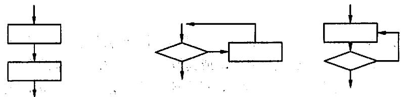

(a) 顺序  
(b) 循环  
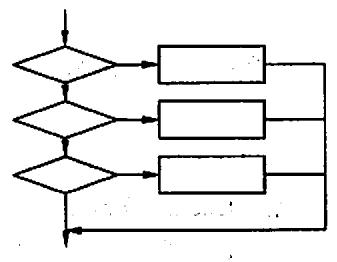  
(c) 选择

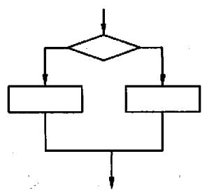  
(d) 条件

图13-20 基本逻辑结构  
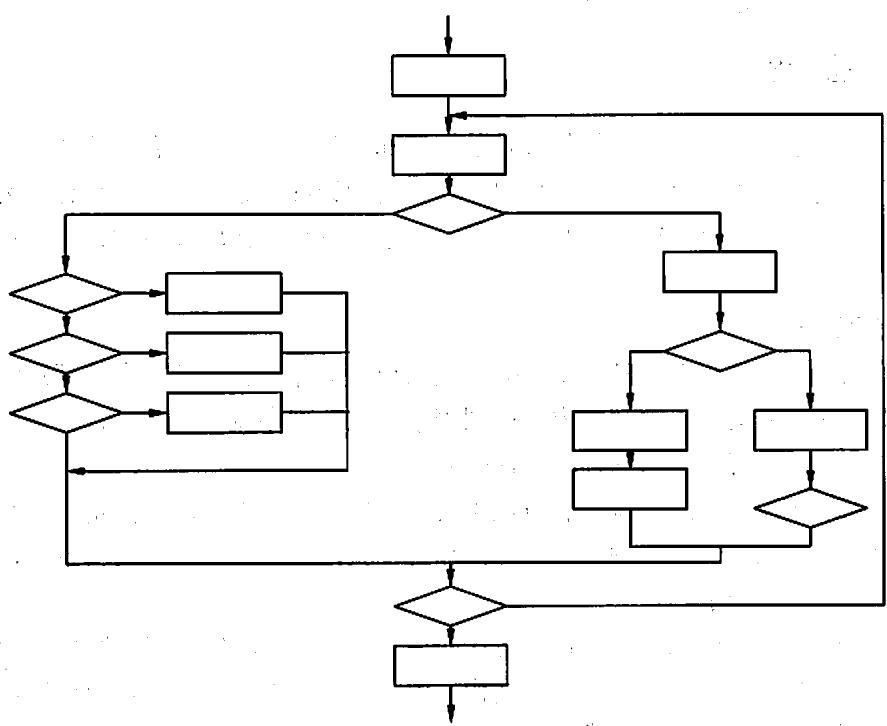  
图13-21 程序流程图示意

## 2. N-S 图

N-S 图是一种符合结构化设计原则的图形描述工具，又称盒图。在 N-S 图中，每个处理步骤用一个盒子表示。盒子可以嵌套。盒子只能从上面进入，从下面走出，除此之外再无其他出入口。所以，盒图限制了控制的随意转移，保证了程序的良好结构。

与程序流程图中的三种基本控制结构列应，盒图中规定了相应的图形构件，如图 13-22 所示。程序流程图也可用盒图表达。

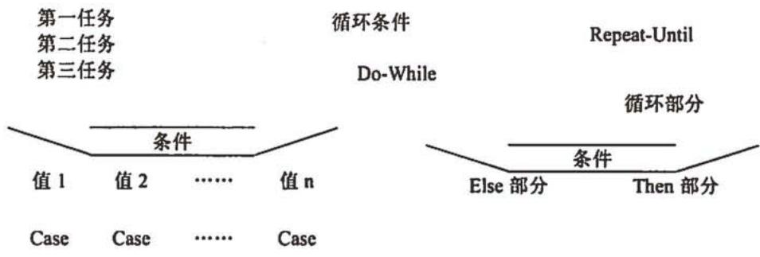  
图 13-22 盒图的主要构件

与流程图相比，N-S 图的优点在于：

\- 它强制设计人员按结构化程序设计方法进行思考并描述其方案。

\- 图像直观，容易理解设计意图，为编程、复查、测试和维护带来方便。

\- 简单易学。

## 3. 程序设计语言

程序设计语言（Program Design Language）是用来描述模块内部具体算法和加工细节的非正式的、比较灵活的语言。其外层语法是确定的，符合一般程序设计语言常用语句的语法规则，用以描述控制结构；而内层语法不确定，可以使用自然语言中的简单句子、短语和数学符号，用以描述程序的功能。通常情况下，流程图和 N-S 图都可以用程序设计语言的方式来表达。

## 13.5 系统设计说明书

系统设计的最终成果是设计人员提交的系统设计说明书。该说明书作为系统实施的重要依据由系统设计人员提交给系统实施人员，以便进行程序开发和其他实施工作。系统设计说明书审批通过后，实施方案方可生效。系统设计说明书应该包括的内容有两部分，引言和系统总体技术方案。

## 13.5.1 系统设计引言

## 1. 摘要

摘要说明所设计的系统的名称、目标和功能。

## 2. 背景

\- 项目的承担者。

\- 用户。

\- 本项目和其他系统或机构的关系和联系。

## 3. 工作条件/限制

说明本项目开发中所具备的工作条件和受到的限制。

\- 硬件/软件/运行环境方面的限制。

\- 保密和安全的限制。

\- 有关部门的业务人员提供确切的数据及其定义。

\- 有关系统软件文本。

\- 网络协议标准文本。

\- 国家安全保密条例。

## 4. 参考和引用资料

\- 本项目的已核准的计划任务书或合同和上级机关的批文。

\- 属于本项目的其他已发表的文件。

\- 本文件中引用的文件资料：列出文件资料的标题、编号、发表日期和制定单位。

\- 说明这些文件资料的来源。

1. 专门术语定义：

列出说明书中所用到的术语。

## 13.5.2 系统总体技术方案

## 1. 系统配置方案

（1）网络设计：系统的网络结构。

\- 网络计算模式，说明采用的是客户机/服务器（C/S）模式还是浏览器/Web 服务器/数据库服务器（B/W/D）模式。

\- 网络拓扑结构，用一张拓扑结构图说明采用的网络拓扑结构，一般有总线型、星型、环状、混合型等。在网络选择上应根据应用系统的地域分布、信息流量进行综合考虑。

\- 网络的逻辑设计，用一张逻辑设计图说明系统的网络逻辑设计。将系统从逻辑上分为各个分系统或子系统，然后按需要配备设备，如主服务器、主交换机、分系统交换机、子系统集线器（hub）、通信服务器、路由器和调制解调器等，并考虑各设备之间的连接结构。

\- 网络操作系统，说明采用的网络操作系统，常见的有 Unix、Netware、Window NT 等。

（2）软硬件选择：硬件选择包括计算机主机、外围设备、连网设备，软件包括操作系统：单机操作系统和网络操作系统。

\- 使用的网络协议，TCP/IP、OSI 等。

\- 数据库产品，说明系统所使用的数据库管理产品，常见的有 Oracle、Sybase、MS SQLServer、Informix，等等。

\- 应用软件，罗列信息系统所使用的其他应用软件或中间件产品，说明其功能和相关技术支持。

## 2. 模块设计

模块设计阶段中，在系统内部划分成各个基础部分——模块结构，确定系统的总体结构。总体结构与各个分层模块结构的关系是程序实施的重要依据。模块结构采用模块结构图来表示。模块结构图是采用 HIPO 图形式绘制而成的框图。

\- 名称，列出系统中各主要功能的结构图名称和它们之间的关系。

\- 功能，用文字简单说明主要模块结构应具有的功能。

\- 功能说明，说明是用伪码形式还是用结构化语言形式，或者其他自然语言形式描述模块结构图的。

\- 评价。

\- 验收，指设计人员验收的决定和处理情况。

## 3. 代码设计

代码设计是信息系统所必需的前提条件，是不可缺少的重要的内容。它是进行信息分类、较对、总计和检查的关键，它也用于指定数据的处理方法、区别数据类型，并指定计算机处理的内容。

（1）代码的方式和种类：简单说明代码的方式和种类。

(2) 功能: 从编码的原则要求 (如单义性、可读性等) 去简单说明代码所体现的功能。

（3）评价：从识别信息、信息标准化、节省存储单元、提高运算速度、节省计算机的处理费用以及代码的特性进行评价。

(4) 验收。

## 4. 输入设计

输入设计担负着将系统外的数据以一定的格式送入计算机的任务，它直接影响到人工系统和机器系统的工作质量。输入设计的基点是确保向信息系统提供正确的信息。输入必须有必要的介质和设备。

（1）输入项目：说明对本系统的主要的输入项目。

（2）输入的承担者：说明对数据输入工作的承担者的安排，并指出操作人员、维护人员的教育水平和技术专长。如果输入数据同某一接口软件有关，应说明设接口软件的来源。

(3) 主要功能要求: 从满足正确、迅速、简单、经济、方便使用等方面的要求去说明。

(4) 输入要求: 简单说明各主要输入数据类型和来源及所用的设备、介质、格式、数值。

(5) 输入校验: 简述所用的数据校验法和效果。

(6) 评价。

(7) 验收。

## 5. 输出设计

输出的含义是把由计算机对输入的原始数据进行处理加工的结果按一定的格式提供给用户。输出不仅有一定的格式要求，而且还必须有必要的介质和设备。

（1）输出项目：说明对本系统的主要输出项目。

（2）输出接受者：说明输出的主要项目的数据的接受者。

(3) 主要功能。

（4）输出要求：说明输出数据类型及所用的设备介质、格式、数值范围、精度等。

(5) 评价。

(6) 验收。

## 6. 数据库设计说明

数据库设计是指数据库应用系统的设计。编制数据库设计说明书的目的是对设计中的数据结构的所有标识、逻辑结构和物理结构做出具体的设计规定。编写提纲和内容要求如下。

(1) 概述。

\- 目标，说明开发的意图、应用目标、作用范围以及有关数据库开发的背景材料

\- 主要功能，简要说明数据库系统的主要功能。

\- 用户的安排，指最终用户。说明操作人员、数据管理人员和维护人员的水平。

(2) 需求规定。

\- 性能规定

\- 精度，简述对数据精度的要求。

\- 有效性，说明对数据库存取数据的有效性的要求。

\- 时间要求，如响应时间、数据的转换和传送时间等。

\- 其他专门要求。

(3) 运行环境要求。

\- 设备，简述运行数据库系统的硬设备及其专门功能。

\- 支撑软件，列出支撑软件并说明测试前的软件。

\- 安全保密，说明在安全保密方面的全部要求。

\- 其他要求。

(4) 设计考虑。

\- 逻辑结构设计，简要说明本系统（或子系统）内所使用的数据结构中，有关数据项、记录、文件的标识定义、长度及它们之间的相互关系。

\- 物理结构设计，简要说明本系统内所使用的数据结构中有关数据库的存储要求、访问方法、存取单位、存取的物理关系（索引、设备、存储区域）、设计考虑和保密处理。

(5) 评价。

简要说明对时间、空间效率、维护代价和各种用户要求进行权衡所产生的方案性能情况。

(6) 验收。

## 7. 实施方案说明书

系统总体结构设计完成以后就要确定系统实施方案，书写实施方案说明书。信息系统的研制工作就从系统设计阶段转入实施阶段。实施方案说明书就作为系统实施阶段的依据和出发点。

(1) 实施方案说明。

\- 项目的说明，指对系统名称、子系统名称、程序名称、程序语言、使用的设备等逐项说明。

\- 数据项目的说明，指对数据长度、文件名称和形式编号、构成记录的各项目名称和内容等逐项说明。

\- 处理内容的说明，指对进行程序设计的处理内容进行详细说明。

(2) 实施的总计划。

\- 工作任务的分解，对于项目开发中须完成的各项工作，包括文件编制、审批、打印、用户培训工作、使用设备的安排工作等，按层次进行分解，指明每项任务的要求。

\- 进度，给出每项工作任务（包括文件编制）的预定开始日期和完成日期，规定各项工作任务完成的先后顺序以及每项工作任务完成的标志。

\- 预算，逐项列出本开发项目所需要的劳务（包括办公费、差旅费、机时费、资料费、通信设备和专用设备的租金）。

(3) 实施方案的审批。

\- 参与审议人员，除用户、系统研制人员、程序员、操作员等以外，还包括邀请的专家、管理人员等。

\- 审批的实施方案，说明经审批的实施方案的概况和审批人员名单。

## 选择题

1. 结构化模块设计的辅助工具不包括\_\_\_\_。
A) 系统流程图
B) HIPO 技术
C) 数据流程图
D) 模块结构图

2. 模块间的聚合方式不包括\_\_\_\_。
A) 偶然聚合
B) 时间聚合
C) 通信聚合
D) 物理聚合

## 思考题

1. 系统分析阶段和系统设计阶段的特点和主要任务各有哪些，两者有什么联系？

2. 结构化系统设计的主要思想是什么，有哪些设计工具来实现这一思想、辅助结构化设计？

3. 数据流图与模块结构图两者之间有什么关系？如何利用系统分析阶段成果完成系统设计阶段的相关任务？例如实现从数据流图到模块结构图的转换。

4. 系统详细设计包括哪些内容？

5. 数据库设计主要有哪几个步骤，各步骤完成什么任务？E-R 模型对应数据库设计的哪个步骤，设计要领是什么？

6. 系统设计说明书的主要内容有哪些，其重要性何在？
