>[!warning] 版本提示
>本书为 **2006 年第 1 版**。现行考试依据是 **《信息系统管理工程师教程（第 2 版）》**（清华社 2024-10，20 章），
>两版**重合极少**：第 1 版的第 1–6 章（硬件/操作系统/语言/配置/数据结构/多媒体）在第 2 版已被删除或压缩。
>本页仅作**扩展参考**，备考请以 [[知识体系]]（第 2 版官方考纲）为准。

# 第14章 信息系统实施

系统设计说明书审核通过之后，系统进入实施阶段。这一阶段要把物理模型转换为可实际运行的物理系统。系统实施阶段的工作对系统的质量有着十分直接的影响。本章介绍结构化的实现方法，讨论与程序设计、系统测试和系统转换有关的技术。

## 14.1 系统实施概述

系统设计说明书被审核通过之后，研制工作进入实施阶段。这一阶段要把物理模型转换为可实际运行的物理系统。一个好的设计方案，只有经过精心实施，才能带来实际效益。因此，系统实施阶段的工作对系统的质量有着十分直接的影响。本章将介绍结构化的实现方法，讨论与程序设计、系统测试和系统交付使用的有关技术。

## 14.1.1 系统实施阶段的特点

系统实施必须在系统分析、系统设计工作完成以后，必须具备完整、准确的系统开发文档，严格按照系统开发文档进行。

与系统分析、系统设计阶段相比，系统实施阶段的特点是工作量大，投入的人力、物力多。因此，这一阶段的组织管理工作也很繁重。对于这样一个多工种、多任务的综合项目，合理的调度安排就显得十分重要。

在当前信息系统建设中，项目负责人往往身兼多种角色。在系统分析阶段，他是系统分析员；在设计阶段，他是主要设计师；在实施阶段，他又是组织者。

在系统分析阶段，系统分析员的主要任务是调查研究、分析问题、与用户一起充分理解用户要求；在系统设计阶段，系统设计人员的任务是精心设计、提出合理方案；在实施阶段，他们的任务是组织协调、督促检查。他们要制定逐步实现物理模型的具体计划，协调各方面的任务，检查工作进度和质量，组织全系统的调试，完成旧系统向新系统的转换。

在实际工作中，系统分析员往往是这几个阶段的组织者。作为合格的系统分析员，不仅要有扎实的计算机科学知识、丰富的管理知识和经验，还要有较强的组织能力。系统开发人员对系统开发文档的全部内容要有明确的理解和认识，不仅应了解本人所承担的部分，还应该了解系统总体结构、接口、数据交换等相互联系部分的内容。

## 14.1.2 系统实施的主要内容

系统实施是开发信息系统的最后一个阶段。这个阶段的任务，是实现系统设计阶段提出的物理模型。按实施方案完成一个可以实际运行的信息系统，并交付用户使用。系统设计说明书详细规定了系统的结构，规定了各个模块的功能、输入和输出，规定了数据库的物理结构。这是系统实施的出发点。如果说研制信息系统是盖一幢大楼，那么系统分析与设计就是根据盖楼的要求画出各种蓝图，而系统实施则是调集各种人员、设备、材料，在盖楼的现场，根据图纸按实施方案的要求把大楼盖起来。

具体讲，这一阶段的任务包括以下几个方面内容。

## 1. 硬件配置

硬件设备包括计算机主机、输入输出设备、存储设备、辅助设备（稳压电源、空调设备等）、通信设备，等等。要购置、安装、调试这些设备。这方面的工作要花费大量的人力、物力，将持续相当长的时间。

## 2. 软件编制

软件设备包括系统软件、数据库管理系统以及一些应用程序。这些软件有些需要购买，有些需要组织人力编写，自行开发的软件还要进行软件测试和系统调试，负责新旧系统的转换。程序设计和软件测试将是这个阶段的主要任务。这需要花费相当多的人力、物力和时间。

## 3. 人员培训

主要指用户的培训，用户包括主管人员和业务人员。系统投入运行后，他们将在系统中工作。这些人多数来自现行系统，精通业务、但往往缺乏计算机知识。为保证系统调试和运行顺利进行，应根据他们的基础，提前进行培训、使他们适应、并逐步熟悉新的操作方法。因为有时改变旧的工作习惯比软件的更换更为困难。

## 4. 数据准备

数据的收集、整理、录入是一项既繁琐、劳动量又大的工作。而没有一定基础数据的准备，系统调试不能很好地进行。一般说来，确定数据库物理模型之后，就应进行数据的整理、录入。这样既分散了工作量，又可以为系统调试提供真实的数据。实践证明，这方面的工作往往容易被人忽视，甚至系统完成后只能作为摆设放在那里而不能真正运行。这等于建好工厂，但缺乏原料而不能投产。这类例子虽然不能说司空见惯，但也不是绝无仅有。因此，要特别强调这一点，不能把系统的实现仅仅归结为编程序或买机器。这几方面的任务是相互联系、彼此制约的。它们的关系可概括为表14-1。

表 14-1 系统实施阶段的主要活动及相互关系

<table><tr><td></td><td>程序编写</td><td>硬件配置</td><td>人员培训</td><td>数据准备</td></tr><tr><td rowspan="2">程序编写</td><td></td><td>提供调试设备</td><td>培训有关人员</td><td>提供试验数据</td></tr><tr><td></td><td></td><td>试用软件</td><td>调试程序</td></tr><tr><td>硬件配置</td><td>提供对硬件设备的要求</td><td></td><td>培训有关人员接收设备</td><td>提供存储量和内存要求</td></tr><tr><td>人员培训</td><td>提供程序培训人员</td><td>提供培训设备</td><td></td><td>提供培训的实验数据</td></tr><tr><td>数据准备</td><td>规定数据准备的内容、格式</td><td>提供录入设备</td><td>提供录入人员</td><td></td></tr></table>

## 14.1.3 系统实施的方法

系统的实施具有一定的风险，尤其是大型的信息系统，实施阶段的任务比较复杂，风险程度更大。很多系统的失败或部分失败都是在实施过程中出现的，如组织中领导更换而对系统建设不重视、购置的设备不能正常运行、软件开发环境不好、主要技术人员离开企业，基础数据不准确或不规范、管理模式的变化等都会导致系统不能成功地实施。因此，在系统的实施过程中，要特别注意领导的亲自参与、人员的培训与组织，抓好系统的软硬件的选型与采购，做好基础数据规范及制定管理制度等基础性的工作。在此基础上，制定出实施计划，确定进度及所需费用。并且监督计划的执行、保证资金到位。

为了降低风险，在实施方法上要注意以下两点。

（1）尽可能选择成熟的软件产品，以保证系统的高性能及高可靠性。选择基础软件或软件产品时，需要考察软件的功能，它的可扩充性、模块性、稳定性，它为二次开发所提供的工具与售后服务与技术支持等，在此基础上再考虑价格因素及所需的运行平台等。

（2）选择好信息系统的开发工具。选择好开发工具，是快速开发且保证开发质量的前提。在选择开发工具时，要着重考虑如下因素：保证开发环境及工具符合应用系统的环境，最好适应跨平台的工作环境，开发工具的功能及性能，如对数据管理的能力，能否处理多媒体信息，用户界面的生成能力，报表制作的能力，与其他系统接口的能力，对事务处理的开发能力等；当应用系统要扩充时，开发工具应支持对原系统的修改与功能的增加，同时要使用符合国际标准的接口和有关协议，使得能与其他系统集成为一个系统；采用面向对象的方法，减少编程的工作量，提高系统的开发效率，缩短开发周期，开发出的系统便于测试和维护。

## 14.1.4 系统实施的关键因素

## 1. 进度的安排

做好实施阶段的进度计划是完成实施的基本保证。由于系统实施阶段任务复杂、工作量大，因此要求进度计划的编制运用科学的方法，并在提高效率的同时能保证质量。因此，要根据人员、任务和环境资源状况，制定详尽的系统实施进度表。系统实施的好坏很大程

度上依赖于管理水平。

## 2. 人员的组织

实施阶段需要较多的专业面广的人员，因此需要提前物色和准备，系统实施中需要的人员涉及多方面，包括网络、计算机硬件、软件人员，特别是程序设计人员。实施人员在进行分工后，首先必须仔细地了解并熟悉系统的设计文档。

程序编码是实施阶段的主要任务，它需要较多熟悉某种或几种程序设计语言或软件开发工具的人员。由于大型应用软件具有很大的开发工作量，必须由多人共同合作来完成彼此紧密联系和相关的程序任务。因此必须有所有参与开发人员共同遵守的规范，而且要求参与编码的程序人员能遵守软件开发的共同规范，能开发出具有统一风格的软件。达到上述目标的方法是开展早期培训，在培训中建立起统一的方法、通用规范的技术手段，乃至采用统一的开发工具来完成各自负责的任务。要达到成果的风格一致，除要求参与人员对设计文档的理解和领会统一外，还要求能用统一的方式、方法和工具来实现程序的开发，而更重要的是应在培训中倡导并认可这种统一和一致的必要性。

## 3. 任务的分解

系统实施阶段所面临的可能是一个庞大而复杂的系统，在系统设计阶段已将其分解为子系统和模块分解是将复杂的事务简单化的措施和手段。但在实际实施中仍然需要将不同技术内容的工作或同一类工作中不同性质或有完成顺序要求的工作加以进一步分析并排列好先后顺序，哪些可以并行，哪些必须排序，哪些应该优先排入进度表。任务被分解和排序后，才可能按任务的性质和技术内容分配给能完成相应任务的人员来完成。在任务分解中除按分析和设计中已经明确的划分，即将系统划分为业务系统和技术系统并对两类系统所包含的具体任务进行分解外，还会在实施中遇到必须完成的而在系统分析和设计中却未明确的任务，它们可能包括：数据的收集和准备、系统的调试和测试、业务人员的培训等，而且它们并不是由程序人员来完成，也应列入任务并排列在进度表中。

## 4. 开发环境的构建

系统开发环境包括硬件环境、软件环境和网络环境等。

按照系统物理配置方案的要求，选择购置该系统所必需的硬件设备和软件系统。硬件设备包括卡机、外围设备、稳压电源、空调装置、机房的配套设施以及通信设备等。软件系统包括操作系统、数据库管理系统、各种应用软件和工具软件等。

计算机硬件设备选择的基本原则是在功能、容量性能等方面能够满足所开发的信息系统的设计要求。值得注意的是，选择计算机系统时要充分进行市场调查，了解设备运行情况及厂商所能提供的服务等。

在建立硬件环境的基础上，还需建立适合系统运行的软件环境，包括购置系统软件和应用软件包。按照设计要求配置的系统软件包括操作系统、数据库管理系统、程序设计语言处理系统等。在企业管理系统中，有些模块可能有商品化软件可供选择，也可以提前购置，其他则需自行编写。

在购买或配置这些软件前应先了解其功能、适用范围、接口及运行环境等，以便做好选购工作。

计算机硬件和软件环境的配置，应当与计算机技术发展的趋势相一致。硬件选型要兼顾升级和维护的要求；软件特别是数据库管理系统，应选择 C/S 或 B/S 模式下的主流软件产品，为提高系统的可扩展性奠定基础。

计算机网络是现代信息系统建设的基础，网络环境的建立应根据所开发的系统对计算机网络环境的要求，选择合适的网络操作系统产品，并按照目标系统将采用的 C/S 或 B/S 工作模式进行有关的网络通信设备与通信线路的架构与连接、网络操作系统软件的安装和调试、整个网络系统的运行性能与安全性测试、网络用户权限管理体系的实施等。

## 14.2 程序设计方法

## 14.2.1 程序设计基础知识

程序设计即编码（coding），也就是为各个模块编写程序。这是系统实现阶段的核心工作。在系统开发的各个阶段中，编程是最容易的、也是人们已掌握得较好的一项工作。根据结构化方法设计了详细的方案，又有了高级语言，初级程序员都可以参加这一阶段的工作。当然，程序员的水平决定了程序的水平。

## 1. 程序设计概述

(1) 程序设计的概念和要求。

程序设计阶段是系统生命周期中详细设计之后的阶段。系统设计是程序设计工作的先导和前提条件。程序设计的任务是使用选定的语言设计程序，把系统设计阶段所得到的程序设计说明书中对信息处理过程的描述，转换成能在计算机系统运行的源程序。

程序设计又被称为编码，由程序设计人员承担，编码工作与系统分析设计阶段的工作相比，是相对比较容易的。

程序设计人员应当仔细阅读系统全部文档，以保证系统设计与系统实施的一致性；深刻理解、熟练掌握并正确运用程序设计语言和软件开发的环境和工具，保证功能的正确实现。

对程序设计的质量要求如下。

\- 程序的正确性。包括正确运用程序设计语言环境和满足系统设计的功能要求。

\- 源程序的可读性。便于其他人员能够读懂和维护。

\- 较高的效率。程序应较少占用内存而具有较高的运行速度。

程序设计质量的几个方面常常是有矛盾的，因此应该结合具体情况，权衡处理。

(2) 程序设计的步骤。

\- 了解计算机系统的性能和软硬件环境。

\- 充分理解系统分析、系统设计的全部文档。

\- 根据设计要求和软硬件环境，选定程序设计语言。

\- 编写程序代码。

\- 程序的检查、编译和调试。

## 2. 程序的标准

对于什么是"好程序"，早期观点与现在有很大不同。早期计算机内存小、速度慢，人们往往把程序的长度和执行速度放在很重要的位置。费尽心机缩短程序长度、减少存储量、提高速度。现在情况有了很大的不同，一般认为好程序应具备下列特点。

\- 正常工作。

\- 调试代价低。

\- 易于维护。

\- 易于修改。

\- 设计不复杂。

\- 运行效率高。

正常工作是最基本的，一个根本不能够工作的程序当然谈不上"好"，谈执行速度、程序长度等指标也毫无意义；调试代价低，即花在调试上的时间少，这一条是衡量程序好坏，也是衡量程序员水平的一个重要标志；其他要求程序可读性强，易于理解。

在相当长的一个时期里，人们认为程序是用于给机器执行的而不是给人阅读的。因而程序员中就存在严重的低估编程方法、不注意程序风格的倾向，认为可以随意编写程序，只要结果正确就行了，读这种程序像读"天书"。可读性（readability）是后来提出的新概念，它主张程序应使人们易于阅读，编程的目标是编出逻辑上正确而又易于阅读的程序。程序可读性好，自然易于理解、易于维护，并将大大降低隐含错误的可能性，从而提高程序的可靠性。

要使程序的可读性好，程序员应有一定的写作能力。他应能写出结构良好、层次分明、思路清晰的文章。有人说："对于程序员来说，最重要的不是学习程序设计语言等，而是英语（日语、汉语）"。程序员在写程序时应该记往：程序不仅是给计算机执行的，也是供人阅读的。

要使程序可读性好，总的要求是使程序简单、清晰。人们总结了使程序简单、清晰的种种技巧和方法，包括的内容如下。

\- 用结构化方法进行详细设计。

\- 程序中包含说明性材料。

\- 良好的程序书写格式。

\- 良好的编程风格。

## 3. 程序设计语言的特性与选择

程序设计语言是程序设计人员用以求解问题的工具，程序设计人员必须适应特定的程序设计语言的限制。程序设计语言的特性表现为其心理特性、技术特性及工程特性。

程序的实现最终要靠人来完成，因此人的因素对程序的实现质量有很大的影响。语言的心理特性，主要表现在编写程序时对人的影响，包括对程序代码的理解等。它在语言中表现为以下几个方面：

## (1) 歧义性

程序设计语言总是以一种确定的方式对源程序的语句进行解释，但程序员可能对其有不同的理解，形成歧义性。歧义影响程序的可读性，容易产生错误。

## (2) 简洁性

是指在用某种程序设计语言编写程序时，人脑必须记忆的关于程序的信息量，用来表示简洁性的属性有：该语言是否便于构造逻辑块及结构化程序，有多少种关键字及缩写；有多少数据类型及默认说明；有多少个算术运算符及逻辑运算符：有多少内部函数。简洁性影响程序的理解性、可读性。

## (3) 局部性与顺序性

人的记忆能力通常分为综合和顺序两类，综合是指把事物作为一个整体记忆及识别的能力，顺序能力是指预知序列中下一个元素的能力。

局部性是指程序设计语言的综合特性。当语句可以组合成程序块时，当结构化构造可以直接实现时，以及编写出的程序表现出高度的模块化及内聚时，局部性就比较显著。如果语言提供不连续的处理，就要降低局部性。顺序性是指一种心理特性，它会影响到软件的维护工作。当遇到逻辑操作的线性序列时，人们易于理解，而很多的分支或多个循环就违反了处理的顺序性。

## (4) 传统性

对某种语言的依赖，影响程序员学习新语言的积极性。

从软件工程的观点来看，程序设计语言特性的表现形式包括如下内容。

（1）是否易于把设计转换为程序，从理论上说，根据系统设计说明去编写程序，其过程应该是明确的。把设计变成程序的难易程度实际上反映了程序设计语言与设计说明相接近的程度。如果该语言能直接实现结构化程序构造，能直接实现复杂的数据结构，能直接实现特殊的输入输出处理、位操作及字符串操作，就能很方便地把设计转换成源程序。

（2）编译效率，程序设计语言的编译器的性能决定了目标代码的运行效率，如果对软件性能要求较高，则配有优化编译器的程序设计语言是很有吸引力的。

（3）可移植性，可移植性是程序设计语言的一种特性，它的含义是，当源程序从一个处理器转换到另一个处理器，或者从一个编译器转换到另一个编译器时，源程序本身不需修改或仅需少量修改。

(4) 是否有开发工具, 使用开发工具, 可以缩短编写源程序的时间, 可以改进源程序的质量。这些工具可能包括排错编译器、源程序格式编排功能、内部编辑功能，用于源程序控制的工具，各种应用领域中的详尽的子程序库等。

（5）源程序的可维护性，设计文档是理解软件的基础，但还必须读懂源程序，才能根据设计的改动去修改源程序。是否易于从设计转变为源程序和语言本身的某些规定，是可维护性的两个主要因素。

语言的技术特性对系统开发的各个阶段都有一定的影响。确定系统需求后，要根据项目的特性选择相应特性的语言，有的要求提供复杂的数据结构，有的要求实时处理强，有的要求能方便地进行数据库的操作。特别是系统设计转化为程序代码时，转化的质量往往受语言性能的影响可能还会影响到设计方法。

为一个特定的设计课题选用程序设计语言时，必须从心理特性、工程特性及技术特性几个方面加以考虑。从所要解决的课题出发确定对语言的要求，并确定这些要求的相对重要性。既然一种语言不可能同时满足多个要求，那么就应该分别对各个要求进行衡量，比较各种可用语言的适用程度。

选择程序设计语言通常应考虑的因素有，项目的应用领域、系统开发的方法、算法及数据结构的复杂性、系统运行的环境、语言的性能、开发人员的知识及对语言的熟悉程度。

## 4. 程序设计风格

(1) 标识符的命名。

标识符是文件名、变量名、常量名、函数名、程序名、段名和程序标号等用户定义的名字的总称。应注意以下规则。

\- 命名规则在程序中前后一致。

\- 命名时一定要避开程序设计语言的保留字。

\- 尽量避免使用意义容易混淆的标识名。

(2) 程序中的注释。

① 序言性注释。

在每个程序或模块的开头的一段说明，起对程序理解的作用，一般包括以下内容：

\- 程序的标识、名称和版本号。

\- 程序功能描述。

\- 接口与截面描述，包括调用及被调用关系、调用形式、参数含义以及相互调用的程序名。

\- 输入/输出数据说明，重要变量和参数说明。

\- 开发历史，包括原作者、审查者、修改者、编程日期、编译日期、审查日期、修改日期等。

\- 与运行环境有关的信息，包括对硬件、软件资源的要求，程序存储与运行方式。

② 解释性注释。

一般嵌在程序之中，与要注释的部分匹配。

进行程序注释应注意以下问题。

\- 注释一定要在程序编制中书写。

\- 解释性注释不是简单直译程序语句，应能说明"做什么"。

\- 一定要保证注释与程序的一致性，程序修改时注释也必须修改。

(3) 程序的布局格式。

利用空格、空行和缩进等方式改善程序的布局，取得较好的视觉效果。

(4) 数据说明。

先说明、后引用，应使数据便于理解和维护。

(5) 程序语句的结构。

一般原则是：语句简明、直观，直接反映程序设计意图，避免过分追求程序的技巧性，不能为追求效率而忽视程序的简明性、清晰性。应遵守如下规则。

\- 每行写一个语句。

\- 避免使用复杂的条件判断。

\- 尽量减少使用否定的逻辑条件进行测试。

\- 尽量减少循环嵌套和逻辑嵌套的层数。

\- 应采用空格、括号等符号使复杂表达式的运算次序清晰直观。

(6) 输入和输出。

输入输出注意以下内容。

\- 针对用户的不同对象、特点和要求设计人机交互方式。

\- 程序在运行过程中应有表明当前状态的说明信息。

\- 交互式输入的请求应有明确的提示。

\- 对于输出的方式与格式，允许用户进行选择和应答。

\- 应设计完备的错误检测和恢复功能。

(7) 程序的运行效率。

主要指计算机运行时间和存储空间两个方面，主要注意事项如下。

\- 编写程序前应尽量简化算术表达式和逻辑表达式，并尽量用逻辑表达式。

\- 尽量选用好的算法。

\- 仔细研究循环嵌套，确定语句是否可以移出循环体。

\- 尽量避免使用多维数组。

\- 尽量避免使用指针和复杂的表。

\- 充分利用语言环境提供的函数。

\- 使用有良好优化特性的编译程序。

## 14.2.2 结构化程序设计

结构化程序设计被称为软件发展中的第一个里程碑，其影响比前两个里程碑（子程序、高级语言）更为深远。结构化程序设计的概念和方法、支持这些方法的一整套软件工具，构成了"结构化革命"。这是存储程序计算机问世以来，对计算机界影响最大的一个软件概念。对于什么是"结构化程序设计"，至今还没有被普遍接受的定义。通常认为结构化程序设计包括以下4方面的内容。

## 1. 限制使用GOTO语句

从理论上讲，只用顺序结构、选择结构、循环结构这三种基本结构就能表达任何一个只有一个入口和一个出口的程序逻辑。为实际使用方便，往往允许增加多分支结构、REPEAT型循环等两三种结构。程序中可以完全不用GOTO语句。这种程序易于阅读、易于验证。但在某些情况下，例如从循环体中跳出，使用GOTO语句描述更为直截了当。

因此，一些程序设计语言还是提供了 GOTO 语句。无限制地使用 GOTO 语句，将使程序结构杂乱无章、难以阅读、难以理解，其中容易隐含一些错误。

## 2. 逐步求精的设计方法

在一个程序模块内，先从该模块功能描述出发，一层层地逐步细化，直到最后分解、细化成语句为止。

## 3. 自顶向下的设计、编码和调试

这是把逐步求精的方法由程序模块内的设计推广到一个系统的设计与实现。这正是本书介绍的结构化方法的来源。

## 4. 主程序员制的组织形式

这是程序员的组织形式。一个主程序员组的固定成员是主程序员一人，辅助程序员一人，程序资料员（或秘书）一人。其他技术人员按需要随时加入组内。主程序员负责整体项目的开发，并负责关键部分的设计、编码和调试。辅助程序员在细节上给主程序员以充分的支持。主程序员、辅助程序员必须在程序技术方面和项目管理方面具有经验和才能，必须完全熟悉该项目的开发工作。这种组织方式的好处在于显著减少了各子系统之间、各程序模块之间通信和接口方面的问题。把设计的责任集中在少数人身上，有利于提高质量。

作为这种组织形式中的一个程序员，不仅应具备程序设计的基本知识，还要对项目所在的领域有较深入的了解、熟悉开发的技术环境，因而能承担一定的程序编写工作，更为重要的是必须有高度的组织纪律性和团队精神，使自己的工作融入整个系统，与组内其他成员协调一致地工作。为此，必须严格遵守以下几项规则。

\- 不使用可能干扰其他模块的命令或函数。

\- 按总体设计的要求传递参数，不随意修改其内容与含义。

\- 按规定的统一格式操作公用文件或数据库。

\- 按统一的原则使用标识符。

\- 按统一要求编写文档。

\- 保持程序风格的一致。

## 14.2.3 面向对象的程序设计

传统的过程式程序设计随着软件危机和应用系统的不断膨胀越来越显得力不从心，随着20世纪70年代Smalltalk及Modula-2等面向对象的编程语言（Object Oriented Programming Language, OOPL）的出现，以及C++的发展成熟，面向对象程序设计（Object Oriented Programming, OOP）思想得到了广泛的认同和普及。至20世纪90年代，各种程序语言或工具都融入了这一思想，其优越性是有目共睹的，它已成为这一时代软件产业的主体技术。

在 OOP 方法中，一个对象即是一个独立存在的实体，对象有各自的属性和行为，彼此以消息进行通信，对象的属性只能通过自己的行为来改变，实现了数据封装，这便是对象的封装性。而相关对象在进行合并分类后，有可能出现共享某些性质，通过抽象后使多种相关对象表现为一定的组织层次，底层次的对象继承其高层次对象的特性，这便是对象的继承性。另外，对象的某一种操作在不同的条件环境下可以实现不同的处理、产生不同的结果：这就是对象的多态性。现有的 OOPL 中都不同程度地实现了对象的以上三个性质。

## 1. 封装性

一般以类（class）来创建一个对象，类表现为一种数据结构。对外提供的界面包括一组数据以及操作这些数据的方法（函数或过程），而隐藏了内部实现的细节，对象操作者只需要了解该对象的界面即可。这样大大增强了模块化程度，很好地实现了软件重用和信息隐藏。

为了更好地保持安全性和独立性，类有部分数据可以被定义为私有数据，其他类的对象或过程不能直接访问私有数据，而一般情况下利用消息机制向对象发送消息，对象所有类就需要定义对应的消息响应函数，主动接受消息并做处理，这也是 OOPL 的一大特点。

## 2. 继承性

类通过继承被定义成不同的层次结构，将相关类的特点抽象出来作为父类，子类继承父类的结构和方法后，再定义各自特定的数据和操作，或者还可以通过重载将父类的某些特殊操作进行重新定义。继承一个单一的父类时叫单继承，如果有两个或两个以上的父类则是多继承。这样做的目的不仅体现了软件重用技术，同时又可最大限度地精简程序、减少冗余代码，极大地提高了程序开发和运行效率。

## 3. 多态性

类的某些操作允许同一名称具有多种语义。OOPL 的这些特点使程序员进行面向对象程序设计时与进行过程式的程序设计有很大的不同，体现在以下这些方面。

\- 设计程序不采用顺序性的结构，而是采用对象本身的属性与方法来解决问题。

\- 在解决问题的过程中，可以直接在对象中设计事件处理程序（接受事件消息），而不用调用子过程严格地按顺序执行，很方便地让用户实现自由无顺序的操作。

\- 数据与程序不是分离的，数据是特定对象的数据，也只有对象的函数或过程才能对数据进行处理，一个对象中的函数或过程共享对象的数据，解决了因调用子过程出现大量数据传递的情况（如函数返回值和较多参数）。

\- 不用设计公用程序模块，因特定方法下的公用模块很难再被扩展为更复杂的处理方式，只需设计类就可以实现重用，而且类库中提供大量基类，掌握它们后可以加快开发过程，开发小组还可以按自己设想的基类放入类库共享。

\- OOPL 非常适合于 Windows 环境下的程序开发，可以充分利用 Windows 的各种资源来构造应用程序，这也就需要程序员比较熟悉 Windows。

## 14.2.4 可视化程序设计

虽然 OOPL 提高了程序的可靠性、可重用性、可扩充性和可维护性，但应用软件为了适应 Windows 界面环境，使用户界面的开发越来越复杂，有关这部分的代码所占比例也越来越大，因此，微软公司推出 Visual Basic 以后，可视化编程技术得到了极大的欢迎，编程人员不再受 Windows 编程的困扰，能够所见即所得地设计标准的 Windows 界面。

可视化编程技术的主要思想是用图形工具和可重用部件来交互地编制程序。它把现有的或新建的模块代码封装于标准接口封包中，作为可视化编程编辑工具中的一个对象，用图符来表示和控制。可视化编程技术中的封包可能由某种语言的一个语句、功能模块或数据库程序组成，由此获得的是高度的平台独立性和可移植性。在可视化编程环境中，用户还可以自己构造可视控制部件，或引用其他环境构造的符合封包接口规范的可视控制部件。增加了编程的效率和灵活性。

可视化编程一般基于事件驱动的原理。用户界面中包含各种类型的可视控制部件，如按钮、列表框和滚动条等，每个可视控制部件对应多个事件和事件驱动程序。发生于可视控制部件上的事件触发对应的事件驱动程序，以完成各种操作。编程人员只要在可视化编程工具的帮助下，利用鼠标或表单建立、复制、缩放、移动或清除各种已提供的控件，然后使用该可视化编程工具提供的语言编写每个控件对应的事件程序，最后可以用解释方式运行来测试程序。这样，通过一系列的交互设计就能很快地完成一个应用项目的编程。

另外，一般可视化编程工具还有应用专家或应用向导提供模板，按照步骤对使用者进行交互式指导，让用户定制自己的应用，然后就可以生成应用程序的框架代码，用户再在适当的地方添加或修改以适应自己的需求。

面向对象编程技术和可视化编程开发环境的结合，改变了应用软件只有经过专门技术训练的专业编程人员才能开发的状况。它使软件开发变得容易，从而扩大了软件开发队伍。由于大量软件模块的重用和可视控件的引入，技术人员在掌握这些技术之后，就能有效地提高应用软件的开发效率、缩短开发周期、降低开发成本，并且使应用软件界面风格统一，有很好的易用性。

## 14.3 系统测试

信息系统测试是信息系统开发过程中非常重要而且漫长的阶段。其重要性表现在，它是保证系统质量和可靠性的关键步骤，是对系统开发过程中的系统分析、系统设计和实施的最后复查。虽然在开发过程中，人们采用了许多保证信息系统的质量和可靠性的方法来分析、设计和实现信息系统，但免不了在工作中会犯错误，这样所开发的系统中就隐藏着许多错误和缺陷。如果问题不在系统正式投运之前的测试阶段被纠正，那么它迟早会在运行期间暴露出来，这时要纠正错误就会付出更高的代价，甚至造成生命和财产的重大损失。

信息系统测试的漫长性表现在测试工作量往往占开发总量的 40% 以上，而对于一些特别重要的甚至是人命关天的大型系统，测试的工作量和成本更大，甚至超过系统开发各阶段总和的 1\~5 倍。

本章重点讲述信息系统测试的基本概念、测试目标、测试过程和测试步骤，讨论测试的关键技术和调试技术以及如何设计测试用例和组织实施测试活动。

## 14.3.1 系统测试概述

从表面上看，测试阶段的目的和其他阶段的目的是相反的，测试之前的所有开发活动都是在积极地构造系统，如软件工程师根据设计文档用一种适当的程序设计语言编写出可以实现某些功能的程序代码，及从事所谓的"建设性"活动。但测试人员却是努力找出软件、系统的错误。事实上，查找错误也就是为了纠正错误。测试阶段发现的错误越多，后期的纠错和维护工作越少。所以它们的目的都是一样的，都是为了开发出高质量、高可靠性的系统。

## 1. 测试的概念和目标

什么是软件测试？测试的目标是什么？《软件测试的艺术》的作者 Grenford J.Myers 对测试的目标进行了归纳。

\- 测试是为了发现错误而执行程序的过程

\- 好的测试方案能够发现迄今为止尚未发现的错误

\- 成功的测试将发现至今尚未发现的错误

总之，测试的目标就是希望能以最少的人力和时间发现潜在的各种错误和缺陷。从上述的目标可以归纳出测试的定义是："为了发现错误而执行程序的过程"。通俗地说，测试是根据开发各阶段的需求、设计等文档或程序的内部结构，精心设计测试用例（即输入数据和预期的输出结果），并利用该测试用例来运行程序以便发现错误的过程。

信息系统测试应包括软件测试、硬件测试和网络测试。硬件测试、网络测试可以根据具体的性能指标来进行，而信息系统的开发工作主要集中在软件。所以我们所说的测试更多的是指软件测试。

正确认识测试的目标是非常重要的，这关系到人们的心理作用。如果测试的目标是为了证明程序没有错误，在设计测试用例时就会引用一些不易暴露错误的数据；相反，如果测试是为了发现程序中的错误，就会力求设计出容易暴露错误的测试方案。所谓"好"与"坏"、"成功"与"失败"的测试方案，也同样存在着心理学的问题。所以 Myers 把测试目标定义为"发现错误"、"发现迄今为止尚未发现的错误"、"发现了至今尚未发现的错误"。

## 2. 测试的类型

测试有模块测试、联合测试、验收测试、系统测试4种类型。

## (1) 模块测试

模块测试是对一个模块进行测试，根据模块的功能说明，检查模块是否有错误。这种测试在各模块编程之后进行。

模块测试一般由编程人员自己进行，有以下测试项目：

\- 模块界面，调用参数（流入数据）数目、顺序和类型

\- 内部数据结构，如初始值是否正确、变量名是否一致、共用数据是否有误

\- 独立路径，是否存在不正确的计算、不正确的循环及判断控制

\- 错误处理，预测错误的产生及后处理，看是否和运行一致

\- 边界条件，对数据大小界限和判断条件的边界进行跟踪运行

## (2) 联合测试

联合测试即通常所说的联调。联合测试可以发现总体设计中的错误，例如模块界面的问题。接照前面分"版本"的实现方法，这种测试是各个版本实现后完成有关接口的测试。

各个模块单独执行可能无误，但组合起来会相互产生影响，可能会出现意想不到的错误，因此要将整个系统作为一个整体进行联调。联合测试方法有两种，即根据模块结构网由上到下或由下到上进行测试。

\- 由上到下，设置下层模块为假模块，检查控制流，较早发现错误，而不至于影响到下层模块。但这种方法要制作的假模块太多，而且不能送回真实数据，可能发现不了内在的错误。

\- 由下到上，先设置上层模块为假模块，测试下层模块执行的正确性，然后逐步向上推广。这种方法方便，设计简单，但要到最后才能窥得全貌，有一定的风险。

较好的方法是将两者结合，高层由上到下，低层由下至上，到中层进行会合。

## (3) 验收测试

验收测试检验系统说明书的各项功能与性能是否实现和满足要求。

验收测试的方法一般是列出一张清单，左边是需求的功能，右边是发现的错误或缺陷。

常见的验收测试有所谓的 $\alpha$ 测试和 $\beta$ 测试，这两种测试都是由用户进行的。但前者由使用者在应用系统开发所在地与开发者一同进行观察记录，后者由用户在使用环境中独立进行。

(4) 系统测试。

系统测试是对整个系统的测试，将硬件、软件、操作人员看作一个整体，检验它是否有不符合系统说明书的地方。这种测试可以发现系统分析和设计中的错误。如安全测试是测试安全措施是否完善，能不能保证系统不受非法侵入。俗话说"没有不透风的墙"，那么什么才算是安全的呢？即安全的标准是什么？可以这样定义：如果入侵一个系统的代价超过了从系统中获得的利益时，那么这就是一个安全的系统。再例如，压力测试就是测试系统在正常数据数量以及超负荷量（如多个用户同时存取）等情况下是否还能正常地工作。

## 14.3.2 测试的原则

报据测试的概念和目标，在进行信息系统测试时应遵循以下基本原则。

(1) 应尽早并不断地进行测试。有的人认为"测试是在应用系统开发完之后才进行"。将这种想法用于测试工作中是非常危险的。由于原始问题的复杂性、开发各阶段的多样性以及参加人员之间的协调等因素, 使得在开发各个阶段都有可能出现错误。有的时候表现在程序中的错误, 并不一定是由于编码产生的, 很有可能是设计阶段, 甚至是由需求分析阶段的问题所引起的, 而且开发各阶段是连续的, 早期出现的小问题到后而就会扩散, 最后需要花费不必要的人力、物力来修改错误。尽早进行测试, 可以尽快地发现问题, 将错误的影响缩小到最小范围。因此, 测试应贯穿在开发的各阶段, 坚持各阶段的技术评审, 这样才能尽早发现错误和纠正错误、消除隐患、提高整个系统的开发质量。

(2) 测试工作应避免由原开发软件的人或小组来承担 (单元测试除外)。从心理上来讲, 人们由于各种原因都不愿否认自己的工作, 总认为自己开发的软件没有错误或错误不严重, 而测试的目的就是为了发现错误; 另一方面, 开发人员对功能理解的错误很难由本人测试出来, 而且在设计测试方案时, 很容易根据自己的编程思路来制定, 具有局限性。所以测试工作由不负责该项目开发的人或其他测试机构来进行会更客观、更有效。

（3）在设计测试方案时，不仅要确定输入数据，而且要从系统的功能出发确定输出结果。把预期的输出结果作为测试方案的一部分可以提高测试的效率，在测试时按照测试方案输入测试数据，其输出结果与预期结果相比较就能发现测试对象是否正确，也能避免由于粗心而把一些似是而非的结果当成正确结果，出现失误。

(4) 在设计测试用例时, 不仅要包括合理、有效的输入条件, 也要包括不合理、失效的输入条件。在测试中人们往往习惯按照合理的、正常的情况进行测试, 而忽略了对异常、不合理的、意想不到的情况进行测试, 而这些正好是隐患, 如果没有排除, 在今后的正式运行中就有可能暴露出来。所以利用不合理的输入条件比用合理的输入条件更能发现错误。例如在测试学生成绩录入功能时, 也应该将负数作为输入数据进行测试。

（5）在测试程序时，不仅要检测程序是否做了该做的事，还要检测程序是否做了不该做的事。多余的工作会带来相应的副作用、影响程序的效率，有时会带来潜在的危害或错误。例如在测试生成职工工资单这一功能时，程序是否在产生在职职工工资的同时，也把

已经调离的职工工资生成出来。

（6）充分重视测试中的群集现象。有的测试人员经过测试发现错误后就认为错误找得差不多了，不再继续进行测试。经验表明，测试后软件中仍存在的错误概率与已经发现的错误数成正比。这个事实可以用米中含沙来比喻，如果我们随便从米袋中抓把米，而米里含有沙时，决不能说沙只有这些。往往是手中的沙越多，说明米袋中的沙含量就越高。根据这一规律，应该对出现错误多的程序段进行重点测试，以提高测试效率。

（7）严格按照测试计划来进行，避免测试的随意性。测试计划应包括测试内容、进度安排、人员安排、测试环境、测试工具、测试资料等。严格地按照测试计划可以保证进度，使各方面都得以协调进行。

（8）妥善保存测试计划、测试用例，作为软件文档的组成部分，为维护提供方便。测试用例都是精心设计出来的，可以为重新测试或追加测试提供方便。当纠正错误、系统功能扩充后，都需要重新开始测试，而这些工作重复的可能性很大，可以利用以前的测试用例或在其基础上修改、扩充测试用例。

## 14.3.3 测试的方法

信息系统测试与工程产品的测试方法一样，常用的有两种方法。一种是不了解产品的内部结构，但对具体的功能有要求，可通过检测每一项功能是否能被正常使用来说明产品是否合格。另一种是知道产品的内部过程，通过检测产品的内部动作是否按照说明书的规定正常运行来考察产品是否合格。前一种方法被称为黑盒测试，后一种方法被称为白盒测试。

对软件进行测试的主要方法如图 14-1 所示。

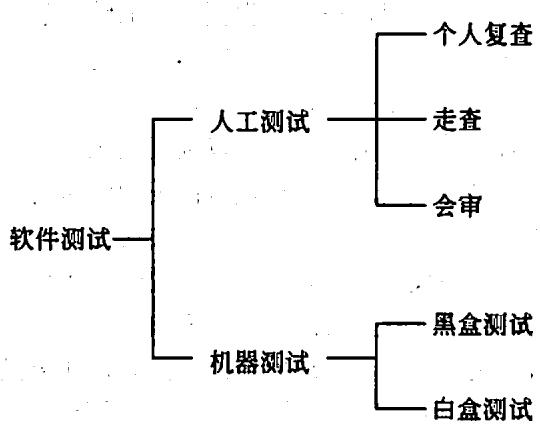  
图14-1 软件测试的主要方法

人工测试指的是采用人工方式进行测试。目的是通过对程序静态结构的检查，找出编译时不能发现的错误。经验表明，组织良好的人工测试可以发现程序中30%\~70%的编码错误和逻辑设计错误。机器测试是把事先设计好的测试用例作用于被测程序，比较测试结果和预期结果是否一致，如果不一致，则说明被测程序可能存在错误。人工测试有一定的局限性，但机器测试只能发现错误的症状，不能对问题进行定位。人工测试一旦发现错误，就能确定问题的位置及是什么错误等，而且能一次发现多处错误。因此应根据实际情况来选择测试方法。

## 1. 人工测试

人工测试又被称为代码复审。可通过阅读程序来查找错误。其内容包括：检查代码和设计是否一致；检查代码逻辑表达是否正确和完整；检查代码结构是否合理，等。主要有以下三种方法。

（1）个人复查，指程序员本人对程序进行检查，发现程序中的错误。由于心理上的原因和思维上的习惯性，一般不太容易发现自己的错误，则更不可能纠正功能理解的错误。因此这种方法主要针对小规模程序，它的效率不高。

(2) 走查, 通常由 3\~5 人组成测试小组, 测试人员也是没有参加该项目开发的有经验的程序设计员。在走查之前, 应先阅读相关的软件资料和源程序, 然后测试人员扮演计算机角色, 将一批有代表性的测试数据沿程序的逻辑走一遍, 监视程序的执行情况, 随时记录程序的踪迹, 发现程序中的错误。由于人工检查程序很慢, 因此只能选择少量简单的用例来进行, 通过 "走" 的进程来不断地发现程序中的错误。

(3)会审,测试人员的构成与走查类似,要求测试人员在会审之前应充分阅读有关的资料(如系统分析、系统设计说明书、程序设计说明书、源程序等),根据经验列出尽可能多的典型错误,然后把它们制成表格。根据这些错误清单(也叫检查表),提出一些问题,供在会审时使用。在会审时,由编程人员逐句讲解程序,测试人员逐个审查、提问,讨论可能出现的错误。实践证明,编程人员在讲解、讨论的过程中能发现自己以前没有发现的错误,使问题暴露出来。例如在讨论某个问题的修改方法时,可能会发现涉及到模块间接口等问题,从而提高了软件质量。会审后要将发现的错误登记、分析、归类,一份交给程序员,另一份由自己妥善保管,以便再次组织会审时使用。

在代码复审时，需要注意两点：一是在代码审查时，必须要检查被测软件是否正确通过了编译，只有正确了之后才能进行代码审查；二是在代码复审期间一定要保证有足够的时间让测试小组对问题进行充分讨论，只有这样才能有效地提高测试效率，避免走弯路。

## 2. 机器测试

机器测试指在计算机上直接用测试用例运行被测程序，从而发现程序错误。机器测试分为黑盒测试和白盒测试两种。

## (1) 黑盒测试

黑盒测试也被称为功能测试，将软件看成黑盒子，在完全不考虑软件的内部结构和特性的情况下，测试软件的外部特性。根据系统分析说明书设计测试用例，通过输入和输出的特性检测是否满足指定的功能。所以测试只作用于程序的接口处，进行黑盒测试主要是

为了发现以下几类错误：

\- 是否有错误的功能或遗漏的功能。

\- 界面是否有误，输入是否能够正确接受，输出是否正确。

\- 是否有数据结构或外部数据库访问错误。

\- 性能是否能够接受。

\- 是否有初始化或终止性错误。

(2) 白盒测试。

白盒测试也被称为结构测试。将软件看成透明的白盒，根据程序的内部结构和逻辑来设计测试用例，对程序的路径和过程进行测试，检查是否满足设计的需要。其原则是：

\- 程序模块中的所有独立路径至少被执行一次。

\- 在所有的逻辑判断中，取"真"和取"假"的两种情况至少都能被执行一次。

\- 每个循环都应在边界条件和一般条件下各被执行一次。

\- 测试程序内部数据结构的有效性等。

## 14.3.4 测试用例设计

## 1. 白盒测试的测试用例设计

白盒测试是对软件的过程性细节做详细检查。通过对程序内部结构和逻辑的分析来设计测试用例。适合于白盒测试的设计技术主要有：逻辑覆盖法、基本路径测试等。下面将介绍逻辑覆盖法。

逻辑覆盖（Logic Coverage）是以程序内部的逻辑结构为基础的测试技术。它考虑的是测试数据执行（覆盖）程序的逻辑程度。由于穷举测试是不现实的，因此，只希望覆盖的程度更高些。根据覆盖情况的不同，逻辑覆盖可分为：语句覆盖、判定覆盖、条件覆盖、判定条件覆盖、多重覆盖、路径覆盖。在讨论这几种覆盖时，均以图14-2所示的程序段为例。这是一个非常简单的程序，共有两个判断、4条不同路径。为了方便起见，分别对第一个判断取假分支，对第一个判断取真分支，对第二个判断取假分支，对第二个判断取真分支并分别命名为b、c、d和e。4条路径表示为abd、acd、abe和ace。其Pascal程序为：

```sql
PROCEDURE TEST (VAR A, B, X: REAL);
BEGIN
    IF (A > 1 AND B = 0) THEN
    X: =X / A;
    IF (A = 2 OR X > 1) THEN
    X: =X + 1;
END;
```

(1) 语句覆盖。

语句覆盖（Statement Coverage）就是设计若干个检测用例，使得程序中的每条语句至

少被执行一次。在所举的示例中，只要选择能通过路径 ace 的测试用例即可。如：

$$
A = 2, B = 0, X = 6 \quad (\text { 覆   盖 } a c e)
$$

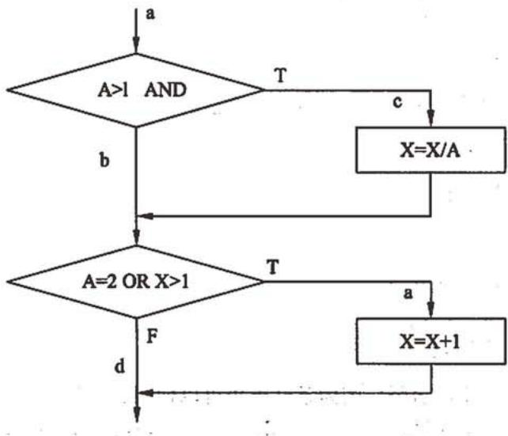  
图 14-2 被测试程序的流程图

语句覆盖对程序的逻辑覆盖程度很低，如果把第一个判断语句中的 AND 错写成 OR，或把第二个判断语句中的 OR 错写成 AND，用上面的测试用例是不能发现问题的。这说明语句覆盖有可能发现不了判断条件中算法出现的错误。

(2) 判定覆盖。

判定覆盖（Decision Coverage）也被称为分支覆盖，就是设计若干个检测用例，使得程序中的每个判断的取真分支和取假分支至少被执行一次。对上述被测程序来说，需要设计测试用例覆盖路径 acd 和 abe（或 abd 和 ace）。可以选择如下的输入数据：

```txt
A=3, B=0, X=3 (覆盖 acd)
A=2, B=1, X=6 (覆盖 abe)
```

还可以选择另外两组输入数据：

```txt
A=1, B=2, X=1 （覆盖 abd）
A=2, B=0, X=6 （覆盖 ace）
```

判断覆盖比语句覆盖的程度稍高，因为如果通过了每个分支的测试，则各语句也都被执行了。但仍有不足，如上述的测试用例不能发现把第二个判断语句中的 X>1 错写成 X<1 的错误。所以，判断覆盖还不能保证一定能查出判断条件中的错误。因此，需要更强的逻辑覆盖来检测内部条件的错误。

(3) 条件覆盖。

条件覆盖（Condition Coverage）就是设计若干个测试用例，使得被测程序中每个判断的每个条件的所有可能情况都至少被执行一次。

上述被测程序，共有4个条件：

```txt
A>1, B=0, A=2, X>1
```

为此，需要设计测试用例，使得a点出现测试结果：

```txt
A>1, A<1, B=0, B≠0
```

并使 b 点出现测试结果:

```txt
A=2, A≠2, X>1, X<1
```

可以设计两组测试输入数据：

```txt
A=1, B=0, X=1（覆盖 abd）
A=2, B=0, X=3（覆盖 ace）
```

条件覆盖通常比判断覆盖强，因为条件覆盖可以使判断语句中的每个条件都能取两个不同的结果。但有可能出现虽然每个条件都取了不同的结果，但判断表达式却始终是一个值的情况，请看下面两组输入数据：

```txt
A=1, B=0, X=6（覆盖 abe）
A=2, B=1, X=1（覆盖 abd）
```

它们满足条件覆盖，但不满足语句覆盖和判断覆盖的标准（未经历路径 c，那么就发现不了 X=X/A 错写成 X=X/B 的错误）。因此，需要对条件及判断产生的分支兼顾，这就是下面要介绍的判断/条件覆盖。

(4) 判断/条件覆盖。

判断/条件覆盖（Decision/Condition Coverage）是既要满足判断覆盖的要求，又要满足条件覆盖的要求。也就是设计若干个测试用例，使得程序中的每个判断的取真分支和取假分支至少执行一次，而且每个条件的所有可能情况都至少被执行一次。对于图 14-2 而言，下面两组输入数据可以满足判断/条件覆盖的要求：

```txt
A=1, B=1, X=1 (覆盖 abd)
A=2, B=0, X=3 (覆盖 acc)
```

但这两组数据也是条件覆盖中所举的示例。因此，有时判断/条件覆盖并不比条件覆盖更强，逻辑表达式的错误也不一定能被检查出来。

(5) 多重覆盖。

多重覆盖（Multi-job Coverage）就是设计多个测试用例，使得各判断表达式中条件的各种组合至少被执行一次。就图 14-2 所示的例子而言，要符合多重覆盖的标准，所设计的

测试用例必须满足下面的8种条件组合：

```csv
①A>1, B=0; ②A>I, B≠0; ③A≤1, B=0; ④A≤1, R≠0;
⑤A=2, X>1; ⑥A=2, X≤1; ⑦A≠2, X>1; ⑧A≠2, X≤1
```

要测试到这 8 种情况，可以选择下列 4 组输入数据：

```txt
A=2, B=0, X=3（覆盖 ace，满足①、⑤）
A=2, B=1, X=1（覆盖 abe，满足②、⑥）
A=1, B=0, X=3（覆盖 abe，满足③、⑦）
A=1, B=1, X=1（覆盖 abd，满足④、⑧）
```

很显然，多重覆盖包含了条件覆盖、判断覆盖和判断/条件覆盖，是前面几种覆盖标准中最强的。但就上面的4组输入数据，也没有将程序中的每条路径都覆盖了，如：没有通过acd这条路径，所以测试仍不完全。

## (6) 路径覆盖

路径覆盖就是设计足够多的测试示例，使被测程序中的所有可能路径至少被执行一次。对上面的例子束说，可以选择这样的4组测试数据来覆盖程序中的所有路径：

```csv
A=1, B=1, X=1（覆盖abd）
A=2, B=0, X=3（覆盖acc）
A=3, B=0, X=3（覆盖acd）
A=2, B=1, X=1（覆盖ah）
```

路径覆盖保证了程序中的所有路径都至少被执行一次，是一种比较全的逻辑覆盖标准。但它没有检查判断表达式中条件的各种组合情况，通常把路径覆盖和多重覆盖结合起来就可以得到查错能力很强的测试用例。如上面的例子，把多重覆盖的4组输入数据和路径覆盖中的第3组数据组合成起来，形成5组输入数据，就可以得到既满足路径覆盖的标准，又满足多重覆盖的标准。

## (7) 循环覆盖

上面介绍的只是语句、分支、条件以及它们的组合情况，而循环也是大多数算法的基础：对循环的测试主要检查循环构造的有效性。循环分为简单循环（Simple Loops）、串联循环（Concatenated Loops）、嵌套循环（Nested Loops）和非结构循环（Unstructured Loops）4种类型，如图14-3所示。

对于循环次数为 n 的简单循环。可以采用下列措施进行测试。

\- 跳过整个循环。

\- 循环次数为 1, 2, n-1, n, n+l。

\- 任取循环次数为 m，其中 m<n。

对于嵌套循环，如果采用简单循环的测试方法，则测试次数将会成几何级数增长。可以采用以下方法进行测试。

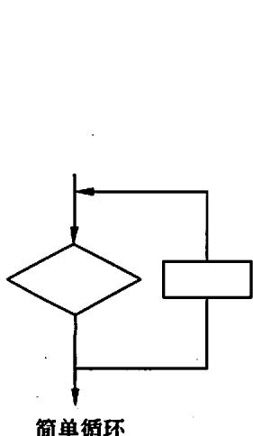

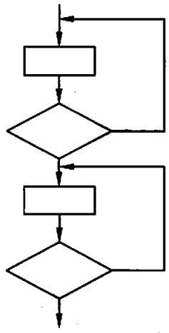  
串联循环

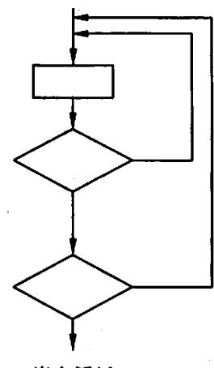

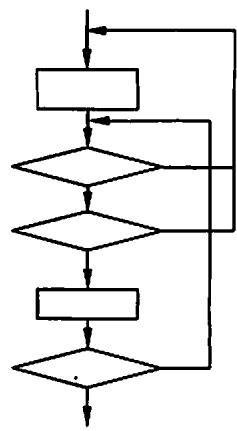  
图14-3 循环的4种类型

\- 从最内层循环开始测试，对所有外层循环都取最小值，内层循环按简单循环的测试方法进行。

\- 由里向外，一层层进行测试，凡是外层的循环都取最小值，该层循环嵌套的那些循环取一些典型的值。

\- 直至所有循环测试完毕。

对于串联循环的测试可分成两种情况：如果两个循环是独立的，则采用简单循环的测试方法；反之，如果两个循环不是独立的，则需要用嵌套循环的测试方法来测试，对于非结构循环，一般先把程序结构化之后再进行测试。

## 2. 黑盒测试的测试用例设计

黑盒测试是在测试时把软件看成一个黑盒子，完全不考虑程序的内部结构及其逻辑，重点考察程序功能是否与需求说明书的要求一致。适合于黑盒测试的设计技术主要有：等价类划分、边界值分析、错误推测法、因果图、功能图等。下面重点介绍等价类划分、边界值分析这两种测试技术。

## (1) 等价类划分

等价类划分是比较典型的黑盒测试技术。如前所述，输入量的穷举测试是不现实的，那么如何才能既可大大减少测试的次数、又不丢失发现错误的机会是问题的关键所在。等价类划分技术的主要思想就是程序的输入数据都可以按照程序说明划分为若下个等价类，每一个等价类对于输入条件可划分为有效的输入和无效的输入，然后再对每一个有效的等价类和无效的等价类设计测试用例。如果用某个等价类的一组测试数据进行测试时没有发现错误，则说明在同一等价类中的其他输入数据也一样查不出问题；反之，如用某个等价类的测试数据进行测试，并检查出错误，则说明用该等价类的其他输入数据进行测试也一样会检测出错误。所以在测试时，只需从每个等价类中取一组输入数据进行测试即可。

使用等价类划分技术设计测试方案时，首先需要根据程序的功能说明划分出输入数据的有效等价类和无效等价类，然后为每个等价类设计测试用倒。在确定输入数据的等价类时常常还需要分析输出数据的等价类，以便根据输出数据的等价类来推导出对应的测试用例。

在划分等价类时，可以按以下原则进行。

\- 如果规定了输入数据的范围，则可划分为一个有效等价类和两个无效等价类。如学生年龄输入的范围为 0\~100，则有效等价类为 "0≤年龄≤100"，两个无效等价类为 "年龄>100" 或 "年龄<0"。

\- 如果规定了输入数据的个数，则可划分为一个有效等价类和两个无效等价类。如一个老师在指导毕业设计时必须指导 1\~5 个学生，则有效等价类为"学生人数是 1\~5 个"，两个无效等价类为"一个都不指导"或"指导人数超过 5 个"。

\- 如果规定了输入数据为一组可能的值，而且程序对每个输入值分别进行处理，这时需要为每个输入数据确定一个有效等价类，把除此之外的所有值确定为一个无效等价类。如在教师涨工资的方案中根据职称（教授、副教授、讲师和助教）的不同其增长幅度也不相同，这时需要对每个职称确定一个有效的等价类（共4个），还有一个无效的等价类，它包含不满足以上身份的所有输入数据。但是，如果在程序对这些可能值的处理都一样时，只需要确定一个有效等价类（所有合理值）和一个无效等价类（除合理值之外的其他任何值）。

\- 如果规定了输入数据必须遵守的规则，则可以划分出一个有效等价类（遵守规则的输入数据）和若干个无效等价类（从不同角度设计得到违反规则的情况）。

\- 如果在划分的某等价类中各值在程序中的处理方式不同，则需要将该等价类进一步划分成更小的等价类。

以上列出的原则只是实际情况中很小的一部分。为了正确划分等价类，需要正确分析被测程序的功能。划分等价类的方法是根据每个输入条件（通常是规范说明中的一句话或一个短语）列出两个或更多的等价类，将其填入表14-2中，建立等价类表。

表 14-2 等价类表

<table><tr><td>输入条件</td><td>有效等价类</td><td>无效等价类</td></tr><tr><td>……</td><td>……</td><td>……</td></tr><tr><td>……</td><td>……</td><td>……</td></tr></table>

根据等价类表设计测试用例，完成下面两个步骤。

\- 设计新的测试用例，使其尽可能多地覆盖未被覆盖的有效等价类，重复这一步骤直至所有有效等价类都被覆盖。

\- 设计新的测试用例，使其覆盖一个而且仅此一个未被覆盖的无效等价类，重复这

一步骤直至所有无效等价类都被覆盖。

之所以这么做，是因为程序在遇到错误之后就不会再检查是否还有其他错误。所以一个测试用例只能覆盖一个无效等价类。

例如，判断是否为三角形的条件是其中任意两个数之和应大于第三个数。假入输入的三个数表示三角形的三个边，可以建立如表 14-3 所示的等价类表。

表 14-3 三角形判断的等价类表

<table><tr><td>输入条件</td><td>有效等价类</td><td>无效等价类</td></tr><tr><td>三个正整数</td><td>任意两个数之和大于第三个数1</td><td>一个两个数之和不大于第三个数2</td></tr><tr><td>三个不全为正整数</td><td></td><td>均为数值型,至少有一个数小于等于3</td></tr><tr><td></td><td></td><td>不全为数值型,含非数字字符4</td></tr><tr><td>变量个数</td><td>输入三个值5</td><td>输入值不足三个6</td></tr><tr><td></td><td></td><td>输入值大于三个7</td></tr></table>

根据等价类表可设计如下测试用例：

a=3, b=4, c=5; (覆盖①、⑤有效等价类)

a=1, b=2, c=5; (覆盖②无效等价类)

a=-3, b=2, c=5; (覆盖③无效等价类)

a=2, b=2, c=5; (覆盖④无效等价类)

a=2, b=1; (覆盖⑥无效等价类)

a=1, b=2, c=5, d=3; (覆盖⑦无效等价类)

## (2) 边界值分析

边界值分析也是黑盒测试技术，是等价类划分的一种补充。通常，程序在处理边界时容易发生错误。而等价类划分技术是在等价类中随便选择一组数据作为代表，并没有考虑边界情况。边界值分析是指将每个等价类的各边界作为测试目标，使得测试数据等于、刚刚小于、或刚大于等价类的边界值。

边界值分析技术在设计测试用例的原则与等价类划分技术的许多方面类似。需要注意的是，边界值分析技术不仅应注意输入条件的边值，还应根据输出条件的边值设计测试用例（下面的④、⑤原则就是针对输出条件的边值问题）。选择测试用例有以下原则：

① 如果规定了输入数据的范围，则应取等于该范围的边界值，以及刚刚超过这个范围的边界值的测试数据。如某数输入的范围是从 0\~1.0，则可选"-0.01"、"0"、"1.0"和"1.01"作为测试数据。

② 如果规定了输入数据的个数，则应取最大个数、最小个数、比最大个数多 1 和比最小个数少 1 的数作为测试数据。如一个老师在指导毕业设计时必须指导 1\~5 个学生，则可选指导人数分别为 0 个、1 个、5 个和 6 个作为测试数据。

③ 如果程序中使用了内部数据结构，则需要选择该数据结构的边界值作为测试用例。

如在程序中使用了一个数组，其下标值的范围为 0\~20，这就需要选择达到该数组的下标边界值（即 0 与 20）作为测试数据。

④ 根据规格说明的每个输出条件可以使用第①条原则。如某个被测程序的输出值在0\~1之间，则需要设计测试用例使得其输出值分别为0和1。

⑤ 根据规格说明的每个输出条件也可以使用第②条原则。如某个被测程序在显示时要求显示的记录数最多为 5 条，则需要设计测试用例使得其输出的记录数分别为 0 条、1 条和 5 条。

例如，前面的三角形判断示例中，如果把 $a+b>c$ 错误写成 $a+b\geqslant c$ ，等价类划分方法通常无法发现这个错误。使用边界值分析技术，则会选择这样的测试用例：

$$
A = 1, b = 2, c = 3;
$$

这组数据就能发现上述错误。

从这里可以看出，边界值分析与等价类划分技术最大的区别是边界值分析技术在设计测试用例时，将重点检测等价类边界和边界附近的情况，而等价类划分技术只是在每个等价类中随便选择一组测试数据。

在设计测试方案中，通常会把逻辑覆盖、等价类划分和边界值分析等方法结合起来，这样既可以检测设计的内部要求，又可以检测设计的接口要求。

在对非常庞大、复杂的信息系统进行测试时，如果严格按照上面所介绍的测试技术进行，所花费的人力、时间无疑是非常大的。考虑到测试中存在着群集现象以及软件的可重用性，在实际的测试过程中，可以采用抽样测试或重点测试。也就是有针对性地选择具有代表性的测试用例进行测试，或把测试的重点放在容易出错的地方及重要模块上。这样可以以较少资源发现错误，也就提高了测试效率。

## 14.3.5 系统测试过程

由于信息系统的构成可能比较复杂，所涉及的问题比较多，为了保证整个开发任务的按期完成，测试工作不一定只在测试阶段才进行，能提前的应尽量提前。而且可按功能分别进行。例如，硬件、网络等设备在到货后应进行初验，安装后再进行详细的测试，最后结合应用软件等对整个信息系统进行测试。本节将针对信息系统中的硬件系统、网络系统和软件系统中的测试步骤和测试内容进行介绍，重点为软件测试。

## 1. 测试过程

测试是开发过程中一个独立且非常重要的阶段，也是保证开发质量的重要手段之一。测试过程基本上与开发过程平行进行。在测试过程中，需要对整个测试过程进行有效的管理，以保证测试质量和测试效率。一个规范化的测试过程通常包括以下基本的测试活动。

\- 拟定测试计划。

\- 编制测试大纲。

\- 设计和生成测试用例。

\- 实施测试。

\- 生成测试报告。

要使测试有计划且有条不紊地进行，需要编写测试文档。测试文档主要有测试计划和测试分析报告。测试文档的格式和要求参见本书的第10章。

## (1) 拟定测试计划

在拟定测试计划时，要充分考虑整个项目的开发时间和开发进度以及一些人为因素和客观条件等，使得测试计划是可行的。测试计划的内容主要有：测试的内容、进度安排、测试所需的环境和条件（包括设备、被测项目、人员等）、测试培训安排等。

## (2) 编制测试大纲

测试大纲是测试的依据。它明确详尽地规定了在测试中针对系统的每一项功能或特性所必须完成的基本测试项目和测试完成的标准。无论是自动测试还是手动测试，都必须满足测试大纲的要求。

## (3) 设计和生成测试用例

根据测试大纲，设计和生成测试用例。在设计测试用例时，可综合利用前面介绍的测试用例设计技术，产生测试设计说明文档，其内容主要有：被测项目、输入数据、测试过程、预期输出结果，等等。

## (4) 实施测试

测试的实施阶段是由一系列的测试周期组成的。在每个测试周期中，测试人员和开发人员将依据预先编制好的测试大纲和准备好的测试用例，对被测软件或设备进行完整的测试。

## (5) 生成测试报告

测试完成后要形成相应的测试报告，主要对测试进行概要说明，列出测试的结论，指出缺陷和错误。另外，给出一些建议，如：可采用的修改方法，各项修改预计的工作量及修改的负责人等。

通常，测试与纠错是反复交替进行的。如果使用专业测试人员，测试与纠错可以平行进行，从而节约了总的开发时间。另外，由于专业测试人员有丰富的测试经验，采用系统化的测试方法并能全时地投入，而且独立于开发人员的思维，使得他们能够更有效地发现许多单靠开发人员很难发现的错误和问题。

## 2. 测试内容

由于每种测试所花费的成本不同，如果测试步骤安排得不合理，将会造成为了寻找错误原因而浪费大量的时间以及重复测试的情况。因此，合理安排测试步骤对于提高测试效率和降低测试成本有很大的作用，信息系统测试分别按硬件系统、网络系统和软件系统进行测试，最后对整个系统进行总的综合测试。

## (1) 硬件测试

在进行信息系统开发中，通常需要根据项目的情况选购硬件设备。在设备到货后，应在各个相关厂商配合下进行初验测试，初验通过后将硬件与软件、网络等一起进行系统测试。初验测试所做的工作主要如下。

\- 配置检测，检测是否按合同提供了相应的配置，如系统软件、硬盘、内存、CPU等的配置情况。

\- 硬件设备的外观检查，所有设备及配件开箱后，外观有无明显划痕和损伤。这些包括计算机主机、工作站、磁带库、磁盘机柜和存储设备等。

\- 硬件测试，首先进行加电检测，观看运行状态是否正常，有无报警、屏幕有无乱码提示和死机现象，是否能进入正常提示状态。然后进行操作检测，用一些常用的命令来检测机器是否能执行命令，结果是否正常。例如，文件复制、显示文件内容、建立目录等。最后检查是否提供了相关的工具，如帮助系统、系统管理工具等。

通过以上测试，要求形成相应的硬件测试报告，在测试报告中包含测试步骤、测试过程和测试的结论等。

## (2) 网络测试

如果信息系统不是单机，需要在局域网或广域网运行，按合同会选购网络设备。在网络设备到货后，应在各个相关厂商配合下进行初验测试。初验通过后网络将与软件、硬件等一起进行系统测试。初验测试所做的工作主要如下。

\- 网络设备的外观检查，所有设备及配件开箱后，外观有无明显划痕和损伤，这些包括交换机、路由器等。

\- 硬件测试，进行加电检测，观看交换机、路由器等工作状态是否正常，有无错误和报警。

\- 网络连通测试，检测网络是否连通，可以用 ping、telnet、ftp 等命令来检查。

通过以上测试，要求形成相应的网络测试报告，在测试报告中包含测试步骤、测试过程和测试的结论等。

## (3) 软件测试

软件测试实际上分成4步：单元测试、组装测试、确认测试和系统测试，它们将按顺序进行。首先是单元测试（Unit Testing），对源程序中的每一个程序单元进行测试，验证每个模块是否满足系统设计说明书的要求。组装测试（Integration Testing）是将已测试过的模块组合成子系统，重点测试各模块之间的接口和联系。确认测试（Validation Testing）是对整个软件进行验收，根据系统分析说明书来考察软件是否满足要求。系统测试（System Testing）是将软件、硬件、网络等系统的各个部分连接起来，对整个系统进行总的功能、性能等方面的测试。

下面将分别对单元测试、组装测试、确认测试和系统测试的内容和要求加以说明。

## 3. 单元测试

单元测试也被称为被模块测试。在模块编写完成且无编译错误后就可以进行。可以选用人工测试或机器测试，当用机器测试时，一般采用白盒测试法，多个模块可以同时进行。

## (1) 单元测试的内容

在单元测试中，主要从模块的 5 个特征进行检查：模块接口、局部数据结构、重要的执行路径、出错处理和边界条件。

① 模块接口，如果所测模块的数据流不能正确地输入、输出，则根本就无法进行其他的测试。所以在单元测试中要考察模块的接口。Myers 提出了接口测试要点如下。

\- 调用被测模块的输入参数和形式参数在个数、属性、单位上是否一致

\- 调用其他模块时所给的实际参数和被调模块的形式参数在个数、属性、单位上是否一致

\- 调用标准函数时所用的参数在属性、数目和顺序上是否正确

\- 全局变量在各模块中的定义和用法是否一致

\- 输入是否仅改变了形式参数

如果模块完成了外部的输入或输出，还应该再检查以下要点：

\- 开/关的语句是否正确

\- 规定的 I/O 格式是否与输入输出语句一致

\- 在使用文件之前是否已经打开文件或使用文件完毕后是否已关闭文件

\- 输入输出的错误是否被检查并处理

\- 输出的提示信息是否有误

② 局部数据结构，在单元测试中，局部数据结构出错是比较常见的错误，在测试时应重点考虑以下因素。

\- 变量的说明是否合适

\- 是否使用了尚未赋值或尚未初始化的变量

\- 变量的初始值或默认值是否正确

\- 变量名是否有错，例如拼写错误

\- 是否出现上溢。下溢或地址异常的错误

如果有可能，还应确定全局变量对模块的影响。

③ 重要的执行路径，在单元测试中，对路径的测试是最基本的任务。由于不能进行穷举测试，需要精心设计测试用例来发现是否有计算、比较或控制流等方面的错误。

计算方面的错误主要有：算术运算的优先次序不正确或理解错误；精度不够；运算对象的类型彼此不匹配；算法不正确；表达式的符号表示不正确等。

比较和控制流是紧密结合的，一般是通过比较来决定控制流的改变。关于这方面的错误主要有：本应相等的量由于精度问题造成不相等；不同类型进行比较；逻辑运算符不正确或优先次序错误；循环终止不正确（如多循环一次或少循环一次）、死循环；不恰当地修改循环变量；当遇到分支循环时，发生出口错误等。

④ 出错处理，好的设计应该能预测到出错的条件并且有对出错处理的路径。虽然计算机可以显示出错信息的内容，但仍需要程序员对出错进行处理，保证其逻辑的正确性，便于用户维护。对出错的测试应该着重考虑这些常见错误：错误的描述难于理解；错误提示与实际错误不相符；出错的提示信息不足以确定错误或确定造成错误的原因；在对错误进行处理之前，系统已经对错误条件进行了干预等。

⑤ 边界条件，边界条件的测试是单元测试的最后工作，也是非常重要的工作。软件容易在边界出现错误，如一个 n 维数组，在处理数组第 n 个下标时常常发生错误。要仔细选择测试用例，重点考察数据流、控制流在刚好等于、大于或小于最大值或最小值的情况。

模块测试通常由程序员本人来完成。但项目负责人应该注意测试结果，将这些些测试资料妥善保存，为后续的测试工作打下良好的基础。

## (2) 单元测试的方法

由于模块不是独立运行的程序，各模块之间存在联系，即存在调用与被调用的关系，在对每个模块进行测试时，需要开发两种模块：

① 驱动模块（driver），相当于一个主程序，用于接收测试用例的数据，将这些数据送到被测模块，输出测试结果。

② 桩模块（stub），也被称为存根模块，桩模块用来代替被测模块中所调用的子模块，其内可进行少量的数据处理，目的是为了检验入口，输出调用和返回信息。

驱动模块和桩模块是测试用的软件，不是要交给用户的软件组成部分，但需要占用一定的开发费用。为了降低成本，对于一些不能用简单的测试软件进行充分测试的模块，可以用下节介绍的增量式测试方法，在组装测试的同时完成对模块的详细测试。

提高模块的内聚度可以简化单元测试。如果每个模块只完成一种功能，对于具体模块来讲，所需的测试方案数目就会显著减少，而且更容易发现和预测模块中的错误。

## 4. 组装测试

组装测试也被称为集成测试。即使所有模块都通过了测试，但在组装之后，仍可能会出现问题：通过模块的数据被丢失；一个模块的功能对其他模块造成有害的影响；各个模块被组合起来后没有达到预期功能；全局数据结构出现问题；另外单个模块的误差可以接受，但模块组合后，可能会出现误差累积，最后达到不能接受的程度，所以需要组装测试。

通常，组装测试有两种方法：一种是分别测试各个模块，再把这些模块组合起来进行整体测试，这种方法被称为非增量式集成。另一种是把下一个要测试的模块组合到已测试好的模块中，测试完后再将下一个需测试的模块组合进来进行测试，逐步把所有模块组合在一起，并完成测试。该方法被称为增量式集成。非增量式集成可以对模块进行并行测试，能充分利用人力，以加快工程进度。但这种方法容易混乱，出现的错误不容易被查找和定位。增量式测试的范围是一步步扩大的，所以错误容易被定位，而且已测试的模块可在新

的条件下进行测试，程序测试得更彻底。

增量式测试技术有自顶向下的增量方式和自底向上的增量方式两种测试方法。

## (1) 自顶向下的增量方式

自顶向下的增量方式是模块按程序的控制结构，从上到下的组合方式。再增加测试模块时有先深度后宽度和先宽度后深度两种次序。如图14-4所示的自顶向下组合示例中，先深度后宽度的方法是把程序结构中的一条主路径上的模块相组合，测试顺序可以是 $M_{1}\rightarrow M_{2}\rightarrow M_{5}\rightarrow M_{6}\rightarrow M_{3}\rightarrow M_{7}\rightarrow M_{4}$ 。先宽度后深度的方法是把模块按层进行组合，测试顺序是 $M_{1}\rightarrow M_{2}\rightarrow M_{3}\rightarrow M_{4}\rightarrow M_{5}\rightarrow M_{6}\rightarrow M_{7}$ 。组装过程可分成以下步骤：

\- 用主模块作为驱动模块，与之直接相连的模块用桩模块代替。

\- 根据所选的测试次序，用下一个模块替换所用的桩模块；而新引入模块的直接下属模块用桩模块代替，构成新的测试对象。

\- 结合一个模块测试一个模块。为了避免引入新模块产生新问题，需要进行回归测试，即重复部分或全部已经进行过的测试。

\- 所有模块是否已经被组合到系统中，并完成测试。如果没有完成测试，则返回到第二步，重复进行；如果完成测试，则停止测试。

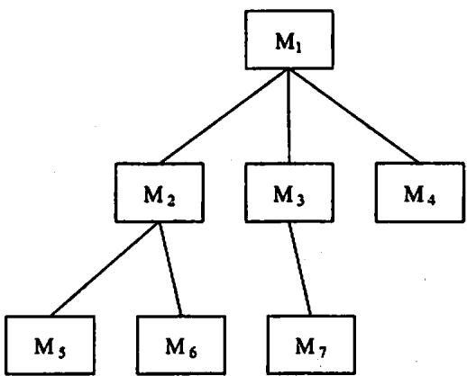  
图14-4 自顶向下的组合示例

自顶向下的增量方式可以较早地验证控制和判断点，如果出现问题可及时进行纠正。在测试时不需要编写驱动模块，但需要桩模块。另外，如果高层模块对下层模块依赖性很大，需要返回大量信息，在用桩模块代替时，桩模块的编写就相对复杂，必然会增加开销。这时可以用下面介绍的自底向上的增量方式。

## (2) 自底向上的增量方式

自底向上的增量方式是从最底层的功能模块开始，边组合边测试，从下向上地完成整个程序结构的测试。其步骤可以概括为：

\- 将最底层的模块组合成能完成某种特定功能的模块簇，为每个模块簇设计驱动程

序，用驱动程序来控制并进行测试。

\- 按从下向上的方向，用实际模块替换相对应的驱动程序，组成新的模块簇，再为该模块簇设计驱动程序，用新的驱动程序进行控制和测试。

\- 所有模块是否已经被组合到系统中，并完成测试。如果没有完成测试，则返回到第二步，重复进行；如果完成测试，则停止测试。

自底向上的增量方式可以较早地发现底层关键性模块出现的错误。在测试时不需要缩写桩模块，但需要驱动模块。另外，这种方式对程序中的主要控制错误的发现相对较晚。

组装测试的方法选择取决于软件的特点和进度安排。在工程中，通常将这两种方法结合起来使用，即对位于软件结构中较上层的使用自顶向下的方法，而对于较底层的使用自底向上的方法。

## 5. 确认测试

经过组装测试之后，软件就被集成起来，接口方面的问题已被排除，就可以进入软件测试的最后一个环节——确认测试。确认测试的任务是进一步验证软件的有效性，也就是说，检查软件的功能和性能是否与用户的要求一样。系统分析说明书描述了用户对软件的要求，所以是软件有效性验证的标准，也是确认测试的基础。

确认测试的步骤如图 14-5 所示。首先要进行有效性测试以及软件配置审查，然后进行验收测试和安装测试，经过管理部门的认可和专家的鉴定后，软件即可交给用户使用。

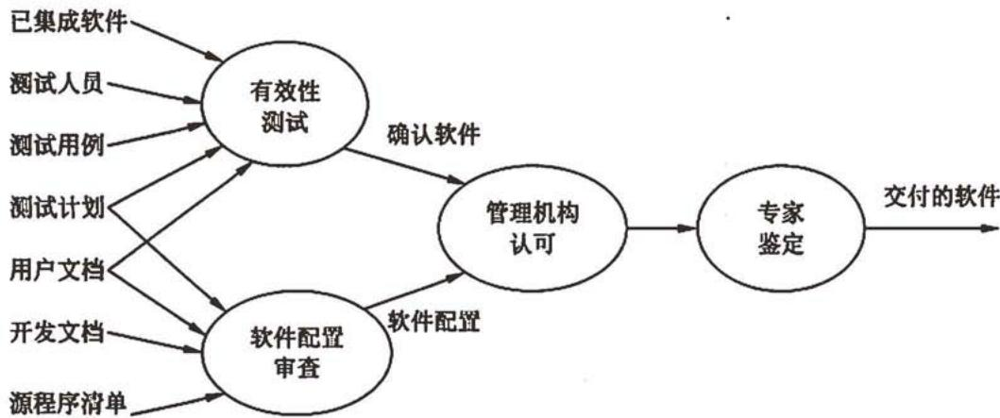  
图14-5 确认测试的步骤

## (1) 有效性测试

有效性测试就是在模拟环境下，通过黑盒测试检验所开发的软件是否与需求规格说明书一致。为此，需要制定测试计划，规定要做的测试类型，设计测试用例，组织测试人员对已集成的软件进行测试。在设计测试用例时，除了检测软件的功能和性能之外，还需要对软件的容错性、维护性等其他方面进行检测。测试人员可由开发商的内部人员组成，但最好是没有参加该项目的有经验的软件设计人员。在所有测试用例完成之后，测试结果有两种情况：

\- 功能和性能等都满足需求，可以接受。

\- 发现测试结果与预期的不符，这时要列出缺陷清单。在这个阶段才发现的严重错误一般很难在预定的时间内纠正，需要与用户协商，寻找妥善解决问题的办法。

## (2) 软件配置审查

确认测试的另一个环节是软件配置的审查，主要是检查软件（源程序、目标程序）和文档（包括面向开发和用户）是否齐全以及分类是否有序。确保文档、资料的正确和完善，以便维护阶段使用。

## (3) 验收测试

在经过软件的有效性测试和软件配置复查后，就应该开始软件系统的验收测试。验收测试是以用户为主的测试。软件开发人员和质量保证人员也应参加。在验收测试之前，需要对用户进行培训，以便熟悉该系统。验收测试的测试用例由用户参与设计，主要验证软件的功能、性能、可移植性、兼容性、容错性等，测试时一般采用实际数据。

## 6. 系统测试

系统测试是将已经确认的软件、计算机硬件、外设、网络等其他元素结合在一起，进行信息系统的各种组装测试和确认测试，其目的是通过与系统的需求相比较，发现所开发的系统与用户需求不符或矛盾的地方。系统测试是根据系统分析说明书来设计测试用例的，常见的系统测试主要有以下内容：

## (1) 恢复测试（Recovery Testing）

恢复测试将检测系统的容错能力。检测方法是采用各种方法让系统出现故障，检验系统是否能按照要求从故障中恢复过来，并在预定的时间内开始处理事务，而且不对系统造成任何损害。如果系统的恢复是自动的（由系统自动完成），则需要验证重新初始化、检查点、数据恢复等是否正确。如果恢复需要人工干预，就要对恢复的平均时间进行评估并判断它是否在允许的范围内。

## (2) 安全性测试（Security Testing）

系统的安全性测试用于检测系统的安全机制、保密措施是否完善且没有漏洞。主要是为了验证系统的防范能力。测试的方法是测试人员模拟非法入侵者，采用各种方法冲破防线。例如，以系统的输入作为突破口，利用输入的容错性进行正面攻击；故意使系统出错，利用系统恢复的过程，窃取密码或其他有用的信息；想方设法截取或破译密码；利用浏览非保密数据，获取所需信息，等等。从理论上说，只要时间和资源允许，没有进入不了的系统。所以，系统安全性设计准则是使非法入侵者所花费的代价比进入系统后所得到的好处要大，此时非法入侵已无利可图。

## (3) 强度测试（Stress Testing）

强度测试是对系统在异常情况下的承受能力的测试，是检查系统在极限状态下运行的情况下，性能下降的幅度是否在被允许的范围内。因此，强度测试要求系统在非正常数量、频率或容量的情况下运行，例如，运行使系统处理超过设计能力的最大允许值的测试用例；设计测试用例使系统传输超过设计最大能力的数据，包括内存的写入和读出，外部设备等；对磁盘保留的数据，设计产生过度搜索的测试用例；等等。强度测试主要是为了发现，在有效的输入数据中可能引起的不稳定或不正确的数据组合。

## (4) 性能测试（Performance Test）

性能测试用于检查系统是否满足系统分析说明书对性能的要求。特别是实时系统或嵌入式系统，即使软件的功能满足需求，但性能达不到要求也是不行的。性能测试覆盖了软件测试的各阶段，而不是等到系统的各部分所有都组装之后，才确定系统的真正性能。通

常与强度测试结合起来进行，并同时对软件、硬件进行测试。软件方面主要从响应时间、处理速度、吞吐量、处理精度等方面来检测。

## (5) 可靠性测试（Reliability Testing）

对于系统分析说明书中提出了可靠性要求时,要对系统的可靠性进行测试。通常使用以下几个指标来衡量系统的可靠性:

\- 平均失效间隔时间（Mean Time Between Failures MTBF）是否超过了规定的时限。

\- 因故障而停机时间（Mean Time To Repairs MTTR）在一年中应不超过多少时间。

## (6) 安装测试（Installation Testing）

在安装软件系统时，会有多种选择。安装测试就是为了检测在安装过程中是否有误、是否易操作等。主要检测：系统的每一个部分是否齐全；硬件的配置是否合理；安装中需要产生的文件和数据库是否已产生，其内容是否正确等。

最后再强调一下,信息系统的开发过程通常为系统分析、设计、编码实现等阶段。而每个阶段都有可能出现错误,测试过程正好与开发过程相反,其开发和测试的关系如图 14-6 所示,单元测试主要是发现编码阶段的错误。组装测试主要用于发现设计阶段产生的错误,如果在确认测试中发现系统分析有错误,这就需要重新

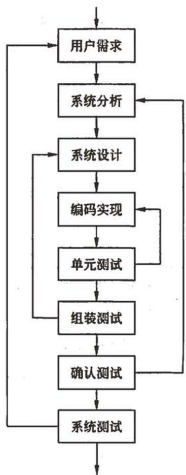  
图14-6 测试与开发的各阶段的关系

修改系统分析、设计和编码。这说明越早犯的错误要到最后才能被发现，因此要重视开发的前期工作。

## 14.3.6 排错调试

测试的目的是为了发现尽可能多的错误，而对于所暴露的错误最终需要被改正。调试的任务就是根据测试时所发现的错误，找出原因和具体的位置，并进行改正。

正如前面所讲的单元测试通常由程序开发人员来进行，对于组装测试、确认测试可以由开发商组织的测试人员或第三方测试中心来进行，在系统测试时需要用户参与共同完成。其原则是除单元测试以外，测试工作应避免由原开发人员或小组来承担。但调试工作主要由程序开发人员来进行，也就是说，谁开发的程序由谁进行调试。

## 1. 调试过程

调试的过程如图 14-7 所示。首先执行设计的测试用例，对测试结果进行分析，如果有错误，需要运用调试技术，找出错误原因和具体的位置。调试结果有两个：一是能确定错误原因并进行了纠正，为了保证错误已排除，需要重新执行暴露该错误的原测试用例以及某些回归测试（即重复一些以前做过的测试）；另一种是未找出错误原因，那么只能对错误原因进行假设，根据假设设计新的测试用例证实这种推测。若推测失败，需进行新的推测，直至找到错误并纠正。通常确定错误原因和具体的位置所需的工作量在调试过程中是非常大的，大约占调试总工作量的 95%，而且花费的时间也不确定。

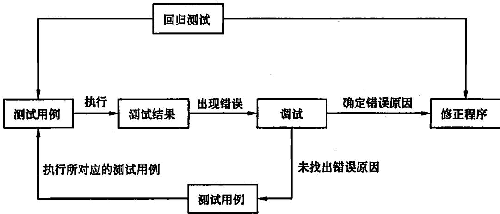  
图14-7 调试过程

## 2. 调试方法

无论哪种调试方法，其目的都是为了对错误进行定位。目前常用的调试方法有如下几种。

## (1) 试探法

调试人员分析错误的症状，猜测问题的位置所在，利用在程序中设置输出语句，分析寄存器、存储器的内容等手段来获得错误的线索，通过一步步的试探和分析来找到错误所在。这种方法效率很低且缓慢，适合于结构比较简单的程序。

## (2) 回溯法

调试人员从发现错误症状的位置开始，人工沿着程序的控制流程往回跟踪程序代码，直到找出错误根源为止。这种方法适合于小型程序，对于大规模程序，由于其需要回溯的路径太多而变得不可操作。

## (3) 对分查找法

这种方法主要用来缩小错误的范围。如果已经知道了程序中的变量在若干位置的预期正确取值，可以在这些位置上用赋值语句或输入语句，给这些变量以正确值，运行程序观察输出结果。如果没有发现问题，则说明从给的变量的正确值开始到输出结果之间的程序没有出错，问题可能在于除此之外的程序中，否则错误就在所考察的这部分程序中。对含有错误的程序段再使用这种方法，直到把故障范围缩小到比较容易诊断为止。

## (4) 归纳法

归纳法就是从测试所暴露的错误出发，收集所有正确或不正确的数据，分析它们之间的关系，提出假想的错误原因，用这些数据来证明或反驳，从而查出错误所在。其步骤为：

\- 收集关于程序做得对或不对的所有数据。

\- 整理数据，找出规律，主要发现在什么条件下出现错误，什么条件下不出错。

\- 提出一个或多个错误原因，如果提不出来，则说明收集的数据不够，需要通过设计和执行附加的测试用例来得到。如果提出了多个错误原因，则应首先选择可能性最大的那个。

\- 用假设来解释所有的原始测试结果，如果能解释这一切，则假设将得以证实，也就将找出错误；否则，要么是假设不完备或不成立，要么有多个错误同时存在，需要重新分析，提出新的假设，直到发现错误为止。

## (5) 演绎法

根据测试结果，列出所有可能的错误原因。分析已有的数据，排除不可能和彼此矛盾的原因，对余下的原因选择可能性最大的，利用已有的数据完善该假设，使假设更具体。运用归纳法的第4步来证明假设的正确性。

以上这些方法均可辅以调试工具。随着测试技术和软件开发环境的发展，可以提供功能越来越强的自动测试和调试工具，支持断点设置、单步运行和各种跟踪技术，为软件的调试提供了很大的方便。但无论哪种工具都代替不了开发人员对整个文档和程序代码的仔细研究和认真审查所起的作用。

## 14.3.7 系统测试报告

测试工作完成以后，应提交测试计划执行情况的说明。对测试结果加以分析，并提出测试的结论意见。系统测试是系统实施阶段的重要工作，系统测试报告的主要内容包括：

\- 概述，说明系统测试的目的。

\- 测试环境，有关软硬件、通信、数据库、人员等情况。

\- 测试内容，系统、子系统、模块的名称，性能技术指标等。

\- 测试方案，测试的方法、测试数据、测试步骤、测试中故障的解决方案等。

\- 测试结果，测试的实际情况、结果等。

\- 结论，系统功能评价、性能技术指标评价、结论。

## 14.4 系统的试运行和转换

系统的试运行是系统调试工作的延续，一般来讲，用户对新系统的验收测试都将在试运行成功之后。系统试运行阶段的工作主要包括：对系统进行初始化、输入各种原始数据记录；记录系统运行的数据和状况；核对新系统输出和旧系统（人工或计算机系统）输出的结果；对实际系统的输入方式进行考查（是否方便、效率如何、安全可靠性、误操作保护等）；对系统实际运行速度、响应速度（包括运算速度、传输速度、查询速度、输出速度等）进行实际测试。

新系统试运行成功之后，就可以进行系统和旧系统之间互相转换。新旧系统之间的转换方式有三种，分别是直接转换、并行转换和分段转换。

## 1. 直接转换

直接切换就是在确定新系统试运行准确无误时，立刻启用新系统，同时终止旧系统运行。这种方式很节省人员、设备费用。这种方式一般适用于一些处理过程不太复杂，数据不很重要的场合，参见图 14-8（a）。

## 2. 并行转换

这种切换方式是新旧系统并行工作一段时间，并经过一段时间的考验以后，新系统正式替代旧系统，参见图 14-8（b）。由于与旧系统并行工作，消除了尚未认识新系统之前的惊慌与不安。在银行、财务和一些企业的核心系统中，这是一种经常使用的切换方式。它的主要特点是安全、可靠，但费用和工作量都很大。

## 3. 分段转换

分段转换又被称为逐步转换、向导转换、试点过渡法等。这种切换方式实际上是以上两种转换方式的结合。在新系统全部正式运行前，一部分一部分地替代旧系统，其示意图参见图14-8（c）。那些在转换过程中还没有正式运行的部分，可以在一个模拟环境中继续试运行。这种方式既保证了可靠性，费用又不至于太多。但是这种分段转换要求子系统之同有一定的独立性，对系统的设计和实现都有一定的要求，否则就无法实现这种分段转换的设想。

综上所述，第一种方式简单，但风险大，一旦新系统运行不起来，就会给工作造成混乱，这只在系统较小且不重要或时间要求不高的情况下采用。第二种方式无论从工作安全上，还是从心理状态上均是较好的。这种方式的缺点就是费用高，所以在系统太大时，费用开销更多。第三种方式是克服第二种方式缺点的混合方式，因而对较大系统较为合适，当系统规模较小时不如使用第二种方便。

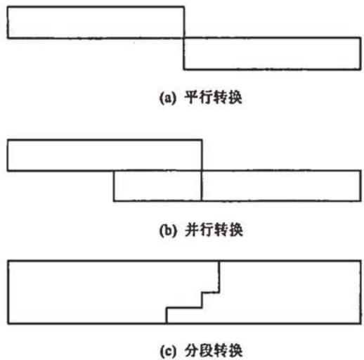  
图 14-8 信息系统转换的方式

## 14.5 人员培训

人员的培训是保证系统顺利切换和正常运行的必不可少的条件。因此信息系统实施过程中必须有周密的培训计划，而不能等到一切工作就绪以后，才开始考虑人员的培训问题，否则会造成资源的闲置与浪费。系统实施阶段的培训主要是针对运行管理人员、普通系统操作人员和系统维护人员。

管理人员和操作人员需要了解系统如何工作，怎样使用并理解系统产生的报告，了解系统如何影响其业务活动，新系统所具备的各项功能。这些可以通过模拟实现，使其充分了解和支持新系统，适应新系统的工作。监督人员需要理解系统及其功能，熟悉数据输入、文件维护、处理输出以及排除故障的方法。系统操作人员直接面对的是数据输入、文件维护，输出文档的建立等日常工作。

一般来说，系统实施阶段培训主要包括如下的内容。

\- 系统整体结构和系统概貌。

\- 系统分析设计思想和步骤。

\- 系统的操作与使用。

\- 系统所用主要软件（编程语言、工具、数据库等）的使用。

\- 数据的收集、统计渠道和口径等，以及运行操作事项。

\- 可能出现的故障以及故障排除的方法。

培训的途径可以根据不同的人员采取不同的方法。比如，相对高层次的人员必须经过高校进行专业的正规学习；较低层次的人员可以被安排非正式的专项培训，也可以通过现场实习、讲座报告等形式进行培训。

新旧系统的交替往往会使一些在旧系统中的知识或权力拥有者对新系统产生不良情绪，进行充分的培训和沟通也能调动各相关人员的积极性、创造性，保证系统实施的成功。而且，培训操作人员的过程也是考验及检查系统结构、硬件设备及应用程序的过程。

## 选择题

1. 单元测试又被称为\_\_\_\_。
A）模块测试 B）机器测试
C）联合测试 D）系统测试

2. 新旧系统同时工作一段时间，经过一段时间的试运行以后，新系统正式替代旧系统的系统转换方式是\_\_\_\_。
A）直接转换 B）机并行转换
C）分段转换 D）分块转换

## 思考题

1. 影响系统实施成功与否的因素有哪几个方面？

2. 好的程序应该有什么样的特点和标准？

3. 结合自己的实践，谈谈程序设计的风格对程序质量好坏的影响。

4. 软件测试有哪些类型和方法？测试的过程是怎样进行的？

5. 黑白盒测试的原理是什么，分别可以发现哪些类型的错误？

6. 如何撰写一份系统测试报告？
