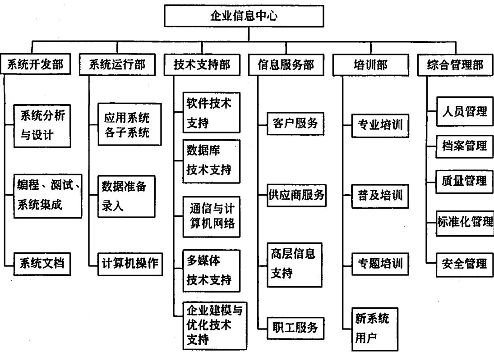
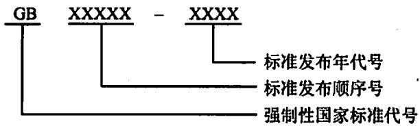
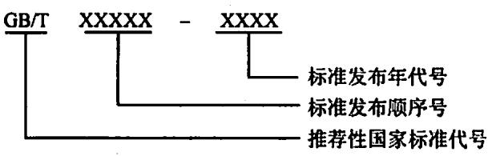
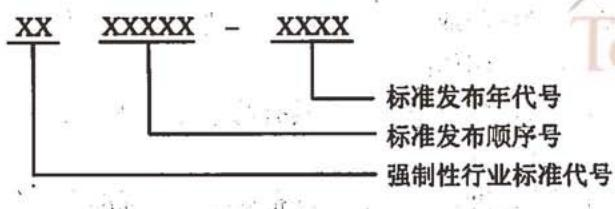
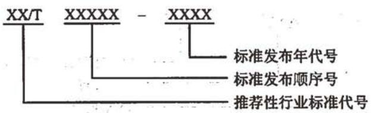
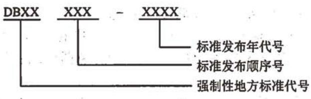
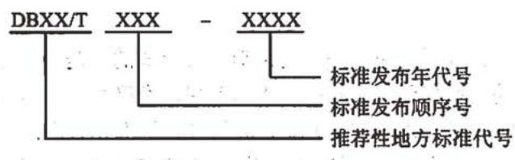
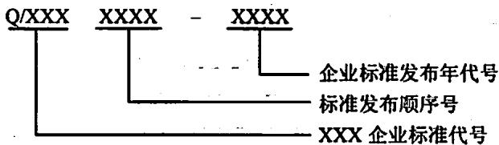

>[!warning] 版本提示
>本书为 **2006 年第 1 版**。现行考试依据是 **《信息系统管理工程师教程（第 2 版）》**（清华社 2024-10，20 章），
>两版**重合极少**：第 1 版的第 1–6 章（硬件/操作系统/语言/配置/数据结构/多媒体）在第 2 版已被删除或压缩。
>本页仅作**扩展参考**，备考请以 [[知识体系]]（第 2 版官方考纲）为准。

# 第15章 信息化与标准化

随着信息技术的不断发展，信息化和标准化逐渐进入人们的视野。无论是企业、政府机关、医疗机构等，都迫切地需要信息化的规划。但是信息化的发展是离不开标准化的，只有设定一定的标准，规范信息化的行为，才能使信息化朝着健康、正确的方向发展。本章主要介绍了信息化和标准化的一些基础知识。

## 15.1 信息化战略和策略

当我们出差到异地他乡时，只要带一张信用卡，就可以到当地银行取款；当我们思念亲人时，只要拨一个电话，就可以享受亲情的温暖；当奥林匹克运动会开幕时，我们只要在家中打开电视机，就可以看到现场直播的比赛盛况，你是否意识到,信息革命已经在我们身边悄悄地发生了。

## 15.1.1 信息化

人们在生活和从事生产等活动中不断产生各种消息，接收者通过各种方式了解到的消息被称为信息。信息的传送一般应借助一定的运载工具，并将信息变换成各种表现形式，如语言、文字、图像、声音等。信息是普遍存在的，像空气一样渗透到全球各个角落、各个领域。人们在生活和工作中要随时随地地获取信息、交流和处理信息，并根据它决策或采取行动。企业为了在竞争中求得生存和发展，获取及时可靠的信息将成为第一需要。信息已同能源和材料一起成为现代化社会的三大资源。信息是资源，而且是一种战略资源。信息与材料、能源不同，信息可以被很多人使用，使用的人越多，创造的价值就越高，而且一条信息可以衍生出多条信息，取之不尽。信息与信息资源不同，信息的日常表现是无序的，但是信息本身存在着内在联系和规律，信息只有通过加工处理才能成为有价值的、可利用的信息资源。随着科技的进步和发展，特别是通信技术、电子技术、激光技术、集成电路、计算机等高技术的出现，在加快经济建设和社会发展的过程中，信息的作用越来越突出，信息和我们的日常生活密切相关，获取信息已经成为我们生活、工作中的重要内容，信息在服务于我们的生活的同时，对我们生活方式的影响也越来越大，所以我们称当前的社会为信息社会。由此衍生出了许多新兴的概念。

信息技术是指对信息进行采集、存储、处理、检索、传递、分析与显示的高技术群。信息技术发展的总趋势是数字化、网络化与智能化，并以互联网技术及其应用技术为中心。

信息产业是以现代信息技术为手段，以开发和利用信息资源为中心内容，提供信息产品和信息服务的产业部门。它包括信息产品制造业、软件与信息服务业、通信业。

信息化是指培育、发展以智能化工具为代表的新的生产力并使之造福于社会的历史过程。智能工具一般必须具备信息获取、信息传递、信息处理、信息再生和信息利用的功能。

完整的信息化内涵如下。

（1）信息网络体系，它是大量信息资源、各种专用信息系统及其公用通信网络和信息平台的总称。

（2）信息产业基础，即信息科学技术的研究、开发、信息装备的制造，软件开发与利用，各类信息系统的集成及信息服务。

（3）社会支持环境，即现代工农业生产，以及管理体制、政策法律、规章制度、文化教育、道德观念等生产关系和上层建筑。

（4）效用积累过程，即劳动者素质、国家的现代化水平和人们生活质量不断得到提高，精神文明和物质文明不断获得进步。

通常人们习惯用信息产业部门所制造的收入在国民生产总值中所占的比重和信息从业者占就业人口的比例作为衡量社会信息化程度的指标。粗略认为两者均超过50%以上，其社会已进入信息社会。

## 15.1.2 国家信息化

国家信息化就是在国家统一规划和组织下，在农业、工业、科学技术、国防和社会生活各个方面应用现代信息技术，深入开发、广泛利用信息资源，发展信息产业，加速实现国家现代化的进程。这个定义包含4层含义：一是实现四个现代化离不开信息化，信息化要服务于现代化；二是国家要统一规划、统一组织；三是各个领域要广泛应用现代信息技术，开发利用信息资源；四是信息化是一个不断发展的过程。

国家信息化体系包括6个要素，即：信息资源、国家信息网络、信息技术应用、信息技术和产业、信息化人才、信息化政策、法规和标准。这个体系是根据中国国情确定的，与国外提出的国家信息基础有所不同。

信息资源，是国民经济和社会发展的战略资源，它的开发和利用是国家信息化体系的核心内容，是国家信息化建设取得实效的关键。信息资源开发和利用的程度是衡量国家信息化水平的一个重要标志。

国家信息网络，是信息资源开发利用和信息技术应用的基础，是信息传输、交换和资源共享的重要手段。只有建设先进的国家信息资源，才能充分发挥信息化的整体效益。

信息技术应用，是指要把信息技术广泛应用于经济和社会各个领域。信息技术应用工作量大、涉及面广，直接关系到国民经济整体素质、效益和人民生活质量的提高，是国家信息化建设的重要任务。

信息技术和产业，是指要发展自己的信息技术和产业，这是我国进行信息化建设的基础。信息化建设要立足于自主技术和国产装备，这不仅是国家经济发展的需要，也是国家安全的需要。

信息化人才，是指建立一支结构合理、高素质的研究、开发、生产、应用队伍，以适应国家信息化建设的需要。人才队伍对其他各个要素的发展速度和质量，有着决定性的影响，是信息化建设的关键。

信息化政策、法规和标准，是指建立一个促进信息化建设的政策、法规环境和标准体系，规范和协调各要素之间的关系，以保障国家信息化的快速、有序、健康发展。

我国信息化建设的指导方针是：坚持以邓小平建设有中国特色社会主义理论为指导，全面贯彻邓小平和江泽民同志关于信息化工作的重要指示，认真贯彻信息化建设的"统筹规划、国家主导，统一标准、联合建设，互联互通、资源共享"24字方针，进一步加快国家信息基础设施和信息产业的发展，积极推进"两个根本性转变"，提高对外合作水平，为促进国民经济持续、快速、健康发展和社会全面进步发挥更大的作用。

我国信息化的总体目标是：坚持以信息化带动工业化的思路，加快信息化建设步伐，在"十五"期间，我国信息化建设要迈上一个新台阶，初步建成国家信息化体系。"十五"期间具体目标如下：

\- 大力发展IP宽带网建设。

\- 以国内和国际两个市场为目标。

\- 继续高速发展信息产业。

\- 继续发展有线电话和有线电视。

\- 电子商务将有一个较大的发展。

\- 电子政务将有很大进展。

\- 大力推进社区信息化以及领域信息化。

\- 继续推进电信体制改革。

\- 促进整个信息产业的稳定发展。

\- 加快信息化急需人才的培养和教育。

信息化的发展有力地促进了我国经济增长质量的提高和产业结构的优化，主要表现在：促进国民经济结构（产业结构、就业结构、消费结构、投资结构、贸易结构）软化；促进国民经济生产要素（劳动者+劳动对象+劳动工具+信息要素）配置优化；对国民经济基本资源（能源、物资、人力和资金）的替代作用；对国民经济增长的倍增作用（乘数效应）；对国民财富的增值作用，等等。

## 15.1.3 企业信息化

企业信息化指的是挖掘先进的管理理念，应用先进的计算机网络技术去整合企业现有的生产、经营、设计、制造、管理，及时地为企业的"三层决策"系统（战术层、战略层、决策层）提供准确而有效的数据信息，以便对需求做出迅速的反应，其本质是加强企业的

"核心竞争力"。

企业的信息化建设可以按照不同的分类方式进行分类。常用的分类方式有按照行业、企业运营模式和企业的应用深度等进行分类。按所处的行业分为：制造业的信息化、商业的信息化、金融业的信息化、服务业务的信息化等。按照企业的运营模式分为：离散型企业的信息化建设和流程型企业的信息化。

目前比较流行的企业信息化有企业资源计划（ERP）、客户关系管理（CRM）、供应链管理（SCM）、知识管理系统（ABC），等等。

企业资源计划系统（Enterprise Resource Planning，ERP）是指建立在信息技术基础上，以系统化的管理思想，为企业决策层及员工提供决策运行手段的管理平台。ERP 系统集中信息技术与先进的管理思想于一身，成为现代企业的运行模式，反映时代对企业合理调配资源、最大化地创造社会财富的要求，成为企业在信息时代生存、发展的基石。

## 15.1.4 我国信息化政策法规

在《国家"十五"信息化专项规划》中，信息化被描述为"以信息技术广泛应用为主导，信息资源为核心，信息网络为基础，信息产业为支撑，信息人才为依托，法规、政策、标准为保障的综合体系"。与工业化一样，信息化也是一种与技术、经济和社会变化相联系的动态发展过程，是衡量一个国家现代化水平、国际竞争力和综合实力的重要标志，是经济和社会发展的战略制高点。如何应对全球信息化发展加速、国际竞争日趋激烈的严峻挑战，加快推进我国的信息化建设进程，成为摆在政府和全社会面前的一项重大课题。国家颁布和出台了一系列的政策法规来保障我国信息化建设的健康发展。例如《中国公用计算机互联网国际连网管理办法》、《国际通信设施建设管理规定》、《通信工程质量监督管理规定》等。

在 2000 年 10 月《中共中央关于制定国民经济和社会发展第十个五年计划的建议》中，首次提出了"以信息化带动工业化"的思想，将信息化战略提到前所未有的高度。"十六大"报告明确提出："坚持以信息化带动工业化，以工业化促进信息化，走出一条科技含量高、经济效益好、资源消耗低、环境污染少、人力资源优势得到充分发挥的新型工业化路子"。

信息化政策体系包括信息技术发展政策、信息产业发展政策、信息资源开发和利用政策，以及与信息化有关的法令法规体系的建设。

## 1. 信息技术发展政策

信息技术是信息化的第一推动力，信息技术政策在信息化政策体系中发挥着重要作用。从20世纪80年代初，国务院就成立了计算机与大规模集成电路领导小组，负责制定我国的信息技术发展政策。在该小组1983年5月召开的一次全国性会议上，提出了我国发展计算机和集成电路技术的基本政策思路，主要内容是：正确处理引进和自主开发的关系，在积极引进国外先进技术的基础上，增强自力更生的能力；计算机技术的开发要以中小型机，特别是微型机、单片机为主要方向；大力加强软件技术开发，迅速形成软件产业；加速人才培养，建立一支强大的科技队伍。会议提出的自主开发与引进相结合的思想成为制定我国信息技术政策的一个基本原则。

为了推动信息技术创新和研究成果的产业化，从20世纪80年代开始，国家对传统的科技体制进行了改革，主要内容是：大力促进企业成为信息技术开发的主体，积极扶植高新技术企业，特别是信息技术企业的创新活动；加强科技中介服务体系的建设，鼓励信息技术成果的交易和市场推广；加强科技产业化基地，特别是以信息技术为主体的高技术产业园区的建设；鼓励科研院所的信息技术人员自主创业，加快信息技术成果的产业化。

在推进信息技术创新的过程中，国家的科技计划发挥了重大作用，并成为我国信息技术发展政策的一个重要组成部分。除了传统的国家科技攻关计划外、从20世纪80年代后期开始，国家陆续推出"八六三"计划、火炬计划、国家自然科学基金、"九七三"计划等重大综合型科技计划，在这些计划中，信息技术的研发被列为重中之重，研发经费的投入也在不断地向信息技术项目倾斜，极大地促进了我国整体信息技术水平的提高。

在 20 世纪 90 年代末，国家发展计划委员会和科学技术部会同有关部门、省市，在广泛听取各方面意见的基础上，编制了《当前优先发展的高技术产业化重点领域指南》（以下简称为《指南》）。该《指南》确定了应优先发展的高技术产业化重点领域 138 项，其中信息技术重点领域占了 25 项。该《指南》是引导信息技术发展的指导性文件，对于明确现阶段我国信息技术开发的主要领域和主要方向，有着重要的指导意义。《指南》中确定的重点技术领域包括各种通信设备和通信系统、各种计算机硬件设备、应用软件和各类操作系统、数字类视音频设备、集成电路和新型电子元器件、电子专用设备和仪器以及各种信息应用系统。

## 2. 信息产业发展政策

## (1) 通信产业政策

反垄断、放松管制和市场化改革一直是通信产业发展政策关注的核心。1998年3月，国家组建信息产业部，拉开了电信业政企分开、电信重组和公司化运作的序幕。1999年2月，国务院通过中国电信重组方案，分别批复组建中国移动通信集团公司、中国电信集团公司和中国卫星通信集团公司。2000年12月，铁道通信公司也随之成立。至此，原邮电部政企不分、独家垄断的局面被彻底打破，开始形成数网竞争的市场结构。2001年，经过专家的激烈争论和国家计委等有关部门的反复论证，国家决定对中国电信再次分拆重组。经历这次重组整合后，我国基础电信领域逐步形成中国电信、中国网通、中国移动、中国联通、中国卫星和铁通公司等6家基础电信企业相互竞争的市场格局。

在对基础电信业务进行改革重组的同时，通信行业的政策调整还涉及到增值服务市场的放开、通信服务定价政策的调整等。从20世纪90年代初期开始，无线寻呼、互联网接入和内容服务等电信增值服务逐步向社会开放，外资和民营企业纷纷进入电信增值服务领域。同时，通信服务的定价政策也在发生变化，主要是逐步减小政府对通信服务定价的影响，扩大市场机制的定价范围。从20世纪90年代中期开始，国家计委和信息产业部先后出台多项价格调整政策，除了极少一部分通信服务项目如市话、长话和移动通信服务依然由政府定价外，其他的服务项目（如互联网接入、IP电话等服务的价格以及各种通信增殖服务的价格）已经完全放开，固定电话和移动电话的初装费也大幅度地降低了。通信定价机制由政府主导向市场主导方向的转变使得通信资费水平呈现出不断下降的趋势，极大地带动了通信用户和服务需求的快速增长，并对我国信息化的加速发展起到了巨大的推动作用。

## (2) 信息产品制造业政策

从 20 世纪 80 年代末开始，信息产品制造业就已经成为竞争性产业，无论是市场准入、产品定价还是外商投资，都已经全面放开。从 20 世纪 90 年代开始，信息产品制造业政策的重心转向产业的重组方面，主要是围绕高技术产业园区，培育国家级开发与生产基地，重点扶植具有市场竞争力的大型企业集团，形成以大公司为主体，带动中小企业共同发展的格局；通过企业的改组和整合，加大企业的开发创新力度，形成高效的创新机制。

进入新世纪后，集成电路和软件产业的发展成为关注的焦点，为此出台了一系列政策措施。2000年6月，国务院颁布了《鼓励软件产业和集成电路产业发展的若干政策》。同年9月，财政部、国家税务总局和海关总署联合发布了《关于鼓励软件产业和集成电路产业发展有关税收政策问题的通知》。上述政策涉及软件和集成电路产业的投融资、税收、技术研发、出口、收入分配、人才吸引与培养等方方面面，并就软件企业认定制度、知识产权保护、行业组织和行业管理等提出了具体的实施办法。在2002年7月召开的国家信息化领导小组第二次会议上，又重点讨论了软件产业的发展问题。会议提出了发展我国软件产业的5项政策思路：一是鼓励应用，内需拉动，把培育市场作为发展软件产业的切入点；二是坚持开放，扩大出口，积极参与国际合作与竞争；三是创造工程化环境，促进国产软件标准和质量与国际接轨，保护知识产权，打击走私盗版活动；四是深化改革，鼓励竞争，加快形成一批具有行业特色和优势的软件骨干企业；五是大力培养和广纳高层次的市场开发、经营管理、系统设计等方面人才，充分发挥海外华人和留学生的作用。

## 3. 电子政务发展政策

电子政务是国民经济和社会信息化的一个重要领域，也是信息化发展政策的一个重要方面。在国家信息化领导小组第二次会议上，通过了《关于我国电子政务建设的指导意见》（以下简称为《指导意见》），为我国电子政务的建设提供了基本的政策框架。该《指导意见》指出，推进电子政务不仅对转变政府职能、依法行政、强化政府监管、提高工作效率有重要意义，而且对推动国内信息产业发展，带动整个国民经济和社会信息化进程也将发挥积极的先导作用。《指导意见》提出了"十五"期间我国电子政务建设的基本目标，即初步建成标准统一、功能完善、安全可靠的政务信息网络平台；重点业务系统建设，基础性、战略性政务信息库建设取得实质性成效，信息资源共享程度有较大提高；初步形成电子政务安全保障体系，人员培训工作得到加强，与电子政务相关的法规和标准的制定取得重要进展。《指导意见》还确定了电子政务的建设原则和政策措施，强调发展电子政务，要按照统一规划和标准，明确目标、分类指导、分层推进、分步实施。要从实际出发，需求主导、突出重点、不搞"花架子"、不"刮风"。同时，发展电子政务，还要体现改革精神，要有前瞻性，充分考虑建立和完善社会主义市场经济体制的要求。

## 4. 信息化法规建设

在制定信息化政策时，信息化立法是基础。从总体上看，我国的信息化立法已取得了一定的成就，信息化立法进程也从20世纪90年代末开始明显加快。根据中国信息产业发展研究院的不完全统计，中央各部门和省市地方政府有关信息化的法律文件约2700件，立法的类型涉及信息安全、信息产业、信息产权、技术标准、电子政务及电子商务信息化建设的各个方面。其中，在信息保密、计算机和网络安全，以及与信息有关的知识产权的立法方面，已经初步形成了较为完整的立法体系。在电信、广播电视、政务信息公开、隐私权保护、电子身份认证和电子化交易等立法方面，也已着手准备，部分立法已经被纳入到正式的立法议程。

## 15.2 信息化趋势

在信息技术变革的驱动下，以互联网络为基础、以电子商务为代表的新经济的迅速兴起，正在深刻地改变着我们工作和生活的方式。目前全球使用互联网的人口已经达到2.6亿，而1996年还不足4000万。2005年，这个数字将超过10亿。这表明一个基于网络的虚拟社会正在出现，一个全球性的、巨大的商业市场正在形成。

计算机产业与通信产业的融合，推动人类社会由原子到比特转变，推动全球经济由工业经济向信息经济转型。新经济对传统经济既是巨大的挑战，也会带来新的机会。鼓励创新、鼓励竞争，进一步放松对产业的管制，促进多元化投资特别是对民营经济的投资，成为各国政府推动高新技术产业发展和新经济成长的普遍共识。

高新技术特别是信息技术的开发与应用，带来了一系列新的机会。无论是在美国的"硅谷"，还是在北欧瑞典的"无线谷"；无论是集成电路、个人计算机、无线互联网，还是宽带，新技术正迅速改变着信息产业的结构与商业应用。今天，所有的行业都离不开信息技术。计算机与通信产业自身面临着变革，信息技术的相关产业面临着重组。范围更大、内容更丰富的信息技术应用市场正在创新中形成。互联网将使企业能够集成整个供应链，企业对企业的电子商务市场将世界经济的参与者带到了一个集中的基于网络的位置。电子商务使传统产业发生变革的根本目标是：在原料供应、生产制造、分销批发、客户服务的传统商业流程中，减少中间环节，实现更大的规模、更低的成本、更好的服务。在这个过程中，原料将通过新的、进一步缩短的供应链进行；生产与制造将大量使用企业资源规划（ERP）；分销与客户将在网络的基础上，实现一对一的营销。一句话，就是在信息流、资金流的支持下，实现物流的合理配置。

今天，在高新技术产业发展和新经济兴起的过程中，信息技术及产业的发展是重要的核心和基础。信息产业的自身发展及信息技术的应用，推动了全球的经济增长和通货膨胀的降低，促进了全球商业市场的形成。全球化的过程正是信息化的过程，是信息技术的应用及其对传统农业、工业经济的改造与重组的过程。

目前，信息化以互联网技术及其应用技术为中心，朝着数字化、网络化与智能化发展，在信息化的基础上，出现了许多新生的事物、概念和生活方式。

## 15.2.1 远程教育

现代远程教育是随着现代信息技术的发展而产生的一种新型教育形式，是构筑知识经济时代人们终身学习体系的主要手段。

远程教育是指学生和教师，学生和教育机构之间主要采用多种媒体手段进行系统教学和通信联系的教育形式。

相对于传统的面授教育，远程教育具有这样几个显著的特征：在整个学习期间，师生准永久性地分离；教育机构或组织通过学习材料和支持服务两方面对学生的学习施加影响；利用各种技术媒体联系师生并承载课程内容；提供双向通信交流；在整个学习期间，准永久性地不设学习集体，学生主要是作为个人在学习，为了社交和教学目的进行必要的会面。

通常认为，远程教育已经历经了三代：第一代是函授教育；第二代是广播电视教育；第三代的基本特征是利用计算机网络和多媒体技术，在数字信号环境下进行教学活动，被称为"现代远程教育"。现代远程教育的突出特点是：真正不受空间和时间的限制；受教育对象扩展到全社会；有更丰富的教学资源供受教育者选用；教学形式由原来的以教为主变为以学为主。

## 15.2.2 电子商务

电子商务的定义至今仍不是一个很清晰的概念，各国政府、学者、企业界人士根据自己所处的地位和对电子商务的参与程度，给出了许多表述不同的定义。我们所谈及的电子商务，狭义上被称作电子交易（E-commerce），主要是指利用Web提供的通信手段在网上进行的商业贸易活动，包括买卖产品和提供服务；广义上则指包括电子交易在内的利用Web进行的全部商务活动，也称作电子商业（E-business）。电子商业包括企业内部商务活动，如生产、管理、财务等以及企业间的商务活动，它不仅仅是硬件和软件的结合，更是把买家、卖家、厂家和合作伙伴在Internet、Intranet（企业内联网）和Extranet（外联网）上利用Internet技术与现有的系统结合起来开展业务，如市场分析、客户管理、资源调配、企业决策等。归纳起来，电子商务是指在全球各地广泛的商业贸易活动中，通过信息化网络所进行并完成的各种商务活动、交易活动、金融活动和相关的综合服务活动。

电子商务涉及到买家、卖家、银行或金融机构、政府机构、认证机构、配送中心机构。网上银行、在线电子支付等条件和数据加密、电子签名等技术在电子商务中发挥着重要的不可或缺的作用。它覆盖的业务范围主要如下。

\- 信息传递与交换。

\- 售前、售后服务，如提供产品和服务的细节、产品使用技术指南及回答顾客意见等。

\- 网上交易。

\- 网上支付或电子支付，如电子转账、信用卡、电子支票、电子现金。

\- 运输，如商品的配送管理、运输跟踪以及采用网上方式传输产品。

\- 组建虚拟企业，组建一个物理上不存在的企业，集中一批独立的中小公司的权限，提供比任何单独公司多得多的产品和服务，并实现企业间资源共享等。

根据电子商务发生的对象，可以将电子商务分为 4 种类型。

\- B2B（商业机构对商业机构的电子商务），企业与企业之间使用 Internet 或各种商务网络进行的向供应商定货、接收票证和付款等商务活动。

B2C（商业机构对消费者的电子商务），企业与消费者之间进行的电子商务活动。这类电子商务主要是借助于国际互联网所开展的在线式销售活动。

\- C2A（消费者对行政机构的电子商务），政府对个人的电子商务活动。这类电子商务活动目前还没有真正形成。

\- B2A（商业机构对行政机构的电子商务），企业与政府机构之间进行的电子商务活动。

## 15.2.3 电子政务

电子政务是政府在其管理和服务职能中运用现代信息和通信技术，实现政府组织结构和工作流程的重组优化，超越时间、空间和部门分隔的制约，全方位地向社会提供优质、规范、透明的服务，是政府管理手段的变革。

电子政务是一项覆盖各级政府部门的大型、复杂的系统工程，它的实现以信息技术作为基础，从政府信息发布、政府网上服务到政府部门间及政府部门内的信息共享和网络办公，都需要不断发展的信息技术作为保障。其目标在于建设一个国家电子政务体系，将现有的和即将建设的各个政府网络和应用系统连接起来，统一相关的技术标准和规范，做到互联互通，成为一个统一的国家政务服务平台。

电子政务建设要合理利用现有资源，适度超前。在它的建设中，网络是基础，应把安全贯穿全过程，并以应用为目的。

电子政务应用系统建设包括信息收集、业务处理、决策支持三个层面的内容，要适应政府机构不断重组、职能不断优化的需求。电子政务发展需要经过三个阶段：

\- 第一阶段，政府上网，建立自己的网页用于信息发布。

\- 第二阶段，政府在网上开展非交互式的应用，以及政府通过计算机网络提高办公效率等。

\- 第三阶段，政府通过网络提供交互式的管理和服务，实现内部各部门的信息共享

和协同办公，建成虚拟政府环境。

## 15.3 企业信息资源管理

在以物质资源的开发与利用占主导地位的时代，信息资源是作为物质资源和人力资源的附属物进行管理的。随着信息资源在社会经济生活中的重要性的提高，信息资源管理才作为一个独立的领域逐渐发展起来。

## 15.3.1 信息资源管理的含义

信息资源管理（Information Resources Management，IRM）于20世纪70年代末至20世纪80年代初在美国的政府部门出现，随后迅速扩展到工商企业、科研机构和高等院校等部门。经过20年来的发展，已影响和扩散到世界上许多国家和地区，成为管理领域的新热点之一。

霍顿（F.W.Horton）和马钱德（D.A.Marchand）是美国信息资源管理学家，是IRM理论的奠基人、最有权威的研究者和实践者。他们关于IRM的论著很多，其主要观点如下。

\- 信息资源与人力、物力、财力和自然资源一样，都是企业的重要资源，因此，应该像管理其他资源那样管理信息资源。IRM 是企业管理的必要环节，应该纳入企业管理的预算。

\- IRM 包括数据资源管理和信息处理管理。前者强调对数据的控制，后者则关心企业管理人员在一定条件下如何获取和处理信息，且强调企业中信息资源的重要性。

\- IRM 是企业管理的新职能，产生这种新职能的动因是信息与文件资料的激增、各级管理人员获取有序的信息和快速简便处理信息的迫切需要。

\- IRM 的目标是通过增强企业处理动态和静态条件下内外信息需求的能力来提高管理的效益。IRM 追求 "3E" —— Efficient、Effective 和 Economical，即高效、实效、经济；"3E" 之间关系密切，相互制约。

总的来说，信息资源管理指的是为了确保信息资源的有效利用，以现代信息技术为手段，对信息资源实施计划、预算、组织、指挥、控制、协调的人类管理活动。信息资源管理的思想、方法和实践，对信息时代的企业管理具有重要意义：它为提高企业管理绩效提供了新的思路；它确立了信息资源在企业中的战略地位；它支持企业参与市场竞争；它成为知识经济时代企业文化建设的重要组成部分。

信息资源管理的目标，总的说来就是通过人们的计划、组织、协调等活动，实现对信息资源的科学地开发、合理地配置和有效地利用，以促进社会经济的发展。对于一个组织，特别是企业组织来说，信息资源管理的目标是为实现组织的整体目标服务的。当前，企业面临的环境复杂多变，市场竞争十分激烈，经济活动全球化、市场国际化的趋势加速，信息资源的开发、配置与利用，要为提高企业的应变能力和竞争能力服务。

## 15.3.2 信息资源管理的内容

一个现代社会组织的信息资源主要有：计算机和通信设备；计算机系统软件与应用软件；数据及其存储介质；非计算机信息处理存储装置；技术、规章、制度、法律；从事信息活动的人，等等。一个信息系统就是这些信息资源为实现某类目标的有序组合，因此信息系统的建设与管理就成了组织内信息资源配置与运用的主要手段。

而面向组织，特别是企业组织的信息资源管理的主要内容如下。

\- 信息系统的管理：包括信息系统开发项目的管理、信息系统运行与维护的管理、信息系统的评价等。

\- 信息资源开发、利用的标准、规范、法律制度的制订与实施。

\- 信息产品与服务的管理。

信息资源的安全管理。

\- 信息资源管理中的人力资源管理。

## 15.3.3 信息资源管理的组织

由于信息资源是企业的战略资源，信息资源管理已成为企业管理的重要支柱。一般的大中型企业均设有专门的组织机构和专职人员从事信息资源管理工作。这些专门组织机构如：信息中心（或计算中心）、图书资料馆（室）、企业档案馆（室），企业中还有一些组织机构也兼有重要的信息资源管理任务，如计划、统计部门、产品与技术的研究与开发部门、市场研究与销售部门、生产与物资部门、标准化与质量管理部门、人力资源管理部门、宣传与教育部门、政策研究与法律咨询部门等。

在有关信息资源管理的各类组织中，企业信息中心是基于现代信息技术的信息资源管理机构，其管理手段与管理对象多与现代计算机技术、通信与网络技术有关。现代信息技术本身是信息资源的重要组成部分。利用现代信息技术开发、利用信息资源是现代信息资源管理的主要内容。如图 15-1 所示是一个大中型企业的信息中心的组织结构示意图。

## 15.3.4 信息资源管理的人员

## (1) 信息主管

由于信息资源管理在组织中的重要作用和战略地位，企业主要高层管理人员必须从企业的全局和整体需要出发，直接领导与主持全企业的信息资源管理工作。担负这一职责的企业高层领导人就是企业的信息主管（Chief Information Officer, CIO）。

## (2) 中、基层管理人员

主要包括：企业信息资源管理的中、基层管理人员包括：信息中心（或计算中心）、图书资料馆（室）、企业档案馆（室）等组织机构的负责人，这些机构的分支机构的负责人，企业中兼有重要的信息资源管理任务的组织机构（如计划、统计、产品与技术的研究与开发、市场研究与销售、生产与物资管理、标准化与质量管理、人力资源管理、宣传与教育、政策研究与法律咨询等部门）中分管信息资源（含信息系统与信息技术）的负责人。

  
图 15-1 大中型企业信息中心组织结构图

（3）企业管理信息系统的专业人员。

主要包括：系统分析员、系统设计人员、程序员、系统文档管理人员、数据采集人员、数据录入人员、计算机硬件操作与维护人员、数据库管理人员、网络管理人员、通信技术人员、结构化布线与系统安装技术人员、承担培训任务的教师及教学辅助人员、图书资料与档案管理人员、网站的编辑与美工人员、从事标准化管理、质量管理、安全管理、技术管理、计划、统计等人员。

## 15.4 标准化基础

## 15.4.1 标准化的发展

标准化是人类由自然人进入社会共同生活实践的必然产物，它随着生产的发展、科技的进步和生活质量的提高而发生、发展，受生产力发展的制约，同时又为生产力的进一步发展创造了条件。标准化的发展经历了以下三个阶段：

（1）原始社会标准化，在第一次人类社会的农业、畜牧业分工中，由于物资交换的需要，要求一种公平交换、等价交换的原则，决定度、量、衡单位和器具标准统一，逐步从用人体的特定部位或自然物到标准化的器物。当人类社会第二次产业大分工，即农业、手工业分化时，为了提高生产率，对工具和技术规范化就成了迫切要求。

(2) 近代标准化, 进入以机器生产、社会化大生产为基础的近代, 科学技术适应工业的发展, 为标准化提供了大量生产实践经验, 也为之提供了系统实验手段, 摆脱了凭直观和零散的形式对现象的表述和总结经验的阶段, 从而使标准化活动进入了定量地以实验数据为基础的科学阶段, 并开始推行工业标准化体系, 作为提高生产率的途径。1926年在国际上成立了国家标准化协会国际联合会（ISA）, 标准化活动由企业行为步入由国家管理的状态, 活动范围从机电行业扩展到各行各业, 标准逐渐扩散到全球经济的各个领域, 由保障互换性的手段, 发展成为保障合理配置资源、降低贸易壁垒和提高生产力的重要手段。国际标准化组织在 1994 年正式成立。

(3) 现代标准化, 工业现代进程中, 由于生产和管理高度现代化、专业化、综合化, 这就使现代产品或工程、服务具有明确的系统性和社会化, 一项产品或工程、过程和服务, 往往涉及几十个行业和几万个组织及许多门的科学技术, 从而使标准化活动更具有现代化特征。随着生产全球化和虚拟化的发展以及信息全球化的需要, 组合化和接口标准化将成为标准化发展的关键环节; 综合标准化、超前标准化的概念和活动将应运而生; 标准化的特点从个体水平评价发展到整体评价、系统评价; 标准化的对象从静态演变为动态、从局部联系发展到综合复杂的系统。现代标准化更需要运用方法论、系统论、控制论、信息论和行为科学理论的指导, 以标准化参数最优化为目的, 以系统最优化为方法, 运用数字方法和电子计算技术等手段, 建立与全球经济一体化、技术现代化相适应的标准化体系。

新中国成立以来，党和国家非常重视标准化事业的建设和发展。

1962 年国务院发布了我国第一个标准化管理法规——《工农业产品和工程建设技术标准管理办法》。

1963 年 4 月召开了第一次全国标准化工作会议，编制了《1963—1972 年标准化发展规划》。

1978 年 5 月国务院成立了国家标准总局，以加强标准化工作的管理。同年以中华人民共和国的名义参加了国际标准化组织（ISO）。

1988 年 12 月 29 日第七届全国人大常委会第五次会议通过了《中华人民共和国标准化法》，并以国家主席令颁布，于 1989 年 4 月 1 日起施行，这标志着我国以经济建设为中心的标准工作，进入法制管理的新阶段。

至 1999 年底，我国已有国家标准 19278 项，其中强制性国家标准 2653 项（占国家标准的 13.8%），推荐性标准 16625 项，依法备案的行业标准 30000 项（其中强制性标准约占 10%）；近 9 000 项地方标准和依法备案的企业标准约 350 000 项。基本形成了以国家标准为主，行业标准、地方标准衔接配套的标准体系。标准的覆盖已从传统的工农业产品、工程建设向看高新技术、信息产业环境保护、职业卫生、安全与服务等领域扩展，同时在农业标准化、信息技术标准化、能源标准化以及企业标准化和消灭无标生产等项工作方面都取得了较好的进展。

## 15.4.2 标准化的定义

标准（standard）是对重复性事物和概念所做的统一规定。标准以科学、技术和实践经验的综合成果为基础，以获得最佳秩序和促进最佳社会效益为目的，经有关方面协商一致，由主管机构或公认机构批准，并以规则、指南或特性的文件形式发布，作为共同遵守的准则和依据。

标准化是在经济、技术、科学及管理等社会实践中，以改进产品、过程和服务的适用性，防止贸易壁垒、促进技术合作、促进最大社会效益为目的，对重复性事物和概念通过制定、发布和实施标准，达到统一，以获得最佳秩序和社会效益的过程。标准化具有抽象性、技术性、经济性、连续性（又称继承性）、约束性、政策性等特性。

标准化的范围和对象是"在经济、技术、科学及管理等社会实践中"的"重复性事物和概念"。有很多标准化对象在现代企业活动中的技术性、群众性、基础性都很强，也根本不能靠行政手段来解决。如：产品的品种、规格、型式、尺寸；产品的性能、质量；包装的尺寸、材质、样式；零件、售后服务等各阶段的管理事项，等等。这些种类繁多的技术性、经济性、管理性的标准化对象，只有标准化才能保证企业各项工作的正常进行，才能使企业活动纳入高效率的轨道。标准化对象一般可分为两大类：一类是标准化的具体对象，即需要制定标准的具体事物；另一类是标准化总体对象，即各种具体对象的总和所构成的整体，通过它可以研究各种具体对象的共同属性、本质和普遍规律。

标准化的实质是通过制定、发布和实施标准而达到的统一。没有统一，就没有所谓标准。"统一"包括以下几个方面：

\- 任何标准，都是在一定条件下的"统一规定"。

\- 同一功能的同一对象在同一范围、同一标准化级别上只能有一个统一的标准，编一个标准号，而不能制定出相互重复的两个或多个标准。

\- 同一标准中统一规定的内容，可根据需要是一种或多种，如产品的分等分级、产品的参数系列等。

\- 标准化的统一是相对的。

\- 统一的内容和基础是"科学、技术和实践经验的综合成果"。

标准化的目的是"获得最佳秩序和社会效益"。最佳秩序是指一定环境、一定条件的最合理秩序。最佳秩序是企业进行高效率生产和管理的前提条件。标准化的目的之一，就是在企业中建立起最佳的生产秩序、技术秩序、安全秩序、管理秩序。企业每个方面、每个环节都应建立起互相适应的成龙配套的标准体系，就会使每个企业生产活动和经营管理活动井然有序，避免了混乱、克服了混乱。"秩序"同"高效率"一样也是标准化的机能。标准化的另一目的，就是获得最佳社会效益。一定范围的标准，是从一定范围内的技术效益和经济效果的目标制定出来的。因为制定标准时，不仅要考虑标准在技术上的先进性，还要考虑经济上的合理性。

因此，认真执行标准，就能达到预期的目的。一些发达工业国家把标准化作为企业经营管理、获取利润、进行竞争的"法宝"和"秘密武器"。特别是一些著名公司，往往都建立了企业标准化体系，以保证利润和竞争目标的实现。

## 15.4.3 标准化的过程模式

标准是标准化活动的产物，其目的和作用都是通过制定和贯彻具体的标准来体现的。标准化活动过程一般包括标准产生（调查、研究、形成草案、批准发布）子过程、标准实施（宣传、普及、监督、咨询）子过程和标准更新（复审、废止或修订）等子过程。

## 1. 标准的制定

这是标准化过程中重要的子过程。由于标准化对象不同，这个过程所包含的活动内容也略有不同。一般包括：制定计划（立项）、起草标准、征求意见、审查、批准发布等标准生成阶段和标准发行、复审、废止或修订等后续阶段。

为了规范国际标准的产生过程，ISO 和 IEC 发布了专门的导向性文件。我国还依据该导向制定了相应的国家标准，以规范国家标准的制定程序。应该说在标准化过程中这个阶段的工作内容是清楚和明确的，这个环节既是政府资源投入的重点，也是关注（干预）的重点。

这个阶段发生的问题，有程序性的（如征求意见、审查等）问题，但更多的是实质性的，即标准的适用性、可行性、先进性方面的问题。

## 2. 标准的实施

标准的实施过程包括哪些活动内容，没有统一的规定，通常有标准的宣传、贯彻执行和监督检查等项。有的标准由相关技术组织和管理机构组织宣传，有许多标准并不组织宣传。

在我国，强制性标准的实施是靠强制性的监督检查来推动的。对于推荐性标准的实施尚无有效措施。在发达工业国家，标准都是推荐性的，其实施的推动力一方面来自标准本身的科学性产生的信任，一方面来自产品认证。在这两方面我国都有一定差距。

## 3. 标准的反馈

信息反馈是标准化过程的最后一个环节，是过程的终结，同时又是下一个过程的开始，它总结了前一个过程的经验和问题，并依据客观环境的新变化和新要求，提出标准修订的新目标，这是标准化过程永不停息的动力。

## 15.4.4 标准化的级别和种类

标准化工作是一项复杂的系统工程，标准为适应不同的要求构成了一个庞大而复杂的系统。为便于研究和应用，可以从不同角度和属性将标准进行分类。

## 1. 根据适用范围分类

根据适用范围分类，标准分为国际标准、国家标准、区域标准、行业标准、企业标准和项目规范。

（1）国际标准：（International Standard）由国际标准化组织（ISO）、国际电工委员会（IEC）所制定的标准，以及ISO出版的《国际标准题内关键字索引（KWIC Index)》中收录的其他国际组织制定的标准。

（2）国家标准：（National Standard）由政府或国家级的机构制定或批准的、适用于全国范围的标准，是一个国家标准体系的主体和基础，国内各级标准必须服从且不得与之相抵触。如 GB、ANSI、BS、NF、DIN、JIS 等是中、美、英、法、德、日等国的国家标准的代号。

（3）区域标准：（Regional Standard）泛指世界上按地理、经济或政治划分的某一区域标准化团体制定，并公布开发布的标准。它是为了某一区域的利益而建立的标准。如欧洲标准化委员会（CEN）发布的欧洲标准（EN）就是区域标准。

（4）行业标准：（Specialized Standard）由行业机构、学术团体或国防机构制定，并适用于某个业务领域的标准。又称为团体标准。如美国的材料与试验协会（ASTM）、石油学会标准（API）、机械工程师协会标准（ASME）、英国的劳氏船级社标准（LR），都是国际上有权威性的团体标准，在各自的行业内享有很高的信誉。

（5）企业标准：（Company Standard）有些国家又将其称为公司标准，是由企业或公司批准、发布的标准，也是"根据企业范围内需要协调、统一的技术要求，管理要求和工作要求"所制定的标准。如美国波音飞机公司、德国西门子电器公司、新日本钢铁公司等企业发布的企业标准都是国际上有影响的先进标准。

（6）项目规范：（Project Specification）由某一科研生产项目组织制定，并为该项任务专用的软件工程规范。如计算机集成制造系统（CIMS）的软件工程规范。

我国标准分为国家标准、行业标准、地方标准和企业标准4级。对需要在全国范畴内统一的技术要求，应当制定国家标准。对没有国家标准而又需要在全国某个行业范围内统一的技术要求，可以制定行业标准。对没有国家标准和行业标准而又需要在省、自治区、直辖市范围内统一的工业产品的安全、卫生要求，可以制定地方标准。企业生产的产品没有国家标准、行业标准和地方标准参照的，应当制定相应的企业标准。对已有国家标准、行业标准或地方标准为参照的，鼓励企业制定严于国家标准、行业标准或地方标准要求的企业标准。另外，对于技术尚在发展中，需要有相应的标准文件引导其发展或具有标准化价值，但尚不能制定为标准的项目，以及采用国际标准化组织、国际电工委员会及其他国际组织的技术报告的项目，可以制定国家标准化指导性技术文件。

## 2. 根据标准的性质分类

按标准化的性质分类，标准可分为技术标准、管理标准和工作标准三大类。

对标准化领域中需要协调统一的技术事项所制订的标准被称为技术标准（Technique Standard）。标准化领域中需协调统一的管理事项所制订的标准被称为管理标准（Administrative Standard）。为协调整个工作过程，提高工作质量和效率，针对具体岗位的工作标准制定的标准被称为工作标准（work standard）。

## 3. 根据标准化的对象和作用分类

根据标准化的对象和作用，标准可分为基础标准、产品标准、方法标准、安全标准、卫生标准、环境保护标准、服务标准等。

\- 基础标准（Basic Standard），在一定范围内作为其他标准的基础并普遍使用，具有广泛指导意义的标准。

\- 产品标准（Product Standard），为保证产品的适用性，对产品必须达到的某些或全部特性要求所制定的标准。

\- 方法标准（Method Standard），以各种方法为对象而制定的标准。

\- 安全标准（Safety Standard），以保护人和物品的安全为目的而制定的标准。

\- 卫生标准（Hygienic Standard），为保护人的健康，为食品、医药及其他方面的卫生要求而制定的标准。

\- 环境保护标准（Environment Protection Standard），为保护环境和有利于生态平衡，对大气、水、土壤、噪声、振动等环境质量、污染管理、监测方法及其他事项制定的标准。

\- 服务标准（Service Standard），为提高服务质量，使某项服务工作达到要求所制定的标准。

## 4. 根据法律的约束性分类

根据法律的约束性，可以把标准分为强制标准，暂行标准和推荐性标准。

根据法律或法规规定，应强制实施的标准被称为强制性标准。暂行标准是由一个标准化团体暂时制定并公开发布的文件，以使其作为一个标准，在应用中获得必要的经验。暂行标准一般应规定一个试行期限，试行期内达不到的某些要求和指标，可呈报有关部门酌情放宽执行。推荐采用，自愿执行标准是推荐性标准，推荐性标准一般是具有指导意义，但又不宜强制执行的技术和管理要求。

## 15.5 标准化应用

## 15.5.1 标准的代号和编号

## 1. ISO 的代号和编码

ISO 的代号和编码格式为：ISO+标准号+[杠+分标准号]+冒号+发布年号（方括号中的内容可有可无）。例如 "ISO8402：1987"、"ISO9000-1：1994"。

## 2. 国家标准的代号和编号

我国国家标准的代号由大写汉字拼音字母构成，强制性国家标准代号为 GB，推荐性国家标准的代号为 GB/T。

国家标准的编号由国家标准的代号、标准发布顺序号和标准发布年代号（4 位数），如图 15-2 所示。

  
(a) 强制性国家标准

  
(b) 推荐性国家标准  
图15-2 国家标准

## 3. 行业标准的代号和编号

行业标准代号由汉字拼音大写字母组成。行业标准的编号由行业标准代号、标准发布顺序及标准发布年代号（4位数）组成，如图15-3所示。

行业标准代号，由国务院各有关行政主管部门提出其所管理的行业标准范围的申请报告，国务院标准化行政主管部门审查确定并正式公布该行业标准代号。

## 4. 地方标准的代号和编号

由汉字 "地方标准" "大字拼音 DB" 加上省、自治区、直辖市行政区划代码的前两位数字，再加上斜线 T 组成推荐性地方标准；不加斜线 T 为强制性地方标准，如：

  
(a) 强制性行业标准

  
(b) 推荐性行业标准  
图 15-3 行业标准

强制性地方标准：DB××

推荐性地方标准：DB××/T

地方标准的编号由地方标准代号、地方标准发布顺序号、标准发布年代号（4 位数）三部分组成。如图 15-4 所示。

  
(a) 强制性地方标准

  
(b) 推荐性地方标准  
图15-4 地方标准

## 5. 企业标准的代号和编号

企业标准的代号由汉字"企"大写拼音字母"Q"加斜线再加企业代号组成，企业代号可用大写拼音字母或阿拉数字或两者兼用所组成。企业代号按中央所属企业和地方企业分别由国务院有关行政主管部门或省、自治区、直辖市政府标准化行政主管部门会同同级有关行政主管部门加以规定。例如："Q/"。

企业标准一经制定颁布，即对整个企业具有约束性，是企业法规性文件，没有强制性企业标准和推荐性企业标准之分。

企业标准的编号由企业标准代号、标准发布顺序号和标准发布年代号（4位数）组成。如图15-5所示。

  
图15-5 企业标准

## 15.5.2 信息技术标准化

信息技术标准化是围绕信息技术开发、信息产品研制和信息系统建设、运行与管理来开展的一系列标准化工作，主要包括信息技术术语、信息表示、汉字信息处理技术、媒体、软件工程、数据库、网络通信、电子数据交换、电子卡、管理信息系统、计算机辅助技术等方面的标准化。

为此 ISO 和 IEC 为其建立了第一个联合技术委员会（JTC1）并设立了一系列分技术委员会，如：SC2 字符集和信息编码；SC7 软件工程；SC15 标签和文件结构；SC17 识别卡和信贷卡；SC18 文本和办公系统；SC27 加密技术；SC29 图形、图像和多媒体信息的代码表示，等等。

ISO/IEC JTC1 已经制定了一些信息技术标准，现介绍有关信息识别方面的信息技术基础标准。

## 1. 条形码

条形码是由一组黑白（或彩色）间隔的条形符号组成的，是一种利用光电扫描阅读设备给计算机输入数据的特殊代码。它具有输入速度快、准确性高、技术和设备简单、容易推广等一系列优点。实际上，条码技术就是计算机辅助标准化管理的一种形式。

目前，除商业领域应用之外，还被广泛使用于工业自动化生产线上的产品和零部件的信息描述及加工指令的输入；邮件自动分检机的导向控制；图书编目和借阅的自动化；仓储、货运、票证、医院和血库等许多其他领域。

我国于 1988 年 12 月 28 日成立了 "中国物品编码中心"，负责统一组织、协调和管理全国有关条码方面的工作。1991 年，我国又制定了 GB 12904《通用商品条码》、GB12905《条码系统通用术语条码符号术语》、GB 12906《中国标准书号（ISBN）条码》等条码标准。

## 2. 代码和 IC 卡

代码的主要功能是标识，它是鉴别编码对象的唯一标志；如 21 世纪将普遍赋予的组织机构代码，是依据代码编制规则。赋予国家各机关、企业、事业单位、社会团体及其他组织机构在全国范围内的唯一、始终不变的法定标识，从而可以在计划、财政、税务、金融、劳动、人事、统计、公安、社会保险、资产管理等有关业务活动中应用。因此，代码标准是建设"信息高速公路"必不可少的基础标准。

## 3. EDI

信息技术标准化使"无纸贸易"即通过计算机进行电子数据交换（EDI）成为国际贸易发展的必然趋势，自从1990年，国际商会修订发布的《国际贸易术语解释通则》规定："如买卖双方约定使用电子通讯，合同规定的单证可以由相等的电子单证所代替"后，各国先后把贸易单证格式标准化，实行计算机联网，用半电子单证取代传统的纸介质单据，实现不用纸，不出门而挣天下钱的"无纸贸易"。

## 4. 软件工程

软件工程的范围从只是使用程序设计语言编写程序，扩展到整个软件生存期。软件工程标准化的主要内容包括过程标准（如方法、技术、度量等）、产品标准（如需求、设计、部件、描述、计划、报告等）、专业标准（如职别、道德准则、认证、特许、课程等）、记法标准（如术语、表示法、语言等）、开发规范（准则、方法、规程等）、文件规范（文件范围、文件编制、文件内容要求、编写提示）、维护规范（软件维护、组织与实施等），以及质量规范（软件质量保证、软件配置管理、软件测试、软件验收等）等。

1983 年 5 月我国国家标准总局和原电子工业部主持成立了"计算机与信息处理标准化技术委员会"。和软件相关的是程序设计语言分技术委员会和软件工程技术委员会。现已得到国家标准总局批准的软件工程国家标准如下。

\- 软件开发规范 GB 8566—88。

\- 软件产品开发文件编制指南 GB 8567—88。

\- 计算机软件需求规格说明编制指南 GB 9385—88。

\- 计算机软件测试文件编制规范 GB 9386—88。

\- 软件工程术语标准 GB/T 11457—89。

## 15.5.3 标准化组织

## 1. 国际标准化组织

ISO 和 IEC 是世界上两个最大的、最具有权威的国际化标准组织。

国际标准化组织（International Organization for Standardization ISO），是一个全球性的非政府组织，是国际标准化领域中的一个十分重要的组织。ISO的任务是促进全球范围内的标准化及其有关活动，以利于国际间产品与服务的交流，以及在知识、科学、技术和经济活动中发展国际间的相互合作。其组织机构包括全体大会、主要官员、成员团体、通信成员、捐助成员、政策发展委员会、理事会、ISO中央秘书处、特别咨询组、技术管理局、标样委员会、技术咨询组、技术委员会等。

IEC 成立于 1906 年，是世界上最早的国际性电工标准化机构，总部设在日内瓦。根据 1976 年 ISO 与 IEC 的协议，两组织都是法律上独立的组织，IEC 负责有关电工、电子领域的国际标准化工作，其他领域则由 ISO 负责。IEC 的宗旨是促进电工、电子领域中标准化及有关方面问题的国际合作，增进相互了解。IEC 的工作领域包括了电力、电子、电信和原子能方面的电工技术。现已制订国际电工标准 3000 多个。

除此之外，还有国际计量局（BIPM）、联合国教科文组织（UNESCO）、世界卫生组织（WHO）、世界知识产权组织（WIPO）等国际组织。

## 2. 区域标准化组织

随着世界区域经济体的形成，区域标准化日趋发展。区域标准化是指世界某一地理区域内有关国家、团体共同参与开展的标准化活动。目前，有些区域已成立标准化组织，如欧洲标准化委员会（CEN）、欧洲电工标准化委员会（CENELEC）、欧洲电信标准学会（ETSI）、太平洋地区标准大会（PASC）、泛美技术标准委员会（COPANT）、非洲地区标准化组织（ARSO）等。

例如：欧洲电信标准协会（European Telecommunications Sdandards Institute，ETSI）是欧洲地区性标准化组织,创建于1988年。其宗旨是为贯彻欧洲邮电管理委员会(CEPT)和欧共体委员会（CEC）确定的电信政策，满足电信市场各方面及管制部门的标准化需求。

## 3. 行业标准化组织

行业标准化组织是指制定和公布适应某个业务领域标准的专业标准化团体，以及在其业务领域开展标准化工作的行业机构、学术团体或国防机构。如美国电气电子工程师学会（IEEE）、美国电子工业协会（EIA）等。

美国电气电子工程师学会（Institute of Electrical and Electronics Engineers, IEEE）的前身是 AIEE（美国电气工程师协会）和 IRE（无线电工程师协会），1963 年 1 月 1 日 AIEE 和 IRE 正式合并为 IEEE。

自成立以来 IEEE 一直致力于推动电工技术在理论方面的发展和应用方面的进步。IEEE 是一个非营利性科技学会，拥有全球近 175 个国家 360 000 多名会员。该组织在太空、计算机、电信、生物医学、电力及消费性电子产品等领域中都是权威的标准化组织。

## 4. 国家标准化组织

国家标准化组织是指在国家范围内建立的标准化机构，以及政府承认的标准化团体或者接受政府标准化管理机构指导并具有权威性的民间标准团体。如美国国家标准学会（ANSI）、英国标准学会（BSI）、德国标准化学会（DIN）等。

1. 请简述信息化、国家信息化和企业信息化的概念及关系。

2. 信息资源管理的含义和主要内容是什么？

3. 请简述标准化的概念、级别及种类。

4. 请举出几种常见的标准的代号和编号。

5. 论述一下我国信息化的发展和趋势。

5、办公场所：北京市海淀区中关村软件园

（1）在本行内，由其合的银行贷款贴现。

欢迎光临，免费赠送回款书。

1. 2017年1月1日，中国证券报、上海证券报及证券时报分别刊登了《关于召开2017年第二次临时股东大会的通知》。

[1] 本题式(2003)第1页第一版第2页

第三篇

信息系统的管理

$\therefore {S}_{\Delta ACD} = {S}_{\Delta COD} + {S}_{\Delta BDO}$

[Illegible]

$\therefore {a}_{1} = \frac{b}{c}$ 且 $b > 0$ ,则 $\sin \alpha  = \frac{b}{c}$

(1) $\frac{1}{2}$ (2) $\frac{1}{2}$ (3) $\frac{1}{2}$ (4) $\frac{1}{2}$ (5) $\frac{1}{2}$ (6) $\frac{1}{2}$ (7) $\frac{1}{2}$ (8) $\frac{1}{2}$ (9) $\frac{1}{2}$ (10)

$\therefore {a}_{1} = 3,{b}_{1} = 4$

1. $\frac{1}{2}$ .

$\therefore {S}_{\Delta ACD} = {S}_{\Delta COD} + {S}_{\Delta BDO}$

（1）在 $x$ 轴上，当 $y$ 为正方形的半圆柱体，又有一条平行四边形的圆柱体，开口有一个圆柱体。
