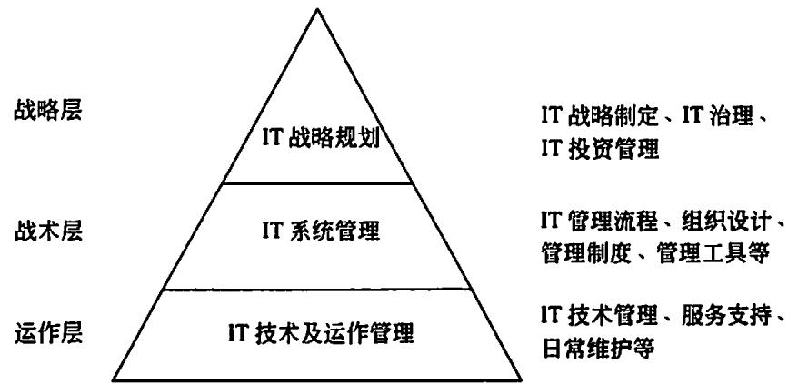
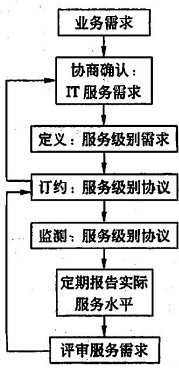
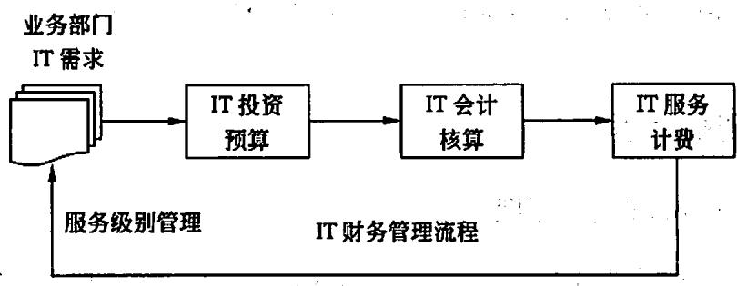

>[!warning] 版本提示
>本书为 **2006 年第 1 版**。现行考试依据是 **《信息系统管理工程师教程（第 2 版）》**（清华社 2024-10，20 章），
>两版**重合极少**：第 1 版的第 1–6 章（硬件/操作系统/语言/配置/数据结构/多媒体）在第 2 版已被删除或压缩。
>本页仅作**扩展参考**，备考请以 [[知识体系]]（第 2 版官方考纲）为准。

# 第16章 系统管理规划

本章主要对于系统管理的定义、要求，以及系统管理服务的概念、范围、成本、水平度量等做基本介绍，同时从用户方和运作方两个角度给出应包括的各类系统管理计划。

## 16.1 系统管理的定义

本节主要是阐述信息系统管理的基本要求，包含从管理层面来看，信息系统如何适应企业发展的 IT 战略和策略；从运作层面来看，信息系统管理的计划、范围、方法、工具、预算等方面内容。

## 16.1.1 管理层级的系统管理要求

信息技术的发展，以及企业对信息技术依赖程度的提高，使 IT 成为许多业务流程必不可少的组成部分，甚至是某些业务流程赖以运作的基础。企业 IT 部门地位提升的同时，也意味着要承担更大的责任，即提高企业的业务运作效率，降低业务流程的运作成本。

## 1. 企业IT管理的层次

企业的 IT 管理工作，既是一个技术问题，更是一个管理问题。下面的图 16-1 描述了企业 IT 管理工作的三层架构。

  
图16-1 IT管理的三个层次

目前我国企业的 IT 管理大部分还处于 IT 技术及运作管理层次，即主要还是侧重于对

IT 基础设施本身的技术性管理工作。因此为了提升 IT 管理工作的水平，必须协助企业在实现有效的 IT 技术及运作管理基础之上，通过协助企业进行 IT 系统管理的规划、设计和建立，进而进行 IT 战略规划，真正实现 IT 与企业业务目标的融合。

## 2. 长期的 IT 规划战略

企业信息化建设的根本就是实现企业战略目标与信息系统整体部署的有机结合，这种结合当然是可以从不同的层次或者角度出发来考虑，但这种不同层次和角度的结合能够给企业带来的最终效益是不一样的。IT 战略有助于确保 IT 活动支持总体经营战略，使该组织实现其经营的目标和目的。

通过了解企业整体的经营战略、管理模式和组织架构，理解企业生存和发展面临的主要挑战和关键业务策略和计划，同时了解企业信息技术应用现状和目前的信息技术应用对企业业务和管理带来的限制，明确未来企业对信息技术应用的主要需求，并据此分析现状与需求的差距，从而确保信息技术战略的制定从根本上符合企业发展的长远目标。

企业 IT 战略规划进行战略性思考的时候可以从以下几方面考虑。

（1）IT 战略规划目标的制定要具有战略性，确立与企业战略目标相一致的企业 IT 战略规划目标，并且以支撑和推动企业战略目标的实现作为价值核心。如果脱离企业战略目标来谈企业 IT 战略规划，那 IT 战略目标就会成为空谈，也就脱离了信息化建设的真正意义所在。

(2) IT 战略规划要体现企业核心竞争力要求, 规划的范围控制要紧密围绕如何提升企业的核心竞争力来进行, 切忌面面俱到的无范围控制。如果说企业竞争最终归结于核心竞争力的较量, 那企业信息化建设的竞争也就最终表现为如何为企业获得这种核心竞争力的价值贡献问题。

（3）IT 战略规划目标的制定要具有较强的业务结合性，深入分析和结合企业不同时期的发展要求，将建设目标分解为合理可行的阶段性目标，并最终转化为企业业务目标的组成部分。企业信息化建设并不只是企业信息部门的事情，而是在企业发展的不同阶段带有极强业务性特点的业务优化以及管理变革的举措。

（4）IT 战略规划对信息技术的规划必须具有策略性，对信息技术发展的规律和趋势要持有敏锐的洞察力，在信息化规划时就要考虑到目前以及未来发展的适应性问题。企业的信息化规划不再是以前的简单网络架构搭建问题，它有很强的总体规划的行为，包括对网络架构的设计、设备的负荷和容量计算、安全架构体系评估等，以及对网络设备的投资，都有一个详尽而周全的考虑和规划，并最终为企业业务的发展提供一个安全可靠的信息技术支撑策略。

（5）IT 战略规划对成本的投资分析要有战术性，既要考虑到总成本投资的最优，也要结合企业建设的不同阶段做出科学合理的投资成本比例分析，为企业获得较低的投资/效益比。企业信息化建设是个高成本的投资项目，包括了系统软件和网络硬件等物资设备的投入，这个数目往往令企业高层管理者产生"质疑"，并予以慎重考虑，因此，在进行 IT 战略规划的时候，就应该对成本投资进行一个科学性的估算和投资分解，为企业成本的投入提出一个战术性的规划，减少企业一次性投资的风险，权宜出一个可观的投资效益比例。

（6）IT 战略规划要对资源的分配和切入时机进行充分的可行性评估。企业信息化建设是一个在人力、物力和财力上巨大消耗的系统工程，对业务部门人力的投入和调配、时间的保证等，都是保证信息化建设的必要资源和条件，因此企业在 IT 战略规划阶段就必须对不同阶段可分配的人、财、物等资源进行充分的分析和论证，这样才能保证以后的实施具有"天时地利人和"的条件，同时也为建设过程提供了可指引的资源配备要求，也为实施计划的制定和实施切入提供了一个可行性依据。

## 3. 系统管理的目标和要求

## (1) 系统管理的目标

系统管理指的是 IT 的高效运作和管理，而不是 IT 战略规划。简单地说，IT 规划关注的是组织的 IT 方面的战略问题，而系统管理是确保战略得到有效执行的战术性和运作性活动。系统管理核心目标应是管理客户（业务部门）的 IT 需求，如何有效地利用 IT 资源恰当地满足业务部门的需求是它的核心使命。换句话说，业务部门只需关心 IT 服务有没有满足其要求，没必要关心如何满足。

企业 IT 系统管理的基本目标可分为以下几个方面。

① 全面掌握企业 IT 环境，方便管理异构网络，从而实现对企业业务的全面管理。

② 确保企业 IT 环境整体的可靠性和整体安全性，及时处理各种异常信息，在出现问题时及时进行恢复，保证企业 IT 环境的整体性能。

③ 确保企业 IT 环境整体的可靠性和整体安全性，对涉及安全操作的用户进行全面跟踪与管理；提供一种客观的手段来评估组织在使用 IT 方面面临的风险，并确定这些风险是否得到了有效的控制。

④ 提高服务水平，加强服务的可管理性并及时产生各类情况报告，及时、可靠地维护各类服务数据。

## (2) 系统管理的要求

为了实现企业 IT 系统管理的目标，IT 系统管理应该能够达到以下要求。

① 企业 IT 系统管理应可以让企业实现对所有 IT 资源统一监控和管理的愿望，应采用一致性的管理模式来推动企业现代化跨平台体系结构的发展。

② 企业 IT 系统管理应适合于企业大型、复杂、分布式的环境，不但控制了所有技术资源，而且直接可从业务角度出发管理整个企业，管理能力可以延伸到关键的非信息设备（如自动柜员机 ATM 监控、运钞车的运钞情况跟踪、机房湿度与温度控制、用户监测系统监控……）。企业可以随时部署新型应用监控系统，用来规划企业商务目标、维持企业高水平服务，提高业务系统商务响应能力。

③ 企业 IT 系统管理应可以将整个企业基础结构以一个真实世界化的视图呈现给我们，让不同技术经验的人理解，让企业集中精力面对自己的业务而非平台之间的差异，这

样有助于大大提高企业的工作效率。

④ 企业 IT 系统管理应是全集成的管理解决方案，覆盖网络资源、性能与能力、事件与状态安全、软件分布、存储、工作流、帮助台、变更管理和其他的用于传统和分布式计算环境的功能，并可用于互联网和企业内部网。

## 4. 用于管理的关键 IT 资源

## (1) 硬件资源

硬件资源包括各类服务器（小型机、Unix、Windows等）、工作站、台式计算机/笔记本、各类打印机、扫描仪等硬件设备，价格从数千人民币到数百万人民币不等。

## (2) 软件资源

软件资源就是指在企业整个环境中运行的软件和文档，其中包括操作系统、中间件、市场上买来的和本公司开发的应用软件、分布式环境软件、服务于计算机的工具软件以及所提供的服务等，文档包括应用表格、合同、手册、操作手册等。

## (3) 网络资源

网络资源包括下面各部分：通信线路，即企业的网络传输介质；企业网络服务器，运行网络操作系统，提供硬盘、文件数据及打印机共享等服务功能，是网络系统的核心；网络传输介质互联设备（T型连接器、调制解调器等）、网络物理层互联设备（中继器、集线器等）、数据链路层互联设备（网桥、交换器等）以及应用层互联设备（网关、多协议路由器等）；企业所用到的网络软件，例如网络操作系统、网络管理控制软件、网络协议等服务软件。

## (4) 数据资源

数据资源是企业生产及管理过程中所涉及到的一切文件、资料、图表和数据等的总称，它涉及到企业生产和经营活动过程中所产生、获取、处理、存储、传输和使用的一切数据资源，贯穿于企业管理的全过程。数据资源与企业的人力、财力、物力和自然资源一样同为企业的重要资源，且为企业发展的战略资源。同时，它又不同于其他资源（如材料、能源资源），是可再生的、无限的、可共享的，是人类活动的最高级财富。

## 16.1.2 运作层级的系统管理要求

## 1. 系统管理的功能范围

IT 系统管理的通用体系架构分为三个部分，分别为 IT 部门管理、业务部门（客户）IT 支持和 IT 基础架构管理。

① IT 部门管理包括 IT 组织结构及职能管理，以及通过达成的服务水平协议（Service Level Agreement, SLA）实现对业务的 IT 支持，不断改进 IT 服务。包括有 IT 财务管理、服务级别管理、问题管理、配置及变更管理、能力管理、IT 业务持续性管理等。

② 业务部门 IT 支持通过帮助服务台（Help Services Desk）实现在支持用户的日常运作过程中涉及到的故障管理、性能及可用性管理、日常作业调度、用户支持等。

③ IT 基础架构管理会从 IT 技术的角度监控和管理 IT 基础架构，提供自动处理功能和集成化管理，简化 IT 管理复杂度，保障 IT 基础架构有效、安全、持续地运行，并且为服务管理提供 IT 支持。

IT 系统管理的三个部分相互支撑，同时支持整个 IT 战略规划，满足业务部门对于 IT 服务的各种需求。

## 2. 系统管理的策略与方法

企业 IT 系统管理的策略是简单的：为企业提供符合目前的业务与管理挑战的解决方案。具体而言包括以下一些内容。

（1）面向业务处理——IT 系统管理的真正需求。

传统 IT 系统管理，是从一个技术的视角来完成。例如，网络管理工具一般只是关注网络的连接和设备的健康性。目前，企业越来越关注解决业务相关的问题，一个业务需要跨越几个技术领域的界限。例如，为了回答简单的问题"为什么定单处理得这么慢"，管理人员必须分析①支持定单处理的应用软件性能；②运行的数据库和系统；③连接的网络。

IT 基础设施的面向业务处理改变了传统的以 "资源为中心" 的视角。这就允许组织更好地选择 IT 资源信息，来处理业务问题。

## (2) 管理所有的 IT 资源，实现端到端的控制

所有 IT 资源必须作为一个整体来管理。管理的成效只能通过对 IT 的各个方面进行便于理解的管理才能实现。IT 系统管理应使企业 IT 部门能够只使用一个管理解决方案，就可以管理企业的所有 IT 资源，包括不同的网络、系统、应用软件和数据库。集中的、有着强壮的管理功能的解决方案横跨了传统的分离的资源。

## （3）丰富的管理功能——为企业提供各种便利

IT 系统管理应包括范围广阔的、丰富的管理功能来管理各种 IT 资源。从网络发现到进度规划，从多平台安全到数据库代理，从万维网服务器管理到负荷平衡，从存储管理到网络性能，从软件的交付到防火墙技术，这些功能提供了丰富的管理能力，可以通过集成在一个开放、面向对象的体系而相互地调用。

## (4) 多平台、多供应商的管理

IT 系统管理除了具有丰富的管理功能，同时还须面对各种不同的环境——TCP/IP、SNA、DECNET 和 IPX 网络；Windows NT、Unix 和处理封闭业务的服务器；台式机和大型机；各种厂商的数据库；CISCO 和 BAY NETWORKS 提供的网络设备；微软和网景提供的万维网浏览器；SAP、Oracle 和其他公司提供的应用软件。企业 IT 管理的策略是提供相联系的集成化的管理方式。

## 3. 系统管理预算

系统管理预算的目的是帮助 IT 部门在提供服务同时加强成本/收益分析，以合理地利用 IT 资源、提高 IT 投资效益。企业 IT 预算大致可分为下面三个方面。

## - 技术成本（硬件和基础设施）

\- 服务成本（软件开发与维护、故障处理、帮助台支持）。

\- 组织成本（会议、日常开支）。

1. 系统管理的工具

由于企业 IT 系统构涉及到企业内的许多元素，所以对跨越整个企业的 IT 资源和组件进行系统管理就变得尤为重要。良好的自动化管理系统可以有效地监控操作系统环境、网络环境、数据存储环境、信息安全环境和业务应用环境；良好的自动化管理系统可以准确地定位和综合诊断系统异常的原因并提出修复的方案；良好的自动化管理系统可以有力地为企业业务系统保驾护航，让业务应用高枕无忧，从而使企业 IT 部门可以将更多精力投入在服务和推动业务方面。

传统的 IT 管理大量依靠熟练管理人员的经验来评估操作数据和确定工作负载、进行性能调整及解决问题。然而，在当今企业分布式的复杂的 IT 环境下，新的策略需要获得最大化业务效率，这些策略使 IT 环境实现自修复和自调整成为可能。这个需求特别是在当今企业面对诸如高的员工流失率和投资新 IT 资源的可用预算减少等挑战时，尤显突出。

在这种情况下，企业迫切需要对其 IT 环境进行有效地自动化管理，以确保业务的正常运行。企业级的系统管理需要考虑多个因素。

\- 自动化管理符合业界的一些最佳实践标准，与 ITIL、COBIT、HP ITSM 参考模型等标准结合，为企业提供更优的自动化管理流程。

\- 自动化管理应提供集成、统一的管理体系。

\- 自动化管理应包含端到端的可靠性和性能管理能力。

\- 自动化管理应能够将 IT 管理与业务优先级紧密地联系起来，从而打破 IT 部门与业务部门之间的隔阂。

\- 自动化管理应着重考虑服务水平的管理，从而为用户提供更优质的服务。

## 16.2 系统管理服务

## 16.2.1 为何引入 IT 服务理念

随着企业之间竞争的加剧和世界范围内电子商务的兴起，IT 受到了企业越来越多的重视。一方面，企业不断投资硬件、网络和系统软件；另一方面，对于 ERP、SCM、CRM 和决策支持及知识管理系统的投资日益增多。然而，许多企业发现 IT 并没有达到它们所期望的效果，这就是业界所说的 "IT 黑洞"、"信息悖论" 等现象。

这些现象的产生，首先是由信息系统本身特点所决定的。现在企业信息系统有几个特点：首先规模越来越大；其次是功能越来越多；再次是变化快；最后是异构性。

其次，从生命周期的观点来看，无论硬件或软件，大致可分为规划和设计、开发（外购）和测试、实施、运营和终止等5个阶段。而前三个阶段从时间而言，仅占其生命周期

的 20%，其余 80% 的时间基本上是在运营。因此如果整个 IT 运作管理做得不好，那么就无法发挥前期投资的收益、带来预期的收益，或为企业增加不必要的成本。

为了改变此种现象，必须转变系统管理的理念，其目的在于使 IT 真正有效地支持企业的业务、强调 IT 对业务处理的渗透。因此 IT 服务理念追求的目标如下。

\- 以客户（企业的业务部门）为中心提供IT服务。

\- 高质量、低成本的 IT 服务。

\- 提供的服务可度量、可计费。

## 16.2.2 服务级别管理

## 1. 为何引入服务级别管理

如果 IT 部门不能准确了解业务部门的服务需求，业务部门的客户也同样不能期望 IT 部门能够为其提供令人满意的 IT 服务。因此，为了让 IT 服务级别满足组织的业务需求，IT 服务部门在对 IT 基础架构进行服务级别设计时，必须充分调查和了解组织真实的业务需求。这就是服务级别管理关注的过程。

为了真正了解组织的 IT 服务需求，以及由此决定相应的服务级别，IT 部门与业务部门之间应进行全面沟通，结合客户对当前服务级别的体验，在此基础上帮助客户分析和梳理那些真实存在却又尚未明确的 IT 服务。因为很多时候，用户和客户并不能准确地把握其真实的 IT 服务需求。除了需要明确组织的 IT 服务需求以外，还应结合相关的 IT 成本预

算进一步确定组织对 IT 服务的有效需求，从而抑制客户在设备和技术方面 "高消费" 的欲望，为组织节约成本，提高 IT 投资的效益。

## 2. 服务级别管理的基本概念

服务级别管理是定义、协商、订约、检测和评审提供给客户服务的质量水准的流程。它是连接 IT 部门和客户（业务部门）之间的纽带，不过其直接面对的不是使用 IT 服务的用户（通常是指业务部门内某个具体的职员），而是为 IT 服务付费的客户（通常是指某个具体的业务部门），如图 16-2 所示。

服务级别管理的主要目标在于，根据客户的业务需求和相关的成本预算，制定恰当的服务级别目标，并将其以服务级别协议（Service Level Agreements，SLA）的形式确定下来。在服务级别协议中确定的服务级别目标，既是 IT 服务部门监控和评价实际服务品质的标准，也是协调 IT 部门和业务部门之间有关争议的基本依据。

  
图 16-2 服务级别管理过程

## 3. 服务级别协议

服务级别协议（SLA）设定了 IT 服务的数量、质量、费用等相关标准，实现了 IT 部门和业务部门之间的全面协作，努力获得高质量的服务以及最大限度地提高服务效率。SLA 不仅用于企业内部 IT 部门和业务部门之间，而且也将用于企业和第三方服务提供商之间（比如外包、应用开发服务、系统集成服务等）。

结构合理的服务级别协议应该包括下列内容。

\- 被明确规定和描述的服务定义。

\- 定义每项服务的测量标准：例如数量、质量、可用性、可靠性、安全性、问题解答、支持、备份、恢复时间、偶然性、增长能力、开发请求。

\- 此外还应包括服务时间框架；服务成本及计费；对不履行职责所实施的惩罚。

\- 依据服务测量方法来监督服务质量。

\- 另外服务级别协议中也应包括企业和第三方服务提供商之间的明确职责。

## 4. 服务级别管理的要点

企业在 IT 系统管理中应用服务级别管理，应注意以下问题。

（1）强调 IT 对业务的价值。这种价值主要体现在两点：一是在考虑服务级别需求时，要充分考虑业务部门潜在的、隐含的需求，以免因遗漏而影响业务的正常运作；二是在确定服务级别目标时，要确定合适的服务级别、服务质量。

（2）要让业务部门的人员参与进来，因为他们清楚地知道业务对 IT 的需求在哪里，他们能够从业务的角度来看待 IT，弥补 IT 人员从 IT 的角度看待业务的不足。

（3）服务级别管理不是书面文章，关键要落到实处。而这需要更长时间，更复杂、更艰难的监测、评审。通过对 IT 服务的衡量，才能确定各个业务在具体时期的服务级别、服务质量情况，也才能很好地进行监控，或者实施服务改进计划。

（4）对于 IT 部门而言，至关重要的是不要好高骛远——创建能提供的，而不是想提供的服务级别管理。对于业务部门来说，SLA 与业务要求相吻合，才有生命力和执行的必要；而 IT 服务商如果承诺过高，高于自己的 IT 能力，即使承诺了 SLA，也依然无法落实、实现。当然，这些因素都必须考虑到服务成本问题，如果 SLA 的实现超出了 IT 服务提供方所能承受的成本或者盈亏平衡点，最终结果也无法达成双赢，长期来看，必将影响 IT 服务的持续运营。

## 16.3 IT 财务管理

## 16.3.1 为何引入 IT 财务管理

通过信息化增强企业的核心竞争力，信息技术对于企业发展的战略意义逐渐被企业界所认同。然而，当企业豪情满怀地将巨资投在各种"IT系统"上，期待着"利润滚滚来"

时，他们最后发现，精良的设备和先进的技术有时并没有为企业创造实实在在的效益、提升企业的竞争力。相反，那些昂贵的"IT系统"常常让他们骑虎难下。这种尴尬和无奈被称为"信息悖论"或"IT黑洞"。

那么，如何走出这"信息悖论"的沼泽地呢？专家们给出的答案是：管理重于技术。要改变以往那种"激情澎湃、热血沸腾"式的非理性IT投资方式，就必须对IT项目的投资过程进行理性管理、研究IT项目投资的必要性和可行性、准确计量IT项目投资的成本和效益，并在此基础上进行投资评价和责任追究。

IT 财务管理作为重要的 IT 系统管理流程，可以解决 IT 投资预算、IT 成本、效益核算和投资评价等问题，从而为高层管理提供决策支持。因此，企业要走出"信息悖论"的沼泽，通过 IT 财务管理流程对 IT 服务项目的规划、实施和运作进行量化管理是一种有效的手段。

## 16.3.2 IT部门的角色转换

在传统的 IT 组织架构设计中，IT 部门仅作为辅助部门，为业务部门提供 IT 支持。这种职能定位使得 IT 部门成为业务部门的"后勤部门"，再加上 IT 部门自身的技术壁垒，使得企业对 IT 项目的决策、IT 项目的预算与成本等失去控制，IT 部门成为名符其实的"IT 黑洞"。

为了改变此状况，企业要求相应地改变 IT 部门在组织架构中的定位，即将 IT 部门从一个技术支持中心改造为一个成本中心，甚至利润中心。这样，就可以将 IT 部门从一个支持部门转变为一个责任中心，从而提高了 IT 部门运作的效率。后续关于 IT 部门职责问题的章节会对此进一步阐述。

## 16.3.3 IT 财务管理流程

IT 财务管理，是负责对 IT 服务运作过程中所涉及的所有资源进行货币化管理的流程。该服务管理流程包括三个环节，它们分别是 IT 投资预算（budgeting）、IT 会计核算（accounting）和 IT 服务计费，IT 财务管理流程如图 16-3 所示。

  
图 16-3 IT 财务管理流程

## 1. 投资预算

IT 投资预算的主要目的是对 IT 投资项目进行事前规划和控制。通过预算，可以帮助高层管理人员预测 IT 项目的经济可行性，也可以作为 IT 服务实施和运作过程中控制的依据。

IT 能力管理主要是管理及规划 IT 容量，而 IT 服务工作量是 IT 服务成本变化的一个主要原因，因此编制预算的时候必须紧密结合 IT 能力管理。

\- 技术成本（硬件和基础设施）。

\- 服务成本（软件开发与维护、偶发事件的校正、帮助台支持）。

\- 组织成本（会议、日常开支）。

## 2. IT 会计核算

IT 会计核算的主要目标在于，通过量化 IT 服务运作过程中所耗费的成本和收益，为 IT 服务管理人员提供考核依据和决策信息。它所包括的活动主要有：IT 服务项目成本核算、投资评价、差异分析和处理。这些活动分别实现了对 IT 项目成本和收益的事中和事后控制。

对成本要素进行定义是 IT 服务项目成本核算的第一步。成本要素是成本项目进一步细分的结果，如硬件可以进一步分为办公室硬件、网络硬件以及中央服务器硬件等。成本要素一般可以按部门、客户或产品等划分标准进行定义。而对于 IT 服务部门而言，理想的方法应该是按照服务要素结构来定义成本要素。

用于 IT 项目投资评价的指标主要有投资回报率（Return on Investment, ROI）和资本报酬率（Return on Capital Employed, ROCE）等指标。

为了达到控制的目的，IT 会计人员需要将每月、每年的实际数据与相应的预算、计划数据进行比较、发现差异，调查、分析差异产生的原因，并对差异进行适当处理。IT 会计人员需要注意的差异一般包括成本差异、收益差异、服务级别差异和工作量差异。

## 3. IT 服务计费

IT 服务计费是负责向使用 IT 服务的业务部门（客户）收取相应费用。通过向客户收取 IT 服务费用，构建一个内部市场并以价格机制作为合理配置资源的手段，迫使业务部门有效地控制自身的需求、降低总体服务成本，从而提高了 IT 投资的效率。IT 服务计费的顺利运作需要以 IT 会计核算所提供的成本核算数据为基础。

## 4. 服务级别与成本的权衡

服务级别协议（SLA）明确界定了IT服务的水平要求及客户的期望。它直接影响到最终服务的范围及水平。服务水平管理与成本管理之间的联系表现在以下方面：服务水平管理提出的目前的服务需求及将来的服务需求决定了成本管理中的服务成本、组织的收费政策及其对客户及最终用户的影响。服务水平协议允许客户对服务水平的需求变动越大，IT服务的收费范围也越大，预算、IT会计核算与收费的管理费用也越高。

## 16.4 制定系统管理计划

## 16.4.1 IT 部门的职责及定位

## 1. IT部门的职责

IT 部门首先要树立 IT 服务的思想，将 IT 当作一种服务来提供。以先进的管理理念和方法、标准来为业务部门提供高质量、低成本、高效率的 IT 支持服务，同时依照事先约定的服务级别协议、监控 IT 服务，并评价最终结果。IT 部门一方面与业务部门根据服务级别协议中量化的服务指标处理与业务部门之间的关系；另一方面也使 IT 部门所提供的服务透明化，不仅让业务部门，更让企业的高层管理者清楚地知道 IT 部门提供了什么服务。上述要求看似苛刻，实际上意味着 IT 部门服务方式的改变，IT 服务人员必须把最终用户和业务管理作为自己的"客户"，把他们的满意作为自己的最终目标。

IT 部门的核心职责在于始终提供并保持高质量的服务；根据对服务和业务优先等级知识的把握，可有效控制不断上升的服务需求的成本；在充分理解业务对于网络、系统和应用性能等能力要求的基础上，制定出符合业务发展的服务水平协议；自动制定出能够真实反映业务动态变化的服务计划。对具体职责而言包括：IT 战略规划、企业应用系统规划、网络及基础设施、数据库管理、安全管理、IT 日常运作、终端用户支持等，本章后面会做详细阐述。

## 2. IT部门的定位

传统的 IT 部门仅仅是核算中心，只是简单地核算有些预算项目的投入成本。这种政策的整个 IT 会计系统集中于成本的核算，从而在无需支出账单和簿记费用的情况下改进了投资决策。然而，这种政策也许不能影响用户的行为，也不能使 IT 部门能够完全从财务角度进行经营。为了改变这种状况，提高 IT 服务质量及投资收益，使 IT 部门逐渐从 IT 支持角色转变为 IT 服务角色，从以 IT 职能为中心转变为以 IT 服务流程为中心，从费用分摊的成本中心模式转变为责任中心，企业必须改变 IT 部门在组织结构中的定位，应该将 IT 部门从一个技术支持中心改造为一个成本中心，甚至利润中心。这样，就可以将 IT 部门从一个支持部门转变为一个责任中心，从而提高了 IT 部门运作的效率。

首先界定成本中心和利润中心的概念，成本中心和利润中心均属于责任会计的范畴。成本中心是成本发生单位，一般没有收入，或仅有无规律的少量收入，其责任人可以对成本的发生进行控制；与之相对应，利润中心是既能控制成本，又能控制收入的责任单位，不但要对成本和收入负责，也要对收入和成本的差额即利润负责。

（1）成本中心，当 IT 部门被确立为一个成本中心时，对其 IT 支出和产出（服务）要进行全面核算，并从客户收费中收取补偿。这种政策要求核算所有的付现和非付现成本，确认 IT 服务运作的所有经济成本。

(2) 利润中心, 作为利润中心来运作的 IT 部门相当于一个独立的营利性组织, 一般拥有完整的会计核算体系。在这种政策下, IT 部门的管理者通常可以像一个独立运营的经济实体一样, 有足够的自主权去管理 IT 部门, 但其目标必须由组织确定。IT 部门从成本中心向利润中心的转变需要清晰地界定服务模式, 与业务部门进行充分的内部沟通, 定义好关键性的服务等级协议 (SLA), 充分展现 IT 价值的透明度与可信度。

IT 部门作为相对独立的利润中心，会带来诸多的优势：对于企业来说，可以使企业将精力集中在核心业务上面，同时降低成本、提高边际利润。对于 IT 部门本身来说，可成为一个独立核算的经济实体，通过市场化的运作实现自身的盈利，一方面，对其内部人员形成有效激励；另一方面，可以更好地利用资源，创造更多的社会价值。对于业务部门来说，在市场需求阶段考虑约束，需要考虑成本因素，行为更具有经济性，有利于整体效率的提升。

在实际应用中，将 IT 部门定位为成本中心或利润中心取决于组织业务的规模和对 IT 的依赖程度。一般来说，对于那些组织业务规模较大且对 IT 依赖程度较高的组织，可将其 IT 部门设立为利润中心，以真正的商业化模式进行运作。而对于那些业务量较小且对 IT 依赖程度不高的组织而言，将 IT 部门作为成本中心运作就可以达到成本控制的目的了。

## 16.4.2 运作方的系统管理计划

从 IT 管理部门而言，包括 IT 战略制定及应用系统规划、网络及基础设施管理、系统日常运行管理、人员管理、成本计费管理、资源管理、故障管理、性能/能力管理、维护管理、安全管理等方面。下面简单介绍几类系统管理计划。

## 1. 系统日常操作管理

系统日常管理对于确保计算机系统满足业务的需要，并完整、及时地处理有效的操作是必不可少的。操作管理包括对服务器等设备定期维护、定期评价性能报告、备份系统及数据、建立紧急情况处理流程、定期检查系统日志和其他审核跟踪记录，以便发现非正常操作或未经授权的访问、合理安排系统资源满足 IT 需求。另外操作管理还有一项重要制度就是将操作流程制成文件并予以归档，并定期测试、修改。

## 2. IT 人员管理

人员管理的首要目的是 IT 部门内部职责的有效划分、让职员理解自身的职责。其他相关的目的还包括定期的职员业绩评定、与职业发展相关的员工培训计划。

## 3. IT 财务管理

IT 财务管理使管理人员能够进行 IT 成本收益分析，并证明 IT 的价值。包括制订正式的 IT 预算、各企业单位的 IT 成本的测量和评估、按照 IT 组织和各企业单位之间的 SLA，进行 IT 服务计费、比照预算，对实际 IT 成本进行监控，包括差异分析、IT 资产和服务的标准采购程序。

## 4. 故障管理

故障管理的目的就是在出现故障的时候，依据事先约定的事故处理优先级别尽可能快地恢复服务的正常运作，避免业务中断，以确保最佳的服务可用性级别。所谓故障是指任何不符合标准操作且已经引起或可能引起服务中断和服务质量下降的事件。故障管理流程转变 IT 部门为了企业内部层出不穷的技术故障而疲于奔命的"救火队"的角色。

## 5. 性能/能力管理

能力管理不仅要考虑企业计算性能对 IT 服务可用性和稳定性的影响, 还要综合考虑各 IT 组件及其相互配合关系对整体服务能力的影响, 以及为达到一定级别的服务能力所需花费的成本。

从这个角度上讲，从性能管理到能力管理的转变，至少反映了以下两个实质性的进步。

\- 能力管理除了关注硬件设备的容量和性能以外，还十分注重 IT 基础架构整体服务能力对业务需求的支持。

\- 能力管理并不追求设备的高容量和高性能，而是力图结合业务需求和 IT 成本来确定有效的能力需求，从而为 IT 服务设计和配置合理的服务能力。

## 6. 资源管理

IT 资源管理主要是摸清企业的各类 IT 资源：硬件资源、软件资源、网络资源、设施及设备资源、数据资源等，并对其进行跟踪。记录 IT 资产的需求、配置、调换、分级以及最终报废的历史情况，提供 IT 资产的生命周期管理，为成本管理提供完整的 IT 资产数据。在此基础之上整合、优化利用企业整个 IT 资源。

## 7. 安全管理

安全管理主要包括安全制度和组织的设定、物理和系统安全管理、外部通信的安全等方面内容。安全管理确保以下事情：只向授权职员提供访问权；经常评估访问级别和安全违反情况；及时从系统中删除被解雇职员的信息。进行用户账号的设置、修改和及时删除（若员工被解雇）的程序。应用软件的功能限制在与雇员的工作职责相当的程度范围之内。

## 16.4.3 用户方的系统管理计划

## 1. 帮助服务台

帮助服务台（Service Desk）在为业务部门提供 IT 服务中扮演着一个极其重要的角色，服务台的主要目标是协调客户（业务部门）和 IT 部门之间的关系，为 IT 服务运作提供支持，从而提高客户服务的满意度。

完整意义上的服务台可以理解为其他 IT 部门和服务流程的 "前台"，它可以在不需要联系特定技术人员的情况下处理大量的业务部门的请求，并可能会使用知识管理系统来协助解决问题。

对用户而言，服务台是他们与 IT 部门的唯一连接点，确保他们找到帮助其解决问题和请求的相关人员。帮助服务台另一方面的功能是记录、解决和监控 IT 服务运作过程中产生的故障问题，主要和故障管理相关联。定期对反复发生的问题进行原因分析和统计，并制定改正计划。供管理层寻找改进的机会。

服务台不仅负责处理事故、问题和客户的询问，同时还为其他活动和流程提供接口。这些活动和流程包括故障管理、系统可用性管理、服务级别管理、配置管理及持续性管理等。

## 2. 用户参与服务级别管理

服务级别管理必须使用户充分参与其中，包括最初 IT 部门与业务部门（客户）协商所提供 IT 服务的内容和级别。其次，IT 部门还应定期和业务部门（客户）举行服务评审会，以评价 SLA 中约定的服务级别目标的实现情况和预测将要发生的问题。服务评审会应当重点关注那些未实现的服务级别的环节，查出导致服务失败的原因并制定相应的服务改进计划。然后，若某些服务级别目标未能实现（因目标本身不可实现而造成的），那么 IT 部门应当与业务部门（客户）重新协商，并修改相应的服务级别协议。

## 3. IT 性能和可用性管理

IT 性能和可用性管理可以为错综复杂的 IT 系统提供 "中枢神经系统"，这些系统不断地收集有关的硬件、软件和网络服务信息，可以分别从组件、业务系统和整个企业的角度来监控电子商务。该管理计划可以有效识别重大故障、疑难故障和不良影响，然后会通知支持人员采取适当措施，或者在许多情况下进行有效修复以避免故障发生。

## 4. 用户参与 IT 管理

企业在进行各类应用系统的开发或实施时，IT 部门必须使业务部门参与开发或实施过程，只有这样才可以确保系统在发布时能较好地满足业务部门的 IT 需求。

另外业务部门与 IT 部门积极沟通共同制定服务级别协议、IT 服务计费标准，则可以有效地推动业务部门参与到 IT 系统管理中来，从而能够有效地执行相关的 IT 管理流程，以实现较高的 IT 服务水平。

## 5. 终端用户安全管理

终端用户安全管理由一组关于个人计算机使用的相关制度，主要包括重要数据备份制度、密码规则制度、计算机病毒的防护及预防、入侵监测及防火墙、外部网访问限制等方面。为的是提高终端用户的计算机使用的可持续性，减少IT部门支持及故障处理的频率。

## 6. 终端用户软件许可协议

IT 部门对终端用户进行关于软件版权的培训，并定期进行软件审查以控制盗版软件以及公司系统的开发副本，保证遵守有关软件许可的法律法规。

## 思考题

1. IT 财务管理的目标及其作用是什么？

2. IT 系统管理的层次、定位、职能范围是什么？

3. 服务级别管理的概念及其在系统管理中的作用是什么？
