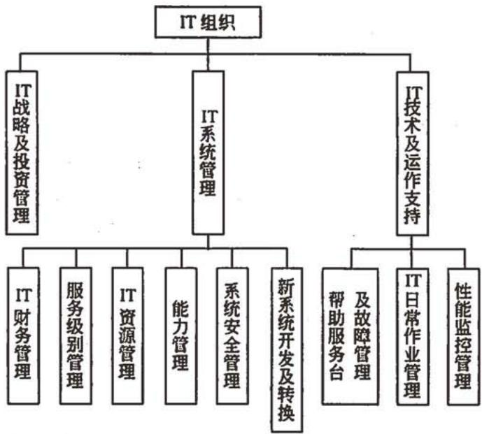
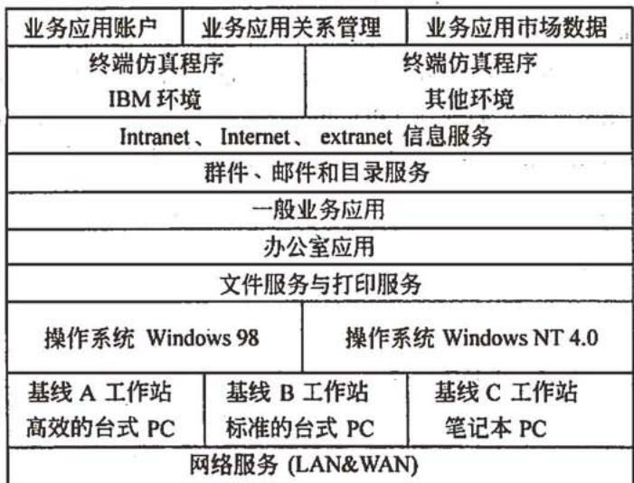
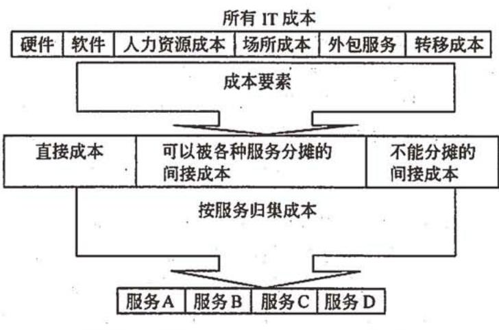
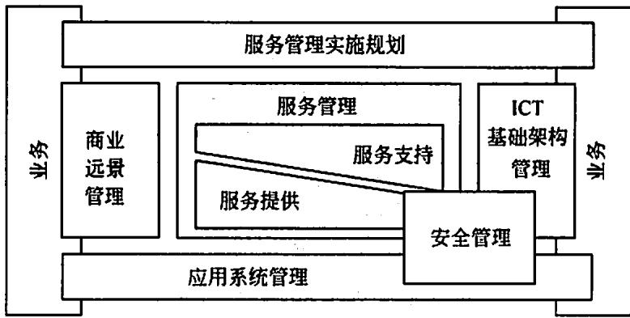
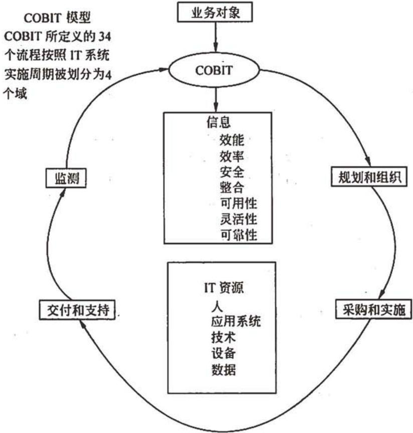

>[!warning] 版本提示
>本书为 **2006 年第 1 版**。现行考试依据是 **《信息系统管理工程师教程（第 2 版）》**（清华社 2024-10，20 章），
>两版**重合极少**：第 1 版的第 1–6 章（硬件/操作系统/语言/配置/数据结构/多媒体）在第 2 版已被删除或压缩。
>本页仅作**扩展参考**，备考请以 [[知识体系]]（第 2 版官方考纲）为准。

# 第17章 系统管理综述

## 17.1 系统运行

## 17.1.1 系统管理分类

IT 系统管理工作主要是优化 IT 部门的各类管理流程，并保证能够按照一定的服务级别，为业务部门（客户）高质量、低成本地提供 IT 服务。IT 系统管理工作可以按照以下两个标准予以分类。

## 1. 按系统类型分类

（1）信息系统，企业的信息处理基础平台，直接面向业务部门（客户），包括办公自动化系统、企业资源计划（ERP）、客户关系管理（CRM）、供应链管理（SCM）、数据仓库系统（Date Warehousing）、知识管理平台（KM）等。

（2）网络系统，作为企业的基础架构，是其他方面的核心支撑平台。包括企业内部网（Intranet）、IP地址管理、广域网（ISDN、虚拟专用网）、远程拨号系统等。

（3）运作系统，作为企业 IT 运行管理的各类系统，是 IT 部门的核心管理平台。包括备份/恢复系统、入侵检测、性能监控、安全管理、服务级别管理、帮助服务台、作业调度等。

（4）设施及设备，设施及设备管理是为了保证计算机处于适合其连续工作的环境中，并把灾难（人为或自然的）的影响降到最低限度。包括专门用来放置计算机设备的设施或房间。

对 IT 资产（计算机设备、通信设备、个人计算机和局域网设备）的恰当的环境保护；有效的环境控制机制：火灾探测和灭火系统、湿度控制系统、双层地板，隐藏的线路铺设、安全设置水管位置，使其远离敏感设备、以及不间断电源和后备电力供应等。

## 2. 按流程类型分类

（1）侧重于 IT 部门的管理，从而保证能够高质量地为业务部门（客户）提供 IT 服务。这一部分主要是对公司整个 IT 活动的管理，包括 IT 财务管理、服务级别管理、IT 资源管理、能力管理、系统安全管理、新系统转换、系统评价等职能。

（2）侧重于业务部门的 IT 支持及日常作业，从而保证业务部门（客户）IT 服务的可用性和持续性。这一部分主要是业务部门 IT 支持服务，包括 IT 日常作业管理、帮助服务台管理、故障管理及用户支持、性能及可用性保障等。

（3）侧重于 IT 基础设施建设，主要是建设企业的局域网、广域网、Web 架构、Internet

连接等。

## 17.1.2 系统管理规范化

系统管理的规范化涉及到人员职责、操作流程等方面标准的制定，并进行有效的标准化。企业IT部门除了IT部门组织结构及职责之外，还应该详细制定各类运作管理规章制度，主要包括：日常作业调度手册、系统备份及恢复手册、性能监控及优化手册、输出管理手册、帮助服务台运作手册、常见故障处理方法、终端用户计算机使用制度等与用户息息相关的IT支持作业方面的规范制度。此外，还包括服务级别管理手册、安全管理制度、IT财务管理制度、IT服务计费及成本核算、IT资源及配置管理、新系统转换流程、IT能力规划管理等由IT部门执行的以提供高质量IT服务为目的的管理流程。

## 17.1.3 系统运作报告

系统运行过程中的关键操作、非正常操作、故障、性能监控、安全审计等信息，应该实时或随后形成系统运作报告，并进行分析以改进系统管理水平。

是否有流程保证对所有不属于标准操作的操作性问题给予记录（在问题管理系统内）、分析和及时处理？

## 1. 系统日常操作日志

系统日志应该记录足以形成数据的信息，为关键性的运作提供审核追踪记录，并且保存合理的时间段。利用日志工具定期对日志进行检查，以便监控例外情况并发现非正常的操作、未经授权的活动、作业完成情况、存储状况、CPU、内存利用水平等。

## 2. 性能/能力规划报告

企业需要了解其 IT 能力能否满足其业务需要，因此它需要了解系统性能、能力和成本的历史数据，定期形成月度、年度性能报告，并进行趋势分析和资源限制评估，在此基础之上增加或调整其 IT 能力。

性能监控工具应该主动地监控、测量和报告系统的性能，包括平均响应时间、每日交易数、平均无故障时间、CPU、存储器等的使用状况、网络性能等，从而可以有预见性地响应变化的业务需求。

## 3. 故障管理报告

企业应定期产生有关问题的统计数据，这些统计数据包括：事故出现次数、受影响的客户数、解决事故所需时间和成本、业务损失成本等，可以供管理层对反复发生的问题进行根本原因的分析，并寻找改进的机会。

另外，对于每次故障处理应该进行数据记录、归类，作为基础，它应包括以下内容。

\- 目录，确定与故障相关联的领域，比如硬件、软件等。

\- 影响度，故障对业务流程的影响程度。

\- 紧迫性，故障需要得到解决的紧急程度。

\- 优先级，综合考虑影响度、紧迫性、风险和可用资源后得出的解决故障的先后顺序。

\- 解决方法，故障解决的流程、处理方法。

这样有利于使用知识管理系统来协助解决问题。

## 4. 安全审计日志

为了能够实时监测、记录和分析网络上和用户系统中发生的各类与安全有关的事件（如网络入侵、内部资料窃取、泄密行为等），并阻断严重的违规行为，就需要安全审计跟踪机制来实现在跟踪中记录有关安全的信息。审计是记录用户使用计算机网络系统进行所有活动的过程，它是提高安全性的重要工具。

审计记录应包括以下信息：事件发生的时间和地点；引发事件的用户；事件的类型；事件成功与否。常见的审计记录可能包括：活动的用户账号和访问特权；用户的活动情况，包括可疑的行为；未授权和未成功的访问企图；敏感命令的运行等。

系统运作报告使对 IT 的整个运行状况的评价得以实现，IT 报告应具备涵盖所有 IT 领域的关键业绩指标，例如风险及问题、财务状况、系统利用率、系统性能、系统故障时间、服务级别执行情况、安全审计等；这也为 IT 运作绩效的改进提供了基础。

## 17.2 IT 部门人员管理

## 17.2.1 IT 组织及职责设计

## 1. IT 组织设计原则

IT 部门组织架构及职责应能充分支持 IT 战略规划并足以使 IT 与业务目标趋于一致、并且应该有明确的职责设计（例如部门划分、岗位职责、与业务部门间的关系等）。因此在进行 IT 组织及职责设计中应注重以下原则：

（1）IT 部门首先应该设立清晰的远景和目标，一个简洁清晰的远景是 IT 管理框架的原动力，它描述了 IT 部门在企业中的位置和贡献。

（2）根据 IT 部门的服务内容重新思考和划分部门职能，进行组织机构调整，清晰部门职责。做到重点业务突出，核心业务专人负责。

（3）建立目标管理制度、项目管理制度，使整个组织的目标能够落实和分解，建立有利于组织生产的项目管理体制。

（4）作为组织机构调整、目标管理制度和项目管理体制的配套工程，建立科学的现代人力资源管理体系，特别是薪酬和考核体系。

(5) 通过薪酬和考核体系的建立，促进信息中心的绩效得以提高。

（6）IT 组织的柔性化，能够较好地适应企业对 IT 服务的需求变更及技术发展。

## 2. IT 组织设计考虑因素

组织结构的设计受到许多因素的影响和限制，同时需要考虑和解决以下问题。

\- 客户位置，是否需要本地帮助台、本地系统管理员或技术支持人员；如果实行远程管理 IT 服务的话，是否会拉开 IT 服务人员与客户之间的距离。

\- IT 员工工作地点，不同地点的员工之间是否存在沟通和协调困难；哪些职能可以集中化；哪些职能应该分散在不同位置（如是否为客户安排本地系统管理员）。

\- IT 服务组织的规模，是否所有服务管理职能能够得到足够的支持，对所提供的服务而言，这些职能是否都是必要的；大型组织可以招聘和留住专业化人才，但存在沟通和协调方面的风险；小型组织虽沟通和协调方面的问题比大型组织少，但通常很难留住专业人才。

\- IT 基础架构的特性，组织支持单一的还是多厂商架构；为支持不同硬件和软件，需要哪些专业技能；服务管理职能和角色能否根据单一平台划分。

1. IT 组织及职责设计

按照本书第 1 章所讲企业 IT 管理的三个层次：IT 战略规划、IT 系统管理、IT 技术管理及支持来进行 IT 组织及岗位职责设计（如图 17-1 所示）。

  
图 17-1 IT 部门组织及职责设计

\- IT 战略及投资管理, 这一部分主要由公司的高层及 IT 部门的主管及核心管理人员组成, 其主要职责是制定 IT 战略规划以支撑业务发展, 同时对重大 IT 投资项目予以评估决策。

\- IT系统管理，这一部分主要是对公司整个IT活动的管理，主要包括IT财务管理、服务级别管理、IT资源管理、性能及能力管理、系统安全管理、新系统运行转换等职能，从而保证高质量地为业务部门（客户）提供IT服务。

IT 技术及运作支持，这一部分主要是 IT 基础设施的建设及业务部门 IT 支持服务，包括 IT 基础设施建设、IT 日常作业管理、帮助服务台管理、故障管理及用户支持、性能及可用性保障等，从而保证业务部门（客户）IT 服务的可用性和持续性。

企业应做好 IT 部门的人力资源规划及近期人力资源工作计划，要有步骤、有策略地及时推进具体工作，同时还应识别岗位所需要的技能及配备足够的人员以实现目标。招聘的过程中要保证公平、公正的原则，通过市场竞争，以较合适的成本取得 IT 部门持续发展所需要的优秀人才。在对外公开招聘前，可以通过内部竞聘方式从内部选拔人才，内部招聘是一种成本低、效率高，但很容易让人遗忘的发现人才的方式。

IT 人员应清晰地划分到职能，同时岗位的工作职责必须正式定义形成职责说明书，包括定员定岗、编制、及时修订岗位职责说明书、制定科学的绩效考核指标等。科学考核是体现员工创造能力的天平，如何让优秀员工在 IT 部门脱颖而出，是优秀企业要掌握的工作技巧。它需要有一套科学的考核指标体系作为支持。对于以系统设计、程序开发、信息化规划、系统维护、技术支持、网站建设等不同工作内容为主的各个岗位，需要设计出相应的关键绩效考核指标（KPI），才能体现出员工的工作业绩。

总之，要用科学的管理体系激发员工的工作热情，不仅要让 IT 部门的工作绩效得到提升，还要让员工的个人职业生涯发展顺利。

## 17.2.2 IT人员的教育与培训

IT 部门的人力资源管理是从部门的人力资源规划及考核激励开始的，用于保障企业各 IT 活动的人员配备。然而，在做好了 IT 部门的人力资源规划基础之上，更为重要的是建设 IT 人员教育与培训体系以及为员工制定职业生涯发展规划，让员工与 IT 部门和企业共同成长。

IT 技术的发展日新月异，导致了 IT 从业人员的学习与培训成本明显高于其他部门，这说明了培训工作在 IT 部门的人力资源管理过程中的重要性。IT 部门负责人一定要在加强自身学习的同时，保障本部门员工的必要专业培训工作，这就像为部队的战士更新手中的老式步枪为新式武器一样，可以大大提高 IT "部队" 的战斗力。

在这种情况下，IT 部门应该尊重员工的个人发展计划，在其进入企业的时候，及早地了解其发展方向与兴趣，尽量好地与现实工作结合起来，共同制订出员工的个人职业发展生涯规划，及早做好相关的人才储备工作。

## 17.2.3 第三方/外包的管理

## 1. 外包商的选择

外包是一种合同协议，组织提交 IT 部门的部分控制或全部控制给一个外部组织，并支付费用，签约方依据合同所签订的服务水平协议，提供资源和专业技能来交付相应的服务。企业应将外包商看作一种长期资源，对企业具有持续的价值。作为一种资产，将时间和资源用于管理这种关系，并使其价值最大化。企业要从外包关系中获取价值，目标是保持一种长期的有价值的关系，同时应该了解，随着时间的推移，技术和组织的变化可能需要新的合作伙伴或新的结盟。因此公司在努力发展长期关系的同时，可通过发展适当的激励和反激励方法促进与外包商的关系。

外包成功的关键因素之一是选择具有良好社会形象和信誉、相关行业经验丰富、能够引领或紧跟信息技术发展的外包商作为战略合作伙伴。因此，对外包商的资格审查应从技术能力、经营管理能力、发展能力这三个方面着手。

（1）技术能力：外包商提供的信息技术产品是否具备创新性、开放性、安全性、兼容性，是否拥有较高的市场占有率，能否实现信息数据的共享；外包商是否具有信息技术方面的资格认证，如信息产业部颁发的系统集成商证书、认定的软件厂商证书等；外包商是否了解行业特点，能够拿出真正适合本企业业务的解决方案；信息系统的设计方案中是否应用了稳定、成熟的信息技术，是否符合银行发展的要求，是否充分体现了银行以客户为中心的服务理念；是否具备对大型设备的运行、维护、管理经验和多系统整合能力；是否拥有对高新技术深入理解的技术专家和项目管理人员。

（2）经营管理能力：了解外包商的领导层结构、员工素质、客户数量、社会评价；项目管理水平，如软件工程工具、质量保证体系、成本控制、配置管理方法、管理和技术人员的老化率或流动率；是否具备能够证明其良好运营管理能力的成功案例；员工间是否具备团队合作精神；外包商客户的满意程度。

（3）发展能力：分析外包服务商已审计的财务报告、年度报告和其他各项财务指标，了解其盈利能力；考察外包企业从事外包业务的时间、市场份额以及波动因素；评估外包服务商的技术费用支出以及在信息技术领域内的产品创新，确定他们在技术方面的投资水平是否能够支持银行的外包项目。

## 2. 外包合同管理

外包合同应明确地规定外包商的任务与职责并使其得到坚持，为企业的利益服务。外包合同应该是经法律顾问评价的契约性协议，并且经过独立审查以确保完整性和风险的级别，在其中明确地规定服务的级别及评价标准，以及对不履行所实施的惩罚；第三方机密性/不泄露协议及利益冲突声明；用于关系的终止、重新评价和/或重新投标的规程以确保企业利益最大化。

外包合同中的关键核心的文件就是服务等级协议（SLA）。SLA 是评估外包服务质量的重要标准，可以说，Sony 的经验中最可贵的一条就在这里：如果不把问题细化到 SLA 的层面，空谈外包才是最大的风险。在合同当中要明确合作双方各自的角色和职责，明确判断项目是否成功的衡量标准。同样需要明确的是合同的奖惩条款和终止条款。让合同具有一定的弹性和可测性，根据对公司未来发展状况的预测将条款限定在一个合理的能力范围之内。要保证合同当中包含一个明确规定的变化条款，以在必要的时候利用该条款来满足公司新业务的需求。

根据客户与外包商建立的外包关系可以将信息技术外包划分为：市场关系型外包、中间关系型外包和伙伴关系型外包。

外包合同关系可被视为一个连续的光谱，其中一端是市场型关系，在这种情况下，你的组织可以在众多有能力完成任务的外包商中自由选择，合同期相对较短，而且合同期满后，能够低成本地、方便地换用另一个外包商完成今后的同类任务。另一端是长期的伙伴关系协议，在这种关系下，你的组织与同一个外包商反复制订合同，并且建立了长期的互利关系。而占据连续光谱中间范围的关系必须保持或维持合理的协作性，直至完成主要任务，这些关系被称为"中间"关系。

## 3. 外包风险控制

IT 外包有着各种各样的利弊。在 IT 外包日益普遍的浪潮中，企业应该发挥自身的作用、降低组织 IT 外包的风险，以最大程度地保证组织 IT 项目的成功实施。具体而言，可从以下几点入手：

（1）加强对外包合同的管理。对于企业 IT 管理者而言，在签署外包合同之前应该谨慎而细致地考虑到外包合同的方方面面，在项目实施过程中也要能够积极制定计划和处理随时出现的问题。使得外包合同能够不断适应变化，以实现一个双赢的局面。

（2）对整个项目体系的规划。企业必须对组织自身需要什么、问题在何处非常清楚，从而能够协调好与外包商之间长期的合作关系。同时IT部门也要让手下的员工积极地参与到外包项目中去。比如，网络标准、软硬件协议以及数据库的操作性能等问题都需要客户方积极地参与规划。企业应该委派代表去参与完成这些工作，而不是仅仅在合同中提出我们需要哪些。

（3）对新技术敏感。要想在技术飞速发展的全球化浪潮中获得优势，组织必须尽快掌握新出现的技术并了解其潜在的应用。企业IT部门应该注意供应商的技术简介、参加高技术研讨会并了解组织现在采用新技术的情况。不断评估组织的软硬件方案，并弄清市场上同类产品及其发展潜力。这些工作必须由企业IT部门负责，而不能依赖于第三方。

（4）不断学习。企业 IT 部门应该在组织内部倡导良好的 IT 学习氛围，以加快用户对持续变化的 IT 环境的适应速度。外包并不意味着企业内部 IT 部门的事情就少了，整个组织更应该加强学习，因为外包的目的并不是把一个 IT 项目包出去，而是为了让这个项目能够更好地为组织的日常运作服务。

## 17.3 系统日常操作管理

## 17.3.1 系统日常操作概述

## 1. 系统日常操作范围

系统日常操作管理是整个 IT 管理中直接面向客户及最为基础的部分, 它涉及企业日常作业调度管理、帮助服务台管理、故障管理及用户支持、性能及可用性保障和输出管理等。从广义的角度讲，运行管理所反映的是 IT 管理的一些日常事务，它们除了确保基础架构的可靠性之外，还需要保证基础架构的运行始终处于最优的状态。

（1）性能及可用性管理。性能及可用性管理提供对于网络、服务器、数据库、应用系统和 Web 基础架构的全方位的性能监控，通过更好的性能数据分析、缩短分析和排除故障的时间、甚至是杜绝问题的发生，这就提高了 IT 员工的工作效率，降低了基础架构的成本。从而，让企业可以放心地在一种可靠的并且是优化的基础架构上部署和支持它们的业务设想，服务的中断时间也就大为减少，管理成本和资源成本也就得到了有效控制。

（2）系统作业调度。在一个企业环境中，为了支持业务的运行，每天都有成千上万的作业被处理。而且，这些作业往往是枯燥无味的，诸如数据库备份和订单处理等。但是，一旦这些作业中的某一个出现故障，它所带来的结果可能是灾难性的。例如，库存无法补充，客户无法收到账单，员工在使用数据库时出现信息错误等。IT在作业管理的问题上往往面临两种基本的挑战：支持大量作业的巨型任务，它们通常会涉及多个系统或应用；对商业目标变化的快速响应。

企业作业管理可以确保支持 IT 基础架构的日常工作过程，诸如文件系统维护、数据库维护、磁盘维护等，可以与业务过程和业务的优先级联系在一起。并且，所有的任务都可以相互统一协调，以一种最有利于业务支持的顺序进行工作。

（3）帮助服务台。帮助服务台可以使企业能够有效地管理故障处理申请，快速解决客户问题，并且记录和索引系统问题及解决方案，共享和利用企业知识，跟踪和监视服务水平协议（SLA），提升对客户的IT服务水平。

帮助服务台提供了一个全面的用户支持解决方案，它通过自动处理加快问题解决过程，使服务台人员能够提高生产效率、压缩成本，从而降低企业总成本；它将为服务支持人员提供唾手可得的信息、功能及工具，从而提高工作满意度；提高用户自助能力，凭借强大的知识库及易用的访问界面，最终用户能够自己解决问题；通过增加服务台的灵活性，技术人员收到报警并可远程解决问题。这样，可以同时解决更多问题，提升IT人员的工作效率。

（4）输出管理。输出管理的目标就是确保将适当的信息以适当的格式提供给全企业范围内的适当人员。企业内部的员工可以很容易地获取各种文件，并及时取得其工作所需的信息。输出管理的功能包括：安全的文件处理环境，可以对系统中的集中和分布的文件及报告进行统一透明的访问；方便的文档打印、查看和存储功能，全面提高IT员工及终端用户的整体工作效率；通过单点控制实现整个企业文件环境的简单管理，免去多种文档管理解决方案和多人管理的麻烦，有效降低文档管理的成本；文档的综合分类能力，确保文件对用户和用户组的正确分发；从文件创建到文件销毁的完整文件支持功能，确保文件和报告的随时随地的可用性；输出管理在确保文档安全性的同时还提供了充分的灵活性，可以随时适应从硬件、操作系统到应用软件的各种新技术的文件需求。

## 2. 系统日常操作手册

企业 IT 部门应该有份关于系统日常操作流程的手册，并予以归档保存。系统日常操作手册应该全面涉及作业调度的时间、优先级，帮助服务台的请求、服务等流程，性能的监控方法、报告内容，以及输出管理等，为这些日常操作提供详细的指导手册。

这些日常操作手册应该包括像系统启动和关闭、工作量安排、输出流程、备份和保存的标准、应急程序、对非正常操作的回应、控制台登记、班次轮换和问题上报程序等具体问题的处理方法。同时，应该保障操作人员熟悉操作手册的内容，并且提供持续培训的程序以维持员工的技能发展。

## 17.3.2 操作结果管理及改进

系统日常操作应该形成相应的日志、报告等，进行分析并据此对日常操作予以改进。常见的系统操作结果包括以下内容：

（1）操作日志记录了足以形成数据的信息，并为关键性的运作提供了审核追踪记录。通过定期检查系统日志和其他审核跟踪记录，来发现非正常操作和/或未经授权的访问

（2）进程安排报告用于追踪并衡量任务的完成、非正常终止、特殊要求和紧急要求，以确保工作表现符合进程安排/任务量中的规定；

（3）利用工具（批处理和实时工具）来主动地监控、测量和报告系统的性能和容量（包括平均响应时间、每日交易数、停电、平均无故障时间、磁盘空间使用、网络性能等）。并且，定期将包含有关性能、容量和可用性的数据的趋势报告提交给IT管理层。

（4）故障报告应包括事故的原因、纠正措施，以及未来的防范措施、违背服务标准的统计测量情况（关于处理中的问题、响应速度、问题类型、维修时间），并且定期地提交给IT管理层。

## 17.3.3 操作人员的管理

应该清晰划分 IT 日常操作管理职能与其他的 IT 职能（比如基础设施建设、应用程序设计、安全管理、资源管理等），IT 日常操作管理职能，应由专职部门执行。

IT 日常操作人员应该完全了解自己的职务内容和责任，并持续得到培训，同时应保证定期检查人员安排，确保配备足够的操作人员。

IT 日常操作人员应能与其他职能的 IT 人员紧密协作，比如能够及时收到有关应用程序开发、技术工程和其他可能影响操作日程安排和流程的 IT 活动的信息。

## 17.4 系统用户管理

## 17.4.1 统一用户管理

## 1. 为何统一用户管理

当前，信息安全已经引起了大家的重视，防火墙、入侵检测、防病毒等安全技术和产品也得到了广泛地了解和应用，这些技术主要侧重于边界的安全及防御，用来抵御外界的入侵。但是，大量的统计数据表明，安全问题往往是从企业内部出现的，特别是用户身份的盗用，往往会造成一些重要数据的泄漏或损坏。因此如何对各种用户的身份进行管理，是一个越来越重要的问题。

身份认证是身份管理的基础。在完成了身份认证之后，接下来需要进行身份管理。当前，企业在进行身份管理时所出现的问题主要是：每台设备、每个系统都有不同的账号和密码，管理员管理和维护起来困难，账号管理的效率低、工作量大，有效的密码安全策略也难以贯彻；用户使用起来也困难，需要记忆大量的密码；账号密码的混用、泄露、盗用的情况也比较严重，出了安全问题也难以追查到具体的责任人。解决这些安全问题的途径，这就在整个企业内部实施统一的身份管理解决方案。

## 2. 统一用户管理的收益

在许多企业里，某个员工离开原公司后，仍然还能通过原来的账户访问企业内部信息和资源，原来的信箱仍然可以使用。为什么会出现这种现象呢？原因在于，当员工离开公司后，尽管人事部门将其除名，但在 IT 系统中相应的多个用户授权却没有被及时删除。

对于一个内部用户而言，身份识别管理的时间跨度从员工加入公司开始直到这名员工离开公司。进入公司后，新员工最先接触的系统是人力资源系统，然后会获得门卡、办公设备等工具，然后还会获得网络的授权，通过授权访问公司的资源。这些不同的应用系统可能来自于不同的厂商，而身份管理系统可以把这些资源都集中起来。新员工的资料一旦被添加到人力资源管理系统之后，系统就会自动生成各种密码和授权，基于Web的授权也可以在这个流程中一次性完成，而且还会把这名员工在公司里所做的任何访问活动都记录下来。当员工离开时，网管只需将其从人力资源管理系统中删除，身份识别管理系统就会自动地到所有的后台系统中，把与该员工相关的授权全部删除，这是一个非常自动化的过程，也是目前企业所应关注的统一用户管理系统。统一用户管理的收益如下。

（1）用户使用更加方便。以前用户在登录不同的系统时，需要使用不同用户名、密码；采用统一认证系统后，用户只需要使用同一个用户名、同一个密码就可以登录所有允许他登录的系统；在使用单点登录系统后，用户可以仅需要输入一次用户名、密码，就能对各个应用系统进行访问。

（2）安全控制力度得到加强。管理人员可以集中地对各个系统上的用户进行管理，控制用户的访问范围和权限，并对用户的行为进行审计，使整个系统的安全管理水平得到极大提高。

(3) 减轻管理人员的负担, 提高工作效率。管理人员不需要再像从前一样, 必须登录各个系统, 才能进行用户账户、密码的管理和维护; 而是可以通过一个统一的管理界面集中地完成, 效率得到了提高, 也减少由于在大量设备上进行操作, 出现人为失误的可能。

（4）安全性得到提高。以前采用静态密码进行认证的方式，变成了采用静态密码加动态密码的双因素认证方式。用户在进行登录时，除了输入用户名外，还要输入静态密码，以及由密码令牌产生或由短信发送的一次性动态密码。

## 17.4.2 用户管理的功能

企业用户管理的功能主要包括用户账号管理、用户权限管理、外部用户管理、用户安全审计等。

## 1. 用户账号管理

用户账号管理主要用于处理用户信息，统一的用户管理可以仅使用一个接口，就可以集中完成账号的创建、以及各个系统上的部署、维护、撤消等工作，从而大大提高其工作效率，减少由于人为操作失误带来的安全风险。

用户账号管理的另一个重要方面是用户密码的管理，密码和账号相关联，被用来鉴别用户的身份。密码应该进行明文规定的格式标准，以便推广强密码（例如，密码由数字、字母字符、大小写字母等混合组成，不包含元音字母），并要定期地变更，才能保证其安全性。用户账号管理还可以实现自我服务，管理用户的个人身份信息以及保密合同，从而能够降低管理用户请求的成本，帮助改善用户体验。

用户账号管理还应有一套正式流程，当员工被解雇或者转职时，人力资源或用户的管理者能及时地通知 IT 部门，从而删除那些被解雇的人员或者其职责和/或责任已经变更的用户账号。

## 2. 用户权限管理

用户权限管理是确定是否允许用户执行所请求操作的流程。用户授权过程出现在认证之后，它使用与用户相关的属性或权限，控制用户进行的访问和操作。授权通常采用基于角色的访问控制（Role based Access Control，RBAC），RBAC便于组织各种资源上的各种权限，进行灵活精确地权限分配。角色由资源和操作构成，角色通常根据企业内各种职务的需要来制定，从而使管理员能够以一种与企业组织模型相对应的方式，对用户赋予权限，进行访问控制。

## 3. 企业外部用户管理

用户管理其中重要的一个方面是关于企业的外包商、供应商、服务商的账号的分配、撤销及权限管理问题。外部用户管理的原则是要求承包商、第三方服务提供商和商业伙伴签订不泄露、机密性或者卖方信誉协议。外部用户管理还应包含使合同解除的外部用户返还所有公司账号的流程、确保分配给顾问和临时雇员的账号在分配期结束时自动终止。

## 4. 用户安全审计

审计是安全的一个重要手段，通过审计，安全人员可以了解系统内已经发生或正在发生的事件，对有可能产生危害的安全事件进行及时的响应和处理，根据对历史数据的分析，调整安全部署，同时也可以为一些处理和诉讼提供证据。

用户安全审计包括：利用日志工具来检测和报告较差的密码和易猜的密码；定期再检查和重新认证用户对系统（应用软件、数据库、主机系统和网络设备）的访问；利用日志工具检测那些对网络或者关键系统进行的反复的未授权访问；对于所有的系统，主动限制、监测和审核超级用户和/或系统管理员的活动等。

## 17.4.3 用户管理的方法

现在计算机及网络系统中常用的身份认证方式主要有以下几种。

## 1. 用户名/密码方式

用户名/密码是最简单也是最常用的身份认证方法，是基于"what you know"的验证手段。每个用户的密码是由用户自己设定的，只有用户自己才知道。只要能够正确输入密码，计算机就认为操作者是合法用户。实际上，由于许多用户为了防止忘记密码，经常采用诸如生日、电话号码等容易被猜测的字符串作为密码，或者把密码抄在纸上并放在一个自认为安全的地方，这样很容易造成密码泄漏。即使能保证用户密码不被泄漏，由于密码是静态的数据，在验证过程中需要在计算机内存中和网络中传输，而每次验证使用的验证信息都是相同的，很容易被驻留在计算机内存中的木马程序或网络中的监听设备截获。因此用户名/密码方式是一种极不安全的身份认证方式。

## 2. IC 卡认证

IC 卡是一种内置集成电路的芯片，芯片中存有与用户身份相关的数据，IC 卡由专门的厂商通过专门的设备生产，是不可复制的硬件。IC 卡由合法用户随身携带，登录时必须将 IC 卡插入专用的读卡器读取其中的信息，以验证用户的身份。IC 卡认证是基于"what you have"的手段，通过 IC 卡硬件不可复制来保证用户身份不会被仿冒。然而由于每次从 IC 卡中读取的数据是静态的，通过内存扫描或网络监听等技术还是很容易截取到用户的身份验证信息，因此还是存在安全隐患。

## 3. 动态密码

动态密码技术是一种让用户密码按照时间或使用次数不断变化、每个密码只能使用一次的技术。它采用一种叫作动态令牌的专用硬件，内置电源、密码生成芯片和显示屏，密码生成芯片运行专门的密码算法，根据当前时间或使用次数生成当前密码并显示在显示屏上。认证服务器采用相同的算法计算当前的有效密码。用户使用时只需要将动态令牌上显示的当前密码输入客户端计算机，即可实现身份认证。由于每次使用的密码必须由动态令牌来产生，只有合法用户才持有该硬件，所以只要通过密码验证就可以认为该用户的身份是可靠的。而用户每次使用的密码都不相同，即使黑客截获了一次密码，也无法利用这个密码来仿冒合法用户的身份。

动态密码技术采用一次一密的方法，有效保证了用户身份的安全性。但是如果客户端与服务器端的时间或次数不能保持良好的同步，就可能发生合法用户无法登录的问题。并且用户每次登录时需要通过键盘输入一长串无规律的密码，一旦输错就要重新操作，使用起来非常不方便。

## 4. USB Key 认证

基于 USB Key 的身份认证方式是近几年发展起来的一种方便、安全的身份认证技术。它采用软硬件相结合、一次一密的强双因子认证模式，很好地解决了安全性与易用性之间的矛盾。USB Key 是一种 USB 接口的硬件设备，它内置单片机或智能卡芯片，可以存储用户的密钥或数字证书，利用 USB Key 内置的密码算法实现了对用户身份的认证。

## 17.4.4 用户管理报告

用户安全管理审计主要用于与用户管理相关的数据收集、分析和存档以支持满足安全需要的标准。用户安全管理审计主要是在一个计算环境中抓取、分析、报告、存档和抽取事件和环境的记录。安全审计分析和报告可以是实时的，就像入侵检测系统，也可以是事后的分析。

用户安全管理审计的主要功能包括如下内容。

（1）用户安全审计数据的收集，包括抓取关于用户账号使用情况等相关数据。

（2）保护用户安全审计数据，包括使用时间戳、存储的完整性来防止数据的丢失。

（3）用户安全审计数据分析，包括检查、异常探测、违规分析、入侵分析。

常见的用户安全审计报告包括如下内容。

（1）了解系统通常会发生什么，哪些资源是用户通常要登录访问的，什么时间是用户访问的高峰时段，只有知道自己网络的一些基本信息才可以针对一些异常状况做出有效及时地审核，从而发现问题所在。

（2）正如上面提到，应该有用户通常登录系统的时段的记录，所以当发现个别用户在一个不寻常的时间登录就需要注意了，当然这不能确切地说明受到攻击，但可以为管理员进一步地审核提供线索。

（3）登录失败的审核应该特别引起留意，任何入侵通常不会像正常用户那样，顺利地登录系统，一般都会进行多次尝试，因此对于某个账户在一段时间内多次出现登录失败的记录就应该多加留意。

## 17.5 运作管理工具

## 17.5.1 运作管理工具的引入

所谓 "工欲善其事，必先利其器"。IT 系统管理中的 "善其事" 就是要在 IT 支持业务发展中取得比较好的效果，达到企业对 IT 的期望和商业目标；"利其器" 就是说应当寻找或创造合适的工具，充分利用先进的工具或手段，使企业在复杂的 IT 服务管理中实现高效率，取得事半功倍的成果。IT 系统管理中利用各类自动化工具主要基于以下的原因。

（1）业务对 IT 的效率和有效性、依赖性不断增强。首先，客户需要和市场的快速变化，使业务方式和流程不断变化，且日益复杂；其次，企业之间的购并和重组，使得不同企业的 IT 结构需要进一步整合，以适应统一、集中的基础架构管理和流程管理。为此，企业在 IT 管理的快速、有效实施、降低风险方面，需要专业工具的支撑。

(2) IT 基础架构和应用日趋复杂。从最早的基于主机的运算模式, 发展到服务器-客

务器 (Client-Server) 的两层结构的运算方式, 再到以互联网应用为主的多层分布式结构

(N-Tier), 以及最近出现的网格运算 (Grid)、自主运算 (Autonomic Computing), 企业应

用对基础架构管理的自动化和智能化要求也在不断提高。不同的软硬件产品构筑的 ERP、

CRM、SCM 等应用的复杂度, 必须通过专业的工具才能够满足管理的需要。

(3) IT 系统管理的需求日益复杂。对 IT 系统管理的需求, 从最初的以软硬件产品为中心的诸如软硬件报修、产品升级、补丁等, 转变到以提高内部和外部客户满意度为中心的服务。必须对客户的 IT 请求进行快速、有效地反应, 并要确保服务品质。为此, 需要采用知识库管理工具、服务级别管理工具、流程管理工具等专业的服务工具, 来提供高质量的、可控的 IT 服务。

通过采用自动化的管理工具，可以在以下方面极大地提高管理水平、管理质量和客户满意度：通过使业务流程能够有效运作，建立战略合作关系；收集高质量的、可信的、准确的和及时的信息，以用于IT系统管理决策；能够更快地分析和呈现系统管理信息，支持服务改进计划；发现和执行预防措施，降低风险和不确定性，提升IT可持续服务的能力。

## 17.5.2 自动化运作管理的益处

利用 IT 系统自动化管理工具之后，从以下一些方面对服务提高和过程改进产生影响。

## 1. 日常操作自动化

IT 日常操作过程必须重复、人工操作容易产生问题的操作适合改为自动化操作，通过运用自动化工具可以管理和规范工作流，提高生产率；从这种做法中立即获得收益，譬如：自动磁带管理系统，这个系统保证恢复过程的质量，消除丢失数据文件的可能性，对磁带媒体进行质量控制，通过确保存储信息的位置减少恢复的时间。

## 2. 更好地发现和解决故障

通过工具时刻监控系统"健康状况"及预设一些规则，在问题引起业务停顿之前找到和确定问题的征兆、并且启动规则所设定的问题解决办法。譬如：设定当磁盘空间减小到超过确定的界限时，给出相应警告或自动去掉备份操作。同时，通过对那些有重复解决步骤的问题的自动化处理，从而能够自动更正问题，大大提高生产效率。

通过标准化记录和追踪问题的数据，建立和监测问题队列以更好地对解决方案进行管理，使解决过程的质量得到了提高。

通过对远程 IT 设备进行 "远程控制" 的工具，加快找到产生问题的范围，减少解决问题的时间，并且减少技术支持的成本。

## 3. IT 人员技术分级

当第一级桌面支持人员有更多的可用的配置信息，并且可以访问更多的基本知识时，他们可以不需要第二级服务支持人员的介入就解决更多的问题、减少解决问题的时间。同时，类似结构的工具和过程可以减轻专家解决问题的负担，允许他们花更多的时间在解决重要问题和从事附加值更大的活动。

## 4. 提高配置信息的可用性

对技术支持人员提供详细的当前配置信息，帮助桌面支持人员发现和解决问题。这些配置信息包括硬件组成、系统资源的使用程度和所安装的软件的列表，包括版本信息。

还要注意到资产管理和软件分发有助于对标准配置的建立、维护和实施的支持。这些工作减少了支持和培训的复杂性，同时也可消除使用环境中的系统性的问题——如果在一部机器或一个应用程序中发现问题，这个问题的修补措施（应用程序的升级、供货商的修补程序、病毒数据文件，等等）可以迅速地被发布到有相同配置的其他机器上。

## 5. 分布式系统管理

系统管理工具最重要的策略就是分层分布式管理，利用管理工具对整个 IT 基础设施实现端对端的管理，包括各种服务器、存储设备、网络设备、备份设备、网络流量及负荷等，实现跨地域的远程监控及管理。

## 17.5.3 运行管理工具功能及分类

一个好的系统管理软件必须提供强大、全面的功能，照顾到系统管理的方方面面。下面是对一个全方位解决方案应该涵盖的管理功能的总结。

## 1. 性能及可用性管理

性能管理不应只是管理操作系统平台的性能、网络的性能或数据库的性能，而应该是综合的性能管理，能在事务一级对企业系统进行监控和分析，指出系统瓶颈到底是在哪里，并且允许管理员设置各种预警条件，在资源还没有被耗尽以前，系统或管理员就可以采取一些预防性措施，保证系统高效运行，增强系统的可用性。

## 2. 网络资源管理

网络是整个信息系统的神经，因此网络管理和监控是整个 IT 系统管理的基础。网络管理所涵盖的内容包括网络拓扑管理、网络故障管理、网络性能管理和网络设备管理等多个方面。

## 3. 日常作业管理

在企业环境中，每天要运行成百上千个作业。系统管理工具应提供一种开放的、可扩充、可调节的作业调度工具，可以在整个企业系统范围内对各种作业进行调度。应实现的主要功能应包括：进度安排功能，作业的监控、预测和模拟，可靠性和容错性管理等。

## 4. 系统监控及事件处理

事件的自动处理功能可以实现对控制台消息做全时的监控和自动处理，大大减轻了管理员的负担，并且还可以通过系统提供的远程通知功能，使用 BP 机、语音信箱、电子邮件等告知管理员，让他们能及时响应软件工具不能解决的问题。

## 5. 安全管理工具

安全管理是为了保证正在运行的系统安全而采取的管理措施，它能监视系统危险情况，一旦出现险情就应立即隔离，并能把险情控制在最小范围之内。

安全管理功能包括：用户账号管理、系统数据的私有性、用户鉴别和授权、访问控制、入侵监测、防病毒、对授权机制和关键字的加/解密管理等。

## 6. 存储管理

在开放企业的网络环境中，服务器变成了数据中心，系统管理解决方案应该从提高整个企业的存储能力和数据管理水平入手。存储管理包括：自动的文件备份和归档、文件系统空间的管理、文件的迁移、灾难恢复、存储数据的管理等。

## 7. 软件自动分发

软件分发功能提供在整个企业范围灵活地集中控制软件和文件的分发和收集，可以用来通过网络自动地安装新软件、补丁或升级，并记录下各种软件的版本，同样能够发送和执行系统管理命令。借助于软件分发的先进功能，能够同时自动处理面向数百个网点的软件分发，降低了成本，不需人工干预，也可以进行逆向操作，在特定条件下删除安装过程中创建的目录和文件。

## 8. 用户连接管理

在企业中有大量的局域网，每一局域网都具有一定的管理工具，如何将这众多的实用管理工具集成在系统管理的构架中，使得各种客户机可以连接到系统的主服务器上，使用户可以高效共享系统提供的文件、打印和各种应用服务，这是连接管理应实现的功能。

## 9. 资产管理/配置管理

也被称为配置管理，它使用户能够在企业级非均匀分布式网络中高效地配置和查看系统的硬件和软件资源，提供了整个服务器/客户机环境中的硬件和软件部件的企业级视图。而且，还将提供对于变更的管理功能。例如，硬件、软件和配置文件的任何改变都会被容易地发现并触发自动的消息和报警。

## 10. 帮助服务台/用户支持

提供自动解答用户问题的功能十分必要。用户可以通过电子邮件、一个直觉的图形界面或 Web 界面向系统提出问题，系统可以自动地搜索知识库，并通过 E-mail 或 Web 向用户返回解答。高级的系统管理软件还带有智能性，具有自学习功能，根据对问题的正确解答实现知识库的自我重构、知识积累。

## 11. 数据库管理

数据库的日常管理、性能分析、数据库表空间碎块的清除等工作都非常重要，需要对异构的数据库环境提供较完整的系统管理解决方案，使数据库管理自动化、最优化。

## 12. IT 服务流程管理

服务流程管理工具主要包括 IT 服务计费及服务级别管理, 根据事先与业务部门(客户)所约定的服务级别进行 IT 服务计费, 转换 IT 部门成为责任中心, 同时还能够提供成本分析、资源利用报告、资源监控、能力规划等功能。

## 17.6 成本管理

## 17.6.1 系统成本管理范围

系统成本性态是指成本总额对业务量的依存关系。业务量是组织的生产经营活动水平的标志量。它可以是产出量也可以是投入量；可以使用实物量、时间度量，也可以使用货币度量。当业务量变化以后，各项成本有不同的性态，大体可以分为：固定成本和可变成本。

## 1. 固定成本

企业信息系统的固定成本，也叫做初始成本项，是为购置长期使用的资产而发生的成本。这些成本一般以一定年限内的折旧体现在会计科目中，并且折旧与业务量的增加无关。主要包含以下几个方面。

（1）建筑费用及场所成本，包括计算机房、办公室及其他设备用房如测试室、培训室、空调等；硬件购置、安装成本；软件购置、开发成本。

（2）人力资源成本，主要指 IT 人员较为固定的工资或培训成本。

（3）外包服务成本，即从外部组织购买服务的成本，它可以是购买应用系统开发服务，也可以是数据中心的建设，因此成本中包括硬件软件等不同成本类型，但由于服务提供方不愿提供详细的成本数据等原因，很难将外包服务成本分解为最基本的成本类型，因此将它单独列出作为一类。

## 2. 运行成本

企业信息系统的运行成本，也叫做可变成本，是指日常发生的与形成有形资产无关的成本，随着业务量增长而正比例增长的成本。IT人员的变动工资、打印机墨盒、纸张、电力等的耗费都会随着IT服务提供量的增加而增加，这些就是IT部门的变动成本。

## 17.6.2 系统预算及差异分析

成本管理以预算成本为限额，按限额开支成本和费用，并以实际成本和预算成本比较，衡量活动的成绩和效果，并纠正差异，以提高工作效率，实现以至超过预期目标。因此完整的成本管理模式应包括：预算；成本核算及IT服务计费；差异分析及改进措施。

## 1. 预算

预算是指组织按照一定的业务量水平及质量水平，估计各项成本、计算预算成本，并以预算成本为控制经济活动的依据，衡量其合理性。当实际状态和预算有了较大差异时，要查明原因并采取措施加以控制。编制预算是以预算项目的成本预测及IT服务工作量的预测为基础的。

预算的编制方法主要有增量预算和零基预算，其选择依赖于企业的财务政策。增量预算是以去年的数据为基础，考虑本年度成本、价格等的期望变动，调整去年的预算。在零基预算下，组织实际所发生的每一活动的预算最初都被设定为零。为了在预算过程中获得支持，对每一活动必须就其持续的有用性给出有说服力的理由。即详尽分析每一项支出的必要性及其取得的效果，确定预算标准。零基预算方法迫使管理当局在分配资源前认真考虑组织经营的每一个阶段。这种方法通常比较费时，所以一般几年用一次。

\- 预算项目的成本预测。预算项目一般按照成本项目划分，一旦确定一般要保持稳定，这样一是可以使企业了解其成本变动趋势，进行纵向比较，也可以与其他企业之间进行横向比较，二是为成本管理活动提供了一个简单的处理基础，如折旧可以按照成本类型的不同分别进行处理。

在预算编制时，各预算项目的成本一般都是未知的，如加班工资、外部网收费等，因此必须对其进行预测。预测这些成本是以从前 IT 会计年度的成本数据为基础或以未来工作量的预测为基础进行的。IT 成本管理必须谨慎地估计不可控制的成本的变化。

\- IT 服务工作量预测。IT 工作量是成本变化的一个主要原因之一，因此，在编制预算的时候，要预测未来 IT 工作量。不仅成本管理活动需要估计工作量，在服务级别管理和容量管理中也需要对工作量进行预测。工作量预测将以工作量的历史数据为基础，考虑数据的更新与计划的修改，得出未来的 IT 工作量。

## 2. 成本核算及 IT 服务计费

IT 服务计费是指向接受 IT 部门服务的业务部门（客户）收取费用，进行成本效益核算的过程。IT 服务计费包括确定收费对象和选择计算收费额的方法。良好的 IT 服务计费是以存在有效的会计系统、完善的成本核算为前提。如果接受 IT 服务的客户是组织外部的客户，则将收取费用作为提供服务的回报，如果接受 IT 服务的客户是企业内部其他部门，则用模拟方式进入适当的会计科目，以反映 IT 部门的活动效果及其对应部门的活动耗费。

进行 IT 服务计费的目的有两个：防止成本转移带来的部门间责任转嫁，使每个责任中心都能作为单独的组织单位进行业绩评价；IT 服务计费系统所确定的转移价格作为一种价格引导业务部门采取明智的决策，IT 部门据此确定提供产品或服务的数量，IT 服务需求部门据此确定所需要的产品或服务的数量。但是，这两个目的往往存在矛盾。能够满足评价部门业绩的转移价格，可能引导部门经理采取并非对企业而言最理想的决策；而能够正确引导部门经理的转移价格可能使某个部门获利水平很高而另一个部门面临亏损。因此很难找到理想的转移价格，而只能根据企业的具体情况选择基本满意的解决办法。

## 3. 差异分析及改进

IT 会计人员将每月、每年成本、收益、工作量、服务水平等的实际数据与相应的预算、计划数据相比较，确定其差额，发现有无例外情况。对存在的例外情况要进行差异分析。

差异分析是指确定差异的数额，将其分解为不同的差异项目，并在此基础上调查发生差异的具体原因并提出分析报告。通过差异分析，找到造成差异的原因、分清责任、采取

纠正行动，以实现降低成本的目的。

## 17.6.3 TCO 总成本管理

确定一个特定的 IT 投资是否能给一个企业带来积极价值是一个很具争论性的话题。企业一般都是只把目光放在直接投资上，比如软硬件价格、操作或管理成本。但是 IT 投资的成本远不止这些。通常会忽视一些间接成本，例如教育、保险、酬金、终端用户平等支持、终端用户培训以及停工引起的损失。这些因素也是企业实现一个新系统的成本的一个很重要的组成部分。另外技术适应性或者综合成本也是企业采用系统时需要充分考虑的一个问题。

准确地估计以及跟踪与一项 IT 投资相关的成本对很多企业来说都是一个很困难的问题。企业核算系统通常也不会跟踪跨企业的 IT 成本。很多企业允许或者鼓励使用部门预算进行 IT 购置。其他企业在功能的或者其他各种各样的商业条目中掩盖了与使用和管理技术投资相关的成本。

TCO 模型面向的是一个由分布式的计算、服务台、应用解决方案、数据网络、语音通信、运营中心以及电子商务等构成的 IT 环境。TCO 同时也将度量这些设备成本之外的因素，如 IT 员工的比例、特定活动的员工成本、信息系统绩效指标，终端用户满意程度的调查也被经常包含在 TCO 的指标之中。这些指标不仅支持财务上的管理，同时也能对其他与服务质量相关的改进目标进行合理性考察和度量。

在大多数 TCO 模型中，以下度量指标中的基本要素是相同的——直接成本及间接成本。所谓的直接成本和间接成本的定义如下。

（1）直接成本。与资本投资、酬金以及劳动相关的预算内的成本。比如软硬件费用、IT人员工资、财务和管理费用、外部采购管理，以及支持酬劳等。

（2）间接成本。与 IT 服务交付给终端用户相关的预算外的成本。比如与终端用户操作相关的成本，例如教育、培训、终端用户开发或执行、本地文件维护等。与停工相关的成本还包括中断生产、恢复成本，或者解决问题成本。

通过 TCO 的分析，我们可以发现 IT 的真实成本平均超出购置成本的 5 倍之多，其中大多数的成本并非与技术相关，而是发生在持续进行的服务管理的过程中。

TCO 会产生一个与企业成本相关的由货币度量的数值。许多企业希望能将自己的成本信息与其他同类组织的进行比较。事实上，这些数据只有当被用来与其他在 TCO 方面作为行业标杆的组织进行比较，或与本组织之前的度量结果进行比较得出取得进步（或退步）的结论时才能发挥其真正的作用。

## 17.7 计费管理

## 17.7.1 计费管理的概念

IT 服务计费管理是负责向使用 IT 服务的客户收取相应费用的流程，它是 IT 财务管理

中的重要环节，也是真正实现企业 IT 价值透明化、提高 IT 投资效率的重要手段。

组织为了向业务部门（客户）收费，根据设立责任中心的政策需要，必须将 IT 部门设立为相应的责任中心——成本中心或利润中心。如果着重考核 IT 服务部门的成本和费用支出、IT 服务部门不形成收入或者不考核其收入的情况下，可以设立成本中心。如果 IT 服务部门被看作一个单独的组织单位来衡量其一定时期的经营业绩——利润，则可以将 IT 服务部门设立为利润中心。

通过向客户收取 IT 服务费用，一般可以迫使业务部门有效地控制自身的需求、降低总体服务成本，并有助于 IT 财务管理人员重点关注那些不符合成本效益原则的服务项目。因此，从上述意义上来说，IT 服务计费子流程通过构建一个内部市场并以价格机制作为合理配置资源的手段，使客户和用户自觉地将其真实的业务需求与服务成本结合起来，从而提高了 IT 投资的效率。

## 17.7.2 计费管理的策略

良好的收费/内部核算体系可以有效控制 IT 服务成本，促使 IT 资源的正确使用，使得稀缺的 IT 资源用于最能反映业务需求的领域。一般一个良好的收费/内部核算体系应该满足以下条件。

(1) 有适当的核算收费政策。

(2) 可以准确公平地补偿提供服务所负担的成本。

（3）树立 IT 服务于业务部门（客户）的态度，确保组织 IT 投资的回报。

（4）考虑收费/核算对 IT 服务的供应者与服务的使用者两方面的利益，核算的目的是优化 IT 服务供应者与使用者的行为，最大化地实现组织的目标。

实施收费/内部核算，组织内部必须制定一个统一的管理政策，来解决可能存在的各种问题，即制定收费政策，否则实施收费是不会成功的。制定的收费政策一般要求要简单、公平、具有现实的可操作性，制定过程应注意以下方面。

（1）信息沟通。与 IT 服务的客户管理层沟通其消费的 IT 服务的成本及应收取的费用。

（2）灵活价格政策。服务收费标准可以根据情况每年调整。由于每年 IT 服务的需求会发生变化，如果某项服务需求大增时，IT 服务提供者需要进行投资，这时会调整 IT 服务的价格，以弥补新的 IT 投入。

(3) 收费记录法。提供 IT 服务时, 每次都要向客户开出发票, 写明应收取的费用, 但并不真正要求客户支付。这种方法主要是为 IT 部门实行以利润为中心, 真正实现收费积累经验, 熟悉 IT 核算过程以及收费控制等, 并及时改正、弥补失误; 同时也让 IT 服务客户逐渐习惯 IT 服务收费。这种方法最终要收取费用, 否则, IT 会计的作用就发挥不出来。

## 17.7.3 计费定价方法

为 IT 服务定价是计费管理的关键问题，其中涉及下列主要问题：确定定价目标、了解

客户对服务的真实需求、准确确定服务的直接成本和间接成本、确定内部计费的交易秩序。

价格策略不仅影响到 IT 服务成本的补偿，还影响到业务部门对服务的需求。灵活适当的价格政策不仅可以补偿服务成本，而且可以为新的服务的推出提供充足的资金。分散经营的组织单位之间相互提供产品或劳务时，需要制定一个内部转移价格。转移价格对于提供服务或产品的生产部门来说代表收入，对于使用这些产品或服务的购买部门来说则代表成本。因此，转移价格会影响到这两个部门的获利水平，使得部门经理非常关心转移价格的制定，并会经常引起争论。制定转移价格的目的有两个：防止成本转移带来的部门间责任转嫁，使每个责任中心都能作为单独的组织单位进行业绩评价；作为一种价格引导各级部门采取明智的决策，IT 部门据此确定提供产品或服务的数量，业务部门据此确定所需要的产品或服务的数量。

常见的定价方法包括以下几种。

（1）成本法。服务价格以提供服务发生的成本为标准，成本可以是总成本，包括折旧等，也可以是边际成本，即在现有 IT 投资水平下，每增加一单位服务所发生的成本。

（2）成本加成定价法。IT 服务的价格等于提供服务的成本加成的定价方法。

$$
\text{IT服务价格} = \text{IT服务成本} + X\%
$$

其中 X% 是加成比例。这个比例是由组织设定的，它可以参照其他投资的收益率，并考虑 IT 部门满足整个组织业务目标的需要情况适当调整而定。这种方法适用于大型的专用服务项目，可以有效地保护服务提供者的利益。

（3）现行价格法。参照现有组织内部其他各部门之间或外部的类似组织的服务价格确定。这种方法要求必须能够找到参照物。

（4）市场价格法。IT 服务的价格按照外部市场供应的价格确定，IT 服务的需求者可以与供应商就服务的价格进行谈判协商。

（5）固定价格法。也叫合同价格法。IT 服务的价格是在与客户谈判的基础上由 IT 部门制定的，一般在一定时期内保持不变。

## 17.7.4 计费数据收集

该子流程的顺利运作需要以 IT 会计核算子流程为基础。

成本核算是跟踪监测 IT 部门或组织的费用是如何形成的书面记录。包括各种分类账，由会计人员进行管理。会计记录非常重要，它是人们认识、识别与 IT 部门有关的成本，了解费用的去向的工具，可以帮助企业计算向企业内部及外部客户提供每一项服务的成本，指出在提供服务过程中资金的去向，提供 IT 成本效益分析或投资回报分析数据，描述成本的变化趋势。

成本核算最主要的工作是定义成本要素，成本要素是成本项目的进一步细分，例如，硬件可以再分为办公室硬件、网络硬件以及中心服务器硬件。这有利于被识别的每一项成本都被较容易地填报在成本表中。成本要素结构一般在一年当中是相对固定的。定义成本要素结构一般可以按部门、按客户或按产品划分。对 IT 部门而言，理想的方法应该是按照服务要素结构定义成本要素结构，这样可以使硬件、软件、人力资源成本等直接成本项目的金额十分清晰，同时有利于间接成本在不同服务之间的分配。服务要素结构越细，对成本的认识越清晰。图 17-2 是一个简单的服务要素结构，底层的服务为上层的服务提供支持，越高层的服务要素的功能与业务关系越密切。

  
(资料来源：John Bartlett, etc. Services Delivery. OGC, 2002)  
图 17-2 服务要素结构  
在确定服务要素结构的基础上识别成本，在各项服务当中分配归集成本，如图 17-3 所示。

  
图 17-3 IT 成本的归集和分配的过程

## 17.8 系统管理标准简介

## 17.8.1 ITIL标准

OGC 于 2001 年发布的 ITIL 2.0 版本中，ITIL 的主体框架被扩充为 6 个主要的模块，即服务管理（Service Management）、业务管理（The Business Perspective）、ICT（信息与通信技术）基础设施管理（ICT Infrastructure Management）、应用管理（Application Management）、IT 服务管理实施规划（Planning to Implement Service Management）和安全管理（Security Management）。这 6 个模块之间的关系如图 17-4 所示。

  
图17-4 ITIL框架结构

在这个框架中，服务管理模块在 ITIL 2.0 中处于最中心的位置，该模块包含了 10 个核心流程以及一项 IT 服务管理职能。

这 10 大核心流程从复杂的 IT 管理活动中，梳理出最佳实践企业所共有的关键流程，比如服务级别管理(SLM)、可用性管理(Availability Management)和配置管理(Configuration Management)等，然后将这些流程规范化、标准化，明确定义各个流程的目标、范围、职能和责任、成本和效益、规划和实施过程、主要活动、主要角色、关键成功因素、绩效评价指标，以及与其他流程的相互关系等。这些核心流程和管理职能被分为两个流程集，分别是服务支持和服务提供。

ITIL 作为一种以流程为基础、以客户为导向的 IT 服务管理指导框架，摆脱了传统 IT 管理以技术管理为焦点的弊端，实现了从技术管理到流程管理，再到服务管理的转化。这种转化具体体现为，ITIL 非常强调各服务管理流程与组织业务的整合，以组织业务和客户的需求为出发点来进行 IT 服务的管理。这样的结果使 IT 部门提供的 IT 服务更符合业务的需求和成本效益原则。

## 17.8.2 COBIT标准

COBIT 标准首先由 IT 审查者协会提出，主要目的是实现商业的可说明性和可审查性。IT 控制定义、测试和流程测量等任务是 COBIT 天生的强项。COBIT 模型在进程和可审查控制方面的定义非常精确，这种可审查控制具有非常重要的作用，它能够确保 IT 流程的可靠性和可测试性。

COBIT 所定义的流程被划分为与 IT 系统实施周期相对应的 4 个独立域。它们分别是：规划和组织、采购和实施、交付和支持以及监测，如图 17-5 所示。

  
图 17-5 COBIT 实施周期

COBIT 模型包含 34 个流程，其中每个流程都在其父域中有自己的编号，以方便识别。例如，问题管理控制及其相关的标准是交付和支持域定义的第 10 个流程；变化管理是采购和实施域定义的第 6 个流程。

每个 COBIT 流程定义还明确地指出了流程的控制对象、成功实施流程所需要的关键因素、用于测量流程质量改进的具体量化标准，以及针对具体流程的成熟度模型。这种成热度模型定义了流程的功能特质，即从手动到全自动，再到优化过程的功能特性。

此外，针对具体流程的成功因素和量化改进标准（被称为"关键目标指针和关键性能指针"）也都有自己的定义。这两项内容可以用作连续性改进流程的一部分。

## 17.8.3 HP ITSM 参考模型和微软 MOF

ITIL 虽然已经成为了 IT 管理领域的事实上标准，但由于它没有说明如何来实施它，因此以 ITIL 为核心，世界上的一些 IT 企业开发了自己的 IT 管理实施方法论。其中影响较大的有微软公司的 MOF（管理运营框架）和 HP 公司的 HP ITSM Reference Model（惠普 ITSM 参考模型）。

基于 ITIL 理论，惠普提出了关于 IT 服务管理的方法论 ITSM，ITSM 服务管理参考模型分为 4 大部分：包括企业 IT 服务规划与管理、企业 IT 服务的开发及利用、企业 IT 日常运作、业务与 IT 的战略整合。其中涉及可用性管理、IT 规划管理、服务级别管理、成本管理、IT 服务发展计划、配置管理、变更管理、运营管理、问题管理、突发事件管理、实施与测试、业务评估、制定 IT 战略等众多模块。体现在惠普产品里面就是 OpenView 产品家族，涵盖了帮助台、SLA Management、资产管理、变更管理、控制管理等多个工具。

微软的 MOF（Microsoft Operations Framework）在如何对支持关键任务服务解决方案的 IT 操作过程进行规划、部署和维护方面提供了指南。MOF 是一种结构化的、但非常灵活的方法，它是以下述因素为基础的：微软的咨询和支持小组以及他们与企业客户和合作伙伴的协作经验，微软的内部 IT 操作组；IT 基础结构库（ITIL），介绍交付关键任务服务解决方案所必需的过程和最佳方法；来自于国际标准化组织（International Organization for Standardization，ISO）的 ISO 15504（又被称为 SPICE），它提供了一种标准的方法，用于评估软件进程的成熟性。

MOF 和 HP ITSM Reference Model 之间的不同，主要表现为前者是特地针对微软的产品和服务而被开发的，而后者是惠普公司根据自身特点和优势提出的该公司使用的 ITSM 实施方法论。

## 17.9 分布式系统的管理

## 17.9.1 分布式系统的问题

## 1. 分布式系统简介

企业现在会面对这样如此复杂多样的局面：主机、不同类型的网络、多种平台和操作系统、日益扩展的客户机 / 服务器应用软件纵横交错地纠缠在一起，并且在很多情况下，还有越来越多的 IT 部门希望在已经足够混乱的环境中再加入对 Internet、Intranet 的联接和管理。

一整套新的技术正在成为实际的交流渠道：电子邮件、群件、即时消息、视讯会议，等等。计算机网络，包括 Internet/Intranet，正在迅速地发展，随着连接的计算机的增多而价值也变得越来越高。

网络、数据库、应用软件平台、应用硬软件平台的差异正在扩大。在一个企业里使用的网络，可以有 TCP/IPSNA、DECnet 和 IPX。因此，为了提供相联系、集成的，对于整个 IT 基础设施的管理，IT 系统管理必须能够弥补在一个企业中存在的这些差异。

## 2. 多种供应商环境

今天异构的、分布的、在 Internet 上工作的世界是一个比我们以前面对的更为复杂的世界。由于企业 IT 基础设施里部件的数量的增多，企业必须管理日益增大的各种资源：完全不同的操作平台（Unix、Windows、Linux 等）；支持多种协议的通信；不同的数据库解决方案、分布式应用软件和台式机的增多，等等。传统管理的方式一直是针对某一个特定平台的，分别解决某一个问题的，为每一个具体问题，如备份与恢复、容量规划、帮助桌面、性能和可用性等，分别购买单点产品（PointProduct）解决方案。这种方式可能会暂时解决问题，但从中长期观点来看，点产品解决方案成指数地增加了管理的复杂性和费用。

传统管理的方式对分布式系统，特别是对包括各种应用软件、网络、数据库、操作系统和 Internet/Intranet 开发在内的管理将采取一种分散的管理方法，把它们分割成零零碎碎的部件，你必须与无数不同的厂商打交道，还不能让其他管理应用软件灵活地集成在一起，不能最大限度地发挥用户在企业 IT 管理软件上的投资。

## 3. 软件的分布性

软件分发在今天的分布式环境是一个非常重要的功能，主要是因为在分布式环境下手工交付、安装、管理软件的成本往往超过了软件本身的成本。

软件分发功能提供了可跨平台的灵活和可以升级的软件分发、安装和管理。

软件分发可以非常灵活地支持用户化的分布式的进度安排，可供选择的扇出方法、不同的网络协议、不同的操作系统、推拉的分布模式。因此，它能够处理实际的设置和环境。

多层次的管理者/代理体系和它对广域网的支持的结合使得软件可以在极大的环境下分发成为现实。扇出服务器和本地服务器的支持使软件分发可以以控制和安全的方式把软件提供给在数百个远方的办公室里的数以万计的系统。

软件分发还应为这些环境提供完全的监听和许可证监视。软件分发的监听和追踪能力使机构可以鉴别和监视在一个特定的网络中的软件的安装，不管它是由谁安装的。它还能够通过提供完全的监听和控制，鉴别什么时候、什么地点、由谁进行的软件安装。

软件分发的功能应能利用存储在公用对象知识库中的设置信息来智能地分布软件。例如它能够判断哪一个系统可以满足某个硬件和软件的要求，保证交付给系统正确版本的软件。

## 17.9.2 分布式环境下的系统管理

客户机/服务器模型确实增加了一个组织 IT 环境的复杂度。在基于主机的实现中，一个运行在一个硬件集成单元上的应用，需要运行一个操作系统，而客户机/服务器单元包含了更多的复杂性。有一些台式 PC，就其本身而言，是非常复杂且难于配置的，就像很多连接它们的网络元素一样，如网卡、交换式集线器、网桥和路由器等。另外，可能有多种服务器、应用程序和数据库管理系统分布在整个组织中。正是这种新的复杂性使得分布式系统频繁地表现出不足的可用性、可靠性和可维护性，而且增加了成本使得业务利益并不那么明显。

现今的环境带来了新的管理挑战，例如，如何管理复杂的环境、提高管理生产率及应用的业务价值。分布式环境中的管理系统应该能够回应这些挑战，应该在下面几个方面表现出优越特性：

## 1. 跨平台管理

跨平台的管理，可以管理包括 Windows NT、Windows 2000、Windows XP、Windows Sever 2003、所有主要的 Linux 版本、Solaris、AIX、HP-UX、Tru64 和 NetWare。也包括了对适用于数据中心的技术的支持，如监控 64 位 Microsoft SQL、Oracle、IBM DB2 等。

## 2. 可扩展性和灵活性

分布式环境下的管理系统可以支持超过一千个管理节点和数以千计的事件。支持终端服务和虚拟服务器技术，确保最广阔的用户群体能够以最灵活的方式访问系统。可以使用Windows 2000、Windows XP或Windows Server 2003系统中的基于MMC的控制台，也可以使用任何网络浏览器中最新增强的Web图形用户界面（GUI）随时随地管理您的环境。

## 3. 可视化的管理

分布式环境下的管理系统应包括独特的可视化能力使您管理环境更快捷、更简易。服务地图（Service Map）显示了IT基础设施组件是如何与IT服务相连接的，使操作员和应用专家能快速确定根本原因和受影响的服务。已申请专利的活动目录拓扑浏览器（Active Directory Topology Viewer）将自动发现和绘制您的整个活动目录环境。

## 4. 智能代理技术

分布式环境中，每个需要监视的系统上都将被安装代理，性能代理用于记录和收集数据，然后在必要时发出关于该数据的报警。借助其强大的端到端应用响应测量功能，性能代理成为任何服务管理战略的核心支持技术。

同时，可以进行实时的性能监视，性能监视器将允许操作员针对报警配置一些常规操作。一旦收到性能报警，性能监视将启动这些操作，如内存分页或发送电子邮件。它还根据严重程度、类型或系统节点和报警状态更新的间隔，对报警进行过滤。

## 17.9.3 分布式系统中的安全管理

在分布式环境下管理安全是异常重要的、关键的问题。它要求结合各个方面，例如认证、授权和监控，成为一个容易管理的解决方案。它还需要处理跨网络环境的网络、系统、数据库和应用软件的安全，应能提供跨不同环境的一次登录的解决方案。这些不同环境包括大型机、局域网、不同的 Unix 系统和中等范围的业务系统。由于可以一次注册，用户只要一次登录，就可以访问所有认证的系统，不必记忆每个不同的系统中的不同的用户代号和密码。

使用简单的管理工具来管理用户代号和密码，安全功能将提供非常健壮的特性，例如密码废除、最少使用的字符个数和特定的要求、在数次不正确的密码输入后自动失效、不允许公用的名称和密码复用，等等。这样，管理员可以制定密码的规则来达到企业的要求，并在系统中执行。

对于认证，除了扩展的认证方式（不只是标准读写）还提供了用户和资源分组的能力。这些原则可以被进一步修改，方法是通过知识库中的日历对象来确定在某个特定的日期或时间生效。

这些日历对象能够用来安排各种企业管理任务的进度，如网络搜索、批处理作业、软件分发、备份，等等。为企业的功能提供了一个强大的集成机制。

安全管理的认证能力要非常灵活。需要被保护的资源，例如文件、终端、打印机、台式机、TCP/IP端口、网页等，都能够被定义，然后和一些特定的业务过程和任务相联系（如接受定单）。它们能够被分组到一个业务过程的视图里，例如，允许管理员容易地认证用户，如所有的接受定单的职员和所有要执行这个任务的人。

此外，系统允许管理员来定义他们自己的资源。这在保护可能内建的应用程序安全方面是十分有用的。这个应用软件可以调用安全管理来检查使用者是否有权来做他想做的事。

另外，安全管理的健壮的监控功能，可以使安全检查员来验证规则的执行情况。这些监控的功能提供了合法访问和非法的闯入企图的历史记录。它们还提供了谁在什么时候，触犯哪个安全规则的监视踪迹。结合安全管理的内嵌的强大的普通报表记录，可以让系统管理员准确、有效地完成他们的工作。

安全管理还应可以保护 Web 服务器、Internet 和 Intranet 这些在业务计算中盛行的环境的安全，并具有一系列能力，例如认证、服务信息访问控制、防火墙能力和广泛的监控和报告，以提供一个电子业务的安全环境。

## 思考题

1. IT 系统管理的主要流程包括哪些？它们的作用及相互关系。

2. IT 部门组织设计所需考虑的问题、设计原则是什么？

3. IT 系统日常操作管理主要包括哪些活动？

4. IT 自动化管理工具对于系统管理有何益处？可以辅助哪些工作？

5. IT 服务计费管理的概念及其对 IT 管理的意义是什么？

6. 简单谈谈目前比较成熟的 IT 管理的标准是什么？
