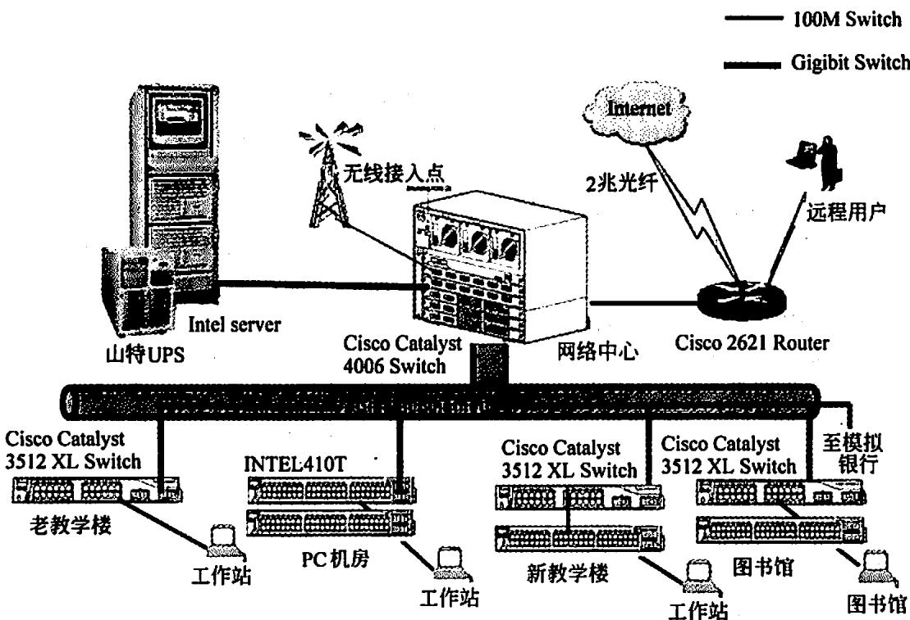
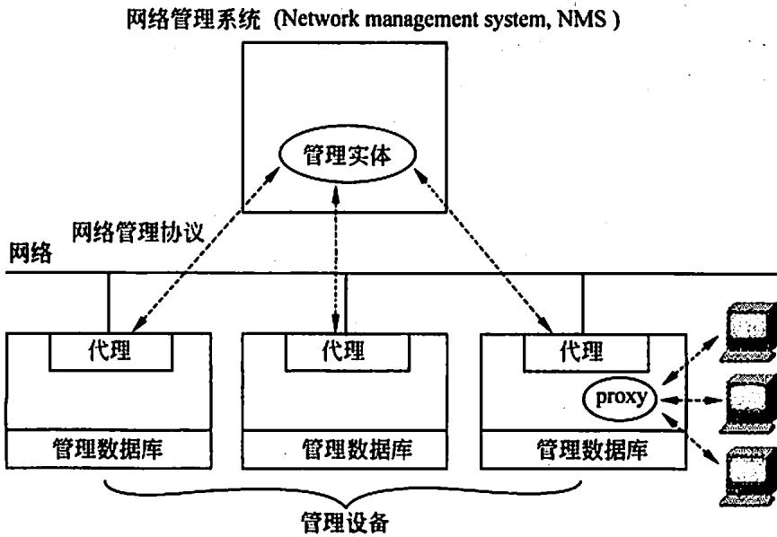

>[!warning] 版本提示
>本书为 **2006 年第 1 版**。现行考试依据是 **《信息系统管理工程师教程（第 2 版）》**（清华社 2024-10，20 章），
>两版**重合极少**：第 1 版的第 1–6 章（硬件/操作系统/语言/配置/数据结构/多媒体）在第 2 版已被删除或压缩。
>本页仅作**扩展参考**，备考请以 [[知识体系]]（第 2 版官方考纲）为准。

# 第18章 资源管理

## 18.1 资源管理概述

## 18.1.1 资源管理概念

IT 资源管理就是洞察所有的 IT 资产（从 PC 服务器、Unix 服务器到主机软件、生产经营数据），并进行有效管理。整体洞察能力允许当前 IT 部门执行业务职能而非成本中心职能，这样可以提升自身价值并与它支持的企业合作以增加利润。资源管理可以整合 IT 资产管理及其部署；资产目录和发现；资产对账；软件许可管理；软硬件的维护、移植和处理；IT 财务管理等功能，并用每一项功能来提升整个生命周期的每一项资产的成本效益。

IT 资产管理解决方案可提供完整的洞察力，可以跨 IT 资产及其硬件和软件元素整个生命周期的每个阶段进行洞察。通过全方位的配置控制、业务报表和分析，实现成本控制、效率提升和最大的投资回报。IT 资产管理包括：为所有内外部资源（包括台式机、服务器、网络、存储设备）提供广泛的发现和性能分析功能，实现资源的合理使用和重部署；提供整体软件许可管理（目录和使用），包括更复杂的数据库和分布式应用；提供合同和厂商管理，可以减少文案工作，如核对发票、控制租赁协议、改进并简化谈判过程；影响分析、成本分析和财政资产管理（包括 ROI 报表），为业务环境提供适应性支持、降低操作环境成本。

## 18.1.2 配置管理

IT 资源管理可以为企业的 IT 系统管理提供支持，而 IT 资源管理能否满足要求在很大程度上取决于 IT 基础架构的配置及运行情况的信息。配置管理就是专门负责提供这方面信息的流程。配置管理提供的有关基础架构的配置信息可以为其他服务管理流程提供支持，如故障及问题管理人员需要利用配置管理流程提供的信息进行事故和问题的调查和分析，性能及能力管理需要根据有关配置情况的信息来分析和评价基础架构的服务能力和可用性。

配置管理中，最基本的信息单元是配置项（Configuration Item，CI）。所有软件、硬件和各种文档，比如变更请求、服务、服务器、环境、设备、网络设施、台式机、移动设备、应用系统、协议、电信服务等都可以被称为配置项。所有有关配置项的信息都被存放在配置管理数据库（CMDB）中。需要说明的是，配置管理数据库不仅保存了IT基础架构中特定组件的配置信息，而且还包括了各配置项相互关系的信息。配置管理数据库需要根据变更实施情况进行不断地更新，以保证配置管理中保存的信息总能反映 IT 基础架构的现时配置情况以及各配置项之间的相互关系。

具体而言，配置管理作为一个控制中心，其主要目标表现在4个方面：

\- 计量所有IT资产。

\- 为其他IT系统管理流程提供准确信息。

\- 作为故障管理、变更管理和新系统转换等的基础。

\- 验证基础架构记录的正确性并纠正发现的错误。

通过实施配置管理流程，可为客户和服务提供方带来多方面的效益，举例如下。

（1）有效管理 IT 组件。IT 组件是 IT 服务的基础。每个服务涉及一个或者多个配置项，通过配置管理可以了解这些配置项发生变动的情况。特别是在某个配置项丢失的时候，配置管理可以帮助 IT 管理人员了解这个配置项的所有人、责任人和应有的状况，从而方便用其他恰当的 IT 组件加以替换。

（2）提供高质量的 IT 服务。配置管理可协助处理变更、发现和解决问题以及提供用户支持，减少了出现错误的次数，避免了不必要的重复工作，从而提高了服务质量、降低了服务成本。

（3）更好地遵守法规。配置管理可维护关于 IT 基础架构中的所有软件的清单，从而可以实现两个目的：一是防止使用非法的软件复制，二是防止使用包含病毒的软件。

（4）帮助制定财务和费用计划。配置管理提供所有配置项的完整列表，根据这份列表我们能够很容易地计算维护和软件许可费用，了解软件许可证过期日期和配置项失效时间以及替换配置项成本。这些信息有助于财务计划的制定。

在 IT 资源管理及其关键的配置管理有所了解后，下面分别对硬件管理、软件管理、数据管理、网络管理、设施及设备管理予以介绍。

## 18.2 硬件管理

## 18.2.1 硬件管理的范围

近年来，企业 IT 资源管理（或称系统管理、系统网络管理、系统资源管理，等等）逐渐成为广大 CEO（企业首席行政主管）与 CIO（企业首席信息主管）所谈论的话题。有效的企业（IT）管理一定是从 CEO/CIO 自身的需求出发，真正反映用户需求，为用户解决实际管理难题，获得企业效益的解决方案。

众所周知，信息技术产业（Information Technology, IT）的发展历程就是企业 CEO/CIO 需求发展的过程。从我们引进先进的硬件产品，到购买数据库软件及应用软件，到现在的大量进行的网络基础建设，无一不是由企业的需求所引导的。

进行 IT 资源管理, 首先第一步就是识别企业待管理的硬件有哪些? 弄清企业的硬件设备有哪些? 有哪些设备需要被管理? COBIT 中定义的 IT 资源如下。

（1）数据。是最广泛意义上的对象（如外部和内部的）、结构化及非结构化的、图像、各类数据。

（2）应用系统。人工处理以及计算机程序的总和。

（3）技术。包括硬件、操作系统、数据库管理系统、网络、多媒体等。

（4）设备。包括所拥有的支持信息系统的所有资源。

（5）人员。包括员工技能，意识、以及计划、组织、获取、交付、支持和监控信息系统及服务的能力。

因此，应该对企业的中央计算机以及外部设备进行统计，并且记录下来各计算机和设备的位置信息、配置信息、购买信息、责任人以及使用状况等。然后再记录分布在各个现场的计算机和外部设备，认真清理，并做好相应的设备的纪录——配置信息、位置信息、购买信息、责任人、使用状况等。并且对于以后新购买的计算机与外部设备都应做好相应的记录，将记录登记到系统的硬件登记表中，如图18-1所示。对于损毁的部分应该相应地删除，这样便于对企业的信息系统资产的硬件进行管理。

<table><tr><td>设备位置</td><td>设备名称</td><td>设备编号</td><td>配置信息</td><td>购买时间</td><td>经销商</td><td>保修时间</td><td>价值</td><td>使用状况</td><td>责任人</td><td>备注</td></tr><tr><td></td><td></td><td></td><td></td><td></td><td></td><td></td><td></td><td></td><td></td><td></td></tr><tr><td></td><td></td><td></td><td></td><td></td><td></td><td></td><td></td><td></td><td></td><td></td></tr><tr><td></td><td></td><td></td><td></td><td></td><td></td><td></td><td></td><td></td><td></td><td></td></tr><tr><td></td><td></td><td></td><td></td><td></td><td></td><td></td><td></td><td></td><td></td><td></td></tr><tr><td></td><td></td><td></td><td></td><td></td><td></td><td></td><td></td><td></td><td></td><td></td></tr><tr><td colspan="11">登记人:登记时间:</td></tr></table>

图 18.1 系统硬件登记表

认真识别和清理企业的硬件设备，对企业的信息系统的资产进行管理，便于以后企业资产的管理。一般管理的硬件包括企业所购买的和保管的各种硬件设备（服务器、交换机、计算机、磁盘、打印机、复印机、扫描仪、刻录机、摄像机、录像机、照相机等）。

识别清楚了有哪些资源需要被管理之后，就应该开始对待管理的资源进行管理准备工作，对于硬件资源应逐步进行登记管理，记录相关资产。

## 18.2.2 硬件配置管理

在配置管理中，"配置"和"配置项"是重要的概念，"配置"是在技术文档中明确说明并最终组成软件产品的功能或物理属性。因此"配置"包括了即将受控的所有产品特性，其内容及相关文档、软件版本、变更文档、硬件运行的支持数据，以及其他一切保证硬件一致性的组成要素，相对与硬件类配置，软件产品的"配置"包括更多的内容并具有易变性。

硬件经常被划分为各类配置项（Configuration Item，CI），这类划分是进行硬件配置管理的基础和前提，CI 是逻辑上组成软件系统的各组成部分。一个系统包括的 CI 的数目是一个与设计密切相关的问题，如果一个产品同时包括硬件和软件部分，一般一个 CI 也同时包括软件和硬件部分。

各 CI 随软件开发活动的进展，会有越来越多的部件进入受控状态。硬件配置管理包括了对各 CI 进行标识并对它们的配置的修改和控制的过程。在变更完成后，要对相应的 CI 进行基线化并形成各类基线。在配置管理系统中，基线就是一个 CI 或一组 CI 在其生命周期的不同时间点上通过正式评审而进入正式受控的一种状态，而这个过程被称为"基线化"。每一个基线都是其下一步开发的出发点和参考点。每个基线都将接受配置管理的严格控制，对其的修改将严格按照变更控制要求的过程进行，上一个基线加上增加和修改的基线内容形成下一个基线，这就是"基线管理"的过程，因此基线具有以下属性：

（1）通过正式的评审过程建立，基线存在于基线库中，对基线的变更接受更高权限的控制，基线是进一步开发和修改的基准和出发点。

(2) 第一个基线包含了通过评审的软件需求, 因此称之为 "需求基线", 通过建立这样一个基线, 受控的系统需求成为进一步软件开发的出发点, 对需求的变更被正式初始化、评估。受控的需求还是对软件进行功能评审的基础。

注意：在硬件的更新阶段，应出具相应的硬件更新报告、存档，并更改硬件登记表。

## 18.2.3 硬件资源维护

所有硬件设备必须由专人负责管理；管理员必须定期对各种办公设备进行清理检查，确保设备处于正常使用状态；用电设备要按时进行线路检查，防止漏电、打火现象，确保设备、库房的安全，对故障设备应随时登记，并及时向上级汇报后妥善处理。

所有硬件设备应该严格遵循部门制定的硬件管理条例。例如：一律不得擅自外借或挪作非工作事务之用；非本部门人员未经许可不得擅自使用本部门设备及软件；严禁擅自对计算机中的任何数据、程序进行删改，等等。

硬件设备在平时应该定期进行清点和检测，发现有问题的应该及时进行处理。硬件系统应定期进行备份，备份的硬盘要妥善保管、做好标签，以防数据丢失。经常使用的硬件设备应得到清洁和维护。各种设备使用说明、保修卡、用户手册等相关文字材料也应由管理员统一收集整理后立卷归档。

## 18.3 软件管理

## 18.3.1 软件管理的范围

软件资源就是指企业整个环境中运行的软件和文档，其中程序包括操作系统、中间件、市场上买来的应用、本公司开发的应用、分布式环境软件、服务与计算机的应用软件以及所提供的服务等，文档包括应用表格、合同、手册、操作手册等。软件管理系统必须将它们表示出来，才能对其进行管理。软件资源管理，是指优化管理信息的收集，对企业所拥有的软件授权数量和安装地点进行管理。还包括软件分发管理，指的是通过网络把新软件分发到各个站点，并完成安装和配置工作。

要进行企业的软件资源管理，首先就要先识别出企业中的运行的软件和文档，将其归类汇总、登记入档。

在项目管理中，软件资源可重用的程度是 CMM 衡量的一个重要指标。众所周知，提高软件的重用度也是每一家软件公司所追求的。

首先要搞清楚自己的家底。把各个项目组的负责人召集在一起，把有重用价值的软件模块或控件收集起来，再把相关的资料组织在一起，标注说明、建立索引、由专人负责管理，可重用模块的升级和完善都要建立完整的档案资料，在升级档案中要记录升级前后的主要区别。为重用模块做出贡献的个人都要被记录在册。一个项目在做系统设计任务书时，就要考虑有哪些以往的软件资源可以利用？新一轮的开发有那些功能可以做成可重用模块。这样才能很好地管理企业的软件资源。

## 18.3.2 软件生命周期和资源管理

软件生命周期指软件开发全部过程、活动和任务的结构框架。软件开发包括发现、定义、概念、设计和实现阶段。

选择一个适当的软件生命周期对项目来说至关重要。在项目策划的初期，就应该确定项目所采用的软件生命周期，统筹规划项目的整体开发流程。一个组织通常能为多个客户生产软件，而客户的要求也是多样化的，一种软件生命周期往往不能适合所有的情况。常见的软件生命周期如表 18-1 所示。

表 18-1 常见的软件生命周期

<table><tr><td>软件生命周期</td><td>优点</td><td>缺点</td><td>适合项目</td></tr><tr><td>瀑布模型</td><td>强调开发的阶段性;强调早期计划及需求调查;强调产品测试</td><td>依赖于早期进行的需求调查,不能适应需求的变化;单一流程,开发中的经验教训不能反馈应用于本产品的过程;风险通常到开发后期才能显露,失去及早纠正的机会</td><td>需求简单清楚,在项目初期就可以明确所有的需求;阶段审核和文档控制要求做好;不需要二次开发</td></tr><tr><td>迭代模型</td><td>开发中的经验教训能及时反馈;信息反馈及时;销售工作有可能提前进行;采取早期预防措施,增加项目成功的机率</td><td>如果不加控制地让用户接触开发中尚未测试稳定的功能,可能对开发人员及用户都产生负面的影响</td><td>事先不能完整定义产品的所有需求;计划多期开发</td></tr><tr><td>快速原型开发</td><td>直观、开发速度快</td><td>设计方面考虑不周全</td><td>需要很快给客户演示的产品</td></tr></table>

软件开发的生命周期包括两方面的内容，首先是项目应包括哪些阶段，其次是这些阶段的顺序如何。一般的软件开发过程包括：需求分析（RA）、软件设计（SD）、编码（Coding）及单元测试（Unit Test）、集成及系统测试(Integration and System Test)、安装(Install)、实施(Implementation)等阶段。

维护阶段实际上是一个微型的软件开发生命周期，包括：对缺隙或更改申请进行分析即需求分析（RA）、分析影响即软件设计（SD）、实施变更即进行编程（Coding），然后进行测试（Test）。在维护生命周期中，最重要的就是对变更的管理。软件维护是软件生命周期中持续时间最长的阶段。在软件开发完成并投入使用后，由于多方面的原因，软件不能继续适应用户的要求。要延续软件的使用寿命，就必须对软件进行维护。软件的维护包括纠错性维护和改进性维护两个方面。

## 18.3.3 软件构件管理

软件构件是软件系统的一个物理单元，它驻留在计算机中而不是只存在于系统分析员的脑海里。像数据表、数据文件、可执行文件、动态链接库、文档等都可以被称为构件。构件有几个基本属性：

（1）构件是可独立配置的单元，因此构件必须自包容。

（2）构件强调与环境和其他构件的分离，因此构件的实现是严格封装的，外界没机会或没必要知道构件内部的实现细节。

（3）构件可以在适当的环境中被复合使用，因此构件需要提供清楚的接口规范，可以与环境交互。

(4) 构件不应当是持续的, 即构件没有个体特有的属性, 理解为构件不应与其有区别, 在任何环境中, 最多仅有特定构件的一份副本。

可以看出，构件沿袭了对象的封装特性，但同时并不局限于一个对象，其内部可以封装一个或多个类、原型对象甚至过程，其结构是灵活的。构件突出了自包容和被包容的特性，这就是在软件生产线上作为零件的必要特征。

软件构件要想在实际工作中得到有效利用，还离不开软件平台的支持。这个软件平台包括构件的运行支撑环境、构件开发/组装环境、构件管理环境和基于构件的开发方法以及开发过程等。在这个软件平台上，用户可以按照自己的需求，选择适合的基础服务模块或高级服务模块，按照一定管理模式搭建出一个基础的框架。这个框架承载的就是软件构件模块。基础框架和软件构件模块，共同构成了基础框架平台。例如，微软公司的 COM 就利用 Windows 系统注册表配合几种唯一标识构件的方式，实现了构件的登记、注销、定位。CORBA 规范中有接口池、实现池等规范定义，配合应用登记管理的机制，也能对应用构件实施管理。

## 18.3.4 软件分发管理

当前，IT 部门需要处理的日常事务大大超过了他们的承受能力，他们要跨多个操作系统部署安全补丁和管理多个应用。在运营管理层面上，他们不得不规划和执行操作系统移植、主要应用系统的升级和部署。这些任务在大多数情况下需要跨不同地域和时区在多个硬件平台上完成。如果不对这样的复杂性和持久变更情况进行管理，将导致整体生产力下降，额外的部署管理成本将远远超过软件自身成本。因此，软件分发管理是基础架构管理的重要组成部分，可以提高 IT 维护的自动化水平，实现企业内部软件使用标准化，并且大大减少维护 IT 资源的费用。

技术在飞速发展，企业需要不断升级或部署新的软件来保持业务应用的适应性和有效性。在企业范围内，手工为每个业务系统和桌面系统部署应用和实施安全问题修复已经成为过去。软件分发管理的支持工具可以自动完成软件部署的全过程，包括软件打包、分发、安装和配置等，甚至在特定的环境下可以根据不同事件的触发实现软件部署的回滚操作。在相应的管理工具的支持下，软件分发管理可以自动化或半自动化地完成下列软件分发任务。

## 1. 软件部署

IT 系统管理人员可将软件包部署至遍布网络系统的目标计算机，对它们执行封装、复制、定位、推荐和跟踪。软件包还可在允许最终用户干预或无需最终用户干预的情况下实现部署，而任何 IT 支持人员均不必亲身前往。

无论软件产品是像 Windows XP Professional 这样的操作系统、像 Microsoft Office 这样的完整应用套件，还是由第三方厂商提供的软件或重要的 Windows 系统更新，均可确保软件处于即时更新状态并降低所需的工作量。

## 2. 安全补丁分发

随着 Windows 等操作系统的安全问题越来越受到大家的关注，每隔一段时间微软都要发布修复系统漏洞的补丁，但很多用户仍不能及时使用这些补丁修复系统，在病毒爆发时就有可能造成重大损失。通过结合系统清单和软件分发，安全修补程序管理功能能够显示计算机需要的重要系统和安全升级，然后有效地分发这些升级。并就每台受控计算机所需安全修补程序做出报告，保障了基于 Windows 的台式机、膝上型计算机和服务器安全。

## 3. 远程管理和控制

对于 IT 部门来说, 手工对分布空间很大的个人计算机进行实际的操作将是繁琐而效率低下的。有了远程诊断工具, 可帮助技术支持人员及时准确获得关键的系统信息, 这样他们就能花费较少的时间诊断故障并以远程方式解决问题。

## 18.3.5 文档管理

软件文档（document）也被称为文件，通常指的是一些记录的数据和数据媒体，它具有固定不变的形式，可被人和计算机阅读。它和计算机程序共同构成了能完成特定功能的计算机软件（有人把源程序也当作文档的一部分）。软件文档的编制（documentation）在软件开发工作中占有突出的地位和相当大的工作量。高效率、高质量地开发、分发、管理和维护文档对于转让、变更、修正、扩充和使用文档，对于充分发挥软件产品的效益都有着重要意义。

在整个软件生存期中，各种文档作为半成品或最终成品，会不断地生成、修改或补充。为了最终得到高质量的产品，必须加强对文档的管理。应注意做到以下几点：

（1）软件开发小组应设一位文档保管人员，负责集中保管本项目已有文档的两套主文本。两套文本内容完全一致。其中的一套可按一定手续，办理借阅。

（2）软件开发小组的成员可根据工作需要在自己手中保存一些个人文档。一般都应是主文本的复制件，并注意和主文本应保持一致，在做必要的修改时，也应先修改主文本。

（3）开发人员个人只保存着主文本中与他工作相关的部分文档。

（4）在新文档取代了旧文档时，管理人员应及时注销旧文档。在文档内容有变动时，管理人员应随时修订主文本，使其及时反映被更新了的内容。

（5）项目开发结束时，文档管理人员应收回开发人员的个人文档。发现个人文档与主文本有差别时，应立即着手解决。这常常是由未及时修订主文本而造成的。

(6) 在软件开发过程中, 可能发现需要修改已完成的文档, 特别是规模较大的项目, 对主文本的修改必须特别谨慎。修改以前要充分估计修改可能带来的影响, 并且要按照提议、评议、审核、批准和实施等步骤加以严格控制。

常见的文档管理工具有 PVCS、Microsoft VSS、Winnote 等。

## 18.3.6 软件资源的合法保护

个人计算机功能的不断翻新，带动了软件开发行业的发展。资源共享已经不再是一个难题。然而，这却使专业的软件开发公司面临着一大难题，那就是他们在不断地投下人力、物力、财力的情况下，却必须承受非法盗版带来的损失。于是，不断出台了一些知识产权保护的办法，来保证公司的正常运营。例如公司间购买软件或者外包业务会分别签订"购买/租用软件许可合同"和"软件开发外包合同"等合同用于保障公司的权益。同时，国家也在出台一系列的政策法规来保护版权。例如我国修订并出台了《计算机软件保护条例》

用于保护知识产权等。

软件资源的状况报告可对哪些应用程序由哪些用户使用、使用多久和基于哪些受控系统等情况加以描述。可对用户或计算机的使用情况进行跟踪，而生成的报告则可将并发使用情况数据与当前许可证所有权进行对比。这有助于将已购买软件同已使用软件进行对照调整，以便做出更加明智的远期采购决策。

## 18.4 网络资源管理

## 18.4.1 网络资源管理的范围

随着企业信息化的不断深入，企业一方面希望众多部门、用户之间能共享信息资源，另一方面也希望各计算机之间能互相传递信息进行通信。这促使了企业信息化向网络化发展，将分散的计算机连接成网、组成计算机网络。

所谓计算机网络，就是把分布在不同地理区域的计算机与专门的外部设备用通信线路互联成一个规模大、功能强的网络系统，从而使众多的计算机可以方便地互相传递信息，共享硬件、软件、数据信息等资源。通俗来说，网络就是通过电缆、电话线，或无线通信等互联的计算机的集合。

因此，企业资产管理里面又增加了企业网络资源管理。要进行企业网络资源管理，首先就要识别目前企业包含哪些网络资源。这里主要识别的是以下几类。

（1）通信线路。即企业的网络传输介质。目前常用的传输介质有双绞线、同轴电缆、光纤等。

（2）通信服务。指的是企业网络服务器。运行网络操作系统，提供硬盘、文件数据及打印机共享等服务功能，是网络控制的核心。目前常见的网络服务器主要有 Netware、Unix 和 Windows NT 三种。

（3）网络设备。计算机与计算机或工作站与服务器进行连接时，除了使用连接介质外，还需要一些中介设备，这些中介设备就是网络设备。主要有网络传输介质互联设备（T型连接器、调制解调器等）、网络物理层互联设备（中继器、集线器等）、数据链路层互联设备（网桥、交换器等）以及应用层互联设备（网关、多协议路由器等）。

（4）网络软件。企业所用到的网络软件。例如网络控制软件、网络服务软件等。

对于企业网络资源应该进行清点，登记在册，定期进行盘点和维护。

## 18.4.2 网络资源管理与维护

识别完待管理的网络资源之后，下一步需要进行的就是网络资源的登记管理，管理员将网络资源分门别类地记录下来，方便企业资产的管理。应定期记下网络资源的设备材料单、开机/停机情况、位置、成本历史记录、保修期、读数、检验路线、安全方案以及资产单据等信息，可以用来将效率与资产寿命最大化。

在登记过程中，应该按照一定的网络设备命名规则和标准给网络的各个设备标上名称，以方便管理。例如通信线路用 line-double-0001，网络软件用 netsoft-micro-0001，等等。

当前计算机网络的发展特点是规模不断扩大，复杂性不断增加，异构性越来越高。一个网络往往由若干个大大小小的子网组成，集成了多种网络系统（NOS）平台，并且包括了不同厂家、公司的网络设备和通信设备等。同时，网络中还有许多网络软件用于提供各种服务。随着用户对网络性能要求的提高，网络资源的维护管理对网络的发展有着很大的影响，并已成为现代信息网络中最重要的问题之一。

一般说来，网络资源维护管理就是通过某种方式对网络资源进行调整，使网络能正常、高效地运行。其目的就是使网络中的各种资源得到更加高效地利用，当网络出现故障时能及时做出报告和处理，并协调、保持网络的高效运行等。一般而言，网络维护管理有5大功能，它们是：网络的失效管理、网络的配置管理、网络的性能管理、网络的安全管理、网络的计费管理。这5大功能包括了保证一个网络系统正常运行的基本功能。

现代计算机网络维护管理系统主要由 4 个要素组成：若干被管理的代理（Managed Agents）；至少一个网络维护管理器（Network Manager）；一种公共网络维护管理协议（Network Management Protocol）；一种或多种管理信息库（Management Information Base, MIB）。其中网络维护管理协议是最重要的部分，它定义了网络维护管理器与被管理代理间的通信方法，规定了管理信息库的存储结构、信息库中关键字的含义以及各种事件的处理方法。目前有影响的网络维护管理协议是 SNMP（Simple Network Management Protocol）和 CMIS/CMIP（the Common Management Information Service/Protocol）。

根据企业网络应用情况，企业局域网可执行每天8小时运行制或每天24小时运行制。但在网络运行期间，企业一定要安排技术人员值班，以便随时处理网络故障、解决网络问题、保持网络畅通、提高网络的可用性和可靠性水平。网络值班可分为现场值班和呼叫（BP机、手机等）值班两种形式：在法定工作时间，应实行现场值班，值班地点最好在网络中心；晚上或节假日期间，视网络应用情况，可设置现场值班或呼叫值班。网络值班要明确职责，规定在正常情况下值班人员应该做些什么工作，在异常情况下又将如何应对，如何填写值班记录和值班交接记录等。

## 18.4.3 网络配置管理

网络配置管理是指管理员对企业所有网络设备的配置的统一管理，通过监控网络和系统配置信息，可以跟踪和管理各种版本的硬件和软件元素的网络操作。目前，管理员大多通过登录方法对网络设备进行配置，并利用设备提供的配置命令完成配置工件。这也是唯一能够完成所有配置任务的方式。设备的制造商会针对不同型号的设备推出一些辅助的配置管理软件工具，简化设备的配置过程。但这往往只能实现部分配置功能，而且只针对特定型号的设备，既缺乏通用性，又没有太大的意义。由于设备的配置参数、方式没有通用的标准和协议，所以没有通用的设备配置管理软件，管理员只能通过各自产品的软件对所有设备进行分别配置。

网络配置管理主要涉及网络设备（网桥、路由器、工作站、服务器、交换机……）的设置、转换、收集和修复等信息。

为了便于日常管理，一般采用网络设备配置图与连接图的方式，如图 18-2 所示，将整个系统的网络情况绘制成一张系统网络配置连接图，以方便管理员掌握整个网络系统。任何大小的网络流量都处于常量（Constant State）状态。任何网络工程师都可以随时更换交换机和路由器的配置。配置更换会对网络可靠性及服务造成破坏性影响。网络配置管理的目标是节约用户时间并降低网络设备误配置引起的网络故障。网络配置管理系统允许用户控制网络变换，简化网络管理工作并迅速修复配置差错。

  
图 18-2 网络配置连接图

配置适当设备与网络安全性之间具有直接关系。当今网络配置管理方案主要注重于实现网络自动转换处理、安全保护和设备管理等。无论配置更换是由恶意攻击、手动修正差错引起，还是由网络产品本身的缺限所引起，都会使设备易于遭受攻击并因此影响商业运行。

目前，基本上有两种主要的网络配置工具：一种是由设备供应商提供的工具；另一种

是由第三方公司提供的工具。

由供应商提供的工具，如思科的产品，只能与他们自己的对应设备（思科设备）共同使用，这对于同种设备的情形（配置采用单个供应商的设备）而言是个很好的选择。

通常网络中采用的是由多供应商提供的一系列设备。在这种情形下，由第三方公司提供的包含多供应商设备的工具将是一个很好的选择。

## 18.4.4 网络管理

网络管理包含 5 部分：网络性能管理、网络设备和应用配置管理、网络利用和计费管理、网络设备和应用故障管理以及安全管理。ISO 建立了一套完整的网络管理模型，其中包含了以上 5 部分的概念性定义。

（1）性能管理。衡量及利用网络性能，实现网络性能监控和优化。网络性能变量包括网络吞吐量、用户响应次数和线路利用。换句话说，就是管理员通过对网络、系统产生的报表数据进行实时地分析与管理。

（2）配置管理。监控网络和系统配置信息，从而可以跟踪和管理各种版本的硬件和软件元素的网络操作。

（3）计费管理。衡量网络利用、个人或小组网络活动，主要负责网络使用规则和账单等。

（4）故障管理。负责监测、日志、通告用户、（一定程度上可能）自动解决网络问题，以确保网络的高效运行，这是因为故障可能引起停机时间或网络退化等。故障管理在 ISO 网络管理单元中是使用最为广泛的一个部分。

(5) 安全管理。控制网络资源访问权限, 从而不会导致网络遭到破坏。只有被授权的用户才有权访问敏感信息。安全管理主要涉及访问控制或网络资源管理。访问控制管理指的是安全性处理过程, 即妨碍或促进用户或系统间的通信, 支持各种网络资源, 如计算机、Web 服务器、路由器或任何其他系统或设备间的相互作用。认证过程主要包含认证和自主访问控制 (Discretionary Access Control) 两个步骤。

常见的网络管理协议主要有由 IETF 定义的简单网络管理协议（SNMP）。远程监控（RMON）是 SNMP 的扩展协议；另一种是由 ISO 定义的通用管理信息协议（CMIP）。典型地，网络管理系统包括两部分：探测器 Probe（或代理），主要负责收集众多网络节点上的数据；控制台 Console，主要负责集合并分析探测器收集的数据，提取有用信息和报告。网络管理结构如图 18-3 所示。

## 18.4.5 网络审计支持

一般来说，网络审计的定义有狭义和广义之分，其中，狭义的网络审计指借助电子计算机的先进的数据处理技术和联网技术，以磁性介质作为主要载体来存储数据以便于用网络来处理、传送、查阅这些数据，使审计工作与计算机网络组成一个有机的整体，从而提高审计的现代化水平。而广义的网络审计是指在网络环境下，借助大容量的信息数据库，并运用专业的审计软件对共享资源和授权资源进行实时、在线地个性化审计服务。

  
图18-3 网络管理的结构

在网络经济时代里，电子商务的普及、虚拟企业的不断涌现，使得企业的运作机制发生了根本性改变。作为对企业经营进行监控的审计机构，同样需要建立起适应自身业务系统的集硬件平台、软件平台、网络平台和数据平台于一体的网络化操作平台，并对数据进行仓库式管理和挖掘分析。

网络审计信息系统的运作网络审计信息系统的结构是构建于计算机技术、数据库技术、Internet / Intranet 等现代信息技术基础之上的，旨在满足客户的信息需求。它将经济事项信息通过 Internet、EDI 或者虚拟专用网传递到并保存在信息数据库中，这些信息包括财务信息，也包括非财务信息。然后通过交互式报告生成器，实现信息系统与客户和外界信息使用者之间的交流。

网络安全技术和机制的建立作为一种网络化运营模式而存在，与其他行业的电子商务交易模式一样，同样需要对网络的安全性进行实时监控和维护，这也是网络审计得以产生和发展的必要技术基础。对于网络安全，首先必须具有一个安全、可靠的通信网络，以保证数据信息安全、快速地被传递；其次，要求对数据库服务器有绝对的控制权，禁止未授权客户和黑客的闯入、盗窃和破坏数据信息。网络审计不管从审计软件和数据库等方面都要利用安全技术，并建立起一套安全机制，以保障网络审计的安全。对于安全机制，主要包括接入管理、安全监视和安全恢复等三方面。首先对于接入管理，主要用于处理好身份鉴别（身份真伪和权限）和接入控制，以控制信息资源的使用；其次是安全监视，主要功能有安全报警设置、安全报警报告以及检查跟踪；最后是安全恢复，主要是及时恢复因网络故障而丢失的信息。对于安全技术而言，主要可以使用防火墙、数据认证、数据加密等技术；另外还可以将不断开发出的新型安全技术及时地应用于网络审计中，如将隧道技术充分地运用于虚拟专用网（VPN）等。因此在安全的网络技术和安全机制的控制下，网络审计的产生和发展从技术层面上奠定了坚实的基础。

## 18.5 数据管理

## 18.5.1 数据生命周期

在数据的整个生命周期中，不同的数据需要不同水平的性能、可用性、保护、迁移、保留和处理。通常情况下，在其生命周期的初期，数据的生成和使用都需要利用高速存储，并相应地提供高水平的保护措施，以达到高可用性和提供相当等级的服务水准。随着时间的推移，数据的重要性会逐渐降低，使用频率也会随之下降。伴随着这些变化的发生，企业就可以将数据进行不同级别的存储，为其提供适当的可用性、存储空间、成本、性能和保护，并且在整个生命周期的不同阶段都能对数据保留进行管理。

数据的安全性管理是数据生命周期中的一个比较重要的环节。在进行数据输入和存取控制的时候，企业必须首先保证输入数据的数据合法性。要保证数据的安全性，必须保证数据的保密性和完整性，主要表现在以下5个方面：

（1）用户登录时的安全性。从用户登录网络开始，对数据的保密性和完整性的保护就应该开始了。

(2) 网络数据的保护。包括在本地网络上的数据或者穿越网络的数据。在本地网络的数据是由验证协议来保证其安全性的。

（3）存储数据以及介质的保护。可以采用数字签名来签署软件产品（防范运行恶意的软件），或者加密文件系统。

（4）通信的安全性。提供多种安全协议和用户模式的、内置的集成支持。

(5) 企业和 Internet 网的单点安全登录。

随着时间的推移，大部分数据将不再会被用到。一般情况下，一些无用的数据将被删除以节省空间，或者将有用的数据无限期地存储，以避免数据损失。

## 18.5.2 信息资源管理

信息资源管理（Information Resource Management，IRM）是对整个组织信息资源开发利用的全面管理。IRM 把经济管理和信息技术结合起来，使信息作为一种资源而得到优化地配置和使用。上次我们在谈企业信息化的任务时，说开发信息资源既是企业信息化的出发点，又是企业信息化的归宿；只有高档次的数据环境才能发挥信息基础设施作用、建立集成化的信息系统、落实信息资源的开发和利用。因此，从 IRM 的技术侧面看，数据环境建设是信息资源管理的重要工作。

企业信息资源管理不是把资源整合起来就行了，而是需要一个有效的信息资源管理体系,其中最为关键的是从事信息资源管理的人才队伍建设；其次，是架构问题，在信息资源建设阶段，规划是以建设进程为主线的，在信息资源管理阶段，规划应是以架构为主线，主要涉及的是这个信息化运营体系的架构，这个架构要消除以往分散建设所导致的信息孤岛，实现大范围内的信息共享、交换和使用，提升系统效率，达到信息资源的最大增值；技术也是一个要素，要选择与信息资源整合和管理相适应的软件和平台；另外一个就是环境要素，主要是指标准和规范，信息资源管理最核心的基础问题就是信息资源的标准和规范。

## 18.5.3 数据管理

企业信息资源开发利用做得好坏的关键人物是企业领导和信息系统负责人。IRM 工作层上的最重要的角色就是数据管理员（Data Administrator，DA）。数据管理员负责支持整个企业目标的信息资源的规划、控制和管理；协调数据库和其他数据结构的开发，使数据存储的冗余最小而具有最大的相容性；负责建立有效使用数据资源的标准和规程，组织所需要的培训；负责实现和维护支持这些目标的数据字典；审批所有对数据字典做的修改；负责监督数据管理部门中的所有职员的工作。数据管理员应能提出关于有效使用数据资源的整治建议，向主管部门提出不同的数据结构设计的优缺点忠告，监督其他人员进行逻辑数据结构设计和数据管理。

数据管理员还需要有良好的人际关系：善于同中高层管理人员一起制定信息资源的短期和长期计划。在数据结构的研制、建立文档和维护过程中，能与项目领导、数据处理人员和数据库管理员协同工作。能同最终用户管理部门一起工作，为他们提供有关数据资源的信息。

一般来说，由数据管理员对日常数据进行更新和维护。数据库为了保证存储在其中的数据的安全和一致，必须有一组软件来完成相应的管理任务，这组软件就是数据库管理系统，简称 DBMS，DBMS 随系统的不同而不同，但是一般来说，它应该包括数据库描述功能、数据库管理功能、数据库的查询和操纵功能、数据库维护功能等。为了提高数据库系统的开发效率，现代数据库系统除了 DBMS 之外，还提供了各种支持应用开发的工具。

目前许多厂商提供了相应的 DBMS，便于数据管理员对底层的数据进行维护。例如 MySQL、东软的 OpenBase、金仓的 KingbaseES 等。

## 18.5.4 公司级的数据管理

如何进行信息资源规划？信息资源规划主要可以概括为"建立两种模型和一套标准"。"两种模型"是指信息系统的功能模型和数据模型，"一套标准"是指信息资源管理基础标准。信息系统的功能模型和数据模型，实际上是用户需求的综合反映和规范化表达；信息资源管理基础标准是进行信息资源开发利用的最基本的标准，这些标准都要体现在数据模型之中。

企业信息化的最终目标是实现各种不同业务信息系统间跨地域、跨行业、跨部门的信息共享和业务协同，而信息共享和业务协同则是建立在信息使用者和信息拥有者对共享数据的涵义、表示及标识有着相同的而无歧义的理解基础上。然而，由于各部门、各行业及各应用领域对于相同的数据概念有着不同的功能需求和不同的描述，从而导致了数据的不一致性。数据的不一致性主要表现为：数据名称的不一致性、数据长度的不一致性、数据表示的不一致性以及数据含义的不统一性。

数据标准化是一种按照预定规程对共享数据实施规范化管理的过程。数据标准化的对象是数据元素和元数据。数据元素是通过定义、标识、表示以及允许值等一系列属性描述的数据单元，是数据库中表达实体及其属性的标识符。在特定的语义环境中，数据元素被认为是不可再分的最小数据单元。元数据是描述数据元素属性（即语义内容）的信息，并被存储在数据元素注册系统（又称数据字典）中。数据元素注册系统通过对规范化的数据元素及其属性（即元数据）的管理，可以有效实现用户跨系统和跨环境的数据共享。数据标准化主要包括业务建模阶段、数据规范化阶段、文档规范化阶段等三个阶段。

数据标准化是建立在对现实业务过程全面分析和了解的基础上的，并以业务模型为基础的。业务建模阶段是业务领域专家和业务建模专家按照《业务流程设计指南》，利用业务建模技术对现实业务需求、业务流程及业务信息进行抽象分析的过程，从而形成覆盖整个业务过程的业务模型。该阶段着重对现实业务流程的分析和研究，尤其需要业务领域专家的直接参与和指导。业务模型是某个业务过程的图形表示或一个设计图。

数据规范化阶段是数据标准化的关键和核心，该阶段是针对数据元素进行提取、规范化及管理的过程。数据元素的提取离不开对业务建模阶段成果的分析，通过研究业务模型能够获得业务的各个参与方、确定业务的实施细则、明确数据元素对应的信息实体。该阶段是业务领域专家和数据规范化专家按照《数据元素设计与管理规范》利用数据元素注册系统（或数据字典）对业务模型内的各种业务信息实体进行抽象、规范化和管理的过程，从而形成一套完整的标准数据元素目录。在实现数据元素标准化的同时，还应关注数据元素取值的规范化，以此实现信息表示和信息处理的标准化。

文档规范化阶段是数据规范化成果的实际应用的关键，是实现离散数据有效合成的重要途径。标准数据元素是构造完整信息的基本单元，各类电子文档则是传递各类业务信息的有效载体，并是将分离的标准数据元素信息进行有效合成的手段。该阶段是业务领域专家和电子文档设计专家按照《电子文档设计指南》对各类电子文档格式进行规范化设计和管理的过程，并形成了一批电子文档格式规范。

综上所述，数据标准化所涉及的三个主要阶段缺一不可、彼此密不可分。业务建模是数据标准化的基础和前提；数据规范化及其管理是数据标准化的核心和重点；文档规范化

是数据标准化成果的有效应用的关键。

此外，数据标准化也可以采用数据字典、数据指南或信息系统字典等加以统一。数据字典实际上也是以数据表和视图为主要存在形式的，它是关于数据的数据表和视图。管理员可以通过数据字典获得全面的数据库信息。

## 18.5.5 数据库审计支持

数据安全是大型数据库应用系统中必须仔细考虑的一个重要问题，也是数据库管理人员和系统管理人员日常工作中最为重要的一部分。有效的数据库审计是数据库安全的基本要求。企业应针对自己的应用和数据库活动定义审计策略。智能审计的实现对安全管理的意义重大，不仅能节省时间，而且能减少执行所涉及的范围和对象。通过智能限制日志大小，还能突出更加关键的安全事件。

信息系统审计员可以从数据库系统本身、主体和客体三个方面来进行审计，审计对数据库对象的访问以及与安全相关的事件。数据库审计员可以分析审计信息、跟踪审计事件、追查责任以及使用审计服务器记录审计跟踪，并且可以根据审计信息，对审计结果进行统计、跟踪和分析，进行审计跟踪、入侵检测等。

目前许多数据库供应商都提供了支持数据库审计的功能，例如东软公司的 OpenBASE Secure 就提供了十分完善的审计功能。

## 18.6 设施和设备管理

## 18.6.1 电源设备管理

随着近年来计算机业和通信业的飞速发展，交换、传输、数据、无线市话、卫星通信等通信设备及大客户，对供电的质量、种类、稳定性、可靠性等提出了更高的要求，电源系统运行质量的好坏直接关系到企业计算机网络、通信网络的运行质量和安全。供电出现问题轻则影响信息传递质量，重则中断通信，导致企业信息系统全阻，给社会带来不良影响，给企业造成巨大的经济损失。因而在企业日常设施和设备运行维护管理上，应对电源专业管理人员和维护人员在确保通信供电安全上提出更高的要求，各级电源专业管理人员应经常调查、研究、分析、解决在电源设备运行和管理中存在的问题，及时提出确保供电安全和电源设备稳定、可靠运行的措施和解决方案。

企业应注意电源接入设备的日常管理和维护，这个设备比较容易老化和发生问题。同时应准备相应的紧急电源设备，当遇到临时停电或其他突发事件的时候，可以及时启动紧急电源设备或不间断电源，以保证企业网络、通信的日常顺利进行。

计算机机房应设专用可靠的供电线路。它的电源设备应提供稳定可靠的电源，供电电源设备的容量应具有一定的余量，供电电源技术指标应按 GB 2887《计算站场地技术要求》中的第9章的规定执行。若由计算机系统独立配电，宜采用干式变压器。安装油浸式变压器时应符合GBJ 232《电气装置安装工程规范》中的规定。从电源室到计算机电源系统的分电盘使用的电缆，除应符合GB 232中配线工程中的规定外，载流量还应减少50%。计算机系统用的分电盘应设置在计算机机房内，并应采取防触电措施。从分电盘到计算机系统的各种设备的电缆应为耐燃铜芯屏蔽的电缆。计算机系统的各设备走线不得与空调设备、电源设备的无电磁屏蔽的走线平行。交叉时，应尽量以接近于垂直的角度交叉，并采取防延燃措施。计算机系统应选用铜芯电缆，严禁铜、铝混用。若不能避免时，应采用铜铝过渡头连接。计算机电源系统的所有接点均应镀铅锡处理、冷压连接。在计算机机房出入口处或值班室，应备有应急电话和应急断电装置。计算站场地宜采用封闭式蓄电池。使用半封闭式或开启式蓄电池时，应设专用房间。房间墙壁、地板表面应做防腐蚀处理，并设置防爆灯、防爆开关和排风装置。计算机系统接地应采用专用地线。专用地线的引线应和大楼的钢筋网及各种金属管道绝缘，且几种接地技术要求及诸地之间的相互关系应符合GB 2887中的规定。机房应设置应急照明和安全口的指示灯。

## 18.6.2 空调设备管理

计算机机房应采用专用空调设备，若与其他系统共用时，应保证空调效果和采取防火措施。空调系统的主要设备应有备份，空调设备在能量上应有一定的余量，应尽量采用风冷式空调设备，空调设备的室外部分应安装在便于维修和安全的地方。空调设备中安装的电加热器和电加湿器应有防火护衬，并尽可能使电加热器远离用易燃材料制成的空气过滤器。它的管道、消声器、防火阀接头、衬垫以及管道和配管用的隔热材料应采用难燃材料或非燃材料，安装在活动地板上及吊顶上的送、回风口应采用难燃材料或非燃材料。新风系统应安装空气过滤器，新风设备主体部分应采用难燃材料或非燃材料。采用水冷式空调设备时，应设置漏水报警装置，并设置防水小堤，还应注意冷却塔、泵、水箱等供水设备的防冻、防火措施。同时还应尽量满足计算机厂商声明的、计算机机房所需要的空调环境。

## 18.6.3 通信应急设备管理

目前，企业用户对于网络应用的要求和依赖程度都在不断提高，因此拥有一个健壮的、在各种特殊危急时刻都能够保障服务通畅的通信网络显得特别重要，尤其是那些特殊行业，比如金融、教育、公安、交通、医疗等。而对于作为提供基础网络服务及各种通信业务的特殊企业——运营商而言，其自身以及为上述企业提供连续不间断业务的能力更是重中之重。应注意企业的主配线架、中间配线架、测试配线架、私有支局交换以及布线等是否符合标准。

企业局域网都应进行结构化布线，以此提高企业局域网的规范性和稳定性水平。网络环境指的就是企业局域网结构化布线系统的周边环境。结构化布线系统由6个子系统组成。

（1）工作区子系统。用户设备与信息插座之间的连接线缆及部件。

(2) 水平子系统。楼层平面范围内的信息传输介质（双绞线、同轴电缆、光缆等）。

（3）主干子系统。连接网络中心和各子网设备间的信息传输介质（双绞线、同轴电缆、光缆等）。

（4）设备室子系统。安装在设备室（网络中心、子网设备间）和电信室的布线系统，由连接各种设备的线缆及适配器组成。

(5) 建筑群子系统。在分散建筑物之间连接的信息传输介质（同轴电缆、光缆等）。

（6）管理子系统。配线架及其交叉连接（hc——水平交叉连接、ic——中间交叉连接、mc——主交叉连接）的端接硬件和色标规则，线路的交连（cross-connect）和直连（interconnect）控制。

对于网络环境来说，现行国家标准《建筑与建筑群综合布线系统工程设计规范》（gb/t 50311-2000）、《计算站场地技术条件》（gb 2887-89）、《电子计算机机房设计规范》（gb 50174-93）、《计算站场地安全要求》（gb 9361-88）有相关的明确的规定，可参照执行。

## 18.6.4 楼宇管理

楼宇管理是指建筑管理及设备管理、运行与维护等。主要包括管理与维护楼宇布线；监控、使用、维护建筑设备；管理通信和网络系统以及管理火灾报警与安全防范系统等。

要注意楼宇中的机房结构，应避开易发生火灾、危险程度高的区域，避开有害气体来源以及存放腐蚀、易燃、易爆物品的地方，避开低洼、潮湿、落雷区域和地震频繁的地方，避开强振动源和强噪音源，避开强电磁场的干扰，避免设在建筑物的高层或地下室，以及用水设备的下层或隔壁，避开重盐害地区，应将机房置于建筑物的安全区内。

计算机机房装修材料应符合 TJ 16 中规定的难燃材料和非燃材料，应能防潮、吸音、不起尘、抗静电等。活动地板应是难燃材料或非燃材料，有稳定的抗静电性能和承载能力，同时耐油、耐腐蚀、柔光、不起尘等。异型活动地板提供的各种规格的电线、电缆、进出口应做得光滑，防止损伤电线、电缆。活动地板下的建筑地面应平整、光洁、防潮、防尘。在安装活动地板时，应采取相应措施，防止地板支脚倾斜、移位、横梁坠落。

楼宇的安全防护要从实体屏障着手，包括门锁、警铃等措施，由于这些屏障只能延迟入侵，而不能防止入侵，因此配合保安系统的建置以减少保安人力，用来弥补较脆弱的屏障，或是在无法或不适合装设屏障的地区，布下防护网，用以发现并警告非法闯入者。

## 18.6.5 防护设备管理

机房应设置好相应的防护设备，如救火设备、防罪犯设备、输电设备、隔音设备等。

安全的机房应设置火灾报警装置。在机房内、基本工作房间内、活动地板下、吊顶里、主要空调管道中及易燃物附近部位应设置烟、温感探测器。A类安全机房应设置卤代烷121（1）1301自动消防系统，并备有卤代烷121（1）1301灭火器。B类安全机房在条件许可情况下，应设置卤代烷121（1）1301自动消防系统，并备有卤代烷121（1）1301灭火器。

C 类安全机房内应设置卤代烷 1211 或 1301 灭火器。计算机机房除纸介质等易燃物质外，禁止使用水、干粉或泡沫等易产生二次破坏的灭火剂。

有暖气装置的计算机机房、沿机房地面周围应设排水沟，应注意对暖气管道定期检查和维修。位于用水设备下层的计算机机房，应在吊顶上设防水层，并设置漏水检查装置。计算机机房的安全接地应符合 GB 2887 中的规定，相对湿度应符合 GB 2887 中的规定。在易产生静电的地方，可采用静电消除剂和静电消除器。应符合 GB 157《建筑防雷设计规范》中的防雷措施。在雷电频繁区域，应装设浪涌电压吸收装置。在易受鼠害的场所，机房内的电缆和电线上应涂敷驱鼠药剂，房内应设置捕鼠或驱鼠装置。对有防辐射要求的计算机机房，在安全区边界由计算机辐射而产生的电磁场强度不应大于有关标准的规定。应建立严格的防范措施和监视规程。

## 18.6.6 信息系统安全性措施标准

针对信息系统安全，信息产业部出台了许多相关的政策来进行规范和管理，例如《建筑与建筑群综合布线系统工程验收规范》、《计算站场地技术条件》、《电子计算机机房设计规范》、《计算站场地安全要求》等。

## 思考题

1. 请简单叙述软件资源应如何进行文档管理。

2. 网络资源是如何管理与维护的？

3. 简述数据安全管理。

4. 举例说明都有哪些设施与设备，应如何管理它们。

5. 请结合实际，综合论述一下公司信息资源管理应注意哪些方面。
