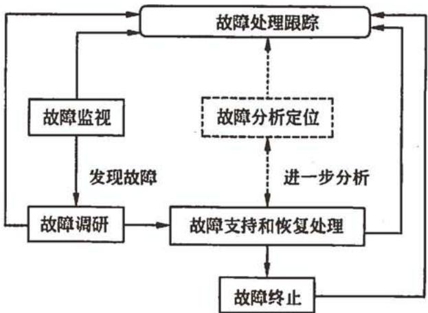
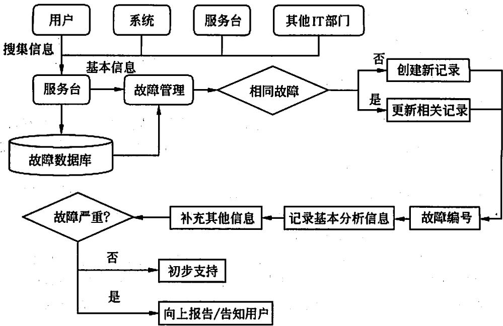
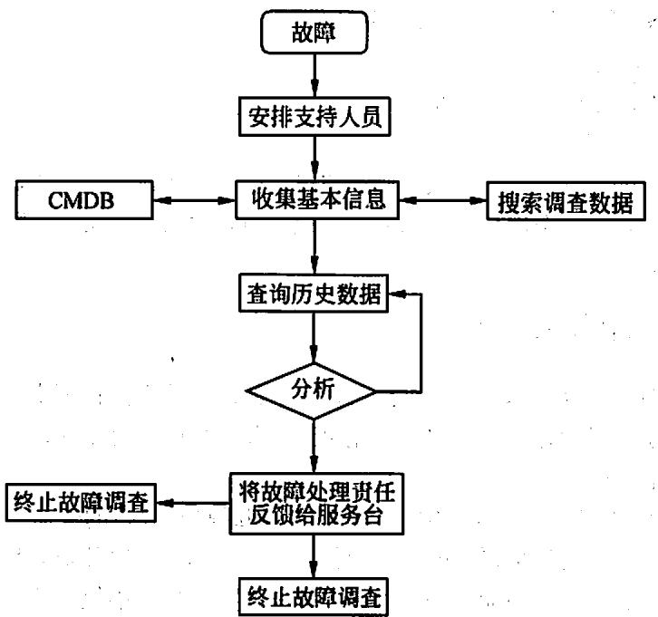
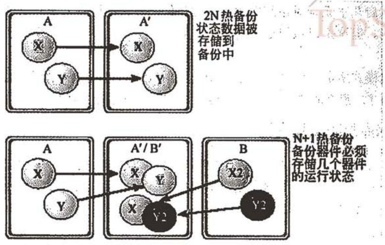
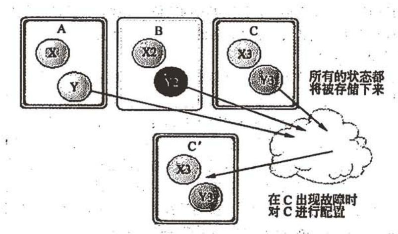
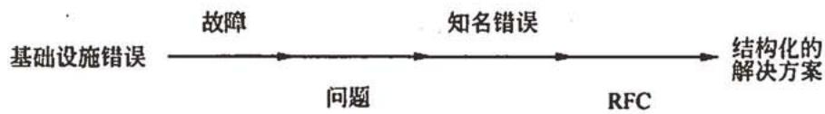
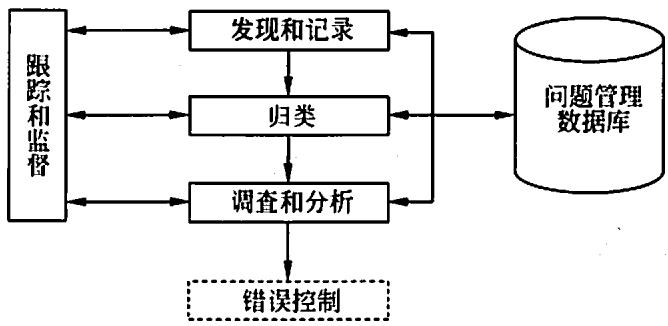
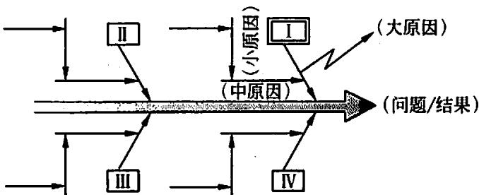
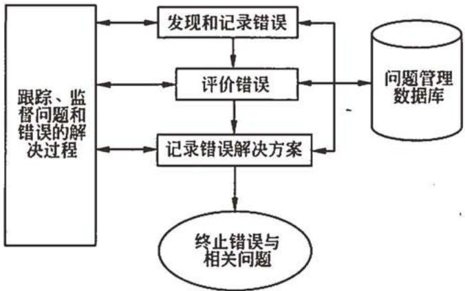

>[!warning] 版本提示
>本书为 **2006 年第 1 版**。现行考试依据是 **《信息系统管理工程师教程（第 2 版）》**（清华社 2024-10，20 章），
>两版**重合极少**：第 1 版的第 1–6 章（硬件/操作系统/语言/配置/数据结构/多媒体）在第 2 版已被删除或压缩。
>本页仅作**扩展参考**，备考请以 [[知识体系]]（第 2 版官方考纲）为准。

# 第19章 故障及问题管理

## 19.1 故障管理概述

## 19.1.1 概念和目标

## 1. 故障、故障处理和故障管理

故障是系统运转过程中出现的任何系统本身的问题，或者是任何不符合标准的操作、已经引起或可能引起服务中断和服务质量下降的事件。

故障处理是指在发现故障之时为尽快恢复系统 IT 服务而采取必要的技术上或者管理上的办法。

故障管理涉及许多 IT 部门和 IT 方面的专家。首先是服务台，作为所有故障的责任人负责监督并记录故障的解决过程。当它不能立即解决发生的故障时，就将其转移给专家支持小组。专家组首先提供临时性的解决办法或者补救措施以尽可能快地恢复服务，避免影响用户正常工作；然后分析故障发生原因，制定解决方案并恢复服务级别协议所规定的服务；最后服务台与客户一道验证方案实施效果并终止故障。

## 2. 故障特征

在故障管理中，我们会碰到三个描述故障的特征，它们联系紧密而又相互区分，即影响度、紧迫性和优先级。

\- 影响度是衡量故障影响业务大小程度的指标，通常相当于故障影响服务质量的程度。它一般是根据受影响的人或系统数量来决定的。

\- 紧迫性是评价故障和问题危机程度的指标，是根据客户的业务需求和故障的影响度而制定的。

\- 优先级是根据影响程度和紧急程度而制定的。用于描述处理故障和问题的先后顺序。

## 3. 故障管理的目标

故障管理的主要目标是尽可能快地恢复服务级别协议规定的水准，尽量减少故障对业务运营的不利影响，以确保最好的服务质量和可用性。

## 19.1.2 故障管理的范围

在 IT 系统运营过程中出现的所有故障都可被纳入故障管理的范围。前面说过故障包括系统本身的故障和非标准操作的事件，常见的故障如下所示。

\- 设备无故报警。

\- 电力中断。

\- 网络瘫痪。

\- 打印机无法打印。

1. 应用系统故障

\- 服务不可用。

\- 无法登录。

\- 系统出现 bug。

1. 请求服务和操作故障

\- 忘记密码。

\- 未做来访登记。

## 19.2 故障管理流程

从在故障监视过程中发现故障到对故障信息地调研，再到故障的恢复处理和故障排除，形成了一个完整的故障管理流程。故障管理即包含了故障监视、故障调研、故障支持和恢复以及故障终止5项基本活动，为了实现对故障流程完善的管理，需要对故障管理的整个流程进行跟踪，并做出相应处理记录。故障管理的流程如图19-1所示。

  
图 19-1 故障管理流程

## 19.2.1 故障监视

故障管理流程的第一项基础活动是故障监视，大多数故障都是从故障监视活动中发现的。

## 1. 监视的考虑因素

不同的系统故障有不同的特征，对系统和整个组织或者企业的业务影响程度可能不同，处理解决的难易度也不同。在进行故障监视时要充分考虑故障的影响度、紧迫性，对影响较大的故障类别进行重点监视，采用更先进的自动化监视管理工具，启动更多的系统监视功能，或者投入更多的人力和物力。这样，在相关部门（服务台、系统本身、用户或者其他 IT 部门）发现故障时，才能尽快根据影响度设置故障处理优先级，尽快进入管理流程。

## 2. 故障接触人员

故障接触人员在故障监视的过程中有着重要的影响和作用。为了在监视过程中尽快发现和应对故障，同时防止非规范操作扩大故障对系统和业务的影响，需要对故障的接触人员进行严格管理，故障监视应该针对不同的故障接触人员指定监视职责，制定相关操作手册，而故障接触人员应该严格按照规定执行操作和报告。同时，故障接触人员本身及其活动也应当作为监视的项目。故障接触人员如下。

（1）故障现场接触人员，在故障发生的现场的接触人员包括系统运行值班人员、系统用户，还可能包括服务台。

（2）初级支持人员，为故障提供一线的初级支持的有服务台和初级支持小组。

（3）高级支持人员，故障处理专家小组或者提供系统服务的厂商技术专家。

## 3. 故障原因分类

美国权威市场调查机构 Gartner Group 曾对造成非计划宕机的故障原因进行分析，并发表了专门报告，主要可以分成以下三大类。

\- 技术因素，包括硬件、操作软件系统、环境因素以及灾难性事故。

\- 应用性故障，包括性能问题、应用缺陷（bug）及系统应用变更。

\- 操作故障，人为地未进行必要的操作或进行了错误操作。

为了便于实际操作中的监视设置,我们将导致 IT 系统服务中断的因素由三类扩展成了 7 类。

\- 按计划的硬件、操作系统的维护操作时引起的故障，如增加硬盘和进行操作系统补丁等。

\- 应用性故障，包括应用软件的性能问题、应用缺陷（bug）及系统应用变更等。

\- 人为操作故障，包括人员的误操作和不按规定的非标准操作引起的故障。

\- 系统软件故障，包括操作系统死机、数据库的各类故障等。

\- 硬件故障，如硬盘或网卡损坏等。

\- 相关设备故障，比如停电时UPS失效导致服务中断。

\- 自然灾害，如火灾，地震和洪水，等等。

从这 7 个分类我们可以看出，导致系统服务中断的原因中，软件和人为操作因素占了很大的比例，硬件和设备因素只占很小的比例。

## 4. 监视项目及监视方法

从以上对故障的原因归类来看，人员、规范操作的执行、硬件和软件是故障监视的重点所在。另外，自然灾害因素由于难以预计和控制，需要进行相关风险分析，可采取容灾防范措施来应对。

(1) 对系统硬件及设备的监视包括各主机服务器及其主要部件、专门的存储设备、网络交换机、路由器, 等等。对硬件设备监控方法主要是采用通用或者专用的管理监控工具, 它们通常具有自动监测、跟踪和报警的功能。

（2）对软件的监视主要针对其应用性能、软件 bug 和变更需求。对软件的性能监控也可以采一些管理监控工具，但由于应用系统主要面向用户，应用系统的缺陷通常由专门的测试工程师负责监视，或者在使用的过程中由用户方发现并提出。变更需求也是在用户使用和监视二合一的过程中发现的。

（3）需要监视的人员包括系统操作员、系统开发工程师、用户、来访者，甚至包括系统所在机房的清洁工和运输公司的职工，等等。要对他们与系统的接触过程中的行为进行跟踪和记录，防止或者及早发现非标准的操作带来的系统故障或者服务故障。

## 19.2.2 故障调研

## 1. 故障信息搜集

如图 19-2 所示，故障信息的来源有服务台、系统、用户和其他 IT 部门。这些信息的搜集方式又分为自动搜集和人工搜集。通常系统本身有相应的故障信息搜集功能，可以通过专门的系统监控软件或者系统日志等方式进行自动搜集。另外，系统运行过程中出现的故障会直接反映在系统的用户一方，或者由相关 IT 部门在执行系统检查和维护时发现，这类故障信息的搜集方式便属于人工搜集。

## 2. 故障查明和记录

发生故障时服务台要记录相关信息，但主要是标示客户和用户的一些基本信息如姓名、工作地点和电话号码等，而本节所讲的故障管理才详细记录了故障信息，比如故障发生的时间、故障影响到的服务等。这样做的目的一是便于确认故障影响，二是问题管理可以根据这些信息查找故障原因，三是密切跟踪故障进展。此外，这些信息也是服务级别管理所需要的。

一般来说故障查明和记录活动过程如图 19-2 所示。

首先，当用户、服务台员工和其他 IT 部门人员发现某故障时，或者系统检测到某故障时，就将其报告给服务台；服务台将基本信息输入故障数据库并报告给故障处理人员。

  
图 19-2 故障查明和记录

接着故障管理人员根据服务台提供的信息和故障数据库信息，判断此故障是否与已有故障相同或相似，如果有就更新故障信息和建立原故障的从属记录，并在必要时修改原故障的影响度和优先级，如果没有则创建新故障记录。

其次，故障管理将给故障一个唯一的编号，记录一些基本的故障分析信息（时间、症状、位置、用户和受影响的服务和硬件等），并补充其他故障信息（与用户的交互信息和配置数据等）。

最后，故障管理需要判断故障是否严重，如果严重就先向管理层报告并告知用户有关情况，再采取进一步行动；如果不严重就直接进入下一步的故障调查和分析。

完整的故障记录应该至少包括以下几项。

\- 故障编号。

\- 故障类别。

\- 记录故障的时间和日期。

\- 故障记录人（或组）的姓名（或ID）。

\- 有关用户的姓名、部门、电话和工作地点。

\- 回复用户的方式（如电话、电子电子邮件等）。

\- 故障描述。

目录。

\- 影响度、紧迫性和优先级。

\- 故障状态（待处理中、处理中和终止等）。

\- 相关的配置信息。

\- 故障得到解决的日期和时间。

\- 终止日期和时间。

随着现代技术的发展，现在的故障监测和报告已可由系统自动完成，故障报告的方式和途径也日趋多样化，甚至用户自己都能直接把故障有关情况记录在故障管理系统中，同时通知故障台有关情况。

## 19.2.3 故障支持和恢复处理

经过故障查明和记录，基本上能得到可以获取的故障信息，接下来就是故障的初步支持。这里强调初步的目的是为了能够尽可能快地恢复用户的正常工作，尽量避免或者减少故障对系统服务的影响。

"初步"包括两层含义：一是根据已有的知识和经验对故障的性质进行大概划分，以便采取相应的措施；二是这里采取的措施和行动不以根本上解决故障为目标，主要目的是维持系统的持续运行，如果不能较快找到解决方案，故障处理小组就要尽量找到临时性的解决办法。

不能通过初步支持来解决的故障在经过故障调查和定位分析后，支持小组会根据更新后的故障信息、提议的权益措施和解决方案以及有关的变更请求，来解决故障并恢复服务，同时更新有关故障信息。

## 19.2.4 故障分析和定位

## 1. 故障调查分析

故障的调查分析这一步骤是在故障经由初步支持没有得到解决时进行的。故障的调查分析过程如图 19-3 所示。

一旦故障被分配给某个支持小组，他们应当做好如下工作。

\- 确认接收故障处理任务，同时指定有关日期和时间。

\- 正常更新故障状态和历史信息。

\- 通知客户故障最新进展。

\- 说明故障当前所处的状态。

\- 尽可能快地把发现的权益措施提供给服务台和客户。

\- 参考已知错误、问题、解决方案、计划的变更和知识库等对故障进行评审。

\- 必要时要求服务台根据协议的服务级别，重新评价故障影响程度和优先级，并在必要时对他们进行调整。

\- 记录所有相关信息，包括以下内容。

  
图 19-3 故障调查过程

◆ 解决方案。

新增的和修改的分类。

\- 对所有相关事件的更新。

$\spadesuit$ 花费的时间。

\- 把故障处理责任反馈给服务台以终止故障。

## 2. 故障定位分析

系统故障中硬件和各类设备的故障定位过程比较典型，下面就主要的硬件故障举例说明故障的定位分析。

（1）中央处理器的故障定位。中央处理器的故障原因主要是集成电路失效。计算机系统均应配备较完善的诊断测试手段，提供详细的故障维修指南，对大部分故障可以实现准确定位。但由于集成电路组装密度很高，一个集成电路芯片包含的逻辑单元和存储单元数以百万计，诊断测试程序检测出的故障通常定位于一个电路模块和一个乃至几个电路卡，维护人员根据测试结果可能在现场进行的维修工作就是更换电路卡。如现场没有相应的备份配件，可以采取降级运行（如多处理机系统可切除故障的处理机，存储器可切除部分有扩展单元等）的手段使系统保持联系运行，如没有补救手段则需要进行停机检修。

（2）外围设备的故障定位。对外围设备的故障检测应采用脱机检测与联机检测两种方式。脱机检测是指外围设备在逻辑上与中央处理机脱离联系（必要时也脱离物理连接）的情况下，对不同外围设备运行特定的测试程序，进行不含接口部分的功能测试，借助设备的面板或专用测试器显示的信息并参阅维修手册来判断故障所在的部位。外围设备的故障有一类是集成电路失效，可通过更换电路卡排除。第一类是各种外设的特殊故障，常见的如磁盘盘面损伤、读写磁头位置偏离或其运载机构不能正常运动、打印机的打印部位损坏或打印纸传递机构故障等，需根据具体情况进行维修。如脱机测试正常而联机却不能正常运行，则应进行针对该设备的联机测试，运行相应的测试程序，测试该设备与中央处理机的接口部位并检验两者之间的协调关系。必要时还可进行模拟环路测试，即将外围设备至主机之间的输入输出连线构成回路，以确认故障所在部位是否在接口电路。

(3) 电源部件的故障定位。计算机硬件中的各个部分均有专用的电源部件, 电源部件中有一部分是大功率的器件, 故障率较高, 是硬件中常见的故障部位。在检测中央处理器及各种外围设备时, 如发现工作异常, 应充分注意到电源部件是可能发生故障的主要部位。

## 19.2.5 故障终止

解决故障和恢复服务后，就到故障终止阶段了。在这个阶段的输入是上一阶段更新后的故障记录和已解决的故障，采取的行动主要是和客户一起确认故障是否被成功解决，输出的结果为更新的故障信息和故障记录。

在故障得到解决后，服务台应该确保以下工作

\- 有关用于解决故障的行动的信息是准确易懂的。

\- 根据故障产生的根本原因对其进行归类。

\- 客户口头同意故障解决方案和方案执行的最终结果。

\- 详细记录了故障控制阶段的所有相关信息，比如：

客户是否满意和满意度如何。

处理故障所花费的时间。

故障终止的日期和时间。

## 19.2.6 故障处理跟踪

服务台负责跟踪和监督所有故障的解决过程。在这个过程中，服务台要做到以下几点。

\- 监督故障状态和故障处理最新进展及其影响服务级别的状况。

\- 特别要注意故障处理责任在不同专家组之间的转移。因为这种转移往往导致支持人员之间责任的不确定性从而产生争论。

\- 更多地注意高影响度故障。

\- 及时通知受影响的用户关于故障处理的最新进展。

\- 检查相似的故障。

这样做有助于保证每个故障在规定的时间内或至少尽可能快的时间内得到解决。大规模的服务台甚至可以考虑成立一个专门的故障监测和控制小组。

## 19.3 主要故障处理

本章开头提到，故障包括系统运转过程中出现的系统本身的问题和引起服务中断和服务质量下降的非标准操作事件。对于后者，我们主要利用故障管理的流程对其进行控制，对于系统本身出现的主要问题，下面将介绍处理办法和恢复措施。

## 19.3.1 故障的基本处理

如计算机发生故障导致系统不能运行则应停机进行临时性维修。首先要区分是软件故障还是硬件设备故障。软件故障可能是因为系统软件的某个环节在特定组合条件下不能正常运行引起的，也可能是由多种作业在运行中因争夺资源而出现"死锁"等原因造成的。这类故障一般可采用重启系统或者其他人工干预手段予以恢复和排除。如果是设备性能变差引起的硬件故障，则应切换到备用系统，尽快恢复系统服务。然后使用测试程序检测故障机的各个部件，特别是中央处理器和磁盘存储器两个部件（输入输出部件一般不至于影响整个系统的正常运行），尽快进行故障定位，然后针对故障部位进行后续维修。

## 19.3.2 主机故障恢复措施

主机故障时通常需要启用系统备份进行恢复。根据所提供的备份类型不同，主机服务上可分为三种：热重启（Hot Restart）、暖重启（Warm Restart）和冷重启（Cold Restart）。热启动服务专门针对客户暂时的系统故障，提供立即恢复系统可用性的服务，以完成客户某些紧急的任务。冷启动服务提供商专门解决那些长期的系统问题（例如由于一栋大楼的倒塌使得整个系统完全瘫痪等）。

下面简单介绍一下这三类重启模式。

无论是由硬件还是由软件引发的系统故障，其持续时间长短取决于系统的重启动能力。如果系统采用热重启、暖重启或冷重启模式，故障管理中的处理方式将各不相同。重启模式受事件发生之时系统可用信息量的影响，可用的信息越多，重启速度也就越快。

## 1. 热重启

热重启的恢复时间最快，但也最难实现。在热重启模式下，应用程序保存系统当前运行的状态信息，并将该信息传送给备份部件，以实现快速恢复。应用程序要具备利用这些状态信息实现系统的重启动的能力。

热重启系统中同样需要在故障管理事件之前预先指定备份部件。这在 2N 系统中最为明显，因为该系统的部件与备份部件是一一对应的（见图 19-4）。而在 N+1 系统中，热重启要求备份部件保存多个运行中部件的状态信息，因此备份部件就必须具有额外存储能力，否则就必须采用暖重启模式。

  
图 19-4 热重启原理示意图

## 2. 暖重启

暖重启与热重启类似。在该模式下，应用程序保存系统当前运行的状态信息，见图 19-5 所示。在执行故障管理时指定备份部件。备份部件需配置必要的应用程序和状态信息，这就增加了重启时间，但降低了备份部件的成本。在备份部件与现行部件不完全相同的系统中，更易实现暖重启。

  
图 19-5 暖重启原理示意图

## 3. 冷重启

冷重启是最易于实现的，但需要最长的重启动时间。冷重启意味着备份部件对故障部件的运行状态一无所知，备份部件只能从初始化状态开始。

实现冷重启几乎无须对系统应用程序做任何修改，由操作系统和服务程序实现高可用性软件的功能。但这是以系统更长的重启时间为代价的，并将丢失系统所有当前的运行状态信息。

各种重启模式所需的时间取决于系统及应用软件的实现方法。相对而言，如果热重启模式的时间为 T，那么暖重启的时间将会是 2\~3T，冷重启的时间将接近 10\~100T。

## 19.3.3 数据库故障恢复措施

当系统运行过程中发生故障，利用数据库后备副本和日志文件就可以将数据库恢复到故障前的某个一致性状态。数据库故障主要分为事务故障、系统故障和介质故障，不同故障的恢复方法也不同。

## 1. 事务故障的恢复措施

事务故障是指事务在运行至正常终点前被终止，此时数据库可能处于不正确的状态，恢复程序要在不影响其他事务运行的情况下强行回滚（rollback）该事务，即撤销该事务已经做出的任何对数据库的修改，使得事务好像完全没有启动一样。事务故障的恢复由系统自动完成。恢复的步骤是：

（1）反向（从后向前）扫描日志文件，查找该事务的更新操作。

（2）对该事务的更新操作执行逆操作，也就是将日志记录更新前的值写入数据库。如果记录中是插入操作，则相当于做删除操作，如果记录中是删除操作则做插入操作，若是修改操作则相当于用修改前的值代替修改后的值。

（3）继续反向扫描日志文件，查找该事务的其他更新操作，并做同样处理。

（4）如此处理下去，直到读到了此事务的开始标记，事务故障恢复就完成了。

## 2. 系统故障的恢复措施

系统故障是指造成系统停止运转的任何事件，使得系统要重新启动。例如，特定类型的硬件错误、操作系统故障、DBMS代码错误、突然停电等。这类故障影响正在运行的所有事务，但不会破坏数据库。此时主存内容（尤其是缓冲区中的内容）都将被丢失，所有运行事务都被非正常终止，有些已完成的事务可能有部分甚至全部留在缓冲区中尚未被写入磁盘，为了保证一致性，应将这些事务已提交的结果重新写入数据库；此外，一些尚未完成的事务结果可能已经被送入物理数据库，为了保证一致性，需要清除这些事务对数据库的所有修改。系统故障的恢复是由系统在重新启动时自动完成的，此时恢复子系统撤销所有未完成的事务并重做（redo）所有已提交的事务。具体的步骤是：

（1）正向（从头到尾）扫描日志文件，找出故障发生前已经提交的事务（这些事务既有 Begin Transaction 记录，也有 commit 记录），将其事务标识记入重做（redo）队列。同时找出故障发生时尚未完成的事务（这些事务只有 Begin Transaction 记录，无相应的 commit 记录），将其事务标识记入撤销（undo）队列。

（2）反向扫描日志文件，对每个 undo 事务的更新操作执行逆操作；也就是将日志记

录中更新前的值写入数据库。

(3) 正向扫描日志文件, 对每个 redo 事务重新执行日志文件登记的操作, 也就是将日志记录中更新后的值写入数据库。

## 3. 介质故障的恢复措施

系统故障常被称为软故障，介质故障常被称为硬故障。硬故障是指外存故障，例如磁盘损坏、磁头碰撞、瞬时强磁场干扰等。这类故障将破坏数据库或部分数据库，并影响正在存取这部分数据的所有事务，日志文件也将被破坏。这类故障比前两类故障发生的可能性要小，但是破坏性最大。恢复方法是重装数据库，然后重做已完成的事务，具体的步骤是：

（1）装入最新的数据库后备副本，使数据库恢复到最近一次转储时的一致性状态。

(2) 装入相应的日志文件副本，重做已完成的事务。

介质故障的恢复需要 DBA 的介入，DBA 只需重装最近转储的数据库副本和有关的各日志文件副本，然后执行系统提供的恢复命令，具体的恢复操作仍由 DBMS 完成。

## 19.3.4 网络故障恢复措施

当遇到线路故障或者是网络连接问题时，需要利用备用电路或者改变通信路径等恢复方法，具体的途径如下。

(1) 双主干, 当原网络发生故障时, 辅助网络就会承担数据传输的任务, 两条主干线缆的物理距离应当相距较远, 来减少两条线缆同时损坏的概率。

(2) 开关控制技术, 由开关控制的网络可以精确地检测出发生故障的地段, 并用辅助路径来分担数据流量, 同时, 可以通过网络管理控制程序来管理网络, 部件故障可以很快显示在控制程序界面上并响应故障。

（3）路由器，一些故障导致必须从别的路径访问别的服务器，这时路由器可以为数据指明流动的方向。

（4）通信中件，通信中件可以使通信绕过网络中发生故障的电路，通过其他网络连接来传输数据。

## 19.4 问题控制与管理

系统运转过程中出现的故障经过处理恢复都得到了暂时解决。其中部分故障可以得到控制解决，这通常是一些故障原因单一的局部性问题，影响也不大；但某些故障出现之后会有同样或者类似的故障接连重复发生，这是故障处理"治标不治本"的后果。要根本解决这类故障，需要从引起这些某一类问题的根本原因出发进行控制，我们将存在这些导致潜在故障的原因的情形称为问题。故障管理后续工作还要延伸到对问题和错误的控制和管理，以及进行故障预防。

## 19.4.1 概念和目标

## 1. 主要概念

（1）问题，问题的是存在某个未知的潜在故障原因的一种情况，这种原因会导致一起和多起故障。问题经常是分析多个呈现相同症状的故障后被发现的。问题也可从单个重要的事物中确认以表示一项错误。这种错误产生的原因虽然未知，但其产生的影响却可能是非常严重的。

（2）已知错误，已知错误是指问题经过诊断分析后找到故障产生的根本原因并制定出可能的解决方案时所处的状态。在这种状态下，一种临时性的权宜措施和永久性的解决方案已经得到确认。如果一个问题转化成了一个已知错误，则应当提出一个变更请求。但是，在通过一项变更将此已知错误永久性地修复之前它仍将作为一个已知错误。

（3）问题控制，问题控制流程是一个有关怎样有效处理问题的过程，其目的是发现故障产生的根本原因（如配置项出现故障）并向服务台提供有关应急措施的意见和建议。

问题控制过程与故障控制过程极为相似并密切相关。故障控制重在解决故障并提供响应的应急措施。一旦在某个或某些事物中发现了问题，问题控制流程便把这些应急措施记录在问题记录中，同时也提供对这些措施的意见和建议。

与故障管理的尽可能快地恢复服务的目标不同，问题管理是要防止再次发生故障，因此，问题管理流程需要更好地进行计划和管理，特别是对那些可能引起业务严重中断的故障更要重点关注并给予更高的优先级。

（4）错误控制，错误控制是解决已知错误的一种管理活动。由于财务和技术方面的原因，影响 IT 基础架构的错误不可能全部得到纠正。错误控制就是要对这些错误进行管理，从而使受其影响的用户能够意识到这些错误的影响。除了消除错误之外，通过错误控制还可能将现有错误的负面影响降到最低。

（5）问题预防，问题预防是指在故障发生之前发现和解决有关问题和已知错误，从而使故障对服务的负面影响其与业务相关的成本降到最低的一种管理活动。通过化被动为主动，IT 支持组织提供了更好的服务并提高了自身的资源使用效率。

## 2. 控制和管理目标

问题管理和控制的目标主要体现在以下三点：

（1）将由 IT 基础架构中的错误引起的故障和问题对业务的影响降到最低限度。

（2）找出出现故障和问题的根本原因，防止再次发生与这些错误有关的故障。

（3）实施问题预防，在故障发生之前发现和解决有关问题。

## 19.4.2 相关逻辑关系

（1）故障是任何不符合标准操作，并且已经引起或可能引起服务中断和服务质量下降的事件。它产生的原因可能比较明显，不需进一步调查就可解决（比如采取补救措施、临时办法和通过变更请求），甚至可不用了解其原因而直接由客户自己解决（比如重启计算机、重新设置通信线路等）。

(2) 问题是指, 导致一起和多起故障的潜在的、不易发现的原因。问题需要被调查后才能确认, 其影响度得确定需要综合考虑它的业务的实际或潜在影响以及起因相同或相似的故障 (包括已解决的和未解决的) 的数量。故障和问题之间不是一对一的关系, 而是多得多的关系: 一个故障可能有多种原因, 一个故障可能对应着某个问题, 同样, 一个问题可能是对多个故障的调查后被确认的。

（3）已知错误是一个故障和问题，而且产生这个故障和问题的根本原因已查明，并已找到解决它的临时办法和永久性的替代方案。解决的过程需要提交变更请求，不过在实施变更以永久性解决它之前，它将一直存在。已知错误和问题之间的关系与故障和问题之间的关系类似，也是多对多。

（4）变更请求适用于记录有关变更内容的书面文件和电子文档。这种变更是针对基础架构的配置项以及与基础架构相关的程序和规章制度而进行的。

故障、问题、已知错误和变更请求之间的逻辑关系可用图 19-6 表示

  
图 19-6 故障、问题、已知错误和变更请求之间的逻辑关系

## 19.4.3 问题管理流程

## 1. 信息输入

问题管理所需要的信息输入如下。

\- 故障信息。

\- 故障处理定义的应急措施。

\- 系统配置信息。

\- 供应商提供的产品和服务信息。

## 2. 主要活动

问题管理流程中的主要活动如下。

\- 问题控制。

\- 错误控制。

\- 问题预防。

\- 制作管理报告。

1. 信息输出

\- 已知错误。

\- 变更请求。

\- 更新的问题记录（包括解决方案和应急措施）。

\- 已解决问题的记录（如果已消除了故障产生的原因）。

\- 故障与问题和已知错误的匹配信息。

\- 其他管理信息。

问题管理流程主要涉及问题控制、错误控制、问题预防和管理报告 4 种活动，下面分别对这 4 种活动做简要介绍。

## 19.4.4 问题控制

在实际运用 IT 服务过程中，出现问题是无法避免的，比如网络出现线路故障，和着随着组织 IT 基础架构复杂性的增加而产生的错误，甚至某些厂商的产品本身的缺陷也可能降低服务质量到不可接受的水平。一旦发现问题，我们必须及时对企业进行控制，分析它产生的原因并在必要时把问题升级为已知错误。问题控制过程如图 19-7 所示

  
图19-7 问题控制过程

## 1. 发现和记录问题

问题控制的第一步是发现和记录问题。原则上所有原因未知的故障都可被称为问题，但我们通常将重复发生的和非常严重的故障归类为问题。发现问题的途径有很多种，常见的问题如下。

\- 在故障初步阶段和支持阶段没能把故障与问题或者已知错误匹配成功

\- 分析故障数据发现重复出现的故障；

\- 分析故障数据排除已与存在的问题和已知错误成功匹配的故障；

\- 分析IT基础架构发现可能导致故障的问题。

问题也可能被问题管理小组以外的人发现。但不管是谁发现的，所有问题都应由问题控制管理流程来处理。

问题记录与故障记录类似，但不包括用户名等信息，同时问题记录应该关联到所有与其相关的故障，故障的解决方案和应急措施也要被记录在相应的问题记录中。

## 2. 问题分类

查明和记录问题后，为便于评价问题对服务级别的影响，确定查找和恢复有故障的配置向所需的人力和资源，可先对问题进行归类。以故障归类类似，问题归类的标准仍然涉及以下4个方面。

\- 目录，确定与问题相关联的领域，比如硬件、软件等。

\- 影响度，问题对业务流程的影响程度。

\- 紧迫性，问题需要得到解决的紧急程度。

\- 优先极，综合考虑影响度、紧迫性、风险和可用资源后得出的解决问题的先后顺序。

## 3. 调查分析

调查问题的过程与调查故障的过程类似，但两者的主要目标明显不同：前者是发现故障产生的潜在原因，而后者是尽可能快速地恢复服务。因此，前者比后者调查得更细致深入，需要调查人员掌握更多的经验和技巧，有时还需要专家的支持：同时，问题调查的范围也比故障调查的要广，它包括对故障处理中使用的应急措施的调查等。当发现更好的和新的应急措施时，问题管理还要将其在问题记录中更新以便故障控制使用。

问题调查和分析过程需要详细的数据，而很多时候这些数据只有在故障发生时才能被收集到，这是一个矛盾。为了解决这个矛盾，问题调查人员应该与故障控制和计算机网络控制部门协调好有关情况。

问题分析方法主要有 4 种：Kepner&Tregoe 法、鱼骨图法、头脑风暴法和流程图法。这里我们重点介绍 Kepner&Tregoe 法和鱼骨图法。

（1）Kepner&Tregoe 法。Kepner&Tregoe 是一种分析问题的方法，即出发点是解决问题是一个系统的过程，应该最大程度上利用已有的知识和经验。它把问题分析分为以下 5 个阶段。

① 定义问题。调查是根据定义问题进行的，因此问题定义必须明确指出 IT 服务偏离服务级别协议的情况。在这里我们要避免这样一种情况，即认为产生问题的最可能的原因已经明朗，因而不用经过进一步调查而可直接做出结论。这可能导致一开始就选错调查的方向。

② 描述问题。在定义问题后从以下几个方面表示。

\- 标识。哪部分没有良好运行？问题是什么？

\- 位置。问题发生在哪里？

\- 时间。问题是什么时候发生的？频率多高？

\- 规模和范围。问题的规模和范围多大？哪些部分将受到影响？

③ 找出产生问题的可能原因。根据第二步的比较和实施的变更，尽量发现问题产生

的可能原因。

④ 测试最可能的原因。评价每个可能原因以确认其是否就是形成问题症状的原因。

⑤ 验证问题原因。通过上一步的测试后，剩余的可能原因需经进一步测试以确认其是否是产生某个问题的真正原因。一般应优先消除那些可以简单快速验证的起因。

（2）鱼骨图法。鱼骨图法是分析问题原因常用的方法之一。在问题分析中，"结果"是指故障或者问题现象，"因素"是指导致问题现象的原因。鱼骨图就是将系统或服务的故障或者问题作为"结果"、以导致系统发生失效的诸因素作为"原因"绘出图形，进而通过图形分析从错综复杂、多种多样的因素中找出导致问题出现的主要原因的一种图形。因此，鱼骨图又叫因果图法。日本质量管理专家石川馨最早使用了这种方法，故有时特性因素图又被称为石川图。

鱼骨图的做法如下。

① 按具体需要选择因果图中的"结果"，放在因果图的最"右边"（相当于"鱼头"）。

② 用带箭头的粗实线或用表示直通"结果"的主干线。

③ 通过调查分析，判别影响"结果"的所有原因。先画出"大原因"，用直线与主干线相连，并在直线的尾端常用长方形框（或圆圈）框（或圈）起来，在框（或圈）内填入"大原因"的内容；进而依次细分所属的全部原因，直至能采取解决问题的措施为止。各大、小原因之间用不同的直线表示因果之间的关系。

④ 主要的或关键的原因常用框框起来，以表示醒目。根据实际需要，对这些关键的或主要的原因还可以做单独的特性因素图，以便进一步重点深入分析。

综合上述各点，一般的鱼骨图分析模式如图 19-8 所示。

  
图 19-8 鱼骨图分析模式

（3）头脑风暴法。头脑风暴法是一种激发个人创造性思维的方法，它常用于解决问题的方法的前三步：明确问题、原因分类和获得解决问题的创新性方案。针对问题，我们可以应用头脑风暴法来提出所有可能的原因。

应用头脑风暴法必须遵守下列 4 个原则：畅所欲言、强调数量、不做评论、相互结合。

（4）流程图法。流程图法通过梳理系统服务的流程和业务运营的流程，画出相应的流程图，关注各个服务和业务环节交接可能出现异常的地方，分析问题的原因所在。流程图中应该包括系统服务中涉及到的软硬件设备、文件、技术和管理人员等所有问题的相关因素。

以上每种问题分析方法有其优点和缺点，问题管理人员应选择合适的方法来分析问题。

## 19.4.5 错误控制

错误控制是管理、控制并成功纠正已知错误的过程，它通过变更请求向变更管理部门报告需要实施的变革，确保已知错误被完全消除，避免再次发生故障。错误控制对所有已知错误从其被发现至被解决的全过程进行控制，涉及公司的许多不同部门。错误控制的过程主要分为三个阶段，如图 19-9 所示。其中跟踪和监督错误活动将覆盖问题的整个生命周期。

  
图 19-9 错误控制

## 1. 发现和记录错误

一旦确定了问题产生的根本原因，问题就将转变为一项错误；如果找到对付错误的应急措施，错误又将成为已知错误。错误或已知错误的确定是错误控制过程的开始。

错误控制系统中有关已知错误的数据来源主要有两个：运行过程和开发过程。前者主要指在问题控制过程中把某个问题升级为已知错误时，在问题调查和分析阶段记录的数据可直接作为错误控制所需错误信息的基础；后者如应用系统包含了开发阶段形成的错误，但直到正式实施时才会被发现，则有关这些错误的信息应该按要求输入到错误控制系统的数据库中。

## 2. 评价错误

发现和记录错误后，问题管理人员与支持组将一道对错误可能的解决方法进行初步评估。如果他们发现不能消除错误，就将通过变更请求向变更管理部门报告有关情况。变更管理部门根据错误对业务的影响、紧迫性、严重性来确定变更管理请求的优先级。

## 3. 记录错误解决过程

错误控制系统应该详细记录每个已知错误的解决过程，特别是与已知错误有关的配置项、症状和解决方案（或替代方案），记录的信息保存于问题管理数据库中。这些信息可用于故障匹配中，为以后的故障调查和解决提供指导，也可用于管理报告中。

## 4. 终止错误

在实施变更已成功消除错误后，可以终止已知错误及其相关的故障和问题，并通过实施后评审确认已知错误的解决效果。对故障来说，实施后评审延续就是简单地打电话询问客户是否满意，但对问题和已知错误来说，实施后评审应该是一个正式的和规范的过程。

## 5. 跟踪监督错误解决过程

变更管理流程将负责处理变更请求，而错误控制需要对已知错误的解决过程进行监控。在整个解决过程中，问题管理需要从变更管理获得有关问题和错误解决情况的正规报告。

## 19.4.6 问题预防

到目前为止，我们说明的主要是一些被动的问题管理活动，事实上，我们完全可以化被动为主动，在故障发生前发现和解决有关问题和已知错误，以尽量减少问题和已知错误对业务的影响，这就是本节要讲的问题预防管理。

问题预防的范围非常广泛，既涉及单个问题，如与系统某一特征相关的重复性故障，也包括有重要影响的战略性决策，如投资建设更好的网络，或者为客户提供多种帮助信息，甚至可以是为问题解决人员提供在线支持以提高他们解决问题的速度、减少用户等待时间。

问题预防的流程主要包括两项活动：趋势分析和制定预防措施。

## 1. 趋势分析

趋势分析的目的是为了能够主动采取措施提高服务质量，它可以从以下几个方面进行：

（1）找出 IT 基础架构中不稳定的组件，分析其原因，以便采取措施降低配置项的故障对业务的影响。

(2) 分析已发生故障和问题，发现某些趋势。

(3) 通过其他方式和途径分析如下。

\- 系统管理工具。

\- 会议。

\- 用户反馈。

\- 与客户和用户的座谈会。

\- 客户和用户调查。

## 2. 制定预防措施

通过趋势分析，问题管理人员既可以发现和消除存在于 IT 基础架构中的故障，也可以探明哪些问题是支持小组必须重点关注的。

为了有效地引导有限的服务支持资源配置到恰当的问题领域，问题的方案管理需要调查哪些领域占有了最多的服务支持。通过从整体上对已出现的和可能出现的问题的分析，我们可以确定哪个问题和哪类问题是真正需要重点关注的和优先解决的。比如，当有些故障出现次数多但影响不大，而有些故障出现少而影响巨大，并且解决这类故障的效益更好时，显然应该优先解决后者。因此，我们可以考虑给每一类故障一个"损害指数"作为测度指标，指数大小可以根据以下几点确定。

\- 故障出现次数。

\- 受影响的客户数。

\- 解决故障所需时间和成本。

\- 业务损失。

这种方法避免了将过多的精力放在一些数量较大但对业务影响较小的故障和问题上面，从而忽略了那些数量较小但影响巨大的故障和问题。事实上，将服务支持资源投入那些出现次数虽少但影响重大的故障和问题上，往往能取得更大的效益。

在确定服务支持人员应重点关注的问题之后，问题管理人员就应当采取适当的行动以预防其发生。这些行动如下。

\- 提交变更请求。

\- 提交有关测试、规程、培训和文档方面的反馈信息。

\- 进行客户教育和培训。

\- 对服务支持人员进行教育和培训。

\- 确保问题管理和故障管理规程得到遵守。

\- 改进相关的流程和程序。

## 19.4.7 管理报告

问题管理流程应定期或不定期地提供有关问题、已知错误和变更请求等方面的管理信息，这些管理信息可用做业务部门和 IT 部门的决策依据。其中，提供的管理报告应说明调查、分析和解决问题和已知错误所消耗的资源和取得的进展。具体来说包括以下几个方面：

(1) 事件报告。支持小组和供应商花费与问题同质、错误控制和问题地方的时间。

（2）产品质量。根据故障、问题和已知错误信息发现经常受错误影响的产品，并确认供应商的产品是否符合要求。

（3）管理效果。说明问题解决前后故障的数量、变更请求数量和解决的已知错误的数量。

（4）常规问题管理与问题预防管理之间的关系。积极的预防比消极的应对故障的出现

更能体现出问题管理流程运营的成熟性。

（5）问题状态和行动计划。说明已对问题采取了何种行动、将采取何种行动及所需的时间和资源。

（6）改进问题管理的意见和建议。根据上面的信息，判断问题管理流程是否达到了服务质量计划的目标。如果没有到达，则审计管理流程，提出改进的意见和建议，并估计所需的资源和费用。

最后的管理报告与问题管理的范围有很大关系。如果范围扩展到产品和服务开发阶段，则问题管理甚至从这个阶段就要开始定义和监督已知问题和已知错误，从而管理报告也要包括这个阶段的有关问题和已知错误的解决和预防情况。

## 选择题

1. 主机故障的恢复重启模式包括（ ）。  
A）热重启 B）冷重启  
C）暖重启 D）冻重启

2. 数据库故障的类别包括（ ）。  
A）事务故障 B）系统故障  
C）操作故障 D）介质故障

## 思考题

1. 系统故障包括哪些类别？请举例说明。

2. 人员为什么是故障监视的重点？哪些人员应当被纳入故障监视的范围内？

3. 简述网络故障时的处理办法有哪些？

4. 故障管理与问题管理两者之间有什么关系？范围和目标各是什么？

5. 简述 Kepner&Tregoe 问题分析法的分析步骤。
