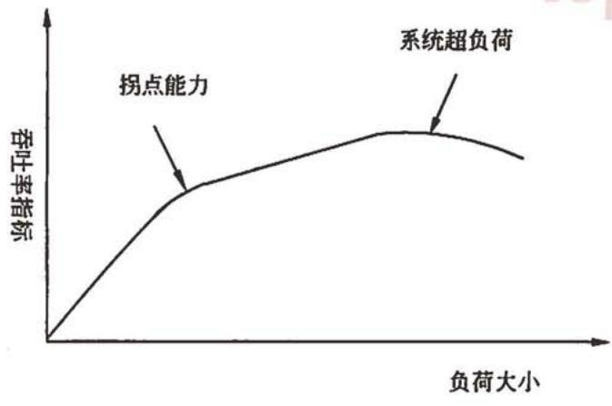
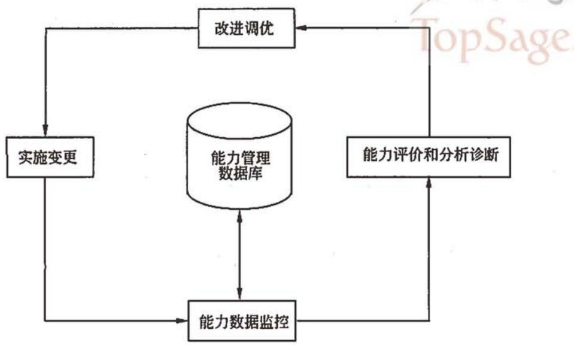

>[!warning] 版本提示
>本书为 **2006 年第 1 版**。现行考试依据是 **《信息系统管理工程师教程（第 2 版）》**（清华社 2024-10，20 章），
>两版**重合极少**：第 1 版的第 1–6 章（硬件/操作系统/语言/配置/数据结构/多媒体）在第 2 版已被删除或压缩。
>本页仅作**扩展参考**，备考请以 [[知识体系]]（第 2 版官方考纲）为准。

# 第21章 性能及能力管理

## 21.1 系统性能评价

## 21.1.1 性能评价概述

## 1. 含义

计算机系统性能评价技术是按照一定步骤，选用一定的度量项目，通过建模和实验，对计算机的性能进行测试并对测试结果做出解释的技术。计算机系统性能评价没有统一的规范。进行评价可以是为了不同的目的。不同的人员可能采用不同的度量项目、不同的测试方法和测试工具，对测试结果将做出不同解释。在 IT 系统的管理中，计算机系统的性能评价技术是十分重要的。

## 2. 重要性

IT 系统的运营管理要考察系统的运营状况，根据需要调整和改善系统软硬件和环境条件，以提高系统的业务支持能力；或者调整 IT 资产结构，在保障系统有效运转的前提下降低 IT 系统总体成本。IT 系统运营管理的根本目的是以尽可能低的花费为组织的业务提供足够的和可靠的 IT 服务支持。

为了保障对业务提供持续可靠并且经济的 IT 支持, 需要对系统性能进行科学而有效的管理。性能评价技术是在必要的时候（例如，新硬件设备采购的评测、定期系统能力评价、业务需求变更之时的能力评测和规划）作为性能管理的支撑技术出现的。

## 21.1.2 性能评价指标

## 1. 计算机系统工作能力指标

反映计算机系统负载和工作能力的常用指标主要有三类，具体如下。

## (1) 系统响应时间（Elapsed Time）

时间是衡量计算机性能最主要和最为可靠的标准，系统响应能力根据各种响应时间进行衡量，它指计算机系统完成某一任务（程序）所花费的时间，比如访问磁盘、访问主存、输入/输出等待、操作系统开销，等等。

响应时间为用户 CPU 时间和系统 CPU 时间之和:

$$
\mathrm{T} = \mathrm{T} _ {\text { u   s   e   r }} + \mathrm{T} _ {\text { s   y   s }}
$$

系统时间主要是指访问磁盘、访问主存和 I/O 等待的时间，因此衡量响应时间主要是衡量用户 CPU 时间。用户 CPU 时间取决于三个特征：时钟周期 $T_{c}$ ，指令平均时钟周期数

CPI 以及程序中总的指令数 $I_{N}$ ，用公式可以表示为：

$$
\mathrm{T} _ {\text { cpu }} = \mathrm{I} _ {\mathrm{N}} \times \mathrm{CPI} \times \mathrm{T} _ {\mathrm{C}}.
$$

CPI 为平均指令时钟周期，可以表示为：

$$
\mathrm{CPI} = \frac {\sum_ {i = 1} ^ {n} \left(\mathrm{CPI} _ {i} \times \mathrm{I} _ {i}\right)}{\mathrm{I} _ {N}} = \sum_ {i = 1} ^ {n} \left(\mathrm{CPI} _ {i} \times \frac {\mathrm{I} _ {i}}{\mathrm{I} _ {N}}\right)
$$

其中 n 为指令的种类数量， $CPI_{i}$ 是第 i 种指令的 CPI， $I_{i}$ 是第 i 种指令使用的数量。

举个例子，A 机执行的程序中有 20% 转移指令（ $2T_{C}$ ），转移指令都需要一条比较指令（ $1T_{C}$ ）配合，B 机中转移指令已经包含了比较指令，但 $T_{C}$ 比 A 机慢 15%。需要比较 A 机、B 机哪个工作速度快。按照上述公式我们可以得出下面的计算结果：

$$
\begin{array}{r l} & {\mathrm{A} \text {机}: \mathrm{T} _ {\mathrm{CPUA}} = \mathrm{I} _ {\mathrm{NA}} \times (0. 2 \times 2 + 0. 2 \times 1 + 0. 6 \times 1) \times \mathrm{T} _ {\mathrm{CA}} = 1. 2 \mathrm{I} _ {\mathrm{NA}} \times \mathrm{T} _ {\mathrm{CA}}} \\ & {\mathrm{B} \text {机}: \mathrm{T} _ {\mathrm{CPUB}} = 0. 8 \mathrm{I} _ {\mathrm{NA}} \times ((0. 2 / 0. 8) \times 2 + (1 - 0. 2 / 0. 8) \times 1) \times 1. 1 5 \mathrm{T} _ {\mathrm{CA}} = 1. 1 5 \mathrm{I} _ {\mathrm{NA}} \times \mathrm{T} _ {\mathrm{CA}}} \end{array}
$$

从比较的结果来看，B 机比 A 机工作速度要快，因此，不能仅按 CPU 的主频衡量系统性能。

## (2) 系统吞吐率（Throughput）

吞吐率指标是系统生产力的度量标准，描述了在给定时间内系统处理的工作量。系统的吞吐率是指单位时间内的工作量。例如，处理器的吞吐率是按每秒处理多少百万条指令（MIPS或者MFLOPS）来度量的。对于在线事务处理系统，吞吐率的度量是每秒处理多少事务（Transaction per second，TPS）。对于通信网络，吞吐率是指每秒传输多少数据报文（PPS）或多少数据位（BPS）。

系统的额定能力是指理想状态下，系统可承受的最大可能吞吐率。一般，我们都不期望让系统达到额定能力，因为此时响应时间太短，输出的显示也太快，以至于用户无法感觉到系统已经发生了响应。能使用户高效工作的能力被称为可用能力。可用能力与额定能力之间的比例就称为系统的效率。

吞吐率指标与系统的负荷之间的关系如图 21-1 所示。最初，在系统的负荷较小时，吞吐率指标增长很快。到某个点时，吞吐率指标的增长率会降低。该点的吞吐率称为拐点能力。继续增加负荷，到某一点时，吞吐率会逐步降低，即此时系统出现超负荷现象。

吞吐率指标是要按照工作单位（即作业、任务、指令等）来定义的。还有，时间性指标与吞吐率指标之间存在相互依赖的关系，响应比较敏捷的系统通常具有较高的吞吐率。

下面介绍一下 MIPS、MFLOPS、TPS 等几个反映系统吞吐率的概念。

① 每秒百万次指令(Million Instruction Per Second, MIPS)。

MIPS 可以用公式表示为:

  
图21-1 负荷与吞吐率指标之间的关系

MIPS 的大小和指令集有关，不同指令集的计算机间的 MIPS 不能做比较，因此在同一台计算机上的 MIPS 是变化的，因程序不同而变化。MIPS 中，除包含运算指令外，还包含取数、存数、转移等指令。相对 MIPS 是指相对于参照机而言的 MIPS，通常用 VAX-11/780 机处理能力为 1MIPS。

② 每秒百万次浮点运算（Million Instruction Per Second，MFLOPS）。

MFLOPS 可以用公式表示为:

MFLOPS = 浮点指令数 / (执行时间 × 1000000)

1MFLOPS 约等于 3MIPS。MIPS 只适宜于评估标量机，不能用于评估向量机，而 MFLOPS 则比较适用于衡量向量机的性能。但是 MFLOPS 仅仅只能用来衡量机器浮点操作的性能，而不能体现机器的整体性能。例如编译程序，不管机器的性能有多好，它的 MFLOPS 不会太高。MFLOPS 是基于操作而非指令的，所以它可以用来比较两种不同的机器。例如 100% 的浮点加要远快于 100% 的浮点除。单个程序的 MFLOPS 值并不能反映机器的性能。

③ 位每秒 (Bits per second, BPS)。

计算机网络信号传输速率一般以每秒传送数据位（Bit）来度量，简写为 BPS。更大的单位包括 KBPS（Kilo bits per second）和 MBPS（Million bits per second）。

④ 数据报文每秒（Packets per second，PPS）。

通信设备（例如路由器）的吞吐量通常由单位时间内能够转发的数据报文数量表示，简写为 PPS。更大的单位包括 KPPS（Kilo packets per second）和 MPPS（Million packets per second）。

⑤ 事务每秒（Transaction per second，TPS）。

即系统每秒处理的事务数量。

## (3) 资源利用率（Utilization Ratio）

资源利用率指标以系统资源处于忙状态的时间为度量标准。系统资源是计算机系统中能分配给某项任务的任何设施，包含系统中的任何硬件、软件和数据资源。例如，CPU 的利用率指标应是 CPU 忙的时间总量 t 除以运行时间总量 T。系统资源未被利用的时间片段被称为空闲时间。对于一个平衡的系统而言，系统空闲与忙的时间片均匀地分布在整个运行时间内，因此系统资源既不会太忙也不会太闲。

## 2. 其他综合性能指标

## (1) 可靠性

系统可靠性通常反映系统处理用户工作的可用性或处理过程失败或错误的概率。系统可用的那部分时间被称为正常运行时间，系统不可用的时间被称为停机故障时间。平均故障间隔时间 MTBF（Mean Time Between Failure）是系统在相邻两次故障之间工作时间的数学期望。通常我们更要关注两次故障之间工作时间的分布特征。有时，MTBF 相对较短，但分布图上可能显示出在个别情况下，相邻故障之间的时间会较长，此时的代价会很大。

## (2) 可维护性

系统失效后在规定时间内可被修复到规定运行水平的能力。可维护性用系统发生一次失败后，系统返回正常状态所需的时间来度量，它包含诊断、失效定位、失效校正等时间。一般用相邻两次故障间工作时间的数学期望，即平均修复时间(Mean Time Between Failure, MTTR)来表示。

## (3) 可扩展性

系统的软硬件的扩充能力，可提高系统性能，如扩展槽允许增加插件板到系统上，又如操作系统支持增加处理器、内存及其他资源，等等。

## (4) 可用性

可维修系统在某时刻能提供有效使用的程度。主要包括使用方便程度以及系统的稳定程度等。有时也指系统实际可用时间与计划提供使用时间的比例。

## (5) 功耗

系统电能消耗量。世界环保组织已制定了计算机及相关设备的一些功耗限额。

## (6) 兼容性

系统现有的硬件或软件与另一个系统或多种系统的硬件和软件的兼容能力和经过整合进行共同工作的能力。

## (7) 安全性

程序和数据等信息的安全程度，如数据不被破坏和不被非法修改等。

## (8) 保密性

确保系统内信息和数据不被非法人员存取，在系统内设置的保密措施，如使用保密锁、

保密码等，使个人或组织有保护和使用他们的数据的专门权利。

## (9) 环境适应性

系统对环境的适应能力，即外界环境改变时系统为保持正常工作的进行调节的能力。

以上列出的系统性能指标中，系统的可靠性、可维护性、可用性和功耗都有定量指标，兼容性、安全性、保密性和可扩展性属于定性指标。

由于性能度量指标的重要程度与具体系统的用户的需求有关，例如军用、商用或者民用的系统之间均会有不同的权重顺序。可以按照具体需求分级别和顺序设置性能评价指标。

## 21.1.3 设置评价项目

系统性能评价尽管包括许多综合性指标和定性的评价指标，但这些都是建立在对系统硬件和软件的众多具体性能指标的监视和评价基础之上的，因此对性能评价项目进行识别和设置是进行性能评价的基础工作。

计算机系统的性能集中体现在处理器、内主存和外存磁盘几大件上，它们的性能以及相互之间的工作支持情况基本决定了系统的整体性能，因此系统性能监视评价的项目主要是CPU、主存、磁盘，此外，越来越多地运行在网络上的分布式计算机系统的性能还极大地依赖于网络，因此网络也是性能评价的一个重要项目。

## 1. CPU

CPU 即中央处理器，它是计算机系统的核心部分。刚才所列的系统性能评价指标都是围绕 CPU 的。当然，这些指标的评价结果是建立在 CPU 与其他系统部件（如内存）的协同工作的基础上的。单就 CPU 而言，考察它在系统中的工作性能要关注 CPU 利用率、队列长度、每秒中断次数，等。

## 2. 内存

除了 CPU，内存也是影响系统性能的最常见的瓶颈之一。看系统内存是否够用的一个重要参考就是分页文件的数目，分页文件是硬盘上的真实文件，当操作系统缺少物理内存时，它就会把内存中的数据挪到分页文件中去，如果单位时间内此类文件使用频繁（每秒个数大于 5），那就应该考虑增加内存。具体考察内存的性能的参数包括内存利用率、物理内存和虚拟内存的大小。

## 3. 磁盘

需要关注跟磁盘的性能有关的几个参数：硬盘忙和空闲的时间比例、每秒读写次数、每次传输平均耗时和硬盘队列长度等。时间越长、队列越长，说明硬盘越忙，硬盘应用时的性能越差。如果硬盘忙不是因为内存缺乏导致频繁交换的话，就要采取相应的措施。

## 4. 网络

衡量网络性能的主要参数是看网络发送、接收的数据量，带宽的利用情况等。

## 21.1.4 性能评价的方法和工具

系统性能的评价方法大致可分为两类：模型法和测量法。

## 1. 模型法

用模型法对系统进行评价，首先应对要评价的计算机系统建立一个适当的模型，然后求出模型的性能指标，以便对系统进行评价。此法既可用于已建成并在运转中的系统，也可用于尚在规划中而并未存在的计算机系统，可以比较方便地应用于设计和改进。模型法与测量法是相互联系的，在模型中使用的一些参数往往来源于对实际系统的测量结果。

模型法又分为分析模型法和模拟模型法两类。

分析模型法是在一定假设条件下，计算机系统参数与性能指标参数之间存在着某种函数关系，按其工作负载的驱动条件列出方程，用数学方法求解。分析模型法中使用得最多的是排队模型。排队模型包括三个部分。

\- 输入流。指各种类型的"顾客"按什么样的规则到来。

\- 排队规则。对于来的顾客按怎样的规则次序接受服务，例如实现顺序服务还是按顾客的急迫程度服务。

\- 服务机构。指同一时刻有多少服务设备可接纳顾客，为每一顾客需要服务多少时间。一般，服务机构过小，不能满足顾客的需要，将使服务质量降低；服务机构过大，人力物力的开支增加，因此产生了顾客需要和服务机构之间的协调问题。怎样才能做到既满足顾客的需要，又使服务机构的费用最低，是"排队论"要研究解决的问题。在计算机系统中，把需要处理的各种作业、命令等当作"顾客"，把计算机的各种软、硬部件如中央被处理机、存储器、输入输出设备、编译模块等当作"服务员"，当某作业在中央处理机中被处理时，就意味着作业（顾客）在接受这个"服务员"的服务。至于排队规则，也可以是先到先服务或有某些优先级的服务。这样就可以把"排队论"的许多成果应用于计算机系统性能评价。

为了使模型的使用对系统的评价有价值，必须解决以下三个问题。

\- 设计模型。根据对系统和工作负载的分析、测量来设计恰当的模型。一般设计出的模型只是部分地反映出系统的特性，而且是所要关心的那部分特性。

\- 解模型。如果有现成的"排队论"结论，就可以直接使用。不然，则需要提出新的解决办法。

\- 校准和证实模型。为了使模型化研究的结果可靠，其精度必须经过校准和证实，以达到可接受的程度。

模拟分析法和分析模型法不同，它不是用一些数学方程去刻画系统的模型，而是用模拟程序的运行去动态表达计算机系统的状态，并进行统计分析，得出性能指标。这种模型可以更加详细地刻画出原来的计算机系统，并且也可以比较灵活地加以控制，但构造模拟模型的费用较大，每次使用时还必须运行模拟程序。

这种模型法需要有一个建立模型并编制模拟程序的过程，然后校准和证实模型，才能计算出所要的性能指标。

## 2. 测量法

通过一定的测量设备或测量程序，测得实际运行的计算机系统的各种性能指标或与之有关的量，然后对它们进行某些计算处理得出相应的性能指标，这是最直接最基本的方法。要使用测量方法，要解决以下问题。

（1）根据系统评价目的和需求，确定测量的系统参数。

(2) 选择测量的方法和工具。测量的方式有两种, 一种为采样方式。即每隔一定的时间间隔, 对计算机系统的一些参数进行一次测量, 另一种为时间跟踪方式, 先规定一些要测量的事件, 如一个作业开始执行、某个寄存器具有某种模式等, 以后每当计算机系统中出现这种事件时就进行一次测量。

常用的测量工具可分为硬件测量工具、软件测量工具、固件测量工具以及混合型测量工具。目前许多测量工具已成为定型产品，可以直接购买和使用，有不少软件测量工具也已被结合到系统软件之中。

(3) 在测量时工作负载的选择。为了使测量所得的结果有代表性, 在测量时, 计算机系统应处于测量者要求的工作负载情况。为此, 有两种方法: 一种是让计算机系统在日常的使用状况下运行, 但选择某些与测量者要求相接近的时间区间。例如要测量系统在中负载条件下的性能, 就应选择在每天系统使用最忙碌的时段进行测量。另一种是由测量者编写一组能反映他们要求的典型程序, 或者选择市场上已有的一些适合他们要求的典型程序,例如对于字处理和文件服务、数据库处理、图像处理、科学和工程计算等都有一些已编制好的基准程序 (benchmark)。两种工作负载相比, 前一种工作负载常在做系统性能监控时使用: 后一种工作负载在比较各种系统或选购新系统时使用。

测量法、分析模型法和模拟模型法三者得出的结果可以相互起到证实的作用。

## 3. 用基准测试程序来测试系统性能

常见的一些计算机系统的性能指标大都是用某种基准程序测量出的结果。下面介绍几类系统性能的基准测试程序，按评价准确性递减的顺序给出。

(1) 实际的应用程序方法 运行例如 C 编译程序、Tex 正文处理软件、CAD 工具, 等等。

（2）核心基准程序方法（Kernel Benchmark）从实际的程序中抽取少量关键循环程序段，并用它们来评价机器的性能。

（3）简单基准测试程序（Toy Benchmark） 简单基准测试程序通常只有 10\~100 行而且运行结果是可以预知的。

（4）综合基准测试程序（Synthetic Benchmark） 是为了体现平均执行而人为编制的，类似于核心程序，没有任何用户真正运行综合基准测试程序。

(5)整数测试程序 Dhrystone 用 C 语言编写, 100 条语句。包括各种赋值语句、各种数据类型和数据区、各种控制语句、过程调用和参数传送、整数运算和逻辑操作。VAX-11/780 的测试结果为每秒 1757 个 Dhrystones 即：

1VAX MIPS=1757 Dhrystones / Second

（6）浮点测试程序 Linpack 用 FORTRAN 语言编写，主要是浮点加法和浮点乘法操作。用 MFLOPS（Million Floating Point Operations Per Second）表示，GFLOPS、TFLOPS Top500 用这些程序进行测试。

（7）Whetstone 基准测试程序 Whetstone 是用 FORTRAN 语言编写的综合性测试程序，主要由执行浮点运算、整数算术运算、功能调用、数组变址、条件转移和超越函数的程序组成。Whetstone 的测试结果用 Kwips 表示，1kwips 表示机器每秒钟能执行 1000 条 Whetstone 指令。

（8）SPEC 基准测试程序 SPEC 是 System Performance Evaluation Cooperative 的缩写，是几十家世界知名计算机大厂商所支持的非盈利的合作组织，旨在开发共同认可的标准基准程序。

（9）SPEC 基准程序是由 SPEC 开发的一组用于计算机性能综合评价的程序。以对 VAX11/780 机的测试结果作为基数，其他计算机的测试结果以相对于这个基数的比例来表示。SPEC 基准程序能较全面地反映机器性能，有一定的参考价值。SPEC 版本 1.0 是 1989 年 10 月被宣布的，是一套复杂的基准程序集，主要用于测试与工程和科学应用有关的数值密集型的整数和浮点数方面的计算。源程序超过 15 万行，包含 10 个测试程序，使用的数据量比较大，分别测试应用的各个方面。SPEC 基准程序测试结果一般以 SPECmark（SPEC 分数）、SPECint（SPEC 整数）和 SPECfp（SPEC 浮点数）来表示。其中 SPEC 分数是 10 个程序的几何平均值，SPEC 整数是 4 个整数程序的几何平均值，SPEC 浮点数是 6 个浮点程序的集合平均值。1992 年在原来 SPECint89 和 SPECfp89 的基础上增加了两个整数测试程序和 8 个浮点数测试程序，因此 SPECint92 由 6 个程序组成，SPECfp92 由 14 个程序组成。这 20 个基准程序是基于不同的应用写成的，主要测量 32 位 CPU、主存储器、编译器和操作系统的性能。1995 年，这些厂商又共同推出了 SPECint95 和 SPECfp95 作为最新的测试标准程序，之后又不断推出新版本。

（10）TPC（Transaction Processing Council）基准程序 TPC 是 Transaction Processing Council（事务处理委员会）的缩写，TPC 基准程序是由 TPC 开发的评价计算机事务处理性能的测试程序，用以评价计算机在事务处理、数据库处理、企业管理与决策支持系统等方面的性能。TPC 成立与 1988 年，目前已有 40 多个成员，几乎包括了所有主要的商用计算机系统和数据库系统。该基准程序的评测结果用每秒完成的事务处理数 TPC 来表示。TPC 基准测试程序在商业界范围内建立了用于衡量机器性能以及性能价格比的标准。

## 21.1.5 评价结果的统计与比较

利用不同基准测试程序对计算机系统进行测试可能会得到不同的性能评价结果，对这些评价结果进行统计和比较分析，可以得到较为准确的接近实际的结果。

性能评价的结果通常有两个指标，一个是峰值性能，一个是持续性能，其中持续性能最能体现系统的实际性能。

## 1. 峰值性能

峰值性能是指在理想情况下计算机系统可获得的最高理论性能值，它不能反映系统的实际性能，而实际性能往往只有峰值性能的 5%\~35%。

## 2. 持续性能

表示持续性能常用的三种平均值是算术平均、几何平均和调和平均。

（1）算术性能平均值 $A_{m}$ 就是简单地把 n 个程序组成的工作负荷中每个程序执行的速率（或执行所费时间的倒数）加起来求其对 n 个程序的平均值。

$$
\mathrm{A} _ {\mathrm{m}} = \frac {1}{\mathrm{n}} \sum_ {\mathrm{i} = 1} ^ {\mathrm{n}} \mathrm{R} _ {\mathrm{i}} = \frac {1}{\mathrm{n}} \sum_ {\mathrm{i} = 1} ^ {\mathrm{n}} \frac {1}{\mathrm{T} _ {\mathrm{i}}}
$$

(2) 几何性能平均值 $G_{m}$ 就是各个程序的执行速率连乘再开 n 次方得到结果。

$$
G _ {m} = \sqrt [ n ]{(\prod_ {i = 1} ^ {n} R _ {i})} = \sqrt [ n ]{(\prod_ {i = 1} ^ {n} \frac {1}{T _ {i}})}
$$

(3) 调和性能平均值 $\mathrm{H}_{\mathrm{m}}$ 就是算出各个程序执行速率倒数（即执行时间）和的平均值的倒数。因为 $\mathrm{H}_{\mathrm{m}}$ 与所有测试程序时间总和成反比关系，所以 $\mathrm{H}_{\mathrm{m}}$ 最接近 CPU 的实际性能。

$$
\mathrm{H} _ {\mathrm{m}} = \frac {\mathrm{n}}{\sum_ {\mathrm{i} = 1} ^ {\mathrm{n}} \frac {1}{\mathrm{R} _ {\mathrm{i}}}} = \frac {\mathrm{n}}{\sum_ {\mathrm{i} = 1} ^ {\mathrm{n}} \mathrm{T} _ {\mathrm{i}}} = \frac {\mathrm{n}}{\mathrm{T} _ {1} + \cdots + \mathrm{T} _ {\mathrm{n}}}
$$

在上面的三种表示方式中，只有 $H_{m}$ 的值是真正与所测程序的运行时间总和成反比的，因此采用调和性能平均值来衡量计算机系统的性能是较为精确的。当对各种计算机性能进行比较而对其性能规格化时，用 $G_{m}$ 几何平均值表示法更能方便反映真实情况。

## 21.2 系统能力管理

系统性能评价围绕计算机系统本身开展，将对其系统基础设施的工作性能指标进行综合评测，并采取必要的技术和管理措施使系统资源效能最大化。前一节所述的系统性能评价和调优实际上作为能力管理流程中的一个步骤为 IT 系统的能力管理提供技术分析和支持。能力管理从一个动态的角度考察组织业务与系统基础设施之间的关系，它要考虑这三个问题：

\- IT系统的成本相对于组织的业务需求而言是否合理。

\- 现有 IT 系统的服务能力能否满足当前及将来的客户需求。

\- 现有的 IT 系统能力是否发挥了其最佳效能。

## 21.2.1 能力管理概述

## 1. 能力管理的范围

能力管理是一个流程，是所有 IT 服务绩效和能力问题的核心。它所涉及的管理范围包括：

（1）所有硬件设备，包括 PC、工作站和各类服务器等。

（2）所有网络设备，包括 LAN、WAN、交换机和路由器等。

（3）所有外部设备，包括各种的大容量存储设备、打印机等。

（4）所有软件，包括自主开发和外购的系统和应用程序软件。

（5）人力资源，所有参与 IT 系统运营的技术人员和管理人员。

能力管理的流程将涵盖以上每一项内容。IT 系统的业务支持能力不仅取决于 IT 系统的各类基础设施的良好运转，还离不开一套规范的能力管理流程和技术、管理人员对技术和管理流程的正确把握。

## 2. 能力管理的目标

能力管理的目标是确保以合理的成本及时地提供 IT 资源以满足组织当前及将来的业务需求。具体而言能力管理流程的目标有以下几点：

（1）分析当前的业务需求和预测将来的业务需求，并确保这些需求在制定能力计划时得到了充分的考虑。

（2）确保当前的 IT 资源能够发挥最大的效能、提供最佳的服务绩效。

（3）确保组织的 IT 投资按计划进行，避免不必要的资源浪费。

（4）合理预测技术的发展趋势，从而实现服务能力与服务成本、业务需求与技术可行性的最佳组合。

## 21.2.2 能力管理活动

能力管理的过程是一个由一系列需要反复循环执行的活动组成的流程。图 21-2 中显示了这一流程的各个环节，即各项具体的技术和管理活动，它们包括能力数据监控、能力评价和分析诊断、改进调优和实施变更。这些活动的前提是构建一个存储所有业务、管理、技术和财务等类型数据的能力数据库作为管理和评价的平台，规划和构建这个数据库也是能力管理中的一项重要准备活动。

  
图 21-2 能力管理中的循环活动

## 21.2.3 设计和构建能力数据库

## 1. 能力数据库的作用

能力数据库是成功实施能力管理流程的基础。能力管理需要将管理流程中采集到的各类与系统运营有关的数据存入能力数据库中。这些数据主要包括技术数据、业务数据、资源利用情况数据、服务数据以及财务数据。规划和构建能力管理数据库时应当考虑如下问题。

（1）用于集中式数据存储的硬件和软件的可用性。

(2) 指定专人负责能力数据库的更新和维护, 其他人只有查阅权限。

（3）定期对能力数据库的内容进行审查和核对。

能力数据库可能是一个概念上的数据库，它可能由许多个物理上被彼此分开的存储空间组成。造成这种状况的原因很可能是不同的硬件和软件上的监控工具记录数据的格式不一致，从而很难转移到同一个存储空间。

能力管理数据库中的数据信息有两个用途：第一，为制作提交给管理层和技术人员的绩效报告和能力管理报告提供基础；第二，用于预测未来的能力需求。

## 2. 能力数据库的结构和存储

一个成功的能力管理流程的基础是能力管理数据库。该数据库中的数据被所有的能力管理的子流程存储和使用，因为该信息库中包含了各种类型的数据，即业务数据、服务数据、技术数据、财务数据和应用数据。

能力数据库中的数据构成了性能评价和能力管理报告的基础，这些报告将会提交给技术和管理部门。同时这些数据也用来进行更多的能力预测，为将来的能力需求规划提供支持和依据。

(1) 能力数据库的输入数据。

能力数据库中输入的数据类型如下所示。

① 业务数据。拥有高质量的业务数据对于系统能力管理和规划十分重要，因为 IT 系统乃至整个企业组织的管理层需要考虑组织当前和未来的业务计划对 IT 系统的容量的影响，从而一方面对 IT 系统进行能力规划，另一方面有效、合理地指导财务和人力预算，更好地进行成本控制。这些业务数据也可以用来预测和证实业务驱动的变更是如何影响系统的能力和绩效的，一般而言，业务数据包括如下的内容。

\- 系统服务的用户数量

\- 公司分支机构的数目及位置

\- 系统注册用户的数目

\- 终端PC的数量

\- 预期工作量的季节性变化

\- 业务交易网站的数目

② 服务数据。能力管理流程要不断考虑 IT 架构对于用户工作的影响。为了使能力管理做到以服务为导向，服务数据需要被存储到能力数据库中。举个例子，交易响应时间是一种典型的服务数据，说它是服务数据的关键在于它是与一定服务级别相对应的，反映了服务的水平状况。

另一个服务数据的例子是对作业进行批处理的时间。总的来说，在服务级别协议和服务级别需求中确定的要求将会提供能力管理流程需要记录和监控的数据，为了保证达到服务级别协议中的服务目标，服务级别管理的阈值应该被包括进去，这样监控活动就能根据这些阈值进行测量然后产生异常报告。

通过设置高于或低于实际目标的阈值，可以唤起一个系统动作或人为操作来避免破坏既有的服务级别协议。

③ 技术数据。IT 系统的大部分组件的使用都应受到一定的限制。如果不考虑使用级别的限制，资源一旦被过度使用，就会影响使用这些资源的服务的质量。例如，推荐的 CPU 的最大利用率为 80%，一个共享的局域网带宽的使用不能超过 40%。

当然某些组件还有物理上的使用限制，例如通过一个网关的最大连接数不能超过 100，对某种类型的硬盘的使用不能超过其物理容量 15 GB。这种对于独立的组件的物理约束和限制，可以被监控活动用来作为产生警告和异常报告的阈值。

④ 财务数据。能力管理数据库里还可能存有财务数据。比如，能力计划中实现 IT 基础设施组件升级所需耗费的成本的信息、目前的每期 IT 预算等信息。这些财务数据的来源如下。

\- 财务计划，降低 IT 服务成本的长期规划

\- IT 预算，包含下一年软硬件采购预算信息

\- 外部提供商，新的软硬件升级的花费

这些数据应该在 IT 系统的财务管理中已有充分体现，在这里出现是因为能力管理需要考虑 IT 服务能力的调整来应对未来的业务需求的变化。

⑤ 资源应用数据。系统中包含的资源数据种类繁多，能力管理数据库中应该能提供有关各类资源组件的按分钟、小时和天等各个时间粒度存储的使用状况的应用数据。考虑丰富的粒度结构的同时要考虑一个数据过时合理丢弃的问题。举个例子，上一周的按分钟粒度搜集的数据这周可能不再有用，上个月按天粒度搜集的数据可能不再有用，不过上个月每天平均的数据却可能需要通过统计并保存起来。无用数据的不断累积是对数据库资源的极大浪费，应该定时丢弃，而有用的历史信息仍然需要被存储。能力数据库应该考虑这些需求并提供相应支持。

资源应用数据的搜集应当是针对每一个组件和每一项服务的，我们举例如表 21-1 所示。

表 21-1 应用数据举例

<table><tr><td colspan="2">对象</td><td colspan="2">可搜集的应用数据举例</td></tr><tr><td>大型机</td><td>CPU 使用率</td><td>换页率</td><td>I/O 速度</td></tr><tr><td>应用程序</td><td>作业请求数</td><td>响应时间</td><td></td></tr><tr><td>Unix 服务器</td><td>CPU 使用率</td><td>内存使用率</td><td>进程数</td></tr><tr><td>中间件</td><td>平均队列长度</td><td>事务数</td><td></td></tr><tr><td>网络</td><td>带宽使用率</td><td>连接数</td><td>错误率</td></tr><tr><td>数据库</td><td>内存占用率</td><td>每秒查询数</td><td></td></tr><tr><td>PC 客户机</td><td>CPU 使用率</td><td>内存使用率</td><td></td></tr></table>

能力管理将存储一切与 IT 系统、服务和客户相关的数据。目前已有很多跨平台的监控和存储性能数据的软硬件工具，对这些工具的选择一定要基于对能力管理需要的考虑。

## (2) 能力数据库的输出数据

对应于输入的数据能力数据库也有数据输出。能力数据库主要提供与系统能力和性能相关的数据信息，供决策者和其他相关管理部门在其他管理流程中使用。这些信息主要以报告的形式提供。

① 服务和组件报告。每个基础组件都应该有相应的负责控制和管理的技术人员和负责整体服务的管理人员。生成的报告说明服务和相应的组件的运转性能和最大性能的使用情况。

② 例外报告 例外报告在某一组件或者服务的性能不可接受时作为能力数据库的输出产生。例外可以是针对任何存储在能力数据库中的组件、服务和评测。举个例子，某台服务器的 CPU 的使用率连续 3 个小时超过 70%，这远远地超过了预期，因此会产生一个例外报告。例外报告可以作为判断服务级别是否被打破的数据来源。

③ 能力预测。为了保证 IT 服务提供商提供持续可靠的服务水平，能力管理流程必须对未来的成长需求进行预测，必须具体对每个组件和每项服务做出预测。预测方法很多，因具体组件技术的不同而不同。由新的系统功能引起的负载变更应当被认为是业务需求的成长带来的负载变更。举个简单的例子，服务器 CPU 的使用率与企业的系统用户数之间就是这个关系，通过分析这类数据可以发现用户数量的增加对系统配置中各组件的负载影响。

如果对未来能力需求的预测显示需要增加某类系统资源，那么这项需求就应该被加入IT预算中。

## 21.2.4 能力数据监控

对每个组件运行和系统整体运营进行持续性监控的目的在于保证所有的软件和硬件都能得到最佳利用，确保所有的为业务服务的目标都能被实现。并且能够根据监控结果对组织业务量进行合理预测。在选择监控对象时，如果对所有组件都进行监控，其成本是相当昂贵的，也是相当难以实施的。因此，必须选择基础设施中对关键业务提供支持的组件进行监控。

## 1. 主要监控性能数据

监控中最常见的性能数据如下：

\- CPU 使用率。

\- 内存使用率。

\- 每一类作业的 CPU 占用率。

\- 磁盘 I/O（物理和虚拟）和存储设备利用率。

\- 队列长度（最大、平均）。

\- 每秒处理作业数（最大、平均）。

\- 请求作业响应时间。

\- 登录和在线用户数。

\- 网络节点数量（包括网络设备、PC和服务器等）。

这些监控数据大体上被分为两类，一类是监控系统容量（比如吞吐量），另一类是监控系统的性能（比如响应时间）。

对部分组件的监控活动应当设有与正常运转时所要求基准水平，亦即阀值。一旦监控数据超过了这些阀值，应当触发警报，并生成相应的例外报告。这些阀值和基准水平值一般根据对历史记录数据的经验分析得出。一种情况是为特定的组件设定监控阀值，比如监控一个 CPU 在某一小时内的使用率不超过 80%；另一种情况是为特定系统服务设定基准水平，比如监控某一项在线服务的响应时间不超过 2 秒，或者该系统服务一小时内处理的服务请求数不能超过 10 000。

以上这些阈值必须低于不影响该项资源（或者该项服务所依赖的资源）正常运转的最大值，或者低于服务级别协议（SLA）中规定的相应值。因此，超过阈值的时候应该还有机会采取纠正措施，以防止超过 SLA 规定，使得系统性能进一步恶化。

## 2. 响应时间的监控策略

很多的系统服务级别协议都将终端用户响应时间（user response time）列为监控对象，但对这项监控需求的支持往往不力，在这介绍几种获取系统和网络服务的用户响应时间的方案：

(1) 在客户端和服务器端的应用软件内植入专门的监控代码。这可以提供"端到端"的服务响应间隔或者定时采样, 将系统总体响应分解为各个组成部件的响应。这类工具提供对应某一项服务的用户端真实的响应时间。

（2）采用装有虚拟终端软件的模拟系统。这类客户端系统上装有终端模拟软件和专门用于检测作业响应时间的软件，它们可以提供"端到端"的服务响应时间，尤其针对复杂的多阶段作业可以提供具有代表意义的时间响应值。与前一种相比，这里提供的响应时间是虚拟的，而不是真实的。

(3) 使用分布式代理监控软件。分散在网络各节点（比如 Internet 上不同的国家）的代理组成了一个分布式监控系统，它可以生成大量来自不同地域的作业，并不定期对它们进行监控评测。这类响应时间数据也不是真实用户的响应时间。

（4）通过辅助监控设备来跟踪客户端样本。这种方法依赖于网络监控系统，即通常被安插在合适的网络节点位置的"嗅探器"。"嗅探器"可以定时监控和记录通过某一网络节点处的通信量。而对这些记录下来的通信量做进一步分析便可以得到服务的响应时间。这类响应数据与真实世界的数据的相似和接近程度取决于"嗅探器"在系统基础架构中的物理和逻辑位置。

当然在很多情况下，以上这些系统或者方法常常会被混合使用。由于 IT 系统涉及到众多的单位和部门，以及种类繁多的信息技术，对响应时间的监控是一个相当复杂的过程。

## 21.2.5 能力分析诊断

首先，能力监控活动获得了有关系统本身运行的部分性能指标，其中包含各类监视项目的具体性能参数。这些项目既包括各类服务器的 CPU、内存、磁盘，也包括网络交换机、路由器，还可能包括服务器运行环境中的各类电力和空调等辅助设备。利用这些数据采用本章第一节中相关合适的性能评价方法和工具，可以完成部分或所有的系统工作能力评价任务。

除此之外，更重要的是，经过对由监控活动所搜集的数据进行的分析可以得出其有关情况的变化趋势，从而帮助确定系统服务正常的使用情况或服务级别，或者为它们制定基准线。通过定期的监控并将监控结果与这些基准线进行比较，可以确定单个设备或组件的使用情况或服务运营的异常情况，从而据此报告对 SLA 的履行情况。此外，根据这些分析的结果还可以预测未来资源的使用量以及比照预期增长率来监控实际的业务增长率。

对监控数据进行分析主要针对的问题包括如下项。

\- 资源争夺（数据、文件、内存、处理器）。

\- 资源负载不均衡。

\- 不合理的锁机制。

\- 低效的应用逻辑设计。

\- 服务请求的突增。

\- 内存占用效率低。

对每一类资源和服务的使用需要分别从短期、中期和长期三个角度进行考虑，考虑它们在每一个时间跨度上的最大、最小及平均占用情况。通常，短期可以理解为一天24小时，中期为一周到一个月，长期为一年。这样，不同IT服务的使用情况随时间跨度上的变化便可以一目了然。

分析某一项资源的使用情况时，既要考虑该资源的总体利用情况，还要考虑各项不同服务对该项资源的占用情况。这样，在某些系统服务需要做出变更时，我们可以通过分析该服务目前的资源占用情况对变更及其对系统整体性能的影响进行预测，从而对系统变更提供指导。举个例子，如果一个被 A、B 两项服务占用的处理器在高峰时段的使用率是 75%，我们需要知道这 75% 的处理器资源被 A、B 两项服务各自占了多少。假设系统本身占用 5%，那么剩下的 70% 如果被 A、B 两项服务均分为 35% 和 35%，不管 A 还是 B 对处理器占用翻倍，处理器都将超出负载能力；如果剩下的 70% 中 A 占 60%，B 占 10%，A 对处理的占用翻倍会导致超载，但 B 对处理器的占用翻倍并不会导致处理器超载。

## 21.2.6 能力调优和改进

在对监控活动采集的数据进行分析后，应当确认可以对哪些配置项进行调整以提高系统资源的利用效率和改进相关 IT 服务。

在实施调优方案之前，最好对调优方案进行测试以验证它的可行性和必要性。通过测试可以了解是否可以通过需求管理来避免实施有关调整，或者在实施前通过模拟测试表明计划的某项变更的有效性。

下面是一些有用的调优策略。

\- 均衡负载。作业请求可能会通过某一特定网关到达服务器主机，这取决于请求开始的位置。通过平衡到达各个网关的作业比例，可以达到调优目的。

\- 均衡磁盘 I/O。有效和有策略地存储数据，减少对数据的竞争使用。

\- 定义一套良好的锁规则说明锁的级别以及何时应该用锁。一般来讲，尽量延迟锁的使用（比如延迟至记录更新之时）可以提高其性能。

\- 有效利用内存。根据实际情形调整应用对内存的占用大小。

关于有效利用内存的问题，一个进程调用已被读入内存的数据而进行处理比顺序读取数据文件的效率高，况且，进程也会竞争更多的内存资源，过多的请求还会导致页面交换时 CPU 使用率超载和延迟。

此外，在执行调优措施之前，最好充分考虑是否有别的特殊的调整办法可以达到同样的目的，这样不必实施上面所述的这些变更，从而节省成本和精力。

## 21.2.7 实施能力变更

实施的目的主要在于将监控、分析和调优活动所确定的变更引进实际的服务运营之中。任何变更的实施都必须通过一个严格而正式的变更流程来进行，这样，可以将变更的影响及响应的风险控制在可接受的水平内。

在实施有关变更后，仍然需要进一步地监控以便合理评估变更的影响。根据评估结果。管理人员可以决定是否需要进一步实施其他变更或撤销已经实施的变更。系统实施变更后将会影响其提供给客户的主要应用服务。这些类型的变更所带来的影响和风险会大于其他类型的变更，在一个正式的变更管理流程的控制下来实施变更会带来以下好处。

\- 对使用该服务的用户将会产生较少的不利影响。

\- 提高用户的效率。

\- 提高 IT 部门的工作效率。

\- 强化对关键应用服务的管理和应用。

在实施有关变更后，仍然需要进一步地监控以便合理评估变更的影响。根据评估结果。管理人员可以决定是否需要进一步实施其他变更或撤销已经实施的变更。

## 21.2.8 能力管理的高级活动项目

能力管理的高级活动项目包括需求管理、能力测试和应用选型。

## 1. 需求管理

需求管理的首要目标是影响和调节客户对 IT 资源的需求。需求管理既可能是由于当前的服务能力不足以支持正在运营的服务项目而进行的一种短期的需求调节活动，也可能是组织为限制长期的能力需求而采取的一种 IT 管理政策。

短期需求管理，一般在 IT 基础设施内某个关键组件发生局部性故障时进行，而长期需求管理一般发生在进行某个组件的升级显得很必要却又似乎"不划算"的情况下。需求管理需要掌握有哪些服务项目在多大程度上需要依赖某项 IT 资源，以及各项服务必须运营的时间安排。这样，需求管理才能确定对某些资源进行调节所带来的影响。

## 2. 模拟测试

模拟测试的目标是分析和测试未来情况发生变更对能力配置规划的影响。在能力管理流程中，它可以帮助能力管理人员在系统资源和系统服务的管理上回答"如果……怎么办"

一类的问题，从而增强能力规划的前瞻性和适应性。

## 3. 应用选型

应用选型作为能力管理的一种活动也是整个应用系统设计开发过程的一个基本部分，进行应用选型的主要目的在于对计划性应用系统变更或实施新的应用系统所需的资源进行估计，从而确保系统资源的配置能够满足所需服务级别的需求。

应用选型要考虑的第一个问题是在初始的系统分析和设计阶段就必须确定所需的服务级别。这样可以保证在应用系统设计开发过程中可以采取恰当的技术和手段，从而更好地满足期望的服务级别。在应用系统设计开发周期的开始而不是后来的某个时候考虑所需的服务级别，可以降低整个系统开发过程的成本和难度。

应用选型需要考虑的另一个问题是新建应用系统的弹性。有时候单个组件的故障可能导致整个 IT 基础设施的瘫痪，但如果在资源管理中充分考虑到 IT 基础设施中脆弱但关键的那些组件并采取适当的预防措施，就可以降低单个组件的故障对整个系统的影响，从而提高 IT 基础设施的弹性。

## 21.2.9 能力计划、考核和报告

## 1. 编制能力计划

开展能力管理流程中的各项活动的同时，活动产生的信息一方面被存储到能力数据库中，另一方面还必须根据这些数据信息编制和更新能力计划。编制能力计划的主要目的是记录当前资源利用程度及服务绩效，以及在充分考虑业务战略和计划后预测组织未来 IT 服务所需要的 IT 资源。

能力计划的编制和更新必须按照规定的时间间隔进行。重要的是，它作为一个投资计划必须根据业务员或预算周期每年发布一次，并且要在新的预算谈判开始之前完成。同时，为了反映业务计划的变更，每个季度对能力计划进行一次更新也是必要的，季度能力计划更新还可以表明以前所做预测的准确性并据以制定或修改有关建议。

一份典型的能力计划应该包括，计划范围、假设条件、管理概要、业务说明、服务概要、资源概要、服务改进方案、成本核算模型及建议等内容，其中服务概要和资源概要均包括对当前情况的介绍和对未来情况的预测两部分。

## 2. 能力评价考核

管理人员需要定期对能力管理流程实施的效率和效果进行评价和考核，以确保能力管理流程的运营符合成本效益原则。

## 3. 编制管理报告

在对能力管理流程的运营结果进行评价和考核之后，能力管理人员应当向 IT 服务提供方和组织的高层管理人员制作和提交能力管理报告。能力管理报告的内容主要包括能力计划实施的控制信息、流程实施中所用的资源以及有关服务能力和绩效改进活动的进展等方

面的情况。

此外，当能力管理流程的过程中出现特殊情况时，还应针对以下情况提交有关例外事项报告。

\- 能力的实际利用程度与计划利用程度之间的差异

\- 上述差异的变化趋势

\- 上述差异对服务级别的影响

\- 能力利用程度预期在长期和短期内上升或下降的情况

## 选择题

1. MIPS 这一性能指标的含义是\_\_\_\_。
A) 每秒百万次指令
B) 每秒百万次浮点运算
C) 每秒数据报文
D) 位每秒

2. 能力数据库中存储的数据类别有哪些?
A）业务数据 B）财务数据
C）技术数据 D）服务数据
E）资源应用数据

## 思考题

1. 计算机的工作性能指标有哪些？评价适用性如何？

2. 常用的系统性能评价方法有哪些，说出它们的原理和评价步骤。

3. 能力管理的循环过程中包括哪些活动，各自的活动内容是什么？

4. 能力数据库在系统能力管理中所起的作用是什么？

5. 考察目前 IT 系统运营的普遍现状，分析当前全面实施能力管理流程的必要性和可行性。
