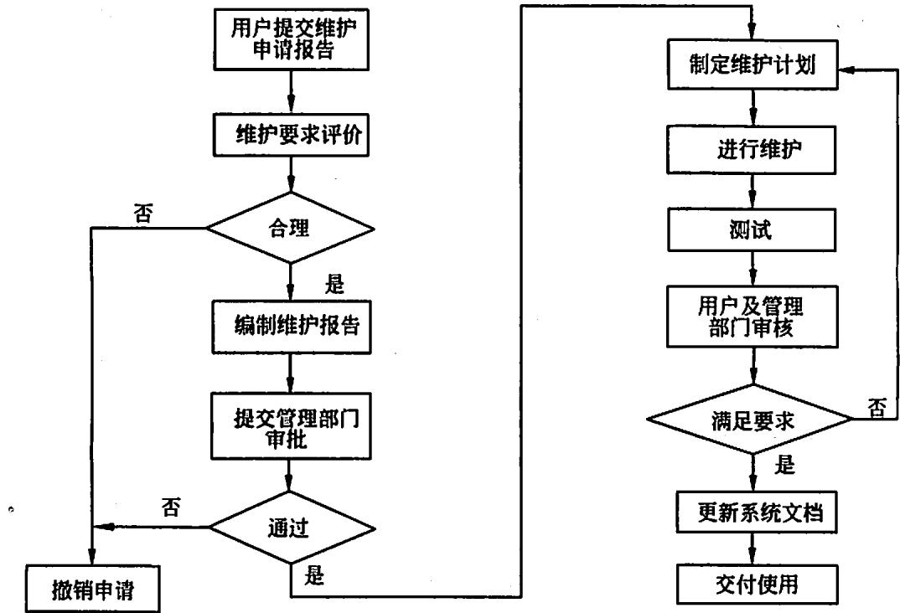

>[!warning] 版本提示
>本书为 **2006 年第 1 版**。现行考试依据是 **《信息系统管理工程师教程（第 2 版）》**（清华社 2024-10，20 章），
>两版**重合极少**：第 1 版的第 1–6 章（硬件/操作系统/语言/配置/数据结构/多媒体）在第 2 版已被删除或压缩。
>本页仅作**扩展参考**，备考请以 [[知识体系]]（第 2 版官方考纲）为准。

# 第22章 系统维护

在系统投入正常运行之后，就开始了生命周期，即短至4\~5年、长达10年的系统运行与维护阶段。系统的管理与维护由企业中专门的信息系统管理机构负责。系统维护的目的是要保证管理信息系统正常而可靠地运行，对系统进行评价，并能使系统不断得到改善和提高，以充分发挥系统的作用。系统维护的任务就是要有计划、有组织地对系统进行必要的改动，以保证系统中的各个要素随着环境的变化始终处于最新的、正确的工作状态。

## 22.1 概述

## 22.1.1 系统维护的任务和内容

系统维护的任务就是要有计划、有组织地对系统进行必要地改动，以保证系统中的各个要素随着环境的变化始终处于最新的、正确的工作状态。

信息系统维护的内容可分为以下 5 类。

（1）系统应用程序维护。系统的业务处理过程是通过程序的运行而实现的，一旦程序发生问题或业务发生变化，就必然引起程序的修改和调整，因此系统维护的主要活动是对程序进行维护。

（2）数据维护。业务处理对数据的需求是不断发生变化的，除系统中主体业务数据的定期更新外，还有许多数据需要进行不定期的更新，或随环境、业务的变化而进行调整，数据内容的增加、数据结构的调整，数据的备份与恢复等，都是数据维护的工作内容。

（3）代码维护。当系统应用范围扩大和应用环境变化时，系统中的各种代码需要进行一定程度的增加、修改、删除以及设置新的代码。

（4）硬件设备维护。主要是指对主机及外设的日常管理和维护，都应由专人负责，定期进行，以保证系统正常有效地运行。

（5）文档维护。根据应用系统、数据、代码及其他维护的变化，对相应文档进行修改，并对所进行的维护进行记载。

## 22.1.2 系统维护的方法

系统的可维护性对于延长系统的生命周期具有决定意义，因此必须考虑如何才能提高系统的可维护性，为此需从5个方面入手。

（1）建立明确的软件质量目标和优先级。可维护的程序应是可理解的、可靠的、可测试的、可更改的、可移植的、高效率的、可使用的。要实现所有这些目标，需要付出很大的代价。对于信息系统，更强调可使用性、可靠性和可修改性等目标，同时规定其优先级。这样有助于提高软件的质量，并对软件生命周期的费用产生很大的影响。

(2) 使用提高软件质量的技术和工具。模块化是系统开发过程中提高软件质量、降低成本的有效方法之一, 也是提高可维护性的有效技术。它的优点是, 如果需要改变某个模块的功能, 只需改变这个模块, 而对其他模块影响很小, 如果需要增加某些功能, 仅需增加完成这些功能的新的模块或模块层, 同时程序错误也容易被定位和纠正。结构化程序设计则把模块化又向前推进一步, 不仅使得模块结构标准化, 而且将模块间的相互作用也标准化了。采用结构化程序设计可以获得良好的程序结构, 提高现有系统的可维护性。

(3) 进行明确的质量保证审查。质量保证审查对于获得和维持系统各阶段的质量, 是一项很有用的技术。审查还可以检测系统在开发和维护阶段内发生的质量变化, 可对问题及时采取措施并加以纠正, 以控制不断增长的维护成本, 延长系统的有效生命周期。

(4) 选择可维护的程序设计语言。程序是维护的对象, 要做到程序代码本身正确无误, 同时要充分重视代码和文档资料的易读性和易理解性。因此, 要注意编码规则、编码风格, 尽量采用结构化程序设计和通用性高的程序设计语言, 把与机器和系统相关的部分减少到最低限度。

(5)系统的文档。系统文档是对程序总目标、程序各组成部分之间的关系、程序设计策略、程序实现过程的历史数据等的说明和补偿。因此,在开发过程中各阶段产生的文档资料要尽可能采用形式描述语言和自动的文件编辑功能。文档是维护工作的依据,文档的质量对维护有着直接的影响。一份好的文档资料应能正确地描述程序的规格,描述的内容必须细化,并且易读、易理解。

完成各项系统维护工作后，应及时提交系统维护报告，就所做的系统维护的具体内容进行总结，并将其加入到系统维护的有关文档中。

## 22.2 制定系统维护计划

在进行具体的系统维护之前，要首先制定好详细的系统维护计划，将维护工作的各个方面都考虑清楚。

## 22.2.1 系统的可维护性

## 1. 信息系统的可维护性

系统的可维护性是对系统进行维护的难易程度的度量，影响系统可维护性主要有三个方面。

（1）可理解性。外来人员理解系统的结构、接口、功能和内部过程的难易程度。

(2) 可测试性。对系统进行诊断和测试的难易程度。

（3）可修改性。对系统各部分进行修改的难易程度。

## 2. 系统可维护性的度量

系统可维护性的三个方面因素是密切相关的，只有正确地理解，才能进行恰当地修改，只有通过完善的测试才能保证修改的正确，这样才能防止引入新的问题。

虽然通过上面三个方面的因素对于系统的可维护性很难量化，但是可以通过能够量化的维护活动的特征，来间接地定量估算系统的可维护性。比如国外企业一般通过把维护过程中各项活动所消耗的时间记录下来，用以间接衡量系统的可维护性，详细内容如下。

\- 识别问题的时间。

\- 管理延迟时间。

\- 维护工具的收集时间。

\- 分析、诊断问题的时间。

\- 修改设计说明书的时间。

\- 修改程序源代码的时间。

\- 局部测试时间。

\- 系统测试和回归测试的时间。

\- 复查时间。

\- 恢复时间。

通过对系统可维护性的分析可见，提高系统可维护性应当从系统分析与设计开始，直至系统实施的系统开发全过程，在系统维护阶段再来评价和注意可维护性已为时已晚。企业应特别强调提高系统可维护性的工作必须贯穿系统开发过程的始终。

## 22.2.2 系统维护的需求

在制定系统维护计划之前首先要充分了解系统维护的需求，只有这样，才能制定出正确的系统维护计划。系统维护的需求主要源于决策层的需要、管理机制或策略的改变、用户意见及对信息系统的更新换代。而在了解系统维护需求之前，要先确定系统维护项目是什么和该项目相应的维护级别。

## 1. 设置系统维护项目

系统的维护的项目如下。

（1）硬件维护：对硬件系统的日常维修和故障处理。

（2）软件维护：在软件交付使用后，为了改正软件当中存在的缺陷、扩充新的功能、满足新的要求、延长软件寿命而进行的修改工作。

（3）设施维护：规范系统监视的流程，IT人员自发地维护系统运行，主动地为其他部门、乃至外界客户服务。

其中，系统维护的重点是系统应用软件的维护工作，按照软件维护的不同性质划分为4种类型，即纠错性维护、适应性维护、完善性维护和预防性维护。根据对各种维护工作分布情况的统计结果，一般纠错性维护占21%，适应性维护占25%，完善性维护达到50%，而预防性维护及其他类型的维护仅占4%。可见系统维护工作中，半数以上的工作是完善性维护。

## 2. 设置维护项目相应的级别

根据系统运行的不同阶段可以实施 4 种不同级别的维护。

(1) 一级维护: 即最完美的支持, 配备足够数量工作人员, 他们在接到请求时, 提供随时对服务请求进行响应的速度, 并针对系统运转的情况提出前瞻性的建议。

（2）二级维护：提供快速的响应，工作人员在接到请求时，提供 24 小时内对请求进行响应的速度。

（3）三级维护：提供较快的响应，工作人员在接到请求时，提供 72 小时内对请求进行响应的速度。

（4）四级维护：提供一般性的响应，工作人员在接到请求时，提供10日内对请求进行响应的速度。

对于试运行状况或软件大面积推广状态的项目，阶段时间可能存在问题较多且可能严重影响用户日常工作的项目（例如财务软件跨年时期），其维护级别为一级。要求在"维护项目申请单"中明确维护级别，一级维护的联系人必须能够随时被联系。维护级别可以由申请维护部门根据具体情况予以申请调整。根据用户具体的请求，"软件维护工作单"的填写人根据具体情况填写紧急程度一栏时可以参照维护级别。

## 22.2.3 系统维护计划

系统的维护不仅范围广，而且影响因素多。通常，在设计系统维护计划之前，要考虑下列三方面的因素：

(1) 维护的背景。包括系统的当前情况、维护的对象、维护工作的复杂性与规模。

(2) 维护工作的影响。包括对新系统目标的影响、对当前工作进度的影响、对本系统其他部分的影响、对其他系统的影响。

（3）资源的要求。包括对维护提出的时间要求、维护所需费用（并与不进行维护所造成的损失比是否合算）、维护所需的工作人员。

做系统维护的计划要考虑很多个方面，包括维护预算、维护需求、维护系统、维护承诺、维护负责人、维护执行计划、更替等。

## 1. 维护预算

系统维护具有很高的代价，一般来讲，系统维护的费用占整个系统生命周期总费用的60%以上。

## （1）有形的代价直接来自维护工作本身

维护工作可分为非生产性活动和生产性活动两部分，前者主要是理解源程序代码的功能，解释数据结构、接口特点和性能限度等。这部分工作量和费用与系统的复杂程度（非结构化设计和缺少文档都会增加系统的复杂程度）、维护人员的经验水平以及对系统的熟悉程度密切相关；后者主要是分析评价、修改设计和编写程序代码等。其工作量与系统开发的方式、方法、采用的开发环境有直接关系。因此，如果系统开发途径不好，且原来的开发人员不能参加维护工作，则维护工作量和费用将呈指数上升。统计表明，60%\~70%的软件费用花在维护方面。

## (2) 许多无形的代价来自维护所产生的效果和影响上

由于越来越多的系统维护工作束缚了系统开发人员和其他开发资源，开发的系统越多，维护的负担越重，将导致完全没有时间和精力从事新系统的开发，从而耽误甚至丧失了开发良机。此外，合理的维护要求不能及时被满足，将引起用户的不满；维护过程中引入新的错误，使系统可靠性下降等问题将带来很高的维护代价。

要根据本单位的实际情况进行系统维护预算，包括系统的情况、系统开发人员的能力水平及是否有相关经验、项目维护的级别等。

## 2. 维护需求

在制定维护计划前，要先确定详细的维护需求，列出维护需求单。维护需求单中包含的内容有：需求提出部门、需求提出人员姓名、需求提出时间、拟修改子系统名称、拟修改功能名称、具体修改要求、系统负责人签字、功能完成情况记录、功能完成人员姓名、功能完成时间，等等。认真填写该表，充分了解维护需求，以便制定出正确的维护计划。

## 3. 维护承诺

通过维护实施人员与提出维护要求的人进行具体讨论，可以达成一定的协议与共识，由此制定详细的维护承诺书并签字。维护实施人员要按照维护承诺来完成维护工作，如果维护过程中有任何影响维护承诺实现的问题，并且经多方努力无法解决的，则应该及时与委托方联系。

## 4. 维护负责人

系统的维护工作一定要慎重，并且对维护人员要求较高。因为系统维护所要解决的问题可能来自系统整个开发周期的各个阶段，因此承担维护工作的人员应对开发阶段的整个过程、每个层次的工作都有所了解，从需求、分析、设计一直到编码、测试等。此外，他们还应具有较强的程序调试和排错能力。这些对维护人员的知识结构、素质和专业水平都有较高的要求。

每项维护工作都应由专人负责，并且通过一定的批准手续。维护工作的审批者要对系统非常熟悉，并且能够判断各种维护的必要性、影响范围和产生的后果。当有关人员完成维护修改任务后，由维护小组组织测试并与用户共同验收成果。通过验收后，新的成果可正式投入使用，系统的相应文档应被更新、归档。

## 5. 维护执行计划和更替

根据维护预算、维护需求、维护承诺、维护负责人员情况和现有的设备、技术等各方面条件来制定系统的维护执行计划，这个计划应涉及执行过程中的步骤和细节，应当尽量减少维护期间对系统的正常运行所造成的影响。需要注意的是，采用本地或全局方式把站点资源移至备用站点，就可以完全避免为升级和维护而执行计划内停机。

系统中的数据、软件和硬件都有一定的更新、维护和检修的工作规程。这些工作都要有详细的、及时的记载，包括维护工作的内容、情况、时间、执行人员等。这不仅是为了保证系统的安全和正常运行，而且有利于系统的评价及进一步扩充。

## 22.2.4 系统维护的实施形式

系统维护的实施形式有 4 种，即：每日检查、定期维护、预防性维护、事后维护。

根据实际情况决定采用哪种实施方式。对于最重要、最常用并且容易出故障的软件、硬件和设施可以采用每日检查的维护方式；对于运行情况比较稳定的软件、硬件或设施，可以采用定期维护的方式，例如每个月维护一次；预防性维护是对那些还有较长使用寿命，目前正常运行，但可能将要发生变化或调整的系统进行的主动的维护，预防性维护也要定期进行一次；事后维护是在问题已经发生了的情况下，对系统进行维护，这种方式是被动的。某IT出问题了，系统的用户是第一个发现的人，打电话给IT部门，IT部门再去解决问题。不仅工作被动，效率低下，更严重的是造成某些其他后果。应当规范系统监视的流程，IT人员自发地维护系统运行，主动地为其他部门、乃至外界客户服务。将CIO们的角色由急诊大夫晋升为保健医生，也使IT部门由被动转化为主动，成为企业赢利的前沿部门。

## 22.3 维护工作的实施

系统维护工作是乏味的重复性工作，很多技术人员觉得缺乏挑战和创新，因此更重视开发而轻视维护。但系统维护的实施是信息系统可靠运行的重要技术保障，必须予以重视，在信息系统维护方面也应注意系统维护人员的稳定性。

## 22.3.1 执行维护工作的过程

系统维护工作的程序如图 22-1 所示。

用户的维护申请都以书面形式的"维护申请报告"向维护管理员提出的。对于纠错性维护，报告中必须完整描述出现错误的环境，包括输入/输出数据以及其他系统状态信息；对于适应性和完善性维护，应在报告中提出简要的需求规格说明书。

维护管理员根据用户提交的申请，召集相关的系统管理员对维护申请报告的内容进行核评。情况属实，则按照维护性质、内容、预计工作量、缓急程度或优先级以及修改所产生的变化结果等，编制维护报告，并将其提交给维护管理部门审批。

维护管理部门从整个系统出发，从合理性和技术可行性两个方面对维护要求进行分析和审查，并对修改所产生的影响做充分地估计。对于不妥的维护要求要在与用户协商的条件下予以修改或撤消。

  
图 22-1 系统维护的工作程序

通过审批的维护报告，由维护管理员根据具体情况制定维护计划。对于纠错性维护，估计其缓急程度。如果维护要求十分紧急，严重影响系统的运行，则应安排立即开始修改工作；如果问题不是很严重，可与其他维护项目结合起来从维护开发资源上统筹安排；对于适应性或完善性维护要求，高优先级的将被安排在维护计划中，优先级不高的可视为一个新的开发项目被组织开发。维护计划的内容应包括：工作的范围、所需资源、确认的需求、维护费用、维修进度安排以及验收标准等。

维护管理员将维护计划下达给系统管理员。要建立维护监督机制，系统维护工作严禁单人操作，在确定项目维护人员的同时，必须指定维护监督人，以保证系统的安全。在真正地执行维护工作之前，系统管理员要根据单位的实际情况制定一个维护实施计划，计划维护工作的具体实施步骤与细节。然后由系统管理员按实施计划进行具体的维护、修改工作。系统维护时，要对数据采取妥善的保护措施，例如：数据转储、抹除、卸下磁盘磁带，维护时安全人员必须在场，等等。远程维护时，应事先通知。修改后应经过严格测试，以验证维护工作的质量。测试通过后，再由用户和管理部门对其进行审核确认，不能完全满足要求的应返工再进行修改。只有经确认的维护成果才能对系统的相应文档进行更新，最后交付用户使用。

为了评价维护的有效性、确定系统的质量、记载系统所经历过的维护内容，应将维护工作的全部内容（如维护目的、维护措施、维护对象、维护规模、语言、时间、维护人和监督人签字、运行和错误发生的情况、维护所进行的修改情况，以及维护所付出的代价等）以规范化文档的形式记录下来，形成历史资料备查，并撰写一份最终的维护总结报告。

维护产生的修改对于系统有三方面的副作用，如下所示。

\- 对源代码的修改可能会引入新的错误。

\- 对数据结构进行修改可能会带来数据的不匹配等错误，在修改时必须参照系统文件中关于数据结构的详细描述和模块间的数据交叉引用表，以防局部的修改影响全局的整体作用。

\- 任何对源程序的修改，如不能对相应的文档进行更新，造成源程序与文档的不一致，必将给今后的应用和维护工作造成混乱。

另外，系统维护人员应职责明确，保持人员的稳定性，对每个子系统或模块至少应安排两个人共同维护，避免对个人的过分依赖。在系统未暴露出问题时，就应着重于熟悉掌握系统的有关文档，了解功能的程序实现过程，一旦提出维护要求，应立即高效优质地实施维护。

最后，应注意系统维护的限度问题。即当系统生命周期结束的时，应及时采用新系统。

## 22.3.2 软件维护

系统维护工作的对象是整个系统的配置。由于问题可能来源于系统的各个组成部分，产生于系统开发的各个阶段，因此系统维护工作并不仅仅是针对源程序代码，而且还包括了系统开发过程中的全部开发文档。所以，一旦业务处理出现问题或发生变化，就要修改应用程序及有关文档。软件维护是系统维护最主要的内容。

## 1. 软件维护管理

（1）任何人员不得擅自对系统文件进行删除或修改。软件操作人员不得对系统文件进行任何内容的操作。

(2) 系统管理员对软件系统进行全面维护，并进行记录。

（3）定期对系统进行病毒检查。

（4）建立故障报告制度。系统运行或软件操作中发生故障，如属简单故障，由系统管理员现场解决；现场无法解决的，由第一发现者进行故障登记，部门负责人会同系统管理员制定处理方案（方案包括：故障分析、拟采取措施、保障数据安全防范措施等），经核算中心分管主任批准后实施。对于无法排除的故障，由系统管理员及时联系相关单位解决。

（5）对软件进行修改、升级时，首先要全面备份系统的数据，做好新旧系统数据的衔接工作。

## 2. 按照维护的具体目标分类

（1）完善性的维护。完善性维护就是在应用软件系统使用期间为不断改善和加强系统的功能和性能，以满足用户日益增长的需求所进行的维护工作。在整个维护工作量中，完

善性维护居第一位。

（2）适应性维护。适应性维护是指为了让应用软件系统适应运行环境的变化而进行的维护活动。适应性维护工作量约占整个维护工作量的 25%。

（3）纠错性维护。纠错性维护的目的在于，纠正在开发期间未能发现的遗留错误。对这些错误的相继发现，对它们进行诊断和改正的过程被称为纠错性维护。这类维护约占总维护工作量的 20%。

（4）预防性维护。其主要思想是维护人员不应被动地等待用户提出要求才做维护工作，而应该选择哪些还有较长使用寿命的部分加以维护。

## 3. 按照开发方分类

自己公司开发的软件、合同开发的软件、市场买的软件，这三种软件的维护途径可以是不同的。

自己公司开发的软件一般由原开发人员进行维护。

按合同开发的软件产品交付后，开发方应依据开发时签定的合同，负责软件的维护和软件版本升级工作。维护活动一般包括：对顾客使用中出现的软件故障进行测试、分析和修复；在维护阶段，按顾客提出的功能和性能改进要求进行软件版本升级，升级后的软件版本应纳入配置管理，并保存软件维护、升级记录。

若购买了某种软件产品且该软件在产品支持周期内，则还可以购买该软件公司的软件维护服务。软件公司为软件产品用户推出专业技术支持服务，服务一般由公司具有丰富产品知识和实践经验的资深软件工程师协同技术中心专家组成专业技术团队共同提供，目的是帮助客户及时、快速、可靠地解决在软件系统的维护过程中所遇到的技术问题，使得客户的软件系统可以更加安全稳定地运行，以保障和促进客户业务的顺利开展并取得更大的成功。

软件维护合同一般包括软件的更新和技术支持。两者捆绑在一起每年统一收取一笔费。客户需要签定软件维护合同，以获得技术支持和将来的升级服务。在多数情况下合同的主要目的是软件的更新。

系统维护中经常会遇到一些问题。系统维护中的编码本身造成的错误比例并不高，仅占4%左右，而绝大部分问题源于系统分析和设计阶段。通常，理解别人编写的程序是很难的，且难度随着软件配置文档的减少而增加；绝大多数系统在设计和开发时并没有很好地考虑将来可能的修改，如有些模块不够独立，牵一发而动全身；系统维护工作相对缺乏挑战性，使系统维护人员队伍不稳定。所以，一般来说，系统维护人员应当就是系统的原开发人员中的一部分。

## 22.3.3 硬件维护

如果硬件出现故障，则应及时分析、判断故障，并进行硬件修复，或者调换。如硬件

在出厂保质期内，应保留保修单，并按照出厂方规定保修。

也可以找专业的硬件维护工程师对硬件进行维护，可选择与其所在的公司签订硬件维护协议。根据协议，该公司可提供快速无限的现场维护服务，以确保客户的硬件正常工作。也可以提供硬件的常规维护，即定期地对硬件进行维护，内容包括：计算机硬件检查、磁盘清洁、打印机清洗，等等，以保证设备健康运行。或者在硬件出现故障时，提供热线支持。

此外，在维护设备清单中指明的特别重要的设备需要安排备用设备，备用设备的配置应能满足替代相应设备正常运行。备用设备的存储要有专人负责，防潮、防火、并防止设备的丢失和损坏，以便在原硬件设备出现故障时，能够及时找到好用的备用设备来替换。

硬件维护管理的要求如下：

① 核算中心网络应配备不间断电源。工作场地应配备必要的火警设施、消防器材，严禁烟火。

② 操作人员应每天保持设备及环境的清洁整齐，要爱护设备。在系统管理员的指导下，每周进行设备保养。

③ 系统管理员每周全面检查一次硬件系统，做好检查记录，发现问题及时处理，以保证系统正常运行。

④ 每月对计算机场地的安全进行检查，包括电源、消防、报警、防鼠、防电磁波、防雷击、防静电等设备和措施，及时消除隐患。

## 选择题

1. 系统维护的类型包括\_\_\_\_。
A) 纠错性维护
B) 适应性维护
C) 完善性维护
D) 增值性维护
E) 预防性维护

2. 系统维护的内容不包括\_\_\_\_。
A）应用程序
B）数据
C）计算机设备
D）文档

## 思考题

1. 科学规范的信息系统管理和维护工作的重要性何在？  
2. 系统维护的内容包括哪些？有哪几种方法和类型？  
3. 系统的可维护性如何解释，如何进行度量？  
4. 简述执行系统维护的流程。
