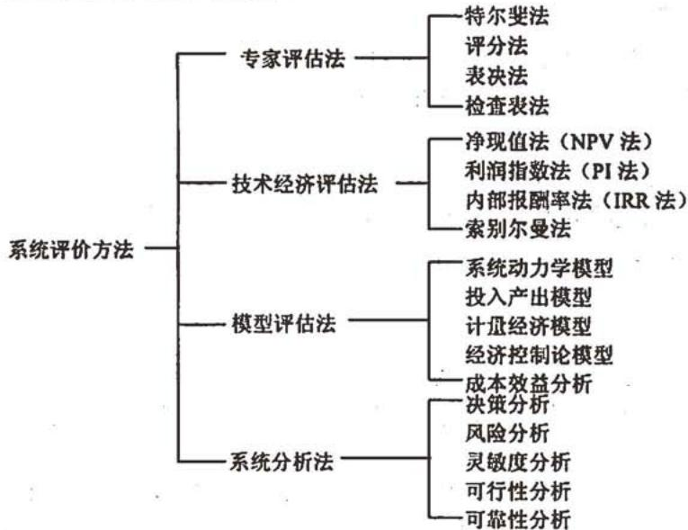
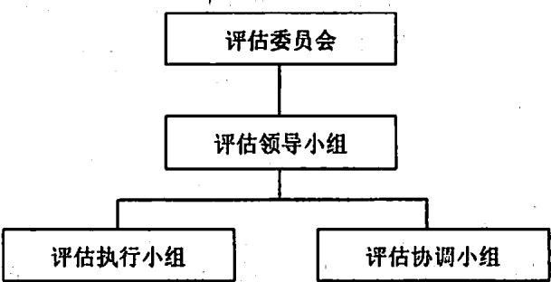

>[!warning] 版本提示
>本书为 **2006 年第 1 版**。现行考试依据是 **《信息系统管理工程师教程（第 2 版）》**（清华社 2024-10，20 章），
>两版**重合极少**：第 1 版的第 1–6 章（硬件/操作系统/语言/配置/数据结构/多媒体）在第 2 版已被删除或压缩。
>本页仅作**扩展参考**，备考请以 [[知识体系]]（第 2 版官方考纲）为准。

# 第24章 信息系统评价

随着信息技术的不断发展，不少企业纷纷上马 MIS、ERP、CRM、SCM 等信息系统。那么，如何评价信息系统的运行效率呢？怎样的信息系统才算是一个合格的信息系统呢？应该从哪些方面来评价一个信息系统的运行质量呢？

所谓系统评价，是指根据预定的系统目的，在系统调查和可行性研究的基础上，主要从技术和经济等方面，就各种系统设计的方案所能满足需要的程度及消耗和占用的各种资源进行评审和选择，并选择出技术上先进、经济上合理、实施上可行的最优或满意方案。根据评价与系统的关系，可以区分出评价类型，如表 24-1 所示。

表 24-1 系统评价的类型

<table><tr><td>评价与系统的关系</td><td>评价的类型</td></tr><tr><td>评价与决策</td><td>决策前评价:决策中评价;决策后评价</td></tr><tr><td>评价与系统发展过程</td><td>事前评价:中间评价;事后评价</td></tr><tr><td>评价与信息特征</td><td>基于数据的评价:基于模型的评价;基于专家知识的评价;基于数据、模型、专家知识评价</td></tr></table>

评价任何问题都必然要涉及以下基本要素：评价者、评价对象、评价目标、评价指标、评价原则和策略。各个基本要素的有机组合被称为一个评价系统。

## 24.1 信息系统评价概述

## 24.1.1 信息系统评价的概念和特点

系统评价就是对系统运行一段时间后的技术性能及经济效益等方面的评价，是对信息系统审计工作的延伸。评价的目的是检查系统是否达到了预期的目标，技术性能是否达到了设计的要求，系统的各种资源是否得到充分利用，经济效益是否理想，并指出系统的长处与不足，为以后系统的改进和扩展提出依据。

信息系统中包含了信息资源、技术设备、任何环境等诸多因素，系统的效率是通过信息的作用和方式表现出来的，而信息的作用又要通过人在一定的环境中，借助以计算机技术为主体的工具进行决策和行动表现出来的。因此信息系统的效能既有有形的，也有无形的，既有直接的，也有间接的；既有固定的，也有变化的。因此，信息系统的评价具有复杂性和特殊性。

根据信息系统的特点、系统评价的要求与具体评价指标体系的构成原则，可从技术性能评价、管理效益评价和经济效益评价等三个方面对信息系统进行评价。

## 24.1.2 信息系统的技术性能评价

信息系统技术性能评价的内容主要包括以下几个方面：

（1）系统的总体技术水平。包括网络的结构、系统的总体结构；所采用技术的先进性、实用性，系统的正确性和集成程度等。

（2）系统的功能覆盖范围。对各个管理层次及业务部门业务的支持程度，满足用户要求的程度、数据管理的规范等。

（3）信息资源开发和利用的范围和深度。包括是否优化了业务流程，人、财、物的合理利用，对市场，客户等信息的利用率等。

（4）系统质量。人机交互的灵活性与方便性，系统响应时间与信息处理速度满足管理业务需求的程度，输出信息的正确性与精确度，单位时州内的故障次数与故障时间在工作时间中的比例，系统结构与功能的调整、改进及扩展、与其他系统交互或集成的难易程度，系统故障诊断、故障恢复的难易程度。

（5）系统安全性。保密措施的完整性、规范性与有效性，业务数据是否会被修改和被破坏，数据使用权限是否得到保证。

(6) 系统文档资料的规范、完备与正确程度。

## 24.1.3 信息系统的管理效益评价

管理效益即社会效益，是间接的经济效益，是通过改进组织结构及运作方式、提高人员素质等途径，促使成本下降、利润增加而逐渐地间接获得的效益。

管理效益评价可以反过来从系统运行所产生的间接管理作用和价值来进行评价。

（1）系统对组织为适应环境所做的结构、管理制度与管理模式等的变革所起的作用。

（2）系统帮助改善企业形象、对外提高客户对企业的信任度，对内增强员工的自信心和自豪感的程度。

（3）系统使管理人员获得许多新知识、新技术与新方法和提高技能素质的作用。

（4）系统对实现系统信息共享的贡献，对提高员工协作精神及企业的凝聚力的作用。

(5) 系统提高企业的基础管理效率，为其他管理工作提供有利条件的作用。

## 24.1.4 信息系统成本的构成

信息系统的成本主要根据系统在开发、运行、维护、管理、输出等方面的资金耗费以及人力、能源的消耗和使用来确定。简单地说，系统的成本构成应该如下。

\- 系统运行环境及设施费用。

\- 系统开发成本。

\- 系统运行与维护成本。

为了对其进行更好的分析，可以从功能属性角度将其划分为：基础成本（开发阶段所需投资和初步运行所需各种设施的建设费用，如开发成本、基础设施购买费、信息材料成本费）、附加成本（指运行、维护过程中不断增加的新的消耗，如材料耗损费、折旧费、业务费）、额外成本（由于信息的特殊性质而引起的成本耗费，如信息技术以及信息交流引起的通信费）和储备成本（在信息活动中作为储备而存在的备用耗费，如各种公积金等）。具体而言，包含以下要素。

（1）开发成本。指在信息系统的分析、设计过程中的耗费，包括市场调研费、人力耗费等。

（2）基础设施购买费。在信息系统建立之初对各种硬件设备的购买费用，可以说是一次性投入的物质耗费，作为固定资产而存在。

（3）信息材料成本费。对信息活动中所需利用的信息资料的购买费用。

（4）各种耗损费。在信息系统的运行过程中涉及的软、硬件耗损费用，包括如下。

\- 信息材料耗损费。包括因材料的时效性和材料使用程度而引起的损耗。

\- 物质材料耗损费。包括能源耗费和原材料（如纸张、磁带等）的损耗。

\- 固定资产耗损、折旧费。包括各项固定资产（如通信设备、办公设备等）的折旧。

（5）通信费用。为进行系统内外交流引起的费用，如联网所交纳的上网费、软件购买费等。

（6）调研费用和咨询费用。包括上级部门委托或自身需要或接受外来委托所进行的调研、咨询过程中产生的耗费，也被称为业务费。

(7) 劳务费。包括职工工资、离退休人员工资及出差的差旅费等。

（8）各种管理费。对人员的管理如职工医药费等福利措施以及对系统内部资源的维护与管理费用。

(9) 税金。向税务部门所缴纳的税额。

## 24.1.5 信息系统经济效益来源

信息系统的效益主要从创收和服务活动中获得，按其属性可分为固有收益（指能长期进行的产品服务或科研基金的申请）、直接收益（从各种服务或信息产品销售中直接获得）、间接收益（信息产品或服务的成果被再次利用所产生的收益）。具体有以下要素。

（1）科研基金费即科学事业费。指进行科研后所获得的收入或上级部门直接拨款用于信息系统的自身建设费用。

（2）系统人员进行技术开发的收入。包括系统人员开发出的成果带来的收入以及参加各种比赛所带来的收入等。

（3）服务收入。接受用户委托所进行的信息服务收取的服务费，包括作为网络结点收取费用、接受咨询、检索等服务带来的收入。

（4）生产经营收入。有的信息系统还兼作别的服务项目，如复印、打字、代译等。有的还开展出版印刷、自行创刊等服务。

(5) 其他收入。除以上获取的收入外, 从别的途径所得到的收入, 如税后留利。

## 24.1.6 信息系统经济效益评价的方法

## 1. 投入产出分析法

这是经济学中衡量某一经济系统效益的重要方法。它的分析手段主要是采用投入产出表。根据系统的实际资源分配和流向，列出系统的所有投入和产出，并制成二维表的形式。该方法适用于从系统角度对系统做经济性分析，因其数据来源一般为系统硬指标，如设备、数据库、人员的消耗费用等。

## 2. 成本效益分析法

成本效益分析即用一定的价格，分析测算系统的效益和成本，从而计算系统的净收益，以判断该系统在经济上的合理性。这种方法的分析结果比较直观，易于理解和接受，操作起来相对容易。其中，关键是效益值的测算问题。信息系统既带来直接效益，又带来间接效益。因此，这里的效益应包括各种有形经济效益，如系统为用户提供服务获得的各种货币收入及信息系统带来的检索速度的提高、工作人员的减少等；也包括某些无形的社会效益，如信息系统的建立有助于产生正确的决策、有助于改善人们的知识结构等。无形效益的计量难度较大，一般是通过用户调查以定性方式测得，再通过某种变换转换为定量数据。

## 3. 价值工程方法

价值工程的基本方程式可以简单表述为：一种产品的价值(V)等于其功能(F)与成本(C)之比，即 V=F/C。由方程可知，价值是功能与成本的综合反映。信息系统要获得最佳经济效益，必须使得方程式中的功能和费用达到最佳配合比例。

价值工程方法的实现是将功能、成本定量化，然后求出比值。成本(C)是用货币表示的各种消耗，数量化相对容易；而功能(F)常常指技术或效用指标，是难以量化的，一般采取的方法是分析系统的功能，对每一功能确定质量评价指标，如检索功能可用检全率、检准率来描述，存储功能可用存储总量、存储增长速度等来描述；然后通过调查，请专家、核心用户对这些功能的各项指标进行打分、评价，由此确定各功能的权值及功能系数。

这种方法为功能和成本提供了可比性，对于信息系统比较适用，且从两个角度评价均可用此法。值得一提的是，为改进现有系统而进行工作评价时，用价值工程方法分析功能、成本的变动对价值的影响尤为有效。但这种方法需要有参照系统使其价值具有可比性。 $V \geqslant 1$ 只是表示方案的可行，并不代表方案为最优。

## 24.1.7 信息系统的综合评价

由于信息系统是一个复杂的社会技术系统，它所追求的不仅仅是单一的经济性指标。除了费用、经济效益和财务方面的考虑外，还涉及技术先进性、可靠性、适用性和用户界面友善性等技术性能方面的要求，以及改善员工劳动强度和单位经营环境、改进组织结构及运作方式的管理目标。

多指标综合评价的理论和方法的研究是一个正在发展的领域。有关它在信息系统评价中的应用研究则更有待人们的工作，在这里我们只讨论系统综合评价的框架轮廓和基本方法。

所谓的信息系统多指标综合评价是指对信息系统所进行的一种全方位的考核或判断，它具备以下特征：

\- 它的评价包含了多个独立指标。

\- 这些指标分别体现着信息系统的不同方面，通常具有不同的量纲。

\- 综合评价的目的是对信息系统做出一个整体性的判断，并用一个总体评价值来反映信息系统的一般水平。

一般说来，信息系统多指标综合评价工作主要包括三方面的内容：一是综合评价指标体系及其评价标准的建立，这是整个评价工作的前提；二是用定性或定量的方法（包括审计的方法）确定各指标的具体数值，即指标评价值；三是各评价值的综合，包括综合算法和权重的确定、总评价值的计算等。

在确定指标以后，再确定各指标的权重，并用审计结果结合定性分析给各指标打分，最后确定该系统的总分和等级，总结建设该系统的经验教训，并指出下一步的发展方向。

## 24.2 信息系统评价项目

## 24.2.1 建立评价目标

评价活动是有目标的，但评价本身不是目的，评价的最终目标是为了做出决策。因此在信息系统周期的不同阶段，应用绩效评价的作用是不同的。在系统规划期，重点关注如何识别满足业务目标的IT系统，同时规划战略目标，并从不同的层面沟通和管理，建立良好的组织架构和技术基础架构是必不可少的；在系统设计期，在于理解IT战略后，识别、开发或获取、实施IT解决方案，保持项目的方向；在系统转换期，主要是对已有系统的变更与维护，以确保系统生命周期的持续改进；在系统运行期，重点在于考核系统找出问题反馈修正系统，关注服务的价值交付，以及应用系统的实际数据处理流程及系统的安全性。

对于一个信息系统的运行评价，首先应该确立相应的系统评价者、评价对象、评价目标、评价指标和评价原则及策略等，编写相应的《信息系统评价计划书》。无论是内部评价，还是外部评价，所有的信息化评价都要遵循一定的工作程序，工作程序是指从确定评价对象至完成整个评价工作的过程。一般包括如下步骤：

（1）确定评价对象，下达评价通知书，组织成立评价工作组和专家咨询组。评价通知书是指评价组织机构（委托人）出具的行政文书，也是企业接受评价的依据。评价通知书应载明评价任务、评价目的、评价依据、评价人员、评价时间和有关要求等事项。

（2）拟定评价工作方案，搜集基础资料。评价工作方案是评价工作组进行某项评估活动的工作安排，其主要内容包括：评价对象、评价目的、评价依据、评价项目负责人、评价工作人员、工作时间安排，拟用评价方法、选用评价标准、准备评价资料以及有关工作要求等。

（3）评价工作组实施评价，征求专家意见和反馈企业，撰写评价报告。评价工作组依据企业报送的资料进行基本评价。如果是企业内部进行评价，可以只对部分内容进行评价，受企业委托的职责而定。如果是外部评价，则要有委托部门的指令，按照计划行事。

（4）评价工作组将评价报告报送专家咨询组复核，向评价组织机构（委托人）送达评价报告和选择公布评价结果，建立评价项目档案等。

评价工作正式开始前，评价工作组可以按照评价基本要求，组织企业有关人员进行自测。企业自测带有自愿和预备性质，自测报告应该有完整的工作底稿备查。

评价工作组取得的评价结论应该与企业自测结论进行对照，及时对评价结论进行补充和修改，对评议工作组的评价结论和企业自测结论相差较大的，要进行基础资料的核对，找出差异原因，如依据充分应该对评价结论进行必要调整。

系统评价的主要方法如图 24-1 所示。

  
图24-1 系统评价的方法

## 24.2.2 设置评价项目

一般地，确定评价对象、下达评价通知书后，应组织成立评价工作组和专家咨询组，开始对系统进行评价。评价小组主要负责审定系统效率、系统有效性、解题周期、响应时间、信息的关联、输入输出的分配及控制、输入输出的格式和内容、文件、记录和数据库的结构、更新和后备措施、系统资料的通用性等内容。关于需要进一步改进的不足之处和建议都要编制成文件，并提交给相应的业务领域的管理人员。IT项目评估应该按照IT项目的特点来进行，从硬件、软件、网络、数据库以及运行等各个方面对IT项目进行全方位的评估。

在测试过程中，应组成一个完整的评估项目组织结构，如图 24-2 所示。

  
图24-2 评估项目组织结构

## 1. 评估委员会

由具有多年信息系统评估经验的专家组成。它将依据评估执行小组所提交的所有关于受评估系统的证据，对受评估系统做出评估。

## 2. 评估领导小组

由评估机构领导成员和申请评估方的信息部门主管共同组成。评估领导小组的职责主要是审核受评估系统的各项测评评估计划和受评估系统测试计划。监督整个评估项目的进度并考察项目各个阶段点的成果。并对最终所形成的现场核查报告和综合评估报告进行审查，评价结果及结论的合理性。

## 3. 评估执行小组

进行具体的核查与测评工作，为系统评估提供足够证据。主要工作职责为：制定信息系统测评计划、实施信息系统测评计划、制定信息系统测评报告、制定信息系统评估报告。

## 4. 评估协调小组

由申请评估方委派相关人员组成，该小组成员至少有一名具备一定的信息系统经验，同时具有一定组织能力的人员，能够在必要时有效调动其他部门人员。评估协调小组的主要工作职责为：为评估执行小组准备必要的测试环境；为评估执行小组提供必要的测试及核查条件，如提供合法账号、管理实施依据、安排会议地点，等等。

目前，我国国家信息化测评中心已经正式推出了中国第一个信息化指标体系——《企业信息化测评指标体系》，以全面评价中国境内各企业的信息化发展和应用水平。该体系包括三部分：一套基本指标、一套补充指标即效能评价和一套评议指标即定性评价。其核心部分是补充指标，也就是效能评价。可以参考这个指标来设置相应的评估标准。

## 24.3 评价项目的标准

企业信息化评价基准是准确衡量信息化绩效的尺度，基准的正确选择对企业信息化评价结果具有较大影响，评价基准的制定既是企业信息化评价体系建立的主要环节，也是企业信息化评价具体工作所面临的一个重要工作步骤。

## 24.3.1 性能评价标准

信息系统的性能究竟是怎么样的呢？它可以承担用户所要求的条件吗？这是信息系统被建设完成之后，许多客户都要问的问题，也是我们信息系统的评价的一个方面。

性能评价时机一般选在项目结束一段时间后，以实际的数据资料为基础，重新衡量信息化建设，为以后相关决策提供借鉴和反馈信息。

指标体系包括如下内容。

\- 系统的可靠性，软件硬件系统的可靠性以及数据可靠性，一般采用评价时间点上的测试结果作为可靠性指标的评价结果。

\- 系统效率，反映系统完成各项功能所需的计算资源，如周转时间、响应时间、吞吐量等系统效率指标。

\- 系统可维护性，确定系统错误并进行修正的努力程度。

\- 系统可扩充性，是指系统处理能力和系统功能的可扩充程度，分为系统结构、系统硬件和系统软件功能可扩充性评价指标。

\- 系统可移植性，指系统从一个硬件（软件）环境移植到另一个硬件（软件）环境的难易程度。

\- 系统实用性，是指系统运行对组织各部门的业务处理效率的提高等的支持程度如何，以及对系统分析、预测和控制的建议有效性如何。

\- 系统适应性，在运行环境、约束条件或用户需求有所变动时的适应能力。

\- 系统安全保密性，对用户无意操作或系统软硬件工作安全性的保护措施，以及对自然灾害和外部黑客攻击的安全保密防护。

下面介绍几个常见指标的概念。

(1) 事务处理响应时间。

事务处理响应时间描述的是作业输入系统到系统输出结果所需要的时间周期。而时间周期又与系统的用户数量有密切关系。主要测评事务处理响应时间是否在一个可接受的范围内，事务处理响应是否受负载的影响，事务处理响应时间是否在已定义的性能服务级别内等几方面内容。

可以使用两个基本原则来准确地和可预见性地测量和监控服务——主动监控和被动监控。主动监控意味着创建"人工事务处理"，该事务处理通过指定的间隔周期定期执行主动测试服务。被动监控则在事务处理以及事务处理交互发生时监控事务处理及其交互。主动监控具有固有的可预见性，它在发现错误之前不需要等待一个错误的实际发生，甚至在其实际影响服务间交互之前即可发现错误。经验表明同时使用这两种技术可以得到最佳效果。

例如，IBM 的 TPC-C 基准测试，可以用来测量每一个事务的响应时间，以及用来模拟键入时间及思考时间，键入时间是指在终端上录入数据所花费的时间，思考时间是指操作人员在终端读取事务的结果，进行下一个事务请求之前所花费的时间。每一个事物都有一个最小键入时间和最小思考时间。

## (2) 作业周转时间

作业周转时间是常见的一个企业测评指标。在信息系统中，它指的是一个作业到下一个作业所需要的时间。周转时间测量与企业的性质有关。例如一个流通型的企业，需要测量供给量、订货周期、操作周期、配送入店周期等。

## (3) 吞吐量

系统吞吐量描述的是在给定时间内系统处理的工作量。对于在线事务处理来说，吞吐量是每秒处理多少事务；对于通信网络来说，吞吐量是指每秒传输多少数据包或多少数据位。所以吞吐量的衡量单位是按工作单位（作业、人物、指令）来定义的。性能测评时往往将吞吐量作为主要的度量标准。例如 TEMS Evaluation 就提供了系统吞吐量的测评。

## (4) 故障恢复时间

一般指平均故障恢复时间，表示信息系统从发生故障到恢复规定功能所需要的时间。但必须说明，随着信息系统规模的增大，修复时间可能会加长。所以修复时间是一个随机变量。

## (5) 控制台响应时间

控制台响应时间，指的是控制台响应事务的时间。

除了上面几个测量标准之外，还有许多其他的测量标准，例如利用率、可靠性等。利用率指标以系统资源处于忙状态的时间为度量标准。系统资源是指计算机系统中能分配给某项任务的所有设施，包括系统中的硬件、软件和数据资源。系统未被利用的时间被称为空闲时间。对一般的系统而言，系统空闲与忙的时间片均匀地分布在整个运行时间内，因此系统资源既不能太忙，也不能太闲。可靠性指标用于描述系统处理用户工作的可用性或处理过程失败或错误的概率。一般人们更关注两次故障之间的工作时间分布特征。

现在许多厂商都提供系统性能监控、测量的工具，我们可以采用这些工具对系统性能

## 24.3.2 运行质量评价标准

系统运行质量评价是指，从系统实际运行的角度对系统性能和建设质量等进行的分析、评估和审计。系统评价的步骤为：先根据评价的目标和目的设置评价指标体系，对于不同的系统评价目的应建立不同的评价指标体系，然后根据评价指标体系确定采用的评价方法，围绕确定的评价指标对系统进行评价，最后给出评价结论。

信息系统在投入运行之后要不断对其运行状况进行分析评价，并以此作为系统维护、更新以及进一步开发的依据，大致有如下一些指标。

## 1. 预定的系统开发目标的完成情况

对照系统目标和组织目标检查系统上线后的实际完成情况；是否满足了科学管理的要求？各级管理人员的满意程度如何？有无进一步的改进意见和建议？为完成预定任务，用户所付出的成本（人、财、物）是否被限制在预定范围内？实施过程是否规范，各阶段文档是否齐全？功能与成本比是否在预定范围内？系统的可维护性、可扩展性、可移植性如何？系统内部各种资源的利用情况怎样？

## 2. 运行环境的评价

运行环境的效率如何？数据传输、输入、输出、加工处理的速度是否匹配？各类设备资源的负荷是否平衡，利用率如何？

## 3. 系统运行使用性评价

系统是否稳定可靠？系统的安全性、保密性如何？用户对系统操作和故障恢复的性能如何？系统功能的实用性和有效性如何？系统运行结果对各个部门的生产、经营、管理、决策和提供工作效率的支持程度如何？对系统的分析、预测和控制的建议有效性如何，实际被采纳的程度如何？系统运行结果的科学性和实用性分析。

## 4. 系统的质量评价

系统质量指的是在特定环境下，在一定的范围内区别某一事物的好坏。质量评价的关键是要定出质量的指标以及评定优劣的标准，质量的概念是相对的，对管理信息系统可以定出如下质量评价的特征和指标。

（1）系统对用户和业务需求的相对满意程度。系统是否满足了用户和管理业务对信息系统的需求，用户对操作的过程和运行结果是否满意。

(2) 系统的开发过程是否规范。指开发各个阶段的工作过程以及文档资料是否规范。

(3) 系统功能的先进性、有效性和完备性。这是衡量信息系统的关键。

（4）系统的性能、成本、效益综合比。这是综合衡量系统质量的首选指标，它集中反映了系统的质量好坏。

（5）系统运行结果的有效性和可行性。考察系统运行结果对于解决预期的管理问题是否有效和是否可行。

（6）结果是否完整。处理结果是否全面满足各级管理者的需求。

（7）信息资源的利用率。系统是否最大限度利用了现有的信息资源并充分发挥了它们在管理决策中的作用。

（8）提供信息的质量如何。考查系统所提供信息（分析结果）的准确程度、精确程度、响应速度以及推理、推断、分析、结论的有效性、实用性、准确性。

(9) 系统实用性。考察系统对管理工作是否实用。

也许随着信息化的进一步发展和全球经济的进一步融合，信息系统也会像计算机硬件行业一样产生各种生产标准，会产生专门对各类系统进行评价的系统，那么用户在选择应用系统的时候就有的放矢了。

## 24.3.3 系统效益评价标准

系统效益评价，指的是对系统的经济效益和社会效益等做出评价，可以分为经济效益评价和社会效益评价。经济效益的评价又称为直接效益的评价；社会效益的评价又称为间接效益的评价。这里主要介绍经济效益的评价。

从经济学的角度，企业管理信息化对于企业的作用可归结为企业生产经营产值的提高或生产成本的降低，进一步可归结为企业生产经营系统所获得的额外的净收益。对系统经济效益的评价采用的是定量方法，成本-效益分析法是较常用的评价方法。

成本-效益分析法就是用系统所消耗的各种资源与收获的收益做比较。主要步骤有：明确企业管理信息化的成本和收益的组成；将成本和收益量化，计算货币价值；通过一定技术经济分析模型或公式，计算有用的指标；比较成本和收益的平衡关系，做出经济效益评价的结论。

企业信息化的成本包括如下。

\- 设备购置费用。购置计算机系统硬件、软件、外设及各种易耗品等。

\- 设施费用。指安装、调试和运行系统需建立的支撑环境的费用，如软件硬件的安装费用、机房建设费、网络布线、入网费等。

\- 开发费用。指开发系统所需的费用，如人员工资、咨询费等。

\- 系统运行维护费用。指系统运行、维护过程中经常发生的费用，如系统切换费用、折旧费用、培训费、管理费、人工费、通信费等。

企业信息化的收益包括如下。

\- 产值增加所获得利润收益，由于系统实施而导致的销售产值的增加，和获得的利润。

\- 产品生产成本降低所节约的开支，如采购费用的降低、库存资金的减少、人工费、通信费的减少，以及由于决策水平的提高而避免的损失。

在成本和收益确定之后，通过简单开支率、回收期、项目补偿期以及净平均收益率等指标的计算，比较成本和收益。

现今常用的评价方法有以下几种，但无论哪一种，都旨在比较投入与产出、收入与成本的关系，它们或者是用两者之差额来比较绝对值，或者是用两者之比值来比较相对值。一旦我们能够按一定方法折算出前述的成本或效益，就可以用这些方法之一进行效益评价。

## (1) 差额计算法

差额计算法以绝对量形式来评价。以可能收入与可能支出的差额来表示：经济效益=可能收入-可能支出。这种方法忽略货币时间价值，可用在信息系统初步构想时的粗略概算。

## (2) 比例计算法

比例计算法以相对量表示：经济效益=产出/投入。比例分析的核心是为了控制成本，管理部门必须更多地注意相对数，而不是绝对数，可以根据一个普通标准，对整个时期结果进行比较。此式反映了系统生产经营的盈利能力，可用在评价信息系统的技术经济效益上。

## (3) 信息费用效益评价法

此法又称为现值指数法，是对净现值法的一个补充。此方法主要用于公共事业，也可用于具体技术是否采用的经济分析。因为信息系统中很多部门的服务还属于公益性服务，对这些服务的经济评价，或者是对某一种最新信息技术何时采用以及是否立即更新设备等方面做决策分析时，都可采用此方法。

## (4) 边际效益分析

不同情况下，边际分析特点不同，在此只阐述最理想状态即完全竞争状态下的边际分析。边际成本是每变动一个单位的生产量而使成本变动的数量。边际效益是每变动一个单位的生产量而使收益变动的数量。若每单位生产增加时，其边际效益大于边际成本，则表示这一单位的生产所获在扣除成本后仍有剩余；因此总利润增加，则愿意生产，反之则减少生产。只有当两者相等时，才能稳定，此时虽无利润可赚，但总利润最大。此时边际效益实际上就是该产品市场均衡价格，即 MR=P。

## (5) 数学模型法

在某些条件不适合以上简单方式的情况下，可自行建立数学规划模型，即将各种约束条件联立组合而生成目标函数，求出可能解，用以分析成本和效益之间的关系。具体有图解法、线性模型法等。它有着清晰的特点，可以根据图形给出解，进而推测未来以及比较各个时期的成果，从而用于长期经营决策之中，尤其对以上方法中不易求得的边际成本、边际收入等数值的求解较方便。大多用于确定信息产品价格以及产品组合、库存之类经营决策的分析。

社会效益主要体现在企业管理信息化对企业内部经营管理能力产生的影响。

## 24.4 系统改进建议

在信息化评价工作完成后，评价小组应该根据上面的评价指标，搜集相应的评价数据，然后根据指标和实际数据，检测开发过程中的缺陷，形成一个总的评价报告。评价报告是由评价工作组完成全部评价工作后，对信息化的运行状况、效益状况和价值贡献等进行对比分析，客观判断形成的综合结论的文本文件，并提出改进建议。

评价报告由正文和附录两部分组成。报告正文的主要内容包括企业系统基本情况描述、主要各项绩效指标对比分析、评价结论、评价依据和评价方法等。报告附录包括有关评价工作的基础文件和数据资料。评价报告要维护被评价企业的正当商业秘密。

评价报告必须客观、公正、准确地描述企业信息化的投入产出状况、后续发展能力等，并做出发展趋势预测。评价工作组在拟定评价报告的过程中应该充分听取专家组的意见。对影响经营的客观情况应该在报告中予以充分说明。

评价报告应该由独立的审计人员进行符合性审核，即：评价工作程序是否完整、评价方法是否正确、选用评价标准是否适当、评价报告是否符合规范等。

常见的系统改进建议有下列两类。

（1）系统修改或重构的建议。系统重构和设计彼此互补。重构可以补充"设计"的不足。评价小组根据评价的测评结果，和开发过程中出现的缺陷和问题，对系统重构和修改提出相应的改进建议，生成系统修改或重构的建议书。

（2）系统开发说明书的建议。评价小组根据系统开发说明书，结合实际运行过程中出现的问题和缺陷，提出更为有效的开发改进建议，生成系统开发说明书的建议。

系统改进建议是系统运行评价的最后一个环节，它是评价的最终结果，也是系统评价的成败所在，因此，应根据要认真考核的实际数据，结合事先制定的指标，给出相应的、合理的评价建议。

评价结果应该反馈给企业决策部门，作为信息化投资决策、经营管理改善和绩效监管的参考依据；并作为对 IT 人员绩效考核的依据，同时也为政府有关部门提供信息咨询和管理参考。

## 思考题

1. 请简述应如何建立信息系统的评价。

2. 信息系统的评价标准是什么？

3. 请举出两种以上的计算机性能评价的工具，并以此为例，解释性能评价的方法。

4. 计算机性能评价的指标有哪些？请举出5类以上。

5. 请简单解释一下什么是系统能力管理。
