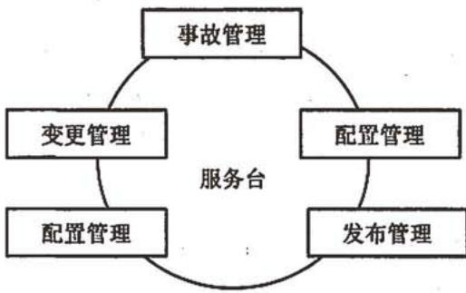

>[!warning] 版本提示
>本书为 **2006 年第 1 版**。现行考试依据是 **《信息系统管理工程师教程（第 2 版）》**（清华社 2024-10，20 章），
>两版**重合极少**：第 1 版的第 1–6 章（硬件/操作系统/语言/配置/数据结构/多媒体）在第 2 版已被删除或压缩。
>本页仅作**扩展参考**，备考请以 [[知识体系]]（第 2 版官方考纲）为准。

# 第25章 系统用户支持

随着信息产业的不断完善，用户支持作为一个企业的重要服务内容，也日益增强。它指的是企业客户支持团队提供现场、电话及电子邮件等形式的技术帮助，对不同的软件客户提供技术支持和帮助，回答用户的问题，针对用户的技术问题制定解决方案。

系统用户支持首先需要解决的就是从用户角度需要看清什么的问题，要确定用户能够看到的内容的范围。然后有针对性地提出相应的支持。为用户提供良好的支持环境，丰富企业的服务内容。

## 25.1 用户角度的项目

系统用户支持首先需要解决的就是从用户角度需要看清什么的问题，要确定用户能够看到的内容的范围。只有这样才能明确用户支持的服务范围，提供客户满意的用户支持。

首先，应该设定软件服务支持的宗旨、服务目标和服务任务，只有明确了服务的方向，才能找到客户支持的角度和方式。例如，IBM 提出 IBM 软件升级与远程技术支持服务的目标是："及时、快速、可靠地解决在软件系统的维护过程中所遇到的技术问题，使客户的软件系统可以更加安全稳定地运行，以保障和促进客户业务的顺利开展并取得更大的成功。"找准了服务目标和方向，就像在黑暗的大海中行驶的船舶找到了航标一样，只有这样才能确定准确的服务范围。

然后，就可以根据企业软件服务支持的宗旨、服务目标、任务，结合软件客户和企业自身客户支持的实际水平，确立用户角度看到的项目是怎么样的，确立相应的用户支持范围。从用户角度出发，确定用户角度看到的项目是怎么样的，会遇到些什么样的问题，这样才能找准客户问题的症结，及时快速解决客户的问题，让客户满意。同时，又要从企业实际水平出发，不能超出企业水平给予客户一些不切实际的承诺，这只能招致客户的反感和不满。

确立好客户角度看到的项目问题，并确立好用户支持的范围和手段之后，就可以建立用户支持团队，准备相应的客户支持服务了。

## 25.2 用户支持

要提供用户支持，必须弄清企业对用户支持的范围是什么，通过哪些方式进行用户支持，即明确项目范围、清晰界定用户的需求。这点看似简单，但实际操作者却需要相当有经验，能够判断自己所拥有的资源；能够在既定时间内完成多少工作；能够与客户有技巧地谈判将其需求控制在最恰当的水平并维持到项目结束。

一般来说，用户支持应该先确定用户支持的范围，例如可以提供软件产品的安装、软件产品的基本日常维护和使用管理、软件产品的基本配置、软件技术问题的根源分析与诊断、提供软件本身问题的修正性软件、软件升级与远程技术支持基础服务等范围内的软件服务。

## 用户支持包括如下内容

（1）软件升级服务。在服务期限内客户可根据自己的需要免费升级到新的版本和移植到新的平台。

（2）软件技术支持服务。提供基于 Internet 的电子化支持，提供 5×8 小时及 7×24 小时（仅限严重程度的问题）远程电话支持服务等。

（3）远程热线支持服务（SupportLine for Middle-Ware）。提供基于 Internet 的电子化支持，7×24 小时远程电话支持服务等。

（4）全面维护支持服务（EPSA for Middle-Ware）。提供基于 Internet 的电子化支持提供 7×24 小时远程电话支持服务，提供客户现场技术服务。

（5）用户教育培训服务。对于软件的使用用户提供软件的使用培训，制定相应的教育培训计划，提供相关人员进行实施。

（6）提供帮助服务台，解决客户的一些常见问题。例如设定"常见问题解答"，用户可通过电子邮件、ftp（文件传送）以及6\~7个有关的讨论小组获得这些服务信息。企业在采用这种方法提供用户支持时，须遵循问题与解答必须简明扼要、文件的开头应列出所有的问题以及及时更新信息三大原则。

此外，一个较为先进的用户支持 Web 网站至少要包括以下这些功能。

\- 可提供技术支持最新消息 用户只要用鼠标单击有关按钮，就能够连接到包括新产品、新技术以及新价格的超文本文件。

\- 可提供解决各种技术问题的答案 用户能简捷地从问题解决信息库找到最新的解决方案。

\- 可提供邮递表功能 用户可以通过电子邮件订阅企业发布的快讯或简报。公司利用邮递表工具，自动将最新的用户支持信息定期发送到用户的电子邮箱。

\- 可向用户提供浏览其他公司有关信息的链接 用户可通过该 Web 网站去浏览分布在 Internet 上与解决当前问题有关的各种信息。

## 25.3 用户咨询

目前，许多企业都提供了用户咨询服务，以方便用户。总的说来，用户咨询服务的主要目的是企业以各种方式帮助用户利用它所提供的各种资源和服务，更好地使用企业为用户提供的产品。

要准备一个可以运行的用户咨询服务，必须要先准备好用户服务的环境。例如，要在网上提供用户咨询，应该准备好相应的服务器、客户服务人员、在线问答方式等，才能够为用户提供相应的咨询服务。

一般来说，主要提供下列用户咨询方式。

## (1) 直接咨询服务（Reference Service）

直接咨询方式是常见的咨询方式，它指的是企业设立专门的用户咨询部，接受用户的咨询。一般来说，这些工作人员具有一定的专业知识与用户咨询服务知识。这种方式具有下列优点：用户亲自到企业提出咨询问题，与服务人员进行面对面的交流与沟通，便于服务人员清楚明了用户的真实意图与要求，有利于问题的解决。对一些重要问题的咨询，多是通过这种方式进行。这种方式的缺点是：用户必须亲自到企业，它无法对远距离用户提供服务；另外，它对一些不擅长口头表达的用户，也会有一些不便。

## (2) 电话服务（Telephone Service）

电话方式可以方便地服务于远距离用户，让用户不必亲自到企业来而是通过电话提出咨询问题，工作人员记录问题并进行回答。这种方式的条件是必须在企业有专门的咨询中心安装供用户咨询的电话，并有专门的服务人员负责接听。这种服务方式的优点在于能远距离提出问题，免去距离带来的不便；同时，电话交谈可以进行语言沟通，杜绝许多问题的歧义。但缺点也是明显的，即服务时间有限，由于咨询问题的难易程度不一样，咨询人员对问题的解答可能不及时或最终解答时间不能确定，往往会导致用户不能在某一确定时间获取答案，造成用户进行多次电话询问。

## （3）公告板（BBS）或讨论组（Group）

由于网络技术的发展与应用, 现在可采用 BBS 系统或 Group 形式。这种形式的具体做法是, 企业网站提供这些功能, 用户可以自由地在企业的这些系统中提出自己的问题, 并将问题发布在网页上, 企业咨询人员则定期浏览、回答用户的问题, 如不能回答, 也可将其发往讨论组中或咨询企业其他部门的专业人士, 寻求问题的答案。这方面形式多样, 如有 FAQ (常见问题解答)、Q&A (问题与解答)、网上咨询、BBS 论坛等。这种方式的优点是, 用户只要能够连接企业网页, 均可发布自己的咨询要求, 并且由于是文字提交方式, 用户有较多时间仔细考虑问题提出的细节与要求, 一般提问会较为准确。咨询人员回答方便且时间充裕, 它能通过电子邮件或仍以公告板方式将答案返回给客户。这些问题的解答也可以长时间地被保留在系统中, 某一类具有代表性的问题, 可以起到同时解答多人的作用, 并形成数据库, 可加入 FAQ 或 Q&A 页面中。它的缺点是, 很难回答一些隐密性强的问题 (网页上不便发布的)。

## (4) 电子邮件（E-mail）

电子邮件方式是最普通也是最常用的一种咨询服务方式，它主要在网站主页或某些网页上设立"参考咨询"或"询问相关人员（Ask）"链接，通过该链接可将咨询问题以电子邮件方式发送给相应的咨询人员，咨询人员以电子邮件方式将答案返回用户。它的优点在于具有很好的方便性和隐秘性，用户只要有自己的电子信箱，就可以通过这种方式提出咨询要求，用户有足够的时间整理自己的提问。同时自己的问题要求，也不会为别人所获知。对于远距离的不能亲自到企业咨询的用户，较为便利。但是这种方式可能会由于处理时间的原因，用户对于咨询问题所获得的回答会不及时，有一定时间差，对于用户的帮助会显得较迟；再者，这种方式必须有电子邮件信箱才能接受服务，不是交互式的，从问题提出到收到咨询结果，这中间可能出现的一些误差、歧义无法得到及时的纠正与再答复。

除此之外，还有许多别的咨询服务方式，例如网上表格（Web Form）、网上实时咨询服务（Real-time Reference Service）、网络会议咨询服务（Video Conferencing Reference Service）、专家咨询服务（Ask-A-Service）、合作的数字参考服务（Collaborative Digital Reference Service）等方式。

然而，随着技术的发展，用户的需求是在不断增长和变更的，任何一家公司或者企业都无法完全预计用户的需求，任何需求和服务都是在不断完善中的。对于客户提出的以前并未发现的需求，应予以标识、记录在案，为以后的系统改进做准备。

标识用户的新需求应先标识用户需要哪些信息，需要的时间和频率，以及以何种格式来显示。这将帮助企业先了解这些用户的需求是否能得到满足，找到不当之处。然后提示，确保已标识所有用户需求，并与潜在的用户一起进行讨论和测试。输入相应数据，使用报表查看数据。

## 25.4 帮助服务台

服务台，即通常所指的帮助台和呼叫中心，是一种服务职能而不是管理流程。对服务提供方而言，服务台可以处理很多用户的请求和询问，节约资源并及时向客户和用户传递有关服务的各种情况；对客户和用户而言，在碰到任何问题或疑问时，只要通知和联系服务台，就可以由服务台指导和协调下一步工作。

服务台（Service Desk）拓展了服务的范围，通过提供一个全球集中的服务联络点促进了组织业务流程与服务管理基础架构的集成。它不仅负责处理事故、问题和询问，同时还为其他活动和流程提供接口。包括客户变更请求、维护合同、软件协议、服务级别管理、配置管理、可用性管理和持续性管理等。

具体而言，服务台的主要职能是：

\- 接受客户请求（可以通过电话、传真、电子邮件等）。

\- 记录并跟踪事故和客户意见。

\- 及时通知客户其请求的当前状况和最新进展。

\- 根据服务级别协议，初步评估客户请求，尽力解决它们或将其安排给有关人员

解决。

\- 根据服务级别协议要求，监督规章制度的执行情况并在必要的时候对其进行修改。

\- 对客户请求从提出直至验证和终止的整个过程进行管理。

\- 在需要短期内调整服务级别时及时与客户沟通。

\- 协调二线支持人员和第三方支持小组。

\- 提供管理方面的信息和建议以改进服务绩效。

\- 根据用户的反馈发现 IT 服务运营过程中产生的问题。

\- 发现客户培训和教育方面的需求。

\- 终止事故并与客户一道确认事故的解决情况。

服务台是服务提供方和用户的日常联络处，负责报告事故和处理服务请求，它与多个服务管理流程密切相关，如图 25-1 所示。

  
图 25-1 服务台与服务管理流程之间的关系

服务台负责跟踪记录各种事故，并负责协调二线支持小组和三线支持小组处理和解决事故，与事故管理关系紧密；同时它参与了配置管理等记录事故、验证事故记录正确性的活动；发布管理时收取软硬件安装费用也需要服务台的帮助；服务台还可以协助实施变更管理，如通知用户有关情况，在一定范围内代为实施变更。

服务台的分布模式主要有分布式、集中式和虚拟式三类。

服务台员工的素质要求是服务台的任务和结构决定的，通常有下列几类。

\- 接线员。这类人员只记录呼叫，不提供解决办法，而只是把呼叫转移给特定的部门。

\- 初级服务员。按照标准规程记录、处理或转移呼叫。

\- 中级服务员。可按照文档化的解决方案处理许多事故，当不能解决时把事故转移给相应的支持小组。

\- 高级服务员。拥有 IT 基础架构方面的专业知识和经验，能够独立解决大部分的事故。

客户和用户满意度是评价服务台工作的主要指标，可以从下面几个方面进行评价。

\- 电话应答是否迅速。

\- 呼叫是否按时传送给二线支持。

\- 是否按时恢复服务。

\- 是否及时通知用户正在实施的变更和将来需要实施的变更。

\- 首次修复率。

\- 服务台员工接电话是否有礼貌。

\- 用户是否得到预防事故发生的建议。

## 25.5 人员培训服务

随着信息服务的不断发展，越来越多的 IT 公司重视在售后对客户进行人员培训。为了使用户可以更好地掌握软件产品和技术，许多公司专门设立了培训课程和认证服务，定期开设集中的培训课程，也可为用户提供特别的现场培训服务。

IT 企业通过专业化的培训，全方位地传递公司软件的管理理念和方法。讲师一般由经验丰富的专家和有实践经验的咨询顾问组成。课程都是 IT 公司软件使用经验的总结和提炼，可操作性强，能够在培训后将所学内容运用到实际工作中，从而帮助用户全面提高控制和管理软件的能力。

一般地，培训可以分为如下内容。

\- 经理管理级的培训（A 级）。对各部门管理人员的培训着重于计算机管理系统对管理的影响，具有什么样的意义，计算机管理系统的业务流程、票据流转规范等。同样强调确保录入数据正确的重要性和意义。因为实际上许多数据是由各部门管理人员来整理、提供的。例如，成品信息表、物料信息表、供应商信息表等。

从使用角度出发，经理管理级人员是将目前手工管理模式与计算机信息管理模式接轨的重要人员。如果经理们不能理解信息化管理的真正含义，难以号召和带动下属员工积极使用信息管理系统，也就不可能达到信息管理系统的根本目标。所以这一环节的培训至关重要。

\- 使用人员级的培训（B 级）。使用人员即后台操作员，他们将负责本部门所有票据的录入、校对及报表打印等工作，同时还要负责管理、指导所在部门的前台操作员，他们的工作技术性相对较强。

后台操作员的培训，除按后台操作手册的有关内容讲解以外，还将反复向他们强调保障录入数据正确的重要意义。因为系统正式运行前后的所有票据、表格都要由他们录入。他们工作的好坏直接关系到系统能否真正有意义地运转。

这个培训主要针对使用人员，即各部门使用人员、核算员与财务人员等。培训的目的是为了让使用人员真正能上岗工作，能担当主要业务，并确保各个环节不出问题，为本企业稳步获取效益做出保障。

\- 系统维护员的培训（C级）。系统管理员是整个系统的高级管理员，他们的工作除了日常例行的事务外还要能够处理许多意外的情况，例如，数据出现混乱、差错、数据库系统、操作系统发生故障以及计算机硬件设备方面的故障。对于处理不了的问题，要能够正确地记录下有关信息及现象并与有关方面取得联系，以造成损失最小的方式加以解决。所以系统管理员应当具有足够的操作系统、数据库系统、计算机网络、计算机硬件等知识储备，另外系统管理员还必须了解企业的各个业务流程。

对于系统管理员的培训，主要着重于计算机管理系统的总体结构、参数设备、系统安装等方面工程实施单位的技术人员，进行整个工程的实施过程也是对系统管理员的培训过程。理想情况下，系统管理员应能在系统正式运行后的短时期内接手所有工程实施单位有关技术人员的工作，这样对于用户和工程实施方都有益。

\- 职业模拟培训模式。职业模拟就是假设一种特定的工作情景，由若干个受训者组织成小组，代表不同的组织或个人，扮演各种特定的角色，例如总经理、财务经理、营销经理、秘书、会计、管理人员，等等。他们要针对特定的条件、环境及工作任务进行分析、决策和运作。这种职业模拟培训旨在让受训者身临其境，以提高自身的适应能力、处理工作的能力和实际工作能力。

\- 实际操作培训模式。在实际运作中教会大家如何操作。

\- 沙盘模拟培训模式。将软件的内容简化在沙盘上，教会大家使用。

除此之外，还有许多模式的教学。人员培训作为当前 IT 企业重要的服务模式被越来越多的人所接受，成为 IT 企业中不可或缺的服务步骤。

## 思考题

1. 试从用户角度考虑，他们需要看到什么样的项目？

2. 用户支持的一般内容是什么？

3. 请简单介绍三类以上的用户咨询服务方式。

4. 请简述服务台与服务管理流程之间的关系。

5. 简单论述一下，怎么进行人员售后培训服务。

## 参考文献

1. 王玉龙. 计算机导论. 北京：电子工业出版社，2005年1月

2. 张丽芬. 操作系统原理与设计. 北京：北京理工大学出版社，2001年10月

3. 王亚平，刘强. 数据库系统工程师教程. 北京：清华大学出版社，2004年7月

4. 谭浩强. C 程序设计语言. 北京：清华大学出版社，2003年1月

5. Alfred V.Aho, Ravi Sethi, Jeffrey D.Ullman, 李建中, 姜守旭译. 编译原理. 北京: 机械工业出版社, 2003 年 8 月

6. 严蔚敏，吴伟民. 数据结构（C语言版）. 北京：清华大学出版社，2003年5月

7. 徐孝凯，贺桂英. 数据结构（C语言描述）. 北京：清华大学出版社，2004年10月

8. 张晓乡，俞会新. 多媒体计算机技术. 北京：中国水利水电出版社，2004年1月

9. 林福宗. 多媒体技术基础. 北京：清华大学出版社，2002年9月

10. Tanenbaum A.S. 潘爱民译. 计算机网络(第4版). 北京：清华大学出版社，2004年8月

11. 相明科. 计算机网络及应用. 中国水利水电出版社, 2003 年 8 月

12. 雷威甲. 网络工程师教程. 北京：清华大学出版社，2004年7月

13. 萨师煊，王珊. 数据库系统概论（第三版）. 北京：高等教育出版社，2000年2月

14. 王珊，陈红. 数据库系统原理教程. 北京：清华大学出版社，1998年5月

15. 戴宗坤，罗万伯. 信息系统安全. 北京：机械工业出版社，2002年11月

16. 周学广，刘艺. 信息安全学. 北京：机械工业出版社，2003年3月

17. Marc Farley, Tom Stearns, Jeffrey Hsu, 李明之译. 网络安全与数据完整性指南. 北京: 机械工业出版社, 1998 年 4 月

18. 惠特曼，徐焱译. 信息安全原理. 北京：清华大学出版社，2004年3月

19. 左美云，邝孔武. 信息系统的开发与管理教程. 北京：清华大学出版社，2001年4月月

20. 张维明，陈卫东，肖卫东等. 信息系统原理与工程. 北京：电子工业出版社，2002年1月

21. 邝孔武，邝志云等。管理信息系统分析与设计. 西安：西安电子科技大学出版社，2004年6月

22. Grady Booch, James Rumbaugh, Ivar Jacobson. 邵维忠，麻志毅，张文娟，孟祥文译. UML 用户指南. 北京：机械工业出版社，2001 年 6 月

23. 甘仞初. 信息系统开发. 北京: 经济科学出版社, 1996 年 8 月

24. 朴顺玉，陈禹. 管理信息系统. 北京：中国人民大学出版社，1995年5月

25. 薛华成. 管理信息系统(第三版). 北京：清华大学出版社，2003年2月

26. 侯卫真. 电子政务系统建设与管理. 北京: 中国人民大学出版社, 2004 年 8 月

27. 盛定宇. 信息系统分析与设计·题解·综合练习. 北京：机械工业出版社，2004年6月

28. 常晋义. 信息系统开发与管理. 北京：机械工业出版社，2004年5月

29. 谭伟贤. 信息系统工程监理 设计·施工·验收. 北京: 电子工业出版社, 2003 年 5 月

30. 郑人杰. 软件工程. 北京: 清华大学出版社, 1999 年 8 月

31. 金江军. 企业信息化与现代电子商务. 北京: 电子工业出版社, 2004 年 10 月

32. 郭咸刚. 企业标准化管理体系 GMS2003 流程范本(精). 北京: 广东经济出版社, 2003 年 9 月

33. 孙强, 左天祖, 刘伟. 北京: IT 服务管理概念、理解与实施. 北京: 机械工业出版社, 2004 年 1 月

34. M.Looijen. 耿继秀, 张璇, 周清华译. 信息系统管理、控制和维护. 北京: 电子工业出版社, 2002 年 11 月

35. 陈国青，雷凯. 信息系统的组织·管理·建模. 北京：清华大学出版社，2002年7月

36. 孟广均, 沈英. 信息资源管理导论. 北京: 科技出版社, 2000 年 6 月

37. 王景光. 信息资源管理. 北京: 高等教育出版社, 2002 年 12 月

38. 林东岱, 曹天杰. 企业信息系统安全: 威胁与对策. 北京: 电子工业出版社, 2004 年 1 月

39. 陈伟强, 黄求新. 企业信息安全指南. 北京: 暨南大学出版社, 2003 年 7 月

40. 胡越明. 计算机组成与结构. 北京: 电子工业出版社, 2002 年 3 月

41. 林闯. 计算机网络和计算机系统的性能评价. 北京: 清华大学出版社, 2001 年 4 月

42. 左天祖. 中国 IT 服务管理指南. 北京: 北京大学出版社, 2004 年 9 月

43. 邝孔武, 王晓敏. 信息系统分析与设计(第2版). 北京: 清华大学出版社, 2002年9月

44. 苏选良. 管理信息系统. 北京: 电子工业出版社, 2003 年 1 月

45. 孙强，陈伟，王东红. 信息化绩效评价：框架、实施与案例分析. 北京：清华大学出版社，2004年10月

全国计算机技术与软件专业技术资格（水平）考试指定用书

根据人事部、信息产业部文件，计算机技术与软件专业技术资格（水平）考试纳入全国专业技术人员职业资格证书制度的统一规划。通过考试获得证书的人员，表明其已具备从事相应专业岗位工作的水平和能力，用人单位可根据工作需要从获得证书的人员中择优聘任相应专业技术职务（技术员、助理工程师、工程师、高级工程师）。计算机技术与软件专业实施全国统一考试后，不再进行相应专业技术职务任职资格的评审工作。

定价：46.00元
