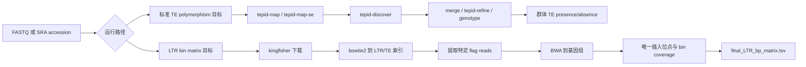
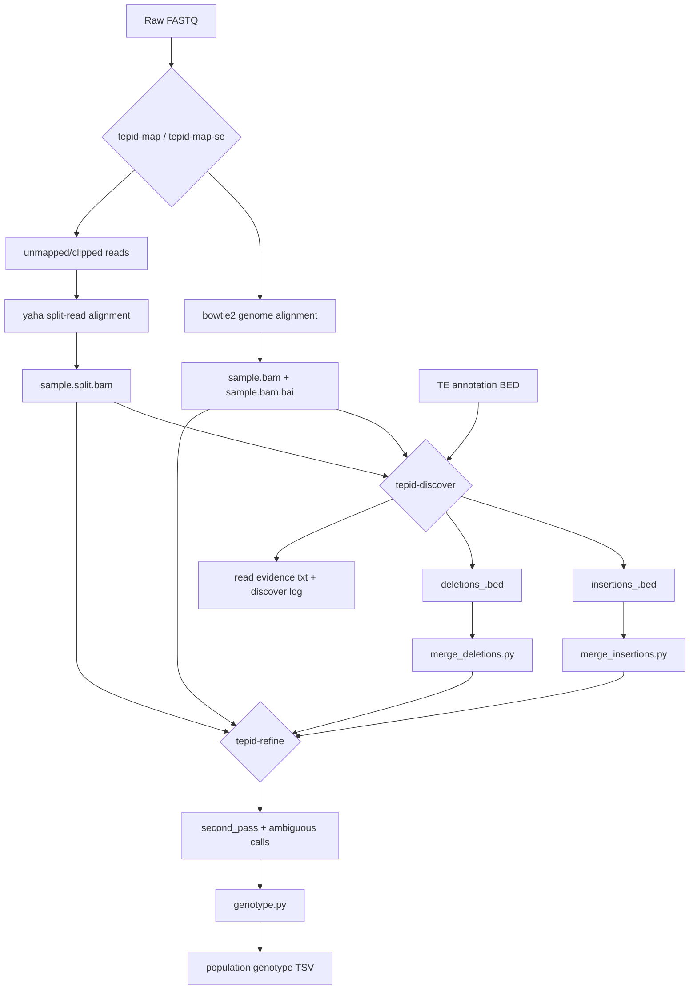
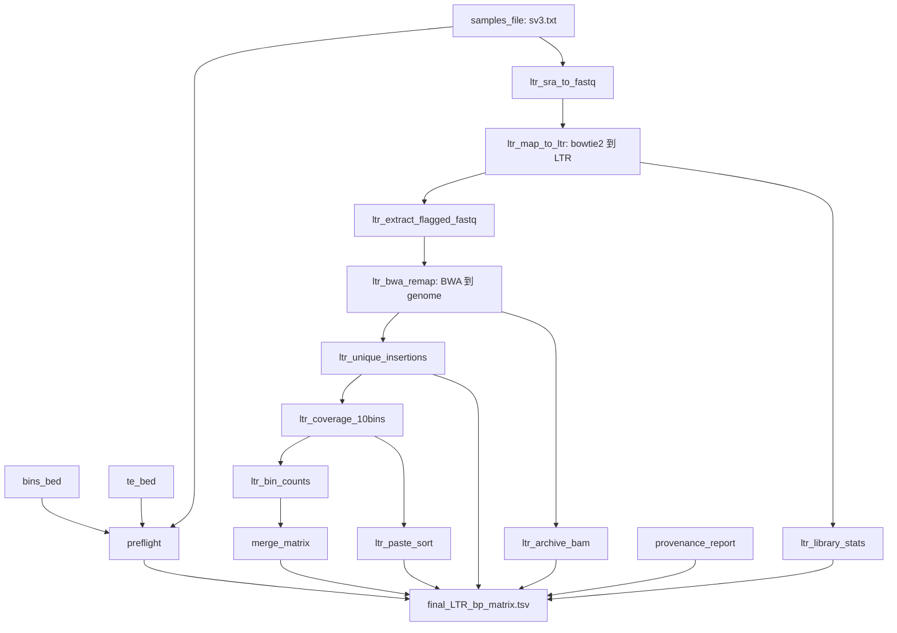
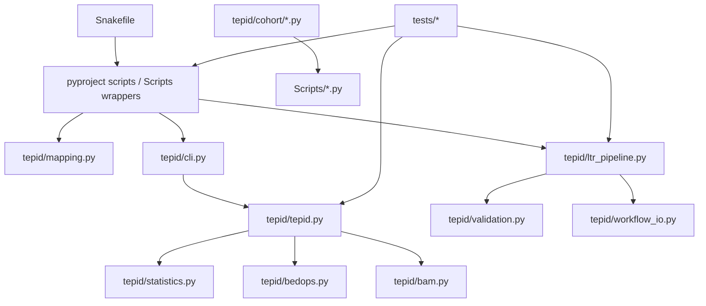

# TEPID 流程、执行逻辑与代码架构说明

本文档整理当前代码库中的主要运行流程、样本数据分析方法、代码结构、算法原理和运维注意事项。内容基于当前仓库实现而写，最后整理日期为 2026-05-23。

## 1. 项目定位

TEPID 用于从 Illumina 测序 reads 中识别转座子多态性，核心目标是得到样本或群体层面的 TE presence/absence 信息。

准确地说，当前仓库不是两个独立项目，而是同一个 TEPID 工具集加一个统一的 Snakemake 编排文件。为了说明执行逻辑，本文把它拆成两个分析目标/规则分支来讲：

1. 标准 TE polymorphism 目标：Snakemake 调用 `tepid-map`、`tepid-discover`、`tepid-refine` 等 TEPID 命令，从 FASTQ 到双映射 BAM，再进行 TE 插入、参考 TE 缺失发现，最后做群体合并、精炼和基因分型。
2. LTR bin matrix 目标：Snakemake 调用同一仓库里的 `tepid-ltr-pipeline` helper，并串联 `kingfisher`、`bowtie2`、`bwa`、`bedtools`、`samtools` 等外部工具；它从 SRA/ENA 样本号下载 reads，先比对到 LTR/TE 序列，再重比对到基因组，按固定窗口统计 LTR 插入信号并生成矩阵。

也就是说，Snakemake 是调度器，TEPID 是被调度的包/命令集合；LTR 分支也是 TEPID 仓库的一部分，只是它不走 `tepid-discover` 的插入/缺失 calling 逻辑，而是走 `tepid-ltr-pipeline` 的 LTR reads 重比对和 bin count 逻辑。

### 1.1 功能清单

| 功能 | 标准 TE polymorphism 目标 | LTR bin matrix 目标 | 说明 |
| --- | --- | --- | --- |
| paired-end FASTQ 映射 | 支持 | 间接支持 | `tepid-map` 用 Bowtie2 + Yaha；LTR 流程从 SRA 下载 paired FASTQ |
| single-end FASTQ 映射 | 支持 | 不作为主路径 | `tepid-map-se` 使用 clipped/unmapped reads 做 Yaha split-read 映射 |
| 非参考 TE 插入发现 | 支持 | 支持 LTR/TE reads 的 bin 计数 | 标准流程输出精确插入 BED；LTR 流程输出唯一重比对位点和 bin 矩阵 |
| 参考 TE 缺失发现 | 支持 | 不支持 | 标准流程用 gap-spanning reads 和覆盖度下降判断参考 TE absence |
| 群体合并 | 支持 | 矩阵级合并 | 标准流程合并事件坐标；LTR 流程合并 bin counts |
| 二次精炼 | 支持 | 不支持 | `tepid-refine` 在未发现该事件的样本中做定点复查 |
| genotype 矩阵 | 支持 | 支持 LTR bin matrix | 标准流程输出 presence/absence accession 列；LTR 输出每 bin 每样本 count |
| SRA/ENA 下载 | 通过 Snakemake 支持 | 支持 | `kingfisher get` 下载 accession |
| 索引构建 | Snakemake 支持 | Snakemake 支持 | `indices_all` 构建 Bowtie2、Yaha、BWA 索引 |
| 断点续跑 | Snakemake 支持 | 支持 | checkpoint 规则和 Snakemake DAG 管理 |
| 统计覆盖度模型 | 支持 | 不支持 | `--statistical` 用 Poisson lower-tail 判断 coverage depletion/ambiguity |

### 1.2 适用场景与边界

适合：

1. 有参考基因组和 TE 注释的 Illumina resequencing 数据。
2. 单样本或群体样本的 TE presence/absence 分析。
3. 需要保留 legacy TEPID 输出文件名的下游分析。
4. 需要把 SRA accession 批量转成 LTR 插入 bin matrix 的场景。

不适合或需要额外开发：

1. long-read 专用 TE 断点解析；当前算法主要面向 short-read split/discordant evidence。
2. de novo TE 家族发现；标准 TE polymorphism 目标假设已有 TE 注释，LTR bin matrix 目标假设已有 TE/LTR FASTA。
3. 不依赖参考基因组的 TE 组装。
4. 精确 TSD、插入方向、插入序列完整重建；当前输出以坐标、TE 名称、read evidence 和 count 为主。



## 2. 快速入口

常用命令入口来自 `pyproject.toml` 的 `[project.scripts]`：

| 命令 | Python 入口 | 作用 |
| --- | --- | --- |
| `tepid-map` | `tepid.mapping:paired_end_main` | paired-end FASTQ 双映射 |
| `tepid-map-se` | `tepid.mapping:single_end_main` | single-end FASTQ 双映射 |
| `tepid-discover` | `tepid.cli:discover_main` | 单样本 TE 插入/缺失发现 |
| `tepid-refine` | `tepid.cli:refine_main` | 群体坐标二次检索和精炼 |
| `tepid-ltr-pipeline` | `tepid.ltr_pipeline:main` | LTR bin matrix helper 子命令 |

`Scripts/tepid-map`、`Scripts/tepid-map-se`、`Scripts/tepid-discover`、`Scripts/tepid-refine` 和 `Scripts/tepid-ltr-pipeline` 是源码树内的兼容包装脚本。当前项目使用 Hatch/`pyproject.toml` 构建，不再依赖 `setup.py`。

## 3. 环境与依赖

当前支持 Python `>=3.14`，CI 目标为 Python 3.14。推荐环境文件是 `environment.yml`，环境名为 `tepid-py314`。

Python 运行依赖：

| 依赖 | 用途 |
| --- | --- |
| `numpy` | 覆盖度、插入片段统计 |
| `pybedtools` | BED/BAM 转换、intersect、merge、coverage |
| `pysam` | BAM/SAM 读取、排序、索引、pileup |

外部工具：

| 工具 | 用途 |
| --- | --- |
| `bowtie2` | 标准流程基因组比对；LTR 流程 LTR/TE 初筛比对 |
| `yaha` | split-read 映射 |
| `samblaster` | paired-end 流程提取 unmapped/split/discordant 读段 |
| `samtools` | BAM/SAM 转换、排序、索引、flagstat |
| `bedtools` | makewindows、coverage、intersect、merge |
| `bwa` | LTR 流程中 LTR reads 到基因组的重比对 |
| `kingfisher` | SRA/ENA reads 下载 |
| `snakemake` | 批处理 DAG 调度 |
| `pigz` | LTR 下载规则中压缩 FASTQ；运行前需确认在 `PATH` 中 |

推荐安装与验证：

```bash
mamba env create -f environment.yml
mamba run -n tepid-py314 python -m pip install -e '.[dev]' -c constraints/py314.txt
mamba run -n tepid-py314 python -m compileall tepid Scripts tests
mamba run -n tepid-py314 python -m pytest tests -q
```

## 4. 输入数据

### 4.1 标准 TE Polymorphism 输入

| 输入 | 说明 |
| --- | --- |
| paired-end FASTQ | `tepid-map -1 R1 -2 R2` |
| single-end FASTQ | `tepid-map-se -q reads.fq` |
| Bowtie2 基因组索引 | `-x` 参数 |
| Yaha 基因组索引 | `-y` 参数 |
| TE 注释 BED | `tepid-discover -t` 和 `tepid-refine -t` |
| 样本名 | `-n`；决定输出文件名 |

TE 注释建议使用 7 列 TEPID BED 格式：

```text
chrom    start    stop    strand    TE_name    TE_family    TE_superfamily
```

当前仓库提供的注释目录：

| 路径 | 内容 |
| --- | --- |
| `Annotation/Arabidopsis/TAIR9_TE.bed.gz` | Arabidopsis TE 注释 |
| `Annotation/Brachypodium/Brachy_TE_v2.2.bed.gz` | Brachypodium TE 注释 |
| `Annotation/Human/hg19.bed.gz` | Human hg19 TE 注释 |

### 4.2 LTR Bin Matrix 输入

主要配置来自 `config.snakemake.example.yaml`：

| 配置项 | 说明 |
| --- | --- |
| `samples_file` | 每行一个 SRA/ENA accession，默认 `sv3.txt` |
| `dir` | 输出目录，默认 `output` |
| `te_fasta` | TE/LTR 共识序列 FASTA，用于构建 LTR Bowtie2 索引 |
| `genome_fasta` | 参考基因组 FASTA |
| `bt2_index` | 标准 TE polymorphism genome Bowtie2 索引 |
| `yaha_index` | 标准 TE polymorphism Yaha 索引 |
| `ltr_bt2_index` | LTR/TE Bowtie2 索引 |
| `bwa_reference` | BWA genome 索引前缀 |
| `genome_fai` | `samtools faidx` 生成的 `.fai` |
| `te_bed` | TE 注释 BED，preflight 默认检查 7 列 |
| `bins_size` | 固定窗口大小，影响最终矩阵文件名 |
| `bins_bed` | bedtools makewindows 产生的窗口 BED |
| `min_ltr_bin_count` | LTR bin 过滤阈值，默认 2 |

当前工作区的 `sv3.txt` 示例只有一个样本：

```text
SRR11301974
```

当前工作区还存在一个 `sv3.single.txt` 示例：

```text
SRR11301984
```

Snakemake 会读取 `samples_file`，去掉空行，并要求样本名只包含字母、数字、下划线、点和短横线：`[A-Za-z0-9_.-]+`。

## 5. 标准 TE Polymorphism 目标

该目标是原始 TEPID 的经典分析路径。它可以手动逐条运行，也可以由 `Snakefile` 中的 `sra_to_fastq`、`tepid_map`、`tepid_discover`、`merge_insertions`、`merge_deletions`、`tepid_refine` 和 `genotype_*` 等规则调度。

### 5.1 标准目标流程图



### 5.2 映射阶段

paired-end 入口：

```bash
tepid-map -x indices/bt2/genome_idx -y indices/yaha/genome_idx \
    -p 16 -s 500 -n S1 -1 S1_1.fastq.gz -2 S1_2.fastq.gz
```

执行逻辑在 `tepid/mapping.py`：

1. `bowtie2 --local --dovetail` 将 reads 比对到基因组。
2. paired-end 结果通过 `samblaster -e -u <sample>.umap.fastq` 提取 unmapped reads。
3. `samtools view` 写出未排序 BAM。
4. `yaha` 将 unmapped reads 做 split-read 映射。
5. `samblaster -s <sample>.split.sam` 提取 split alignment。
6. `samtools view` 生成 `<sample>.split.bam`。
7. `samtools sort` 和 `samtools index` 生成 `<sample>.bam` 与 `<sample>.bam.bai`。
8. `-z` 只压缩生成的 `<sample>.umap.fastq`，不会压缩原始 FASTQ。

single-end 入口：

```bash
tepid-map-se -x indices/bt2/genome_idx -y indices/yaha/genome_idx \
    -p 16 -n S1 -q S1.fastq.gz
```

single-end 流程不能利用 paired-end discordant 信息，因此它从 Bowtie2 BAM 中提取 soft/hard clipped reads 和 unmapped reads，再送入 Yaha。

输出文件：

| 文件 | 说明 |
| --- | --- |
| `<sample>.bam` | Bowtie2 主 BAM，坐标排序 |
| `<sample>.bam.bai` | 主 BAM 索引 |
| `<sample>.split.bam` | Yaha split-read BAM |
| `<sample>.umap.fastq` | 中间 reads；`-z` 时为 `.fastq.gz` |

### 5.3 TE 变异发现

典型命令：

```bash
tepid-discover -n S1 -c S1.bam -s S1.split.bam \
    -t Annotation/Arabidopsis/TAIR9_TE.bed.gz --strict -p 16
```

核心逻辑在 `tepid/tepid.py`：

1. 检查并准备 BAM：`check_bam()` 会把主 BAM 坐标排序并索引；`check_name_sorted()` 会把 split BAM 按 read name 排序。
2. 估算数据特征：paired-end 模式用 `calc_mean()` 估算插入片段均值、标准差和 read length，用 `calc_cov()` 估算覆盖度。
3. 处理 split reads：将 split BAM 转为 BED/BEDPE，按 mapping quality 和 `--mask` 过滤。
4. 处理 discordant reads：paired-end 默认从主 BAM 中提取异常 insert size 或跨染色体 read pairs；也可用 `-D/--discordant` 提供外部 BAM。
5. 插入发现：找一端接近 TE 注释、另一端定位到基因组非参考位置的 split/discordant read clusters。
6. 缺失发现：找跨越参考 TE 的 gap-spanning split/discordant reads，并结合 TE 区域覆盖度下降证据。
7. 写出 BED、read evidence 和日志。

输出文件名是稳定契约：

| 文件 | 说明 |
| --- | --- |
| `insertions_<sample>.bed` | 样本中的新 TE 插入 |
| `deletions_<sample>.bed` | 样本中缺失的参考 TE |
| `insertion_reads_<sample>.txt` | 支持插入的 read names |
| `deletion_reads_<sample>.txt` | 支持缺失的 read names |
| `tepid_discover_log_<sample>.txt` | 样本、覆盖度、参数和完成状态 |

插入 BED 当前格式：

```text
ins_chr    ins_start    ins_stop    ref_chr    ref_start    ref_stop    TE_name    id
```

缺失 BED 当前格式：

```text
ref_chr    ref_start    ref_stop    strand    TE_name    id
```

read evidence 文件格式：

```text
>id    readA,readB,readC
```

### 5.4 插入发现算法实现

标准 paired-end 插入发现整合 split reads 和 discordant reads。代码主入口是 `discover_pe()`，关键 helper 包括 `reorder()`、`merge_bed()`、`process_merged()`、`process_merged_disc()`、`reorder_intersections()` 和 `separate_reads()`。

实现步骤：

1. split-read 初筛：`check_name_sorted()` 先把 split BAM 改为 queryname 排序，再用 `pybedtools.BedTool(…).bam_to_bed()` 转 BED。
2. 质量过滤：插入使用 `quality_filter_ins`；默认 `>=5`，strict 模式 `>=10`。
3. BEDPE 组装：`convert_split_pairbed()` 将同一 read 的两段 split alignment 转成 BEDPE。
4. 候选插入筛选：`split_ins` 保留两段 split alignment 距离超过 5 kb 或跨染色体的 reads。
5. TE 关联：`pair_to_bed(te, f=0.80)` 要求 read pair 与 TE 注释有足够重叠，用于判断某一段来自 TE 序列。
6. 坐标重排：`reorder()` 把 TE read 和 genome read 分开，保证输出中的插入侧坐标和 TE 侧坐标含义固定。
7. split cluster 合并：`merge_bed()` 用 pybedtools merge 合并近邻读段，并 collapse read names、TE names、read type 等列。
8. split cluster 过滤：`process_merged()` 去掉多重非嵌套 TE、TE read cluster 不合理、较小 cluster 支持过强等复杂候选。
9. discordant cluster 合并：paired-end 模式下 `filter_discordant()` 提取异常 insert size 或跨染色体 read pairs；正向和反向 discordant cluster 在 200 bp 内合并。
10. 高置信 split-only 调用：split read 数达到 `insertion_reads_high` 的 cluster 可直接进入 `high.temp`。
11. 低支持 split + discordant 调用：split 支持低于 high 阈值时，需要与 processed discordant cluster 相交，并由 `reorder_intersections()` 确认同一 TE/参考坐标且总 read 数达到 `insertion_reads_low`。
12. 结果拆分：`separate_reads()` 写出 `insertions_<sample>.bed` 和 `insertion_reads_<sample>.txt`。

single-end 插入发现没有 discordant read 证据，因此 `discover_se()` 只保留 high-confidence split clusters。其输出格式与 paired-end 插入一致，便于 cohort 合并。

插入算法的核心判定是"一个 read 或 read pair 同时提供 TE 侧证据和 genome 侧锚定证据"。TE 侧证据来自与已知 TE 注释的 overlap；genome 侧锚定坐标用于定义新插入位点。

### 5.5 缺失发现算法实现

缺失发现的目标是判断参考基因组中已有的 TE 在样本中是否缺失。代码主入口是 `discover_pe()` / `discover_se()`，关键 helper 是 `create_deletion_coords()`、`annotate_deletions()`、`annotate_deletions_se()`、`get_coverages()` 和统计模式下的 `coverage_is_depleted()`。

paired-end 实现步骤：

1. evidence 汇总：把 split BEDPE 和 discordant BEDPE 合并为 `disc_split_dels`，每条 evidence 标注来源为 `split` 或 `disc`。
2. gap 坐标生成：`create_deletion_coords()` 要求 read pair 在同一染色体、两端不在 10 bp 窗口内重叠，并把两端之间的 gap 作为候选缺失区间。
3. gap 长度过滤：候选 gap 必须小于 20 kb。
4. TE overlap：候选 gap 先与 merged TE annotation 做 `f=0.8` overlap，再与原始 TE BED 做 `F=0.8` overlap，确保 gap 覆盖参考 TE 的主要部分。
5. TE 长度检查：`annotate_deletions()` 要求 gap 尺寸足以解释该 TE；paired-end 中 `(length - mean_insert_size) > gapsize` 的候选会被跳过。
6. read evidence 计数：split 和 discordant reads 分别累计，合成 `total_reads`。
7. 覆盖度证据：默认模式用 TE 区域 coverage / 两侧 2 kb flank coverage 的比值判断，`<=0.1` 支持缺失。
8. 调用规则：满足覆盖度 depletion 且 `total_reads >= deletion_reads / 2`，或不依赖覆盖度但 `total_reads >= deletion_reads`，即可输出缺失。
9. 去重：同一个 TE name 在一个样本中只写一次，防止重复调用同一参考 TE。

single-end 缺失发现只有 split-read evidence；`annotate_deletions_se()` 的 TE 长度判定使用 `length > gapsize + 50` 过滤候选，不使用 discordant reads。

缺失算法的核心判定是"reads 跨越了参考 TE 原本所在区域，且 TE 区域覆盖度相对背景下降"。这与插入算法相反：插入是发现 reference 中没有的 TE 侧证据，缺失是发现 reference TE 区域在样本中被跨越或低覆盖。

### 5.6 群体精炼算法实现

`tepid-refine` 不是重新全基因组发现，而是定点复查 cohort master list。它使用每个样本的一次发现结果作为候选全集，再在没有被调用的样本中降低阈值寻找弱证据。

实现步骤：

1. `readNames()` 读取所有样本名。
2. `getOtherLines()` 对每个 merged event 计算"没有在该事件 accession 列表里的样本"，即 inverse accession list。
3. 每个样本只检查自己在 inverse accession list 中的事件。
4. `find_reads_conc()` 检查主 BAM 中是否有连续覆盖该坐标的 concordant reads；如果连续覆盖存在，通常说明没有该变异，不继续 rescue。
5. `find_reads()` 在 split BAM 中取出落在候选坐标的 read names。
6. `extract_reads()` 按 read name 从 indexed split BAM 提取 reads 到临时 BAM。
7. insertion rescue 用 `check_te_overlaps()` 判断提取 reads 是否与目标 TE list 相交。
8. deletion rescue 用 `check_te_overlaps_dels()` 先从 split BAM 生成 deletion coords，再与 TE annotation 相交。
9. rescue 阈值低于首次发现：deletion 使用 `cov / 5`，insertion 使用 `cov / 10`。
10. 证据不足时调用 `_ambiguous_region()`；低覆盖区域写入 `ambiguous_*_<sample>.bed`，避免 genotype 时误判为 absence。

最终 genotype 逻辑由 `tepid/cohort/genotype.py` 完成：merged 中列出的样本为 presence；不在 presence 中的样本加上 reference 作为 opposite list；ambiguous 中出现的样本会从 opposite list 中删除。

### 5.7 阈值与过滤

`--strict` 会提高 read count 和 mapping quality 阈值。

paired-end 默认模式：

| 参数 | 计算方式 |
| --- | --- |
| deletion read 阈值 | `max(int(cov / 5), 4)` |
| insertion low 阈值 | `max(int(cov / 10), 2)` |
| insertion high 阈值 | `max(int(cov / 5), 2)` |
| insertion mapping quality | `>= 5` |
| deletion mapping quality | `>= 0` |

paired-end strict 模式：

| 参数 | 计算方式 |
| --- | --- |
| deletion read 阈值 | `max(int(cov / 5), 10)` |
| insertion low 阈值 | `max(int(cov / 5), 10)` |
| insertion high 阈值 | `max(int(cov / 2), 10)` |
| insertion/deletion mapping quality | `>= 10` |

single-end 默认模式的 deletion read 阈值是 `max(int(cov / 10), 4)`；strict 模式与 paired-end strict 使用同一组高置信阈值。

### 5.8 统计覆盖度模式

默认模式沿用传统规则：

1. 缺失：TE 区域平均覆盖度与上下游 2 kb 背景覆盖度的比值 `<= 0.1` 时支持缺失。
2. ambiguous：目标区域加减 200 bp 的平均覆盖度低于固定阈值时记为 ambiguous。

加 `--statistical` 后使用 `tepid/statistics.py` 中的 Poisson lower-tail 模型：

```bash
tepid-discover ... --statistical --stats-alpha 0.01
tepid-refine ... --statistical --stats-alpha 0.01
```

统计模式中，缺失覆盖度期望来自 TE 两侧 flank depth；ambiguous 判断使用样本全局覆盖度作为期望。`--stats-alpha` 必须在 `(0, 1)` 之间。

### 5.9 群体合并、精炼和分型

群体流程用于减少 false negatives：一个位点只要在任一样本中被发现，就在其他样本相同坐标处二次检索更弱证据。

主要步骤：

1. `merge_insertions.py -f insertions` 合并各样本插入位点。
2. `merge_deletions.py -f deletions` 合并各样本缺失位点。
3. `flip_deletions.py` 把"缺失该 TE 的样本列表"翻转成"含有该 TE 的样本列表"，让插入和缺失共享 presence/absence 语义。
4. `tepid-refine` 对每个样本检查 cohort master coordinates，输出 second-pass 和 ambiguous 文件。
5. `genotype.py` 合并 refined 和 ambiguous 信息，生成最终 TSV。

`merge_insertions.py` 和 `merge_deletions.py` 会扫描当前工作目录下的样本子目录，因此运行前应把每个样本的 `insertions_<sample>.bed` 或 `deletions_<sample>.bed` 放在对应样本目录中；Snakemake cohort 规则会自动创建这种临时工作目录。

`tepid-refine` 关键输出：

| 文件 | 说明 |
| --- | --- |
| `second_pass_insertion_<sample>.bed` | 二次检索补救到的插入 |
| `second_pass_deletion_<sample>.bed` | 二次检索补救到的缺失 |
| `second_pass_reads_insertion_<sample>.txt` | 插入二次证据 |
| `second_pass_reads_deletion_<sample>.txt` | 缺失二次证据 |
| `ambiguous_insertion_<sample>.bed` | 覆盖度不足或证据不够的插入位点 |
| `ambiguous_deletion_<sample>.bed` | 覆盖度不足或证据不够的缺失位点 |

`genotype.py` 输出每个变异位点的两类 accession 列表：含有该事件的样本，以及明确不含该事件的样本。ambiguous 样本会从"明确不含"列表中移除。

## 6. LTR Bin Matrix 目标

该目标仍在同一个 `Snakefile` 中，由 `ltr_pipeline_all` 汇总调度。它调用 `tepid-ltr-pipeline` 的 helper 子命令，但不调用 `tepid-discover` 或 `tepid-refine`，因此输出是 LTR 插入信号的 bin count matrix，而不是标准 TE polymorphism 目标的插入/缺失 genotype BED。

### 6.1 运行方式

构建索引：

```bash
snakemake indices_all --configfile config.snakemake.example.yaml --cores 8
```

生成 bins：

```bash
samtools faidx data/my_genome.fa
snakemake make_bins --configfile config.snakemake.example.yaml \
    --config genome_fai=data/my_genome.fa.fai \
             bins_size=1000 bins_bed=bins/genome_1000bp.bed \
    --cores 2
```

完整 LTR 流程：

```bash
snakemake ltr_pipeline_all --configfile config.snakemake.example.yaml --cores 32
```

分阶段断点续跑：

```bash
snakemake checkpoint_download --configfile config.snakemake.example.yaml --cores 16
snakemake checkpoint_mapping  --configfile config.snakemake.example.yaml --cores 16
snakemake checkpoint_remap    --configfile config.snakemake.example.yaml --cores 16
snakemake ltr_pipeline_all    --configfile config.snakemake.example.yaml --cores 16
```

`rule all` 默认目标是最终 LTR bin 矩阵。标准 TE polymorphism cohort 规则需要显式指定目标，例如 `cohort_outputs` 或 `cohort_genotypes`。

### 6.2 LTR DAG



### 6.3 LTR 各规则执行逻辑

| Snakemake rule | 输入 | 输出 | 逻辑 |
| --- | --- | --- | --- |
| `preflight` | samples、bins、TE BED | `.preflight.ok` | 检查样本文件非空、bins 存在、TE BED 列数 |
| `ltr_sra_to_fastq` | sample accession | `temp/<sample>/ltr_fastq/*.fastq.gz` | `kingfisher get` 下载，`pigz` 压缩并测试 gzip |
| `ltr_map_to_ltr` | FASTQ | `temp/<sample>/ltr/<sample>-vs-LTR.bam` | `bowtie2 --end-to-end -k 1 --very-fast` 到 LTR/TE 索引 |
| `ltr_extract_flagged_fastq` | LTR BAM | `<sample>-vs-LTR.fq` | 提取 flag 在 `{69,101,117,133,165,181}` 的 reads |
| `ltr_bwa_remap` | flagged FASTQ | `<sample>.sam` | `bwa mem` 到全基因组 |
| `ltr_unique_insertions` | SAM | `02_LTR-bed/*unique.bed`、`03_unique-sum/*_unique-sum.txt` | 只保留一个 primary mapped alignment 的 query name |
| `ltr_coverage_10bins` | bins BED + unique BED | coverage raw/filtered BED | `bedtools coverage -counts`，按 `min_ltr_bin_count` 过滤 |
| `ltr_bin_counts` | filtered BED | `temp/<sample>/bam/<sample>_bin_counts.txt` | 归档每个样本的 bin count |
| `ltr_paste_sort` | filtered BED | `04_LTR-paste/*for_paste.txt` | 按自然染色体顺序排序 |
| `ltr_library_stats` | LTR BAM | `03_unique-sum/*library_change.txt` | `samtools flagstat` 汇总 total/mapped |
| `ltr_archive_bam` | BWA SAM | `01_LTR-bam/<sample>.bam` | 转 BAM 并排序归档 |
| `merge_matrix` | 所有样本 bin counts | `final/final_LTR_<bins_size>bp_matrix.tsv` | 合并为样本矩阵，缺失 bin 记 0 |
| `provenance_report` | 无 | `output/report/*.tsv` | 写出版本和输出清单 |

### 6.4 LTR Helper 算法细节

LTR bin matrix 目标是对历史 FIFO shell driver 的参数化翻译，核心 helper 在 `tepid/ltr_pipeline.py`。

关键实现：

1. LTR 初筛：`bowtie2 --time --end-to-end -k 1 --very-fast` 把 paired FASTQ 比对到 LTR/TE Bowtie2 index。`-k 1` 只保留一个报告 alignment，目的是快速捞出含 LTR/TE 信号的 reads。
2. flag 提取：`write_flagged_fastq_from_bam()` 只保留 SAM flag 在 `{69, 101, 117, 133, 165, 181}` 的 reads，并写成 FASTQ。代码会补齐缺失 quality：若 BAM 中没有 quality，就用同长度的 `I`。
3. genome remap：提取出的 reads 用 `bwa mem` 重比对到 genome reference。
4. 唯一插入判断：`write_unique_insertions_from_sam()` 按 `query_name` 聚合 BWA alignments，只保留恰好一个 primary mapped alignment 的 read。secondary、supplementary、unmapped、MAPQ=0 或缺 reference 坐标的 alignment 会被排除。
5. BED 输出：唯一 reads 写成 `chrom start end query_name` 四列 BED。
6. coverage binning：`bedtools coverage -counts -a bins_bed -b unique.bed` 统计每个固定窗口内唯一插入 reads 的数量。
7. count 过滤：`filter_coverage_counts()` 默认保留第 4 列 count `>= min_ltr_bin_count` 的 bins；默认阈值是 2。
8. 自然排序：`write_paste_sorted()` 使用 `natural_bed_sort_key()`，让 `chr2` 排在 `chr10` 前面，避免纯字符串排序造成矩阵顺序不符合基因组习惯。
9. 矩阵合并：`write_ltr_matrix()` 读取所有样本的 bin count 文件，合并所有出现过的 bins；某样本缺失的 bin count 记为 0。内部 bin count 文件仍是 BED 的 0-based half-open 坐标，但最终 `Bin_ID` 报告为 1-based closed 区间，例如 BED `chr1 0 1000` 输出为 `chr1:1-1000`。

LTR bin matrix 目标的输出是 count matrix，不是标准 TE polymorphism 目标的 presence/absence genotype。实际使用时可根据研究目的再做二值化，例如 `count >= 1` 或 `count >= min_ltr_bin_count` 视为 presence；这个二值化策略当前没有硬编码在仓库里。

### 6.5 LTR 输出目录

若 `dir: output`，主要输出如下：

```text
output/
  .preflight.ok
  .checkpoints/
    download.done
    mapping.done
    remap.done
  temp/
    <sample>/
      ltr_fastq/
      ltr/
      bam/
  01_LTR-bam/
    <sample>.bam
  02_LTR-bed/
    <sample>-vs-LTRinsertion_unique.bed
  03_unique-sum/
    <sample>_unique-sum.txt
    <sample>-library_change.txt
  04_LTR-paste/
    <sample>-vs-LTR_per<bins_size>bp-for_paste.txt
  final/
    final_LTR_<bins_size>bp_matrix.tsv
  output/report/
    versions.tsv
    output_manifest.tsv
```

注意：`provenance_report` 当前路径是 `{dir}/output/report/`，所以默认 `dir: output` 时会出现 `output/output/report/`。

### 6.6 LTR 矩阵格式

`tepid/workflow_io.py` 生成最终矩阵。每个样本的 bin count 文件格式是 BED/bedtools 使用的 0-based half-open 坐标：

```text
chrom    start    end    count
```

最终矩阵的 `Bin_ID` 转为常规 1-based closed 展示坐标：

```text
Bin_ID          sampleA    sampleB
chr1:1-1000    2          5
chr1:1001-2000 0          0
chr2:1-1000    0          1
```

矩阵文件名随 `bins_size` 变化：

| `bins_size` | 输出文件 |
| --- | --- |
| `100` | `final_LTR_100bp_matrix.tsv` |
| `1000` | `final_LTR_1000bp_matrix.tsv` |

## 7. 样本数据分析方法

### 7.1 样本清单检查

LTR 批处理以 `samples_file` 为样本真值来源。建议运行前检查：

```bash
sed -n '1,20p' sv3.txt
wc -l sv3.txt
```

每行必须是一个 accession 或样本名，不能包含空格、斜杠、冒号等字符。Snakemake 中样本名会进入路径和 wildcard，因此必须保持稳定、唯一、可作为文件名。

### 7.2 当前测试数据代表的结果

仓库测试夹具提供了一个最小 Arabidopsis 例子，用于回归验证 `tepid-discover` 的输出。

插入测试结果：

```text
chr5    7608484    7608542    chr4    12269420    12269612    AT4TE57000    0
```

含义：

| 列 | 含义 |
| --- | --- |
| `chr5 7608484 7608542` | 推断的新插入位点 |
| `chr4 12269420 12269612` | 支持 reads 命中的参考 TE 坐标 |
| `AT4TE57000` | TE 名称 |
| `0` | 该样本内事件 ID |

缺失测试结果：

```text
chr3    9808122    9809189    +    AT3TE40820    0
```

含义：

| 列 | 含义 |
| --- | --- |
| `chr3 9808122 9809189` | 参考 TE 坐标 |
| `+` | strand |
| `AT3TE40820` | TE 名称 |
| `0` | 该样本内事件 ID |

支持 reads 文件用 `>事件ID` 映射到 read name 列表，可用于 IGV 或二次核查。

### 7.3 单样本结果检查

标准 TE polymorphism 目标完成后，可先检查：

```bash
ls -lh insertions_S1.bed deletions_S1.bed \
    insertion_reads_S1.txt deletion_reads_S1.txt \
    tepid_discover_log_S1.txt
sed -n '1,20p' tepid_discover_log_S1.txt
```

建议关注：

| 指标 | 为什么重要 |
| --- | --- |
| coverage | 低于 10x 时日志会告警；推荐分析数据通常应高于 20x |
| mean insert size / std | paired-end discordant 判断依赖这些统计值 |
| read length | 太短的 reads 降低 split-read 定位能力 |
| 空 BED | 可能是真实无变异，也可能是覆盖度、注释、索引或 mask 问题 |
| reads evidence 数量 | 过少时需要谨慎解释 |

### 7.4 LTR 结果检查

LTR 流程完成后建议先看：

```bash
head output/02_LTR-bed/SRR11301974-vs-LTRinsertion_unique.bed
head output/03_unique-sum/SRR11301974_unique-sum.txt
head output/03_unique-sum/SRR11301974-library_change.txt
head output/final/final_LTR_100bp_matrix.tsv
```

解释：

| 文件 | 看什么 |
| --- | --- |
| `*insertion_unique.bed` | 每条唯一 BWA primary alignment 的基因组坐标 |
| `*_unique-sum.txt` | 唯一插入 reads 数量 |
| `*library_change.txt` | LTR BAM total/mapped reads 摘要 |
| `final_LTR_*bp_matrix.tsv` | 每个 bin 在每个样本中的 LTR 插入计数 |

如果最终矩阵大量为 0，优先检查：

1. `ltr_bt2_index` 是否对应 TE/LTR 序列。
2. `bwa_reference` 是否对应同一个基因组版本。
3. `bins_bed` 染色体命名是否与 BWA reference 一致。
4. `min_ltr_bin_count` 是否过高。
5. `pigz`、`kingfisher`、`bowtie2`、`bwa` 是否在实际 Snakemake 环境中可执行。

### 7.5 已完成单样本案例：SRR11301984

当前机器上可确认的完整单样本 LTR 验证输出位于：

```text
/mnt/data05/norD509HPC/T25ronglin/output/tepid_verify_SRR11301984_20260522
```

该目录完成时间为 2026-05-22 18:45 左右，包含 `.preflight.ok`、`01_LTR-bam/`、`02_LTR-bed/`、`03_unique-sum/`、`04_LTR-paste/`、`final/` 和 `temp/` 等完整输出层级。

关键结果汇总：

| 指标                           | 数值            | 来源文件                                                                | 解释                                                                                      |
| ---------------------------- | ------------- | ------------------------------------------------------------------- | --------------------------------------------------------------------------------------- |
| 样本                           | `SRR11301984` | `sv3.single.txt` / 输出文件名                                            | 单样本验证 accession                                                                         |
| LTR BAM total reads          | `111,926,316` | `03_unique-sum/SRR11301984-library_change.txt`                      | `samtools flagstat` 摘要中的 total                                                          |
| LTR BAM mapped reads         | `2,158,400`   | `03_unique-sum/SRR11301984-library_change.txt`                      | 比对到 LTR/TE index 的 mapped reads，约 `1.93%`                                               |
| BWA unique insertion records | `2,959,627`   | `03_unique-sum/SRR11301984_unique-sum.txt`、`02_LTR-bed/*unique.bed` | flagged FASTQ 经 BWA genome remap 后，按 query name 只有一个 primary mapped alignment 的 records |
| retained 1 kb bins           | `596,885`     | `temp/SRR11301984/bam/SRR11301984_bin_counts.txt`                   | count 过滤后的 1 kb windows                                                                 |
| final matrix rows            | `596,886`     | `final/final_LTR_1000bp_matrix.tsv`                                 | header 1 行 + retained bins 596,885 行                                                    |

注意：`mapped_reads` 来自第一步 LTR Bowtie2 BAM 的 flagstat；`unique_insertions` 来自后续 flagged reads 的 BWA genome remap，两者不是同一个分母，不能直接解释为 "unique / mapped rate"。

unique insertion BED 前几行如下：

```text
chr1    7268     7418     SRR11301984.53540259
chr1    24205    24355    SRR11301984.48746682
chr1    25540    25689    SRR11301984.32682908
chr1    25589    25739    SRR11301984.42864159
chr1    25733    25883    SRR11301984.44221592
```

这些行表示：read `SRR11301984.<id>` 被 LTR flag 提取后，经 BWA-MEM 重比对到基因组 `chr1:start-end`。这里仍是 BED 内部坐标，遵守 0-based half-open。

bin count 文件前几行是 BED/bedtools 坐标：

```text
chr1    25000    26000    3
chr1    27000    28000    6
chr1    52000    53000    4
chr1    60000    61000    8
chr1    61000    62000    3
```

标准化后的矩阵 `Bin_ID` 应报告为 1-based closed 区间，所以对应为：

```text
Bin_ID              SRR11301984
chr1:25001-26000    3
chr1:27001-28000    6
chr1:52001-53000    4
chr1:60001-61000    8
chr1:61001-62000    3
```

如果看到旧输出里仍是 `chr1:25000-26000`，那是之前矩阵生成逻辑直接复用了 BED start。当前 `write_ltr_matrix()` 已修正为 `start + 1`，重新生成矩阵后第一列会从 1-based 坐标开始。

对该样本的初步解释：

1. `SRR11301984` 已经完成 LTR 单样本验证流程，输出不是只有中间文件，而是已经有最终矩阵。
2. 该样本 LTR Bowtie2 初筛 mapped reads 占 total reads 约 `1.93%`，说明只抽取了总 reads 中一小部分 LTR/TE 相关 reads 进入后续 remap。
3. BWA remap 后保留 `2,959,627` 条唯一 primary alignment，说明可定位到 genome 的 LTR 相关 reads 数量充足。
4. 经过 1 kb binning 和默认 `min_ltr_bin_count` 过滤后，保留 `596,885` 个有支持的 windows。
5. 下游若要做 presence/absence，可以在矩阵层面把 count 大于 0 或大于等于指定阈值的 bins 转为 presence；当前仓库保留 count，不在矩阵生成阶段强制二值化。

另一个输出目录：

```text
/mnt/data05/norD509HPC/T25ronglin/output/tepid
```

该目录中存在 `SRR11301974` 和 `SRR11301984` 的若干 LTR 中间/结果文件。但其中 `final/final_LTR_1000bp_matrix.tsv` 当前 header 只有 `SRR11301974`，这与当前 `sv3.txt` 只包含 `SRR11301974` 一致；因此它应被理解为按当前样本清单生成的单样本矩阵，而不是两个样本都完成合并后的 cohort 矩阵。

## 8. 代码架构



| 路径 | 职责 |
| --- | --- |
| `Snakefile` | 批处理 DAG，包含索引构建、标准 TE polymorphism 规则、LTR bin matrix 规则、cohort 规则 |
| `config.snakemake.example.yaml` | Snakemake 参数、索引路径、线程和 bins 配置模板 |
| `tepid/mapping.py` | `tepid-map` 和 `tepid-map-se` 的实际实现 |
| `tepid/cli.py` | `tepid-discover`、`tepid-refine` 参数解析和模式分发 |
| `tepid/tepid.py` | 传统 TEPID 核心算法：discover、refine、BAM 准备、BED 操作 |
| `tepid/ltr_pipeline.py` | LTR helper 子命令：flag extraction、unique insertion、coverage filter、preflight |
| `tepid/workflow_io.py` | LTR 矩阵命名、自然排序、bin count 合并 |
| `tepid/statistics.py` | Poisson 覆盖度 depletion/ambiguous 判断 |
| `tepid/validation.py` | 文件、工具、TE BED、BAM quickcheck 校验 |
| `tepid/cohort/*.py` | 群体合并、缺失翻转和 genotype 逻辑 |
| `tepid/bam.py` | 对 legacy BAM helper 的 re-export |
| `tepid/bedops.py` | 对 legacy BED helper 的 re-export |
| `tepid/discover/outputs.py` | discover 输出文件名 dataclass |
| `tepid/refine/outputs.py` | refine 输出文件名 dataclass |
| `Scripts/*.py` | cohort 脚本包装或源码树兼容入口 |
| `tests/*` | 行为契约、回归夹具、Snakemake dry-run 和 packaging 检查 |

## 9. 标准化、命名与可复现规范

### 9.1 数据格式标准化

| 类型 | 标准要求 | 代码依赖点 |
| --- | --- | --- |
| 坐标体系 | BED 0-based start、half-open interval | pybedtools/bedtools 计算 overlap、merge、coverage |
| TE 注释 | 标准 TE polymorphism 目标使用 7 列：chrom/start/stop/strand/name/family/superfamily | `tepid-discover -t`、LTR `preflight` |
| BAM 排序 | 主 BAM 坐标排序；split BAM queryname 排序 | `check_bam()`、`check_name_sorted()` |
| 样本名 | 只允许 `[A-Za-z0-9_.-]+` | Snakemake wildcard 和输出路径 |
| SRA 样本表 | 每行一个 accession，空行忽略 | `read_samples()` 和 Snakefile 样本读取 |
| LTR bin count | `chrom start end count` 至少 4 列，内部为 BED 0-based half-open | `read_bin_count_file()` |
| LTR matrix `Bin_ID` | 输出为 1-based closed：`start + 1` 到 `end` | `write_ltr_matrix()` |

### 9.2 输出命名标准化

标准 TE polymorphism 目标保留 legacy 文件名，避免破坏已有下游脚本：

| 阶段 | 命名 |
| --- | --- |
| discover insertion | `insertions_<sample>.bed` |
| discover deletion | `deletions_<sample>.bed` |
| discover reads | `insertion_reads_<sample>.txt`、`deletion_reads_<sample>.txt` |
| discover log | `tepid_discover_log_<sample>.txt` |
| refine second pass | `second_pass_insertion_<sample>.bed`、`second_pass_deletion_<sample>.bed` |
| refine ambiguous | `ambiguous_insertion_<sample>.bed`、`ambiguous_deletion_<sample>.bed` |
| cohort genotype | `genotype_insertions.tsv`、`genotype_deletions.tsv` |
| LTR matrix | `final_LTR_<bins_size>bp_matrix.tsv` |

### 9.3 参数与环境标准化

1. Python 版本以 `pyproject.toml`、`environment.yml`、`constraints/py314.txt`、CI workflow 保持一致，当前为 Python 3.14。
2. Python 包版本以 `constraints/py314.txt` 固定，避免 numpy/pysam/pybedtools 行为漂移。
3. Snakemake 参数集中在 `config.snakemake.example.yaml`，禁止在 rule 中写入本地实验室绝对路径。
4. 工具路径优先通过环境 `PATH` 解析；需要环境包装时使用 `use_mamba_run: true`、`mamba` 和 `tepid_env`。
5. 样本列表、参考、TE 注释、bins 和索引路径都应写入 config 或命令参数，不应硬编码在脚本内。

### 9.4 质量控制标准化

建议把以下检查作为每批数据的固定 QC：

| 检查 | 命令或文件 | 判定 |
| --- | --- | --- |
| BAM 完整性 | `samtools quickcheck` | 无错误 |
| 主 BAM 排序/索引 | `samtools view -H`、`.bai` | `SO:coordinate` 且有索引 |
| split BAM 排序 | `samtools view -H` | `SO:queryname` 或让 `check_name_sorted()` 重写 |
| TE BED 列数 | `tepid-ltr-pipeline preflight` | 7 列 |
| discover 日志 | `tepid_discover_log_<sample>.txt` | coverage、read length、finish normally |
| LTR 下载 | `kingfisher.log`、`pigz -t` | FASTQ 非空且 gzip 可读 |
| LTR 矩阵 | `final_LTR_*bp_matrix.tsv` | header 样本顺序与 `samples_file` 一致 |

### 9.5 重要运行契约

| 契约 | 说明 |
| --- | --- |
| BAM 会被原地改写 | `check_bam()` 可能把输入 BAM 排序并覆盖原路径；`check_name_sorted()` 可能把 split BAM 改为 queryname 排序 |
| 输出文件名稳定 | smoke tests 和 Snakemake 依赖 `insertions_<sample>.bed`、`deletions_<sample>.bed`、`second_pass_*` 等名字 |
| 样本名必须文件安全 | Snakemake 会拒绝含空格、斜杠等字符的 sample |
| TE BED 列数要一致 | LTR preflight 当前按 7 列检查；标准 discover 也按 TEPID 7 列语义使用 |
| `--mask` 可接受文件 | `tepid.cli` 会把 mask 文件内逗号和换行展开为逗号列表 |
| `--keep` 控制 temp 清理 | discover/refine 默认会清理随机 prefix 的 `.temp` 文件 |
| LTR 输出 `temp()` 可被 Snakemake 清理 | 需要长期保留的结果应看 `01_LTR-bam`、`02_LTR-bed`、`03_unique-sum`、`04_LTR-paste`、`final` |
| 路径带空格 | Python 映射入口已有测试覆盖递归模式中的空格路径；Snakemake 样本名仍不能含空格 |

## 10. 验证与回归测试

完整 Python 验证：

```bash
python -m compileall tepid Scripts tests
python -m pytest tests -q
```

聚焦测试：

```bash
python -m pytest tests/mapping_test.py -q
python -m pytest tests/tepid_test.py tests/discover_se_test.py -q
python -m pytest tests/refine_test.py tests/scripts_test.py -q
python -m pytest tests/ltr_pipeline_test.py tests/workflow_io_test.py -q
python -m pytest tests/snakemake_ltr_contract_test.py -q
```

Snakemake dry-run：

```bash
snakemake -n --configfile config.snakemake.yaml ltr_pipeline_all --cores 1
```

安装后 smoke：

```bash
bash .github/scripts/smoke-discover-refine.sh \
    --check-cli-help \
    --artifact-dir .artifacts/smoke-local
```

## 11. 常见问题定位

| 现象 | 优先检查 |
| --- | --- |
| `kingfisher: command not found` | 是否在 `tepid-py314` 环境中；或 `use_mamba_run: true` 是否配置正确 |
| `pigz: command not found` | LTR 下载规则需要 `pigz`；安装后重跑同一 Snakemake 命令 |
| `Chromosome names do not match TE annotation` | BAM reference、TE BED、bins BED 的染色体命名是否一致 |
| discover 结果为空 | 覆盖度、TE 注释版本、mask、split BAM 排序、mapping quality 阈值 |
| LTR 矩阵为空或全 0 | LTR index、BWA reference、bins 坐标、`min_ltr_bin_count` |
| Snakemake 中断 | 直接重跑同一目标；必要时加 `--rerun-incomplete` |
| cohort genotype 少样本 | ambiguous 文件会把样本从明确 absence 列表中剔除 |

## 12. 推荐分析顺序

小规模单样本标准 TE polymorphism 目标：

```bash
tepid-map -x indices/bt2/genome_idx -y indices/yaha/genome_idx \
    -p 16 -s 500 -n S1 -1 S1_1.fastq.gz -2 S1_2.fastq.gz
tepid-discover -n S1 -c S1.bam -s S1.split.bam \
    -t data/te_annotation.bed --strict -p 16
```

群体标准 TE polymorphism 目标：

```bash
# 每个样本先独立 tepid-map + tepid-discover
python Scripts/merge_insertions.py -f insertions
python Scripts/merge_deletions.py -f deletions
python Scripts/flip_deletions.py -s all_samples.txt -d deletions.bed \
    -r B73 -o flipped_deletions.bed

# 对每个样本运行 tepid-refine，然后再 merge refined / ambiguous 并 genotype
tepid-refine -n S1 -c S1.bam -s S1.split.bam -t data/te_annotation.bed \
    -a all_samples.txt -i insertions.bed -d deletions.bed -p 16
```

LTR 批处理：

```bash
cp config.snakemake.example.yaml config.snakemake.yaml
# 修改 samples_file、索引、te_bed、bins_bed、dir 等配置
snakemake indices_all --configfile config.snakemake.yaml --cores 8
snakemake make_bins --configfile config.snakemake.yaml --cores 2
snakemake ltr_pipeline_all --configfile config.snakemake.yaml --cores 32
```

## 13. 当前实现的边界

1. LTR 流程的 `preflight` 主要检查文件存在和 TE BED 列数，不检查索引前缀是否完整，也不检查所有外部工具是否存在。
2. `provenance_report` 目前写固定的 `python=3.14` 和 `tepid=0.8.0`，不是动态读取运行环境。
3. LTR helper 的 unique insertion 判断是 query name 只有一个 primary mapped BWA alignment，不等同于全基因组唯一 mappability 的复杂统计模型。
4. 标准 TE polymorphism 核心算法集中在 `tepid/tepid.py`，函数较多且保留 legacy 文件名约定，改动时应优先运行现有回归测试。
5. Snakemake 默认目标是 LTR 矩阵；标准 TE polymorphism cohort 规则存在，但不会被 `rule all` 自动触发。

## 14. 文献与方法依据

### 14.1 TEPID 与 TE Polymorphism 方法

| 主题 | 文献 |
| --- | --- |
| TEPID 原始算法和 Arabidopsis 群体 TE 多态性 | Stuart T, Eichten SR, Cahn J, Karpievitch Y, Borevitz JO, Lister R. 2016. Population scale mapping of transposable element diversity reveals links to gene regulation and epigenomic variation. eLife. DOI: [10.7554/eLife.20777](https://doi.org/10.7554/eLife.20777) |
| polyTE 工具 benchmark | Rishishwar L, Mariño-Ramírez L, Jordan IK. 2017. Benchmarking computational tools for polymorphic transposable element detection. Briefings in Bioinformatics. DOI: [10.1093/bib/bbw072](https://doi.org/10.1093/bib/bbw072) |
| TEMP，pair-end + split-read TE polymorphism 思路 | Zhuang J, Wang J, Theurkauf W, Weng Z. 2014. TEMP: a computational method for analyzing transposable element polymorphism in populations. Nucleic Acids Research. DOI: [10.1093/nar/gku323](https://doi.org/10.1093/nar/gku323) |
| RelocaTE2，TE 插入位点高分辨率定位参考 | Chen J, Wrightsman TR, Wessler SR, Stajich JE. 2017. RelocaTE2: a high resolution transposable element insertion site mapping tool for population resequencing. PeerJ. DOI: [10.7717/peerj.2942](https://doi.org/10.7717/peerj.2942) |

### 14.2 本仓库依赖工具文献

| 工具 | 文献 |
| --- | --- |
| Bowtie2 | Langmead B, Salzberg SL. 2012. Fast gapped-read alignment with Bowtie 2. Nature Methods. DOI: [10.1038/nmeth.1923](https://doi.org/10.1038/nmeth.1923) |
| YAHA | Faust GG, Hall IM. 2012. YAHA: fast and flexible long-read alignment with optimal breakpoint detection. Bioinformatics. DOI: [10.1093/bioinformatics/bts456](https://doi.org/10.1093/bioinformatics/bts456) |
| SAMBLASTER | Faust GG, Hall IM. 2014. SAMBLASTER: fast duplicate marking and structural variant read extraction. Bioinformatics. DOI: [10.1093/bioinformatics/btu314](https://doi.org/10.1093/bioinformatics/btu314) |
| BWA-MEM | Li H. 2013. Aligning sequence reads, clone sequences and assembly contigs with BWA-MEM. arXiv. DOI: [10.48550/arXiv.1303.3997](https://doi.org/10.48550/arXiv.1303.3997) |
| SAMtools/SAM format | Li H, Handsaker B, Wysoker A, et al. 2009. The Sequence Alignment/Map format and SAMtools. Bioinformatics. DOI: [10.1093/bioinformatics/btp352](https://doi.org/10.1093/bioinformatics/btp352) |
| BEDTools | Quinlan AR, Hall IM. 2010. BEDTools: a flexible suite of utilities for comparing genomic features. Bioinformatics. DOI: [10.1093/bioinformatics/btq033](https://doi.org/10.1093/bioinformatics/btq033) |
| pybedtools | Dale RK, Pedersen BS, Quinlan AR. 2011. Pybedtools: a flexible Python library for manipulating genomic datasets and annotations. Bioinformatics. DOI: [10.1093/bioinformatics/btr539](https://doi.org/10.1093/bioinformatics/btr539) |
| Snakemake | Köster J, Rahmann S. 2012. Snakemake-a scalable bioinformatics workflow engine. Bioinformatics. DOI: [10.1093/bioinformatics/bts480](https://doi.org/10.1093/bioinformatics/bts480) |
| Kingfisher | Woodcroft BJ. Kingfisher: A utility for procurement of public sequencing data. Zenodo release record: [10.5281/zenodo.10525139](https://zenodo.org/records/10525139) |
