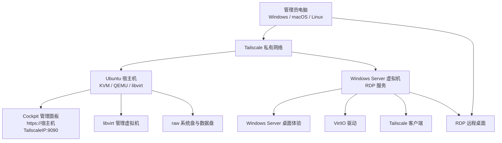
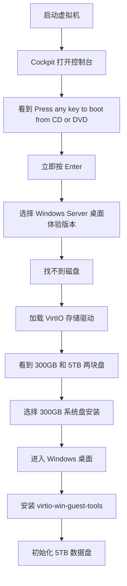
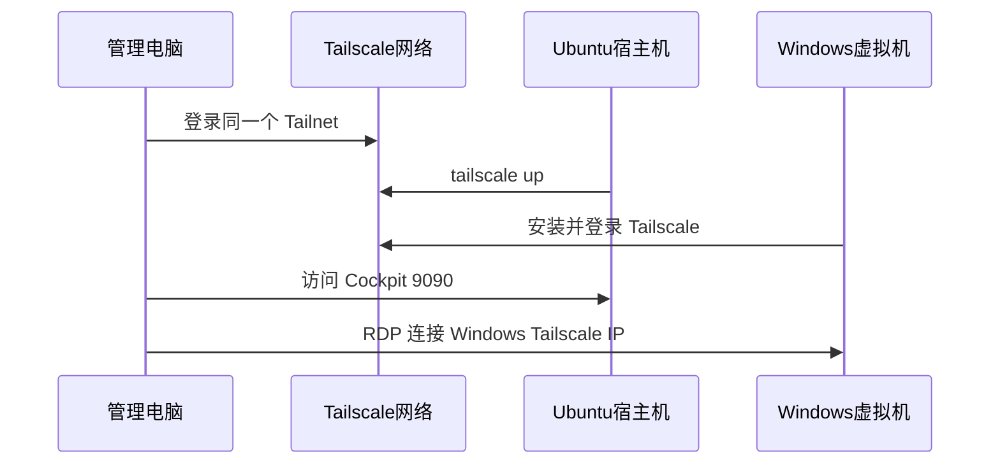
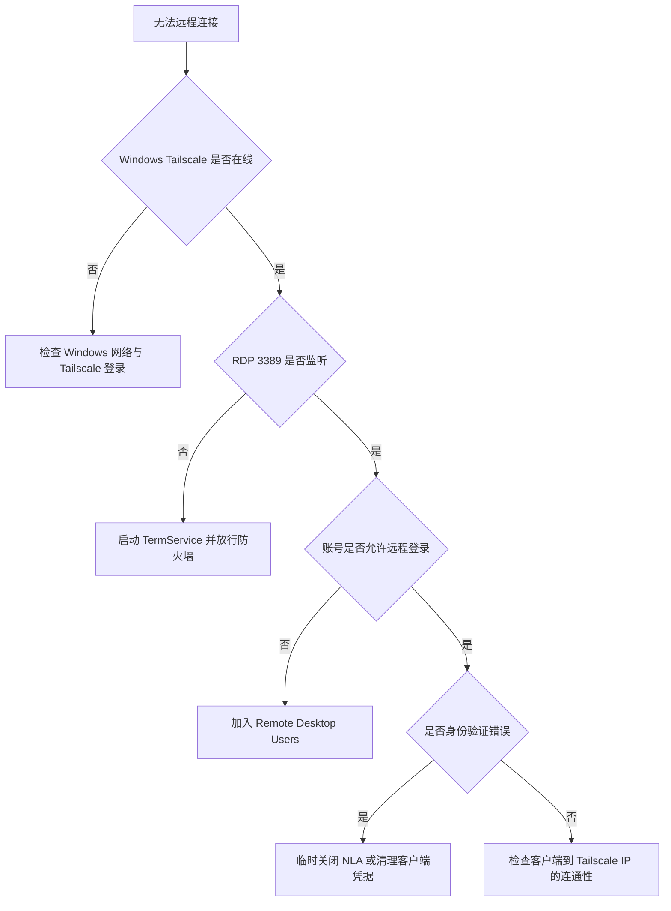
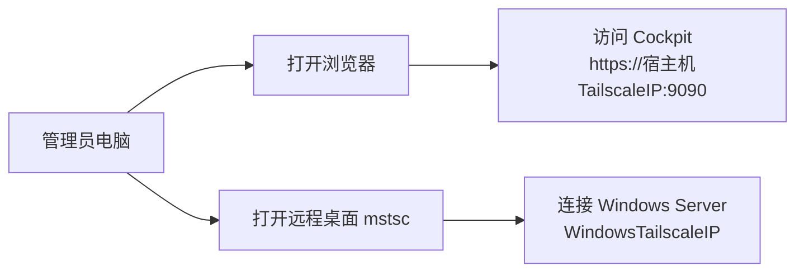

## 1. 方案概述

本文档记录一套在 Ubuntu Server 上使用 **KVM / QEMU / libvirt** 部署 Windows Server 虚拟机的完整流程。最终采用 **Tailscale + RDP** 访问 Windows Server，不再直接暴露远程桌面端口到公网，也不依赖校园网/单位网额外绑定虚拟机 MAC。

适用场景：

```text
1. 校园网、单位网、实验室服务器
2. 网络存在 IP/MAC 绑定
3. 不方便做 br0 桥接
4. 不希望公网暴露 3389 远程桌面端口
5. 希望通过浏览器管理宿主机和虚拟机
6. 希望 Windows Server 支持远程桌面访问
```

Ubuntu 官方文档推荐通过 `qemu-kvm` 和 `libvirt-daemon-system` 提供 KVM/libvirt 虚拟化能力，并将需要管理虚拟机的用户加入 `libvirt` 组。Cockpit 是 Linux 的 Web 管理界面，默认通过 9090 端口访问，可用于管理宿主机和虚拟机。([Ubuntu](https://ubuntu.com/server/docs/how-to/virtualisation/libvirt/?utm_source=chatgpt.com "Libvirt - Ubuntu Server documentation"))

---

## 2. 最终架构图



最终访问方式：

```text
宿主机管理：
https://<宿主机 Tailscale IP>:9090

Windows 远程桌面：
mstsc /v:<Windows Server Tailscale IP>
```

Tailscale 官方文档说明，可通过 Tailscale 将 Windows RDP 放在私有 Tailnet 内访问，而无需暴露端口或管理复杂网络配置。([Tailscale](https://tailscale.com/docs/solutions/access-remote-desktops-using-windows-rdp?utm_source=chatgpt.com "Access remote desktops using Windows RDP · Tailscale Docs"))

---

## 3. 为什么不使用公网端口转发或桥接

在校园网或单位网环境中，常见网络限制包括：

```text
1. 宿主机 IP 与物理网卡 MAC 绑定
2. 不允许一台物理机后面出现多个未知 MAC
3. 虚拟机桥接后可能无法 DHCP、无法出网或被准入系统拦截
4. 公网暴露 RDP 容易被扫描、爆破
```

因此本方案最终不采用：

```text
1. br0 桥接
2. Direct attachment / macvtap
3. 公网端口转发 RDP
4. 手写 nftables / iptables 暴露 3389
5. passt portForward
6. QEMU SLIRP hostfwd
```

最终使用：

```text
宿主机正常联网
Windows 虚拟机正常出网
宿主机和 Windows 虚拟机分别加入 Tailscale
通过 Tailscale IP 访问 Cockpit 和 RDP
```

---

## 4. 资源规划

```text
宿主机系统：Ubuntu Server
虚拟化：KVM / QEMU / libvirt
管理面板：Cockpit
虚拟机系统：Windows Server 2025
CPU：20 vCPU
内存：32 GB
系统盘：300 GB raw
数据盘：5 TB raw
磁盘驱动：VirtIO
网卡驱动：VirtIO
远程访问：Tailscale + RDP
```

推荐目录结构模板：

```text
<BASE_DIR>/
  ├── iso/
  │   ├── <WINDOWS_SERVER_ISO>
  │   └── virtio-win.iso
  ├── images/
  │   ├── winserver-system.raw
  │   └── winserver-data.raw
  ├── backup/
  └── scripts/
```

---

## 5. 安装 KVM、libvirt、Cockpit

```bash
sudo apt update

sudo apt install -y \
  qemu-kvm \
  libvirt-daemon-system \
  libvirt-clients \
  virtinst \
  qemu-utils \
  ovmf \
  swtpm \
  swtpm-tools \
  bridge-utils \
  cpu-checker \
  cockpit \
  cockpit-machines \
  cockpit-networkmanager \
  cockpit-storaged \
  wget \
  curl \
  vim \
  htop \
  acl
```

启动服务：

```bash
sudo systemctl enable --now libvirtd
sudo systemctl enable --now virtlogd
sudo systemctl enable --now cockpit.socket
```

检查 KVM：

```bash
kvm-ok
egrep -c '(vmx|svm)' /proc/cpuinfo
lsmod | grep kvm
```

检查 libvirt：

```bash
virsh -c qemu:///system list --all
```

检查 Cockpit：

```bash
systemctl status cockpit.socket --no-pager
```

Cockpit 默认通过 9090 端口访问，并使用系统账号登录。([Cockpit Project](https://cockpit-project.org/guide/latest/?utm_source=chatgpt.com "Cockpit documentation - Cockpit Project"))

---

## 6. 创建非 root 虚拟机管理用户

创建用户：

```bash
sudo useradd -d <BASE_DIR> -s /bin/bash <VM_ADMIN>
sudo passwd <VM_ADMIN>
```

如果用户已存在，仅修改家目录：

```bash
sudo usermod -d <BASE_DIR> <VM_ADMIN>
```

加入管理组：

```bash
sudo usermod -aG sudo,libvirt,kvm <VM_ADMIN>
```

创建目录：

```bash
sudo mkdir -p <BASE_DIR>/{iso,images,backup,scripts}
sudo chown -R <VM_ADMIN>:<VM_ADMIN> <BASE_DIR>
```

重新登录该用户后检查：

```bash
su - <VM_ADMIN>
groups
virsh -c qemu:///system list --all
```

应包含：

```text
sudo
libvirt
kvm
```

---

## 7. 配置目录权限

因为 ISO 和磁盘镜像不在默认 `/var/lib/libvirt/` 下，需要确保 `libvirt-qemu` 能访问：

```bash
sudo setfacl -m u:libvirt-qemu:x <BASE_DIR的上级目录>
sudo setfacl -m u:libvirt-qemu:rx <BASE_DIR>
sudo setfacl -m u:libvirt-qemu:rx <BASE_DIR>/iso
sudo setfacl -m u:libvirt-qemu:rwx <BASE_DIR>/images
sudo setfacl -d -m u:libvirt-qemu:rwx <BASE_DIR>/images
```

检查：

```bash
getfacl <BASE_DIR>
getfacl <BASE_DIR>/iso
getfacl <BASE_DIR>/images
```

---

## 8. 准备 Windows Server ISO 和 VirtIO ISO

ISO 目录中应包含：

```text
<WINDOWS_SERVER_ISO>
virtio-win.iso
```

设置权限：

```bash
sudo chown <VM_ADMIN>:<VM_ADMIN> <BASE_DIR>/iso/*.iso
sudo chmod 644 <BASE_DIR>/iso/*.iso
sudo setfacl -m u:libvirt-qemu:r <BASE_DIR>/iso/*.iso
```

`virtio-win.iso` 用于 Windows 在 KVM/QEMU 下识别 VirtIO 磁盘、VirtIO 网卡和安装 QEMU Guest Agent。安装 Windows 时，如果看不到磁盘，需要从 VirtIO ISO 加载存储驱动。VirtIO 官方文档也说明，安装阶段可加载硬盘驱动以使 Windows 识别存储设备。([virtio-win](https://virtio-win.github.io/Knowledge-Base/Driver-installation.html?utm_source=chatgpt.com "Driver installation | virtio-win"))

---

## 9. 创建 raw 磁盘

```bash
qemu-img create -f raw <BASE_DIR>/images/winserver-system.raw 300G
qemu-img create -f raw <BASE_DIR>/images/winserver-data.raw 5120G
```

设置权限：

```bash
sudo chown <VM_ADMIN>:<VM_ADMIN> <BASE_DIR>/images/winserver-system.raw
sudo chown <VM_ADMIN>:<VM_ADMIN> <BASE_DIR>/images/winserver-data.raw

sudo chmod 660 <BASE_DIR>/images/winserver-system.raw
sudo chmod 660 <BASE_DIR>/images/winserver-data.raw

sudo setfacl -m u:libvirt-qemu:rw <BASE_DIR>/images/winserver-system.raw
sudo setfacl -m u:libvirt-qemu:rw <BASE_DIR>/images/winserver-data.raw
```

检查：

```bash
ls -lh <BASE_DIR>/images/
du -h <BASE_DIR>/images/*
qemu-img info <BASE_DIR>/images/winserver-system.raw
qemu-img info <BASE_DIR>/images/winserver-data.raw
```

说明：

```text
ls -lh：显示虚拟容量
du -h：显示实际占用
```

---

## 10. 创建 Windows Server 虚拟机

```bash
virt-install \
  --connect qemu:///system \
  --name <VM_NAME> \
  --memory 32768 \
  --vcpus 20,sockets=1,cores=20,threads=1 \
  --cpu host-passthrough \
  --machine q35 \
  --boot uefi \
  --os-variant win2k25 \
  --disk path=<BASE_DIR>/images/winserver-system.raw,format=raw,bus=virtio,cache=none,io=threads \
  --disk path=<BASE_DIR>/images/winserver-data.raw,format=raw,bus=virtio,cache=none,io=threads \
  --disk path=<BASE_DIR>/iso/virtio-win.iso,device=cdrom \
  --cdrom <BASE_DIR>/iso/<WINDOWS_SERVER_ISO> \
  --network network=default,model=virtio \
  --graphics vnc,listen=127.0.0.1 \
  --video qxl \
  --channel unix,target_type=virtio,name=org.qemu.guest_agent.0 \
  --noautoconsole
```

如果 `win2k25` 不识别：

```bash
osinfo-query os | grep -i win
```

没有 `win2k25` 时使用：

```bash
--os-variant win2k22
```

---

## 11. 虚拟机安装流程图



---

## 12. 通过 Cockpit 安装 Windows

访问 Cockpit：

```text
https://<宿主机IP>:9090
```

如果宿主机已加入 Tailscale：

```text
https://<宿主机TailscaleIP>:9090
```

路径：

```text
Virtual Machines
  -> <VM_NAME>
  -> Console
```

启动时看到：

```text
Press any key to boot from CD or DVD...
```

立即按：

```text
Enter
```

建议选择：

```text
Windows Server 2025 Datacenter Evaluation（桌面体验）
```

不建议选择不带“桌面体验”的 Server Core，因为后续配置驱动、Tailscale、RDP 会更麻烦。

---

## 13. 加载 VirtIO 磁盘驱动

如果 Windows 安装界面看不到硬盘：

```text
加载驱动程序 / Load driver
```

选择 VirtIO ISO 中的路径：

```text
viostor\2k25\amd64
```

如果没有 `2k25`：

```text
viostor\2k22\amd64
```

加载后应看到：

```text
300 GB 系统盘
5 TB 数据盘
```

安装时选择：

```text
300 GB 系统盘
```

不要选择 5 TB 数据盘。

---

## 14. 安装 VirtIO Guest Tools

进入 Windows 桌面后，打开 VirtIO 光盘，运行：

```text
virtio-win-guest-tools.exe
```

安装内容包括：

```text
VirtIO 磁盘驱动
VirtIO 网卡驱动
Balloon 驱动
QEMU Guest Agent
其他 VirtIO 组件
```

安装完成后重启 Windows。

宿主机检查 Guest Agent：

```bash
virsh --connect qemu:///system domifaddr <VM_NAME> --source agent
```

---

## 15. 初始化 5 TB 数据盘

Windows 管理员 PowerShell：

```powershell
Get-Disk
```

找到 5 TB 数据盘，假设编号为 `0`：

```powershell
Initialize-Disk -Number 0 -PartitionStyle GPT
New-Partition -DiskNumber 0 -UseMaximumSize -DriveLetter D
Format-Volume -DriveLetter D -FileSystem NTFS -NewFileSystemLabel "Data" -Confirm:$false
```

图形方式：

```text
Win + R
diskmgmt.msc
```

然后：

```text
联机
初始化为 GPT
新建简单卷
分配 D:
NTFS 快速格式化
```

5 TB 数据盘必须使用 GPT，不应使用 MBR。

---

## 16. 安装 Tailscale

### 16.1 宿主机安装 Tailscale

```bash
curl -fsSL https://tailscale.com/install.sh | sh
sudo tailscale up
```

查看状态：

```bash
tailscale status
tailscale ip -4
```

宿主机加入 Tailnet 后，Cockpit 可以通过：

```text
https://<宿主机TailscaleIP>:9090
```

访问。

### 16.2 Windows Server 安装 Tailscale

在 Windows Server 中安装 Tailscale 客户端，登录同一个 Tailnet。

查看 Windows 的 Tailscale IP：

```powershell
tailscale ip -4
```

之后远程桌面连接：

```text
mstsc /v:<Windows Server Tailscale IP>
```

---

## 17. Tailscale 访问图



---

## 18. 开启 Windows RDP

Windows 管理员 PowerShell：

```powershell
Set-ItemProperty `
  -Path "HKLM:\System\CurrentControlSet\Control\Terminal Server" `
  -Name "fDenyTSConnections" `
  -Value 0

Set-Service TermService -StartupType Automatic
Start-Service TermService
```

中文系统里，`Remote Desktop` 防火墙组名可能不识别，直接新建规则更稳：

```powershell
New-NetFirewallRule `
  -DisplayName "Allow RDP TCP 3389" `
  -Direction Inbound `
  -Protocol TCP `
  -LocalPort 3389 `
  -Action Allow

New-NetFirewallRule `
  -DisplayName "Allow RDP UDP 3389" `
  -Direction Inbound `
  -Protocol UDP `
  -LocalPort 3389 `
  -Action Allow
```

检查：

```powershell
netstat -ano | findstr ":3389"
```

看到：

```text
0.0.0.0:3389 LISTENING
```

说明 RDP 已经监听。

---

## 19. 创建远程桌面用户

```powershell
New-LocalUser "rdp01" -Password (Read-Host -AsSecureString "Password") -FullName "RDP User 01"

Add-LocalGroupMember -SID "S-1-5-32-555" -Member "rdp01"
```

说明：

```text
S-1-5-32-555 = Remote Desktop Users 组
中文系统也适用
```

登录时用户名建议填写：

```text
.\rdp01
```

---

## 20. RDP 身份验证错误处理

如果出现：

```text
发生身份验证错误
给函数提供的标志无效
```

可以临时关闭 NLA：

```powershell
Set-ItemProperty `
  -Path "HKLM:\SYSTEM\CurrentControlSet\Control\Terminal Server\WinStations\RDP-Tcp" `
  -Name "UserAuthentication" `
  -Value 0

Restart-Service TermService -Force
```

必要时调整 RDP 安全层：

```powershell
Set-ItemProperty `
  -Path "HKLM:\SYSTEM\CurrentControlSet\Control\Terminal Server\WinStations\RDP-Tcp" `
  -Name "SecurityLayer" `
  -Value 1

Set-ItemProperty `
  -Path "HKLM:\SYSTEM\CurrentControlSet\Control\Terminal Server\WinStations\RDP-Tcp" `
  -Name "MinEncryptionLevel" `
  -Value 2

Restart-Service TermService -Force
```

客户端清理旧凭据：

```cmd
cmdkey /list
cmdkey /delete:TERMSRV/<Windows Server Tailscale IP>
```

---

## 21. 多用户远程桌面说明

如果只是管理员维护或少量连接，普通 RDP 即可。若要多人长期同时登录 Windows Server 桌面，应部署 Remote Desktop Services，并配置合法 RDS CAL。微软文档说明，连接到 Remote Desktop Services 会话主机的每个用户或设备都需要 RDS CAL，并且 Windows Server 2025 需要兼容版本的 RDS CAL。([Microsoft Learn](https://learn.microsoft.com/zh-cn/windows-server/remote/remote-desktop-services/rds-client-access-license?utm_source=chatgpt.com "使用客户端访问许可证（CAL）许可远程桌面服务 | Microsoft ..."))

安装 RDS 角色：

```powershell
Install-WindowsFeature RDS-RD-Server,RDS-Licensing -IncludeManagementTools -Restart
```

重启后配置：

```text
Remote Desktop Licensing Manager
激活许可证服务器
安装 RDS CAL
配置授权模式：按用户 或 按设备
```

---

## 22. AMD CPU 优化配置

本方案使用 AMD CPU，因此不配置 Intel 专属的 `evmcs`。Red Hat 文档说明，可以通过 Hyper-V enlightenments 优化 Windows 虚拟机，并在时钟中启用 `hypervclock`。([docs.redhat.com](https://docs.redhat.com/zh-cn/documentation/red_hat_enterprise_linux/10/html/configuring_and_managing_windows_virtual_machines/enabling-hyper-v-enlightenments?utm_source=chatgpt.com "4.2. Enabling Hyper-V enlightenments | Configuring and managing Windows ..."))

### 22.1 关机并备份 XML

```bash
virsh --connect qemu:///system shutdown <VM_NAME>
```

如果无法正常关机：

```bash
virsh --connect qemu:///system destroy <VM_NAME>
```

备份：

```bash
mkdir -p <BASE_DIR>/backup

virsh --connect qemu:///system dumpxml <VM_NAME> \
  > <BASE_DIR>/backup/<VM_NAME>-before-amd-opt.xml
```

编辑：

```bash
virsh --connect qemu:///system edit <VM_NAME>
```

### 22.2 CPU 拓扑

AMD 机器不建议配置 `threads='2'`，否则可能出现类似：

```text
This family of AMD CPU doesn't support hyperthreading(2)
```

推荐：

```xml
<vcpu placement='static'>20</vcpu>

<cpu mode='host-passthrough' check='none' migratable='on'>
  <topology sockets='1' dies='1' cores='20' threads='1'/>
</cpu>
```

含义：

```text
1 socket × 20 cores × 1 thread = 20 vCPU
```

### 22.3 Hyper-V Enlightenments

```xml
<features>
  <acpi/>
  <apic/>
  <hyperv mode='custom'>
    <relaxed state='on'/>
    <vapic state='on'/>
    <spinlocks state='on' retries='8191'/>
    <vendor_id state='on' value='KVM Hv'/>
    <vpindex state='on'/>
    <runtime state='on'/>
    <synic state='on'/>
    <stimer state='on'>
      <direct state='on'/>
    </stimer>
    <frequencies state='on'/>
    <reset state='on'/>
    <tlbflush state='on'/>
  </hyperv>
  <vmport state='off'/>
  <smm state='on'/>
</features>
```

### 22.4 Windows 时钟

```xml
<clock offset='localtime'>
  <timer name='rtc' tickpolicy='catchup'/>
  <timer name='pit' tickpolicy='delay'/>
  <timer name='hpet' present='no'/>
  <timer name='hypervclock' present='yes'/>
</clock>
```

保存后启动：

```bash
virsh --connect qemu:///system start <VM_NAME>
```

检查：

```bash
virsh --connect qemu:///system dumpxml <VM_NAME> | grep -A30 "<hyperv"
virsh --connect qemu:///system dumpxml <VM_NAME> | grep -A10 "<clock"
```

---

## 23. 开机自启

```bash
virsh --connect qemu:///system autostart <VM_NAME>
```

检查：

```bash
virsh --connect qemu:///system dominfo <VM_NAME>
```

---

## 24. 备份建议

### 24.1 备份虚拟机 XML

```bash
mkdir -p <BASE_DIR>/backup

virsh --connect qemu:///system dumpxml <VM_NAME> \
  > <BASE_DIR>/backup/<VM_NAME>.xml
```

### 24.2 关机备份 raw 磁盘

```bash
virsh --connect qemu:///system shutdown <VM_NAME>
```

确认关机：

```bash
virsh --connect qemu:///system list --all
```

备份：

```bash
rsync -ah --progress \
  <BASE_DIR>/images/winserver-system.raw \
  <BASE_DIR>/backup/

rsync -ah --progress \
  <BASE_DIR>/images/winserver-data.raw \
  <BASE_DIR>/backup/
```

5 TB 数据盘较大，长期建议使用：

```text
ZFS snapshot
LVM snapshot
存储阵列快照
定期离线备份
```

---

## 25. 排错图



---

## 26. 常用检查命令

### 26.1 宿主机检查

```bash
kvm-ok
lsmod | grep kvm
systemctl status libvirtd --no-pager
systemctl status cockpit.socket --no-pager
virsh --connect qemu:///system list --all
```

### 26.2 虚拟机信息

```bash
virsh --connect qemu:///system dominfo <VM_NAME>
virsh --connect qemu:///system domblklist <VM_NAME>
virsh --connect qemu:///system domiflist <VM_NAME>
```

### 26.3 Windows IP

```bash
virsh --connect qemu:///system domifaddr <VM_NAME> --source agent
```

或：

```bash
sudo virsh net-dhcp-leases default
```

### 26.4 日志

```bash
sudo tail -f /var/log/libvirt/qemu/<VM_NAME>.log
journalctl -u libvirtd -xe
```

### 26.5 Tailscale

宿主机：

```bash
tailscale status
tailscale ip -4
```

Windows：

```powershell
tailscale status
tailscale ip -4
```

---

## 27. 最终访问方式



最终只需要两个入口：

```text
1. Cockpit 管理宿主机和虚拟机：
   https://<宿主机 Tailscale IP>:9090

2. RDP 访问 Windows Server：
   mstsc /v:<Windows Server Tailscale IP>
```

---

## 28. 相关链接

- Ubuntu Server libvirt/KVM 官方文档：安装 `qemu-kvm`、`libvirt-daemon-system`，并配置 libvirt 管理用户。([Ubuntu](https://ubuntu.com/server/docs/how-to/virtualisation/libvirt/?utm_source=chatgpt.com "Libvirt - Ubuntu Server documentation"))
    
- Cockpit 官方文档：Cockpit 是 Linux 的 Web 管理界面，通常通过 9090 端口访问。([Cockpit Project](https://cockpit-project.org/guide/latest/?utm_source=chatgpt.com "Cockpit documentation - Cockpit Project"))
    
- Tailscale 官方 RDP 文档：通过 Tailnet 安全访问 Windows RDP，无需暴露端口。([Tailscale](https://tailscale.com/docs/solutions/access-remote-desktops-using-windows-rdp?utm_source=chatgpt.com "Access remote desktops using Windows RDP · Tailscale Docs"))
    
- VirtIO Windows 驱动安装文档：Windows 安装阶段可加载 VirtIO 存储驱动。([virtio-win](https://virtio-win.github.io/Knowledge-Base/Driver-installation.html?utm_source=chatgpt.com "Driver installation | virtio-win"))
    
- Red Hat Windows VM 优化文档：Hyper-V enlightenments 与 `hypervclock` 可用于优化 Windows 虚拟机。([docs.redhat.com](https://docs.redhat.com/zh-cn/documentation/red_hat_enterprise_linux/10/html/configuring_and_managing_windows_virtual_machines/enabling-hyper-v-enlightenments?utm_source=chatgpt.com "4.2. Enabling Hyper-V enlightenments | Configuring and managing Windows ..."))
    
- Microsoft RDS CAL 文档：多人长期远程桌面需要合法 RDS CAL。([Microsoft Learn](https://learn.microsoft.com/zh-cn/windows-server/remote/remote-desktop-services/rds-client-access-license?utm_source=chatgpt.com "使用客户端访问许可证（CAL）许可远程桌面服务 | Microsoft ..."))
    

---

## 29. 总结

最终推荐方案：

```text
Ubuntu KVM / libvirt
+ Cockpit 图形管理
+ Windows Server 2025 虚拟机
+ VirtIO 驱动
+ raw 系统盘与数据盘
+ AMD Hyper-V Enlightenments 优化
+ Tailscale 安全远程访问
```

核心优势：

```text
1. 不暴露 RDP 到公网
2. 不需要学校或单位为虚拟机绑定 MAC
3. 不依赖 br0 桥接
4. 不依赖手写端口转发规则
5. 宿主机和 Windows 都可远程安全访问
6. 后续可扩展 RDS 多用户访问
```

最终使用方式非常简单：

```text
管理宿主机：访问 Cockpit 的 Tailscale IP
使用 Windows：远程桌面连接 Windows Server 的 Tailscale IP
```