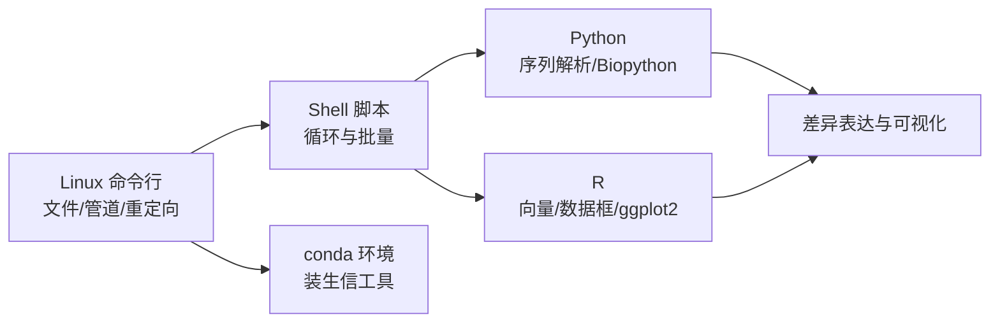

# 生物信息学必备技能清单：Linux × Python × R

> [!NOTE]
> 这是一份**能力自查 + 速查手册**。文中所有命令、语法说明与代码示例均整理自你知识库中的资料（书目见文末「资料来源」），不是凭空补充的通用教程。
> 定位：不要求像系统管理员那样精通 Linux 底层，但要能**独立完成生信分析流程中的各个关键步骤**。[^guide]

[^guide]: 出自《生物信息学入门指南》的能力自查说明。

## 目录

- [一、Linux 命令篇](vault/%E6%96%B9%E6%B3%95/%E7%94%9F%E4%BF%A1%E5%88%86%E6%9E%90/02_LInux%E5%8F%8A%E7%BC%96%E7%A8%8B%E5%9F%BA%E7%A1%80#%E4%B8%80linux-%E5%91%BD%E4%BB%A4%E7%AF%87)
  - [1.1 终端与快捷键](vault/%E6%96%B9%E6%B3%95/%E7%94%9F%E4%BF%A1%E5%88%86%E6%9E%90/02_LInux%E5%8F%8A%E7%BC%96%E7%A8%8B%E5%9F%BA%E7%A1%80#11-%E7%BB%88%E7%AB%AF%E4%B8%8E%E5%BF%AB%E6%8D%B7%E9%94%AE)
  - [1.2 命令的通用语法](vault/%E6%96%B9%E6%B3%95/%E7%94%9F%E4%BF%A1%E5%88%86%E6%9E%90/02_LInux%E5%8F%8A%E7%BC%96%E7%A8%8B%E5%9F%BA%E7%A1%80#12-%E5%91%BD%E4%BB%A4%E7%9A%84%E9%80%9A%E7%94%A8%E8%AF%AD%E6%B3%95)
  - [1.3 绝对路径与相对路径](vault/%E6%96%B9%E6%B3%95/%E7%94%9F%E4%BF%A1%E5%88%86%E6%9E%90/02_LInux%E5%8F%8A%E7%BC%96%E7%A8%8B%E5%9F%BA%E7%A1%80#13-%E7%BB%9D%E5%AF%B9%E8%B7%AF%E5%BE%84%E4%B8%8E%E7%9B%B8%E5%AF%B9%E8%B7%AF%E5%BE%84)
  - [1.4 文件与目录操作](vault/%E6%96%B9%E6%B3%95/%E7%94%9F%E4%BF%A1%E5%88%86%E6%9E%90/02_LInux%E5%8F%8A%E7%BC%96%E7%A8%8B%E5%9F%BA%E7%A1%80#14-%E6%96%87%E4%BB%B6%E4%B8%8E%E7%9B%AE%E5%BD%95%E6%93%8D%E4%BD%9C)
  - [1.5 查看、检索与统计](vault/%E6%96%B9%E6%B3%95/%E7%94%9F%E4%BF%A1%E5%88%86%E6%9E%90/02_LInux%E5%8F%8A%E7%BC%96%E7%A8%8B%E5%9F%BA%E7%A1%80#15-%E6%9F%A5%E7%9C%8B%E6%A3%80%E7%B4%A2%E4%B8%8E%E7%BB%9F%E8%AE%A1)
  - [1.6 管道与数据流重定向（核心）](vault/%E6%96%B9%E6%B3%95/%E7%94%9F%E4%BF%A1%E5%88%86%E6%9E%90/02_LInux%E5%8F%8A%E7%BC%96%E7%A8%8B%E5%9F%BA%E7%A1%80#16-%E7%AE%A1%E9%81%93%E4%B8%8E%E6%95%B0%E6%8D%AE%E6%B5%81%E9%87%8D%E5%AE%9A%E5%90%91%E6%A0%B8%E5%BF%83)
  - [1.7 指令连续下达：`;` `&&` `||`](vault/%E6%96%B9%E6%B3%95/%E7%94%9F%E4%BF%A1%E5%88%86%E6%9E%90/02_LInux%E5%8F%8A%E7%BC%96%E7%A8%8B%E5%9F%BA%E7%A1%80#17-%E6%8C%87%E4%BB%A4%E8%BF%9E%E7%BB%AD%E4%B8%8B%E8%BE%BE--)
  - [1.8 权限与环境变量](vault/%E6%96%B9%E6%B3%95/%E7%94%9F%E4%BF%A1%E5%88%86%E6%9E%90/02_LInux%E5%8F%8A%E7%BC%96%E7%A8%8B%E5%9F%BA%E7%A1%80#18-%E6%9D%83%E9%99%90%E4%B8%8E%E7%8E%AF%E5%A2%83%E5%8F%98%E9%87%8F)
  - [1.9 进程、资源与任务监控](vault/%E6%96%B9%E6%B3%95/%E7%94%9F%E4%BF%A1%E5%88%86%E6%9E%90/02_LInux%E5%8F%8A%E7%BC%96%E7%A8%8B%E5%9F%BA%E7%A1%80#19-%E8%BF%9B%E7%A8%8B%E8%B5%84%E6%BA%90%E4%B8%8E%E4%BB%BB%E5%8A%A1%E7%9B%91%E6%8E%A7)
  - [1.10 远程连接与 HPC 集群](vault/%E6%96%B9%E6%B3%95/%E7%94%9F%E4%BF%A1%E5%88%86%E6%9E%90/02_LInux%E5%8F%8A%E7%BC%96%E7%A8%8B%E5%9F%BA%E7%A1%80#110-%E8%BF%9C%E7%A8%8B%E8%BF%9E%E6%8E%A5%E4%B8%8E-hpc-%E9%9B%86%E7%BE%A4)
  - [1.11 软件安装：conda / bioconda](vault/%E6%96%B9%E6%B3%95/%E7%94%9F%E4%BF%A1%E5%88%86%E6%9E%90/02_LInux%E5%8F%8A%E7%BC%96%E7%A8%8B%E5%9F%BA%E7%A1%80#111-%E8%BD%AF%E4%BB%B6%E5%AE%89%E8%A3%85conda--bioconda)
  - [1.12 生信实战命令行片段](vault/%E6%96%B9%E6%B3%95/%E7%94%9F%E4%BF%A1%E5%88%86%E6%9E%90/02_LInux%E5%8F%8A%E7%BC%96%E7%A8%8B%E5%9F%BA%E7%A1%80#112-%E7%94%9F%E4%BF%A1%E5%AE%9E%E6%88%98%E5%91%BD%E4%BB%A4%E8%A1%8C%E7%89%87%E6%AE%B5)
  - [1.13 Linux 能力自查清单](vault/%E6%96%B9%E6%B3%95/%E7%94%9F%E4%BF%A1%E5%88%86%E6%9E%90/02_LInux%E5%8F%8A%E7%BC%96%E7%A8%8B%E5%9F%BA%E7%A1%80#113-linux-%E8%83%BD%E5%8A%9B%E8%87%AA%E6%9F%A5%E6%B8%85%E5%8D%95)
- [二、Python 编程基础篇](vault/%E6%96%B9%E6%B3%95/%E7%94%9F%E4%BF%A1%E5%88%86%E6%9E%90/02_LInux%E5%8F%8A%E7%BC%96%E7%A8%8B%E5%9F%BA%E7%A1%80#%E4%BA%8Cpython-%E7%BC%96%E7%A8%8B%E5%9F%BA%E7%A1%80%E7%AF%87)
- [三、R 语言基础篇](vault/%E6%96%B9%E6%B3%95/%E7%94%9F%E4%BF%A1%E5%88%86%E6%9E%90/02_LInux%E5%8F%8A%E7%BC%96%E7%A8%8B%E5%9F%BA%E7%A1%80#%E4%B8%89r-%E8%AF%AD%E8%A8%80%E5%9F%BA%E7%A1%80%E7%AF%87)
- [四、练习路线建议](vault/%E6%96%B9%E6%B3%95/%E7%94%9F%E4%BF%A1%E5%88%86%E6%9E%90/02_LInux%E5%8F%8A%E7%BC%96%E7%A8%8B%E5%9F%BA%E7%A1%80#%E5%9B%9B%E7%BB%83%E4%B9%A0%E8%B7%AF%E7%BA%BF%E5%BB%BA%E8%AE%AE)
- [资料来源](vault/%E6%96%B9%E6%B3%95/%E7%94%9F%E4%BF%A1%E5%88%86%E6%9E%90/02_LInux%E5%8F%8A%E7%BC%96%E7%A8%8B%E5%9F%BA%E7%A1%80#%E8%B5%84%E6%96%99%E6%9D%A5%E6%BA%90)

---

## 一、Linux 命令篇

> [!IMPORTANT]
> 为什么要学 Linux：许多生信软件（如 Bowtie2、qiime2、vsearch 等）主要在 Linux 上发布和维护，大型计算任务的计算平台也是 Linux。[^guide]

### 1.1 终端与快捷键

终端是文本窗口程序（如 GNOME Terminal、Konsole），通过它使用命令行 Shell，Ubuntu 默认 Shell 是 **Bash**。提示符 `$` 前显示 `用户名@主机名:当前目录`，`~` 是用户主目录（home）的指示符；管理员 root 的提示符为 `#`，出于安全一般不推荐用 root 登录。

| 快捷键 | 作用 |
|---|---|
| `Tab` | 自动补全命令／文件名；匹配到多个时会响铃提示，再补几个字符即可 |
| `↑` / `↓` | 调出历史命令，长命令不必重输 |
| `Ctrl + U` | 取消整行输入 |
| `Ctrl + A` / `Ctrl + E` | 光标移到行首 / 行尾 |
| `Ctrl + L` | 清屏（等同 `clear`） |
| `Ctrl + C` | 终止当前进程 |
| `exit` | 退出终端 |

### 1.2 命令的通用语法

Unix 命令统一遵循：

```bash
command option(s) input
```

可以把命令想成自然语言里的**动词**，`input` 是作用对象，`option(s)` 用来改变命令的默认行为。查看任意命令手册用 `man`。

### 1.3 绝对路径与相对路径

| 类型 | 判别 | 示例 |
|---|---|---|
| 绝对路径 | 以 `/` 开头（顶层是根目录 `/`） | `cd /data/username` |
| 相对路径 | 不以 `/` 开头 | `P/P_in` |

常用切换：

```bash
cd            # 回 home 目录（cd ~ 或 cd /home/username 等价）
cd ..         # 上一级
cd ../../     # 上两级，以此类推
pwd           # 打印当前工作目录，如 /home/username
```

### 1.4 文件与目录操作

| 命令 | 作用 | 要点与示例 |
|---|---|---|
| `pwd` | print working directory | 打印当前目录 |
| `cd` | change directory | 见上 |
| `ls` | list directory content | `ls -l` 逐行显示详细信息；`ls -1` 一行一个；`ls folder` 查看其他目录 |
| `mkdir` | make a directory | `mkdir folder` |
| `touch` | 创建空文件 | `touch bioinformatics.txt` |
| `cp` | 复制文件／文件夹 | `cp a.txt b.txt`；复制文件夹必须加 `-r`（递归）：`cp -r folder new_folder` |
| `mv` | 重命名或移动 | `mv old.txt new.txt` |
| `rm` | 删除文件或文件夹 | 谨慎使用 |
| `find` | 查找文件 | `find /etc -name '*.conf'` |
| `nano` | 基础文本编辑器 | 可编辑 txt/csv/fasta/genbank/gtf/fastq；`Ctrl+X` 保存退出；文件不存在时会新建 |

> [!TIP]
> `ls -l` 输出的行首字符 `-` 表示文件、`d` 表示目录；第 5 列是大小（默认以字节显示）。这是判断"下下来的是不是空文件"最快的方法。

### 1.5 查看、检索与统计

| 命令 | 作用 |
|---|---|
| `cat` | 把文件内容打印到屏幕 |
| `less` | 分页浏览大文件 |
| `head` / `tail` | 看开头 / 结尾若干行 |
| `wc` | word / line / character 计数 |
| `grep` | 模式（关键字）搜索 |
| `cut` | 按分隔符或字符位置裁切字段 |
| `sort` | 排序 |
| `uniq` | 去除／统计重复行 |
| `column` | 表格数据在终端中对齐显示 |
| `awk '{print $N}'` | 以空白为间隔，打印第 N 个字段 |
| `tee` | 把数据转存一份到文件 |
| `split` | 按行数或容量切分成多份 |

生信场景要求：能**从 FASTA、FASTQ、GFF、TSV 文件中提取和统计内容**。[^guide]

### 1.6 管道与数据流重定向（核心）

三种数据流的代号与符号：

| 数据流 | 代码 | 符号 |
|---|---|---|
| 标准输入 stdin | 0 | `<` 或 `<<` |
| 标准输出 stdout | 1 | `>`（覆盖） / `>>`（累加） |
| 标准错误输出 stderr | 2 | `2>` / `2>>` |

```bash
# 丢弃错误信息（例如无权访问的目录报错）
find /etc -name '*passwd*' 2> /dev/null

# 正确与错误写进同一个文件（三种等价写法）
find /etc -name '*passwd*' >  ~/find_passwd.txt 2>&1
find /etc -name '*passwd*' 2> ~/find_passwd.txt 1>&2
find /etc -name '*passwd*' &>  ~/find_passwd.txt

# 用 () 把多条命令的输出统一汇整
(date; cal -3; echo "The following is log") > mylog.txt

# 标准输入 <<
cat > yourtype.txt << eof
here is GoGo!
eof
```

> [!WARNING]
> 管道 `|` **只处理 standard output**，对 standard error 会直接忽略；要一并处理需搭配 `2>&1`。另外不要用 `command > file.txt 2> file.txt`——文件无法被两个进程同时打开读写，应写成 `> file.txt 2>&1` 或 `&> file.txt`。

### 1.7 指令连续下达 `;` `&&` `||`

```bash
# ; 无依赖地连续执行
date; uptime; uname -r

# && 前一个成功（回传值 0）才执行下一个
ls -ld /dev/shm/check && rmdir /dev/shm/check

# || 前一个失败（回传非 0）才执行下一个：目录不存在才创建
ls -ld /dev/shm/check || mkdir /dev/shm/check

# 常用组合：判断存在性
ls -d /etc && echo exist || echo non-exist
```

脚本中可自定义回传值（`${@}` 代表所有参数，`$?` 取上一条命令回传值）：

```bash
#!/bin/bash
ls ${@} && exit 100 || exit 10
```

### 1.8 权限与环境变量

需要掌握：`chmod`、`chown`、`export`、`.bashrc`、`PATH`，知道如何配置软件路径与环境变量。[^guide]

`test` / `[ ]` 常用判断（注意中括号内必须留空白）：

| 类别 | 参数 |
|---|---|
| 文件类型 | `-e` 存在、`-f` 为文件、`-d` 为目录、`-L` 为链接档 |
| 权限 | `-r` `-w` `-x` `-u`(SUID) `-g`(SGID) `-k`(Sticky) `-s`(非空白) |
| 文件比较 | `-nt` 较新、`-ot` 较旧、`-ef` 同一文件（同 inode） |
| 整数 | `-eq` `-ne` `-gt` `-lt` `-ge` `-le` |
| 字符串 | `-z` 空、`-n` 非空、`==` `!=` |
| 多重条件 | `-a`(and) `-o`(or) `!`(反相) |

```bash
[ -e "${1}" ] && echo "${1} exist" || echo "${1} non-exist"
```

### 1.9 进程、资源与任务监控

| 命令 | 作用 |
|---|---|
| `top` / `htop` | 实时查看进程与占用 |
| `ps` | 查看进程 |
| `kill PID` | 结束指定进程 |
| `df` / `du` | 磁盘空间 / 目录占用 |
| `nohup` | 断开连接后继续运行 |
| `Ctrl+C` | 终止前台进程 |

### 1.10 远程连接与 HPC 集群

```bash
ssh username@remote.computer      # 例：ssh username@biowulf.nih.gov
```

输入密码时**屏幕不显示任何内容**，继续输入回车即可；登录后提示符类似 `[username@biowulf ~]$`。

| 命令 | 作用 |
|---|---|
| `ssh` | 连接远程计算机／HPC |
| `scp` / `rsync` | 文件上传下载 |
| `screen` / `tmux` | 断开连接后保持程序运行 |
| `module` | 集群上查找、加载、卸载已安装软件 |
| `sbatch` | 向集群提交作业（非交互式） |
| `sinteractive` | 申请交互式计算资源（交互分析、传数据） |

> [!TIP]
> 集群上 home 目录通常配额很小且不可扩容（如 Biowulf 只有 16GB），不适合放分析输入输出；应放到可申请扩容的 data 目录。[^biowulf]

[^biowulf]: 出自 NIH Biowulf 的 Unix 入门培训材料。

### 1.11 软件安装：conda / bioconda

需要熟悉 `conda`、`apt`、`pip`；能创建独立环境并在其中安装工具（如 fastp、vsearch、kraken2 等），并知道如何导出、分享 conda 环境或镜像。[^guide]

Conda 介于包管理器与容器之间，因为它**还能管理环境**——不同流程可能需要同一工具的不同版本，分环境安装可避免互相干扰；**Bioconda** 是专门收录生信软件的 conda channel，同时也能安装管理 Python / R 及其库。

```bash
# 配置 channel
conda config --add channels bioconda
conda config --add channels conda-forge
conda config --set channel_priority strict

# 新建环境并安装软件（推荐：一个流程一个环境）
conda create -n cutadapt cutadapt
conda create -n af -y -c bioconda simpleaf
conda create -n kingfisher -c conda-forge -c bioconda kingfisher

# 激活环境（每开一个新 shell 都要做）
conda activate af

# 用 yml 清单复现环境
conda env create --name qiime2-amplicon-2025.4 --file qiime2-amplicon-ubuntu-latest-conda.yml
conda env create --name q2-picrust2-amplicon-2024.5 --file q2-picrust2-amplicon-2024.5.yml
conda activate qiime2-amplicon-2025.4

# Apple Silicon（M1/M2）需要指定走 Rosetta2 的 intel 包
CONDA_SUBDIR=osx-64 conda create -n af -y -c bioconda simpleaf
conda env config vars set CONDA_SUBDIR=osx-64
```

> [!WARNING]
> 环境必须显式 `conda activate` 后才能使用其中的软件；在脚本里可写成 `source ~/.bashrc && conda activate 环境名 && 命令`。

### 1.12 生信实战命令行片段

<details>
<summary><b>① bioawk：FASTQ/FASTA 互转、计数、反向互补</b></summary>

`bioawk -c fastx` 会自动判断输入是 FASTA 还是 FASTQ。

```bash
# FASTQ → FASTA
bioawk -c fastx '{print ">"$name"\n"$seq}' contam.fastq | head -n 4

# 统计序列条数
bioawk -c fastx 'END{print NR}' contam.fastq

# 反向互补
bioawk -c fastx '{print ">"$name"\n"revcomp($seq)}' contam.fastq | head -n 4
```

</details>

<details>
<summary><b>② awk 处理 GTF：算特征长度</b></summary>

```bash
awk '{print $seqname, $end-$start}' Mus_musculus.GRCm38.75_chr1.gtf | head -n 4
# 1  465597
# 1   16807
# 1    5485
# 1   12533
```

> 想再加基因名就要从第 9 列的属性串里 split 出来，还需要 sed 清洗——这已经超出"一行命令"的合理范围，这种需求应该改用 bioawk 或 Python。

</details>

<details>
<summary><b>③ 经典组合管线：BAM 里统计 barcode 读数</b></summary>

```bash
samtools view -F 256 $bam_file | grep $bc_tag | sed $sed_pattern | sort | uniq -c | sort -nr | awk '{print $2 ", " $1}'
```

`$bc_tag` 为 cell barcode 标签（如 `CB:Z:`），`$sed_pattern` 用于提取完整 barcode。

</details>

<details>
<summary><b>④ awk + wget：按元数据批量下载并改名</b></summary>

```bash
awk '{system("wget -c ftp://.../"$5"/"$6"/"$6"_f1.fq.gz -O seq/"$1"_1.fq.gz")}' <(tail -n+2 metadata.txt)
awk '{system("wget -c ftp://.../"$5"/"$6"/"$6"_r2.fq.gz -O seq/"$1"_2.fq.gz")}' <(tail -n+2 metadata.txt)

# 同样思路自动生成 QIIME2 manifest
awk 'NR==1{print "sample-id\tforward-absolute-filepath\treverse-absolute-filepath"} \
     NR>1{print $1"\t$PWD/seq/"$1"_1.fq.gz\t$PWD/seq/"$1"_2.fq.gz"}' metadata.txt > manifest

# 下载后检查文件是否完整
ls -lsh seq
```

</details>

<details>
<summary><b>⑤ 专用 FASTA/Q 工具：seqtk / seqkit</b></summary>

```bash
# seqtk：按名单抽序列、按 bed 区域抽、随机抽样、质量修剪
seqtk subseq in.fq name.lst > out.fq
seqtk subseq in.fa reg.bed  > out.fa
seqtk sample -s100 read1.fq 10000 > sub1.fq   # 双端要用相同随机种子保持配对
seqtk trimfq in.fq > out.fq
seqtk trimfq -b 5 -e 10 in.fa > out.fa        # 左切 5bp、右切 10bp
```

seqkit 则提供 `common`（多文件取共有序列）、`split` / `split2`（拆分）、`head`（前 N 条）、`replace`（正则替换）、`rename`、`concat` 等成套子命令。

</details>

### 1.13 Linux 能力自查清单

- [ ] **文件与目录**：`ls cd pwd cp mv rm mkdir rmdir find`；会区分绝对路径与相对路径；能在复杂目录中快速找到文件
- [ ] **内容查看与处理**：`cat less head tail grep cut awk sort uniq wc`；能从 FASTA、FASTQ、GFF、TSV 中提取和统计内容
- [ ] **压缩与打包**：`tar gzip gunzip zip unzip`
- [ ] **权限与环境**：`chmod chown export .bashrc PATH`
- [ ] **软件安装与包管理**：`conda apt pip`；能建独立环境装工具；能导出／分享环境或镜像
- [ ] **任务管理与监控**：`top htop ps kill df du nohup`；会看内存、CPU 占用和任务状态
- [ ] **远程与传输**：`ssh scp rsync screen tmux`；断连后程序继续跑，能上传下载
- [ ] **脚本与自动化**：能写简单的 bash、awk，或用 perl/python 脚本批量处理；理解 `for`、`while`、变量、管道 `|`、重定向 `>` `>>`
- [ ] **日志与排错**：能看懂生信工具输出信息，定位错误来源（输入格式、路径、依赖包）

---

## 二、Python 编程基础篇

> [!NOTE]
> 推荐的系统学习路径：《Python for Biologists》按章推进即可覆盖生信所需（作者为爱丁堡大学生信讲师，面向从本科生到 PI 的生物学家）。

### 2.1 语法特征：缩进即结构

Python 的语句**只靠行尾**标记结束，复合语句靠**缩进**表示从属；其他语言里的分号、关键字结尾和花括号**全部没有**。

> [!IMPORTANT]
> 标准做法是缩进 **4 个空格**，并且**不要用 Tab 字符**——它会干扰 Python 的缩进计算。

### 2.2 值与类型

最常用四类简单类型：**布尔（logical/Boolean）、整数（integer）、浮点（float）、字符串（string）**，另有一个特殊的"无值"值 `None`。

```python
>>> 90
90
>>> None          # None 表示"什么都没有"，所以不打印任何东西
```

同一个值既是一个「类型 type」的实例，也是一个「类 class」的实例（instance），两套术语在书中会逐步切换。

### 2.3 运算符与条件表达式

六个比较运算符返回布尔值：`==` `!=` `<` `<=` `>` `>=`；此外还有 `if / else` 形式的**条件表达式**：条件为真时取 `if` 后的值，为假时取 `else` 后的值。

### 2.4 赋值

```python
a = b = c = 0      # 链式赋值，常用于给多个名字绑定同一个初值
a += 1             # 增量赋值，等价于 a = a + 1
```

增量赋值可用的运算符：`+=` `-=` `*=` `/=` `//=` `%=` `**=`。

### 2.5 常用内置函数

| 函数 | 说明 |
|---|---|
| `len(arg)` | 返回字符数（更一般地，返回元素个数） |
| `print(args..., sep=..., end=...)` | 打印参数，默认以空格分隔、以换行结尾 |
| `input(string)` | 打印提示串，读取一行输入并以字符串返回 |
| `abs(value)` | 绝对值 |
| `max(args...)` / `min(args...)` | 最大值 / 最小值 |
| `str(arg)` / `int(arg)` | 类型转换（类型本身也可当函数调用） |

> [!WARNING]
> Python 2 与 Python 3 差异：`print` 在 Python 2 是语句而非函数（不能指定分隔符）；`input` 在 Python 2 中名为 `raw_input`；Python 2 的整数除法需要 `from __future__ import division`。

### 2.6 四类控制语句

程序的"脚手架"，缺了它们就只能做前几章那种简单计算：

1. **条件（Conditionals）**：`if` / `else` / `elif`——让程序能"当序列长度 > 300 才打印名字""两个样本距离 < 10 米才归为一组"
2. **循环（Loops）**：`while`，含循环变量初始化、无限循环、带守卫条件的循环
3. **迭代（Iterations）**：对序列／集合逐个处理
4. **异常处理（Exception handlers）**：Python 错误与 traceback 的捕获

### 2.7 集合类型与推导式

覆盖：字符串、字节与字节数组（`bytes` / `bytearray`）、`range`、元组（tuple）、列表（list）、映射与字典（dict）、流与文件、生成器，以及**推导式（comprehensions）**。

生信实例——读 FASTA 并清洗：

```python
# 每条记录先 partition 成 (描述行, '\n', 序列) 三元组
return [seq.partition('\n') for seq in read_FASTA_strings(filename)]

# 去掉开头的 '>' 和序列内部换行
return [(info[1:], seq.replace('\n', ''))
        for info, ignore, seq in read_FASTA_entries(filename)]

# 元组可在推导式中解包，命名的元素让代码更好懂
return [[seq[0][1:], seq[2].replace('\n', '')]
        for seq in read_FASTA_entries(filename)]
```

### 2.8 函数

`def` 定义，参数表可为空、多个参数用逗号分隔，函数体相对 `def` 行缩进一级。参数可以**有默认值**、可以用**具名参数**调用。**docstring** 与注释不同：注释在解释时消失，docstring 会保留，`help()` 会读取它连同参数列表生成帮助说明。

### 2.9 正则表达式（生信高频）

典型需求：从基因 accession 名中截取第 3 个字符到下划线之间的部分、判断蛋白序列是否含某个冗余 motif。工具内置在 Python 中但**不是自动可用**，必须先了解**模块（modules）**再 `import`。章节要点：

- 模块与 `raw string`（原始字符串）
- 在字符串中搜索模式、提取匹配到的部分、获取匹配位置
- 用正则切分字符串、查找多个匹配

### 2.10 文件读写与路径

章节覆盖：从文件读文本、处理换行符、文件缺失的情况、写文件、关闭文件、路径与文件夹。

### 2.11 生信实战：Biopython

```python
from Bio import SeqIO

# 解析（返回 SeqRecord 迭代器，通常配 for 循环）
for seq_record in SeqIO.parse("ls_orchid.fasta", "fasta"):
    print(seq_record.id)
    print(repr(seq_record.seq))
    print(len(seq_record))

# 只想要 ID 列表 → 列表推导式
identifiers = [seq_record.id for seq_record in SeqIO.parse("ls_orchid.gbk", "genbank")]

# 换格式只需改格式字符串：fasta / genbank / swiss / embl ...
record = SeqIO.read("NC_005816.gb", "genbank")
len(record)          # 9609
len(record.features) # 41

# Seq 对象：大小写转换、拼接
from Bio.Seq import Seq
dna_seq = Seq("acgtACGT")
dna_seq.upper()                       # Seq('ACGTACGT')
"GTAC" in dna_seq.upper()             # 大小写不敏感匹配
Seq("N"*10).join([Seq("ATG"), Seq("ATCCCG"), Seq("TTGCA")])

# 底层快速解析 FASTQ（不需要把质量值转成整数时）
from Bio.SeqIO.QualityIO import FastqGeneralIterator
count = 0; total_len = 0
with open("example.fastq") as in_handle:
    for title, seq, qual in FastqGeneralIterator(in_handle):
        count += 1
        total_len += len(seq)
print("%i records with total sequence length %i" % (count, total_len))

# 按引物筛选并切片写出
primer_reads = (rec[11:] for rec in SeqIO.parse("SRR020192.fastq", "fastq")
                if rec.seq.startswith("GATGACGGTGT"))
count = SeqIO.write(primer_reads, "with_primer_trimmed.fastq", "fastq")
```

> [!TIP]
> 处理大型 FASTA/FASTQ 时可用低层解析器提升效率；需要随机访问时用 `SeqIO.index()` 把它当**只读字典**用（如 `gb_vrl["AB811634.1"]`），不必关心记录来自哪个文件。

### 2.12 数据分析生态

| 库 | 用途 |
|---|---|
| NumPy | 数组创建（`array` `arange` `linspace` `zeros`）、形状变换、ufunc 与广播、统计函数 |
| pandas | 数据读写（CSV/Excel/数据库）、DataFrame 查改增删、描述性统计、`groupby` / `agg` / `apply` / `transform` |
| Matplotlib / seaborn / pyecharts | 散点、折线、柱、饼、箱线、热力图、3D 散点、交互式图形 |
| scikit-learn | 预处理、聚类、分类、回归与模型评估（轮廓系数、精确率、召回率、F1） |
| SciPy | 科学计算 |

### 2.13 章节学习地图（Python for Biologists）

| 章 | 主题 | 关键子项 |
|---|---|---|
| 2 | Printing and manipulating text | 变量存字符串、字符串操作工具、特殊字符 |
| 3 | Reading and writing files | 读文本、换行处理、缺失文件、写文件、关闭文件、路径 |
| 4 | Lists and loops | 建列表取元素、写循环、把字符串当列表、split 成列表、按行迭代、`range` |
| 5 | Writing our own functions | 定义函数、具名参数、默认参数、测试函数 |
| 6 | Conditional tests | True/False、`if` `else` `elif`、`while`、复杂条件、返回真假的函数 |
| 7 | Regular expressions | 模块、raw string、搜索、提取匹配、匹配位置、正则切分、多匹配 |
| 8 | Dictionaries | 存成对数据、创建字典、遍历字典 |
| 9 | Files, programs, and user input | 文件、程序与用户输入 |

> [!TIP]
> 这本书还专门覆盖了一般入门书不讲、但对生物学家极有用的**正则表达式**和**子进程（subprocesses）**。

---

## 三、R 语言基础篇

> [!IMPORTANT]
> R 新手的大部分困难来自对基本语言概念、数据结构和"行为"的误解——它与 Python、Perl 差异相当大。**向量（vector）与向量化（vectorization）** 是理解 R 一切的地基。

### 3.1 向量：R 最重要的特性

R **没有"单个值（标量）"这种类型**——像 `3.1` 或 `"AGCTACGACT"` 都存在**长度为 1 的向量**里：

```r
> length(3.1)
[1] 1
> x <- c(56, 95.3, 0.4)   # 用 c() 组合出更长的向量
> x
[1] 56.0 95.3  0.4
```

### 3.2 索引与子集化（subsetting）

```r
> x[2]        # R 是 1-indexed！第 1 个元素用 x[1]（Python 是 0-indexed）
[1] 95.3
> x[4]        # 越界返回 NA（"not available" 缺失值）
[1] NA
> x[3] <- 0.5 # 索引 + 赋值可改元素

> b <- c(a=3.4, b=5.4, c=0.4)   # 向量可以带名字
> names(b)
[1] "a" "b" "c"
> b['x']                        # 也可按名字取
```

> [!NOTE]
> 索引本身 `3` 也是一个向量，所以自然允许它有多个元素——这就是 **subsetting**，是 R 特别适合处理数据的首要原因。

### 3.3 向量类型与因子

- R 的向量**必须同类型**（与 Python 的 list、Perl 的 array 不同），这样 `x + y` 时才事先知道能否相加
- 支持：integer、double（numeric，默认所有数字都建 numeric 向量）、character、logical、complex、raw
- 混类型时按**信息损失最小**原则向上转换：

```r
> c(43L, TRUE, 3.2413341, "a string")
[1] "43"  "TRUE"  "3.2413341"  "a string"   # 全部变成字符串
> typeof(q)
[1] "double"
```

- **因子（factor）** 存分类变量，如处理组（high/medium/low/control）、链（forward/reverse）、染色体（chr1、chr2…）；它在 R 里无处不在，也是新手的常见坑

### 3.4 向量化

向量化让我们**不必写显式循环**就能逐元素处理：

```r
> x + y;  x - y;  x/y        # 所有算术运算符都是向量化的
> seq(3, 5)                  # [1] 3 4 5
> 1:5                        # [1] 1 2 3 4 5
```

### 3.5 数据框 data.frame

R 存放表格数据的主力结构：**列 = 变量，行 = 观测**。

```r
> d$depth                    # 用 $ 取单列，返回向量
> mean(d$depth)
[1] 8.183938
> summary(d$depth)           # Min. 1st Qu. Median Mean 3rd Qu. Max.
```

> [!WARNING]
> 与 `read.csv()` / `read.delim()` 一样，`data.frame()` 会把字符向量转成因子；要关掉就设 `stringsAsFactors = FALSE`。

### 3.6 列表 list

- 向量：同质、只支持那 6 种类型
- 列表：**异质**（可放不同类型的向量、其他列表、环境、数据框、矩阵、函数…），可递归嵌套
- 事实上 **data.frame 就是用 list 构建的**（每列是向量、各列类型可不同），可以用 `is.list(mtcars)` 验证

```r
> adh <- list(chr="2L", start=14615555L, end=14618902L, name="Adh")
> adh$chr
[1] "2L"
```

### 3.7 数据读写与保存

```r
rt <- read.table("matrix.txt", sep="\t", header=T, check.names=F)
x  <- read_tsv('~/simrep.summary.tsv')     # readr 风格

# read.delim()/read.csv() 默认把字符串列强制成 factor → 用 stringsAsFactors=FALSE 关闭

save(tmp, file="example.Rdata")   # 保存指定对象
load("example.Rdata")             # 完整还原
save.image()                      # 保存工作空间全部对象（配合 savehistory() 抢救式留存）
```

### 3.8 可视化：ggplot2

```r
install.packages("ggplot2")
library(ggplot2)
```

ggplot2 与 R base graphics 很不同，它建立在 *Grammar of Graphics* 之上：每张图由**图层叠加**而成，把几何对象的美学属性映射到数据，图层还可做统计变换、改变坐标轴与颜色标度。

```r
p <- ggplot(Diff, aes(logFC, -log10(P.Value))) +
     geom_point(aes(col=Significant), size=3) +
     geom_hline(aes(yintercept=-log10(adjP)), colour="gray", linetype="twodash") +
     geom_vline(aes(xintercept=aflogFC), colour="gray", linetype="twodash") +
     theme_bw()
```

### 3.9 生信实战：差异表达分析

常用包组合：`limma`、`DESeq2`、`edgeR`、`Rsubread`、`pheatmap`、`ggsci`、`dplyr`、`ggpubr`、`ggplot2`。

```r
library(ggplot2); library(limma); library(pheatmap); library(ggsci); library(dplyr)

# 读矩阵、基因名去重
rt <- read.table("matrix.txt", sep="\t", header=T, check.names=F)
rt <- as.matrix(rt); rownames(rt) <- rt[,1]
exp <- rt[,2:ncol(rt)]
rt  <- matrix(as.numeric(as.matrix(exp)), nrow=nrow(exp),
              dimnames=list(rownames(exp), colnames(exp)))
rt  <- avereps(rt)

# edgeR / limma-voom 路线
x <- DGEList(counts=fc$counts, genes=fc$annotation[,c("GeneID","Length")])
x_rpkm <- rpkm(x, x$genes$Length)
isexpr <- rowSums(cpm(x) > 10) >= 2      # 过滤：至少 2 个库中 CPM > 10
x <- x[isexpr,]
y <- voom(x, design, plot=TRUE)
plotMDS(y, xlim=c(-2.5, 2.5))            # 样本聚类
```

> [!TIP]
> 结果解读惯例：火山图横轴为 log2 倍数变化、纵轴为 `-log10(p)`，红色点通常表示上调、蓝色点下调、灰色点不显著；显著差异基因可再用 `pheatmap` 聚类查看区块。

---

## 四、练习路线建议



**阶段自检**

- [ ] 第 1 阶段：能在服务器 `ssh` 登录、`ls -l` 看清文件、`cd`/`cp -r` 组织目录、`less` 看大文件
- [ ] 第 2 阶段：能用 `|` 把 `grep/cut/sort/uniq/wc` 串起来统计 FASTQ/GFF；会 `>` `2>` `&>` 重定向
- [ ] 第 3 阶段：能写 `for`/`while` 脚本批量跑工具；会用 `nohup`/`tmux` 保活，会 `top`/`df` 看资源
- [ ] 第 4 阶段：能用 conda 为每个流程建独立环境并导出分享
- [ ] 第 5 阶段：Python 能解析 FASTA/FASTQ、用正则提模式、用 Biopython 读写与切片
- [ ] 第 6 阶段：R 能熟练用向量／数据框／因子，能读入表达矩阵出火山图与热图

> [!TIP]
> Linux 练习环境：Windows 可用 WSL 或虚拟机，也可以用云计算平台（入门级租用最低配即可）；Vim 只需掌握最小集合：`i` 进入编辑 → `[ESC]` → `:wq` 保存退出。

---

## 资料来源

| 主题 | 资料 |
|---|---|
| 生信 Linux 能力自查清单、conda 要求、Vim 最小用法 | 《生物信息学入门指南》 |
| Linux 命令语法、`pwd/cd/ls/mkdir/touch/cp/mv/rm/nano`、ssh、`ls -l` 输出解读、home 配额 | NIH Biowulf《Essentials Unix Skills》 |
| 指令连续下达 `;` `&&` `||`、重定向 0/1/2、`2>/dev/null`、`&>`、管道限制、管线命令集、`test`/`[ ]` | 《鸟哥私房菜 第 8 堂课：bash 指令连续下达与数据流重导向》 |
| 终端提示符含义、`$`/`#`、`~`、Tab/↑↓/Ctrl+A/E/L/U/C 快捷键、`ls cd pwd mkdir rm mv cp cat echo kill top sudo` | 《生物信息学与基因组分析入门》第 2 章 |
| 命令行生信十条规则、术语表、conda/bioconda 定位 | *Ten simple rules for getting started with command-line bioinformatics* |
| conda 环境创建/激活/`--file` 复现/channel 配置 | Cutadapt 安装文档、single-cell best practices、QIIME 2 2025.4 教程、Snakemake/Bioconda |
| `bioawk`、GTF 的 awk 处理、BAM 统计管线、FASTA 解析思路 | 《Bioinformatics Data Skills》 |
| seqtk / seqkit 常用子命令 | seqtk (lh3)、SeqKit 文档 |
| Python 缩进规则、类型、运算符、赋值、内置函数、四类控制语句、集合与推导式、函数与 docstring | 《Bioinformatics Programming Using Python》 |
| Python for Biologists 章节体系、正则与 subprocess、作者与许可 | 《Python for Biologists》 |
| Biopython `SeqIO.parse/read/write`、`Seq` 方法、`FastqGeneralIterator`、Cookbook 筛选切片 | Biopython 1.87 文档与 Tutorial and Cookbook |
| Python 数据分析生态（NumPy/pandas/sklearn/可视化） | Python 数据分析系列课件 |
| R 向量、1-indexed、类型与因子、向量化、data.frame、list、读写与 save/load、ggplot2 图层语法 | 《Bioinformatics Data Skills》第 8 章 |
| R 差异表达实战（limma/DESeq2/pheatmap/火山图） | GEO 差异表达分析代码分享、Rsubread+limma 案例、《生物信息学（第四版）》转录组章节 |
