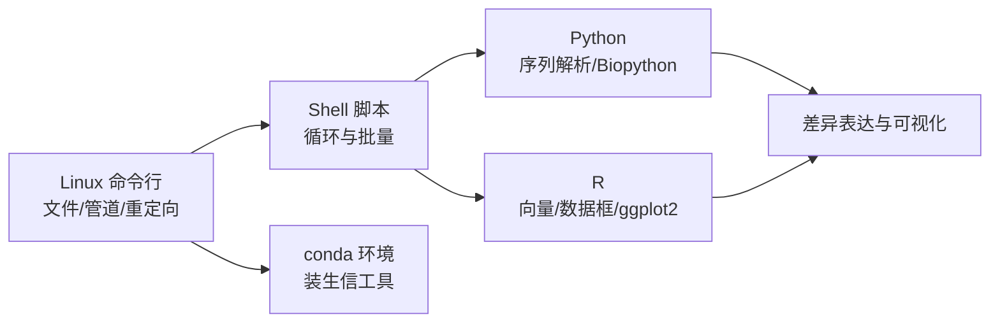

# 什么是生物信息学
>生物信息学是一门利用计算机科学、统计学和信息技术来分析和解释生物数据的交叉学科。简单来说，它是**生物学、计算机科学和数学**的融合体，核心任务是从海量的生物数据中提取有价值的知识。
## 研究方法
- 序列分析
	- 基因识别、序列比对（如BLAST工具），用于找出不同物种间的相似性
- 基因组学
	- 全基因组测序数据的组装与注释，典型代表是人类基因组计划
- 进化与系统发育分析
	- 从氨基酸序列推断三维结构，如AlphaFold在这一领域的突破
- 转录组与表达分析
	- 分析RNA测序数据，研究基因在不同条件下的表达差异
## 总体流程
1. 质控数据
	1. 检验测序与建库质量
	2. 减少测序过程中的误差
2. 数据比对
	1. 全局比对
	2. 局部比对
3. 下游分析
	1. 由上部的比对后得到`bam`文件进行下游的各类分析例如：差异表达分析
## 测序数据种类
### 第二代测序数据
>第二代测序数据是指通过**高通量测序平台**一次性对**数百万至数十亿条DNA片段**[短读长测序技术](https://zhida.zhihu.com/search?content_id=205851199&content_type=Article&match_order=1&q=%E7%9F%AD%E8%AF%BB%E9%95%BF%E6%B5%8B%E5%BA%8F%E6%8A%80%E6%9C%AF&zhida_source=entity)进行并行读取后产生的**海量短序列读取（reads）及其衍生信息**的总称。其核心特征是通量高、单条读长短、单位碱基成本极低，与之相对的第一代Sanger测序则是通量低、读长长、成本高。

### 第二代测序
第二代测序主要是边合成边测序，
#### 分为以下几步：
1. **文库构建**：将基因组DNA打断成几百bp的片段，两端加上接头；
2. **桥式扩增**：片段在flow cell上被固相扩增成簇，每个簇包含同一模板的数千个拷贝；
3. **循环测序**：每轮加入带荧光标记的dNTP，拍照记录碱基种类，切掉荧光基团后进入下一轮；
4. **碱基识别**：将荧光信号转化为碱基序列，输出`FASTQ`文件。
#### 主要的产物有：

| 数据类型   | 典型文件格式               | 说明                    |
| ------ | -------------------- | --------------------- |
| 原始下机数据 | FASTQ/BCL            | 含碱基序列及对应的质量值          |
| 比对后数据  | SAM/BAM/CRAM         | 记录`reads`在参考基因组上的位置   |
| 变异数据   | Vcf/gVCF             | 记录`SNP`、`INDEL`等变异位点  |
| 定量数据   | counts matrix / FPKM | 记录表达量矩阵（`RNA-SEQ`）    |
| 组装数据   | FASTA / GFA          | 拼接后的`conting`或`graph` |
#### 核心质量评估指标
- **Q30比例**：碱基质量值≥30（错误率≤0.1%）的碱基占比，**通常要求≥85%​**；
- **测序深度（Depth）​**：某位点被覆盖的次数，WGS常要求30×以上，肿瘤ctDNA可达数千×；
- **覆盖度（Coverage）​**：参考基因组被覆盖的比例；
- **读长（Read length）​**：常见50bp、100bp、150bp，**PE150是目前主流**；
- **GC含量**：异常偏离可提示污染或偏好性。
#### 属于二代测序的种类
- **全基因组重测序（WGS）​**：检测全基因组范围的变异；
- **全外显子测序（WES）​**：只测编码区，成本更低，临床常用；
- **RNA-seq**：转录组表达量、可变剪接分析；
- **ChIP-seq / ATAC-seq**：表观遗传与染色质开放性研究；
- **宏基因组（mNGS）​**：病原微生物检测、肠道菌群分析；
- **单细胞测序**：如10x Genomics平台，解析细胞异质性。
#### 常见分析流程
![[assets/Pasted image 20261007153939.png]]
### 第三代测序
>单分子实时测序技术，也叫[从头测序技术](https://zhida.zhihu.com/search?content_id=205851199&content_type=Article&match_order=1&q=%E4%BB%8E%E5%A4%B4%E6%B5%8B%E5%BA%8F%E6%8A%80%E6%9C%AF&zhida_source=entity)。与前两代测序技术相比，其最大的特点就是单分子测序，测序过程无需进行PCR扩增，实现了对每一条DNA分子的单独测序。
####  [纳米孔电信号测序](https://zhida.zhihu.com/search?content_id=205851199&content_type=Article&match_order=1&q=%E7%BA%B3%E7%B1%B3%E5%AD%94%E7%94%B5%E4%BF%A1%E5%8F%B7%E6%B5%8B%E5%BA%8F&zhida_source=entity)：
#### [单分子荧光信号测序](https://zhida.zhihu.com/search?content_id=205851199&content_type=Article&match_order=1&q=%E5%8D%95%E5%88%86%E5%AD%90%E8%8D%A7%E5%85%89%E4%BF%A1%E5%8F%B7%E6%B5%8B%E5%BA%8F&zhida_source=entity)：
# 系统及编程基础
## 一、Linux 命令篇
> [!IMPORTANT]
> 为什么要学 Linux：许多生信软件（如 Bowtie2、qiime2、vsearch 等）主要在 Linux 上发布和维护，大型计算任务的计算平台也是 Linux。[^guide]
### 1.1 终端与快捷键
终端是文本窗口程序（如 GNOME Terminal、Konsole），通过它使用命令行 Shell，Ubuntu 默认 Shell 是 **Bash**。提示符 `$` 前显示 `用户名@主机名:当前目录`，`~` 是用户主目录（home）的指示符；管理员 root 的提示符为 `#`，出于安全一般不推荐用 root 登录。

| 快捷键 | 作用 |
|---|---|
| `Tab` | 自动补全命令／文件名；匹配到多个时会响铃提示，再补几个字符即可 |
| `↑` / `↓` | 调出历史命令，长命令不必重输 |
| `Ctrl + U` | 取消整行输入 |
| `Ctrl + A` / `Ctrl + E` | 光标移到行首 / 行尾 |
| `Ctrl + L` | 清屏（等同 `clear`） |
| `Ctrl + C` | 终止当前进程 |
| `exit` | 退出终端 |

### 1.2 命令的通用语法
Unix 命令统一遵循：
```bash
command option(s) input
```
可以把命令想成自然语言里的**动词**，`input` 是作用对象，`option(s)` 用来改变命令的默认行为。查看任意命令手册用 `man`。
### 1.3 绝对路径与相对路径

| 类型 | 判别 | 示例 |
|---|---|---|
| 绝对路径 | 以 `/` 开头（顶层是根目录 `/`） | `cd /data/username` |
| 相对路径 | 不以 `/` 开头 | `P/P_in` |

常用切换：
```bash
cd # 回 home 目录（cd ~ 或 cd /home/username 等价）
cd .. # 上一级
cd ../../ # 上两级，以此类推
pwd # 打印当前工作目录，如 /home/username
```

### 1.4 文件与目录操作

| 命令 | 作用 | 要点与示例 |
|---|---|---|
| `pwd` | print working directory | 打印当前目录 |
| `cd` | change directory | 见上 |
| `ls` | list directory content | `ls -l` 逐行显示详细信息；`ls -1` 一行一个；`ls folder` 查看其他目录 |
| `mkdir` | make a directory | `mkdir folder` |
| `touch` | 创建空文件 | `touch bioinformatics.txt` |
| `cp` | 复制文件／文件夹 | `cp a.txt b.txt`；复制文件夹必须加 `-r`（递归）：`cp -r folder new_folder` |
| `mv` | 重命名或移动 | `mv old.txt new.txt` |
| `rm` | 删除文件或文件夹 | 谨慎使用 |
| `find` | 查找文件 | `find /etc -name '*.conf'` |
| `nano` | 基础文本编辑器 | 可编辑 txt/csv/fasta/genbank/gtf/fastq；`Ctrl+X` 保存退出；文件不存在时会新建 |

> [!TIP]
> `ls -l` 输出的行首字符 `-` 表示文件、`d` 表示目录；第 5 列是大小（默认以字节显示）。这是判断"下下来的是不是空文件"最快的方法。

### 1.5 查看、检索与统计

  
| 命令 | 作用 |
|---|---|
| `cat` | 把文件内容打印到屏幕 |
| `less` | 分页浏览大文件 |
| `head` / `tail` | 看开头 / 结尾若干行 |
| `wc` | word / line / character 计数 |
| `grep` | 模式（关键字）搜索 |
| `cut` | 按分隔符或字符位置裁切字段 |
| `sort` | 排序 |
| `uniq` | 去除／统计重复行 |
| `column` | 表格数据在终端中对齐显示 |
| `awk '{print $N}'` | 以空白为间隔，打印第 N 个字段 |
| `tee` | 把数据转存一份到文件 |
| `split` | 按行数或容量切分成多份 |

### 1.6 管道与数据流重定向（核心）
三种数据流的代号与符号：

| 数据流 | 代码 | 符号 |
|---|---|---|
| 标准输入 stdin | 0 | `<` 或 `<<` |
| 标准输出 stdout | 1 | `>`（覆盖） / `>>`（累加） |
| 标准错误输出 stderr | 2 | `2>` / `2>>` |

```bash
# 丢弃错误信息（例如无权访问的目录报错）
find /etc -name '*passwd*' 2> /dev/null
# 正确与错误写进同一个文件（三种等价写法）
find /etc -name '*passwd*' > ~/find_passwd.txt 2>&1
find /etc -name '*passwd*' 2> ~/find_passwd.txt 1>&2
find /etc -name '*passwd*' &> ~/find_passwd.txt
# 用 () 把多条命令的输出统一汇整
(date; cal -3; echo "The following is log") > mylog.txt
# 标准输入 <<
cat > yourtype.txt << eof
here is GoGo!
eof
```

> [!WARNING]
> 管道 `|` **只处理 standard output**，对 standard error 会直接忽略；要一并处理需搭配 `2>&1`。另外不要用 `command > file.txt 2> file.txt`——文件无法被两个进程同时打开读写，应写成 `> file.txt 2>&1` 或 `&> file.txt`。
### 1.7 指令连续下达 `;` `&&` `||`

```bash
# ; 无依赖地连续执行
date; uptime; uname -r
# && 前一个成功（回传值 0）才执行下一个
ls -ld /dev/shm/check && rmdir /dev/shm/check
# || 前一个失败（回传非 0）才执行下一个：目录不存在才创建
ls -ld /dev/shm/check || mkdir /dev/shm/check
# 常用组合：判断存在性
ls -d /etc && echo exist || echo non-exist
```

脚本中可自定义回传值（`${@}` 代表所有参数，`$?` 取上一条命令回传值）：
```bash
#!/bin/bash
ls ${@} && exit 100 || exit 10
```

### 1.8 进程、资源与任务监控

| 命令 | 作用 |
|---|---|
| `top` / `htop` | 实时查看进程与占用 |
| `ps` | 查看进程 |
| `kill PID` | 结束指定进程 |
| `df` / `du` | 磁盘空间 / 目录占用 |
| `nohup` | 断开连接后继续运行 |
| `Ctrl+C` | 终止前台进程 |

### 1.9 远程连接 HPC


```bash
ssh username@remote.computer
```

输入密码时**屏幕不显示任何内容**，继续输入回车即可；登录后提示符类似 `[username@biowulf ~]$`。

| 命令                | 作用               |
| ----------------- | ---------------- |
| `ssh`             | 连接远程计算机／HPC      |
| `scp` / `rsync`   | 文件上传下载           |
| `screen` / `tmux` | 断开连接后保持程序运行      |
## 二、Python 编程基础篇
### 2.1 语法特征：缩进即结构
Python 的语句**只靠行尾**标记结束，复合语句靠**缩进**表示从属；其他语言里的分号、关键字结尾和花括号**全部没有**。
> [!IMPORTANT]
>标准做法是缩进 **4 个空格**，并且**不要用 Tab 字符**——它会干扰 Python 的缩进计算。
### 2.2 值与类型
最常用四类简单类型：**布尔（logical/Boolean）、整数（integer）、浮点（float）、字符串（string）**，另有一个特殊的"无值"值 `None`。

  

```python

>>> 90

90

>>> None # None 表示"什么都没有"，所以不打印任何东西

```

  

同一个值既是一个「类型 type」的实例，也是一个「类 class」的实例（instance），两套术语在书中会逐步切换。

  

### 2.3 运算符与条件表达式

  

六个比较运算符返回布尔值：`==` `!=` `<` `<=` `>` `>=`；此外还有 `if / else` 形式的**条件表达式**：条件为真时取 `if` 后的值，为假时取 `else` 后的值。

  

### 2.4 赋值

  

```python

a = b = c = 0 # 链式赋值，常用于给多个名字绑定同一个初值

a += 1 # 增量赋值，等价于 a = a + 1

```

  

增量赋值可用的运算符：`+=` `-=` `*=` `/=` `//=` `%=` `**=`。

  

### 2.5 常用内置函数

  

| 函数 | 说明 |

|---|---|

| `len(arg)` | 返回字符数（更一般地，返回元素个数） |

| `print(args..., sep=..., end=...)` | 打印参数，默认以空格分隔、以换行结尾 |

| `input(string)` | 打印提示串，读取一行输入并以字符串返回 |

| `abs(value)` | 绝对值 |

| `max(args...)` / `min(args...)` | 最大值 / 最小值 |

| `str(arg)` / `int(arg)` | 类型转换（类型本身也可当函数调用） |

  

> [!WARNING]

> Python 2 与 Python 3 差异：`print` 在 Python 2 是语句而非函数（不能指定分隔符）；`input` 在 Python 2 中名为 `raw_input`；Python 2 的整数除法需要 `from __future__ import division`。

  

### 2.6 四类控制语句

  

程序的"脚手架"，缺了它们就只能做前几章那种简单计算：

  

1. **条件（Conditionals）**：`if` / `else` / `elif`——让程序能"当序列长度 > 300 才打印名字""两个样本距离 < 10 米才归为一组"

2. **循环（Loops）**：`while`，含循环变量初始化、无限循环、带守卫条件的循环

3. **迭代（Iterations）**：对序列／集合逐个处理

4. **异常处理（Exception handlers）**：Python 错误与 traceback 的捕获

  

### 2.7 集合类型与推导式

  

覆盖：字符串、字节与字节数组（`bytes` / `bytearray`）、`range`、元组（tuple）、列表（list）、映射与字典（dict）、流与文件、生成器，以及**推导式（comprehensions）**。

  

生信实例——读 FASTA 并清洗：

  

```python

# 每条记录先 partition 成 (描述行, '\n', 序列) 三元组

return [seq.partition('\n') for seq in read_FASTA_strings(filename)]

  

# 去掉开头的 '>' 和序列内部换行

return [(info[1:], seq.replace('\n', ''))

for info, ignore, seq in read_FASTA_entries(filename)]

  

# 元组可在推导式中解包，命名的元素让代码更好懂

return [[seq[0][1:], seq[2].replace('\n', '')]

for seq in read_FASTA_entries(filename)]

```

  

### 2.8 函数

  

`def` 定义，参数表可为空、多个参数用逗号分隔，函数体相对 `def` 行缩进一级。参数可以**有默认值**、可以用**具名参数**调用。**docstring** 与注释不同：注释在解释时消失，docstring 会保留，`help()` 会读取它连同参数列表生成帮助说明。

  

### 2.9 正则表达式（生信高频）

  

典型需求：从基因 accession 名中截取第 3 个字符到下划线之间的部分、判断蛋白序列是否含某个冗余 motif。工具内置在 Python 中但**不是自动可用**，必须先了解**模块（modules）**再 `import`。章节要点：

  

- 模块与 `raw string`（原始字符串）

- 在字符串中搜索模式、提取匹配到的部分、获取匹配位置

- 用正则切分字符串、查找多个匹配

  

### 2.10 文件读写与路径

  

章节覆盖：从文件读文本、处理换行符、文件缺失的情况、写文件、关闭文件、路径与文件夹。

  

### 2.11 生信实战：Biopython

  

```python

from Bio import SeqIO

  

# 解析（返回 SeqRecord 迭代器，通常配 for 循环）

for seq_record in SeqIO.parse("ls_orchid.fasta", "fasta"):

print(seq_record.id)

print(repr(seq_record.seq))

print(len(seq_record))

  

# 只想要 ID 列表 → 列表推导式

identifiers = [seq_record.id for seq_record in SeqIO.parse("ls_orchid.gbk", "genbank")]

  

# 换格式只需改格式字符串：fasta / genbank / swiss / embl ...

record = SeqIO.read("NC_005816.gb", "genbank")

len(record) # 9609

len(record.features) # 41

  

# Seq 对象：大小写转换、拼接

from Bio.Seq import Seq

dna_seq = Seq("acgtACGT")

dna_seq.upper() # Seq('ACGTACGT')

"GTAC" in dna_seq.upper() # 大小写不敏感匹配

Seq("N"*10).join([Seq("ATG"), Seq("ATCCCG"), Seq("TTGCA")])

  

# 底层快速解析 FASTQ（不需要把质量值转成整数时）

from Bio.SeqIO.QualityIO import FastqGeneralIterator

count = 0; total_len = 0

with open("example.fastq") as in_handle:

for title, seq, qual in FastqGeneralIterator(in_handle):

count += 1

total_len += len(seq)

print("%i records with total sequence length %i" % (count, total_len))

  

# 按引物筛选并切片写出

primer_reads = (rec[11:] for rec in SeqIO.parse("SRR020192.fastq", "fastq")

if rec.seq.startswith("GATGACGGTGT"))

count = SeqIO.write(primer_reads, "with_primer_trimmed.fastq", "fastq")

```

  

> [!TIP]

> 处理大型 FASTA/FASTQ 时可用低层解析器提升效率；需要随机访问时用 `SeqIO.index()` 把它当**只读字典**用（如 `gb_vrl["AB811634.1"]`），不必关心记录来自哪个文件。

  

### 2.12 数据分析生态

  

| 库 | 用途 |

|---|---|

| NumPy | 数组创建（`array` `arange` `linspace` `zeros`）、形状变换、ufunc 与广播、统计函数 |

| pandas | 数据读写（CSV/Excel/数据库）、DataFrame 查改增删、描述性统计、`groupby` / `agg` / `apply` / `transform` |

| Matplotlib / seaborn / pyecharts | 散点、折线、柱、饼、箱线、热力图、3D 散点、交互式图形 |

| scikit-learn | 预处理、聚类、分类、回归与模型评估（轮廓系数、精确率、召回率、F1） |

| SciPy | 科学计算 |

  

### 2.13 章节学习地图（Python for Biologists）

  

| 章 | 主题 | 关键子项 |

|---|---|---|

| 2 | Printing and manipulating text | 变量存字符串、字符串操作工具、特殊字符 |

| 3 | Reading and writing files | 读文本、换行处理、缺失文件、写文件、关闭文件、路径 |

| 4 | Lists and loops | 建列表取元素、写循环、把字符串当列表、split 成列表、按行迭代、`range` |

| 5 | Writing our own functions | 定义函数、具名参数、默认参数、测试函数 |

| 6 | Conditional tests | True/False、`if` `else` `elif`、`while`、复杂条件、返回真假的函数 |

| 7 | Regular expressions | 模块、raw string、搜索、提取匹配、匹配位置、正则切分、多匹配 |

| 8 | Dictionaries | 存成对数据、创建字典、遍历字典 |

| 9 | Files, programs, and user input | 文件、程序与用户输入 |

  

> [!TIP]

> 这本书还专门覆盖了一般入门书不讲、但对生物学家极有用的**正则表达式**和**子进程（subprocesses）**。

  

---

  

## 三、R 语言基础篇

  

> [!IMPORTANT]

> R 新手的大部分困难来自对基本语言概念、数据结构和"行为"的误解——它与 Python、Perl 差异相当大。**向量（vector）与向量化（vectorization）** 是理解 R 一切的地基。

  

### 3.1 向量：R 最重要的特性

  

R **没有"单个值（标量）"这种类型**——像 `3.1` 或 `"AGCTACGACT"` 都存在**长度为 1 的向量**里：

  

```r

> length(3.1)

[1] 1

> x <- c(56, 95.3, 0.4) # 用 c() 组合出更长的向量

> x

[1] 56.0 95.3 0.4

```

  

### 3.2 索引与子集化（subsetting）

  

```r

> x[2] # R 是 1-indexed！第 1 个元素用 x[1]（Python 是 0-indexed）

[1] 95.3

> x[4] # 越界返回 NA（"not available" 缺失值）

[1] NA

> x[3] <- 0.5 # 索引 + 赋值可改元素

  

> b <- c(a=3.4, b=5.4, c=0.4) # 向量可以带名字

> names(b)

[1] "a" "b" "c"

> b['x'] # 也可按名字取

```

  

> [!NOTE]

> 索引本身 `3` 也是一个向量，所以自然允许它有多个元素——这就是 **subsetting**，是 R 特别适合处理数据的首要原因。

  

### 3.3 向量类型与因子

  

- R 的向量**必须同类型**（与 Python 的 list、Perl 的 array 不同），这样 `x + y` 时才事先知道能否相加

- 支持：integer、double（numeric，默认所有数字都建 numeric 向量）、character、logical、complex、raw

- 混类型时按**信息损失最小**原则向上转换：

  

```r

> c(43L, TRUE, 3.2413341, "a string")

[1] "43" "TRUE" "3.2413341" "a string" # 全部变成字符串

> typeof(q)

[1] "double"

```

  

- **因子（factor）** 存分类变量，如处理组（high/medium/low/control）、链（forward/reverse）、染色体（chr1、chr2…）；它在 R 里无处不在，也是新手的常见坑

  

### 3.4 向量化

  

向量化让我们**不必写显式循环**就能逐元素处理：

  

```r

> x + y; x - y; x/y # 所有算术运算符都是向量化的

> seq(3, 5) # [1] 3 4 5

> 1:5 # [1] 1 2 3 4 5

```

  

### 3.5 数据框 data.frame

  

R 存放表格数据的主力结构：**列 = 变量，行 = 观测**。

  

```r

> d$depth # 用 $ 取单列，返回向量

> mean(d$depth)

[1] 8.183938

> summary(d$depth) # Min. 1st Qu. Median Mean 3rd Qu. Max.

```

  

> [!WARNING]

> 与 `read.csv()` / `read.delim()` 一样，`data.frame()` 会把字符向量转成因子；要关掉就设 `stringsAsFactors = FALSE`。

  

### 3.6 列表 list

  

- 向量：同质、只支持那 6 种类型

- 列表：**异质**（可放不同类型的向量、其他列表、环境、数据框、矩阵、函数…），可递归嵌套

- 事实上 **data.frame 就是用 list 构建的**（每列是向量、各列类型可不同），可以用 `is.list(mtcars)` 验证

  

```r

> adh <- list(chr="2L", start=14615555L, end=14618902L, name="Adh")

> adh$chr

[1] "2L"

```

  

### 3.7 数据读写与保存

  

```r

rt <- read.table("matrix.txt", sep="\t", header=T, check.names=F)

x <- read_tsv('~/simrep.summary.tsv') # readr 风格

  

# read.delim()/read.csv() 默认把字符串列强制成 factor → 用 stringsAsFactors=FALSE 关闭

  

save(tmp, file="example.Rdata") # 保存指定对象

load("example.Rdata") # 完整还原

save.image() # 保存工作空间全部对象（配合 savehistory() 抢救式留存）

```

  

### 3.8 可视化：ggplot2

  

```r

install.packages("ggplot2")

library(ggplot2)

```

  

ggplot2 与 R base graphics 很不同，它建立在 *Grammar of Graphics* 之上：每张图由**图层叠加**而成，把几何对象的美学属性映射到数据，图层还可做统计变换、改变坐标轴与颜色标度。

  

```r

p <- ggplot(Diff, aes(logFC, -log10(P.Value))) +

geom_point(aes(col=Significant), size=3) +

geom_hline(aes(yintercept=-log10(adjP)), colour="gray", linetype="twodash") +

geom_vline(aes(xintercept=aflogFC), colour="gray", linetype="twodash") +

theme_bw()

```

  

### 3.9 生信实战：差异表达分析

  

常用包组合：`limma`、`DESeq2`、`edgeR`、`Rsubread`、`pheatmap`、`ggsci`、`dplyr`、`ggpubr`、`ggplot2`。

  

```r

library(ggplot2); library(limma); library(pheatmap); library(ggsci); library(dplyr)

  

# 读矩阵、基因名去重

rt <- read.table("matrix.txt", sep="\t", header=T, check.names=F)

rt <- as.matrix(rt); rownames(rt) <- rt[,1]

exp <- rt[,2:ncol(rt)]

rt <- matrix(as.numeric(as.matrix(exp)), nrow=nrow(exp),

dimnames=list(rownames(exp), colnames(exp)))

rt <- avereps(rt)

  

# edgeR / limma-voom 路线

x <- DGEList(counts=fc$counts, genes=fc$annotation[,c("GeneID","Length")])

x_rpkm <- rpkm(x, x$genes$Length)

isexpr <- rowSums(cpm(x) > 10) >= 2 # 过滤：至少 2 个库中 CPM > 10

x <- x[isexpr,]

y <- voom(x, design, plot=TRUE)

plotMDS(y, xlim=c(-2.5, 2.5)) # 样本聚类

```

  

> [!TIP]

> 结果解读惯例：火山图横轴为 log2 倍数变化、纵轴为 `-log10(p)`，红色点通常表示上调、蓝色点下调、灰色点不显著；显著差异基因可再用 `pheatmap` 聚类查看区块。
---
## 四、练习路线建议



# 常见软件及使用基础
