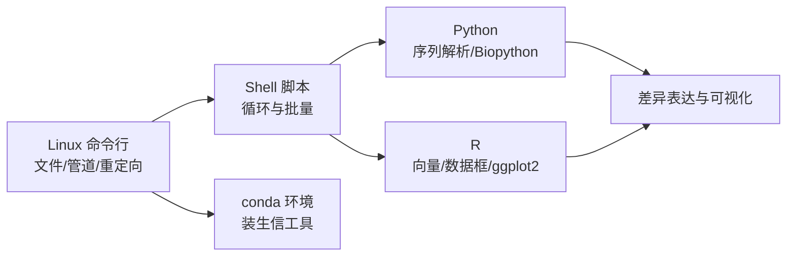

# 什么是生物信息学

>生物信息学是一门利用计算机科学、统计学和信息技术来分析和解释生物数据的交叉学科。简单来说，它是**生物学、计算机科学和数学**的融合体，核心任务是从海量的生物数据中提取有价值的知识。

## 研究方法

- 序列分析
	- 基因识别、序列比对（如BLAST工具），用于找出不同物种间的相似性
- 基因组学
	- 全基因组测序数据的组装与注释，典型代表是人类基因组计划
- 进化与系统发育分析
	- 从氨基酸序列推断三维结构，如AlphaFold在这一领域的突破
- 转录组与表达分析
	- 分析RNA测序数据，研究基因在不同条件下的表达差异

## 总体流程

1. 质控数据
	1. 检验测序与建库质量
	2. 减少测序过程中的误差
2. 数据比对
	1. 全局比对
	2. 局部比对
3. 下游分析
	1. 由上部的比对后得到`bam`文件进行下游的各类分析例如：差异表达分析

## 测序数据种类

### 第二代测序数据

>第二代测序数据是指通过**高通量测序平台**一次性对**数百万至数十亿条DNA片段**[短读长测序技术](https://zhida.zhihu.com/search?content_id=205851199&content_type=Article&match_order=1&q=%E7%9F%AD%E8%AF%BB%E9%95%BF%E6%B5%8B%E5%BA%8F%E6%8A%80%E6%9C%AF&zhida_source=entity)进行并行读取后产生的**海量短序列读取（reads）及其衍生信息**的总称。其核心特征是通量高、单条读长短、单位碱基成本极低，与之相对的第一代Sanger测序则是通量低、读长长、成本高。

### 第二代测序

第二代测序主要是边合成边测序，

#### 分为以下几步：

1. **文库构建**：将基因组DNA打断成几百bp的片段，两端加上接头；
2. **桥式扩增**：片段在flow cell上被固相扩增成簇，每个簇包含同一模板的数千个拷贝；
3. **循环测序**：每轮加入带荧光标记的dNTP，拍照记录碱基种类，切掉荧光基团后进入下一轮；
4. **碱基识别**：将荧光信号转化为碱基序列，输出`FASTQ`文件。

#### 主要的产物有：

| 数据类型   | 典型文件格式               | 说明                    |
| ------ | -------------------- | --------------------- |
| 原始下机数据 | FASTQ/BCL            | 含碱基序列及对应的质量值          |
| 比对后数据  | SAM/BAM/CRAM         | 记录`reads`在参考基因组上的位置   |
| 变异数据   | Vcf/gVCF             | 记录`SNP`、`INDEL`等变异位点  |
| 定量数据   | counts matrix / FPKM | 记录表达量矩阵（`RNA-SEQ`）    |
| 组装数据   | FASTA / GFA          | 拼接后的`conting`或`graph` |

#### 核心质量评估指标

- **Q30比例**：碱基质量值≥30（错误率≤0.1%）的碱基占比，**通常要求≥85%​**；
- **测序深度（Depth）​**：某位点被覆盖的次数，WGS常要求30×以上，肿瘤ctDNA可达数千×；
- **覆盖度（Coverage）​**：参考基因组被覆盖的比例；
- **读长（Read length）​**：常见50bp、100bp、150bp，**PE150是目前主流**；
- **GC含量**：异常偏离可提示污染或偏好性。

#### 属于二代测序的种类

- **全基因组重测序（WGS）​**：检测全基因组范围的变异；
- **全外显子测序（WES）​**：只测编码区，成本更低，临床常用；
- **RNA-seq**：转录组表达量、可变剪接分析；
- **ChIP-seq / ATAC-seq**：表观遗传与染色质开放性研究；
- **宏基因组（mNGS）​**：病原微生物检测、肠道菌群分析；
- **单细胞测序**：如10x Genomics平台，解析细胞异质性。

#### 常见分析流程

![[assets/Pasted image 20261007153939.png]]

### 第三代测序

>单分子实时测序技术，也叫[从头测序技术](https://zhida.zhihu.com/search?content_id=205851199&content_type=Article&match_order=1&q=%E4%BB%8E%E5%A4%B4%E6%B5%8B%E5%BA%8F%E6%8A%80%E6%9C%AF&zhida_source=entity)。与前两代测序技术相比，其最大的特点就是单分子测序，测序过程无需进行PCR扩增，实现了对每一条DNA分子的单独测序。

####  [纳米孔电信号测序](https://zhida.zhihu.com/search?content_id=205851199&content_type=Article&match_order=1&q=%E7%BA%B3%E7%B1%B3%E5%AD%94%E7%94%B5%E4%BF%A1%E5%8F%B7%E6%B5%8B%E5%BA%8F&zhida_source=entity)：

#### [单分子荧光信号测序](https://zhida.zhihu.com/search?content_id=205851199&content_type=Article&match_order=1&q=%E5%8D%95%E5%88%86%E5%AD%90%E8%8D%A7%E5%85%89%E4%BF%A1%E5%8F%B7%E6%B5%8B%E5%BA%8F&zhida_source=entity)：

# 系统及编程基础

## 一、Linux 命令篇

> [!IMPORTANT]
> 为什么要学 Linux：许多生信软件（如 Bowtie2、qiime2、vsearch 等）主要在 Linux 上发布和维护，大型计算任务的计算平台也是 Linux。[^guide]

### 1.1 终端与快捷键

终端是文本窗口程序（如 GNOME Terminal、Konsole），通过它使用命令行 Shell，Ubuntu 默认 Shell 是 **Bash**。提示符 `$` 前显示 `用户名@主机名:当前目录`，`~` 是用户主目录（home）的指示符；管理员 root 的提示符为 `#`，出于安全一般不推荐用 root 登录。

| 快捷键 | 作用 |
|---|---|
| `Tab` | 自动补全命令／文件名；匹配到多个时会响铃提示，再补几个字符即可 |
| `↑` / `↓` | 调出历史命令，长命令不必重输 |
| `Ctrl + U` | 取消整行输入 |
| `Ctrl + A` / `Ctrl + E` | 光标移到行首 / 行尾 |
| `Ctrl + L` | 清屏（等同 `clear`） |
| `Ctrl + C` | 终止当前进程 |
| `exit` | 退出终端 |

### 1.2 命令的通用语法

Unix 命令统一遵循：

```bash
command option(s) input
```

可以把命令想成自然语言里的**动词**，`input` 是作用对象，`option(s)` 用来改变命令的默认行为。查看任意命令手册用 `man`。

### 1.3 绝对路径与相对路径

| 类型 | 判别 | 示例 |
|---|---|---|
| 绝对路径 | 以 `/` 开头（顶层是根目录 `/`） | `cd /data/username` |
| 相对路径 | 不以 `/` 开头 | `P/P_in` |

常用切换：

```bash
cd # 回 home 目录（cd ~ 或 cd /home/username 等价）
cd .. # 上一级
cd ../../ # 上两级，以此类推
pwd # 打印当前工作目录，如 /home/username
```

### 1.4 文件与目录操作

| 命令 | 作用 | 要点与示例 |
|---|---|---|
| `pwd` | print working directory | 打印当前目录 |
| `cd` | change directory | 见上 |
| `ls` | list directory content | `ls -l` 逐行显示详细信息；`ls -1` 一行一个；`ls folder` 查看其他目录 |
| `mkdir` | make a directory | `mkdir folder` |
| `touch` | 创建空文件 | `touch bioinformatics.txt` |
| `cp` | 复制文件／文件夹 | `cp a.txt b.txt`；复制文件夹必须加 `-r`（递归）：`cp -r folder new_folder` |
| `mv` | 重命名或移动 | `mv old.txt new.txt` |
| `rm` | 删除文件或文件夹 | 谨慎使用 |
| `find` | 查找文件 | `find /etc -name '*.conf'` |
| `nano` | 基础文本编辑器 | 可编辑 txt/csv/fasta/genbank/gtf/fastq；`Ctrl+X` 保存退出；文件不存在时会新建 |

> [!TIP]
> `ls -l` 输出的行首字符 `-` 表示文件、`d` 表示目录；第 5 列是大小（默认以字节显示）。这是判断"下下来的是不是空文件"最快的方法。

### 1.5 查看、检索与统计

| 命令 | 作用 |
|---|---|
| `cat` | 把文件内容打印到屏幕 |
| `less` | 分页浏览大文件 |
| `head` / `tail` | 看开头 / 结尾若干行 |
| `wc` | word / line / character 计数 |
| `grep` | 模式（关键字）搜索 |
| `cut` | 按分隔符或字符位置裁切字段 |
| `sort` | 排序 |
| `uniq` | 去除／统计重复行 |
| `column` | 表格数据在终端中对齐显示 |
| `awk '{print $N}'` | 以空白为间隔，打印第 N 个字段 |
| `tee` | 把数据转存一份到文件 |
| `split` | 按行数或容量切分成多份 |

### 1.6 管道与数据流重定向（核心）

三种数据流的代号与符号：

| 数据流 | 代码 | 符号 |
|---|---|---|
| 标准输入 stdin | 0 | `<` 或 `<<` |
| 标准输出 stdout | 1 | `>`（覆盖） / `>>`（累加） |
| 标准错误输出 stderr | 2 | `2>` / `2>>` |

```bash
# 丢弃错误信息（例如无权访问的目录报错）
find /etc -name '*passwd*' 2> /dev/null
# 正确与错误写进同一个文件（三种等价写法）
find /etc -name '*passwd*' > ~/find_passwd.txt 2>&1
find /etc -name '*passwd*' 2> ~/find_passwd.txt 1>&2
find /etc -name '*passwd*' &> ~/find_passwd.txt
# 用 () 把多条命令的输出统一汇整
(date; cal -3; echo "The following is log") > mylog.txt
# 标准输入 <<
cat > yourtype.txt << eof
here is GoGo!
eof
```

> [!WARNING]
> 管道 `|` **只处理 standard output**，对 standard error 会直接忽略；要一并处理需搭配 `2>&1`。另外不要用 `command > file.txt 2> file.txt`——文件无法被两个进程同时打开读写，应写成 `> file.txt 2>&1` 或 `&> file.txt`。

### 1.7 指令连续下达 `;` `&&` `||`

```bash
# ; 无依赖地连续执行
date; uptime; uname -r
# && 前一个成功（回传值 0）才执行下一个
ls -ld /dev/shm/check && rmdir /dev/shm/check
# || 前一个失败（回传非 0）才执行下一个：目录不存在才创建
ls -ld /dev/shm/check || mkdir /dev/shm/check
# 常用组合：判断存在性
ls -d /etc && echo exist || echo non-exist
```

脚本中可自定义回传值（`${@}` 代表所有参数，`$?` 取上一条命令回传值）：

```bash
#!/bin/bash
ls ${@} && exit 100 || exit 10
```

### 1.8 进程、资源与任务监控

| 命令 | 作用 |
|---|---|
| `top` / `htop` | 实时查看进程与占用 |
| `ps` | 查看进程 |
| `kill PID` | 结束指定进程 |
| `df` / `du` | 磁盘空间 / 目录占用 |
| `nohup` | 断开连接后继续运行 |
| `Ctrl+C` | 终止前台进程 |

### 1.9 远程连接 HPC

```bash
ssh username@remote.computer
```

输入密码时**屏幕不显示任何内容**，继续输入回车即可；登录后提示符类似 `[username@biowulf ~]$`。

| 命令                | 作用               |
| ----------------- | ---------------- |
| `ssh`             | 连接远程计算机／HPC      |
| `scp` / `rsync`   | 文件上传下载           |
| `screen` / `tmux` | 断开连接后保持程序运行      |

## 二、Python 编程基础篇

### 2.1 语法特征：缩进即结构

Python 的语句**只靠行尾**标记结束，复合语句靠**缩进**表示从属；其他语言里的分号、关键字结尾和花括号**全部没有**。

> [!IMPORTANT]
>标准做法是缩进 **4 个空格**，并且**不要用 Tab 字符**——它会干扰 Python 的缩进计算。

### 2.2 值与类型

最常用四类简单类型：**布尔（logical/Boolean）、整数（integer）、浮点（float）、字符串（string）**，另有一个特殊的"无值"值 `None`。

```python
>>> 90
90
>>> None # None 表示"什么都没有"，所以不打印任何东西
```

同一个值既是一个「类型 type」的实例，也是一个「类 class」的实例（instance），两套术语在书中会逐步切换。

### 2.3 运算符与条件表达式

六个比较运算符返回布尔值：`==` `!=` `<` `<=` `>` `>=`；此外还有 `if / else` 形式的**条件表达式**：条件为真时取 `if` 后的值，为假时取 `else` 后的值。

### 2.4 赋值

```python
a = b = c = 0 # 链式赋值，常用于给多个名字绑定同一个初值
a += 1 # 增量赋值，等价于 a = a + 1
```

增量赋值可用的运算符：`+=` `-=` `*=` `/=` `//=` `%=` `**=`。

### 2.5 常用内置函数

| 函数                                 | 说明                  |
| ---------------------------------- | ------------------- |
| `len(arg)`                         | 返回字符数（更一般地，返回元素个数）  |
| `print(args..., sep=..., end=...)` | 打印参数，默认以空格分隔、以换行结尾  |
| `input(string)`                    | 打印提示串，读取一行输入并以字符串返回 |
| `abs(value)`                       | 绝对值                 |
| `max(args...)` / `min(args...)`    | 最大值 / 最小值           |
| `str(arg)` / `int(arg)`            | 类型转换（类型本身也可当函数调用）   |

### 2.6 四类控制语句

程序的"脚手架"，缺了它们就只能做前几章那种简单计算：

1. **条件（Conditionals）**：`if` / `else` / `elif`——让程序能"当序列长度 > 300 才打印名字""两个样本距离 < 10 米才归为一组"
2. **循环（Loops）**：`while`，含循环变量初始化、无限循环、带守卫条件的循环
3. **迭代（Iterations）**：对序列／集合逐个处理
4. **异常处理（Exception handlers）**：Python 错误与 traceback 的捕获

### 2.7 集合类型与推导式

覆盖：字符串、字节与字节数组（`bytes` / `bytearray`）、`range`、元组（tuple）、列表（list）、映射与字典（dict）、流与文件、生成器，以及**推导式（comprehensions）**。

读 FASTA 并清洗：

```python
# 每条记录先 partition 成 (描述行, '\n', 序列) 三元组
return [seq.partition('\n') for seq in read_FASTA_strings(filename)]
# 去掉开头的 '>' 和序列内部换行
return [(info[1:], seq.replace('\n', ''))
for info, ignore, seq in read_FASTA_entries(filename)]
# 元组可在推导式中解包，命名的元素让代码更好懂
return [[seq[0][1:], seq[2].replace('\n', '')]
for seq in read_FASTA_entries(filename)]
```

### 2.8 函数

`def` 定义，参数表可为空、多个参数用逗号分隔，函数体相对 `def` 行缩进一级。参数可以**有默认值**、可以用**具名参数**调用。**docstring** 与注释不同：注释在解释时消失，docstring 会保留，`help()` 会读取它连同参数列表生成帮助说明。

### 2.9 正则表达式

典型需求：从基因 accession 名中截取第 3 个字符到下划线之间的部分、判断蛋白序列是否含某个冗余 motif。工具内置在 Python 中但**不是自动可用**，必须先了解**模块（modules)** 再 `import`。章节要点：

- 模块与 `raw string`（原始字符串）
- 在字符串中搜索模式、提取匹配到的部分、获取匹配位置
- 用正则切分字符串、查找多个匹配

### 2.10 文件读写与路径

章节覆盖：从文件读文本、处理换行符、文件缺失的情况、写文件、关闭文件、路径与文件夹。

### 2.11 数据分析生态

| 库 | 用途 |
|---|---|
| NumPy | 数组创建（`array` `arange` `linspace` `zeros`）、形状变换、ufunc 与广播、统计函数 |
| pandas | 数据读写（CSV/Excel/数据库）、DataFrame 查改增删、描述性统计、`groupby` / `agg` / `apply` / `transform` |
| Matplotlib / seaborn / pyecharts | 散点、折线、柱、饼、箱线、热力图、3D 散点、交互式图形 |
| scikit-learn | 预处理、聚类、分类、回归与模型评估（轮廓系数、精确率、召回率、F1） |
| SciPy | 科学计算 |

---

## 三、R 语言基础篇

> [!IMPORTANT]
> R 新手的大部分困难来自对基本语言概念、数据结构和"行为"的误解——它与 Python、Perl 差异相当大。**向量（vector）与向量化（vectorization）** 是理解 R 一切的地基。

### 3.1 向量：R 最重要的特性

R **没有"单个值（标量）"这种类型**——像 `3.1` 或 `"AGCTACGACT"` 都存在**长度为 1 的向量**里：

```r
> length(3.1)
[1] 1
> x <- c(56, 95.3, 0.4) # 用 c() 组合出更长的向量
> x
[1] 56.0 95.3 0.4
```

### 3.2 索引与子集化（subsetting）

```r
> x[2] # R 是 1-indexed！第 1 个元素用 x[1]（Python 是 0-indexed）
[1] 95.3
> x[4] # 越界返回 NA（"not available" 缺失值）
[1] NA
> x[3] <- 0.5 # 索引 + 赋值可改元素 
> b <- c(a=3.4, b=5.4, c=0.4) # 向量可以带名字
> names(b)
[1] "a" "b" "c"
> b['x'] # 也可按名字取
```

> [!NOTE]
> 索引本身 `3` 也是一个向量，所以自然允许它有多个元素——这就是 **subsetting**，是 R 特别适合处理数据的首要原因。

### 3.3 向量类型与因子

- R 的向量**必须同类型**（与 Python 的 list、Perl 的 array 不同），这样 `x + y` 时才事先知道能否相加
- 支持：integer、double（numeric，默认所有数字都建 numeric 向量）、character、logical、complex、raw
- 混类型时按**信息损失最小**原则向上转换：

```r
> c(43L, TRUE, 3.2413341, "a string")
[1] "43" "TRUE" "3.2413341" "a string" # 全部变成字符串
> typeof(q)
[1] "double"
```

- **因子（factor）** 存分类变量，如处理组（high/medium/low/control）、链（forward/reverse）、染色体（chr1、chr2…）；它在 R 里无处不在，也是新手的常见坑

### 3.4 向量化

向量化让我们**不必写显式循环**就能逐元素处理：

```r
> x + y; x - y; x/y # 所有算术运算符都是向量化
> seq(3, 5) # [1] 3 4 5
> 1:5 # [1] 1 2 3 4 5
```

### 3.5 数据框 data.frame

R 存放表格数据的主力结构：**列 = 变量，行 = 观测**。

```r
> d$depth # 用 $ 取单列，返回向量
> mean(d$depth)
[1] 8.183938
> summary(d$depth) # Min. 1st Qu. Median Mean 3rd Qu. Max.
```

> [!WARNING]
> 与 `read.csv()` / `read.delim()` 一样，`data.frame()` 会把字符向量转成因子；要关掉就设 `stringsAsFactors = FALSE`。

### 3.6 列表 list

- 向量：同质、只支持那 6 种类型
- 列表：**异质**（可放不同类型的向量、其他列表、环境、数据框、矩阵、函数…），可递归嵌套
- 事实上 **data.frame 就是用 list 构建的**（每列是向量、各列类型可不同），可以用 `is.list(mtcars)` 验证

```r
> adh <- list(chr="2L", start=14615555L, end=14618902L, name="Adh")
> adh$chr
[1] "2L"
```

### 3.7 数据读写与保存

```r
rt <- read.table("matrix.txt", sep="\t", header=T, check.names=F)
x <- read_tsv('~/simrep.summary.tsv') # readr 风格
# read.delim()/read.csv() 默认把字符串列强制成 factor → 用 stringsAsFactors=FALSE 关闭
save(tmp, file="example.Rdata") # 保存指定对象
load("example.Rdata") # 完整还原
save.image() # 保存工作空间全部对象（配合 savehistory() 抢救式留存）
```

### 3.8 可视化：ggplot2

```r
install.packages("ggplot2")
library(ggplot2)
```

ggplot2 与 R base graphics 很不同，它建立在 *Grammar of Graphics* 之上：每张图由**图层叠加**而成，把几何对象的美学属性映射到数据，图层还可做统计变换、改变坐标轴与颜色标度。

```r
p <- ggplot(Diff, aes(logFC, -log10(P.Value))) +
geom_point(aes(col=Significant), size=3) +
geom_hline(aes(yintercept=-log10(adjP)), colour="gray", linetype="twodash") +
geom_vline(aes(xintercept=aflogFC), colour="gray", linetype="twodash") +
theme_bw()
```

### 3.9 差异表达分析

常用包组合：`limma`、`DESeq2`、`edgeR`、`Rsubread`、`pheatmap`、`ggsci`、`dplyr`、`ggpubr`、`ggplot2`。

```r
library(ggplot2); library(limma); library(pheatmap); library(ggsci); library(dplyr)
# 读矩阵、基因名去重
rt <- read.table("matrix.txt", sep="\t", header=T, check.names=F)
rt <- as.matrix(rt); rownames(rt) <- rt[,1]
exp <- rt[,2:ncol(rt)]
rt <- matrix(as.numeric(as.matrix(exp)), nrow=nrow(exp),
dimnames=list(rownames(exp), colnames(exp)))
rt <- avereps(rt)
# edgeR / limma-voom 路线
x <- DGEList(counts=fc$counts, genes=fc$annotation[,c("GeneID","Length")])
x_rpkm <- rpkm(x, x$genes$Length)
isexpr <- rowSums(cpm(x) > 10) >= 2 # 过滤：至少 2 个库中 CPM > 10
x <- x[isexpr,]
y <- voom(x, design, plot=TRUE)
plotMDS(y, xlim=c(-2.5, 2.5)) # 样本聚类
```

> [!TIP]
> 结果解读惯例：火山图横轴为 log2 倍数变化、纵轴为 `-log10(p)`，红色点通常表示上调、蓝色点下调、灰色点不显著；显著差异基因可再用 `pheatmap` 聚类查看区块。

---

## 四、练习路线建议



# 常见软件及使用基础

## 公共流程

### 1 原始数据质控与过滤

| 软件                     | 角色                     | 关键点                                       |
| ---------------------- | ---------------------- | ----------------------------------------- |
| FastQC                 | 单样本质量报告（碱基质量、GC、接头、重复） | 通常与 MultiQC 汇总使用                          |
| fastp                  | 质控 + 去接头 + 过滤（一体化、快）   | 自动检测接头，支持 UMI、polyG/polyX                 |
| Trimmomatic            | 传统剪切工具（Java）           | 步骤式参数，植物/动物数据均常用                          |
| cutadapt / Trim-galore | 接头与质量剪切                | 常与甲基化流程搭配                                 |
| MultiQC                | 多样本报告汇总                | 与 FastQC、Qualimap、RSeQC、featureCounts 等兼容 |

#### **fastp 常用参数**

| 参数                                                | 含义                                             |
| ------------------------------------------------- | ---------------------------------------------- |
| `-a / --adapter_sequence`                         | read1 接头序列；SE 数据未指定时自动检测；指定后关闭自动检测             |
| `--adapter_sequence_r2`                           | read2 接头（PE）；未指定则同 read1                       |
| `--adapter_fasta`                                 | 用 FASTA 中全部序列同时剪切 read1/read2                  |
| `-A / --disable_adapter_trimming`                 | 关闭接头剪切（默认开启）                                   |
| `-2 / --detect_adapter_for_pe`                    | 对 PE 数据额外做接头检测（更干净、更耗时）                        |
| `-f / -t`                                         | read1 全局前端/尾端各剪切 N 个碱基（Illumina 末轮质量差时 `-t 1`） |
| `-F / -T`                                         | read2 的对应设置，未指定则继承 read1                       |
| `-b / -B`                                         | 剪切到最大长度（max_len1 / max_len2）                   |
| `-5 / --cut_front`                                | 从 5' 端滑窗剪切（窗口均质低于阈值即切除）                        |
| `-3 / --cut_tail`                                 | 从 3' 端滑窗剪切                                     |
| `-r / --cut_right`                                | 遇到低质窗口则切除该窗口及其右侧全部（类似 SLIDINGWINDOW）           |
| `-W / --cut_window_size`                          | 滑窗大小，默认 4                                      |
| `-M / --cut_mean_quality`                         | 窗口平均质量阈值，默认 Q20                                |
| `-g / --trim_poly_g`、`-G / --disable_trim_poly_g` | polyG 尾剪切（NovaSeq/NextSeq 默认开启，最短长度默认 10）      |
| `--trim_poly_x`                                   | polyX 尾剪切                                      |
| `--umi`                                           | UMI 预处理（流程第一步）                                 |

fastp 处理顺序（会影响读长）：UMI → 全局前端剪切 → 全局尾端剪切 → 5' 质量修剪 → 滑窗修剪 → 3' 质量修剪 → polyG → PE 重叠法去接头 → 按序列去接头 → polyX → 最大长度剪切

### 2 比对软件的选择（按数据类型）

| 软件                   | 适用                                           | 库内要点                                                          |
| -------------------- | -------------------------------------------- | ------------------------------------------------------------- |
| BWA（`bwa mem`）       | DNA 重测序、WGS/WES、BSA-seq 等 DNA 数据             | FM-index/BWT；`bwa index -bwtsw` 建索引；`-R` 加 read group，`-t` 线程 |
| Bowtie 2             | ChIP-seq、ATAC-seq、DNA/短读比对；也是 Bismark 默认比对引擎 | 支持 gapped/local/PE；长度无上限（与 Bowtie1 区别）；输出 SAM；可用 `--local`    |
| HISAT2               | RNA-seq（含剪接），也可作 Bismark 可选引擎（端到端）           | 支持 `--rna-strandness`、`--dta`、已知剪接位点                          |
| STAR                 | RNA-seq 剪接比对（快，内存需求大）                        | 库内仅收录版本与集群用法概述，详细参数见 STARmanual                               |
| minimap2 / winnowmap | 长读（ONT/PacBio）比对                             | 库内列为可用工具                                                      |

### 3 BAM/SAM 通用处理（SAMtools / Picard / Sambamba）

```bash
samtools view -bS aln.sam > aln.bam # SAM→BAM
samtools sort -@ 8 -o aln.sorted.bam aln.bam # 坐标排序
samtools index aln.sorted.bam # 建索引（需坐标排序）
samtools merge out.bam in1.bam in2.bam # 合并（需相同参考序列集）
samtools faidx ref.fasta # 参考基因组索引
samtools view aln.sorted.bam chr1:1000-2000 # 区域提取
```

`samtools sort` 关键参数：`-o` 输出文件、`-O` 格式(sam/bam/cram)、`-n` 按读名排序（与 `index` 不兼容）、`-T` 临时文件前缀、`-m` 每线程内存（默认 768 MiB）、`-l` 压级别 0–9、`-@` 线程 
`samtools index`：为坐标排序且 BGZF 压缩的 SAM/BAM/CRAM 建立索引，便于区域随机访问；SAM 必须先 bgzip；BAI 适用于 ≤512 Mbp 染色体，更大用 CSI 
### 4 区间运算、信号可视化与流程框架

| 工具                             | 常用子命令/参数                                                                                                                                                                          | 用途                         |
| ------------------------------ | --------------------------------------------------------------------------------------------------------------------------------------------------------------------------------- | -------------------------- |
| bedtools                       | `intersect -a peaks.bed -b genes.bed -f 0.50 -r`（`-f`+`-r` = 双向 50% 重叠）；`closest -io`（忽略重叠区间，返回最近基因）                                                                              | peak 与基因/区间交集、最近基因注释       |
| deepTools                      | `bamCoverage`（生成 bigWig）、`computeMatrix`（`--skipZeros --metagene`）、`plotProfile`、`plotHeatmap`、`multiBamSummary`、`plotCorrelation`、`plotFingerprint`、`bamCompare`、`computeGCBias` | 覆盖度转换、TSS/基因体信号矩阵、富集热图与轮廓图 |
| IGV                            | 桌面端浏览比对与变异                                                                                                                                                                        | 人工核查 candidate 区间/位点       |
| Snakemake / Nextflow / nf-core | 流程编排；nf-core/rnaseq 含 STAR/RSEM/HISAT2/Salmon + FastQC/RSeQC/Qualimap/MultiQC + UMI-tools + Salmon/Kallisto 可选                                                                    | 可复现批量分析                    |

Snakemake 中的最小变异流程（bwa_map → samtools_sort → samtools_index → bcftools_call）

---

## DNA 重测序 / WGS / WES / BSA-seq（变异检测类）
### 1.1 标准链路
```
FASTQ → 质控(fastp/FastQC) → BWA 比对 → SAMtools 排序 → 去重(Picard/sambamba)
→ [可选] InDel 局部重比对、BQSR → 变异检测(GATK HaplotypeCaller / bcftools / freebayes)
→ 过滤与归一化(bcftools filter / norm) → 注释(SnpEff / ANNOVAR)
→ 下游：BSA 定位 / GWAS / 群体遗传 / CNV-SV
```
### 1.2软件与常用参数
**BWA**
```bash
bwa index -bwtsw genome.fa # 长基因组建索引
bwa aln -bwtsw genome.fa s.fastq > s.sai # 旧式 aln（短读）
bwa samse genome.fa s.sai s.fastq > s.sam
bwa mem -R '@RG\tID:sample\tSM:sample' -t 8 genome.fa R1.fq R2.fq | samtools view -Sb - > sample.bam
```

`-R` 写入 read group（GATK 必需），`-t` 线程数

**GATK（Best Practices 要点）**
- InDel 局部重比对：BWA 对 InDel 附近错配容忍度高，需重比对纠错
- BQSR 碱基质量校正：修正测序仪系统偏差（read 末端错误率偏高、AC 质量低于 TG）；同一补测样本按 lane 分别校正
- 变异检测：`HaplotypeCaller`（De Bruijn 图 + PairHMM）比 `UnifiedGenotyper` 更准
**bcftools / SAMtools（轻量路线）**
```bash
bcftools mpileup -f genome.fa sample.sorted.bam | bcftools call -mv -P <prior_mutation_rate> - > raw.vcf
```
- `call -m`：多变体（multiallelic）模式；`-v`：仅输出变异位点；`-P`：先验突变率
- `norm`：`-f ref.fa` 左对齐并归一化 indel、`-m-` 拆分多等位位点、`-d` 去重复记录、`-x` 移除指定注释（如 `INFO`、`FILTER/SomeFilter`）
- 过滤常用表达式配合 `-i / -e`（EXPRESSION）

**变异注释：SnpEff**

```bash
java -Xmx8g -jar snpEff.jar dm5.34 s.vcf > s.ann.vcf
# 叠加 ChIP-seq/调控区注释（可用多个 -interval）
java -Xmx8g -jar snpEff.jar -v -motif -interval protocols/ex2_regulatory.bed \
GRCh37.75 protocols/ex2.vcf > protocols/ex2.ann.vcf

```

`java -Xmx8g` 设定堆内存；数据库名（如 `dm5.34`、`GRCh37.75`）需与参考版本一致 

### 1.3 BSA-seq（混池定位，作物/突变体常用）

**推荐工具组合**：质控 FastQC/Trimmomatic/fastp → 比对 BWA/Bowtie2 → BAM 处理 SAMtools/Picard → 变异检测 GATK HaplotypeCaller / bcftools → SV/CNV Lumpy、Control-Freec → 注释 SnpEff/ANNOVAR → 定位 QTLseqr / MutMap pipeline / QTL-seq / ED 脚本 → 富集 GO/KEGG(clusterProfiler)
**核心算法与参数**

| 算法                     | 要点                                                                                         |
| ---------------------- | ------------------------------------------------------------------------------------------ |
| SNP-index / ΔSNP-index | SNP-index = 与参考不同的 read 数 k / 总 read 数 n；Δ = 突变池 − 野生池；滑窗（常用 100 kb）计算后对同染色体做 LOESS 拟合得到阈值 |
| 过滤经验                   | 一般保留两池中 SNP-index > 0.3 的位点；阈值需结合群体大小与测序深度设置                                               |
| ED（欧氏距离）               | 基于两池 A/C/G/T 碱基比例的距离，适合无亲本变异信息场景                                                           |
| MutMap                 | 只用突变池 + 野生型亲本，适合 EMS/辐射诱变（拟南芥、水稻等）                                                         |
| QTL-seq / QTLseqr      | ΔSNP-index 与 G 统计值，支持显著性检验与多重检验校正、可视化                                                      |
| GPS                    | 多池梯度，可同时定位多个 QTL                                                                           |

**易错点**：混池个体 <20 会显著增加噪声与假阳性；未标记重复 → 变异假阳性；未做碱基质量校正 → 变异可信度下降；ΔSNP-index 阈值不当 → 区间过宽或漏检；无参考基因组时可考虑 BSR-seq（BSA + RNA-seq）

---

## 转录组 RNA-seq（bulk）

### 2.1 策略选择
- **有参考基因组**（研究可变剪切、新转录本）：reads → TopHat/HISAT/STAR 剪接比对 → Cufflinks/StringTie 转录本拼接与定量 → 与 GFF 注释比较鉴定新转录本 → Blast2GO 功能注释
- **有参考转录组**（只关注已知转录本表达）：reads → Bowtie 等非剪接比对 → RSEM/Kallisto 定量
- **无参考基因组**：Trinity 等从头拼接 → Bowtie 回比 → HTSeq-count/RSEM 定量 → Blast2GO 注释 *[pdf_104]*
### 2.2 HISAT2 常用参数

| 参数                                 | 含义                                                                                        |
| ---------------------------------- | ----------------------------------------------------------------------------------------- |
| `-x <ht2-idx>`                     | 索引前缀                                                                                      |
| `-1 / -2`                          | 双端 fastq（逗号分隔可多文件）；`-U` 单端；`--sra-acc` 直接读 SRA                                            |
| `-p <int>`                         | 并行搜索线程数                                                                                   |
| `-k <int>`                         | 每个 read 最多报告 N 个不同初级比对（默认 5/线性索引，10/图索引）；值过大在重复基因组上会很慢                                    |
| `--rna-strandness`                 | 链特异性：SE 用 `F`/`R`，PE 用 `FR`/`RF`；使用后每个比对带 XS 标签                                           |
| `--dta` / `--dta-cufflinks`        | 为转录本组装（StringTie / Cufflinks）优化比对；`--dta-cufflinks` 额外按 GT/AG、GC/AG、AT/AC 寻找新剪接位点         |
| `--known-splicesite-infile`        | 提供已知剪接位点列表                                                                                |
| `--no-spliced-alignment`           | 关闭剪接比对（作 DNA 比对用）                                                                         |
| `--no-temp-splicesite`             | 关闭"用已发现剪接位点辅助后续 read"的策略                                                                  |
| `--max-seeds <int>`                | 最多延伸的种子数（默认 max(5, 2×k)）；调大提高灵敏度但可能变慢                                                     |
| `-I / -X`                          | PE 最小/最大片段长度（`--no-spliced-alignment` 时有效）；两者差距越大越慢                                       |
| `--fr / --rf / --ff`               | PE 方向（默认 `--fr`，适配 Illumina PE）                                                           |
| `--no-mixed` / `--no-discordant` 类 | 关闭单独比对单个 mate 的行为                                                                         |
| `--secondary`                      | 报告次级比对                                                                                    |
| `--avoid-pseudogene`               | 尽量避免比对到假基因（实验性）                                                                           |
| `--no-templatelen-adjustment`      | 关闭 RNA-seq 模板长度（SAM 第 9 列）校正                                                              |
| `hisat2-build`                     | `-p` 线程、`--large-index` 强制大索引、`-a/--noauto` 手动设 `--bmax/--dcv/--packed`、`--snp` 提供 SNP 列表 |

### 2.3 reads 计数：featureCounts（Subread / Rsubread）
```bash
featureCounts -T 5 -t exon -g gene_id -a annotation.gtf -o counts.txt SE.bam
fetureCounts -s 1 -t exon -g gene_id -a annotation.gtf -o counts.txt SE.bam # 链特异，-s 2 = 反向
featureCounts -p --countReadPairs -t exon -g gene_id -a annotation.gtf -o counts.txt PE.bam
featureCounts -p --countReadPairs -P -d 50 -D 600 ... # 仅计 50–600 bp 的片段
featureCounts -p --countReadPairs -B ... # 只计两端都比对上的片段
featureCounts -p --countReadPairs -C ... # 排除嵌合片段
```

| 参数                        | 含义                                                 |
| ------------------------- | -------------------------------------------------- |
| `-T`                      | 线程数                                                |
| `-a`                      | 注释文件（GTF 或 SAF，SAF 五列：GeneID/Chr/Start/End/Strand） |
| `-t`                      | feature 类型（默认 exon）                                |
| `-g`                      | 汇总所依据的属性（GTF 用 `gene_id`）                          |
| `-o`                      | 输出计数文件（可同时输入多个 BAM 一次汇总）                           |
| `-s`                      | 0=非链特异，1=正向，2=反向                                   |
| `-p` + `--countReadPairs` | 双端按 fragment 计数                                    |
| `-P` / `-d` / `-D`        | 按片段长度过滤及其下/上限                                      |
| `-B` / `-C`               | 要求两端都比对上 / 排除嵌合片段                                  |
| `-O`                      | 允许一个 read 计入多个（meta-）feature                       |
| `--extraAttributes`       | 输出中附加额外属性                                          |

### 2.4 免比对定量：Salmon / kallisto（+ tximport 导入 DESeq2）

```bash
kallisto index -i transcripts.idx transcripts.fa.gz
kallisto quant -t 24 -i transcripts.idx -o output -b 100 R1.fastq R2.fastq # -b = bootstrap 次数
```

- 三者（Salmon/Sailfish/kallisto）基于伪比对，速度快、内存与磁盘占用低，且能保留多重比对片段从而提高灵敏度
- 用 tximport 把 Salmon/kallisto/RSEM 输出导入 DESeq2/edgeR 

### 2.5 差异表达工具对比

| 工具        | 标准化                         | 模型假设    | 统计检验               |
| --------- | --------------------------- | ------- | ------------------ |
| edgeR     | TMM / upper quartile / RLE  | 负二项     | Exact test         |
| DESeq2    | DESeq sizeFactors           | 负二项     | Wald test / LRT    |
| limma     | TMM                         | voom 转换 | Empirical Bayes    |
| baySeq    | quantile / TMM / total      | 负二项     | Empirical Bayesian |
| NOIseq    | RPKM / TMM / upper quartile | 非参数     | condition vs null  |
| EBSeq     | DESeq median normalization  | 负二项     | Empirical Bayesian |
| Cuffdiff2 | geometric / quartile / FPKM | β 负二项   | t-test             |

实操阈值示例：DESeq2 取 |log2FoldChange| > 2 且 padj < 0.01；edgeR 常配合 `filterByExpr(min.count=2, min.prop=0.05)` + `glmQLFit/glmQLFTest` + BH 校正，筛选 FDR < 0.05 且 |logFC| > 1 *[pdf_104][web_111]*

### 2.6 nf-core/rnaseq 参考组成（可作标准化流程模板）

比对与定量 STAR/RSEM/HISAT2/Salmon；QC：FastQC、RSeQC、Qualimap、dupRadar、Preseq、MultiQC；UMI 去重 UMI-tools 或 picard MarkDuplicates；转录本组装定量 StringTie；污染筛查 Kraken2→Bracken / Sylph / BBMap *[web_115]*

---

## 三、ChIP-seq（蛋白-DNA 互作）

### 3.1 链路与软件

```

FASTQ → 质控/去接头 → Bowtie2 比对基因组 → 过滤低质量/重复 → MACS2 callpeak（有对照）

→ peak 注释(HOMER annotatePeaks / bedtools / ChIPseeker) → motif(HOMER findMotifsGenome / MEME)

→ 可视化(deepTools bamCoverage / computeMatrix / plotHeatmap + IGV)

```

**Bowtie 2 基本用法**

```bash

bowtie2 -x lambda_virus -U reads.fq -S eg1.sam # 单端

bowtie2 -x index -1 reads_1.fq -2 reads_2.fq -S eg2.sam # 双端

bowtie2 --local -x index -U longreads.fq -S eg3.sam # 局部比对（长读）

bowtie2-build [options]* reference_in bt2_base # 建索引

```

- 索引基于 FM-index/BWT；支持 gapped、local、PE；双端比对得分 = 两个 mate 得分之和；`-k N` 时输出 N 个不同有效比对，后续比对带 SAM secondary 标志(256)，supplementary 的 MAPQ 为 255

- `bowtie2-build`：`--large-index`（参考 <~4 Gb 也强制大索引）、`-a/--noauto`（手动设置 `--bmax/--dcv/--packed`）、`-p`（packed，省内存但慢 2–3 倍）*[web_52][web_55][web_56]*

**MACS2 callpeak（核心）**

```bash

macs2 callpeak -t ChIP.bam -c Control.bam -f BAM -g hs -n test -B -q 0.01

```

| 参数 | 含义 |

|---|---|

| `-t` / `-c` | 处理组 / 对照组（Input） |

| `-f` | 输入格式（BAM/SAM/BED 等） |

| `-g` | 有效基因组大小（如 `hs`、`mm`，或数值） |

| `-n` | 输出前缀 |

| `-B` | 输出 bedGraph 信号文件 |

| `-q` | FDR(q 值)阈值（如 0.01） |

MACS2 定位：Model-based Analysis of ChIP-Seq，用于识别转录因子结合位点 *[web_48]*

**deepTools 可视化**

`bamCoverage` 生成 bigWig → `computeMatrix`（可加 `--skipZeros --metagene`）→ `plotProfile` / `plotHeatmap`；另有 `bamCompare`、`multiBamSummary`、`plotCorrelation`、`plotFingerprint`、`plotEnrichment`、`computeGCBias` 等 *[web_87][web_92]*

**HOMER**：`annotatePeaks.pl`（peak 注释到基因/UTR/外显子/内含子）、`findMotifsGenome.pl` / `findMotifs.pl`（motif 发现）、`findKnownMotifs.pl`、`annotateTranscripts.pl`、`makeBigWig.pl` 等 *[web_129]*

**motif 分析背景选择**：检测 TF motif 富集时常以 H3K27ac 位点作背景（代表所有激活态 TF 结合的零分布）*[pdf_133]*

**区间交集**：`bedtools intersect -a exp1.bed -b exp2.bed -f 0.50 -r`（互为 50% 重叠）；`bedtools closest -a both.bed -b genes.bed -io`（返回最近且不重叠的基因）*[web_142][pdf_123]*

---

## 四、ATAC-seq（染色质开放性）

### 4.1 bulk ATAC-seq

- 比对：Bowtie 2（同上用法）

- **peak calling（关键参数，与 ChIP-seq 不同）**：按 ENCODE pipeline 用

```bash

macs2 callpeak --nomodel --shift -100 --extsize 200 -t sample.bam -n sample -g hs -B -q 0.05

```

`--nomodel --shift -100 --extsize 200` 的目的是基于 Tn5 插入位点（而非 read 覆盖丰度）推断 peak *[web_51][web_53]*

- 质控特有指标：FRiP、TSS enrichment、核小体信号、片段长度分布（可配合 deepTools `bamPEFragmentSize`）

- 可选 ENCODE ATAC-seq pipeline（Anshul Kundaje 实验室，v2.1.3，可用 biocontainers 加载）*[web_60]*

### 4.2 单细胞 ATAC（scATAC）

- 10x 数据：`cellranger-atac count`

```bash

cellranger-atac count --id=sample345 \

--reference=refdata-cellranger-arc-GRCh38-2020-A-2.0.0 \

--fastqs=runs/HAWT7ADXX/outs/fastq_path \

--sample=mysample --localcores=8 --localmem=64

```

`--localcores` / `--localmem` 控制本地线程与内存 *[web_77]*

- SnapATAC：同 cluster 细胞聚合后调用 `runMACS`，MACS2 v2.1.2 参数 `--nomodel --shift 100 --ext 200 --qval 1e-2 -B --SPMR`；motif 分析用 `runChromVAR`（chromVAR）与 `runHomer`（HOMER de novo motif）*[web_49]*

- Signac/Seurat：`CreateMotifMatrix`（JASPAR2020 + 基因组）、`CreateMotifObject`、`SetAssayData(slot='motifs')`、`RunChromVAR(genome=BSgenome...)` *[web_132]*

- 稀有细胞类型 peak 分析经验：随机抽样 ~2 亿条去重 read（约等于 10x Chromium scATAC 推荐复杂度）*[web_51]*

---

## 五、DNA 甲基化（BS-seq / WGBS / RRBS / EM-seq 类似处理）

工具：**Bismark**（一步完成亚硫酸盐比对 + 甲基化判定，输出区分 CpG / CHG / CHH 上下文）*[pdf_82]*

### 5.1 三步流程

```bash

# ① 基因组准备（生成 C→T 与 G→A 两套亚硫酸盐基因组）

bismark_genome_preparation --path_to_aligner /path/bin/ /path/to/genome_folder/

  

# ② 比对 + 甲基化判定（默认 Bowtie2 端到端；可 --hisat2 切换）

bismark --genome /path/to/genome_folder/ -1 R1.fq -2 R2.fq -o outdir/

  

# ③ 甲基化提取

bismark_methylation_extractor --gzip --bedGraph --buffer_size 10G sample_bismark_bt2_pe.bam

bismark_methylation_extractor --gzip --bedGraph --buffer_size 10G --cytosine_report \

--genome_folder /path_to_genome_folder/ sample_bismark_bt2.bam

```

另需 `deduplicate_bismark`（BS 数据去重，WGBS 建议做，RRBS 通常不做）*[web_93][web_83][web_86]*

### 5.2 比对参数要点

| 参数 | 说明 |

|---|---|

| `--hisat2` | 改用 HISAT2（Bismark 会限制其为端到端 `--no-softclipping`，假定已做接头/质量剪切）；大/小索引均支持 |

| `--no-spliced-alignment` | 关闭剪接比对 |

| `--known-splicesite-infile` | 提供已知剪接位点 |

| `-N` / `-L` / `-I` / `-X` | 错配数、种子长度、插入片段上下限（灵敏度控制） |

| `--directional`（默认） | 定向文库；此模式下不报告 CTOT/CTOB 链比对 |

| `--parallel` / `--multicore` | 并行加速（v0.14.0+ 比对与提取均支持） |

链约定：OT/CTOT 给出 top 链胞嘧啶甲基化信息，OB/CTOB 给出 bottom 链信息（即参考 top 链上 G 的位置）*[web_54][web_86][web_81]*

### 5.3 甲基化提取参数

| 参数 | 含义 |

|---|---|

| `-s / --single-end`、`-p / --paired-end` | 指定数据类型，不指定则自动判断 |

| `--gzip` | 输出压缩 |

| `--bedGraph` | 额外输出 bedGraph 与 coverage（0-based start / 1-based end） |

| `--cytosine_report --genome_folder <dir>` | 输出全基因组胞嘧啶报告（含未覆盖位点，文件较大） |

| `--buffer_size` | 排序缓冲区大小（如 10G） |

| `--no_overlap`（PE 默认开） / `--include_overlap` | 双端重叠区只计一次（避免片段中部偏高），关闭会保留更多数据 |

| `--ignore` 系列 | 忽略 read 端若干位置（去除酶切位点/建库偏倚） |

| `--comprehensive` | 合并所有比对链输出 |

| `--merge_non_CpG` | 合并 CHG/CHH 上下文（可与链特异/上下文选项组合） |

| `--CX_context` | 报告所有胞嘧啶（不只 CpG），会产生大量临时文件且排序耗时 |

| `--scaffolds` | 处理大量 scaffold 的未完成基因组 |

| `--ample_memory` | 用数组排序替代 Unix sort |

| `--vanilla` | 输入为旧版 Bismark 自定义格式（≤0.5.x） |

输出：提取结果（1-based）、bedGraph（0-based start）、coverage（1-based）、全基因组胞嘧啶报告（`<chr> <pos> <strand> <count m> <count un-m> <C-context> <trinucleotide context>`）；同时生成 M-bias 图与各位置甲基化比例表 *[web_80][web_81]*

其他：`methylation_consistency` 按 read 内 CpG 一致性分类（未甲基化 0–10%、混合 10–90%、甲基化 90–100%），默认只考虑 ≥5 个 CpG 的 read（`--min-count`），阈值用 `--lower_threshold` / `--upper_threshold` 调整 *[web_85]*

---

## 六、单细胞组学

### 6.1 scRNA-seq

**Cell Ranger（10x Chromium）**

```bash

cellranger count --id=run_count_1kpbmcs \

--fastqs=pbmc_1k_v3_fastqs \

--sample=pbmc_1k_v3 \

--transcriptome=refdata-gex-GRCh38-2020-A

```

命令族：`mkfastq`、`count`、`aggr`、`reanalyze`、`multi`；`--id` 输出目录名、`--fastqs` FASTQ 路径、`--sample` 样本名、`--transcriptome` 参考转录组 *[web_76]*

其他 10x 流程：`cellranger-atac count`（ATAC）、`cellranger-arc`（ATAC+GEX 多组学）、`cellranger-dna`（单细胞 CNV）*[web_77][web_78][web_79]*

内部原理（概述）：Read1 用 STAR 比对，barcode/UMI 过滤纠错后按 barcode+UMI+gene 标记 PCR 重复，生成 gene-barcode 矩阵 *[pdf_139][web_144]*

**Seurat（R）**

```r

cluster0.markers <- FindMarkers(pbmc, ident.1 = 0, logfc.threshold = 0.25, test.use = "roc", only.pos = TRUE)

```

关键参数：`ident.1`（目标簇；不允许为 NULL）、`logfc.threshold`、`test.use`（Wilcox、roc、LR 逻辑回归、MAST、t 等）、`min.pct`、`min.cells.feature`、`only.pos`、`fc.slot`（v5.0.2 新增）*[web_95][web_91][web_90]*

Seurat 7 类差异检验可用于 scRNA 数据：t 检验、Wilcoxon、logistic regression、负二项/Poisson GLM、似然比检验、MAST 双部分 hurdle 模型等 *[web_91]*

**Scanpy（Python）**

预处理模块 `pp`：`calculate_qc_metrics`、`filter_cells`、`filter_genes`、`highly_variable_genes`、`normalize_total`、`log1p`（`X = log(X+1)`，默认自然对数，`base`/`copy`/`chunked`/`chunk_size`/`layer`/`obsm` 可调）、`regress_out`、`scale`、`combat`、`scrublet`、`neighbors`、`pca`；与 `tl`/`pl` 模块配合 *[web_63]*

**Bioconductor / OSCA**

```r

markers <- findMarkers(sce, test.type = "wilcox", direction = "up", lfc = 1)

sce <- runUMAP(sce, dimred = 'corrected')

```

可 `block=` 指定个体等阻断因素，避免供体效应 *[web_96]*

**流程选择经验**

10 种 UMI 预处理流程（Cell Ranger、Optimus、salmon alevin、alevin-fry、kallisto|bustools、dropSeqPipe、scPipe、zUMIs、celseq2、scruff）比较显示：Cell Ranger 与 salmon alevin 检出的高丰度 feature 更多且以蛋白编码基因为主；kallisto|bustools 的计数分布差异最大（低/中丰度 feature 更多）；下游标准化与聚类方法合适时，多数流程聚类结果与已知标签一致。建议复杂组织中聚焦蛋白编码基因信号 *[web_102][web_103]*

### 6.2 scATAC-seq

见第四章 4.2（cellranger-atac、SnapATAC runMACS、Signac RunChromVAR、HOMER）。

---
