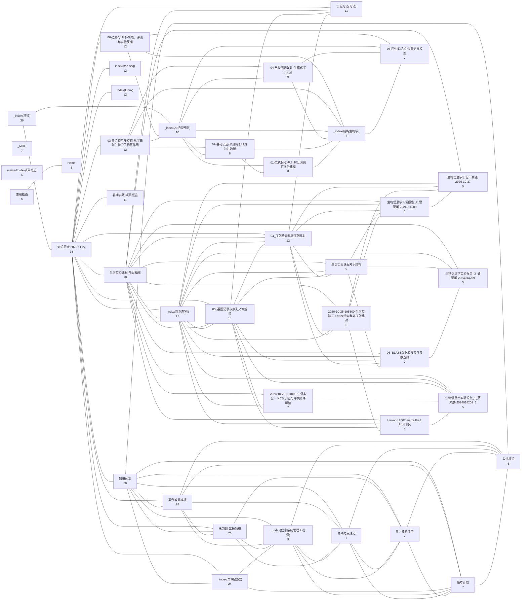

# 知识图谱 · 2026-11-24

> 由 Workbench RAG 卡片生成。笔记 533 篇，连边 417 条，活跃节点 533 个，孤立笔记 336 篇。

## 结构图（度最高的 40 个节点）

## 枢纽笔记（连接数最多）

| 笔记 | 连接数 |
|---|---|
| [[notes/class-notes/结构生物学/AI结构预测/精读/_index\|_index(精读)]] | 36 |
| [[vault/系统与工具/知识图谱-2026-11-22\|知识图谱-2026-11-22]] | 35 |
| [[notes/考证/信息系统管理工程师/知识体系\|知识体系]] | 30 |
| [[notes/考证/信息系统管理工程师/案例答题模板\|案例答题模板]] | 28 |
| [[notes/考证/信息系统管理工程师/练习题·基础知识\|练习题·基础知识]] | 26 |
| [[notes/考证/信息系统管理工程师/第2版教程/_index\|_index(第2版教程)]] | 24 |
| [[vault/项目/生信实验课程/生信实验课程-项目概览\|生信实验课程-项目概览]] | 18 |
| [[notes/生信实验/_index\|_index(生信实验)]] | 17 |
| [[vault/方法/生信分析/05_基因记录与序列文件解读\|05_基因记录与序列文件解读]] | 14 |
| [[wiki/bsa-seq/index\|index(bsa-seq)]] | 12 |
| [[wiki/Linux/index\|index(Linux)]] | 12 |
| [[vault/方法/生信分析/04_序列检索与双序列比对\|04_序列检索与双序列比对]] | 12 |
| [[notes/class-notes/结构生物学/AI结构预测/06-边界与闭环-局限、评测与实验反哺\|06-边界与闭环-局限、评测与实验反哺]] | 12 |
| [[notes/class-notes/结构生物学/AI结构预测/03-复合物与多模态-从蛋白到生物分子相互作用\|03-复合物与多模态-从蛋白到生物分子相互作用]] | 12 |
| [[vault/项目/暑期实践/暑期实践-项目概览\|暑期实践-项目概览]] | 11 |

## 主题聚类（标签传播）

- **簇 1**（51 篇）：知识图谱-2026-11-22、知识体系、案例答题模板、练习题·基础知识、_index(第2版教程)、_index(信息系统管理工程师)、高频考点速记、复习资料清单 等
- **簇 2**（44 篇）：_index(精读)、06-边界与闭环-局限、评测与实验反哺、03-复合物与多模态-从蛋白到生物分子相互作用、_index(AI结构预测)、04-从预测到设计-生成式蛋白设计、02-基础设施-预测结构成为公共数据、01-范式起点-从衍射反演到可微分建模、_index(结构生物学) 等
- **簇 3**（19 篇）：生信实验课程-项目概览、_index(生信实验)、05_基因记录与序列文件解读、04_序列检索与双序列比对、生信实验课程知识结构、06_BLAST数据库搜索与参数选择、2026-10-25-194000-生信实验一 NCBI浏览与序列文件解读、2026-10-25-195500-生信实验二 Entrez搜索与双序列比对 等
- **簇 4**（12 篇）：index(bsa-seq)、ch08-case-study-rice、ch10-troubleshooting、ch09-api-reference、ch07-outputs、ch06-cli-reference、ch05-pipeline、ch04-algorithm 等
- **簇 5**（12 篇）：index(Linux)、ch10-bash、ch09-vim、ch08-compress、ch07-filesystem、ch06-file-management、ch05-permissions、ch04-first-login 等

## 孤立笔记（没有任何链接）

共 336 篇，前 20：

- [[未命名]]
- [[wiki/生信学笔记/参看文档/a4-scanpy-api]]
- [[wiki/生信学笔记/参看文档/a3-sources]]
- [[wiki/生信学笔记/参看文档/a2-tools]]
- [[wiki/生信学笔记/参看文档/a1-glossary]]
- [[wiki/生信学笔记/index]]
- [[wiki/c/sorting-algorithms]]
- [[wiki/c/main-function]]
- [[wiki/c/interview-questions]]
- [[wiki/c/exam-tips]]
- [[wiki/c/chapter8]]
- [[wiki/c/chapter7]]
- [[wiki/c/chapter6]]
- [[wiki/c/chapter5]]
- [[wiki/c/chapter4]]
- [[wiki/c/chapter3]]
- [[wiki/c/chapter2]]
- [[wiki/c/cases]]
- [[wiki/c/c-keywords]]
- [[vault/项目/细胞生物学作业]]
